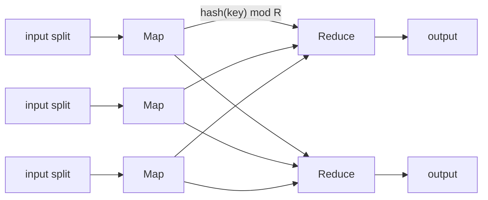

# CS 121: Information Retrieval — Topic: Inverted Indexes & Index Construction

## Table of Contents

- [1. From the Incidence Matrix to the Index](#1-from-the-incidence-matrix-to-the-index)
- [2. The Inverted Index: Dictionary and Postings](#2-the-inverted-index-dictionary-and-postings)
- [3. Building an Index in Memory](#3-building-an-index-in-memory)
- [4. Richer Postings: Counts, Positions, Extents, Scores](#4-richer-postings-counts-positions-extents-scores)
- [5. Phrase Queries: Biword and Positional Indexes](#5-phrase-queries-biword-and-positional-indexes)
- [6. When the Index Does Not Fit: Memory and Hardware](#6-when-the-index-does-not-fit-memory-and-hardware)
- [7. External Construction: Partial Indexes and Merging](#7-external-construction-partial-indexes-and-merging)
- [8. Index Engineering: Reading an Index Bigger Than Memory](#8-index-engineering-reading-an-index-bigger-than-memory)
- [9. Distributed Indexing with MapReduce](#9-distributed-indexing-with-mapreduce)
- [10. Updating the Index](#10-updating-the-index)
- [11. Quick Reference & Top 5 Things to Remember](#11-quick-reference--top-5-things-to-remember)

> This chapter is about the **Index Creation** box of the search-engine architecture ([Search Engines & the Web](topic-search-engines.en-US.md)): turning processed text ([Text Processing](topic-text-processing.en-US.md)) into a data structure that answers queries fast. How the index is *used* — merging postings for AND, skip pointers, document-at-a-time and term-at-a-time scoring — is in [Query Processing & Efficient Top-K](topic-query-processing.en-US.md); the Boolean model and ranking functions are in [Retrieval Models](topic-retrieval-models.en-US.md).

## 1. From the Incidence Matrix to the Index

### 1.1 The term-document incidence matrix

Take a small collection of Shakespeare plays and ask: **which plays contain the words Brutus AND Caesar but NOT Calpurnia?** You could grep all the plays for Brutus and Caesar, then strip out the lines containing Calpurnia. That is not an acceptable answer for search:

- It is **slow** for large corpora.
- **NOT Calpurnia** is non-trivial.
- Other operations, like finding the word *Romans* **near** *countrymen*, aren't feasible.
- **Ranked retrieval** isn't possible — and users want ordered documents.

A **term-document incidence matrix** is a Boolean matrix: rows are **terms**, columns are **documents**, and an entry is 1 if the play contains the word, 0 otherwise.

| | Antony and Cleopatra | Julius Caesar | The Tempest | Hamlet | Othello | Macbeth |
|---|---|---|---|---|---|---|
| Antony | 1 | 1 | 0 | 0 | 0 | 1 |
| Brutus | 1 | 1 | 0 | 1 | 0 | 0 |
| Caesar | 1 | 1 | 0 | 1 | 1 | 1 |
| Calpurnia | 0 | 1 | 0 | 0 | 0 | 0 |
| Cleopatra | 1 | 0 | 0 | 0 | 0 | 0 |
| mercy | 1 | 0 | 1 | 1 | 1 | 1 |
| worser | 1 | 0 | 1 | 1 | 1 | 0 |

**Incidence vectors**: each term has a 0/1 vector, its row. To answer the query, take the rows for Brutus, Caesar and Calpurnia, **complement** Calpurnia's, and **bitwise AND** them:

$$R = I_{Bru} \wedge I_{Cae} \wedge \neg I_{Cal}$$

$I_t$ is term $t$'s row, $\wedge$ is bitwise AND, and $\neg$ flips every bit.

```text
(Brutus)         1 1 0 1 0 0  AND
(Caesar)         1 1 0 1 1 1  AND
(NOT Calpurnia)  1 0 1 1 1 1  =
                 1 0 0 1 0 0
```

The result's 1s are columns 1 and 4: **Antony and Cleopatra** and **Hamlet**. Julius Caesar has both names but also Calpurnia, so the NOT removes it. Step through it, or type another query (AND / OR / NOT over these terms):

```viz incidence-matrix
{"title": "Brutus AND Caesar AND NOT Calpurnia", "terms": "Antony: 1 1 0 0 0 1; Brutus: 1 1 0 1 0 0; Caesar: 1 1 0 1 1 1; Calpurnia: 0 1 0 0 0 0; Cleopatra: 1 0 0 0 0 0; mercy: 1 0 1 1 1 1; worser: 1 0 1 1 1 0", "docs": "Antony and Cleopatra, Julius Caesar, The Tempest, Hamlet, Othello, Macbeth", "query": "Brutus AND Caesar AND NOT Calpurnia", "interactive": true}
```

The two documents that match are, in fact, the plays in which both names occur together:

- *Antony and Cleopatra*, Act III, Scene ii — Agrippa [aside to Domitius Enobarbus]: "Why, Enobarbus, / When Antony found Julius **Caesar** dead, / He cried almost to roaring; and he wept / When at Philippi he found **Brutus** slain."
- *Hamlet*, Act III, Scene ii — Lord Polonius: "I did enact Julius **Caesar** I was killed i' the / Capitol; **Brutus** killed me."

> 📘 **Going further**: [Manning et al., *Introduction to Information Retrieval*, Ch 1](https://nlp.stanford.edu/IR-book/pdf/irbookonlinereading.pdf)

### 1.2 Why the matrix does not scale

Can you use this on bigger collections? Take:

- $N = 10^6$ documents, each with about $10^3$ words;
- about 6 bytes per word, including spaces and punctuation → about **6 GB** of data;
- $M = 500\text{K}$ **distinct** terms among them.

The term-document matrix is then $500\text{K} \times 1\text{M}$: **half a trillion** 0s and 1s, so it **can't be built in memory**. But it has **no more than one billion 1s** — at most $10^6 \times 10^3$, one per word occurrence. The matrix is **extremely sparse**.

> 💡 **Key Insight**: The better representation records **only the 1 positions**. For each term, keep the list of documents that contain it. That is the inverted index of [§2](#2-the-inverted-index-dictionary-and-postings).

> 📝 **Practice**: [§1.3](#13-practice)

### 1.3 Practice

#### How big is the incidence matrix?

A collection has $N = 10^6$ documents of about $10^3$ words each, about 6 bytes per word, and $M = 500\text{K}$ distinct terms. How much text is that, how many cells does the incidence matrix have, and at most how many of them are 1?

<details>
<summary>Solution</summary>

Text: $10^6 \times 10^3 \times 6$ bytes $= 6 \times 10^9$ bytes ≈ **6 GB**. Matrix: $5 \times 10^5 \times 10^6 = 5 \times 10^{11}$ cells, **half a trillion**. 1s: each word occurrence can add at most one, so at most $10^6 \times 10^3 = 10^9$, **one billion**. At most $10^9 / (5 \times 10^{11}) = 0.2\%$ of the cells are 1, so store only the 1 positions.

</details>

## 2. The Inverted Index: Dictionary and Postings

### 2.1 One list per term

**For each term *t*, store a list of all documents that contain *t*.** Each document is identified by a **docID**, a document serial number.

```text
Brutus    → 1  2  4  11  31  45  173  174
Caesar    → 1  2  4   5   6  16   57  132
Calpurnia → 2  31 54 101
```

Can we use fixed-size arrays for this? What happens if the word *Caesar* is added to document 14? The list must stay sorted, so 14 goes between 6 and 16, which means shifting everything after it — and a full array needs to be replaced by a bigger one (worked out in [§2.4](#24-practice)). Lists grow and shrink term by term, so we need **variable-size postings lists**:

- **On disk**, a **continuous run of postings** is the optimal solution.
- **In memory**, use linked lists, variable-length arrays, or associative arrays — with some **trade-offs in size and ease of insertion**.

The vocabulary:

| Part | What it is |
|---|---|
| **Dictionary** | The terms (Brutus, Caesar, Calpurnia) |
| **Postings** | All the lists together |
| **Posting** | One entry of a list (one docID) |

The lists are **sorted by docID**; the reason is the merge that answers AND queries ([Query Processing & Efficient Top-K](topic-query-processing.en-US.md)).

In code, the inverted index is normally a **map/dictionary with the term as the key and the postings list as the value**: `friend → 2, 4, …`, `roman → 1, 2, …`, `countryman → 13, 16`.

### 2.2 Indexes in general, and the terminology

**Indexes are data structures designed to make search faster.** Text search has unique requirements, which leads to unique data structures. The most common one is the **inverted index**:

- it's a **general name for a class of structures**, not one fixed layout;
- it's "**inverted**" because **documents are associated with words**, rather than words with documents — similar to a **concordance** (the index at the back of a book).

Croft's terms:

- Each index term is associated with an **inverted list**. It contains lists of documents, or lists of word occurrences in documents, plus other information.
- Each entry is a **posting**. The part of the posting that refers to a specific document or location is the **pointer**.
- Each document in the collection gets a **unique number**.
- Lists are usually **document-ordered** (sorted by document number).

### 2.3 The running example: S1–S4

A standard small example indexes four sentences about tropical fish; later sections reuse it.

- **S1** Tropical fish include fish found in tropical environments around the world, including both freshwater and salt water species.
- **S2** Fishkeepers often use the term tropical fish to refer only those requiring fresh water, with saltwater tropical fish referred to as marine fish.
- **S3** Tropical fish are popular aquarium fish, due to their often bright coloration.
- **S4** In freshwater fish, this coloration typically derives from iridescence, while salt water fish are generally pigmented.

Its **simple inverted index** (each posting = a sentence number; 46 terms):

```text
and          1          marine       2           species      1
aquarium     3          often        2 3         term         2
are          3 4        only         2           the          1 2
around       1          pigmented    4           their        3
as           2          popular      3           this         4
both         1          refer        2           those        2
bright       3          referred     2           to           2 3
coloration   3 4        requiring    2           tropical     1 2 3
derives      4          salt         1 4         typically    4
due          3          saltwater    2           use          2
environments 1          fish         1 2 3 4     water        1 2 4
fishkeepers  2          found        1           while        4
fresh        2          freshwater   1 4         with         2
from         4          generally    4           world        1
in           1 4        include      1
including    1          iridescence  4
```

> 💡 **Key Insight**: The index never stores the 0s. `fish` has 4 postings, `marine` has 1 — space grows with the number of (term, document) pairs, not terms × documents.

> 📘 **Going further**: [Croft §5.3 Inverted Indexes and §5.3.1 Documents (book p. 129, 131)](https://ciir.cs.umass.edu/downloads/SEIRiP.pdf) · [IIR Ch 1–2](https://nlp.stanford.edu/IR-book/pdf/irbookonlinereading.pdf)

> 📝 **Practice**: [§2.4](#24-practice)

### 2.4 Practice

#### Adding Caesar to document 14

Caesar's postings are stored in a fixed-size array `1 2 4 5 6 16 57 132` with 8 slots. Then *Caesar* is added to document 14. What happens?

<details>
<summary>Solution</summary>

The list must stay sorted by docID, so 14 belongs between 6 and 16: `1 2 4 5 6 14 16 57 132`. In a fixed-size array that means **shifting** 16, 57 and 132 one slot right — and the array is full (8 slots, 8 entries), so you need a **bigger array**. Lists grow and shrink by term, so fixed-size arrays don't work: we need **variable-size postings lists** — a continuous run on disk, and linked lists / variable-length arrays / associative arrays in memory, trading size against ease of insertion.

</details>

## 3. Building an Index in Memory

### 3.1 The pipeline

Inverted index construction runs in stages:

| Stage | Example |
|---|---|
| Documents to be indexed | `Friends, Romans, countrymen.` |
| **Tokenizer** → token stream | `Friends` `Romans` `Countrymen` |
| **Text processing: linguistic modules** → modified tokens | `friend` `roman` `countryman` |
| **Indexer** → inverted index | `friend → 2 → 4`, `roman → 1 → 2`, `countryman → 13 → 16` |

The **typical minimal stages of text processing** are **tokenization** (cut the character sequence into word tokens; deal with "John's", *a state-of-the-art solution*), **normalization** (map text and query terms to the same form: you want *U.S.A.* and *USA* to match), **stemming, perhaps** (*authorize*, *authorization*), and **stop words, perhaps** (*the, a, to, of* — may be omitted, or not). Details are in [Text Processing](topic-text-processing.en-US.md).

> ⚠️ **Pitfall**: Whatever you do to document tokens, you must do to **query** terms too (that's what "map text and query term to the same form" means). Stem *authorization* in the index but not in the query, and the query misses.

### 3.2 Token sequence → sort → dictionary and postings

Index two documents:

- **Doc 1**: *I did enact Julius Caesar I was killed i' the Capitol; Brutus killed me.*
- **Doc 2**: *So let it be with Caesar. The noble Brutus hath told you Caesar was ambitious*

1. **Token sequence**: a sequence of **(modified token, document ID) pairs**, in text order — `(I, 1) (did, 1) (enact, 1) … (me, 1) (so, 2) … (ambitious, 2)`: 29 pairs.
2. **Sort** by term, then by docID: `(ambitious, 2) (be, 2) (brutus, 1) (brutus, 2) (caesar, 1) (caesar, 2) (caesar, 2) (capitol, 1) …`.
3. **Merge and split**: multiple entries of a term in a single document are **merged**; the result is split into a **dictionary** and **postings**; **document frequency** (df, the number of documents containing the term) is added to the dictionary.

Result: 22 terms. The ones with two postings are `brutus`, `caesar`, `the`, `was` (df = 2, postings `1 → 2`); every other term has df = 1. For instance `hath` occurs only in Doc 2, so its posting is just `2`. The steps in Python:

```python
import re

docs = {1: "I did enact Julius Caesar I was killed i' the Capitol; Brutus killed me.",
        2: "So let it be with Caesar. The noble Brutus hath told you Caesar was ambitious"}

# 1. token sequence: (modified token, docID) pairs in text order
pairs = [(t, d) for d, text in docs.items()
         for t in re.findall(r"[a-z0-9']+", text.lower())]
print(len(pairs), "pairs;", sum(1 for _, d in pairs if d == 1), "from doc 1,",
      sum(1 for _, d in pairs if d == 2), "from doc 2")

# 2. sort by term, then docID
pairs.sort()
print(pairs[:8])

# 3. merge repeats within a document, split into dictionary (term, df) and postings
postings = {}
for term, d in pairs:
    if not postings.get(term) or postings[term][-1] != d:
        postings.setdefault(term, []).append(d)
print(len(postings), "terms")
for term, plist in postings.items():
    if len(plist) > 1:
        print(term, "df =", len(plist), plist)
print("killed", postings["killed"], "hath", postings["hath"])
```

```text
29 pairs; 14 from doc 1, 15 from doc 2
[('ambitious', 2), ('be', 2), ('brutus', 1), ('brutus', 2), ('caesar', 1), ('caesar', 2), ('caesar', 2), ('capitol', 1)]
22 terms
brutus df = 2 [1, 2]
caesar df = 2 [1, 2]
the df = 2 [1, 2]
was df = 2 [1, 2]
killed [1] hath [2]
```

`killed` occurs twice in Doc 1 but has df = 1 and one posting — merging is per document. Step through the construction — or type your own documents (`docID: text; docID: text`):

```viz inverted-index
{"title": "Indexer steps on Doc 1 and Doc 2", "docs": "1: I did enact Julius Caesar I was killed i' the Capitol; Brutus killed me. ; 2: So let it be with Caesar. The noble Brutus hath told you Caesar was ambitious", "postings": "docs", "interactive": true}
```

The result has two parts that cost storage: the **terms and counts** (the dictionary) and the **lists of docIDs** (the postings). The two questions for implementing an IR system are **how to index efficiently** and **how much storage is needed** — [§3.3](#33-the-simple-in-memory-indexer-buildindex) to [§6](#6-when-the-index-does-not-fit-memory-and-hardware).

### 3.3 The simple in-memory indexer: BuildIndex

The simplest indexer keeps the whole index in one hash table, reads documents one at a time, and appends each document's number to the list of every distinct token it contains:

```text
procedure BuildIndex(D)                      ▷ D is a set of text documents
    I ← HashTable()                          ▷ Inverted list storage
    n ← 0                                    ▷ Document numbering
    for all documents d ∈ D do
        n ← n + 1
        T ← Parse(d)                         ▷ Parse document into tokens
        Remove duplicates from T
        for all tokens t ∈ T do
            if I_t ∉ I then
                I_t ← List<Posting>()
            end if
            I_t.append(Posting(n))
        end for
    end for
    return I
end procedure
```

The parts to notice:

- `n ← 0` / `n ← n + 1`: **document numbering** — docIDs are a counter, not the URL ([§3.4](#34-docids-urls-vs-integers)).
- `List<Posting>()` / `Posting(n)`: what's inside a posting ([§3.5](#35-what-a-posting-holds)).
- `I ← HashTable()` and `return I`: the whole index lives in one in-memory hash table. What happens if you run out of memory? → [§6](#6-when-the-index-does-not-fit-memory-and-hardware).

A runnable Python version, with a `Posting` class holding a frequency count:

```python
import re

class Posting:
    def __init__(self, docid, tfidf, fields):
        self.docid = docid
        self.tfidf = tfidf  # use freq counts for now
        self.fields = fields

def parse(text):
    return re.findall(r"[a-z0-9']+", text.lower())

def build_index(docs):
    """BuildIndex(D) with docIDs 1, 2, ..."""
    index = {}                          # I <- HashTable()
    n = 0                               # document numbering
    for d in docs:
        n += 1
        tokens = parse(d)               # T <- Parse(d)
        for t in set(tokens):           # remove duplicates
            if t not in index:
                index[t] = []           # List<Posting>()
            index[t].append(Posting(n, tokens.count(t), []))
    return index

docs = ["I did enact Julius Caesar I was killed i' the Capitol; Brutus killed me.",
        "So let it be with Caesar. The noble Brutus hath told you Caesar was ambitious"]
index = build_index(docs)
for term in ["brutus", "caesar", "killed", "hath"]:
    print(term, [(p.docid, p.tfidf) for p in index[term]])
print(len(index), "terms")
```

```text
brutus [(1, 1), (2, 1)]
caesar [(1, 1), (2, 2)]
killed [(1, 2)]
hath [(2, 1)]
22 terms
```

Same 22 terms as the sort-based steps of [§3.2](#32-token-sequence--sort--dictionary-and-postings). Documents are processed in docID order, so each list comes out sorted by docID without a sort.

### 3.4 DocIDs: URLs vs integers

**If docIDs are URLs**, `https://www.ics.uci.edu/~aburtsev/238P/lectures/lecture03-calling-conventions` is **77 characters** — 77 bytes in C++, 352 bytes in Java, and well over 100 bytes in Python 3 (the exact figure depends on the interpreter version: 118 bytes on the Python 3.13 used for the check below, 126 on older 3.x builds). DocIDs are used in postings lists, and depending on the posting structure can appear **several times in the same list**. **Strings are very wasteful to store and to compare.**

**Map URLs to integers as you process documents**:

```text
0 → https://www.ics.uci.edu/~aburtsev/238P/lectures/lecture03-calling-conventions
1 → https://www.ics.uci.edu/~goodrich/teach/ics247/notes
2 → https://www.ics.uci.edu/~thornton/ics184/MidtermSolutions.html
…
```

Integers are **4 bytes in C, C++ and Java**, **28 bytes in Python** — almost always the same size, independent of the string. (Python 3 has a single arbitrary-precision `int`; the older "converts integers to longs when they overflow" behaviour belongs to Python 2.)

The estimate for Python 3: 10,000 index terms, ~20 postings per term, average URL 51 characters (~100 bytes):

| DocIDs as | Size |
|---|---|
| URLs | 10,000 × 20 × 100 ≈ **20,000,000 bytes (20 MB)** |
| integers | 10,000 × 20 × 28 ≈ **5,600,000 bytes (5.6 MB)** |

**Reduced to 28%** of the string version → about **4× more postings fit in memory**, and it is **significantly faster to sort**. Checking the sizes:

```python
import sys

url = "https://www.ics.uci.edu/~aburtsev/238P/lectures/lecture03-calling-conventions"
print(len(url), "chars ->", sys.getsizeof(url), "bytes as a Python 3 str;",
      "int ->", sys.getsizeof(12345), "bytes")

terms, per_term = 10_000, 20
avg_url = 100                     # ~51-character URL as a Python 3 str
as_urls = terms * per_term * avg_url
as_ints = terms * per_term * sys.getsizeof(12345)
print("URLs:", as_urls, "bytes;", "ints:", as_ints, "bytes;",
      "ratio:", round(as_ints / as_urls, 2))
```

```text
77 chars -> 118 bytes as a Python 3 str; int -> 28 bytes
URLs: 20000000 bytes; ints: 5600000 bytes; ratio: 0.28
```

**You must keep that mapping stored somewhere**: you need it to show the search results (users want URLs, not numbers). It's typically **not part of the inverted index itself**, but an **auxiliary bookkeeping structure, serialized to a file** ([§8.2](#82-other-auxiliary-structures)).

### 3.5 What a posting holds

**Postings contain the context of the term occurrence in a document**: the **doc id**, a **frequency count or tf-idf** score, **fields**, **positions**, … At minimum a posting needs the doc id and a frequency count (or tf-idf):

```python
class Posting:
    def __init__(self, docid, tfidf, fields):
        self.docid = docid
        self.tfidf = tfidf  # use freq counts for now
        self.fields = fields
```

[§4](#4-richer-postings-counts-positions-extents-scores) goes through the information a posting can carry.

> 📘 **Going further**: [Croft §5.6.1 Simple Construction (book p. 156)](https://ciir.cs.umass.edu/downloads/SEIRiP.pdf) · [Croft §5.5 Auxiliary Structures (p. 154), §5.6 Index Construction (p. 156)](https://ciir.cs.umass.edu/downloads/SEIRiP.pdf) · [IIR Ch 1, Ch 2, Ch 4 (index construction)](https://nlp.stanford.edu/IR-book/pdf/irbookonlinereading.pdf)

> 📝 **Practice**: [§3.6](#36-practice)

### 3.6 Practice

#### Index two documents

Doc 1: *I did enact Julius Caesar I was killed i' the Capitol; Brutus killed me.* Doc 2: *So let it be with Caesar. The noble Brutus hath told you Caesar was ambitious*. Lower-case the tokens and build the dictionary (with document frequency) and the postings.

<details>
<summary>Solution</summary>

1. Token sequence: 29 (term, docID) pairs, 14 from Doc 1 and 15 from Doc 2 (`i` counted twice, `killed` twice, `caesar` twice in Doc 2).
2. Sort by term, then docID.
3. Merge repeats within a document, count documents:

```text
term       df  postings     term       df  postings
ambitious  1   2            julius     1   1
be         1   2            killed     1   1
brutus     2   1 → 2        let        1   2
caesar     2   1 → 2        me         1   1
capitol    1   1            noble      1   2
did        1   1            so         1   2
enact      1   1            the        2   1 → 2
hath       1   2            told       1   2
i          1   1            was        2   1 → 2
i'         1   1            with       1   2
it         1   2            you        1   2
```

22 terms. `killed` occurs twice in Doc 1 but has df = 1 and one posting — merging is per document.

</details>

#### DocIDs as URLs vs integers

An index has 10,000 terms with about 20 postings per term. The average URL is 51 characters (about 100 bytes as a Python 3 string) and a Python integer takes 28 bytes. Compare the size of the postings when docIDs are URLs and when they are integers.

<details>
<summary>Solution</summary>

URLs: 10,000 × 20 × 100 = 20,000,000 bytes ≈ **20 MB**. Integers: 10,000 × 20 × 28 = 5,600,000 bytes ≈ **5.6 MB** — 28% of the URL version, so about 3.6× (100 / 28) more postings fit in the same memory, and integers are much faster to sort and compare. The price: an auxiliary docID → URL map, saved to a file, to show results.

</details>

## 4. Richer Postings: Counts, Positions, Extents, Scores

Starting from the S1–S4 index of [§2.3](#23-the-running-example-s1s4), information can be added to each posting, one kind at a time.

### 4.1 Counts

**Inverted index with counts**: each posting is `docID:count`, the number of times the term occurs in that document. It **supports better ranking algorithms**.

```text
fish      1:2  2:3  3:2  4:2
tropical  1:2  2:2  3:1
to        2:2  3:1
the       1:1  2:1
```

(every other term has count 1 in each of its documents).

### 4.2 Positions and proximity matches

**Inverted index with positions**: each posting is `docID,position` (word number in the sentence), one posting per occurrence. It **supports proximity matches**.

```text
tropical  1,1  1,7  2,6  2,17  3,1
fish      1,2  1,4  2,7  2,18  2,23  3,2  3,6  4,3  4,13
water     1,17  2,14  4,12
```

**Proximity matches** are matching **phrases** ("tropical fish") or **words within a window** ("find *tropical* within 5 words of *fish*"). An inverted index whose postings store positions — postings `[docID, word pos]` — makes these query features **efficient**: align the two lists and look for `fish` at position $p+1$ after `tropical` at $p$, in the same document.

```text
tropical  1,1        1,7  2,6  2,17        3,1
fish      1,2  1,4        2,7  2,18  2,23  3,2  3,6  4,3  4,13
```

The phrase *tropical fish* occurs at 1,1–2 · 2,6–7 · 2,17–18 · 3,1–2 (S4 has no *tropical*). The full positional index, built step by step:

```viz inverted-index
{"title": "Positional index of S1–S4", "docs": "1: Tropical fish include fish found in tropical environments around the world, including both freshwater and salt water species. ; 2: Fishkeepers often use the term tropical fish to refer only those requiring fresh water, with saltwater tropical fish referred to as marine fish. ; 3: Tropical fish are popular aquarium fish, due to their often bright coloration. ; 4: In freshwater fish, this coloration typically derives from iridescence, while salt water fish are generally pigmented.", "postings": "positions"}
```

[§5](#5-phrase-queries-biword-and-positional-indexes) shows how phrase queries use these lists and what they cost.

### 4.3 Fields and extents

**Document structure is useful in search** (see markup and fields in [Text Processing](topic-text-processing.en-US.md)):

- **field restrictions** — e.g. date, `from:`, etc.;
- **words in some fields are more important** — e.g. the title!

Options to capture this in the index:

1. **separate inverted indexes for each field type**;
2. **add information about fields to postings**;
3. use **extent lists**.

**Extent lists**: an **extent** is a **contiguous region of a document**, represented with word positions. The inverted list for a **field type** records all extents of that field:

```text
fish   1,2  1,4  2,7  2,18  2,23  3,2  3,6  4,3  4,13
title  1:(1,3)  2:(1,5)  4:(9,15)
```

`1:(1,3)` = a title extent in document 1, given by word positions 1 and 3. To match *fish in the title*, align the two lists: `1,2` falls in `1:(1,3)` and `4,13` falls in `4:(9,15)`; document 2's title `(1,5)` contains no `fish` posting, and document 3 has no title extent.

### 4.4 Scores and score-ordered lists

**Other possibilities**:

- **Store precomputed scores** in the inverted list, e.g. the list for *fish* `[(1:3.6), (3:2.2)]`, where 3.6 is the total feature value for document 1. **Improves speed but reduces flexibility** (change the ranking and you must rebuild).
- **Create score-ordered lists**: the query processing engine can **focus only on the top part of each inverted list**, where the highest-scoring documents are. **Very efficient for single-word queries**.

| Posting stores | Example | Enables |
|---|---|---|
| docID | `fish 1 2 3 4` | Boolean queries (AND/OR/NOT) |
| docID:count | `fish 1:2 2:3 3:2 4:2` | better ranking (term frequency) |
| docID,position | `fish 1,2 1,4 …` | phrases, proximity windows |
| extent list per field | `title 1:(1,3) …` | field restrictions, title boosts |
| docID:score | `fish (1:3.6) (3:2.2)` | fast ranking; less flexible |

The scoring that uses these stored features is in [Retrieval Models](topic-retrieval-models.en-US.md) and [Query Processing & Efficient Top-K](topic-query-processing.en-US.md).

> 📘 **Going further**: [Croft §5.3.2 Counts (p. 133), §5.3.3 Positions (p. 134), §5.3.4 Fields and Extents (p. 136), §5.3.5 Scores (p. 138), §5.3.6 Ordering (p. 139)](https://ciir.cs.umass.edu/downloads/SEIRiP.pdf) · [IIR Ch 2 (positional postings and phrase queries)](https://nlp.stanford.edu/IR-book/pdf/irbookonlinereading.pdf)

> 📝 **Practice**: [§4.5](#45-practice)

### 4.5 Practice

#### Find the phrase "tropical fish"

In the positional index below, where does the phrase *tropical fish* occur?

```text
tropical  1,1  1,7  2,6  2,17  3,1
fish      1,2  1,4  2,7  2,18  2,23  3,2  3,6  4,3  4,13
```

<details>
<summary>Solution</summary>

A phrase match needs `fish` at position $p+1$ in the same document as `tropical` at $p$:

| tropical | needs fish at | found? |
|---|---|---|
| 1,1 | 1,2 | ✓ |
| 1,7 | 1,8 | ✗ (S1 word 8 is *environments*) |
| 2,6 | 2,7 | ✓ |
| 2,17 | 2,18 | ✓ |
| 3,1 | 3,2 | ✓ |

The phrase occurs **4 times**, in **documents 1, 2 and 3**. Document 4 contains *fish* but not *tropical*, so a document-only index (`tropical 1 2 3`, `fish 1 2 3 4`) can't tell the phrase from the two words appearing anywhere — that's what positions buy.

The same check in Python:

```python
tropical = [(1, 1), (1, 7), (2, 6), (2, 17), (3, 1)]
fish = [(1, 2), (1, 4), (2, 7), (2, 18), (2, 23), (3, 2), (3, 6), (4, 3), (4, 13)]

def phrase(first, second):
    """Positions where `second` immediately follows `first` in the same document."""
    later = set(second)
    return [(d, p) for d, p in first if (d, p + 1) in later]

hits = phrase(tropical, fish)
print(hits, "-> docs", sorted({d for d, _ in hits}))
```

```text
[(1, 1), (2, 6), (2, 17), (3, 1)] -> docs [1, 2, 3]
```

</details>

## 5. Phrase Queries: Biword and Positional Indexes

We want to answer queries such as **"university of california"** — **as a phrase**. The sentence *"I went to university in california"* is **not** a match.

- Phrase queries have proven **easily understood by users**: one of the few "advanced search" ideas that works.
- Many more queries are **implicit** phrase queries.
- For this it **no longer suffices** to store only `<term : docs>` entries.

### 5.1 Biword (bigram) indexes

**A first attempt: biword indexes.** Index **every consecutive pair of terms** in the text as a phrase. *"Friends, Romans, Countrymen"* generates the biwords (= bigrams!) **friends romans** and **romans countrymen**. Each biword is now a **dictionary term**: all bigrams are indexed, and **two-word phrase queries are immediate**. Adopted for small $n$, but **unfeasible for arbitrary sizes**.

**Longer phrases** are broken down: *University of California Irvine* becomes the Boolean query on bigrams

```text
university of AND of california AND california irvine
```

Without the documents, we **cannot verify** that a document matching this Boolean query contains the **continuous** phrase. **It can have false positives!**

**Issues**:

- false positives, as above;
- **index blowup** from a bigger dictionary: infeasible for more than biwords, big even for all biwords — though very large search engines support some n-grams for small $n$;
- so bigram indexes for **all** bigrams are **not the standard solution**, but they can be **part of a compound strategy**.

### 5.2 Positional indexes

**A better approach**: in the postings, store for each term the **position(s)** in which tokens of it appear. Positional postings themselves were built in [§4.2](#42-positions-and-proximity-matches) (the *tropical fish* example); this section adds how phrase queries use them, and what they cost.

```text
<term, number of docs containing term;
 doc1: position1, position2 … ;
 doc2: position1, position2 … ;
 etc.>
```

For example:

```text
<be: 993427;
 1: 7, 18, 34, 72, 86, 231;
 2: 3, 149;
 4: 17, 191, 291, 430, 434;
 5: 363, 367, …>
```

**Which of docs 1, 2, 4, 5 could contain "to be or not to be"?**

- For phrase queries we use a **merge algorithm recursively at the document level** — first the docs that contain every term, then positions inside each doc.
- **Pre-clean** the list to keep only documents that **respect the distance** between words that appear more than once in the query: the two *be*s in "to be or not to be" are **4 positions apart**.
- We now deal with **more than just equality** — offsets like $p+1$, $p+4$.

Only docs **4** (430, 434) and **5** (363, 367) have two *be*s exactly 4 apart, so docs 1 and 2 are out before looking at any other term.

**Processing a phrase query**: extract the inverted index entries for each distinct term — *to, be, or, not* — and merge their doc:position lists to enumerate all positions with "to be or not to be":

```text
to: 2:1,17,74,222,551; 4:8,16,190,429,433; 7:13,23,191; ...
be: 1:17,19; 4:17,191,291,430,434; 5:14,19,101; ...
```

In doc 4, *to* at 429 and 433 and *be* at 430 and 434 line up: the phrase can start at **position 429** (to 429, be 430, … to 433, be 434). The **same general method** works for **proximity searches** ("within $k$ words").

> ⚠️ **Pitfall**: These two *be* lists are separate illustrations (doc 1 is `7, 18, …` in one and `17, 19` in the other, and doc 5 differs); only doc 4's positions agree in both. Don't try to combine them into one index.

### 5.3 Positional index size

- A positional index **expands postings storage substantially** — even though indexes can be compressed.
- **Nevertheless, a positional index is now standardly used**, because of the power and usefulness of phrase and proximity queries, whether used **explicitly** or **implicitly** in a ranking retrieval system.
- It needs an entry **for each occurrence**, not just once per document, so its size depends on **average document size**: an average web page has under 1,000 terms; SEC filings, books, even some epic poems easily have 100,000.

**Rules of thumb**, for "English-like" languages:

| Measure | Rule of thumb |
|---|---|
| Compressed positional index vs non-positional | **2–4×** as large |
| Positional index vs original text | **35–50%** of the volume |

### 5.4 Mixing schemes

**N-grams and positional approaches can be combined.** For particular phrases (*"Michael Jackson"*, *"Britney Spears"*) it's inefficient to keep merging positional postings lists — even more so for *"The Who"* (two stop words). A more sophisticated mixed indexing scheme (Williams et al., 2004) ran a typical web query mixture in **¼ of the time** of a positional index alone, for **26% more space**.

> 📘 **Going further**: [Croft §5.3.3 Positions (book p. 134)](https://ciir.cs.umass.edu/downloads/SEIRiP.pdf) · [IIR Ch 2 (biword indexes, positional indexes, combination schemes)](https://nlp.stanford.edu/IR-book/pdf/irbookonlinereading.pdf)

> 📝 **Practice**: [§5.5](#55-practice)

### 5.5 Practice

#### Breaking "University of California Irvine" into bigrams

What Boolean query on a biword index answers the phrase *University of California Irvine*, and can it be wrong?

<details>
<summary>Solution</summary>

Consecutive pairs: `university of AND of california AND california irvine`.

Yes, it can be wrong: a **false positive** is a document that contains all three bigrams but not as one continuous phrase (e.g. "university of" in one sentence and "of california", "california irvine" elsewhere). Without the document text (or positions), the biword index can't verify the phrase.

</details>

#### Which documents could contain "to be or not to be"?

Positions of *be*: `1: 7, 18, 34, 72, 86, 231; 2: 3, 149; 4: 17, 191, 291, 430, 434; 5: 363, 367, …`. Which of docs 1, 2, 4, 5 could contain the phrase *to be or not to be*? Then, given positions of *to* in doc 4 (`8, 16, 190, 429, 433`) and of *be* in doc 4 (`17, 191, 291, 430, 434`), where does the phrase start in doc 4?

<details>
<summary>Solution</summary>

"to be or not to be" has *be* at offsets 1 and 5 — **two *be*s 4 positions apart**. Pre-clean the *be* list:

| Doc | Pairs of *be* positions 4 apart |
|---|---|
| 1 | none |
| 2 | none |
| 4 | (430, 434) |
| 5 | (363, 367) |

Only **docs 4 and 5** could contain it (doc 5 still needs *to*, *or*, *not* checked).

In doc 4: start $p$ needs *to* at $p$ and $p+4$, *be* at $p+1$ and $p+5$. $p = 429$: to 429 ✓, be 430 ✓, to 433 ✓, be 434 ✓. The phrase starts at **position 429** (*or* and *not* must then be at 431 and 432).

```python
be = {1: [7, 18, 34, 72, 86, 231], 2: [3, 149],
      4: [17, 191, 291, 430, 434], 5: [363, 367]}
for d, ps in be.items():
    print(d, [(p, p + 4) for p in ps if p + 4 in ps])

# doc 4: phrase starts at p if to@p, be@p+1, to@p+4, be@p+5
to4, be4 = {8, 16, 190, 429, 433}, {17, 191, 291, 430, 434}
print([p for p in to4 if p + 1 in be4 and p + 4 in to4 and p + 5 in be4])
```

```text
1 []
2 []
4 [(430, 434)]
5 [(363, 367)]
[429]
```

</details>

## 6. When the Index Does Not Fit: Memory and Hardware

### 6.1 Does the index fit in memory?

**Inverted index for small data.** If it fits in memory, use Python's dictionaries `{}` (or Java's `HashMap`):

- fill it during indexing,
- write it to a file,
- load it back into the dict/HashMap for search.

Very simple to implement… **but this will not work in any realistic web search engine**.

**Inverted index for large data** — a back-of-the-envelope calculation:

| Quantity | Value |
|---|---|
| Vocabulary | 50,000 tokens |
| Average postings list size | 20 |
| Postings | 50,000 × 20 = **1,000,000** |
| DocID = URL, average 50 characters | ≈ 100 bytes each (Python) |
| Postings storage | 1,000,000 × 100 = **100,000,000 bytes = 100 MB** |
| Plus payload per posting (e.g. tf-idf), 4 bytes each | many more MB |

And the web comprises **far more than 10⁶ documents** (hosts alone are more than 10⁹). So **usually the index does not fit in memory all at once** → out-of-memory errors.

> 💡 **Key Insight**: Two levers come out of this: make postings smaller (integer docIDs instead of URLs, [§3.4](#34-docids-urls-vs-integers)) and stop assuming the whole index is in RAM (the rest of this chapter).

### 6.2 Hardware basics

**In-memory index construction does not scale**: you can't fit the entire collection into memory. How do we construct an index for very large collections — **taking into account hardware constraints**: memory, disk, speed, etc.?

- Servers used in IR systems typically have **several GB of main memory**, sometimes hundreds of GB. Available **disk space is 2–3 orders of magnitude larger**.
- But **fault tolerance is very expensive**: it's much cheaper to use **many regular machines** rather than one fault-tolerant machine — and regular machines have **much smaller RAM**.
- Large-scale storage is based on **spinning disks**. Access to data in memory is **much** faster than access to data on disk.
- **Disk seeks**: no data is transferred while the disk head is being positioned. So transferring **one large chunk** from disk to memory is faster than transferring **many small chunks**.
- **Disk I/O is block-based**: whole blocks are read and written, not smaller chunks. Block sizes: **8 KB to 256 KB**.

Jeff Dean's **"Latency Numbers Every Programmer Should Know"** (2020 update):

| Operation | Latency |
|---|---|
| L1 cache reference | 0.5–1.5 ns |
| L2 cache reference | 5–7 ns |
| L3 cache reference | 16–25 ns |
| Mutex lock/unlock | 25 ns |
| 64 MB main memory reference | 50–75 ns |
| Send 4 KB over 100 Gbps HPC fabric | 1,040 ns |
| Compress 1 KB with Zippy | 2,000 ns (2 µs) |
| Read 1 MB sequentially from memory | 3,000 ns (3 µs) |
| Send 4 KB over 10 Gbps ethernet | 10,000 ns (10 µs) |
| Read 1 MB sequentially from SSD | 49,000 ns (49 µs) |
| Read 1 MB sequentially from HDD | 825,000 ns (825 µs) |
| Disk seek (up to) | 2,000,000 ns (2,000 µs) |
| Send packet CA → Netherlands → CA | 150,000,000 ns (150,000 µs) |

So back to the indexer's `I ← HashTable()`: **could this be a file, directly?** **No.** Compare a disk seek of up to 2 ms with a 50–75 ns memory reference in the table above.

**Use disk as "memory"?** Can we run the same algorithm on a larger collection, with disk instead of memory? **No**: accessing and modifying $T \approx 10^8$–$10^9$ records on disk means **too many disk seeks** (each up to 2 ms). **We need an external algorithm** ([§7](#7-external-construction-partial-indexes-and-merging)).

> 💡 **Key Insight**: A disk seek costs tens of thousands of memory references, and one large chunk transfers faster than many small ones. How to build an index that doesn't fit in memory comes next.

> 📘 **Going further**: [Jeff Dean](https://ai.google/research/people/jeff/) · [Original numbers (Norvig)](http://norvig.com/21-days.html#answers) · [2019 version (gist)](https://gist.github.com/eshelman/343a1c46cb3fba142c1afdcdeec17646) · [2020 interactive version](https://colin-scott.github.io/personal_website/research/interactive_latency.html) · [Croft §5.6.2 Merging (book p. 157)](https://ciir.cs.umass.edu/downloads/SEIRiP.pdf) · [IIR Ch 4 (hardware basics)](https://nlp.stanford.edu/IR-book/pdf/irbookonlinereading.pdf)

> 📝 **Practice**: [§6.3](#63-practice)

### 6.3 Practice

#### How big is the index?

The vocabulary has 50,000 tokens, the average postings list has 20 entries, and each docID is a URL of about 50 characters, about 100 bytes in Python. How much memory do the postings take?

<details>
<summary>Solution</summary>

Postings: 50,000 × 20 = 1,000,000. Bytes: 1,000,000 × 100 = 100,000,000 ≈ **100 MB** — before any payload (tf-idf, 4 bytes each, adds more). That's for 10⁶ postings; the web has far more than 10⁶ documents, so the index usually **does not fit in memory all at once**.

</details>

## 7. External Construction: Partial Indexes and Merging

### 7.1 Partial indexes

The external algorithm:

1. Build the inverted list structure **until a certain size** (choose it from the memory you have; profile it).
2. **Write the partial index to disk**, and start a new one.
3. At the end, the disk holds **many partial indexes**, which are **merged**.

Partial lists (= partial indexes) must be designed so **they can be merged in small pieces** — e.g. by **storing them in alphabetical order**.

The pseudocode is `BuildIndex` of [§3.3](#33-the-simple-in-memory-indexer-buildindex) with two changes: read the documents in **batches**, and after each batch **sort and write** the hash table to disk, then empty it.

```text
procedure BuildIndex(D)
  I ← HashTable
  n ← 0
  B ← []                          # batch of documents
  while D is not empty do
    B ← GetBatch(D)
    for all documents d in B do
      n ← n+1
      T ← Parse(d)
      RemoveDuplicates(T)
      for all tokens t in T do
        if t not in I then
          I[t] = []
        I[t].append(Posting(n))
      end for
    end for
    SortAndWriteToDisk(I, name)
    I.empty()
  end while
```

> ⚠️ **Pitfall**: `n` keeps counting across batches, so docIDs stay **globally unique and increasing**: every partial index is sorted by docID, which is what makes the merge below a simple concatenation per term. (Reset `n` per batch and the concatenated lists would no longer be sorted, and docIDs from different batches would collide.)

### 7.2 Merging two partial indexes

Index A holds `aardvark 2 3 4 5` and `apple 2 4`; Index B holds `aardvark 6 9` and `actor 15 42 68`. Walk both in term order: `aardvark` is in both, so A's postings are followed by B's; `actor` only in B; `apple` only in A.

| Combined index | Postings |
|---|---|
| aardvark | 2 3 4 5 6 9 |
| actor | 15 42 68 |
| apple | 2 4 |

### 7.3 How to merge the sorted runs?

**Binary merges**: merge **2 files at a time**. During each layer, **read** into memory in blocks of a few MB (~10 MB is not uncommon for HDDs — **but you should profile!**), **merge, write back**. Merging two runs from disk/SSD:

| Run 1 | | Run 2 | | Merged postings list | |
|---|---|---|---|---|---|
| brutus | d1,d3 | brutus | d6,d7 | brutus | d1,d3,d6,d7 |
| caesar | d1,d2,d4 | caesar | d8,d9 | caesar | d1,d2,d4,d8,d9 |
| noble | d5 | julius | d10 | julius | d10 |
| with | d1,d2,d3,d5 | killed | d8 | killed | d8 |
| | | | | noble | d5 |
| | | | | with | d1,d2,d3,d5 |

**Multi-way merge** is **more efficient**: read from **all files simultaneously**.

- Open **all** partial index files at once, with a **read buffer** for each and a **write buffer** for the output file.
- In each iteration, **pick the lowest termID** that hasn't been processed.
- **Merge all postings lists** for that termID and write it out.

As long as you read **decent-sized chunks** of each block into memory and write out a decent-sized output chunk, **you're not killed by disk seeks**. The actual size of those chunks **must be actively probed** — it's hardware and filesystem dependent.

A multi-way merge on Index A and B, with `heapq.merge` doing "pick the lowest term" across all runs:

```python
import heapq

def multiway_merge(*runs):
    """Merge partial indexes: each run is a list of
    (term, postings) sorted by term."""
    merged = []
    for term, postings in heapq.merge(*runs, key=lambda e: e[0]):
        if merged and merged[-1][0] == term:
            merged[-1][1].extend(postings)   # same term: append
        else:
            merged.append((term, list(postings)))
    return merged

index_a = [("aardvark", [2, 3, 4, 5]), ("apple", [2, 4])]
index_b = [("aardvark", [6, 9]), ("actor", [15, 42, 68])]
for term, postings in multiway_merge(index_a, index_b):
    print(term, postings)
```

```text
aardvark [2, 3, 4, 5, 6, 9]
actor [15, 42, 68]
apple [2, 4]
```

> 💡 **Key Insight**: Sorting each partial index alphabetically is what lets the merge stream: in a real indexer each run is a file read front to back once, through one buffer, never seeked around.

> 📘 **Going further**: [Croft §5.6.2 Merging (book p. 157)](https://ciir.cs.umass.edu/downloads/SEIRiP.pdf) · [IIR Ch 4 (blocked sort-based indexing)](https://nlp.stanford.edu/IR-book/pdf/irbookonlinereading.pdf)

> 📝 **Practice**: [§7.4](#74-practice)

### 7.4 Practice

#### Merge Index A and Index B

Index A: `aardvark 2 3 4 5`, `apple 2 4`. Index B: `aardvark 6 9`, `actor 15 42 68`. What is the combined index?

<details>
<summary>Solution</summary>

Walk both indexes in alphabetical order, taking the smallest term each time:

1. `aardvark` is the smallest term in both → concatenate: `2 3 4 5 6 9` (A's docIDs are all smaller than B's, so concatenating keeps the list sorted).
2. `actor` (only in B) → `15 42 68`.
3. `apple` (only in A) → `2 4`.

Combined index: `aardvark 2 3 4 5 6 9 · actor 15 42 68 · apple 2 4` — the output of the `multiway_merge` code in [§7.3](#73-how-to-merge-the-sorted-runs).

</details>

## 8. Index Engineering: Reading an Index Bigger Than Memory

Building the index on disk is half of it; at **query time** you also have to find postings.

**Small index**: load it **entirely into memory** as a hash table / dictionary and find the postings by key. *What if the index is larger than available memory?*

**Large index**: it doesn't fit in memory, so you must search for postings **in the file itself**. How?

1. **Scan the file** looking for the query terms. What if the terms in the file are **not sorted**? Then it's a full scan, $O(n)$. With terms **sorted**, you can binary-search: from $O(n)$ to $O(\log N)$ — and **sorting the query terms helps** too.
2. **Jump to the right positions in the file**: $O(1)$. **INDEX THE INDEX!**

### 8.1 Index the index

As you construct the inverted index, create another **bookkeeping file with offsets** into the inverted index file:

- term "ape" is at position 1311, "apple" at position 1345, etc. — **or**
- words starting with "b" start at position 10035, words starting with "c" at 20457, etc.

This **secondary index is much smaller** than the inverted index, so it will (usually) fit in memory. **Then: `seek(position)`.**

**Seek operations**, on a small test file:

```python
with open("test.txt", "w") as f:
    f.write("Hello world!\nThis is a test file.\n"
            "For explaining how seek works.\n")

f = open("test.txt")
f.seek(4);  print(repr(f.readline()))
f.seek(13); print(repr(f.readline()))

# "Index the index": term -> byte offset of its line
offsets, pos = {}, 0
with open("test.txt", "rb") as g:
    for line in g:
        offsets[line.split()[0].decode()] = pos
        pos += len(line)
print(offsets)
f.seek(offsets["For"]); print(repr(f.readline()))
```

```text
'o world!\n'
'This is a test file.\n'
{'Hello': 0, 'This': 13, 'For': 34}
'For explaining how seek works.\n'
```

`seek(4)` lands inside "Hello", so `readline()` returns the rest of line 1; `"Hello world!\n"` is 13 bytes, so `seek(13)` lands exactly at line 2. The second half is the bookkeeping file in miniature: one offset per entry, then one seek per lookup.

> ⚠️ **Pitfall**: Offsets are **byte** offsets. Build them by reading in binary mode (`"rb"`), as above; in text mode, multi-byte UTF-8 characters and Windows `\r\n` line endings make character counts differ from byte positions.

### 8.2 Other auxiliary structures

| Structure | Contains | Stored as |
|---|---|---|
| **Document IDs** | lookup table from docid to URL | hash table in memory, or B-tree for larger collections |
| **Vocabulary** or **lexicon** | lookup table from index term to the **byte offset** of its inverted list in the inverted file | hash table in memory, or B-tree for larger vocabularies |
| **Term statistics** | e.g. df | at the **start** of each inverted list |
| **Collection statistics** | e.g. number of documents | in a **separate file** |

### 8.3 Alternatives to a single inverted index

- **Split** the inverted index file into **alphabet ranges**.
- Create **file system path trees**: `index/a/`, `index/b/`, `index/c/`, etc.
- The search component **keeps the files open all the time** — **open, but not in memory!**

**Multiple files in multithreading: aggregate!** On a multiprocessor machine (several processor chips, separate memory cards, many I/O slots), split index files can be read by **parallel threads** and the results aggregated.

> 📘 **Going further**: [Croft §5.5 Auxiliary Structures (book p. 154)](https://ciir.cs.umass.edu/downloads/SEIRiP.pdf)

> 📝 **Practice**: [§8.4](#84-practice)

### 8.4 Practice

#### What does seek return?

A file `Test.txt` is `Hello world!` / `This is a test file.` / `For explaining how seek works.` (three lines). What do `f.seek(4); f.readline()` and `f.seek(13); f.readline()` return?

<details>
<summary>Solution</summary>

- `seek(4)` puts the file position after `Hell`, so `readline()` returns the rest of line 1: `'o world!\n'`.
- `"Hello world!\n"` is 13 bytes (12 characters + newline), so `seek(13)` lands at the start of line 2: `'This is a test file.\n'`.

Both match the run in [§8.1](#81-index-the-index). That's the whole trick of "index the index": store byte offsets, `seek` straight there, read one entry.

</details>

## 9. Distributed Indexing with MapReduce

**Scaling it up.** Distributed processing is driven by the need to index and analyze **huge amounts of data** (i.e., the Web), using **large numbers of inexpensive servers** rather than larger, more expensive machines. **MapReduce** is a distributed programming tool designed for indexing and analysis tasks.

**Motivating example**: a large text file of credit card transactions, one card number and an amount per line. **Count the unique card numbers.** A hash table → memory problems; with a **sorted** file, counting is simple. Distributed, the same holds: **sorting and placement are crucial**.

### 9.1 Map, shuffle, reduce

MapReduce is a framework that **focuses on data placement and distribution**:

- **Mapper**: generally transforms a list of items into **another list of items of the same length**.
- **Reducer**: transforms a list of items into a **single item**.
- The definitions aren't strict about the number of outputs; **many mapper and reducer tasks** run on a cluster.

The basic process:

1. **Map** stage: transforms data records into **pairs, each with a key and a value** — e.g. `<key="term", value="docId">`.
2. **Shuffle**: uses a **hash function** so that all pairs with the **same key** end up next to each other **on the same machine** — e.g. `hash(term) mod (number of reduce machines)`.
3. **Reduce** stage: processes records in batches where **all pairs with the same key are processed at the same time** — all `<term, docId>` pairs for one term are on one machine, so it can "reduce" them into the postings list.



The picture builds up in order: map boxes, then the all-to-all shuffle edges, then the reduce boxes and output.

**Idempotence** of mapper and reducer provides **fault tolerance**: multiple runs on the same input give the same output, so the library can re-run work if a machine **fails** or is **slow** — computations are redundant, avoiding bottlenecks.

### 9.2 The pseudocode

Credit cards: the map emits `(card, amount)`; the shuffle groups by card; the reduce sums each card's amounts.

```text
procedure MapCreditCards(input)
    while not input.done() do
        record ← input.next()
        card ← record.card
        amount ← record.amount
        Emit(card, amount)
    end while
end procedure

procedure ReduceCreditCards(key, values)
    total ← 0
    card ← key
    while not values.done() do
        amount ← values.next()
        total ← total + amount
    end while
    Emit(card, total)
end procedure
```

Each reduce call corresponds to one unique card, so the number of output pairs is the number of unique card numbers.

**Indexing**: the map emits `(word, docNumber:position)` for every token; the reduce writes the word once and then encodes its postings.

```text
procedure MapDocumentsToPostings(input)
    while not input.done() do
        document ← input.next()
        number ← document.number
        position ← 0
        tokens ← Parse(document)
        for each word w in tokens do
            Emit(w, number:position)
            position = position + 1
        end for
    end while
end procedure

procedure ReducePostingsToLists(key, values)
    word ← key
    WriteWord(word)
    while not values.done() do
        EncodePosting(values.next())
    end while
end procedure
```

> ⚠️ **Pitfall**: The reducer must loop over its own `values` (`values.done()`, as in `ReduceCreditCards`). A loop on an `input` object would refer to the mapper's variable, which does not exist inside the reducer.

**MapReduce is typically used for data streams**: there's **no end**, **no "final index"** — only a **temporarily valid** index.

> 📘 **Going further**: [Croft §5.6.3 Parallelism and Distribution (book p. 158)](https://ciir.cs.umass.edu/downloads/SEIRiP.pdf) · [IIR Ch 4 (distributed indexing)](https://nlp.stanford.edu/IR-book/pdf/irbookonlinereading.pdf)

## 10. Updating the Index

**Dynamic collections!** The web changes continuously.

- **Index merging** ([§7](#7-external-construction-partial-indexes-and-merging)) is a good strategy when updates come in **large batches**.
- For **small updates** it is very inefficient. Instead, create a **separate index for new documents** and **merge the results** of searching both indexes *a posteriori*. The small index could be **in memory**: fast to update and to search.
- **Deletions** are handled with a **delete list**. **Modifications** = put the old version on the delete list + add the new version to the new-documents index.

In the architecture picture this is a second, small **Index** box next to the main one, and a **"Deleted Pages"** store beside it. This is the **delayed updating strategy**: **temporary (and much smaller) auxiliary index structures** for **updated pages** and **removed pages**, with a **veto system** between them and ranking, so deleted pages are filtered out before results reach the user interface.

> 📘 **Going further**: [Croft §5.6.4 Update (book p. 164)](https://ciir.cs.umass.edu/downloads/SEIRiP.pdf) · [IIR Ch 4 (dynamic indexing)](https://nlp.stanford.edu/IR-book/pdf/irbookonlinereading.pdf)

## 11. Quick Reference & Top 5 Things to Remember

**Index vocabulary**

| Term | Meaning |
|---|---|
| Dictionary | The set of terms (with document frequency) |
| Postings list / inverted list | The docIDs (and more) for one term, sorted by docID |
| Posting | One entry; its document part is the *pointer* |
| Document frequency (df) | Number of documents containing the term |
| Extent | Contiguous region of a document (a field), as word positions |
| Biword index | Every consecutive pair of terms is a dictionary term |
| Lexicon | Term → byte offset of its list in the inverted file |

**Indexer steps**

| Step | Output |
|---|---|
| Tokenize + linguistic modules | modified tokens |
| Emit pairs | (term, docID) in text order |
| Sort | by term, then docID |
| Merge | one dictionary entry per term + df + postings |

**What a posting can store**

| Posting stores | Enables |
|---|---|
| docID | Boolean queries |
| docID:count | ranking by term frequency |
| docID,position | phrases, proximity |
| extent list | field restrictions, title boosts |
| docID:score | fast ranking; less flexible |

**Sizes and latencies**

| Fact | Value |
|---|---|
| Incidence matrix, $10^6$ docs × 500K terms | $5 \times 10^{11}$ cells, at most $10^9$ ones |
| 1M postings with URL docIDs (Python) | ~100 MB |
| URL vs int docIDs, 200K postings | 20 MB vs 5.6 MB (28%) |
| Int size | 4 bytes C/C++/Java, 28 bytes Python |
| Memory reference vs disk seek | 50–75 ns vs up to 2 ms |
| Disk block size | 8–256 KB |
| Positional vs non-positional index (compressed) | 2–4× as large; 35–50% of the text |

**Top 5 things to remember**

1. The incidence matrix is far too big but extremely sparse; an inverted index stores **only the 1s**: **term → postings list of docIDs**, sorted by docID, plus df in the dictionary.
2. The indexer emits **(term, docID) pairs, sorts by term then docID, and merges** repeats within a document; **df** = number of documents, not occurrences. Use **integer docIDs** with an auxiliary URL map.
3. Postings can carry **counts** (ranking), **positions** (phrases, proximity), **extents** (fields) or **precomputed scores** (speed vs flexibility). Biword indexes give false positives and blow up the dictionary, so a **positional index** (2–4× larger) is the standard, sometimes mixed with n-grams.
4. A disk seek costs tens of thousands of memory references, so build **partial indexes** in memory, write each **sorted**, and **multi-way merge** them with big buffered reads; MapReduce does the same across machines (map → shuffle by `hash(term)` → reduce).
5. At query time, **index the index**: keep a small term → byte-offset lexicon in memory and `seek`. Handle updates with a small auxiliary index plus a **delete list**, merging in batches.