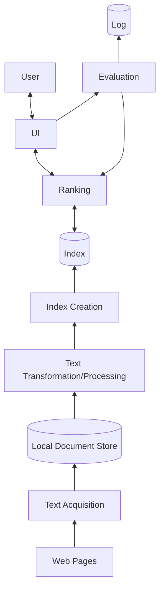
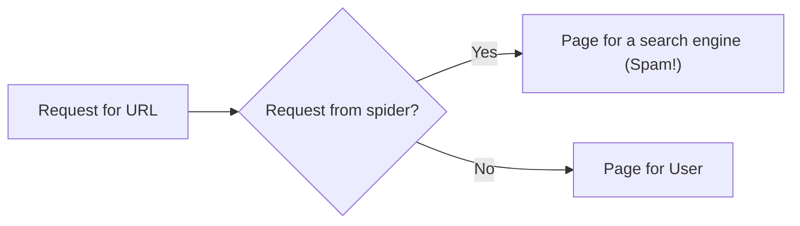

# CS 121: Information Retrieval — Topic: Search Engines & the Web

## Table of Contents

- [1. What Is Information Retrieval?](#1-what-is-information-retrieval)
- [2. Why Web Search Engines Matter](#2-why-web-search-engines-matter)
- [3. Database Engines vs. Search Engines: Relevance and Retrieval Models](#3-database-engines-vs-search-engines-relevance-and-retrieval-models)
- [4. Classic IR vs. Web IR](#4-classic-ir-vs-web-ir)
- [5. The Search Workflow and Search Engine Architecture](#5-the-search-workflow-and-search-engine-architecture)
- [6. The Web Graph and How the Web Evolved](#6-the-web-graph-and-how-the-web-evolved)
- [7. Web Users: Needs, Queries and Behavior](#7-web-users-needs-queries-and-behavior)
- [8. The Business Model: Ads on Search](#8-the-business-model-ads-on-search)
- [9. Search Engine Optimization (SEO)](#9-search-engine-optimization-seo)
- [10. Coercion Techniques and Spam](#10-coercion-techniques-and-spam)
- [11. The War on Spam and Why SEO Tricks Don't Last](#11-the-war-on-spam-and-why-seo-tricks-dont-last)
- [12. What Ranking Really Uses: The Yandex Leak](#12-what-ranking-really-uses-the-yandex-leak)
- [13. Quick Reference & Top 5 Things to Remember](#13-quick-reference--top-5-things-to-remember)

> This chapter is the map of the whole subject: what a web search engine is, who uses it and for what, how it earns money, how people try to game it, and how it is built. The blocks of the architecture in [§5.2](#52-search-engine-architecture) are each treated in depth elsewhere: [Web Crawling](topic-crawling.en-US.md), [Document Conversion, Storage & Duplicates](topic-documents.en-US.md), [Text Processing](topic-text-processing.en-US.md), [Inverted Indexes & Index Construction](topic-indexing.en-US.md), [Retrieval Models](topic-retrieval-models.en-US.md), [Query Processing & Efficient Top-K](topic-query-processing.en-US.md), [Link Analysis: HITS & PageRank](topic-link-analysis.en-US.md) and [Search Engine Evaluation](topic-evaluation.en-US.md).

## 1. What Is Information Retrieval?

> 💡 **Key Insight**: Information retrieval is **the activity of searching and extracting information from a collection of information resources**. Here that means *textual* information from *text documents*.

The classic, broader definition (Salton, 1968): IR is a field concerned with the **structure, analysis, organization, storage, searching, and retrieval** of information. Its primary focus is text — scholarly papers, books, news, e-mail, web pages — but IR also covers other media: audio, images, video.

### 1.1 Types of IR and types of search engines

IR is more than search. There are four kinds of IR task and five kinds of search engine; this chapter is about **search**, on the **web**.

| Types of IR | What it does |
|---|---|
| **Search** (this chapter) | Find documents for a query |
| Filtering or tracking | Detect documents of interest (e.g. as they arrive) |
| Classification | Label documents with pre-existing labels |
| Question answering | Go beyond finding documents: find *answers* |

| Types of search engines |
|---|
| **Web search** (this chapter) |
| Vertical search |
| Enterprise search |
| Desktop search |
| Peer-to-peer search |

> 📘 **Going further**: [Croft, Metzler & Strohman, *Search Engines: Information Retrieval in Practice*, §1.1 What Is Information Retrieval? (book p. 1)](https://ciir.cs.umass.edu/downloads/SEIRiP.pdf) · [§1.3 Search Engines (book p. 6)](https://ciir.cs.umass.edu/downloads/SEIRiP.pdf)

## 2. Why Web Search Engines Matter

How often do you use a web search engine? The case for their importance:

- **Without search engines the Web wouldn't scale.** Nobody has an incentive to create content that can't be found. Taxonomies and bookmarks can't keep up with the Web's size ("or can they?").
- **The Web is a technology artifact and a social environment.** For most people, Internet = Web, or even Internet = Google search.
- **Search makes aggregation of interest possible**, which creates incentives for niche players, and makes "unlimited selection" stores possible (Amazon, Netflix).
- A Pew Research Center study on search engine use (2012) found users more satisfied than ever with result quality, but many were anxious about search engines and other sites collecting personal information.
- Web search and IR are essential to modern life and central to professional life, in industry and academia.

### 2.1 Search is the money

Search turned out to be the first, and best, mechanism for advertising on the Web. Worldwide web advertising revenue is forecast at USD 633 billion for 2026.

| Figure | Value |
|---|---|
| US web advertising revenue, 2025 | USD 294.59B, +14% over 2024 (the 2000–2025 chart rises from near zero, steeply after ~2016) |
| Worldwide digital advertising (Statista; PwC, Omdia) | 266 (2018), 310, 343, 448, 484, 522\*, 562\*, 599\*, 633\* (2026), 663\* (2027) — billion USD, \* = forecast |
| By 2027 | more than USD 663B worldwide |
| US online ad revenue by type, 2025 | **Search 38.8%**, Display 27.7%, Video 26.5%, Other 4.2%, Audio 2.8% |

The business model for ads has changed over time ([§8](#8-the-business-model-ads-on-search)), but search is still the largest slice of US online ad revenue.

> 📘 **Going further**: [Statista: Digital advertising industry in the U.S.](https://www.statista.com/topics/1176/online-advertising/) · [Statista: US online ad revenue by type](https://www.statista.com/statistics/190458/categorie-breakdown-of-us-online-advertising-revenue-2010/)

### 2.2 Search engineers and the job market

Search engineers either **develop and maintain search engines** or **design and optimize content for search engines**. IEEE Spectrum charts built from Hired data show the market. Hired reports growth in demand only for each year's top ten specialties, so a 0% means "not in that year's top ten".

| Growth in demand, by specialty | 2018 | 2019 |
|---|---|---|
| AR/VR | 0% | 1,400% |
| Gaming | 0% | 146% |
| Computer Vision | 0% | 146% |
| **Search** | 0% | **137%** |
| Machine Learning | 27% | 89% |
| Security | 132% | 49% |
| Data | 38% | 45% |
| Frontend | 4% | 17% |
| Backend | 33% | 17% |
| Blockchain | 517% | 9% |
| Full-stack | 7% | 5% |
| Embedded | 76% | 0% |
| Mobile | 15% | 0% |

| Software engineering salaries (USD) | London | New York | SF Bay Area | Toronto |
|---|---|---|---|---|
| **Search** | 92,000 | 136,000 | **165,000** | 102,000 |
| NLP | 101,000 | — | 164,000 | — |
| Security | 103,000 | 127,000 | 163,000 | 95,000 |
| Machine Learning | 99,000 | 138,000 | 162,000 | 104,000 |

(For NLP, New York and Toronto have no data.) In this data, Search is among the fastest-growing specialties in 2019 and the best-paid of the four in the Bay Area.

> 📘 **Going further**: [IEEE Spectrum: software engineering salaries and demand by specialty](https://spectrum.ieee.org/view-from-the-valley/at-work/tech-careers/software-engineering-salaries-jump-demand-for-arvr-expertise-skyrockets) · [Croft §1.4 Search Engineers (book p. 9)](https://ciir.cs.umass.edu/downloads/SEIRiP.pdf)

## 3. Database Engines vs. Search Engines: Relevance and Retrieval Models

### 3.1 Database engine or search engine?

What is the difference between a database search and a search engine? Compare two kinds of request:

| | Database engine | Search engine |
|---|---|---|
| Example | "Find accounts whose balance is greater than `$100`" | "UCI library hours", "Find how to merge two lists in Python", "Find the graph of y=log(x)" |
| Data | Well-structured, well-defined; not just text but numbers | Text, with vague and varied information needs |
| Query | Formal language and logic | Informal, ad-hoc |
| Meaning | **Semantics are well-defined** | The engine must infer the meaning of words and sentences — **semantics are inferred** |

> 💡 **Key Insight**: A database query has exactly one right answer set — every row matching `balance > 100`. A search query has no such answer; the engine has to *guess* what the user meant and rank documents by how well they fit. That guess is the subject of the next subsection.

### 3.2 The core issue: relevance and retrieval models

**Relevance** is what a search engine is really computing. Textual similarity between query and document is only the first ingredient — *databases stop there*. A search engine also uses context:

| Context | Examples |
|---|---|
| Textual similarity | query words vs. document words (databases stop here!) |
| Document context | origin, author, popularity, … |
| User context | geographic location, prior queries, age, preferred language, … |
| Query context | special symbols |

A **retrieval model** is defined behind every notion of relevance. It is the conceptual design of *what to pay attention to* when matching a query and a document — for example, grammar vs. raw text, and which parts of the context count. A good retrieval model finds the documents relevant to **the person who submitted the query**, and it is the basis for the ranking algorithms (see [Retrieval Models](topic-retrieval-models.en-US.md)).

> ⚠️ **Pitfall**: "Relevant" means relevant *to that user*, not "contains the query words". Two people typing the same query can deserve different results (location, language, prior queries).

> 📘 **Going further**: [Croft §1.2 The Big Issues (book p. 4)](https://ciir.cs.umass.edu/downloads/SEIRiP.pdf)

> 📝 **Practice**: [§3.3](#33-practice)

### 3.3 Practice

#### Database query or search query?

For each request, decide whether it is a database query or a search-engine query, and say why:

1. "Find accounts whose balance is greater than `$100`"
2. "UCI library hours"
3. "Find how to merge two lists in Python"
4. "Find the graph of y=log(x)"

<details>
<summary>Solution</summary>

(1) is a **database** query: the data is structured (an accounts table with a numeric balance), the condition is formal logic (`balance > 100`), and the semantics are well-defined — every matching row is correct, none is missing. (2)–(4) are **search** queries: they are informal and ad hoc, and the engine must infer what they mean. Does "UCI library hours" want today's hours, one branch's hours, or the holiday schedule? Which programming idiom counts as "merge"? A page *about* log(x), or a plot? There is no single correct answer set, only a ranking by relevance.

</details>

## 4. Classic IR vs. Web IR

**Classic IR** assumes a **fixed document collection** (the corpus), and the goal is to retrieve the information relevant to an information need. Formally: for each query $Q$ and stored document $D$ there is a relevance score $R(Q, D)$, and the system maximizes it. Context is ignored, the user is ignored, and the corpus is static.

**Web IR** breaks every one of those assumptions:

| Classic assumption | On the Web | Consequence |
|---|---|---|
| The corpus is stored centrally | The Web is huge — it can't be stored in any centralized memory | Corpus is not centralized |
| The corpus is static | The Web changes all the time | Must update constantly |
| Context is ignored | There is information to avoid (spam, manipulation) — *adversarial IR* | Context can't be ignored |
| The user is ignored | One interface serves hugely divergent needs | User can't be ignored |

**Web search engines** are the practical application of IR. They must crawl terabytes to petabytes of web pages and answer queries in under a second — though indexing can take "a bit" longer. Besides the IR issues, the big design issues are:

- **Performance**: response time, query throughput, indexing speed
- **Speed of discovering and integrating new documents**
- **Coverage**
- **Freshness**
- **Spam**

> 💡 **Key Insight**: Sub-second *queries*, slower *indexing*: the expensive work (crawling, processing, indexing) is done ahead of time so the query path stays fast. That split is exactly the two halves of the architecture in [§5.2](#52-search-engine-architecture).

> 📘 **Going further**: [Croft §1.3 Search Engines (book p. 6)](https://ciir.cs.umass.edu/downloads/SEIRiP.pdf)

> 📝 **Practice**: [§4.1](#41-practice)

### 4.1 Practice

#### Which classic IR assumption breaks?

Classic IR maximizes $R(Q, D)$ over a fixed corpus, ignoring context and the user. For each fact about the Web, name the assumption it breaks: (a) the Web can't fit in any centralized memory; (b) pages change all the time; (c) some pages are written to game the ranking; (d) one search box serves everyone.

<details>
<summary>Solution</summary>

(a) The corpus is centralized → **not centralized**. (b) The corpus is static → **not static**: the engine must update constantly. (c) Context is ignored → it **can't be**: this is *adversarial IR*, with information to avoid. (d) The user is ignored → it **can't be**: hugely divergent needs share one interface.

</details>

## 5. The Search Workflow and Search Engine Architecture

### 5.1 The search workflow from the user's side

The story from the perspective of the user is built up in four steps. A dashed line separates what the user sees from what runs behind it:

1. **The user** types a query into a search box (Go / Search).
2. The query goes to a **database of pages**, and the **search results** page comes back.
3. A second store, the **ad indices**, feeds the results page too — the sponsored results next to the organic ones.
4. Behind it all, the **web spider** (crawler) walks **the Web** — pages linking to pages — and hands pages to the **indexer**, which builds the **indices** the queries run against.

> 💡 **Key Insight**: The user only ever touches the query side. Everything behind the dashed line — crawling, indexing — happened before the query was typed, which is why the results come back in under a second.

### 5.2 Search engine architecture

The architecture has two halves:

- **Preprocessing steps** (offline, before any query): Web Pages → **Text Acquisition** → Local Document Store → **Text Transformation/Processing** → **Index Creation** → Index.
- **Querying process** (online, per query): User ↔ **UI** ↔ **Ranking** ↔ Index, with **Evaluation** watching the UI, writing to a **Log**, and feeding back into Ranking.



What each block does:

| Block | Responsibilities |
|---|---|
| **Text Acquisition** | Crawler; feeds; data dumps; text conversion (e.g. PDF → text); the document store |
| **Text Transformation** | Parser = tokenizer + structure; **stopping** (removing words like "the", "of"); **stemming** (grouping similar words, e.g. fishes → fish); link extraction and analysis (how popular a link is); information extraction (text structure); classifier (topic, non-content, spam, …) |
| **Index Creation** | Corpus statistics; **term weighting** (how important a word is in documents); **index inversion** (doc → term becomes term → doc); index distribution (essential for large indexes) |
| **User Interaction** (UI) | Query input (keywords, operators such as AND); query transformation (spell checking, query suggestion and expansion); results output (page summaries, highlighting important words) |
| **Ranking** | Relevance scoring (how well each doc matches the query); performance optimization (lower response time); distribution — a query broker allocates queries to different processors |
| **Evaluation** | Logging (improves the engine in the long run); ranking analysis (does the ranking work for its users, judged by their behavior?); performance analysis (people expect fast answers, so performance is monitored and improved) |

Grouping the blocks gives the usual map of the topics: Web Pages + Text Acquisition ([Web Crawling](topic-crawling.en-US.md), [Document Conversion, Storage & Duplicates](topic-documents.en-US.md)); Text Transformation + Index Creation ([Text Processing](topic-text-processing.en-US.md), [Inverted Indexes & Index Construction](topic-indexing.en-US.md)); Index + Ranking ([Retrieval Models](topic-retrieval-models.en-US.md), [Query Processing & Efficient Top-K](topic-query-processing.en-US.md), [Link Analysis](topic-link-analysis.en-US.md)); Evaluation ([Search Engine Evaluation](topic-evaluation.en-US.md)); and the UI together with the user ([§7](#7-web-users-needs-queries-and-behavior)).

> 💡 **Key Insight**: **Index inversion** is the heart of the left half. A document naturally maps to its terms (doc → term). Search needs the opposite — given a term, which documents contain it (term → doc). Building that inverted index is what makes sub-second queries possible.

> ⚠️ **Pitfall**: Stopping and stemming are *text transformation*, not index creation, and spell checking / query expansion belong to *user interaction*, not ranking. When asked which block a task lives in, use the table above.

> 📘 **Going further**: [Croft Ch 2 Architecture of a Search Engine (book p. 13)](https://ciir.cs.umass.edu/downloads/SEIRiP.pdf) · Croft §2.3.1–2.3.6 cover the six blocks (book pp. 17–27)

## 6. The Web Graph and How the Web Evolved

### 6.1 The web graph and its characteristics

Why can a spider crawl the web? Because the Web is a graph:

- **Pages are nodes.**
- **Hyperlinks are directed edges.** A link from A to B lets you get from A to B, not back.

A crawler follows the edges from page to page. What does this graph look like?

| Characteristic | What the studies find |
|---|---|
| **Significant duplication** | 30%–40% of pages in some studies [Brod97, Shiv99]; 25%–30% is Google's number from 2013; copyscape.com finds copies of a page |
| **High linkage** | More than 8 links per page |
| **Very large** | Hosts $O(10^9)$; the number of pages is much larger still |
| **Spam, misleading and false information** | $O(10^{8\text{–}9}?)$ pages of it |
| **High rate of change** | see the three studies below |

**Size** — Netcraft's survey. On a log scale, websites grow from about $10^4$ in 1995 to a **~1.8 billion peak in Feb 2018**, then **~1.1 billion in March 2024**. In Feb 2026 there were **1,419,977,535 hostnames**, but only **208,200,947 active sites** — about 14.7%.

**Rate of change:**

| Study | Sample | Finding |
|---|---|---|
| [Cho00] | 720k pages from 270 popular sites, sampled daily for 5 months in 1999 | **40% changed weekly, 23% daily** |
| [Fett02] | 151M pages checked over a few months | Significant changes: 7% weekly; some changes: 25% weekly |
| [Ntul04] | 154 **large** sites recrawled from scratch weekly | 8% had new pages every week; 8% die; 5% new content; 25% new links |

> 💡 **Key Insight**: Each row is a crawler/index problem: duplicates waste space ([Document Conversion, Storage & Duplicates](topic-documents.en-US.md)), size means you can't fetch everything, spam means you can't trust what you fetch, and change makes every copy go stale ([Web Crawling](topic-crawling.en-US.md)).

> 📘 **Going further**: [Source of Google's 2013 duplication figure (YouTube)](https://www.youtube.com/watch?v=mQZY7EmjbMA) · [Copyscape](https://www.copyscape.com) · [Netcraft web server survey, Sep 2020](https://news.netcraft.com/archives/2020/09/23/september-2020-web-server-survey.html) · [Netcraft web server survey, Mar 2026](https://www.netcraft.com/blog/march-2026-web-server-survey/) · [Croft §3.2 Crawling the Web (book p. 32)](https://ciir.cs.umass.edu/downloads/SEIRiP.pdf) · [Croft §3.7 Detecting Duplicates (book p. 60)](https://ciir.cs.umass.edu/downloads/SEIRiP.pdf)

### 6.2 How the Web evolved

The Web has gone through five phases:

1. Static content (documents)
2. Dynamic content (applications — calendar and weather apps)
3. User-generated content (social — Wikipedia, LinkedIn, Facebook)
4. Mobile
5. ??? AR? VR? Brain-interfaces?

> 💡 **Key Insight**: One need has stayed invariant through every phase: **to find information**. The present-day solution is IR systems for **search and ranking**.

## 7. Web Users: Needs, Queries and Behavior

### 7.1 Why people search

Based on Jansen et al. (2008):

| Need | Share | The user wants to… |
|---|---|---|
| Informational | ~80% | learn about something |
| Navigational | ~10% | go to that page (also called "URL search") |
| Transactional | ~10% | do something |
| Miscellaneous | (small) | explore, socialize, etc. |

### 7.2 How they write queries and who they are

Most queries are **ill-defined**:

- **Short** — 80% have fewer than 3 words
- **Imprecise terms**
- **No logical operators**
- **Low effort** — spelling mistakes

Users show wide variance in **needs, expectations, knowledge and bandwidth** — your search engine will be better if you take these points seriously. Their **behavior**:

- **85% look over one result screen only** (!!!)
- 78% of queries are not modified
- They follow links — "the scent of information"

> ⚠️ **Pitfall**: Two different 80% figures: ~80% of searches are *informational*; 80% of queries are *shorter than 3 words*. 85% = one result screen; 78% = queries not modified.

### 7.3 How far do people look?

An iProspect survey asked: "If you don't find what you are looking for, at what point do you move on, either to another search engine or to another search on the same engine?"

| Users move on… | Share |
|---|---|
| After the first few entries | 22.6% |
| After the first page | 18.6% |
| After the first two pages | 25.8% |
| After the first three pages | 14.7% |
| More than three pages | 10.8% |
| The whole list, unless it's dozens of pages | 7.4% |

So 41.2% give up by the end of the first page and 67.0% by the end of the second (the bars add up to 99.9% because of rounding). Cumulative sums, computed:

```python
share = [22.6, 18.6, 25.8, 14.7, 10.8, 7.4]
total = 0
for s in share:
    total += s
    print(round(total, 1))
```

```text
22.6
41.2
67.0
81.7
92.5
99.9
```

This is why *precision of the first few hits* matters more than recall for web search ([Search Engine Evaluation](topic-evaluation.en-US.md)).

### 7.4 From task to query: the information need pipeline

The query is the last link of a chain, losing meaning at each step.

| Stage | Example |
|---|---|
| Task | Stop the noisy fan in the courtyard |
| Info need | Info about EPA regulations |
| Verbal form | What are EPA rules on noise pollution? |
| Query | EPA Sound Pollution |

### 7.5 Answering the need behind the query

The query is often an **imprecise indicator** of what the user wants. What can we do?

- Design retrieval models and mathematical definitions of the **relevance score** that are generic, albeit not ideal for every specific topic ([§3.2](#32-the-core-issue-relevance-and-retrieval-models); [Retrieval Models](topic-retrieval-models.en-US.md))
- Use **user context**: who, where, what
- **Guess the type of information** wanted (image, map, math, …)
- **Correct and/or expand** queries ([Text Processing](topic-text-processing.en-US.md))

### 7.6 Web search characteristics and trends

There are **few popular broad queries** and **many rare specific queries**. For example, all cancer-related searches form a pie chart with a few visible slices ("cancer", "breast cancer", "skin cancer", "prostate cancer", "lung cancer", "colon cancer", "leukemia", "lymphoma") and hundreds of tiny ones.

Term interest can be explored at Google Trends, and a search engine **uses trend information** to:

| Use | How trends help |
|---|---|
| Auto-complete | Enhance the user experience; correct spelling errors |
| Optimize search results | What's trending "near you" can help in relevance scoring |
| Smart-cache search results | If a search is trending, keep its results in cache |

> 📘 **Going further**: [Google Trends](https://www.google.com/trends/)

> 📝 **Practice**: [§7.7](#77-practice)

### 7.7 Practice

#### Who gives up when?

Using the survey table in §7.3 (22.6%, 18.6%, 25.8%, 14.7%, 10.8%, 7.4%), what share of users move on by the end of the first page? By the end of the second? What share are still reading after three pages?

<details>
<summary>Solution</summary>

By the end of the first page: 22.6% + 18.6% = **41.2%**. By the end of the second: 41.2% + 25.8% = **67.0%**. Users who read past three pages: "More than three pages" 10.8% + "the whole list" 7.4% = **18.2%** (equivalently 100% − 81.7%, with the 0.1% difference being rounding).

</details>

## 8. The Business Model: Ads on Search

Search is the largest slice of online ad revenue ([§2.1](#21-search-is-the-money)). The history and the mechanics:

1. **Early synergy**: keyword-based engines — Altavista (1995–1997), Excite, InfoSeek, Inktomi — and **paid placement ranking**, ads based on an **auction for a keyword** (Goto.com → Overture.com → Yahoo! → Google).
2. **Link-based ranking**, pioneered by Google (1998+): links added **authoritativeness** to relevance and blew away keyword-only engines ([Link Analysis: HITS & PageRank](topic-link-analysis.en-US.md)). Great user experience, no business model yet — meanwhile Goto/Overture's annual revenues were near USD 1B.
3. **Google added paid placement ads**, differentiated from the results. **Yahoo!** bought Inktomi for search tech (a few hundred million USD) and Overture for paid placement tech (USD 1.6 billion, 2003): sponsored links alongside objective results. Google licensed Yahoo!'s paid placement tech — its ad engine for many years (perhaps still; nobody knows with certainty).
4. **Today**: engines maintain that ads do **not** affect vendors' ranking (nobody knows for sure). Placement is **fully automated**, **balances auction price and relevance**, and is **targeted**.

### 8.1 How companies pay

| Model | The advertiser pays… | Good for |
|---|---|---|
| **CPM** — Cost Per Mil | per $10^3$ showings (impressions) of the ad | Branding campaigns |
| **CPC** — Cost Per Click | when a user clicks the ad | Sales campaigns |
| **CPA** — Cost Per Action/Acquisition | only if the click triggered some action (e.g. DuckDuckGo + Amazon) | Paying for results |

**Why it makes sense for the business**: on the search-engine picture of [§5.1](#51-the-search-workflow-from-the-users-side), crawling, indexing and organic results are **more interesting, less valuable financially**; the ad indices are **less interesting, ~10× more valuable**.

### 8.2 Click fraud

- **USD 7.2 billion were lost between 2016 and 2018** (Guardian).
- Google calls these **"invalid clicks"**.
- Search engines have sophisticated tools to detect fraud.

> ⚠️ **Pitfall**: The M in CPM is *mil(le)* — a thousand impressions, not a million. Click fraud hurts per-click pricing: each fake click is billed.

> 📝 **Practice**: [§8.3](#83-practice)

### 8.3 Practice

#### Pick the pricing model

An advertiser wants (a) to make a new soda brand widely known, (b) to be charged only when a shopper actually buys, (c) to drive visits to its web store and pay per visit. Which of CPM, CPC, CPA fits each? If an ad is shown 250,000 times at a CPM of USD 4, what is the bill?

<details>
<summary>Solution</summary>

(a) **CPM** — branding campaigns pay for showings. (b) **CPA** — the advertiser pays only if the click triggered an action such as a purchase. (c) **CPC** — sales campaigns pay per click. Bill: 250,000 impressions = 250 thousands, and 250 × USD 4 = **USD 1,000**. (Remember CPM is per *thousand*, not per million: per million it would be USD 4 × 0.25 = USD 1.)

</details>

## 9. Search Engine Optimization (SEO)

Paid ad placement costs money. So… **SEO** is the **tuning of a web page/site/app to rank highly** in search results for certain queries. It's an alternative to paying for ad placement, with a bonus: **visibility through rank = greater trust**. In short, **it's marketing**: getting your content to your audience.

| Question | Answer |
|---|---|
| Motives | Commercial, political, religious, lobbying |
| Who does it | Internally: webmasters, writers. Commercially: companies, consultants. Hosting services. Plugins to popular CMSs |

SEO is essentially a **marketing–technology interface** area. How to do it: Google's webmaster guidance, WebmasterWorld's SEO tools, and many books (for example *The Art of SEO* by Enge, Spencer and Stricchiola, O'Reilly).

**Ethical and unethical ways:**

| Legitimate | Unethical ("aka spam") |
|---|---|
| Indexed age of the pages (older is better) | Fake pages |
| Good incoming links | Fake sites that point to your site |
| Good content: well written, well organized, up to date | Fake comments/engagement (bots!) |
| Good use of web standards/practices | In short: "alternative facts", aka lies |
| Fast servers (quick response) | |

Sometimes the line between legitimate and illegitimate is hard to find — there's a **large grey area**.

**Location matters too**: results also depend on **which data center receives the query**. google.com, google.fr and google.pt show different results for a single query such as "Paris", so different SEO strategies can be considered per country.

> 📘 **Going further**: [Google: webmaster guidelines (answer 40349)](https://support.google.com/webmasters/answer/40349?hl=en) · [WebmasterWorld SEO tools](http://freetools.webmasterworld.com/category/seo-tools)

## 10. Coercion Techniques and Spam

### 10.1 Coercion techniques

**Keyword stuffing.** First-generation search engines relied heavily on textual content and word frequency, so SEO played with keywords:

- **Misleading meta-tags** — a travel site's `<head>` with a `<meta name="keywords">` tag listing "Expedia, Travel, Cheap Airfare, Car, Hotels, Vacations, Airfare, Car Rental, Cruises, …" and a description tag stuffed the same way
- **Repeating words** over and over
- **Playing games with colors** (white text on white) — visible to spiders/crawlers and indexers, but not to users

**Cloaking**: serving different content to a spider than to a browser. The server checks who is asking:



This architecture is the same as a **dynamic content engine** — it can adapt to different search engines.

**Doorway pages**: like cloaking, but using a **redirect (302)**. HTTP 302 means "the requested resource resides **temporarily** under a different URI. Since the redirection might be altered on occasion, the client SHOULD continue to use the Request-URI for future requests." The initial page is optimized for the spider; then an instantaneous redirect takes the user to the actual content, so **the user sees the final page**.


**Link exchanges**: "I link to you, you link to me"; "translations"; and **universities and professors are targets** — essentially because of the **trust transfer** that matters at the link-analysis level ([Link Analysis: HITS & PageRank](topic-link-analysis.en-US.md)).

> ⚠️ **Pitfall**: Cloaking and doorway pages both show the engine something the user doesn't see; the difference is the mechanism. Cloaking = the **server branches on who's asking**. Doorway = **one page for everyone, then a 302 redirect** that only a browser follows to the real content.

### 10.2 Spam

| Two major types | What it is |
|---|---|
| **Link spamming** | Bots that search for blogs and leave comments with links |
| **Clicker bots** | Bots that issue queries and "click" on targeted query results |

There is a whole **spam industry** (search results sell "First Page of Google GUARANTEED" and "How To Get On The First Page of Google In 24 hours"), and web contests get spammed too.

> 📘 **Going further**: [How to win (or cheat) any online voting contest](https://www.wholewhale.com/tips/how-to-win-or-cheat-any-online-voting-contest/) · [Croft §4.5.3 Link Quality (book p. 111)](https://ciir.cs.umass.edu/downloads/SEIRiP.pdf)

### 10.3 Seeing cloaking from the client side: spoofing the User-Agent

The important class is `urllib.request.Request()`: by setting the **User-Agent** header, a simple Python script makes the server think it's Chrome on an iPhone. This is **"spoofing"**, widely used to access sites that refuse scripts/bots — **but be careful with this!**

```python
#
# Spoofing the User-Agent with urllib.request
#
import sys
import urllib.request

def print_data_url(url_name: str) -> None:
    # First we spoof an user agent
    headers = {'User-Agent': "Mozilla/5.0 (iPhone; CPU iPhone OS 16_3 like "
                             "Mac OS X) AppleWebKit/605.1.15 (KHTML, like "
                             "Gecko) CriOS/110.0.5481.83 Mobile/15E148 "
                             "Safari/604.1"}
    request = urllib.request.Request(url_name, headers=headers)
    # Now we can retrieve data
    response = urllib.request.urlopen(request)
    response_data = response.read()
    response_data = response_data.decode(encoding = 'utf-8')
    response.close()
    print(response_data)

if __name__ == "__main__":
    print_data_url(sys.argv[1])
```

Run against a page that reports the header it received, it prints the iPhone string:

```bash
$ python3 print_url_3.py https://www.whatismybrowser.com/detect/what-is-my-user-agent/ | grep -i "Mozilla"
```

To see the mechanism end to end, here is a tiny cloaking server that sends one page to anything announcing itself as `Python-urllib` (a bot) and another page to everyone else, together with both kinds of client:

```python
import threading
import urllib.request
from http.server import BaseHTTPRequestHandler, HTTPServer

IPHONE = ("Mozilla/5.0 (iPhone; CPU iPhone OS 16_3 like Mac OS X) "
          "AppleWebKit/605.1.15 (KHTML, like Gecko) CriOS/110.0.5481.83 "
          "Mobile/15E148 Safari/604.1")

class Cloaker(BaseHTTPRequestHandler):
    def do_GET(self):
        agent = self.headers.get("User-Agent", "")
        is_bot = agent.startswith("Python-urllib")      # "Request from spider?"
        body = ("page for a search engine" if is_bot else "page for a user").encode()
        self.send_response(200)
        self.send_header("Content-Length", str(len(body)))
        self.end_headers()
        self.wfile.write(body)

    def log_message(self, *args):                        # keep the output clean
        pass

server = HTTPServer(("127.0.0.1", 8765), Cloaker)
threading.Thread(target=server.serve_forever, daemon=True).start()
url = "http://127.0.0.1:8765/"

plain = urllib.request.urlopen(url).read().decode()
spoofed = urllib.request.urlopen(
    urllib.request.Request(url, headers={"User-Agent": IPHONE})).read().decode()
print("default urlopen  ->", plain)
print("spoofed iPhone   ->", spoofed)
server.shutdown()
```

```text
default urlopen  -> page for a search engine
spoofed iPhone   -> page for a user
```

A plain `urlopen(url)` announces itself as `Python-urllib/3.x` — the default a cloaking server or bot blocker looks for — while the spoofed script arrives as the iPhone string and gets the user's page.

> 📝 **Practice**: [§10.4](#104-practice)

### 10.4 Practice

#### Cloaking or doorway page?

A site returns a keyword-packed page when the request comes from a crawler, and a normal page when it comes from a browser. A second site returns the same keyword-packed page to everyone, but the page instantly redirects browsers (302) to the real content. Name each technique and say what separates them.

<details>
<summary>Solution</summary>

The first is **cloaking**: the server branches on who is asking (spider vs. browser) and serves different content. The second is a **doorway page**: one page for everyone, optimized for the spider, followed by an instantaneous 302 redirect that a browser follows, so the user sees only the final page. The difference is the mechanism: server-side branching on the requester versus a redirect.

</details>

## 11. The War on Spam and Why SEO Tricks Don't Last

**How engines fight back:**

| Weapon | Details |
|---|---|
| Quality indicators | Statistical analysis of links; statistical analysis of votes |
| Usage indicators | Analytics |
| Anti-bot mechanisms | Captchas (e.g. reCAPTCHA "type the two words") |
| Limits on meta keywords | |
| Family-friendly filters | |
| **Robust link analysis** | Ignore statistically improbable links (a page in Portuguese from Portugal linking to a page in Chinese from China); detect cycles; use link analysis to detect spammers — a very simple rule: **guilt by association** ([Link Analysis: HITS & PageRank](topic-link-analysis.en-US.md)) |
| Editorial (human!) intervention | Black-listing, and creating training sets for supervised ML |
| Spam recognition by machine learning | |

**Webmaster guidelines**: search engines publish SEO policies — what is allowed and what isn't. They **must not be ignored**: once a site is blacklisted by a search engine, it virtually **disappears from the Web**.

**SEO "tricks" are volatile**, because they depend on how the engines work, and those methods keep changing:

| Era | Google's methods | What they look at |
|---|---|---|
| 1996 – ? | PageRank; then Panda (2011), Penguin (2012), Hummingbird (2013), Pigeon (2014), … | **Words and links** |
| Since 2016 | RankBrain — machine learning based | **Concepts** |
| Since October 2019 | BERT — NLP, machine learning | |
| Now | RankBrain + BERT + … — **more than 200 methods and signals** (!) | |

Can you optimize for BERT? Google says no (but it's too early to tell).

> 💡 **Key Insight**: **Optimizing for users will guarantee optimizing for good search engines.** Tricks exploit gaps between what engines measure and what users want; the gaps keep closing.

## 12. What Ranking Really Uses: The Yandex Leak

**Yandex** is the largest internet and technology company in Russia and the former Soviet Union countries. It launched in 1997, one year before Google (1998), and is now probably the largest search engine in Russia — before the war it had a market share of about 42% there. Worldwide it ranks 4th (search engine market share, March 2023):

| Engine | Google | Bing | Yahoo! | **Yandex** | DuckDuckGo | Baidu |
|---|---|---|---|---|---|---|
| Share | 93.18% | 2.87% | 1.12% | **1.02%** | 0.52% | 0.42% |

**The leak**: Yandex has developed search technology since 1993. Software information was leaked by a (now former) employee on **25 Jan 2023** — 44 GB of data, available via torrents, covering not only search but also maps, mail and cloud services.

**Three major factor families:**

| Factor type | Depends on | Examples |
|---|---|---|
| **Static** | The website only | Links, headers, advertisement ratio |
| **Dynamic** | Website + the query | Text relevance, tf-idf ranking |
| **User search** | The user only | User location, query language |

**Signals used in the ranking:**

- MatrixNet + Palekh + Korolyov + CatBoost (ML ranking models)
- PageRank
- tf-idf
- Page quality scoring
- Authoritativeness link inheritance
- Historical server response quality
- Page age, freshness, update frequency
- **Crawl level**: more weight to pages reached directly after the first page
- **Click history**: how often users click the page when it appears in a result list — filtered from bots!
- Specific factors for medical, legal, financial (and probably political) topics
- **URL string**: numbers, trailing slashes, capital letters — all negative!
- Similarity between users
- Font size (is it mobile friendly?)
- …

> 💡 **Key Insight**: The leak matches the themes of this chapter: "fast servers" ([§9](#9-search-engine-optimization-seo)) = *historical server response quality*; bot-filtered click history = defence against clicker bots ([§10.2](#102-spam)); static/dynamic/user factors = $R(Q, D, \dots)$ spelled out. PageRank and tf-idf appear as just two signals among many ([Link Analysis: HITS & PageRank](topic-link-analysis.en-US.md), [Retrieval Models](topic-retrieval-models.en-US.md)).

## 13. Quick Reference & Top 5 Things to Remember

| Term | Meaning |
|---|---|
| Information retrieval | Searching and extracting information from a collection of information resources (here: text documents) |
| Corpus | The document collection |
| Relevance $R(Q, D)$ | How well document $D$ satisfies the need behind query $Q$ (on the web $R(Q, D, \dots)$) |
| Retrieval model | What to pay attention to when matching a query and a document; the basis for ranking |
| Adversarial IR | Retrieval where some content is designed to manipulate the engine (spam) |
| Stopping / stemming | Drop very common words / group word variants (fishes → fish) |
| Index inversion | doc → term becomes term → doc |
| Query broker | Distributes queries to different processors |
| CPM / CPC / CPA | Per 1,000 impressions / per click / per action |
| SEO | Tuning a page or site to rank highly; legitimate or spam, with a large grey area |

| Architecture half | Blocks |
|---|---|
| Preprocessing (offline) | Text Acquisition → Document Store → Text Transformation → Index Creation → Index |
| Querying (online) | UI ↔ Ranking ↔ Index; Evaluation + Log feeding back into Ranking |

| Web fact | Number |
|---|---|
| Duplication | 30–40% (studies), 25–30% (Google, 2013) |
| Links per page | more than 8 |
| Websites | ~1.8B peak (Feb 2018), ~1.1B (Mar 2024); Feb 2026: 1.42B hostnames, 208M active |
| Change [Cho00] | 40% weekly, 23% daily |
| Needs [Jansen 2008] | ~80% informational, ~10% navigational, ~10% transactional |
| Queries | 80% shorter than 3 words; 78% not modified |
| Results | 85% look at one result screen only |
| Click fraud | USD 7.2B lost, 2016–2018 |

| Spam technique | How it fools the engine |
|---|---|
| Keyword stuffing | Misleading meta-tags, repeated words, white-on-white text |
| Cloaking | Server sends spiders a different page than browsers |
| Doorway page | Spider-optimized page + instant 302 redirect for users |
| Link exchanges / link spam | Fake links and blog comments to transfer trust |
| Clicker bots | Fake queries and clicks on targeted results |

**Top 5 things to remember**

1. IR here = searching and extracting information from a collection of **text documents**, done on the **Web**; databases answer well-defined queries over structured data, search engines **infer** meaning from vague queries and **rank** by relevance.
2. Relevance = textual similarity **plus** document, user and query context; the Web breaks all four classic IR assumptions (not centralized, not static, adversarial, the user matters).
3. The architecture has an offline half (Text Acquisition, Text Transformation, Index Creation) and an online half (UI, Ranking, Evaluation); index inversion makes sub-second queries possible.
4. The Web is a huge, duplicated (30–40%), densely linked (8+ links/page), spam-ridden, fast-changing directed graph; users write short queries (80% under 3 words), mostly informational (~80%), and 85% look at one result screen only.
5. Search is the biggest slice of online ads (CPM / CPC / CPA, click fraud), which is why SEO and spam exist (stuffing, cloaking = branch on requester, doorway = 302 redirect); engines fight back with link analysis, ML and editors, and real rankings use hundreds of signals — optimize for users.