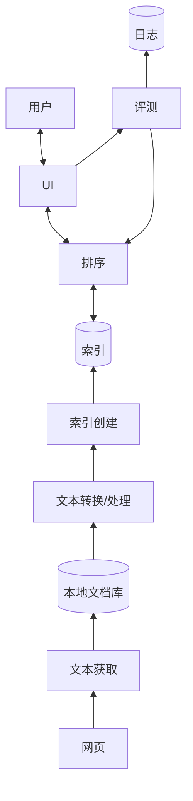
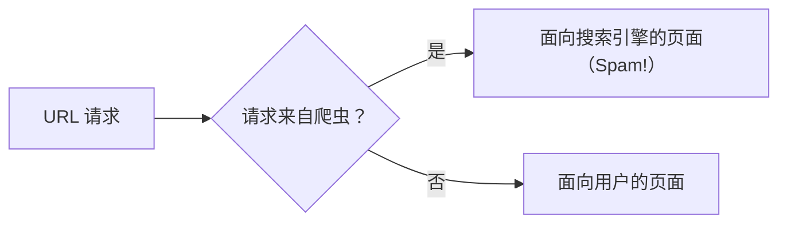

# CS 121: Information Retrieval — 话题：搜索引擎与 Web

## 目录

- [1. 什么是信息检索？](#1-什么是信息检索)
- [2. 为什么网络搜索引擎重要](#2-为什么网络搜索引擎重要)
- [3. 数据库引擎与搜索引擎：相关性与检索模型](#3-数据库引擎与搜索引擎相关性与检索模型)
- [4. 经典 IR 与 Web IR](#4-经典-ir-与-web-ir)
- [5. 搜索流程与搜索引擎架构](#5-搜索流程与搜索引擎架构)
- [6. 网络图与网页的演化](#6-网络图与网页的演化)
- [7. 网页用户：需求、查询与行为](#7-网页用户需求查询与行为)
- [8. 商业模式：搜索广告](#8-商业模式搜索广告)
- [9. 搜索引擎优化（SEO）](#9-搜索引擎优化seo)
- [10. 作弊技术与垃圾信息](#10-作弊技术与垃圾信息)
- [11. 垃圾信息之战与 SEO 技巧的短命](#11-垃圾信息之战与-seo-技巧的短命)
- [12. 排名究竟用了什么：Yandex 泄露](#12-排名究竟用了什么yandex-泄露)
- [13. 速查与五条要点](#13-速查与五条要点)

> 本章是整个主题的地图：什么是网络搜索引擎，谁在用它、用来做什么，它如何赚钱，人们如何试图操纵它，以及它是如何构建的。[§5.2](#52-搜索引擎架构) 中架构的各个模块，在其他章节中有深入讨论：[网络爬虫](topic-crawling.zh-CN.md)、[文档转换、存储与去重](topic-documents.zh-CN.md)、[文本处理](topic-text-processing.zh-CN.md)、[倒排索引与索引构建](topic-indexing.zh-CN.md)、[检索模型：布尔、tf-idf 与向量空间](topic-retrieval-models.zh-CN.md)、[查询处理与高效 Top-K](topic-query-processing.zh-CN.md)、[链接分析：HITS 与 PageRank](topic-link-analysis.zh-CN.md) 和 [搜索引擎评测](topic-evaluation.zh-CN.md)。

## 1. 什么是信息检索？

> 💡 **关键洞见**：信息检索是**从信息资源集合中搜索并提取信息的活动**。这里指的是来自**文本文档**的*文本*信息。

更宽泛的经典定义（Salton, 1968）：IR 是一个研究信息的**结构、分析、组织、存储、搜索与检索**的领域。它的主要关注对象是文本，例如学术论文、书籍、新闻、电子邮件和网页，但 IR 也涵盖音频、图像、视频等其他媒体。

### 1.1 信息检索的类型与搜索引擎的类型

IR 不止于搜索。信息检索有四类任务，搜索引擎有五类；本章讨论的是**网络**上的**搜索**。

| 信息检索的类型 | 功能 |
|---|---|
| **搜索**（本章） | 为查询找到文档 |
| 过滤或追踪 | 检测感兴趣的文档（例如新文档到达时） |
| 分类 | 用预先给定的标签为文档打标签 |
| 问答 | 超越查找文档，直接找出*答案* |

| 搜索引擎的类型 |
|---|
| **网页搜索**（本章） |
| 垂直搜索 |
| 企业搜索 |
| 桌面搜索 |
| 点对点搜索 |

> 📘 **延伸阅读**：[Croft、Metzler 与 Strohman，*Search Engines: Information Retrieval in Practice*，§1.1 什么是信息检索？（书中第 1 页）](https://ciir.cs.umass.edu/downloads/SEIRiP.pdf) · [§1.3 搜索引擎（书中第 6 页）](https://ciir.cs.umass.edu/downloads/SEIRiP.pdf)

## 2. 为什么网络搜索引擎重要

你多久使用一次网络搜索引擎？它们重要的理由如下：

- **没有搜索引擎，网络就无法规模化。** 没有人有动机去创建无法被找到的内容。分类目录和书签跟不上网络的规模（"或者真的可以吗？"）。
- **网络既是一种技术产物，也是一个社会环境。** 对大多数人来说，互联网 = Web，甚至互联网 = Google 搜索。
- **搜索让兴趣得以聚合**，这为小众玩家创造了机会，也让"无限选择"的商店（如 Amazon、Netflix）成为可能。
- 皮尤研究中心在 2012 年关于搜索引擎使用的研究发现，用户对结果质量的满意度比以往任何时候都高，但许多人担心搜索引擎和其他网站会收集个人信息。
- 网络搜索与 IR 是现代生活的基础，也是工业界和学术界职业生涯的核心。

### 2.1 搜索即生意

搜索是网络广告的第一个、也是最好的机制。全球网络广告收入预计在 2026 年达到 USD 633 billion。

| 数据 | 数值 |
|---|---|
| 2025 年美国网络广告收入 | USD 294.59B，较 2024 年增长 14%（2000–2025 年的图表从接近零开始，约 2016 年后急剧上升） |
| 全球数字广告（Statista；PwC、Omdia） | 266（2018）、310、343、448、484、522\*、562\*、599\*、633\*（2026）、663\*（2027）——单位为十亿美元，\* 表示预测值 |
| 到 2027 年 | 全球超过 USD 663B |
| 2025 年美国在线广告收入按类型 | **搜索 38.8%**、展示 27.7%、视频 26.5%、其他 4.2%、音频 2.8% |

广告的商业模式随时间发生了变化（[§8](#8-商业模式搜索广告)），但搜索仍是美国在线广告收入中占比最大的部分。

> 📘 **延伸阅读**：[Statista：美国数字广告行业](https://www.statista.com/topics/1176/online-advertising/) · [Statista：美国在线广告收入按类型](https://www.statista.com/statistics/190458/categorie-breakdown-of-us-online-advertising-revenue-2010/)

### 2.2 搜索工程师与就业市场

搜索工程师要么**开发和维护搜索引擎**，要么**设计并优化面向搜索引擎的内容**。IEEE Spectrum 的图表以 Hired 的数据呈现了这一市场。Hired 只报告每年前十大专业的需求增长，因此 0% 表示"不在当年前十之列"。

| 按专业划分的需求增长 | 2018 | 2019 |
|---|---|---|
| AR/VR | 0% | 1,400% |
| 游戏 | 0% | 146% |
| 计算机视觉 | 0% | 146% |
| **搜索** | 0% | **137%** |
| 机器学习 | 27% | 89% |
| 安全 | 132% | 49% |
| 数据 | 38% | 45% |
| 前端 | 4% | 17% |
| 后端 | 33% | 17% |
| 区块链 | 517% | 9% |
| 全栈 | 7% | 5% |
| 嵌入式 | 76% | 0% |
| 移动端 | 15% | 0% |

| 软件工程薪资（美元） | London | New York | SF Bay Area | Toronto |
|---|---|---|---|---|
| **搜索** | 92,000 | 136,000 | **165,000** | 102,000 |
| 自然语言处理 | 101,000 | — | 164,000 | — |
| 安全 | 103,000 | 127,000 | 163,000 | 95,000 |
| 机器学习 | 99,000 | 138,000 | 162,000 | 104,000 |

（自然语言处理方向在纽约和多伦多没有数据。）在这组数据中，搜索是 2019 年增长最快的专业之一，也是这四个方向中在湾区薪资最高的一个。

> 📘 **延伸阅读**：[IEEE Spectrum：软件工程薪资与各专业需求](https://spectrum.ieee.org/view-from-the-valley/at-work/tech-careers/software-engineering-salaries-jump-demand-for-arvr-expertise-skyrockets) · [Croft §1.4 搜索工程师（书中第 9 页）](https://ciir.cs.umass.edu/downloads/SEIRiP.pdf)

## 3. 数据库引擎与搜索引擎：相关性与检索模型

### 3.1 数据库引擎还是搜索引擎？

数据库搜索与搜索引擎有什么区别？比较两类请求：

| | 数据库引擎 | 搜索引擎 |
|---|---|---|
| 示例 | Find accounts whose balance is greater than `$100` | UCI library hours、Find how to merge two lists in Python、Find the graph of y=log(x) |
| 数据 | 结构良好、定义明确；不只是文本，还包括数字 | 文本，信息需求模糊且多样 |
| 查询 | 形式语言与逻辑 | 非正式、临时性 |
| 含义 | **语义是明确定义的** | 引擎必须推断词语和句子的含义——**语义是推断出来的** |

> 💡 **关键洞见**：数据库查询恰好只有一个正确的答案集——所有满足 `balance > 100` 的行。搜索查询没有这样的答案集；引擎必须*猜测*用户的意思，并按文档与查询的匹配程度对文档排序。这种猜测正是下一小节的主题。

### 3.2 核心问题：相关性与检索模型

**相关性**是搜索引擎真正在计算的东西。查询与文档之间的文本相似度只是第一个要素——*数据库到此为止*。搜索引擎还会利用上下文：

| 上下文 | 示例 |
|---|---|
| 文本相似度 | 查询词与文档词（数据库到此为止！） |
| 文档上下文 | 来源、作者、流行度…… |
| 用户上下文 | 地理位置、先前的查询、年龄、首选语言…… |
| 查询上下文 | 特殊符号 |

每一种相关性概念背后都定义了一个**检索模型**。它是在匹配查询与文档时*应关注什么*的概念设计——例如，语法与原始文本的取舍，以及上下文的哪些部分算数。一个好的检索模型能找到与**提交查询的人**相关的文档，它是排序算法的基础（参见 [检索模型：布尔、tf-idf 与向量空间](topic-retrieval-models.zh-CN.md)）。

> ⚠️ **易错点**："相关"指的是与*该用户*相关，而不是"包含查询词"。两个人输入同样的查询，可能应该得到不同的结果（位置、语言、先前的查询）。

> 📘 **延伸阅读**：[Croft §1.2 核心问题（书中第 4 页）](https://ciir.cs.umass.edu/downloads/SEIRiP.pdf)

> 📝 **练习**：[§3.3](#33-练习)

### 3.3 练习

#### 数据库查询还是搜索查询？

对于每个请求，判断它是数据库查询还是搜索引擎查询，并说明理由：

1. Find accounts whose balance is greater than `$100`
2. UCI library hours
3. Find how to merge two lists in Python
4. Find the graph of y=log(x)

<details>
<summary>解答</summary>

(1) 是**数据库**查询：数据是结构化的（一张带数值型余额的账户表），条件是形式逻辑（`balance > 100`），语义是明确定义的——每一条匹配的行都正确，没有遗漏。(2)–(4) 是**搜索**查询：它们是非正式、临时性的，引擎必须推断其含义。"UCI library hours" 想要的是今天的开放时间、某一个分馆的时间，还是假期安排？哪一种编程惯用法算作"合并"？是*关于* log(x) 的页面，还是一张图？这里没有唯一正确的答案集，只有按相关性排序的结果。

</details>

## 4. 经典 IR 与 Web IR

**经典 IR** 假设存在一个**固定的文档集合**，即语料库（corpus），目标是检索与信息需求相关的信息。形式化地说：对每个查询 $Q$ 和每个存储的文档 $D$，都有一个相关性分数 $R(Q, D)$，系统要使其最大化。上下文被忽略，用户被忽略，语料库是静态的。

**Web IR** 打破了其中的每一条假设：

| 经典假设 | 在网络上 | 后果 |
|---|---|---|
| 语料库集中存储 | 网络庞大到无法放入任何集中式存储器 | 语料库不是集中式的 |
| 语料库是静态的 | 网络时刻在变化 | 必须持续更新 |
| 可以忽略上下文 | 存在需要规避的信息（垃圾信息、操纵）——*对抗性 IR*（adversarial IR） | 上下文不能被忽略 |
| 可以忽略用户 | 同一个界面要服务差异极大的需求 | 用户不能被忽略 |

**网络搜索引擎**是 IR 的实际应用：它们必须爬取 TB 到 PB 级的网页，并在一秒之内响应查询，而索引的构建可以"稍微"慢一些。除了 IR 问题之外，主要的设计问题还包括：

- **性能**：响应时间、查询吞吐量、索引速度
- **发现并整合新文档的速度**
- **覆盖率**
- **新鲜度**
- **垃圾信息**

> 💡 **关键洞见**：查询要在亚秒级完成，而索引较慢：开销大的工作（爬取、处理、索引）提前完成，查询路径因此保持快速。这种分工正是 [§5.2](#52-搜索引擎架构) 中架构的两个部分。

> 📘 **延伸阅读**：[Croft §1.3 搜索引擎（书中第 6 页）](https://ciir.cs.umass.edu/downloads/SEIRiP.pdf)

> 📝 **练习**：[§4.1](#41-练习)

### 4.1 练习

#### 哪一条经典 IR 假设被打破了？

经典 IR 在固定的语料库上最大化 $R(Q, D)$，忽略上下文和用户。对于关于网络的每个事实，指出它打破了哪一条假设：(a) 网络无法放进任何集中式存储；(b) 网页时刻在变化；(c) 有些网页是为操纵排序而编写的；(d) 同一个搜索框服务所有人。

<details>
<summary>解答</summary>

(a) 语料库是集中的 → **不是集中的**。(b) 语料库是静态的 → **不是静态的**：引擎必须持续更新。(c) 上下文被忽略 → 它**不能被忽略**：这就是*对抗性 IR*，存在需要规避的信息。(d) 用户被忽略 → 它**不能被忽略**：差异极大的需求共享同一个界面。

</details>

## 5. 搜索流程与搜索引擎架构

### 5.1 用户视角的搜索流程

从用户的角度来看，故事分四步展开。虚线把用户看到的部分与其背后运行的部分分隔开：

1. **用户**在搜索框（Go / Search）中输入查询。
2. 查询被发送到**页面数据库**，随后返回**搜索结果**页面。
3. 第二个存储——**广告索引**——同样为结果页面提供数据：与自然结果并列展示的赞助结果。
4. 在幕后，**网络蜘蛛**（web spider，即爬虫）遍历**网络**——页面链接到页面——并把页面交给**索引器**，由它构建查询所针对的**索引**。

> 💡 **关键洞见**：用户只接触查询这一侧。虚线之后的一切——爬取、索引——都发生在查询输入之前，这也是结果能在一秒之内返回的原因。

### 5.2 搜索引擎架构

架构分为两个部分：

- **预处理步骤**（离线，在任何查询之前）：网页 → **文本获取**（Text Acquisition）→ 本地文档库 → **文本转换/处理**（Text Transformation/Processing）→ **索引创建**（Index Creation）→ 索引。
- **查询过程**（在线，每次查询时）：用户 ↔ **UI** ↔ **排序**（Ranking）↔ 索引，其中**评测**（Evaluation）监视 UI，写入**日志**（Log），并反馈给排序。



各模块的职责：

| 模块 | 职责 |
|---|---|
| **文本获取** | 爬虫；订阅源；数据转储；文本转换（如 PDF → 文本）；文档库 |
| **文本转换** | 解析器 = 分词器 + 结构；**停用词去除**（stopping，去掉 "the"、"of" 之类的词）；**词干提取**（stemming，把相似的词归为一组，如 fishes → fish）；链接提取与分析（链接有多受欢迎）；信息提取（文本结构）；分类器（主题、非内容、垃圾信息等） |
| **索引创建** | 语料统计；**词项加权**（term weighting，一个词在文档中有多重要）；**索引倒排**（index inversion，文档 → 词项 变为 词项 → 文档）；索引分布（对大型索引至关重要） |
| **用户交互**（UI） | 查询输入（关键词、AND 之类的运算符）；查询变换（拼写检查、查询建议与扩展）；结果输出（页面摘要、突出显示重要词语） |
| **排序** | 相关性打分（每个文档与查询的匹配程度）；性能优化（降低响应时间）；分布式——**查询代理**（query broker）把查询分配给不同的处理器 |
| **评测** | 日志记录（长期来看改进引擎）；排序分析（排序是否对其用户有效，以用户行为判断）；性能分析（人们期望快速的答案，因此要监控并改进性能） |

把各模块归并起来，就得到各主题的大致划分：网页 + 文本获取（[网络爬虫](topic-crawling.zh-CN.md)、[文档转换、存储与去重](topic-documents.zh-CN.md)）；文本转换 + 索引创建（[文本处理](topic-text-processing.zh-CN.md)、[倒排索引与索引构建](topic-indexing.zh-CN.md)）；索引 + 排序（[检索模型：布尔、tf-idf 与向量空间](topic-retrieval-models.zh-CN.md)、[查询处理与高效 Top-K](topic-query-processing.zh-CN.md)、[链接分析：HITS 与 PageRank](topic-link-analysis.zh-CN.md)）；评测（[搜索引擎评测](topic-evaluation.zh-CN.md)）；以及 UI 与用户（[§7](#7-网页用户需求查询与行为)）。

> 💡 **关键洞见**：**索引倒排**是架构左半部分的核心。文档天然地映射到它的词项（文档 → 词项）。搜索需要相反的方向——给定一个词项，哪些文档包含它（词项 → 文档）。构建这样的倒排索引，才使亚秒级查询成为可能。

> ⚠️ **易错点**：停用词去除和词干提取属于*文本转换*，而不是索引创建；拼写检查和查询扩展属于*用户交互*，而不是排序。遇到"某项任务属于哪个模块"的问题，请以上表为准。

> 📘 **延伸阅读**：[Croft 第 2 章 搜索引擎架构（书中第 13 页）](https://ciir.cs.umass.edu/downloads/SEIRiP.pdf) · Croft §2.3.1–2.3.6 涵盖六个模块（书中第 17–27 页）

## 6. 网络图与网页的演化

### 6.1 网络图及其特征

为什么爬虫能够爬取网络？因为网络构成了一张图：

- **页面是节点。**
- **超链接是有向边。** 从 A 指向 B 的链接让你能从 A 到达 B，但反过来不行。

**爬虫**沿着这些边从一个页面走到另一个页面。这张图是什么样子的？

| 特征 | 研究发现 |
|---|---|
| **大量重复** | 一些研究发现 30%–40% 的页面重复 [Brod97, Shiv99]；Google 2013 年给出的数字是 25%–30%；copyscape.com 能找到某个页面的副本 |
| **高度链接** | 每页超过 8 个链接 |
| **极其庞大** | 主机数约为 $O(10^9)$；页面数还要多得多 |
| **垃圾、误导与虚假信息** | 其中有 $O(10^{8\text{–}9}?)$ 个页面 |
| **变化频繁** | 见下面三项研究 |

**规模**——Netcraft 的调查。在对数刻度上，网站数从 1995 年的约 $10^4$ 增长到 2018 年 2 月约 18 亿的峰值，之后在 2024 年 3 月回落到**约 11 亿**。2026 年 2 月，共有 **1,419,977,535 个主机名**，但只有 **208,200,947 个活跃网站**（约 14.7%）。

**变化速率：**

| 研究 | 样本 | 发现 |
|---|---|---|
| [Cho00] | 1999 年对 270 个热门网站的 72 万个页面进行了为期 5 个月的每日采样 | **40% 每周变化，23% 每天变化** |
| [Fett02] | 检查了 1.51 亿个页面，历时数月 | 显著变化：每周 7%；部分变化：每周 25% |
| [Ntul04] | 每周从头重新爬取 154 个**大型**网站 | 8% 每周都有新页面；8% 消失；5% 有新内容；25% 有新链接 |

> 💡 **关键洞见**：每一行都对应爬虫/索引的一个问题：重复浪费空间（[文档转换、存储与去重](topic-documents.zh-CN.md)），规模大意味着无法全部抓取，垃圾信息意味着抓到的内容不可信，而变化让每一份副本都会过时（[网络爬虫](topic-crawling.zh-CN.md)）。

> 📘 **延伸阅读**：[Google 2013 年重复率数字的来源（YouTube）](https://www.youtube.com/watch?v=mQZY7EmjbMA) · [Copyscape](https://www.copyscape.com) · [Netcraft 网站服务器调查（2020 年 9 月）](https://news.netcraft.com/archives/2020/09/23/september-2020-web-server-survey.html) · [Netcraft 网站服务器调查（2026 年 3 月）](https://www.netcraft.com/blog/march-2026-web-server-survey/) · [Croft §3.2 爬取网络（书中第 32 页）](https://ciir.cs.umass.edu/downloads/SEIRiP.pdf) · [Croft §3.7 检测重复（书中第 60 页）](https://ciir.cs.umass.edu/downloads/SEIRiP.pdf)

### 6.2 网页的演化

网页经历了五个阶段：

1. 静态内容（文档）
2. 动态内容（应用——日历和天气应用）
3. 用户生成内容（社交，如 Wikipedia、LinkedIn、Facebook）
4. 移动端
5. ??? AR？VR？脑机接口？

> 💡 **关键洞见**：贯穿每个阶段，有一种需求始终不变：**找到信息**。当今的解决方案是用于**搜索与排序**的 IR 系统。

## 7. 网页用户：需求、查询与行为

### 7.1 人们为何搜索

基于 Jansen 等人（2008）：

| 需求 | 占比 | 用户想要…… |
|---|---|---|
| 信息型 | 约 80% | 了解某件事 |
| 导航型 | 约 10% | 前往某个页面（也称"URL 搜索"） |
| 交易型 | 约 10% | 完成某件事 |
| 其他 | （较少） | 探索、社交等 |

### 7.2 查询的写法与用户是谁

大多数查询都是**定义不清的**：

- **很短**——80% 的查询少于 3 个词
- **用词不精确**
- **不使用逻辑运算符**
- **投入很少**——拼写有错误

用户在**需求、期望、知识和带宽**方面差异很大，如果你认真对待这些要点，你的搜索引擎会更好。他们的**行为**是：

- **85% 的人只看一屏结果**（!!!）
- 78% 的查询没有被修改
- 他们顺着链接走——"信息的气味"（the scent of information）

> ⚠️ **易错点**：两个不同的 80%：约 80% 的搜索是*信息型*的；80% 的查询*少于 3 个词*。85% 指一屏结果；78% 指查询未被修改。

### 7.3 用户会看多远？

iProspect 的一项调查问道："如果你没有找到想要的内容，你会在什么时候转向另一个搜索引擎，或在同一引擎中换一个搜索？"

| 用户转移的时机 | 占比 |
|---|---|
| 看完前几条之后 | 22.6% |
| 看完第一页之后 | 18.6% |
| 看完前两页之后 | 25.8% |
| 看完前三页之后 | 14.7% |
| 超过三页之后 | 10.8% |
| 看完整个列表（除非有几十页） | 7.4% |

因此，41.2% 的人在第一页结束时放弃，67.0% 的人在第二页结束时放弃（由于四舍五入，各项之和为 99.9%）。累积和按下面的代码计算：

```python
share = [22.6, 18.6, 25.8, 14.7, 10.8, 7.4]
total = 0
for s in share:
    total += s
    print(round(total, 1))
```

```text
22.6
41.2
67.0
81.7
92.5
99.9
```

这正是网页搜索中*前几条命中结果的精确率*比召回率更重要的原因（[搜索引擎评测](topic-evaluation.zh-CN.md)）。

### 7.4 从任务到查询：信息需求链条

查询是这条链条的最后一环，每一步都会损失一部分含义。

| 阶段 | 示例 |
|---|---|
| 任务 | 制止庭院里嘈杂的风扇 |
| 信息需求 | 关于 EPA 法规的信息 |
| 口头表达 | EPA 关于噪声污染的规定是什么？ |
| 查询 | EPA Sound Pollution |

### 7.5 回应查询背后的需求

查询往往只是用户真正想要什么的一个**不精确的指示**。我们能做些什么？

- 设计通用的检索模型，以及**相关性分数**的数学定义，它们未必对每个具体主题都理想（参见 [§3.2](#32-核心问题相关性与检索模型)；[检索模型：布尔、tf-idf 与向量空间](topic-retrieval-models.zh-CN.md)）
- 利用**用户上下文**：是谁、在哪里、要做什么
- **猜测用户想要的信息类型**（图片、地图、数学，等等）
- **纠正和/或扩展**查询（[文本处理](topic-text-processing.zh-CN.md)）

### 7.6 网页搜索的特点与趋势

**热门的宽泛查询很少，而罕见的具体查询很多。** 例如，所有与癌症相关的搜索会形成一张饼图：可见的几块是 "cancer"、"breast cancer"、"skin cancer"、"prostate cancer"、"lung cancer"、"colon cancer"、"leukemia"、"lymphoma"，其余则是数百个很小的切片。

词语的关注度可以在 Google Trends 上查看，搜索引擎会**利用趋势信息**来：

| 用途 | 趋势如何帮助 |
|---|---|
| 自动补全 | 改善用户体验；纠正拼写错误 |
| 优化搜索结果 | "你附近"正在流行的内容可以帮助相关性打分 |
| 智能缓存搜索结果 | 如果某个搜索正在流行，就把它的结果保留在缓存中 |

> 📘 **延伸阅读**：[Google Trends](https://www.google.com/trends/)

> 📝 **练习**：[§7.7](#77-练习)

### 7.7 练习

#### 谁在什么时候放弃？

利用 §7.3 中的调查表（22.6%、18.6%、25.8%、14.7%、10.8%、7.4%），到第一页结束时有多少用户转移？到第二页结束时呢？翻过三页之后仍在阅读的用户占多少？

<details>
<summary>解答</summary>

到第一页结束：22.6% + 18.6% = **41.2%**。到第二页结束：41.2% + 25.8% = **67.0%**。读过三页之后仍在继续的用户：“超过三页” 10.8% + “整个列表” 7.4% = **18.2%**（等价于 100% − 81.7%，0.1% 的差异来自四舍五入）。

</details>

## 8. 商业模式：搜索广告

搜索是网络广告收入中占比最大的部分（[§2.1](#21-搜索即生意)）。下面是它的历史与机制：

1. **早期的协同**：基于关键词的搜索引擎——Altavista（1995–1997）、Excite、InfoSeek、Inktomi——以及**付费排名**（paid placement ranking），即广告基于**关键词竞拍**投放（Goto.com → Overture.com → Yahoo! → Google）。
2. **基于链接的排名**，由 Google 于 1998 年起开创：链接为相关性增加了**权威性**，大幅超越了只看关键词的搜索引擎。用户体验很好，但还没有商业模式——与此同时，Goto/Overture 的年收入接近 10 亿美元。
3. **Google 加入了付费广告**，并与搜索结果明确区分开。**Yahoo!** 以几亿美元收购 Inktomi 以获得搜索技术，又以 16 亿美元（2003 年）收购 Overture 以获得付费排名技术：赞助链接与客观结果并列展示。Google 则授权使用了 Yahoo! 的付费排名技术，多年来它一直是 Google 的广告引擎（如今是否仍然如此，无人确知）。
4. **如今**：各引擎宣称广告**不会**影响广告主的排名（无人能完全确定）。广告投放是**全自动**的，**在竞价价格与相关性之间取得平衡**，并且是**定向**的。

### 8.1 广告主如何付费

| 模式 | 广告主付费…… | 适用于 |
|---|---|---|
| **CPM**——千次展示成本（Cost Per Mil） | 每 $10^3$ 次展示（曝光）付费 | 品牌推广活动 |
| **CPC**——点击成本（Cost Per Click） | 用户点击广告时付费 | 销售活动 |
| **CPA**——行动成本（Cost Per Action/Acquisition） | 仅当点击触发了某个行为时付费（如 DuckDuckGo + Amazon） | 为结果付费 |

**这对业务为何说得通**：在 [§5.1](#51-用户视角的搜索流程) 的搜索引擎示意图中，爬取、索引和自然结果**更有意思，但经济价值更低**；广告索引**没那么有意思，却约高 10 倍的价值**。

### 8.2 点击欺诈

- **2016 至 2018 年间损失了 72 亿美元**（《卫报》）。
- Google 称之为**"无效点击"**（invalid clicks）。
- 搜索引擎有复杂的工具来检测欺诈。

> ⚠️ **易错点**：CPM 中的 M 取自 *mil(le)*——即一千次展示，而不是一百万次。点击欺诈会损害按点击计价的定价：每一次虚假点击都会被计费。

> 📝 **练习**：[§8.3](#83-练习)

### 8.3 练习

#### 选择定价模式

一位广告主希望 (a) 让一个新的汽水品牌广为人知，(b) 只在购物者真正购买时付费，(c) 为引流到其网上商店而付费（按访问次数）。CPM、CPC、CPA 各自适合哪一种？如果一则广告被展示了 250,000 次，CPM 为 USD 4，账单是多少？

<details>
<summary>解答</summary>

(a) **CPM**——品牌推广按展示付费。(b) **CPA**——只有点击触发了购买等行为时，广告主才付费。(c) **CPC**——销售活动按点击付费。账单：250,000 次展示 = 250 千次，250 × USD 4 = **USD 1,000**。（记住 CPM 是按*千次*计算，而不是百万次；若按百万次计，则是 USD 4 × 0.25 = USD 1。）

</details>

## 9. 搜索引擎优化（SEO）

付费广告投放需要花钱。于是……**SEO** 是为了在特定查询的搜索结果中获得高排名，而对网页、网站或应用进行的调优。它是付费广告投放的替代方案，还有一个好处：**通过排名获得的可见度 = 更高的信任**。简而言之，**它就是营销**：让你的内容抵达你的受众。

| 问题 | 答案 |
|---|---|
| 动机 | 商业、政治、宗教、游说 |
| 谁来做 | 内部：网站管理员、写作人员。商业化：公司、顾问。托管服务。流行 CMS 的插件 |

SEO 本质上是一个**营销与技术的交叉领域**。学习方法包括：Google 的站长指南、WebmasterWorld 的 SEO 工具，以及许多书籍（例如 Enge、Spencer 与 Stricchiola 合著、O'Reilly 出版的 *The Art of SEO*）。

**合乎道德与不合乎道德的做法：**

| 合法 | 不道德（即 "spam"） |
|---|---|
| 页面的收录时间（越早越好） | 虚假页面 |
| 优质的入链 | 指向你网站的虚假网站 |
| 优质内容：写得好、组织得好、保持更新 | 虚假评论 / 互动（机器人！） |
| 良好地使用网络标准与实践 | 简而言之："替代事实"，即谎言 |
| 快速的服务器（响应迅速） | |

有时合法与非法之间的界线很难划清——中间存在一片**很大的灰色地带**。

**地点同样重要**：结果还取决于查询由**哪个数据中心**接收。google.com、google.fr 和 google.pt 对同一个查询（例如 "Paris"）会显示不同的结果，因此可以针对每个国家考虑不同的 SEO 策略。

> 📘 **延伸阅读**：[Google 站长指南（答案 40349）](https://support.google.com/webmasters/answer/40349?hl=en) · [WebmasterWorld SEO 工具](http://freetools.webmasterworld.com/category/seo-tools)

## 10. 作弊技术与垃圾信息

### 10.1 作弊技术

**关键词堆砌。** 第一代搜索引擎严重依赖文本内容和词频，于是 SEO 在关键词上做起了文章：

- **误导性元标签**——一个旅游网站的 `<head>` 中，`<meta name="keywords">` 标签列出了 "Expedia, Travel, Cheap Airfare, Car, Hotels, Vacations, Airfare, Car Rental, Cruises, …"，描述标签也以同样的方式堆砌关键词
- **反复重复词语**
- **在颜色上做文章**（白字写在白底上）：爬虫和索引器能看到，用户却看不到

**伪装**（cloaking）：向爬虫提供与向浏览器提供的不同内容。服务器会检查请求者是谁：



这种架构与**动态内容引擎**相同，它可以针对不同的搜索引擎做出调整。

**过渡页**（doorway page）：与伪装类似，但使用的是**重定向（302）**。HTTP 302 表示"所请求的资源**暂时**位于另一个 URI 之下。由于重定向可能会偶尔改变，客户端应继续使用 Request-URI 发起后续请求。" 最初的页面针对爬虫做了优化；随后一个即时重定向把用户带到真正的内容，因此**用户看到的是最终页面**。


**链接交换**："我链接你，你链接我"；"翻译版本"；以及**大学和教授是被瞄准的目标**——根本上是因为在链接分析的层面，**信任的转移**至关重要（参见 [链接分析：HITS 与 PageRank](topic-link-analysis.zh-CN.md)）。

> ⚠️ **易错点**：伪装和过渡页都向引擎展示了用户看不到的东西，区别在于机制。伪装 = **服务器根据请求者是谁来分支**。过渡页 = **对所有人是同一个页面，然后通过 302 重定向**，只有浏览器会跟随这个重定向到真正的内容。

### 10.2 垃圾信息

| 两大主要类型 | 含义 |
|---|---|
| **链接垃圾**（link spamming） | 自动程序搜寻博客并留下带链接的评论 |
| **点击机器人**（clicker bots） | 自动程序发出查询，并"点击"针对性查询的结果 |

整个**垃圾信息产业**都存在（搜索结果中售卖 "First Page of Google GUARANTEED" 和 "How To Get On The First Page of Google In 24 hours" 之类的服务），网络投票比赛也同样会被灌水。

> 📘 **延伸阅读**：[如何赢得（或作弊赢得）任何在线投票比赛](https://www.wholewhale.com/tips/how-to-win-or-cheat-any-online-voting-contest/) · [Croft §4.5.3 链接质量（书中第 111 页）](https://ciir.cs.umass.edu/downloads/SEIRiP.pdf)

### 10.3 从客户端看伪装：伪造 User-Agent

最重要的一类是 `urllib.request.Request()`：通过设置 **User-Agent** 请求头，一个简单的 Python 脚本就能让服务器以为它是 iPhone 上的 Chrome。这就是**"伪造"（spoofing）**，它被广泛用于访问那些拒绝脚本或机器人的网站——**但要小心！**

```python
#
# Spoofing the User-Agent with urllib.request
#
import sys
import urllib.request

def print_data_url(url_name: str) -> None:
    # First we spoof an user agent
    headers = {'User-Agent': "Mozilla/5.0 (iPhone; CPU iPhone OS 16_3 like "
                             "Mac OS X) AppleWebKit/605.1.15 (KHTML, like "
                             "Gecko) CriOS/110.0.5481.83 Mobile/15E148 "
                             "Safari/604.1"}
    request = urllib.request.Request(url_name, headers=headers)
    # Now we can retrieve data
    response = urllib.request.urlopen(request)
    response_data = response.read()
    response_data = response_data.decode(encoding = 'utf-8')
    response.close()
    print(response_data)

if __name__ == "__main__":
    print_data_url(sys.argv[1])
```

在一个会报告自己收到的请求头的页面上运行，它会打印出 iPhone 字符串：

```bash
$ python3 print_url_3.py https://www.whatismybrowser.com/detect/what-is-my-user-agent/ | grep -i "Mozilla"
```

为了端到端地看清这一机制，下面给出一个很小的伪装服务器：它向自称 `Python-urllib`（机器人）的请求返回一个页面，向其他所有请求返回另一个页面，并附带两种客户端：

```python
import threading
import urllib.request
from http.server import BaseHTTPRequestHandler, HTTPServer

IPHONE = ("Mozilla/5.0 (iPhone; CPU iPhone OS 16_3 like Mac OS X) "
          "AppleWebKit/605.1.15 (KHTML, like Gecko) CriOS/110.0.5481.83 "
          "Mobile/15E148 Safari/604.1")

class Cloaker(BaseHTTPRequestHandler):
    def do_GET(self):
        agent = self.headers.get("User-Agent", "")
        is_bot = agent.startswith("Python-urllib")      # "Request from spider?"
        body = ("page for a search engine" if is_bot else "page for a user").encode()
        self.send_response(200)
        self.send_header("Content-Length", str(len(body)))
        self.end_headers()
        self.wfile.write(body)

    def log_message(self, *args):                        # keep the output clean
        pass

server = HTTPServer(("127.0.0.1", 8765), Cloaker)
threading.Thread(target=server.serve_forever, daemon=True).start()
url = "http://127.0.0.1:8765/"

plain = urllib.request.urlopen(url).read().decode()
spoofed = urllib.request.urlopen(
    urllib.request.Request(url, headers={"User-Agent": IPHONE})).read().decode()
print("default urlopen  ->", plain)
print("spoofed iPhone   ->", spoofed)
server.shutdown()
```

```text
default urlopen  -> page for a search engine
spoofed iPhone   -> page for a user
```

普通的 `urlopen(url)` 会自称 `Python-urllib/3.x`——这正是伪装服务器或机器人拦截器所查找的默认值；而伪造了 User-Agent 的脚本则以 iPhone 字符串到达，于是拿到的是用户页面。

> 📝 **练习**：[§10.4](#104-练习)

### 10.4 练习

#### 伪装还是过渡页？

某网站在请求来自爬虫时返回一个堆满关键词的页面，来自浏览器时返回正常页面。第二个网站则对所有人都返回同一个堆满关键词的页面，但会即时把浏览器通过 302 重定向到真正的内容。请分别指出它们是哪种作弊技术，并说明二者的区别。

<details>
<summary>解答</summary>

第一个是**伪装**：服务器根据请求者（爬虫还是浏览器）分支，提供不同的内容。第二个是**过渡页**：对所有人是同一个页面，针对爬虫优化，随后一次即时的 302 重定向被浏览器跟随，因此用户只看到最终页面。区别在于机制：是服务器端按请求者分支，还是通过重定向。

</details>

## 11. 垃圾信息之战与 SEO 技巧的短命

**搜索引擎如何反击：**

| 武器 | 细节 |
|---|---|
| 质量指标 | 对链接做统计分析；对投票做统计分析 |
| 使用指标 | 分析数据 |
| 反机器人机制 | 验证码（例如 reCAPTCHA 的"输入这两个词"） |
| 对元关键词的限制 | |
| 适合家庭的过滤器 | |
| **稳健的链接分析** | 忽略统计上不可能的链接（例如，来自葡萄牙的葡萄牙语页面链接到来自中国的中文页面）；检测环路；用链接分析来识别垃圾信息发布者，一条非常简单的规则："**因关联而有罪**"（guilt by association）（参见 [链接分析：HITS 与 PageRank](topic-link-analysis.zh-CN.md)） |
| 人工编辑干预 | 黑名单，以及为监督式机器学习创建训练集 |
| 基于机器学习的垃圾识别 | |

**站长指南**：搜索引擎会发布 SEO 政策，说明哪些做法被允许，哪些不被允许。它们**不可忽视**：一旦网站被搜索引擎列入黑名单，它实际上就会**从网络上消失**。

**SEO "技巧"容易过时**，因为它们依赖于引擎的工作方式，而这些方法一直在变化：

| 时代 | Google 的方法 | 它们关注的对象 |
|---|---|---|
| 1996 年 – ? | PageRank；随后是 Panda（2011）、Penguin（2012）、Hummingbird（2013）、Pigeon（2014），…… | **词语与链接** |
| 2016 年起 | RankBrain——基于机器学习 | **概念** |
| 2019 年 10 月起 | BERT——自然语言处理与机器学习 | |
| 现在 | RankBrain + BERT + …… ——**超过 200 种方法与信号**（!） | |

能为 BERT 做优化吗？Google 说不能（但现在下结论还为时过早）。

> 💡 **关键洞见**：**为用户优化，就必然会为优秀的搜索引擎优化。** 各种技巧利用的是引擎所测量的东西与用户真正想要的东西之间的缝隙；而这些缝隙也在不断被填补。

## 12. 排名究竟用了什么：Yandex 泄露

**Yandex** 是俄罗斯和前苏联国家中最大的互联网与技术公司。它成立于 1997 年，比 Google（1998 年）早一年，如今可能是俄罗斯最大的搜索引擎；战争爆发之前，它在俄罗斯的市场份额约为 42%。在全球范围内，它排名第 4（搜索引擎市场份额，2023 年 3 月）：

| 引擎 | Google | Bing | Yahoo! | **Yandex** | DuckDuckGo | Baidu |
|---|---|---|---|---|---|---|
| 份额 | 93.18% | 2.87% | 1.12% | **1.02%** | 0.52% | 0.42% |

**泄露事件**：Yandex 自 1993 年起就在开发搜索技术。2023 年 1 月 25 日，一名（现已离职的）员工泄露了软件信息：44 GB 的数据，可通过 torrent 获取，内容不仅涵盖搜索，还包括地图、邮件和云服务。

**三大类因子：**

| 因子类型 | 取决于 | 示例 |
|---|---|---|
| **静态** | 只取决于网站本身 | 链接、标题、广告比例 |
| **动态** | 网站 + 查询 | 文本相关性，tf-idf 排名 |
| **用户搜索** | 只取决于用户 | 用户位置，查询语言 |

**排序中使用的信号：**

- MatrixNet + Palekh + Korolyov + CatBoost（机器学习排序模型）
- PageRank
- tf-idf
- 页面质量评分
- 权威性的链接继承
- 历史服务器响应质量
- 页面年龄、新鲜度、更新频率
- **爬取层级**：更看重那些直接从第一页链接到达的页面
- **点击历史**：页面出现在结果列表中时，用户点击它的频率——并经过机器人过滤！
- 医疗、法律、金融（以及可能的政治）话题的专门因子
- **URL 字符串**：数字、结尾斜杠、大写字母，全都是负面因素！
- 用户之间的相似性
- 字体大小（是否适合移动端？）
- ……

> 💡 **关键洞见**：这次泄露与本章的主题相互印证："快速服务器"（[§9](#9-搜索引擎优化seo)）= *历史服务器响应质量*；经过机器人过滤的点击历史 = 对点击机器人的防御（[§10.2](#102-垃圾信息)）；静态、动态与用户因子 = 把 $R(Q, D, \dots)$ 具体展开。PageRank 与 tf-idf 只是众多信号中的两个（参见 [链接分析：HITS 与 PageRank](topic-link-analysis.zh-CN.md)、[检索模型：布尔、tf-idf 与向量空间](topic-retrieval-models.zh-CN.md)）。

## 13. 速查与五条要点

| 术语 | 含义 |
|---|---|
| 信息检索 | 从信息资源集合中搜索并提取信息（此处指文本文档） |
| 语料库 | 文档集合 |
| 相关性 $R(Q, D)$ | 文档 $D$ 满足查询 $Q$ 背后需求的程度（在网络上为 $R(Q, D, \dots)$） |
| 检索模型 | 在匹配查询与文档时应关注什么；排序的基础 |
| 对抗性 IR | 某些内容被设计用来操纵引擎（垃圾信息）的检索 |
| 停用词去除 / 词干提取 | 去掉非常常见的词 / 把词的变体归为一组（fishes → fish） |
| 索引倒排 | doc → term 变为 term → doc |
| 查询代理 | 把查询分配给不同的处理器 |
| CPM / CPC / CPA | 每千次展示 / 每次点击 / 每次行动 |
| SEO | 调优页面或网站以获得高排名；既可能合法，也可能是垃圾信息，中间有很大的灰色地带 |

| 架构部分 | 模块 |
|---|---|
| 预处理（离线） | 文本获取 → 文档库 → 文本转换 → 索引创建 → 索引 |
| 查询（在线） | UI ↔ 排序 ↔ 索引；评测 + 日志反馈给排序 |

| 网页事实 | 数字 |
|---|---|
| 重复率 | 30–40%（研究）、25–30%（Google，2013） |
| 每页链接数 | 超过 8 个 |
| 网站数 | 约 18 亿峰值（2018 年 2 月），约 11 亿（2024 年 3 月）；2026 年 2 月：14.2 亿个主机名，2.08 亿个活跃站点 |
| 变化（Cho00） | 每周 40%，每天 23% |
| 需求（Jansen 2008） | 约 80% 信息型，约 10% 导航型，约 10% 交易型 |
| 查询 | 80% 少于 3 个词；78% 未被修改 |
| 结果 | 85% 只看一屏结果 |
| 点击欺诈 | 2016–2018 年损失 USD 7.2B |

| 作弊技术 | 如何欺骗引擎 |
|---|---|
| 关键词堆砌 | 误导性元标签、重复词语、白字白底 |
| 伪装 | 服务器向爬虫发送的页面与浏览器看到的不同 |
| 过渡页 | 针对爬虫优化的页面 + 对用户的即时 302 重定向 |
| 链接交换 / 链接垃圾 | 通过虚假链接和博客评论转移信任 |
| 点击机器人 | 对针对性结果发出虚假查询并点击 |

**必记的 5 件事**

1. 本章中，IR = 从**文本文档**集合中搜索并提取信息，而这一切发生在**网络**上；数据库回答定义明确的查询，搜索引擎则从模糊的查询中**推断**含义，并按相关性**排序**。
2. 相关性 = 文本相似度 **加上** 文档、用户与查询上下文；网络打破了经典 IR 的全部四个假设（不是集中式的、不是静态的、具有对抗性、用户很重要）。
3. 架构分为离线的一半（文本获取、文本转换、索引创建）和在线的一半（UI、排序、评测）；索引倒排使亚秒级查询成为可能。
4. 网络是一张庞大、重复率高（30–40%）、链接密集（每页 8 个以上）、充斥垃圾信息、变化迅速的有向图；用户写的查询很短（80% 少于 3 个词），以信息型为主（约 80%），并且 85% 的人只看一屏结果。
5. 搜索是网络广告中最大的部分（CPM / CPC / CPA，点击欺诈），这正是 SEO 与垃圾信息存在的原因（堆砌；伪装 = 按请求者分支；过渡页 = 302 重定向）；搜索引擎以链接分析、机器学习和人工编辑来反击，而真实的排序使用数百个信号——所以为用户优化。