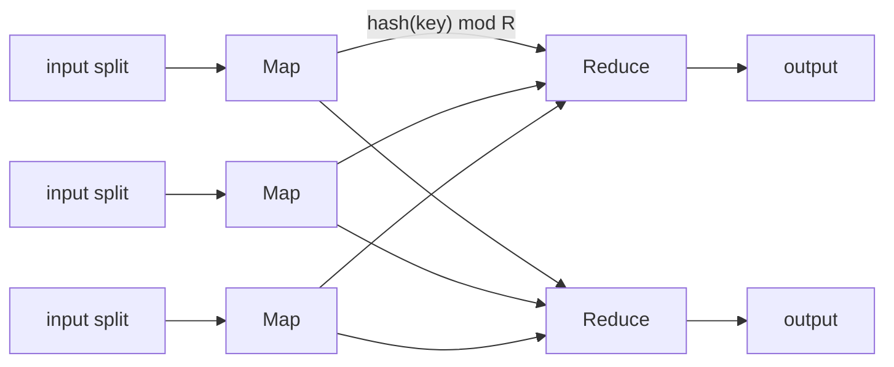

# CS 121: Information Retrieval — Week 7: Distributed Indexing, Engineering Issues

## Table of Contents

- [1. Where We Are This Week](#1-where-we-are-this-week)
- [2. Indexing Beyond Memory: Partial Indexes and Merging](#2-indexing-beyond-memory-partial-indexes-and-merging)
- [3. Faster AND Queries: Skip Pointers and Query Order](#3-faster-and-queries-skip-pointers-and-query-order)
- [4. Phrase Queries and Biword Indexes](#4-phrase-queries-and-biword-indexes)
- [5. Positional Indexes](#5-positional-indexes)
- [6. Index Engineering: Reading an Index Bigger Than Memory](#6-index-engineering-reading-an-index-bigger-than-memory)
- [7. Distributed Indexing with MapReduce](#7-distributed-indexing-with-mapreduce)
- [8. Updating the Index](#8-updating-the-index)
- [9. Distributed Query Evaluation](#9-distributed-query-evaluation)
- [10. Query Caching](#10-query-caching)
- [11. Document-at-a-Time vs Term-at-a-Time](#11-document-at-a-time-vs-term-at-a-time)
- [12. Conjunctive Processing](#12-conjunctive-processing)
- [13. Threshold Methods, MaxScore and Early Termination](#13-threshold-methods-maxscore-and-early-termination)
- [14. From Boolean to Ranked Retrieval](#14-from-boolean-to-ranked-retrieval)
- [15. Take 1: The Jaccard Coefficient](#15-take-1-the-jaccard-coefficient)
- [16. Count Vectors and the Bag of Words](#16-count-vectors-and-the-bag-of-words)
- [17. Term Frequency and Log-Frequency Weighting](#17-term-frequency-and-log-frequency-weighting)
- [18. Document Frequency, idf and tf-idf](#18-document-frequency-idf-and-tf-idf)
- [19. In-class Notes & Assignment Tips](#19-in-class-notes--assignment-tips)
- [20. Worked Examples (with Solutions)](#20-worked-examples-with-solutions)
- [21. Quick Reference & Top 5 Things to Remember](#21-quick-reference--top-5-things-to-remember)

> UCI CS 121 / IN4MATX 141: Information Retrieval — Prof. Alberto Krone-Martins, Fall 2026, week of Nov 11
> Built from the Lecture 17, 18, 19 and 20 slides, plus Lecture 20.5 — the in-class recap of this material on Nov 18, listed under Week 8 in the Schedule (the YuJa videos are not included; there was no in-person class this week, so there is no Lecture 17.5). Organized by concept, not by lecture.
> 📖 Readings this week: [Croft et al., Ch 5 Ranking with Indexes and Ch 7 Retrieval Models](https://ciir.cs.umass.edu/downloads/SEIRiP.pdf) · [Manning, Raghavan & Schütze, *Introduction to IR*, Ch 2 and 4](https://nlp.stanford.edu/IR-book/pdf/irbookonlinereading.pdf)

> 📅 **Class logistics**: **No in-person class on Wednesday, Nov 11** (Veterans Day) — the lectures are the videos.
> Assignment 3 Milestone 2 (Boolean AND search) is due **Friday, Nov 13, 11:59 pm**.
> Next week: Online Quiz 3 in class on **Wednesday, Nov 18** (bring your laptop); Milestone 3 (ranked search) is due **Friday, Nov 27, 11:59 pm**.

---

## 1. Where We Are This Week

The architecture map ([Week 1 §10](week-01.en-US.md#10-search-engine-architecture)) opens every deck this week, and the highlight moves across it:

- **Index Creation → Index** (L17 p2–20, L18 p6–46): building an index that doesn't fit in memory, and building it on many machines.
- **Querying Process** (L17 p21–49, L19): using the index — Boolean AND, phrases, then distributed and optimized evaluation. "How do we process a query? Later — what kinds of complex queries can we process?" (L17 p22).
- **Index updates** (L18 p47–53): the map gains a second, small index and a **"Deleted Pages!"** store next to the main one.
- **Ranking** (L20): "Evolving from Boolean retrieval" — scores instead of yes/no.

The in-class recap's agenda (L20.5 p5–37) lists this week's videos in order: index engineering issues (indexes too large for memory, auxiliary data structures), distributed index (MapReduce), updating the index, distributed query evaluation, query caching, query processing (document-at-a-time, term-at-a-time), conjunctive processing, threshold methods, ranked retrieval, and the Jaccard coefficient.

L17 p3–6 replays the end of Week 6: the simple in-memory `BuildIndex` with `I ← HashTable()` ("Could this be a file, directly?") and Jeff Dean's latency table. See [Week 6 §9](week-06.en-US.md#9-the-simple-in-memory-indexer-and-docids) and [§10](week-06.en-US.md#10-scaling-index-construction-hardware-basics). The new slide is L17 p6:

**Use disk as "memory"?** Can we run the same algorithm on a larger collection, with disk instead of memory? **No**: accessing and modifying $T \approx 10^8$–$10^9$ records on disk means **too many disk seeks** (each up to 2 ms). **We need an external algorithm.**

---

## 2. Indexing Beyond Memory: Partial Indexes and Merging

### 2.1 Partial indexes

The external algorithm (L17 p7–11):

1. Build the inverted list structure **until a certain size** (which size? — see the in-class tip below).
2. **Write the partial index to disk**, and start a new one.
3. At the end, the disk holds **many partial indexes**, which are **merged**.

Partial lists (= partial indexes) must be designed so **they can be merged in small pieces** — e.g. by **storing them in alphabetical order**.

The slide's pseudocode (L17 p11) is Week 6's `BuildIndex` with the two highlighted changes: read the documents in **batches**, and after each batch **sort and write** the hash table to disk, then empty it.

```text
procedure BuildIndex(D)
  I ← HashTable
  n ← 0
  B ← []                          # batch of documents
  while D is not empty do
    B ← GetBatch(D)
    for all documents d in B do
      n ← n+1
      T ← Parse(d)
      RemoveDuplicates(T)
      for all tokens e in T do
        if t not in I then
          I[t] = []
        I[t].append(Posting(n))
      end for
    end for
    SortAndWriteToDisk(I, name)
    I.empty()
  end while
```

> ⚠️ **Pitfall**: The slide loops over `tokens e` but then uses `t` — read both as the same token `t`. Note that `n` keeps counting across batches, so docIDs stay **globally unique and increasing**: every partial index is sorted by docID, which is what makes the merge below a simple concatenation per term.

### 2.2 Merging two partial indexes

L17 p12–15 builds one picture. Index A holds `aardvark 2 3 4 5` and `apple 2 4`; Index B holds `aardvark 6 9` and `actor 15 42 68`. Walk both in term order: `aardvark` is in both, so A's postings are followed by B's; `actor` only in B; `apple` only in A.

| Combined index | Postings |
|---|---|
| aardvark | 2 3 4 5 6 9 |
| actor | 15 42 68 |
| apple | 2 4 |

> 📝 **Practice**: [Worked Example 20.1](#201-merge-index-a-and-index-b-l17-p1215)

### 2.3 How to merge the sorted runs?

**Binary merges** (L17 p16): merge **2 files at a time**. During each layer, **read** into memory in blocks of a few MB (~10 MB is not uncommon for HDDs — **but you should profile!**), **merge, write back**. The slide's figure merges two runs from disk/SSD:

| Run 1 | | Run 2 | | Merged postings list | |
|---|---|---|---|---|---|
| brutus | d1,d3 | brutus | d6,d7 | brutus | d1,d3,d6,d7 |
| caesar | d1,d2,d4 | caesar | d8,d9 | caesar | d1,d2,d4,d8,d9 |
| noble | d5 | julius | d10 | julius | d10 |
| with | d1,d2,d3,d5 | killed | d8 | killed | d8 |
| | | | | noble | d5 |
| | | | | with | d1,d2,d3,d5 |

**Multi-way merge** (L17 p17–20) is **more efficient**: read from **all files simultaneously**.

- Open **all** partial index files at once, with a **read buffer** for each and a **write buffer** for the output file.
- In each iteration, **pick the lowest termID** that hasn't been processed.
- **Merge all postings lists** for that termID and write it out.

As long as you read **decent-sized chunks** of each block into memory and write out a decent-sized output chunk, **you're not killed by disk seeks**. The actual size of those chunks **must be actively probed** — it's hardware and filesystem dependent.

A multi-way merge on the slide's Index A and B, with `heapq.merge` doing "pick the lowest term" across all runs:

```python
import heapq

def multiway_merge(*runs):
    """Merge partial indexes: each run is a list of
    (term, postings) sorted by term."""
    merged = []
    for term, postings in heapq.merge(*runs, key=lambda e: e[0]):
        if merged and merged[-1][0] == term:
            merged[-1][1].extend(postings)   # same term: append
        else:
            merged.append((term, list(postings)))
    return merged

index_a = [("aardvark", [2, 3, 4, 5]), ("apple", [2, 4])]
index_b = [("aardvark", [6, 9]), ("actor", [15, 42, 68])]
for term, postings in multiway_merge(index_a, index_b):
    print(term, postings)
```

```text
aardvark [2, 3, 4, 5, 6, 9]
actor [15, 42, 68]
apple [2, 4]
```

> 💡 **Key Insight**: Sorting each partial index alphabetically is what lets the merge stream: in a real indexer each run is a file read front to back once, through one buffer, never seeked around.

> 🔗 **Go deeper**: [Croft §5.6.2 Merging (book p. 157)](https://ciir.cs.umass.edu/downloads/SEIRiP.pdf) · [IIR Ch 4 (blocked sort-based indexing)](https://nlp.stanford.edu/IR-book/pdf/irbookonlinereading.pdf)

---

## 3. Faster AND Queries: Skip Pointers and Query Order

Recap: the Boolean model (AND, OR, NOT; each document a set of words; exact match; email, library catalogs, macOS Spotlight) and the $O(x+y)$ merge of docID-sorted postings are in [Week 6 §5](week-06.en-US.md#5-query-processing-and-by-merging-postings) and [§6](week-06.en-US.md#6-the-boolean-retrieval-model) (L17 p23–25 repeat them). L17 p24 adds: Boolean retrieval has **two outcomes, TRUE and FALSE** — "exact-match" retrieval, the **simplest form of "ranking"** — and **proximity operators** are also used.

### 3.1 Skip pointers

"**You can also add skip pointers**" (L17 p26). In the slide's figure, *Brutus* `2 4 8 16 32 64 128` has skips 2 → 16 → 128 and *Caesar* `1 2 3 5 8 13 21 34` has skips 1 → 5 → 21. A skip pointer lets the merge jump over a run of postings when the skip target is still smaller than the other list's current docID. The result is the same (`2 8`); fewer postings are read.

### 3.2 Query optimization: process in order of increasing frequency

Can you optimize at **query time** too (L17 p27–32)? Take a query that is an AND of $n$ terms: for each term get its postings, then AND them together. **What is the best order?**

| Term | Postings |
|---|---|
| Brutus | 2 4 8 16 32 64 128 |
| Caesar | 1 2 3 5 8 16 21 34 |
| Calpurnia | 13 16 |

Query: *Brutus AND Calpurnia AND Caesar*. **Process in order of increasing frequency**: start with the **smallest set**, then keep cutting further. Execute it as **(Calpurnia AND Brutus) AND Caesar**. The intermediate result can never be longer than the shortest list, so every later merge is cheap.

**This is why we kept the document frequency in the dictionary** (L17 p30–32): df is exactly the length of each postings list, known before reading any of them.

The first merge of the optimized order:

```viz postings-intersect
{"title": "(Calpurnia AND Brutus) first — the shortest list leads (L17 p29–32)", "lists": "13 16 | 2 4 8 16 32 64 128", "terms": "Calpurnia, Brutus"}
```

The answer `[16]` is then ANDed with Caesar → `[16]`.

> ⚠️ **Pitfall**: Order by **df** (number of documents), not by how often the term appears in total — df is the postings list length, and that's what determines the merge cost.

> 📝 **Practice**: [Worked Example 20.2](#202-best-order-for-brutus-and-calpurnia-and-caesar-l17-p2932)

> 🔗 **Go deeper**: [Croft §5.4.7 Skipping and Skip Pointers (book p. 151)](https://ciir.cs.umass.edu/downloads/SEIRiP.pdf) · [IIR Ch 2 (faster postings merges via skip pointers)](https://nlp.stanford.edu/IR-book/pdf/irbookonlinereading.pdf) · [IIR Ch 1 (processing Boolean queries, query optimization)](https://nlp.stanford.edu/IR-book/pdf/irbookonlinereading.pdf)

---

## 4. Phrase Queries and Biword Indexes

We want to answer queries such as **"university of california"** — **as a phrase** (L17 p33). The sentence *"I went to university in california"* is **not** a match.

- Phrase queries have proven **easily understood by users**: one of the few "advanced search" ideas that works.
- Many more queries are **implicit** phrase queries.
- For this it **no longer suffices** to store only `<term : docs>` entries.

**A first attempt: biword (bigram) indexes** (L17 p34). Index **every consecutive pair of terms** in the text as a phrase. *"Friends, Romans, Countrymen"* generates the biwords (= bigrams!) **friends romans** and **romans countrymen**. Each biword is now a **dictionary term**: all bigrams are indexed, and **two-word phrase queries are immediate**. Adopted for small $n$, but **unfeasible for arbitrary sizes**.

**Longer phrases** are broken down (L17 p35–36): *University of California Irvine* becomes the Boolean query on bigrams

```text
university of AND of california AND california irvine
```

Without the documents, we **cannot verify** that a document matching this Boolean query contains the **continuous** phrase. **It can have false positives!**

**Issues** (L17 p37):

- false positives, as above;
- **index blowup** from a bigger dictionary: infeasible for more than biwords, big even for all biwords — though very large search engines support some n-grams for small $n$;
- so bigram indexes for **all** bigrams are **not the standard solution**, but they can be **part of a compound strategy**.

> 📝 **Practice**: [Worked Example 20.3](#203-breaking-university-of-california-irvine-into-bigrams-l17-p3536)

> 🔗 **Go deeper**: [IIR Ch 2 (biword indexes)](https://nlp.stanford.edu/IR-book/pdf/irbookonlinereading.pdf)

---

## 5. Positional Indexes

**Solution 2** (L17 p38): in the postings, store for each term the **position(s)** in which tokens of it appear. Positional postings themselves were built in [Week 6 §8](week-06.en-US.md#8-richer-postings-counts-positions-extents-scores) (the *tropical fish* example); this week adds how phrase queries use them, and what they cost.

```text
<term, number of docs containing term;
 doc1: position1, position2 … ;
 doc2: position1, position2 … ;
 etc.>
```

### 5.1 Phrase queries with positions

The slide's example (L17 p39–42):

```text
<be: 993427;
 1: 7, 18, 34, 72, 86, 231;
 2: 3, 149;
 4: 17, 191, 291, 430, 434;
 5: 363, 367, …>
```

**Which of docs 1, 2, 4, 5 could contain "to be or not to be"?**

- For phrase queries we use a **merge algorithm recursively at the document level** — first the docs that contain every term, then positions inside each doc.
- **Pre-clean** the list to keep only documents that **respect the distance** between words that appear more than once in the query: the two *be*s in "to be or not to be" are **4 positions apart**.
- We now deal with **more than just equality** — offsets like $p+1$, $p+4$.

Only docs **4** (430, 434) and **5** (363, 367) have two *be*s exactly 4 apart, so docs 1 and 2 are out before looking at any other term.

**Processing a phrase query** (L17 p43–44): extract the inverted index entries for each distinct term — *to, be, or, not* — and merge their doc:position lists to enumerate all positions with "to be or not to be":

```text
to: 2:1,17,74,222,551; 4:8,16,190,429,433; 7:13,23,191; ...
be: 1:17,19; 4:17,191,291,430,434; 5:14,19,101; ...
```

In doc 4, *to* at 429 and 433 and *be* at 430 and 434 line up: the phrase can start at **position 429** (to 429, be 430, … to 433, be 434). The **same general method** works for **proximity searches** ("within $k$ words").

> ⚠️ **Pitfall**: The *be* list on L17 p43 isn't the one on p39–42 (doc 1 is `17,19` there, and doc 5 differs) — they're two separate illustrations. Doc 4's positions agree in both.

### 5.2 Positional index size

- A positional index **expands postings storage substantially** — even though indexes can be compressed (L17 p45–46).
- **Nevertheless, a positional index is now standardly used**, because of the power and usefulness of phrase and proximity queries, whether used **explicitly** or **implicitly** in a ranking retrieval system.
- It needs an entry **for each occurrence**, not just once per document, so its size depends on **average document size** (L17 p47): an average web page has under 1,000 terms; SEC filings, books, even some epic poems easily have 100,000.

**Rules of thumb** (L17 p48), for "English-like" languages:

| Measure | Rule of thumb |
|---|---|
| Compressed positional index vs non-positional | **2–4×** as large |
| Positional index vs original text | **35–50%** of the volume |

### 5.3 Mixing schemes

**N-grams and positional approaches can be combined** (L17 p49). For particular phrases (*"Michael Jackson"*, *"Britney Spears"*) it's inefficient to keep merging positional postings lists — even more so for *"The Who"* (two stop words). A more sophisticated mixed indexing scheme (Williams et al., 2004) ran a typical web query mixture in **¼ of the time** of a positional index alone, for **26% more space**.

> 📝 **Practice**: [Worked Example 20.4](#204-which-documents-could-contain-to-be-or-not-to-be-l17-p3944)

> 🔗 **Go deeper**: [Croft §5.3.3 Positions (book p. 134)](https://ciir.cs.umass.edu/downloads/SEIRiP.pdf) · [IIR Ch 2 (positional indexes, combination schemes)](https://nlp.stanford.edu/IR-book/pdf/irbookonlinereading.pdf)

---

## 6. Index Engineering: Reading an Index Bigger Than Memory

Building the index on disk is half of it; at **query time** you also have to find postings (L18 p6–28 · L20.5 p6–23, "Index engineering issues").

**Small index** (L18 p7–8): load it **entirely into memory** as a hash table / dictionary and find the postings by key. *What if the index is larger than available memory?*

**Large index** (L18 p9–15): it doesn't fit in memory, so you must search for postings **in the file itself**. How?

1. **Scan the file** looking for the query terms. What if the terms in the file are **not sorted**? Then it's a full scan, $O(n)$. With terms **sorted**, you can binary-search: from $O(n)$ to $O(\log N)$ — and **sorting the query terms helps** too.
2. **Jump to the right positions in the file**: $O(1)$. **INDEX THE INDEX!**

### 6.1 Index the index

As you construct the inverted index, create another **bookkeeping file with offsets** into the inverted index file (L18 p16–18):

- term "ape" is at position 1311, "apple" at position 1345, etc. — **or**
- words starting with "b" start at position 10035, words starting with "c" at 20457, etc.

This **secondary index is much smaller** than the inverted index, so it will (usually) fit in memory. **Then: `seek(position)`.**

**Seek operations** (L18 p19–23), on the slide's `Test.txt`:

```python
with open("test.txt", "w") as f:
    f.write("Hello world!\nThis is a test file.\n"
            "For explaining how seek works.\n")

f = open("test.txt")
f.seek(4);  print(repr(f.readline()))
f.seek(13); print(repr(f.readline()))

# "Index the index": term -> byte offset of its line
offsets, pos = {}, 0
with open("test.txt", "rb") as g:
    for line in g:
        offsets[line.split()[0].decode()] = pos
        pos += len(line)
print(offsets)
f.seek(offsets["For"]); print(repr(f.readline()))
```

```text
'o world!\n'
'This is a test file.\n'
{'Hello': 0, 'This': 13, 'For': 34}
'For explaining how seek works.\n'
```

`seek(4)` lands inside "Hello", so `readline()` returns the rest of line 1; `"Hello world!\n"` is 13 bytes, so `seek(13)` lands exactly at line 2. The second half is the bookkeeping file in miniature: one offset per entry, then one seek per lookup.

> ⚠️ **Pitfall**: Offsets are **byte** offsets. Build them by reading in binary mode (`"rb"`), as above; in text mode, multi-byte UTF-8 characters and Windows `\r\n` line endings make character counts differ from byte positions.

> 📝 **Practice**: [Worked Example 20.5](#205-what-does-seek-return-l18-p1923)

### 6.2 Other auxiliary structures

(L18 p26)

| Structure | Contains | Stored as |
|---|---|---|
| **Document IDs** | lookup table from docid to URL | hash table in memory, or B-tree for larger collections |
| **Vocabulary** or **lexicon** | lookup table from index term to the **byte offset** of its inverted list in the inverted file | hash table in memory, or B-tree for larger vocabularies |
| **Term statistics** | e.g. df | at the **start** of each inverted list |
| **Collection statistics** | e.g. number of documents | in a **separate file** |

### 6.3 Alternatives to a single inverted index

(L18 p27–28)

- **Split** the inverted index file into **alphabet ranges**.
- Create **file system path trees**: `index/a/`, `index/b/`, `index/c/`, etc.
- The search component **keeps the files open all the time** — **open, but not in memory!**

**Multiple files in multithreading: aggregate!** (L18 p28) — over an IBM Power 740 system diagram (two processor chips, separate memory cards, many I/O slots): split index files can be read by **parallel threads** and the results aggregated.

> 🔗 **Go deeper**: [Croft §5.5 Auxiliary Structures (book p. 154)](https://ciir.cs.umass.edu/downloads/SEIRiP.pdf)

---

## 7. Distributed Indexing with MapReduce

**Scaling it up** (L18 p29–31). Distributed processing is driven by the need to index and analyze **huge amounts of data** (i.e., the Web), using **large numbers of inexpensive servers** rather than larger, more expensive machines. **MapReduce** is a distributed programming tool designed for indexing and analysis tasks.

**Motivating example** (L18 p32–33): a large text file of credit card transactions, one card number and an amount per line. **Count the unique card numbers.** A hash table → memory problems; with a **sorted** file, counting is simple. Distributed, the same holds: **sorting and placement are crucial**.

### 7.1 Map, shuffle, reduce

MapReduce is a framework that **focuses on data placement and distribution** (L18 p34–43):

- **Mapper**: generally transforms a list of items into **another list of items of the same length**.
- **Reducer**: transforms a list of items into a **single item**.
- The definitions aren't strict about the number of outputs; **many mapper and reducer tasks** run on a cluster.

The basic process:

1. **Map** stage: transforms data records into **pairs, each with a key and a value** — e.g. `<key="term", value="docId">`.
2. **Shuffle**: uses a **hash function** so that all pairs with the **same key** end up next to each other **on the same machine** — e.g. `hash(term) mod (number of reduce machines)`.
3. **Reduce** stage: processes records in batches where **all pairs with the same key are processed at the same time** — all `<term, docId>` pairs for one term are on one machine, so it can "reduce" them into the postings list.



The slides' figure (L18 p38–42) builds this up: map boxes, then the all-to-all shuffle edges, then the reduce boxes and output.

**Idempotence** of mapper and reducer provides **fault tolerance**: multiple runs on the same input give the same output, so the library can re-run work if a machine **fails** or is **slow** — computations are redundant, avoiding bottlenecks.

### 7.2 The pseudocode

Credit cards (L18 p44): the map emits `(card, amount)`; the shuffle groups by card; the reduce sums each card's amounts.

```text
procedure MapCreditCards(input)
    while not input.done() do
        record ← input.next()
        card ← record.card
        amount ← record.amount
        Emit(card, amount)
    end while
end procedure

procedure ReduceCreditCards(key, values)
    total ← 0
    card ← key
    while not values.done() do
        amount ← values.next()
        total ← total + amount
    end while
    Emit(card, total)
end procedure
```

Each reduce call corresponds to one unique card, so the number of output pairs is the number of unique card numbers.

**Indexing** (L18 p45), with the interesting parts boxed on the slide: the map emits `(word, docNumber:position)` for every token; the reduce writes the word once and then encodes its postings.

```text
procedure MapDocumentsToPostings(input)
    while not input.done() do
        document ← input.next()
        number ← document.number
        position ← 0
        tokens ← Parse(document)
        for each word w in tokens do
            Emit(w, number:position)
            position = position + 1
        end for
    end while
end procedure

procedure ReducePostingsToLists(key, values)
    word ← key
    WriteWord(word)
    while not input.done() do
        EncodePosting(values.next())
    end while
end procedure
```

> ⚠️ **Pitfall**: `ReducePostingsToLists` loops on `input.done()`, but there's no `input` in the reducer — read it as `values.done()`, like `ReduceCreditCards`.

**MapReduce is typically used for data streams** (L18 p46): there's **no end**, **no "final index"** — only a **temporarily valid** index.

> 🔗 **Go deeper**: [Croft §5.6.3 Parallelism and Distribution (book p. 158)](https://ciir.cs.umass.edu/downloads/SEIRiP.pdf) · [IIR Ch 4 (distributed indexing)](https://nlp.stanford.edu/IR-book/pdf/irbookonlinereading.pdf)

---

## 8. Updating the Index

**Dynamic collections!** The web changes continuously (L18 p48–53).

- **Index merging** (§2) is a good strategy when updates come in **large batches**.
- For **small updates** it is very inefficient. Instead, create a **separate index for new documents** and **merge the results** of searching both indexes *a posteriori*. The small index could be **in memory**: fast to update and to search.
- **Deletions** are handled with a **delete list**. **Modifications** = put the old version on the delete list + add the new version to the new-documents index.

That's the architecture picture of L18 p51 and p53: a second, small **Index** box, then a **"Deleted Pages!"** store beside it.

> 🗣️ **In class** (L20.5 p28–30): the in-class version names this the **delayed updating strategy** — **temporary (and much smaller) auxiliary index structures** for **updated pages** ("Index n..") and **removed pages** ("Deleted Pages"), with a **veto system** between them and Ranking, so deleted pages are filtered out before results reach the UI.

> 🔗 **Go deeper**: [Croft §5.6.4 Update (book p. 164)](https://ciir.cs.umass.edu/downloads/SEIRiP.pdf) · [IIR Ch 4 (dynamic indexing)](https://nlp.stanford.edu/IR-book/pdf/irbookonlinereading.pdf)

---

## 9. Distributed Query Evaluation

"Optimizing query evaluation" (L19 p2–18). Distributing the query **speeds up query processing significantly**.

**Basic process**: all queries go to a **director machine**; the director sends messages to many **index servers**; each index server does **some portion** of the query processing; the director **organizes the results** and returns them to the user. Two main ways to split the work:

| | Document distribution | Term distribution |
|---|---|---|
| Index | each index server is a **search engine for a small fraction** of the collection | a **single index** for the whole cluster; **each inverted list** is assigned to one index server |
| Query | the director sends **a copy of the query to every** index server; each returns its **top-k** | in most cases the data for a query is **not on a single machine**; one server — usually the one with the **longest inverted list** — processes the query, the others **send it their information** |
| Results | the director **merges** them into one ranked list | final results sent to the director |
| Watch out | **collection statistics should be shared** for effective ranking | moving list data between servers |

> ⚠️ **Pitfall**: With document distribution, each server only sees its own documents. If each computed df from its fraction, the same document would get different scores on different servers — that's why collection statistics must be shared.

> 🔗 **Go deeper**: [Croft §5.7.5 Distributed Evaluation (book p. 180)](https://ciir.cs.umass.edu/downloads/SEIRiP.pdf)

---

## 10. Query Caching

(L19 p19–24)

- Query distributions are **similar to Zipf**: **about ½ of each day's queries are unique**, but some are **very popular**. L19 p20 replays the Zipf plot for AP89 — straight on log-log in the middle, off at the highest and lowest frequencies (hapax legomena = words that occur once); see [Week 4 §11](week-04.en-US.md#11-text-statistics-and-zipfs-law).
- Caching can significantly improve effectiveness:
  - cache (perhaps **in memory**) **popular query results**;
  - cache **in memory** common **inverted lists**.
- **Inverted list caching can help even with unique queries** — a never-seen query is still made of common words.
- The cache **must be refreshed** to prevent stale data.

> 🔗 **Go deeper**: [Croft §5.7.6 Caching (book p. 181)](https://ciir.cs.umass.edu/downloads/SEIRiP.pdf)

---

## 11. Document-at-a-Time vs Term-at-a-Time

Back in the Querying Process box (L19 p25–39). Two ways to compute ranked scores from inverted lists:

- **Document-at-a-time**: computes **complete scores** for documents by processing **all term lists, one document at a time**.
- **Term-at-a-time**: **accumulates** scores for documents by processing **term lists one at a time**.

**Both have optimization techniques** that significantly reduce the time to generate scores (§12–13).

The slides' example: query **salt water tropical**, postings `x:y` = document number and word count, and the score of a document is the sum of its counts. Document-at-a-time goes column by column (the gray lines are retrieval steps): doc 1 = 1 + 1 + 2 = **4**, doc 2 = 1 + 2 = **3**, doc 3 = **1**, doc 4 = 1 + 1 = **2**. Term-at-a-time reads *salt* (partial scores 1:1, 4:1), then *water* (1:2, 2:1, 4:2), then *tropical* — and ends with the same final scores.

```viz query-eval
{"title": "salt water tropical (L19 p30–39) — switch between the two orders", "postings": "salt: 1:1 4:1; water: 1:1 2:1 4:1; tropical: 1:2 2:2 3:1", "mode": "doc", "interactive": true}
```

> ⚠️ **Pitfall**: The last row of the term-at-a-time figure (L19 p38) shows final scores `1:4 2:3 2:2 4:2`; the third box should be **3:1** (doc 3 has only *tropical* once — the document-at-a-time figure on p33 has 3:1).

### 11.1 The pseudocode

Both procedures take the query $Q$, the index $I$, the feature functions $f$ and $g$, and $k$, and use a **priority queue** $R$ of size $k$ for the top results. The update $s_d \leftarrow s_d + g_i(Q) f_i(l_i)$ is the abstract ranking model of [Week 6 §7](week-06.en-US.md#7-indexes-and-ranking-the-abstract-model): a query feature times a document feature. In the example, $g_i(Q) = 1$ and $f_i$ is the count.

Document-at-a-time (L19 p34):

```text
procedure DocumentAtATimeRetrieval(Q, I, f, g, k)
    L ← Array()
    R ← PriorityQueue(k)
    for all terms w_i in Q do
        l_i ← InvertedList(w_i, I)
        L.add( l_i )
    end for
    for all documents d ∈ I do
        s_d ← 0
        for all inverted lists l_i in L do
            if l_i.getCurrentDocument() = d then
                s_d ← s_d + g_i(Q) f_i(l_i)     ▷ Update the document score
            end if
            l_i.movePastDocument( d )
        end for
        R.add( s_d, d )
    end for
    return the top k results from R
end procedure
```

Term-at-a-time (L19 p39) keeps a hash table $A$ of **accumulators**:

```text
procedure TermAtATimeRetrieval(Q, I, f, g, k)
    A ← HashTable()
    L ← Array()
    R ← PriorityQueue(k)
    for all terms w_i in Q do
        l_i ← InvertedList(w_i, I)
        L.add( l_i )
    end for
    for all lists l_i ∈ L do
        while l_i is not finished do
            d ← l_i.getCurrentDocument()
            A_d ← A_d + g_i(Q) f(l_i)
            l_i.moveToNextDocument()
        end while
    end for
    for all accumulators A_d in A do
        s_d ← A_d                ▷ Accumulator contains the document score
        R.add( s_d, d )
    end for
    return the top k results from R
end procedure
```

**The list functions** (L19 p35):

| Function | Does |
|---|---|
| `getCurrentDocument()` | the document number of the current posting |
| `skipForwardToDocument(d)` | moves forward until `getCurrentDocument()` ≥ $d$; may read to the end of the list |
| `movePastDocument(d)` | moves forward until `getCurrentDocument()` > $d$ |
| `moveToNextDocument()` | the next document; = `movePastDocument(getCurrentDocument())` |
| `getNextAccumulator(d)` | the first document number $d' \ge d$ that already has an accumulator |
| `removeAccumulatorsBetween(a, b)` | removes accumulators for documents with $a < d < b$ |

> ⚠️ **Pitfall**: The slide writes `skipForwardToDocument`: "until `getCurrentDocument()` <= d" and `movePastDocument`: "until … < d" — the comparisons are flipped. You move forward **until the current document is ≥ d** (resp. **> d**); `moveToNextDocument` = `movePastDocument(current)` only makes sense that way.

**Trade-off** (L19 p40): term-at-a-time **uses more memory for accumulators** (a partial score for every document seen so far), but **accesses disk more efficiently** (each list is read sequentially, once). Document-at-a-time keeps only $k$ results, but reads from all lists at once.

> 📝 **Practice**: [Worked Example 20.6](#206-score-salt-water-tropical-both-ways-l19-p3039)

> 🔗 **Go deeper**: [Croft §5.7.1 Document-at-a-time Evaluation (book p. 166), §5.7.2 Term-at-a-time Evaluation (book p. 168)](https://ciir.cs.umass.edu/downloads/SEIRiP.pdf)

---

## 12. Conjunctive Processing

**Two classes of optimization** (L19 p40–42):

| Class | Example | Better for |
|---|---|---|
| **Read less data** from inverted lists | skip lists (skip pointers, §3.1), index the index (§6.1) | **simple** feature functions |
| **Calculate scores for fewer documents** | **conjunctive processing** | **complex** feature functions |

**Conjunctive processing** (L19 p43–46):

- among the **simplest** query optimizations, and the **default mode** of many engines;
- **every returned document must contain all query terms** (an AND, but with scores);
- works best when **one query term is rare**: by first selecting the documents containing the rare term(s), you **skip a large fraction** of the documents;
- usable in **both** term-at-a-time and document-at-a-time.

**Conjunctive term-at-a-time** (L19 p47): **check the accumulator for the next document containing all previously seen terms, and skip the list of postings to that document.** The first list ($i = 0$) creates accumulators as usual; for later lists, `getNextAccumulator(d)` finds the next candidate $d'$, `removeAccumulatorsBetween(d_0, d')` throws away candidates this list skipped (they lack the term), and the list either scores $d$ (if $d = d'$) or skips forward to $d'$.

```text
 1: procedure TermAtATimeRetrieval(Q, I, f, g, k)
 2:   A ← Map()
 3:   L ← Array()
 4:   R ← PriorityQueue(k)
 5:   for all terms w_i in Q do
 6:     l_i ← InvertedList(w_i, I)
 7:     L.add( l_i )
 8:   end for
 9:   for all lists l_i ∈ L do
10:     d_0 ← −1
11:     while l_i is not finished do
12:       if i = 0 then
13:         d ← l_i.getCurrentDocument()
14:         A_d ← A_d + g_i(Q) f(l_i)
15:         l_i.moveToNextDocument()
16:       else
17:         d ← l_i.getCurrentDocument()
18:         d′ ← A.getNextAccumulator(d)
19:         A.removeAccumulatorsBetween(d_0, d′)
20:         if d = d′ then
21:           A_d ← A_d + g_i(Q) f(l_i)
22:           l_i.moveToNextDocument()
23:         else
24:           l_i.skipForwardToDocument(d′)
25:         end if
26:         d_0 ← d′
27:       end if
28:     end while
29:   end for
30:   for all accumulators A_d in A do
31:     s_d ← A_d           ▷ Accumulator contains the document score
32:     R.add( s_d, d )
33:   end for
34:   return the top k results from R
35: end procedure
```

**Conjunctive document-at-a-time** (L19 p48): **find the largest document pointed to by an inverted list; try to skip all lists to point to that document; if it can, score, otherwise break.**

```text
 1: procedure DocumentAtATimeRetrieval(Q, I, f, g, k)
 2:   L ← Array()
 3:   R ← PriorityQueue(k)
 4:   for all terms w_i in Q do
 5:     l_i ← InvertedList(w_i, I)
 6:     L.add( l_i )
 7:   end for
 8:   d ← −1
 9:   while all lists in L are not finished do
10:     s_d ← 0
11:     for all inverted lists l_i in L do
12:       if l_i.getCurrentDocument() > d then
13:         d ← l_i.getCurrentDocument()
14:       end if
15:     end for
16:     for all inverted lists l_i in L do
17:       l_i.skipForwardToDocument(d)
18:       if l_i.getCurrentDocument() = d then
19:         s_d ← s_d + g_i(Q) f_i(l_i)     ▷ Update the document score
20:         l_i.movePastDocument( d )
21:       else
22:         d ← −1
23:         break
24:       end if
25:     end for
26:     if d > −1 then R.add( s_d, d )
27:     end if
28:   end while
29:   return the top k results from R
30: end procedure
```

On *salt water tropical*, only document 1 has all three terms, so conjunctive processing returns just doc 1 = 4 — and never scores docs 2, 3, 4:

```viz query-eval
{"title": "Conjunctive salt water tropical — skipping instead of scoring (L19 p43–48)", "postings": "salt: 1:1 4:1; water: 1:1 2:1 4:1; tropical: 1:2 2:2 3:1", "mode": "doc", "conjunctive": true}
```

> 💡 **Key Insight**: Conjunctive processing is [§3.2](#32-query-optimization-process-in-order-of-increasing-frequency)'s lesson again — the rarest term bounds the work. Here *salt* (2 documents) limits the candidates to docs 1 and 4 before *water* or *tropical* is fully read.

> 🔗 **Go deeper**: [Croft §5.7.3 Optimization Techniques (book p. 170)](https://ciir.cs.umass.edu/downloads/SEIRiP.pdf)

---

## 13. Threshold Methods, MaxScore and Early Termination

**Threshold methods** use the **number of top-ranked documents needed ($k$)** to optimize query processing — for most applications, $k$ is small (L19 p49–56).

- For any query there is a **minimum score** a document must reach to be shown: the score of the $k$-th highest-scoring document, which gives the **threshold $\tau$**.
- Unfortunately, **we don't know $\tau$** until the query is done; optimization methods **estimate $\tau'$** and ignore documents that can't beat it.
- **Document-at-a-time**: use the score of the **lowest-ranked document so far** (the $k$-th in the priority queue) as $\tau'$. **Term-at-a-time**: use the **$k$-th largest score in the accumulator table**.

**MaxScore** compares the **maximum score that the remaining documents could have** to $\tau'$, and ignores the parts of inverted lists that **can't generate a score above $\tau'$**. It is a **safe** optimization: the ranking is the **same** as without it.

**MaxScore example** (L19 p57–60): query *eucalyptus tree*. *Tree* is common (a long list); *eucalyptus* is rare (a few postings).

- The indexer computes $\mu_{tree}$, the **maximum score for any document containing just "tree"**.
- Assume $k = 3$; $\tau'$ is the lowest score after the first three documents.
- **Likely $\tau' > \mu_{tree}$**: $\tau'$ is the score of a document that contains **both** query terms.
- So we can **safely skip over all gray postings**: in the figure, the *tree* postings are white only for the first few documents and for documents that also contain *eucalyptus*; every other *tree* posting is gray — a tree-only document scores at most $\mu_{tree} < \tau'$ and can't enter the top 3.

**Other approaches** (L19 p61–66):

| Approach | How | Safe? |
|---|---|---|
| **Early termination** | some queries are more expensive than others: **ignore high-frequency word lists** in term-at-a-time; **ignore documents at the end of lists** in doc-at-a-time | **unsafe** — the ranking can change |
| **List ordering** | order inverted lists by a **quality metric** (e.g. PageRank) or by **partial score** | makes unsafe (and fast) optimizations **more likely to retrieve good documents** |

> ⚠️ **Pitfall**: "Safe" means the top-$k$ ranking is identical to full evaluation (MaxScore). Early termination is "unsafe": faster, but it can drop a document that belonged in the top $k$.

> 🔗 **Go deeper**: [Croft §5.7.3 Optimization Techniques (book p. 170)](https://ciir.cs.umass.edu/downloads/SEIRiP.pdf) · [Croft §5.3.6 Ordering (book p. 139)](https://ciir.cs.umass.edu/downloads/SEIRiP.pdf)

---

## 14. From Boolean to Ranked Retrieval

**Boolean retrieval, the verdict** (L17 p50):

| Advantages | Disadvantages |
|---|---|
| results are **predictable**, relatively easy to explain | effectiveness **depends entirely on the user** |
| many different features can be incorporated | **simple queries usually don't work well** |
| **efficient** processing, since many documents can be eliminated | **complex queries are difficult** |

**Retrieval models** (L20 p3–8) are a **mathematical framework for the search process** — **theories about relevance**: they state their **assumptions**, are the **basis of ranking algorithms**, and **can be implicit**; progress in them has tracked **improvements in effectiveness**. **Relevance** is complex (many factors; **people often disagree** in judgments), so models simplify it: **topical vs. user** relevance, **binary vs. continuous vs. multi-valued** relevance ([Week 1 §6](week-01.en-US.md#6-the-core-issue-relevance-and-retrieval-models)).

**Ranked retrieval** (L20 p9–11). So far our queries have all been **Boolean** — good for **expert users** who know their needs and the collection, and for **applications**; not for most **"generic" users**, who can't (or won't) write Boolean queries and **don't want to wade through 1000s of results** — particularly on the **web**.

**Feast or famine** (L20 p12–14): Boolean queries often return **too few (= 0) or too many (1000s)** results.

| Query | Hits |
|---|---|
| "standard user dlink650" | 200,000 |
| "standard user dlink650 no card found" | 0 |

It takes skill to write a query with a manageable number of hits: **AND gives too few; OR gives too many**. Except in specific cases (e.g. law), people happily **trade deterministic results for ease of use**.

**Ranked retrieval models** (L20 p15–19) return an **ordering** over the (top) documents instead of a **set**, usually for **free text queries** (just words, no operators) — two separate choices in principle, paired in practice. Feast or famine disappears: show the **top $k$ (≈ 10)**, whatever the result-set size. **Strong assumption: the ranking algorithm "works" for the user.**

**Scoring** is the basis (L20 p20–26): return documents in the order most likely to be useful. **Assign a score — say in $[0, 1]$ — to each document**, measuring how well document and query "match". Start with a **one-term query**:

- if the query term **does not occur** in the document, the score should be **0**;
- the **more frequent** the query term in the document, the **higher** the score should be.

> 🔗 **Go deeper**: [Croft §7.1 Overview of Retrieval Models (book p. 233), §7.1.1 Boolean Retrieval (book p. 235)](https://ciir.cs.umass.edu/downloads/SEIRiP.pdf) · [IIR Ch 6 (scoring, term weighting)](https://nlp.stanford.edu/IR-book/pdf/irbookonlinereading.pdf)

---

## 15. Take 1: The Jaccard Coefficient

A commonly used measure of the **overlap of two sets** $A$ and $B$ (L20 p27–30 · L20.5 p38):

$$J(A, B) = \frac{|A \cap B|}{|A \cup B|}$$

$|A \cap B|$ is the number of elements in both sets, $|A \cup B|$ the number in either. Score a document by taking $A$ = the query's terms and $B$ = the document's terms.

- $J(A, A) = 1$; $J(A, B) = 0$ if $A \cap B = \emptyset$.
- **Good properties**: $A$ and $B$ **don't have to be the same size**; it **always gives a number between 0 and 1**.

**Issues with Jaccard for scoring** (L20 p31–34):

- It **doesn't consider term frequency** (how many times a term occurs in a document).
- **Rare terms in a collection are more informative than frequent terms**; Jaccard ignores this.
- **More sophisticated heuristics to normalize for document length** give better scores. Another option, instead of $|A \cap B| / |A \cup B|$:

$$\frac{|A \cap B|}{\sqrt{|A \cup B|}}$$

> 💡 **Key Insight**: The three issues are the agenda of the next sections: term frequency → §17, rarity → §18 (idf), length normalization → the vector space model (Week 8).

> 🔗 **Go deeper**: [IIR Ch 6 (scoring and term weighting)](https://nlp.stanford.edu/IR-book/pdf/irbookonlinereading.pdf)

---

## 16. Count Vectors and the Bag of Words

Recall the **term-document incidence matrix** ([Week 5 §13](week-05.en-US.md#13-the-term-document-incidence-matrix), L20 p35): each document is a **binary vector** $\in \{0,1\}^{|V|}$.

**Term-document count matrices** (L20 p36 · L20.5 p40): consider the **number** of occurrences of a term in a document. Each document is a **count vector** in $\mathbb{N}^{|V|}$ — a column below:

| | Antony and Cleopatra | Julius Caesar | The Tempest | Hamlet | Othello | Macbeth |
|---|---|---|---|---|---|---|
| Antony | 157 | 73 | 0 | 0 | 0 | 0 |
| Brutus | 4 | 157 | 0 | 1 | 0 | 0 |
| Caesar | 232 | 227 | 0 | 2 | 1 | 1 |
| Calpurnia | 0 | 10 | 0 | 0 | 0 | 0 |
| Cleopatra | 57 | 0 | 0 | 0 | 0 | 0 |
| mercy | 2 | 0 | 3 | 5 | 5 | 1 |
| worser | 2 | 0 | 1 | 1 | 1 | 0 |

(The slide boxes the *Julius Caesar* column as one document's vector.)

**Bag of words model** (L20 p37–40): the vector representation **doesn't consider the order** of words. *John is quicker than Mary* and *Mary is quicker than John* have **the same vectors**. In a sense this is a **temporary step back**, since a positional index (§5) can tell these two documents apart — positional information comes back later; for now, bag of words.

> 🔗 **Go deeper**: [IIR Ch 6 (term frequency and weighting, bag of words)](https://nlp.stanford.edu/IR-book/pdf/irbookonlinereading.pdf)

---

## 17. Term Frequency and Log-Frequency Weighting

The **term frequency** $\mathrm{tf}_{t,d}$ of term $t$ in document $d$ is the **number of times** $t$ occurs in $d$ (L20 p41–44). (**Note: frequency = count in IR.**)

We want to use tf in query-document scores — but **raw tf is not what we want**. A document with 10 occurrences of the term is **more** relevant than one with 1 occurrence, **but not 10 times more**. Relevance doesn't increase proportionally with term frequency.

**Log-frequency weighting** (L20 p45–46):

$$w_{t,d} = \begin{cases} 1 + \log_{10} \mathrm{tf}_{t,d}, & \text{if } \mathrm{tf}_{t,d} > 0 \\ 0, & \text{otherwise} \end{cases}$$

| tf | 0 | 1 | 2 | 10 | 1000 |
|---|---|---|---|---|---|
| $w$ | 0 | 1 | 1.3 | 2 | 4 |

The score for a document-query pair sums over the terms $t$ in **both** $q$ and $d$:

$$\mathrm{score}(q, d) = \sum_{t \in q \cap d} \left(1 + \log_{10} \mathrm{tf}_{t,d}\right)$$

The score is **0** if none of the query terms is in the document.


---

## 18. Document Frequency, idf and tf-idf

### 18.1 Rare terms are more informative

(L20 p47–51)

- **Rare terms** are more informative than frequent terms — recall stop words. A query term that is rare in the collection, e.g. **arachnocentric**: a document containing it is very likely relevant to the query *arachnocentric*. → We want a **high weight for rare terms**.
- **Frequent terms** (e.g. *high, increase, line*): a document containing one is more likely relevant than one that doesn't, but it's **not a sure indicator**. → **Positive weights** for *high, increase, line*, but **lower** than for rare terms.

We'll use **document frequency (df)** to capture this.

### 18.2 idf

$\mathrm{df}_t$ is the **document frequency** of $t$: **the number of documents that contain $t$** (L20 p52–53). It is an **inverse** measure of the informativeness of $t$, with $0 < \mathrm{df}_t \le N$. The **idf** (inverse document frequency) of $t$ is

$$\mathrm{idf}_t = \log_{10}\left(N / \mathrm{df}_t\right)$$

where $N$ is the number of documents in the collection. We use $\log(N/\mathrm{df}_t)$ instead of $N/\mathrm{df}_t$ to **dampen** the effect of idf. It will turn out that **the base of the log is immaterial**. There is **one idf value for each term $t$** in a collection.

**idf example, $N$ = 1 million** (L20 p54) — the slide fills in the first two rows; the rest follow from the same formula:

| term | $\mathrm{df}_t$ | $\mathrm{idf}_t$ |
|---|---|---|
| calpurnia | 1 | 6 |
| animal | 100 | 4 |
| sunday | 1,000 | 3 |
| fly | 10,000 | 2 |
| under | 100,000 | 1 |
| the | 1,000,000 | 0 |

**Effect of idf on ranking** (L20 p55–56): does idf matter for a **one-term query** like *iPhone*? **No — idf has no effect on ranking one-term queries**: every document gets the same idf factor. idf affects ranking for queries with **at least two terms**: for *capricious person*, idf makes occurrences of *capricious* count for **much more** than occurrences of *person*.

**Collection vs. document frequency** (L20 p57): the **collection frequency** of $t$ is the number of occurrences of $t$ in the collection, counting multiple occurrences.

| Word | Collection frequency | Document frequency |
|---|---|---|
| insurance | 10440 | 3997 |
| try | 10422 | 8760 |

*Which word is a better search term (and should get a higher weight)?* **insurance**: the two have almost the same collection frequency, but *insurance* is concentrated in fewer than half as many documents, so its df is lower and its idf higher. That's why idf uses df, not collection frequency.

### 18.3 tf-idf

The **tf-idf weight** of a term is the **product** of its tf weight and its idf weight (L20 p58–59 · L20.5 p43):

$$w_{t,d} = \left(1 + \log \mathrm{tf}_{t,d}\right) \times \log\left(N / \mathrm{df}_t\right)$$

- The **best known** and most used weighting scheme in IR.
- The "-" in tf-idf is a **hyphen, not a minus sign!** Alternative names: tf.idf, tf × idf, tfidf.
- **Good properties**: it **increases with the number of occurrences** within a document, and **increases with the rarity** of the term in the collection.

The score of a document $d$ for a query $q$ (L20 p60–61 · L20.5 p44):

$$\mathrm{Score}(q, d) = \sum_{t \in q \cap d} \mathrm{tf.idf}_{t,d}$$

The in-class version of this slide (L20.5 p44) labels the three parts: $\mathrm{Score}(q, d)$ is the **relevance score of a document given a query**, the sum runs over the **terms in the intersection of query and document**, and each summand $w_{t,d}$ is the **tf-idf** weight.

**Many variants** can be constructed: how "tf" is computed (with or without logs), whether the terms in the query are also weighted, … **pick and/or design your heuristics**.

The tf and idf columns above, computed:

```python
import math

N = 1_000_000
for term, df in [("calpurnia", 1), ("animal", 100),
                 ("sunday", 1_000), ("fly", 10_000),
                 ("under", 100_000), ("the", 1_000_000)]:
    print(f"{term:9} idf = {math.log10(N / df):.0f}")
print([round(1 + math.log10(tf), 1) for tf in (1, 2, 10, 1000)])
```

```text
calpurnia idf = 6
animal    idf = 4
sunday    idf = 3
fly       idf = 2
under     idf = 1
the       idf = 0
[1.0, 1.3, 2.0, 4.0]
```

> ⚠️ **Pitfall**: A term in **every** document (*the*, df = N) gets idf = 0, so its tf-idf is 0 no matter how often it appears — idf does the job of a stop list automatically.

> 📝 **Practice**: [Worked Example 20.7](#207-fill-in-the-idf-table-l20-p54) · [Worked Example 20.8](#208-insurance-or-try-l20-p57)

> 🔗 **Go deeper**: [Croft §7.1.2 The Vector Space Model (book p. 237)](https://ciir.cs.umass.edu/downloads/SEIRiP.pdf) · [IIR Ch 6 (inverse document frequency, tf-idf weighting)](https://nlp.stanford.edu/IR-book/pdf/irbookonlinereading.pdf)

---

## 19. In-class Notes & Assignment Tips

"On Assignment 3" (L18 p2–5) repeats the milestones of [Week 6 §11](week-06.en-US.md#11-in-class-notes--assignment-tips) (MS1 indexer, MS2 AND-only with a text interface, MS3 ranked under **300 ms** with a timer). New on L18 p5: MS3 **"may benefit from positional information; come back to these lectures"** — §5 for positions, §11–13 for fast scoring.

**Do you really need "index the index" in Project 3?** (L18 p24–25 · L20.5 p24) **Maybe! (mostly yes… ☺)** Remember the **300 ms** budget for query processing in MS3, and remember that **you cannot load your entire index object into memory**. So the query side needs §6: an in-memory offset table (or alphabet-split files) and `seek()`.

> 💡 **Key Insight**: The week maps onto MS3 almost line by line: partial indexes + merge to build (§2), index-the-index + seek to look up (§6), process terms in order of increasing df and conjunctive processing to keep it fast (§3, §12), and tf-idf to rank (§18).

---

## 20. Worked Examples (with Solutions)

### 20.1 Merge Index A and Index B (L17 p12–15)

Index A: `aardvark 2 3 4 5`, `apple 2 4`. Index B: `aardvark 6 9`, `actor 15 42 68`. What is the combined index?

<details>
<summary>Solution</summary>

Walk both indexes in alphabetical order, taking the smallest term each time:

1. `aardvark` is the smallest term in both → concatenate: `2 3 4 5 6 9` (A's docIDs are all smaller than B's, so concatenating keeps the list sorted).
2. `actor` (only in B) → `15 42 68`.
3. `apple` (only in A) → `2 4`.

Combined index: `aardvark 2 3 4 5 6 9 · actor 15 42 68 · apple 2 4` — the slide's last frame and the output of the `multiway_merge` code in §2.3.

</details>

Back to [§2.2](#22-merging-two-partial-indexes).

### 20.2 Best order for Brutus AND Calpurnia AND Caesar (L17 p29–32)

Brutus `2 4 8 16 32 64 128` · Caesar `1 2 3 5 8 16 21 34` · Calpurnia `13 16`. In which order should the ANDs run, and what is the answer?

<details>
<summary>Solution</summary>

Order by increasing document frequency: Calpurnia (df 2), Brutus (df 7), Caesar (df 8). Execute **(Calpurnia AND Brutus) AND Caesar**:

1. Calpurnia AND Brutus = `[16]`.
2. `[16]` AND Caesar = `[16]`.

Answer: **document 16**. The second merge works on a 1-element list instead of two lists of 7 and 8. The dfs come from the dictionary, without reading any postings.

</details>

Back to [§3.2](#32-query-optimization-process-in-order-of-increasing-frequency).

### 20.3 Breaking "University of California Irvine" into bigrams (L17 p35–36)

What Boolean query on a biword index answers the phrase *University of California Irvine*, and can it be wrong?

<details>
<summary>Solution</summary>

Consecutive pairs: `university of AND of california AND california irvine`.

Yes, it can be wrong: a **false positive** is a document that contains all three bigrams but not as one continuous phrase (e.g. "university of" in one sentence and "of california", "california irvine" elsewhere). Without the document text (or positions), the biword index can't verify the phrase.

</details>

Back to [§4](#4-phrase-queries-and-biword-indexes).

### 20.4 Which documents could contain "to be or not to be"? (L17 p39–44)

`be: 1: 7, 18, 34, 72, 86, 231; 2: 3, 149; 4: 17, 191, 291, 430, 434; 5: 363, 367, …`. Which of docs 1, 2, 4, 5 could contain the phrase? Then, with `to: 4: 8, 16, 190, 429, 433` and `be: 4: 17, 191, 291, 430, 434`, where does it start in doc 4?

<details>
<summary>Solution</summary>

"to be or not to be" has *be* at offsets 1 and 5 — **two *be*s 4 positions apart**. Pre-clean the *be* list:

| Doc | Pairs of *be* positions 4 apart |
|---|---|
| 1 | none |
| 2 | none |
| 4 | (430, 434) |
| 5 | (363, 367) |

Only **docs 4 and 5** could contain it (doc 5 still needs *to*, *or*, *not* checked).

In doc 4: start $p$ needs *to* at $p$ and $p+4$, *be* at $p+1$ and $p+5$. $p = 429$: to 429 ✓, be 430 ✓, to 433 ✓, be 434 ✓. The phrase starts at **position 429** (*or* and *not* must then be at 431 and 432).

</details>

Back to [§5.1](#51-phrase-queries-with-positions).

### 20.5 What does seek return? (L18 p19–23)

`Test.txt` is `Hello world!` / `This is a test file.` / `For explaining how seek works.`. What do `f.seek(4); f.readline()` and `f.seek(13); f.readline()` return?

<details>
<summary>Solution</summary>

- `seek(4)` puts the file position after `Hell`, so `readline()` returns the rest of line 1: `'o world!\n'`.
- `"Hello world!\n"` is 13 bytes (12 characters + newline), so `seek(13)` lands at the start of line 2: `'This is a test file.\n'`.

Both match the slide and the run in §6.1. That's the whole trick of "index the index": store byte offsets, `seek` straight there, read one entry.

</details>

Back to [§6.1](#61-index-the-index).

### 20.6 Score salt water tropical both ways (L19 p30–39)

Postings (doc:count): salt `1:1 4:1` · water `1:1 2:1 4:1` · tropical `1:2 2:2 3:1`. Score = sum of counts. Compute the final scores document-at-a-time and term-at-a-time, and the conjunctive result.

<details>
<summary>Solution</summary>

**Document-at-a-time** (one column at a time):

| Doc | salt | water | tropical | Score |
|---|---|---|---|---|
| 1 | 1 | 1 | 2 | **4** |
| 2 | — | 1 | 2 | **3** |
| 3 | — | — | 1 | **1** |
| 4 | 1 | 1 | — | **2** |

**Term-at-a-time** (one row at a time, accumulators):

| After | Accumulators |
|---|---|
| salt | 1:1, 4:1 |
| water | 1:2, 2:1, 4:2 |
| tropical | 1:4, 2:3, 3:1, 4:2 |

Same final scores; ranking: **1, 2, 4, 3**. (The slide's last row prints 2:2 for the third box; it's 3:1.)

**Conjunctive**: only doc 1 contains all three terms → **doc 1 = 4**.

</details>

Back to [§11](#11-document-at-a-time-vs-term-at-a-time).

### 20.7 Fill in the idf table (L20 p54)

$N = 1{,}000{,}000$. df: calpurnia 1, animal 100, sunday 1,000, fly 10,000, under 100,000, the 1,000,000. Compute $\mathrm{idf}_t = \log_{10}(N/\mathrm{df}_t)$.

<details>
<summary>Solution</summary>

| term | $N/\mathrm{df}_t$ | idf |
|---|---|---|
| calpurnia | $10^6$ | 6 |
| animal | $10^4$ | 4 |
| sunday | $10^3$ | 3 |
| fly | $10^2$ | 2 |
| under | $10^1$ | 1 |
| the | $10^0$ | 0 |

Each 10× increase in df costs exactly 1 point of idf; a term in every document gets 0.

</details>

Back to [§18.2](#182-idf).

### 20.8 Insurance or try? (L20 p57)

insurance: collection frequency 10440, document frequency 3997. try: collection frequency 10422, document frequency 8760. Which is the better search term?

<details>
<summary>Solution</summary>

**insurance**. Their collection frequencies are almost equal, so cf can't tell them apart. But *insurance* appears in 3997 documents (about 2.6 occurrences per document that has it) while *try* is spread over 8760 (about 1.2 each). Fewer documents → lower df → **higher idf**: a document containing *insurance* says more about its topic. That's why weighting uses **df**, not collection frequency.

</details>

Back to [§18.2](#182-idf).

---

## 21. Quick Reference & Top 5 Things to Remember

**Building and reading a big index**

| Problem | Fix | Slides |
|---|---|---|
| Index doesn't fit in memory while building | write sorted **partial indexes**, then **merge** | L17 p7–11 |
| Merging many partial indexes | **multi-way merge**: one read buffer per file, lowest term first, decent-sized chunks (profile!) | L17 p16–20 |
| Index doesn't fit in memory at query time | **index the index**: term → byte offset, then `seek` | L18 p9–23 |
| Too much data for one machine | **MapReduce**: map → shuffle by `hash(key) mod R` → reduce | L18 p30–45 |
| Small updates | separate small (in-memory) index + **delete list**; merge results | L18 p48–52 |

**Query processing**

| Technique | Idea | Safe? |
|---|---|---|
| Skip pointers | jump over postings in the merge | yes |
| Increasing-df order | AND the shortest lists first | yes |
| Document- vs term-at-a-time | all lists per doc vs one list at a time (accumulators: more memory, better disk access) | — |
| Conjunctive processing | only docs with all terms; skip to candidates | yes (for AND semantics) |
| MaxScore | skip postings that can't beat $\tau'$ | **yes** |
| Early termination | drop high-frequency lists / list tails | **no** |
| Document vs term distribution | split by documents (share collection stats) vs by inverted lists | — |
| Caching | popular results + common inverted lists; refresh | — |

**Phrases**

| Index | Phrase query | Cost |
|---|---|---|
| Biword | AND of bigrams | false positives, dictionary blowup |
| Positional | merge on doc, then positions ($p+1$, $p+k$) | 2–4× non-positional; 35–50% of the text |
| Mixed | bigrams for frequent phrases + positions | ¼ the time, +26% space (Williams et al.) |

**Scoring formulas**

| Name | Formula |
|---|---|
| Jaccard | $\lvert A \cap B\rvert / \lvert A \cup B\rvert$ (variant: divide by $\sqrt{\lvert A \cup B\rvert}$) |
| Log tf | $1 + \log_{10} \mathrm{tf}_{t,d}$ if tf > 0, else 0 |
| idf | $\log_{10}(N / \mathrm{df}_t)$ |
| tf-idf | $(1 + \log \mathrm{tf}_{t,d}) \times \log(N/\mathrm{df}_t)$ |
| Score | $\sum_{t \in q \cap d} \mathrm{tf.idf}_{t,d}$ |

**Top 5 things to remember**

1. An index too big for memory is built as **sorted partial indexes merged multi-way**, and read through a small in-memory **offset table + `seek`** — the disk is never used like RAM.
2. For an AND of terms, **process in order of increasing df** (that's why df is in the dictionary); conjunctive processing and skip pointers build on the same idea.
3. Phrase queries: biword indexes give **false positives**; positional indexes check **exact offsets** (two *be*s 4 apart) and are now standard despite being 2–4× larger.
4. **Document-at-a-time** finishes one document across all lists; **term-at-a-time** finishes one list and keeps accumulators (more memory, sequential disk). MaxScore is **safe**, early termination is **unsafe**.
5. **tf-idf** = $(1 + \log \mathrm{tf}) \times \log(N/\mathrm{df})$: grows with occurrences in the document and with rarity in the collection; idf has **no effect on one-term queries**, and df (not collection frequency) measures rarity.