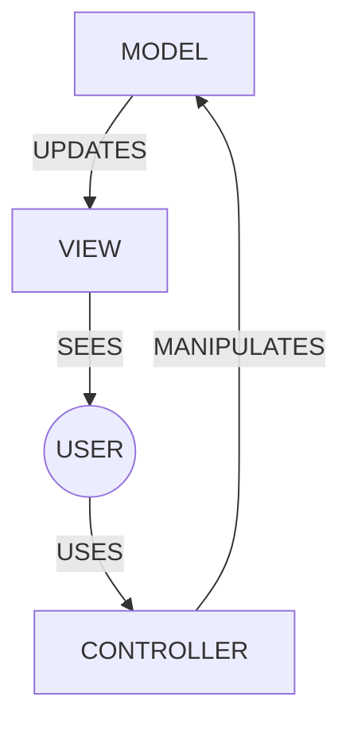

# IN4MATX 133: User Interface Software — Lecture 15: Device Resources & Sensors

## Table of Contents

- [1. Ionic and Capacitor](#1-ionic-and-capacitor)
- [2. Adding Capacitor and a plugin to a project](#2-adding-capacitor-and-a-plugin-to-a-project)
- [3. Running in the browser: ionic serve](#3-running-in-the-browser-ionic-serve)
- [4. Running on an emulator or a device](#4-running-on-an-emulator-or-a-device)
- [5. Signals](#5-signals)
- [6. Local notifications](#6-local-notifications)
- [7. Geolocation](#7-geolocation)
- [8. Sharing](#8-sharing)
- [9. Plugin quality and plugin issues](#9-plugin-quality-and-plugin-issues)
- [10. Strengths and weaknesses of hybrid apps](#10-strengths-and-weaknesses-of-hybrid-apps)
- [11. In-class Questions & Demos (with Solutions)](#11-in-class-questions--demos-with-solutions)
- [12. Quick Reference & Top 5 Things to Remember](#12-quick-reference--top-5-things-to-remember)

> UCI IN4MATX 133: User Interface Software — Prof. Travis Linden Reid, Fall 2026, Tuesday 11/17 (Week 8)
> Built from the Lecture 15 slides (35 pages) and the demo repo folder `W8_L1_DeviceResources_Signals`. Organized by concept, not by source.

> 📅 **Class logistics**: A4 is due **Monday, Nov 23, at midnight**. Join an A4 group on Canvas.

Today's goals (slides 3, 34): access device resources with a Capacitor plugin; run an Ionic/Capacitor project in an emulator or on a device; use signals to track variable changes granularly; describe the strengths and limitations of web hybrid apps.

---

## 1. Ionic and Capacitor

**Ionic** (slide 4) gives you Angular-style components for many interface elements common in mobile apps: lists, buttons, sliders, tabs, modal dialogs, search bars and more (the slide shows an iOS list of "recent conversations" and a range-slider screen). That's the UI half, covered in [Lecture 13](lec-13.en-US.md).

**Capacitor** (slide 5) is the other half: libraries for connecting to **device resources**, packaged as **plugins**.

- There are hundreds of plugins.
- They are either **official** (maintained by the Capacitor team) or **community** plugins.
- Some have known issues (more in [Section 9](#9-plugin-quality-and-plugin-issues)).

So an Ionic app is a web app (Angular + Ionic components) and Capacitor is the bridge from that web code to the phone's notifications, GPS, share sheet, camera and so on.

> 🔗 **Go deeper**: [Ionic UI components](https://ionicframework.com/docs/components/) · [Ionic: native APIs / Capacitor plugins](https://ionicframework.com/docs/native/)

## 2. Adding Capacitor and a plugin to a project

Adding Capacitor to an **existing** Ionic project (slide 6) is two npm packages, then one package per device resource:

```bash
cd [project folder]
npm install @capacitor/core
npm install @capacitor/cli

# one package per resource, e.g. local notifications
npm install @capacitor/local-notifications
```

Then the resource is available in your TypeScript:

```ts
import { LocalNotifications } from ‘capacitor/local-notifications’;
var notif = await LocalNotifications.schedule ( { …. } );
```

⚠️ Slide 6's import has two typos: curly quotes `‘…’` (a syntax error in TS) and a missing `@`. Correct form: `import { LocalNotifications } from '@capacitor/local-notifications';` — every official plugin lives under the `@capacitor/` scope.

Before building for a phone, two more setup steps (slide 8):

```bash
# initialize Capacitor settings for the project (app name, app id, web dir)
npx cap init

# set up the project for Android or iOS
npm install @capacitor/[android or ios]
npx cap add [android or ios]
```

`npx cap init` writes `capacitor.config.ts`. The demo project's (from the repo):

```ts
import type { CapacitorConfig } from '@capacitor/cli';

const config: CapacitorConfig = {
  appId: 'com.inf133.deviceexamples',
  appName: 'DeviceResourceExamples',
  webDir: 'www'
};

export default config;
```

`webDir: 'www'` is where `ionic build` puts the compiled web app, which is what Capacitor copies into the native project. The demo app's `package.json` has `@capacitor/core`, `@capacitor/cli`, `@capacitor/ios` and the three plugins this lecture uses: `@capacitor/local-notifications`, `@capacitor/geolocation`, `@capacitor/share`. `npx cap add ios` is what created its `ios/` folder (an Xcode project).

> 🧪 **Demo files**: [capacitor.config.ts](https://github.com/travislindenreid/INF33-Demos/blob/main/W8_L1_DeviceResources_Signals/solution1/DeviceResourceExamples/capacitor.config.ts) · [package.json](https://github.com/travislindenreid/INF33-Demos/blob/main/W8_L1_DeviceResources_Signals/solution1/DeviceResourceExamples/package.json)

## 3. Running in the browser: ionic serve

To run an Ionic project in the browser (slide 7):

```bash
ionic serve
```

Capacitor **evaluates the platform and available resources at run time**. A plugin tries to use the native feature; when there isn't one (you're in a browser), it **falls back to a web API**. So the same `LocalNotifications.schedule(...)` call is a native notification on a phone and a browser notification in `ionic serve`.

Different browsers have different capabilities — e.g. Firefox doesn't support local notifications, but Safari does.

The takeaway on slide 10: **if you're not using Capacitor for a native device resource, none of the setup and deploy commands are needed** — just `ionic serve` and test in the browser.

> ⚠️ **Pitfall**: "it works in `ionic serve`" only tests the web fallback. A plugin's browser behavior can differ from (or be missing compared to) its device behavior — see the Share plugin in [Section 8](#8-sharing).

> 🔗 **Go deeper**: [Ionic CLI: ionic serve](https://ionicframework.com/docs/cli/commands/serve) · [Capacitor: progressive web apps](https://capacitorjs.com/docs/basics/progressive-web-app)

## 4. Running on an emulator or a device

Deploying (slide 9) is build → sync → open the native IDE:

```bash
# build the Ionic project and sync the web app into the native project
ionic build
npx cap sync

# open the native project in Android Studio or Xcode
npx cap open [android or ios]
```

Then deploy to an emulator or a device **from the native IDE** (the Run button in Android Studio / Xcode).

Alternatively, **live reload** keeps an emulator or device updated as you edit:

```bash
ionic cap run [android or iOS] -l --external
```

`-l` is live reload; `--external` serves on your machine's network address so the phone can reach the dev server. (The demo project's `ios/App/App/Info.plist` sets `NSAllowsArbitraryLoads` to true, i.e. the iOS app may load plain-`http` pages such as that dev server.)

| Step | Command | What it does |
|---|---|---|
| once | `npx cap init` | Capacitor config for the project |
| once per platform | `npm install @capacitor/ios` + `npx cap add ios` | create the native project |
| each change | `ionic build` | compile the web app into `www/` |
| each change | `npx cap sync` | copy `www/` + plugins into the native project |
| to run | `npx cap open ios` | open Xcode / Android Studio, run from there |
| or | `ionic cap run ios -l --external` | live reload on emulator/device |

**A4 and testing on device** (slides 11–12). A4 gives you two options:

- use a **native device resource**, or
- write data to **local storage**.

If you choose a native resource that needs a real device to test (not a browser or emulator), do this **first**: install Capacitor, use the resource in an extremely simple way, and try deploying to the device. Deploying to a device counts toward the **bonus point** (A4/A5).

Why bother: it's good experience, it's necessary for publishing on the App Store / Google Play, and testing on device is non-trivial — every app you build will hit device-specific errors, and users only ever experience your app on their device. "Non-trivial, but also non-optional in the real world."

## 5. Signals

Angular's change detection (slide 13) is complex and had a significant update in July this year to a new model. The **view only refreshes** when:

- an event fires,
- an input changes,
- you refresh manually, or
- a **signal** changes.

A **signal** is a variable wrapper that tells the view to refresh.

**Where this fits: Model-View-Controller** (slide 14). The **model** is the data behind an app. It notifies views when it changes, lets views query it for data, and lets the controller manipulate it. The slide's diagram: the controller *manipulates* the model, the model *updates* the view, the user *sees* the view and *uses* the controller. A signal is the "model notifies the view" arrow.



What signals do (slide 15):

- wrap a variable;
- when the value changes, update **only the portion of the template that uses the variable** — more performant than refreshing the entire view;
- make sure the view updates **whenever** the variable updates.

Prof. Reid's experience: **to refresh the view after async callbacks, wrap the variable in a signal** — including after Capacitor calls or a `fetch` to a remote API.

How to use one (slide 16): import `signal` from `@angular/core`, initialize with `signal<type>(defaultValue)`, update with `set(newValue)`, and **read it by calling it** — `readyForSelfie()`:

```ts
// component.ts file
// at top of file…
import { Component, signal } from ‘@angular/core’;

// in Component variable declarations…
readyForSelfie = signal<boolean>(false);

// in some function…
readyForSelfie.set(true);
```

```html
<!-- component.html file -->
@if ( readyForSelfie() )
{ … }
```

Two slide slips: curly quotes again (use `'@angular/core'`), and inside a component method it's `this.readyForSelfie.set(true)`.

The demo app (from `home.page.ts`, solution1) keeps all of its state in signals and sets them **after** awaiting Capacitor calls:

```ts
export class HomePage {
  finishedReminder = signal<boolean>(false);
  finishedLocation = signal<boolean>(false);

  latCoord = signal<number>(0);
  longCoord = signal<number>(0);

  async getLocation () {
    const position = await Geolocation.getCurrentPosition();
    this.finishedLocation.set(true);
    this.latCoord.set(position.coords.latitude);
    this.longCoord.set(position.coords.longitude);
  }
  // scheduleReminder() and shareStuff(): Sections 6 and 8
}
```

```html
<div id="container">
  @if(!finishedReminder())
  {
    <ion-button (click)="scheduleReminder()">Schedule a reminder</ion-button>
  }
  @if(finishedReminder() && !finishedLocation())
  {
    <ion-button (click)="getLocation()">Print geolocation</ion-button>
  }
  @if(finishedLocation())
  {
    <ion-item>Coordinates: ({{latCoord()}}, {{longCoord()}})</ion-item>

    <ion-button (click)="shareStuff()">Share my coordinates</ion-button>
  }
</div>
```

The claim holds for this project (Angular 22): built and run in Chromium with notifications and location allowed, each click moves to the next button and the coordinates appear. With the four signals turned into plain fields (`finishedReminder = false;` … `this.finishedReminder = true;`, template without the `()`), the page **stays on "Schedule a reminder"** after the click, even though the code ran — the assignment happens after an `await`, and nothing tells the view to refresh.

Try it below: the page is the demo app re-created with Ionic web components (no Angular in the sandbox, so `signal()` and the three plugins are small stand-ins written for this page). Click through the three buttons, then press Next to swap in plain variables:

```viz web-demo
{"title": "Demo 1 (slide 25 · setup1 → solution1) re-created with Ionic web components; signal() and the three plugins are stand-ins", "width": 375, "height": 420, "html": "<link rel=\"stylesheet\" href=\"https://cdn.jsdelivr.net/npm/@ionic/core@8.8.19/css/ionic.bundle.css\">\n<script type=\"module\" src=\"https://cdn.jsdelivr.net/npm/@ionic/core@8.8.19/dist/ionic/ionic.esm.js\"></script>\n<ion-app>\n<ion-header><ion-toolbar><ion-title>Daily selfie</ion-title></ion-toolbar></ion-header>\n<ion-content>\n  <div id=\"container\"></div>\n</ion-content>\n</ion-app>", "css": "#container { text-align: center; position: absolute; left: 0; right: 0; top: 50%; transform: translateY(-50%); }", "js": "// ---- Stand-ins (the sandbox has no Angular and no Capacitor) ----\n// A tiny signal(): read with s(), write with s.set(v); set() re-renders the template.\nfunction signal(value) {\n  const s = () => value;\n  s.set = (v) => { value = v; render(); };\n  return s;\n}\nconst LocalNotifications = {\n  requestPermissions: async () => ({ display: 'granted' }),\n  schedule: async (opts) => { console.log('scheduled', opts.notifications[0].title); return opts; }\n};\nconst Geolocation = {\n  getCurrentPosition: async () => ({ coords: { latitude: 33.6405, longitude: -117.8443 } })\n};\nconst Share = {\n  share: async () => { throw new Error('Share API not available in this browser'); }\n};\n\n// ---- home.page.ts (solution1) ----\nconst finishedReminder = signal(false);\nconst finishedLocation = signal(false);\nconst latCoord = signal(0);\nconst longCoord = signal(0);\n\nasync function scheduleReminder() {\n  console.log('clicked schedule selfie');\n  const perm = await LocalNotifications.requestPermissions();\n  if (perm.display == 'granted') {\n    await LocalNotifications.schedule({ notifications: [{ title: 'Daily Reminder', body: 'Time to do the thing!', id: 1, schedule: { at: new Date(Date.now()) } }] });\n    finishedReminder.set(true);\n  }\n}\nasync function getLocation() {\n  const position = await Geolocation.getCurrentPosition();\n  finishedLocation.set(true);\n  latCoord.set(position.coords.latitude);\n  longCoord.set(position.coords.longitude);\n}\nasync function shareStuff() {\n  try {\n    await Share.share({ title: 'Share coordinates', text: `My current coordinates are ${latCoord()}, ${longCoord()}`, dialogTitle: 'Share my coordinates' });\n  } catch (e) {\n    console.log(e.message);\n  }\n}\n\n// ---- home.page.html: the three @if blocks ----\nfunction button(label, onClick) {\n  const b = document.createElement('ion-button');\n  b.textContent = label;\n  b.addEventListener('click', onClick);\n  return b;\n}\nfunction render() {\n  const c = document.getElementById('container');\n  c.innerHTML = '';\n  if (!finishedReminder()) c.append(button('Schedule a reminder', scheduleReminder));\n  if (finishedReminder() && !finishedLocation()) c.append(button('Print geolocation', getLocation));\n  if (finishedLocation()) {\n    const item = document.createElement('ion-item');\n    item.textContent = `Coordinates: (${latCoord()}, ${longCoord()})`;\n    c.append(item, button('Share my coordinates', shareStuff));\n  }\n}\nrender();", "steps": [{"note": "Plain variables instead: set() only stores the value and nothing redraws, so the first button never goes away (what the real app does when the signals are plain fields).", "js": "\n// ---- Without signals: assigning a value doesn't refresh the view ----\nfunction signal(value) {\n  const s = () => value;\n  s.set = (v) => { value = v; };\n  return s;\n}"}], "interactive": true}
```

> 💡 **Key Insight**: a signal is read with `()` and written with `.set()`. Forgetting the `()` in the template prints the function, not the value; assigning with `=` replaces the signal with a plain value and the view stops updating.

> 🧪 **Demo files**: [solution1/…/home.page.ts](https://github.com/travislindenreid/INF33-Demos/blob/main/W8_L1_DeviceResources_Signals/solution1/DeviceResourceExamples/src/app/home/home.page.ts) · [solution1/…/home.page.html](https://github.com/travislindenreid/INF33-Demos/blob/main/W8_L1_DeviceResources_Signals/solution1/DeviceResourceExamples/src/app/home/home.page.html)

> 📝 **Practice**: [Demo 1](#111-demo-1-schedule-a-reminder-print-and-share-the-location-slide-25--setup1--solution1)

> 🔗 **Go deeper**: [Angular: Signals guide](https://angular.dev/guide/signals) · [Wikipedia: Model–view–controller](https://en.wikipedia.org/wiki/Model%E2%80%93view%E2%80%93controller)

## 6. Local notifications

Slide 17: three official plugin examples — **Local Notification**, **Geolocation**, **Sharing** (there are others).

**Goal** (slide 18): send a notification to the phone — e.g. remind someone to journal their sleepiness.

**Step 1 — import and ask permission** (slide 19). Import the plugin in a service or component, then prompt the user to authorize notifications, e.g. when the page initializes:

```ts
import { LocalNotifications } from '@capacitor/local-notifications';

async ngOnInit() {
    await LocalNotifications.requestPermissions();
}
```

The prompt looks different per platform. On the web: a browser bar "http://localhost:8102 wants to — Show notifications — Block / Allow". On iOS: a system alert "“myApp” Would Like to Send You Notifications … Don't Allow / Allow".

**Step 2 — schedule** (slide 20). `schedule` takes an array of notifications; `schedule.at` is a `Date`, so you **can schedule for the future** (here: 5 seconds from now):

```ts
import { LocalNotifications } from '@capacitor/local-notifications';

const notifs = await LocalNotifications.schedule({
  notifications: [
    {
      title: "Title",
      body: "Body",
      id: 1,
      schedule: { at: new Date(Date.now() + 1000 * 5) },
      sound: null,
      attachments: null,
      actionTypeId: "",
      extra: null
    }
  ]
});
console.log('scheduled notifications', notifs);
```

The demo app (slide 25 shows it in the browser: "Daily selfie" with a "Schedule a selfie reminder" button) checks the permission result before scheduling, then flips a signal:

```ts
async scheduleReminder () {
  console.log("clicked schedule selfie");
  const perm = await LocalNotifications.requestPermissions();
  if(perm.display == 'granted')
  {
    const notif = await LocalNotifications.schedule({
      notifications: [
        {
          title: 'Daily Reminder',
          body: 'Time to do the thing!',
          id: 1,
          schedule: {at: new Date(Date.now())}
        }
      ]
    });
    this.finishedReminder.set(true);
  }
}
```

When the browser doesn't grant notifications (headless Chromium's default), the console shows only `clicked schedule selfie` and the page stays on the first button: `perm.display` isn't `'granted'`, so nothing is scheduled and the signal isn't set.

> ⚠️ **Pitfall**: `requestPermissions()` resolves whether the user says yes or no. Check `perm.display == 'granted'` before relying on notifications — the user can always press "Don't Allow".

> 🔗 **Go deeper**: [Capacitor: Local Notifications API](https://capacitorjs.com/docs/apis/local-notifications)

## 7. Geolocation

**Goal** (slide 21): get the device's location, heading and speed. Probably not relevant for A4 — but few Capacitor plugins are testable and meaningful in the browser, and this is one.

Import `Geolocation` and call `getCurrentPosition()` (slide 22):

```ts
import { Geolocation } from '@capacitor/geolocation';

const position = await Geolocation.getCurrentPosition({});
```

The result's `coords.latitude` / `coords.longitude` are what the demo stores (Section 5's `getLocation()`). In the browser this uses the browser's location permission; with location allowed, the demo shows `Coordinates: (<lat>, <long>)` and the "Share my coordinates" button.

## 8. Sharing

**Goal** (slide 23): export data from your app to a social app on the device — share a photo to Facebook, share text in a text message.

- It uses the **Web Share API** in the browser — "support is currently spotty".
- It can share URLs, text and files (e.g. a picture).
- Not available in some desktop browsers, but usually available in a phone's browser.

Import the plugin and call `Share.share()` with the content (slide 24):

```ts
import { Share } from '@capacitor/share';

let shareRet = await Share.share({
  title: 'See cool stuff',
  text: 'Really awesome thing you need to see right meow',
  url: 'http://ionicframework.com/',
  dialogTitle: 'Share with buddies'
});
```

The demo wraps it in `try/catch`, because **an error is thrown if the user cancels sharing** (repo comment):

```ts
async shareStuff () {
  // try/catch because error is thrown if user cancells sharing operation
  try {
    await Share.share({
      title: 'Share coordinates',
      text: `Just in case you wanted to know, these are my current coordinates. Perhaps this is an emergency location sharing app idk. My current coordinates are ${this.latCoord()}, ${this.longCoord()}`,
      dialogTitle: 'Share my coordinates',
    });
  } catch (e) {
    console.log(e);
  }
}
```

Note `this.latCoord()` — reading a signal inside a template literal still needs the call. In desktop Chromium (Linux) the catch is what runs: the console shows `CapacitorException: Share API not available in this browser` — the "not available in some desktop browsers" case from slide 23, handled by the same `try/catch`.

> ⚠️ **Pitfall**: always `try/catch` around `Share.share()` — it rejects both when the user cancels and when the browser has no Web Share API.

> 🔗 **Go deeper**: [Capacitor: Share API](https://capacitorjs.com/docs/apis/share) · [web.dev: Web Share API](https://web.dev/web-share/) · [Capacitor issue #910](https://github.com/ionic-team/capacitor/issues/910) · [Ionic: Social Sharing plugin](https://ionicframework.com/docs/native/social-sharing) · [SocialSharing-PhoneGap-Plugin (GitHub)](https://github.com/EddyVerbruggen/SocialSharing-PhoneGap-Plugin)

## 9. Plugin quality and plugin issues

Capacitor plugins (slide 26): some are maintained officially, others by the community. As a result:

- quality varies **immensely**;
- features may not work as expected;
- community information might be out of date.

Plugin issues (slide 27): there are many. Example: Prof. Reid tried the **Camera** plugin for this lecture's demo and found it's **no longer usable in-browser** — so the demo uses notifications, geolocation and sharing instead. Only a limited set of functionality is enabled, plugins may be unreliable, and Capacitor is continuing to improve.

Thoughts on native resources (slide 31):

- The state of native support is "just okay".
- You could **fork** (copy) a broken or incomplete plugin and patch it yourself. Is that better or worse than writing the plugin yourself?
- This is the clear downside of hybrid apps vs native: **device libraries can't be used directly** — you rely on community libraries or fill in the missing pieces.

> 🔗 **Go deeper**: [Capacitor issues on GitHub](https://github.com/ionic-team/capacitor/issues)

## 10. Strengths and weaknesses of hybrid apps

| Weaknesses (slide 32) | Strengths (slide 33) |
|---|---|
| Performance issues | Can share a codebase between web and mobile |
| Inconsistency with the platform | Can save time and effort (sometimes) |
| Limited access to device capabilities | Easily design for various form factors |
| | Access to *some* device capabilities |

**The choice is all about analyzing requirements.** A hybrid app wins when the device resources you need are none, or are covered by well-maintained plugins; native wins when you need lots of native resources or high performance.

> 📝 **Practice**: [Question 1](#112-question-1-when-might-a-web-hybrid-app-be-preferable-to-a-native-app-slides-2830)

## 11. In-class Questions & Demos (with Solutions)

### 11.1 Demo 1: Schedule a reminder, print and share the location (slide 25 · setup1 → solution1)

**Task.** `setup1` is an Ionic + Angular + Capacitor app ("Daily selfie") with the template, the four signals and the plugin imports already in place. The three methods are empty:

```ts
async scheduleReminder () {
  console.log("clicked schedule selfie");
  // TODO: request permissions, schedule reminder, update finishedReminder
}

async getLocation () {
  // TODO: get current location, update latCoord and longCoord, update finishedLocation
}

async shareStuff () {
  // TODO: share current coordinates
  // TODO: try/catch because error is thrown if user cancells sharing operation
}
```

The template (Section 5) shows one step at a time: "Schedule a reminder" → "Print geolocation" → the coordinates and "Share my coordinates".

<details>
<summary>Answer</summary>

```ts
async scheduleReminder () {
  console.log("clicked schedule selfie");
  const perm = await LocalNotifications.requestPermissions();
  if(perm.display == 'granted')
  {
    const notif = await LocalNotifications.schedule({
      notifications: [
        {
          title: 'Daily Reminder',
          body: 'Time to do the thing!',
          id: 1,
          schedule: {at: new Date(Date.now())}
        }
      ]
    });
    this.finishedReminder.set(true);
  }
}

async getLocation () {
  const position = await Geolocation.getCurrentPosition();
  this.finishedLocation.set(true);
  this.latCoord.set(position.coords.latitude);
  this.longCoord.set(position.coords.longitude);
}

async shareStuff () {
  // try/catch because error is thrown if user cancells sharing operation
  try {
    await Share.share({
      title: 'Share coordinates',
      text: `Just in case you wanted to know, these are my current coordinates. Perhaps this is an emergency location sharing app idk. My current coordinates are ${this.latCoord()}, ${this.longCoord()}`,
      dialogTitle: 'Share my coordinates',
    });
  } catch (e) {
    console.log(e);
  }
}
```

Result in Chromium with notifications and location allowed: "Schedule a reminder" → "Print geolocation" → `Coordinates: (<lat>, <long>)` with "Share my coordinates"; pressing Share logs `CapacitorException: Share API not available in this browser` (caught). Key points:

- every update after an `await` goes through `.set()` — that's what makes the `@if` blocks switch (with plain fields the page stays on the first button);
- check `perm.display == 'granted'` before scheduling;
- `try/catch` around `Share.share()`.

The interactive re-creation is in [Section 5](#5-signals).

</details>

> 🧪 **Demo files**: [setup1/…/home.page.ts](https://github.com/travislindenreid/INF33-Demos/blob/main/W8_L1_DeviceResources_Signals/setup1/DeviceResourceExamples/src/app/home/home.page.ts) · [solution1/…/home.page.ts](https://github.com/travislindenreid/INF33-Demos/blob/main/W8_L1_DeviceResources_Signals/solution1/DeviceResourceExamples/src/app/home/home.page.ts) · [home.page.html](https://github.com/travislindenreid/INF33-Demos/blob/main/W8_L1_DeviceResources_Signals/solution1/DeviceResourceExamples/src/app/home/home.page.html)

Back to [Section 5](#5-signals).

### 11.2 Question 1: When might a web hybrid app be preferable to a native app? (slides 28–30)

When might developing a web hybrid app be preferable to a native app?

- A. When you need to access a lot of native device resources
- B. When you don't need any native device resources
- C. When you can use well-maintained libraries to access native resources
- D. When you need high performance
- E. I don't know, this lecture has scared me away from making hybrid apps

<details>
<summary>Answer</summary>

**Answer: B and C** (the slides don't reveal the poll result; this follows from slides 31–33).

- **B** — with no native resources, hybrid's biggest weakness (limited device access, unreliable plugins) doesn't apply, and you keep its strengths: one codebase for web and mobile, easy design for many form factors.
- **C** — the downside is relying on plugins of varying quality; if the plugins you need are well maintained, that risk is small.
- **A** is wrong: lots of native resources means lots of plugins of uneven quality, or writing/patching them yourself — "the clear downside" (slide 31).
- **D** is wrong: performance issues are the first weakness on slide 32.
- **E** — the lecture's point is "analyze the requirements", not "never go hybrid".

</details>

Back to [Section 10](#10-strengths-and-weaknesses-of-hybrid-apps).

## 12. Quick Reference & Top 5 Things to Remember

**Capacitor commands**

| Command | Purpose |
|---|---|
| `npm install @capacitor/core` / `@capacitor/cli` | add Capacitor to an Ionic project |
| `npm install @capacitor/local-notifications` | add one plugin (one package per resource) |
| `ionic serve` | run in the browser (plugins fall back to web APIs) |
| `npx cap init` | create the Capacitor config |
| `npm install @capacitor/ios` · `npx cap add ios` | set up the native project |
| `ionic build` · `npx cap sync` | build the web app, copy it into the native project |
| `npx cap open ios` | open Xcode / Android Studio to run on emulator/device |
| `ionic cap run ios -l --external` | live reload on emulator/device |

**Plugin calls**

| Plugin | Import | Call |
|---|---|---|
| Local Notifications | `@capacitor/local-notifications` | `requestPermissions()`, `schedule({ notifications: [...] })` |
| Geolocation | `@capacitor/geolocation` | `getCurrentPosition()` → `coords.latitude/longitude` |
| Share | `@capacitor/share` | `share({ title, text, url, dialogTitle })` (wrap in try/catch) |

**Signals**

| Action | Code |
|---|---|
| import | `import { Component, signal } from '@angular/core';` |
| declare | `ready = signal<boolean>(false);` |
| write | `this.ready.set(true);` |
| read (TS or template) | `this.ready()` / `@if (ready()) { … }` |

**Top 5 things to remember**

1. Capacitor plugins connect web code to device resources; in the browser they fall back to web APIs, and browser support differs (Firefox: no local notifications; desktop Chromium: no Share).
2. Without a native resource you only need `ionic serve`; for a device it's `ionic build` → `npx cap sync` → `npx cap open`, and you run from the native IDE.
3. The view refreshes on events, input changes, manual refreshes and signal changes — so values set after an `await` (Capacitor calls, `fetch`) should be signals, written with `.set()` and read with `()`.
4. Check `perm.display == 'granted'` after `requestPermissions()`, and wrap `Share.share()` in `try/catch`.
5. Hybrid vs native is a requirements decision: hybrid shares one codebase and form factors; native wins on performance, platform consistency and full device access.