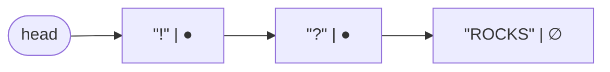
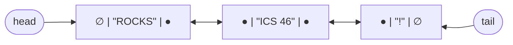
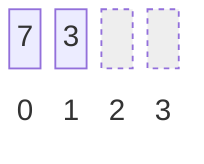
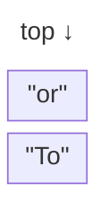
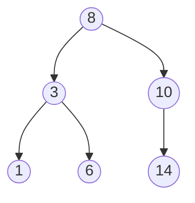
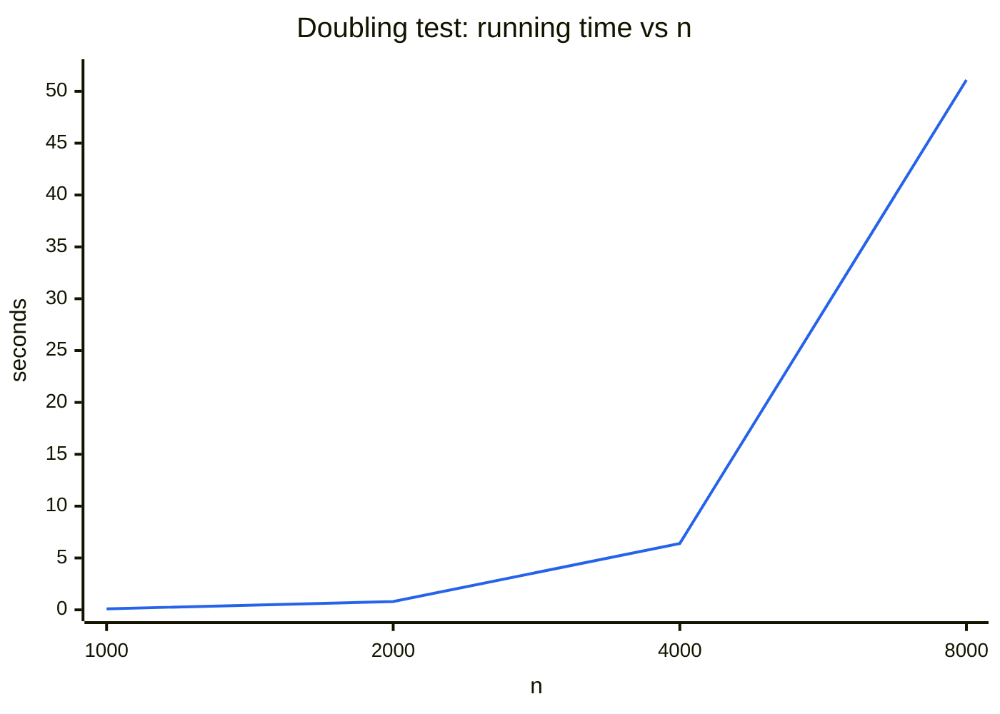

# Writing for Kazuha's site renderer

(File name kept so the references in SKILL.md still work.)

Since late Oct 2026 the notes live in his Astro site repo (GitHub
`KKazuhaK/uci.kazuha.me`; pushing to main publishes) as `src/content/notes/ICS-46/<slug>.<lang>.md` —
`lec-NN` (two digits) or a special such as `final-review`; `en-US` / `zh-CN`.
Each note is published at `/~kazuhak/notes/ics-46/<slug>/<lang>/` (e.g.
`/~kazuhak/notes/ics-46/lec-10/en-US/`); old md-viewer URLs 301 there.
The old `ICS46_LecNN_Notes_en-US.md` names are no longer used.

Every note starts with frontmatter — exactly two fields, JSON-style
double-quoted strings — then one blank line and the body's own `#` title:

```markdown
---
title: "Trees"
summary: "Binary trees, traversals, BST insert/search/delete, and height analysis."
---

# Information and Computer Science 46 — Lecture 10: Trees
```

`title` is the short name on the course hub card; `summary` is one sentence
listing the lecture's topics. The course hub, prev/next, home page and
sitemap are generated from these; nothing is updated by hand. A missing or
empty title/summary, or a bad file name, fails the site build.

One renderer (`src/lib/markdown/`) renders note pages, md-viewer and
md-editor: **marked (GFM)** + marked-footnote, plus his own extensions: line
breaks inside `>` callouts kept (each line on its own line, like his 45C
callouts), `$…$`/`$$…$$` typeset with KaTeX, CJK-friendly
`**bold**`/`*italic*`, and pipes inside `` `code` `` in table rows
auto-escaped; raw HTML renders. Mermaid 11 (pan/zoom, theme follows the
site), ```` ```viz <component> ```` demos and Shiki highlighting.
`check_md.py` renders the note with the site's renderer module
(`assets/js/kzh-markdown.mjs`, taken from the repo's `deploy` branch), so if
he changes the renderer the check follows automatically.

## So standard GitHub Markdown works

Nested lists, multi-line list items, tables and lists inside `>` quotes,
`~~strike~~`, footnotes `[^1]`, task lists, `\|` escapes, ordered lists
that start at any number, raw HTML.

## What still bites (check_md.py flags these)

| Don't write | What happens | Write instead |
|---|---|---|
| `vector<int>`, `Array<T>`, `<iostream>` outside backticks | parsed as an HTML tag and **disappears** (raw HTML passes through) | `` `vector<int>` `` |
| a text line directly followed by `---` or `===` | the line becomes an `<h2>`/`<h1>` (setext heading) | blank line before `---` |
| 4-space indented line after a blank line (not in a list) | becomes a code block | no indent |
| a lone `$` in prose | KaTeX may pair it with another `$` | `` `$` `` |
| images `` / `` from anywhere but his assets CDN | no local image files allowed (the deliverable is one file) | a viz demo, table or text; a slide screenshot only as `https://cdn.jsdelivr.net/gh/KKazuhaK/assets@main/ics.uci.edu/ics-46/<slug>/<name>.png` |
| HTML (`<br>`, layout `<div>`s) | works on his site, but not in plain Markdown readers and adds nothing the notes need | Markdown — the one exception is the answer fold, `<details>` / `<summary>Solution</summary>` (SKILL.md Step 4) |
| `?kind=course_notes&…` links | legacy viewer links — check_md ERROR | relative link to the source file (below) |

Heading anchors: lowercase, drop everything except letters/digits/spaces/`_`/`-`,
spaces → `-` (so `## 7. add(index, item)` → `#7-addindex-item`). Repeats get
`-1`, `-2`. check_md.py verifies every `(#anchor)` against the rendered ids.

## Links between notes

Link other notes with a relative Markdown link **to the source file**; the
site turns it into the note's URL:

- same course: `[Lecture 9](lec-09.en-US.md#3-tracing-one-partition)`
- other course: `[Week 1](../CS-121/week-01.en-US.md)`

Add `#anchor` at the end to jump to a section. A link to a note that isn't
written yet is fine: it shows as plain text until that note exists, then
becomes a link (check_md WARNs, looked up in the live `sitemap.json`).
Never write the old `?kind=course_notes&course=…&note=…` form. Pipes inside
`` `inline code` `` in a table cell are safe — the renderer escapes them
before GFM splits cells.

## House style (matches his ICS 45C notes)

- File: `lec-NN.en-US.md` (two-digit lecture number), saved in `src/content/notes/ICS-46/`.
- Frontmatter `title` + `summary` (above), blank line, then the title line.
- Title line: `# Information and Computer Science 46 — Lecture N: <Title>`
- `## Table of Contents` as a flat bullet list of `[N. Title](#anchor)` links.
- A `>` scope note under the title: course line, date, which slides and supplements were used, "organized by concept, not by source".
- Callouts as blockquotes starting with an emoji + bold label; each `>`
  line shows as its own line:
  `> 💡 **Key Insight**: ...`, `> ⚠️ **Pitfall**: ...`, `> 📘 **Beyond the lecture**: ...`, `> 📝 **Activity N** (slide p): ...`
- Numbered `##` sections, `###` subsections numbered `N.1`, `N.2`.
- Final section: quick-reference tables + "Top 5 things to remember".

## Diagrams: `viz` first, Mermaid only as a fallback

Since Oct 2026 every diagram in the notes is an interactive `viz` block
(`references/viz-components.md`). The Mermaid patterns below are kept only
for the rare static picture no component covers — name that component on
the report's `wanted:` line, or better, write it.

## Mermaid patterns (fallback only; all tested on Mermaid 11)

Quote every label (`["..."]`); write `"` as `#quot;`, `#` as `#35;`, `<`/`>` as `#lt;`/`#gt;`.

Singly linked list:



Doubly linked list with tail (the `~~~` invisible link keeps `tail` on the right):



Array with capacity > size (indices under the cells, empty slots dashed):



Stack (top first):



Binary tree:



Measured data / growth curves (set a visible line colour):



Before/after of one pointer change (e.g. a slide's highlighted arrow): use two
small diagrams labelled "Before" / "After", or a `memory-trace` viz demo if the change
involves locals. Mark a removed link with `-.-x` and `linkStyle N stroke:#999`.

Memory traces (stack + heap, every field, step by step): use the
`memory-trace` viz component (it takes memdiag's step format); don't draw
them in Mermaid.
