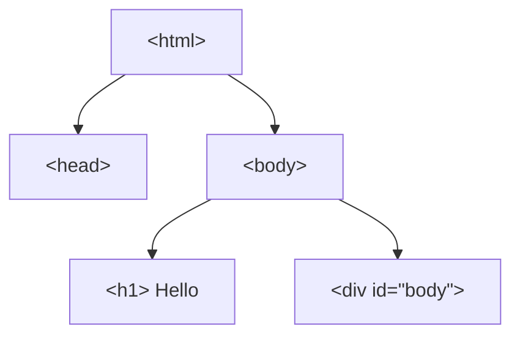

# Writing for Kazuha's site renderer

(File name kept so the references in SKILL.md still work.)

The notes live in his Astro site repo (GitHub
`KKazuhaK/uci.kazuha.me`; pushing to main publishes) as `src/content/notes/IN4MATX-133/<slug>.<lang>.md`
— `lec-NN` (two digits) or a special such as `final-review`; `en-US` /
`zh-CN` — and are published at `/~kazuhak/notes/in4matx-133/<slug>/<lang>/`
(old md-viewer URLs 301 there). The old `IN4MATX133_LecNN_Notes_en-US.md`
names are no longer used.

Every note starts with frontmatter — exactly two fields, JSON-style
double-quoted strings — then one blank line and the body's own `#` title:

```markdown
---
title: "The DOM"
summary: "DOM tree, querySelector, events and listeners, and changing the page from JavaScript."
---

# IN4MATX 133: User Interface Software — Lecture 6: The DOM
```

`title` is the short name on the course hub card; `summary` is one sentence
listing the topics. Hub, prev/next, home page and sitemap are generated
from these. Missing/empty fields or a bad file name fail the site build.

One renderer (`src/lib/markdown/`) renders note pages, md-viewer and
md-editor: **marked (GFM)** + marked-footnote, plus his own extensions:
line breaks inside `>` callouts kept (each line on its own line),
`$…$`/`$$…$$` typeset with KaTeX, CJK-friendly `**bold**`/`*italic*`,
pipes inside `` `code` `` in table rows auto-escaped, raw HTML rendered.
Mermaid 11, ```` ```viz <component> ```` demos and Shiki highlighting (use
`html`, `css`, `js`, `ts`, `json`, `bash` fence languages). `check_md.py`
renders the note with the site's renderer module
(`assets/js/kzh-markdown.mjs`, taken from the repo's `deploy` branch), so if he changes the renderer the check
follows automatically.

## Standard GitHub Markdown works

Nested lists, multi-line list items, tables and lists inside `>` quotes,
`~~strike~~`, footnotes `[^1]`, task lists, `\|` escapes, ordered lists
that start at any number.

## What bites — and in a web course it bites constantly

Raw HTML passes straight through marked. Notes about HTML name tags in
almost every sentence, so this is the trap that matters most:

| Don't write | What happens | Write instead |
|---|---|---|
| the <p> element, <div>, <script> in prose | rendered as a **real** element: an unclosed `<div>` swallows the rest of the page, `<script>` may run, `<h1>` adds a heading the TOC doesn't know | `` `<p>` ``, `` `<div>` `` |
| `<my-tag>`, `Array<string>` outside backticks | unknown tag, **disappears** | `` `Array<string>` `` |
| `&nbsp;`, `&lt;` in prose | turned into the character | `` `&nbsp;` `` |
| a text line directly followed by `---` or `===` | the line becomes an `<h2>`/`<h1>` (setext heading) | blank line before `---` |
| 4-space indented line after a blank line (not in a list) | becomes a code block | no indent |
| a lone `$` in prose (`${name}` template literals!) | KaTeX may pair it with another `$` | `` `${className}` `` |
| images `` / `` from anywhere but his assets CDN | no local image files allowed | web-demo, table or text; a slide screenshot only as `https://cdn.jsdelivr.net/gh/KKazuhaK/assets@main/ics.uci.edu/in4matx-133/<slug>/<name>.png` |
| `?kind=course_notes&…` links | legacy viewer links — check_md ERROR | relative link to the source file (below) |
| HTML for layout (`<br>`, buttons) | works on his site, but not in plain Markdown readers | Markdown — the one exception is the answer fold, `<details>` / `<summary>Answer</summary>` (SKILL.md Step 4), which `check_md.py` accepts |

`check_md.py` reports every `<tag>` outside backticks as an ERROR in this
skill (it's the IN4MATX 133 copy of the script).

Heading anchors: lowercase, drop everything except letters/digits/spaces/`_`/`-`,
spaces → `-` (so `## 7. The box model` → `#7-the-box-model`). **Tags in
headings:** the renderer drops `<…>` from the id even inside backticks
(`## 1. \`<div>\` vs \`<span>\`` becomes `#1--vs`), so write tag names in
headings without angle brackets: `## 1. div vs span` → `#1-div-vs-span`.
Repeats get `-1`, `-2`. check_md.py verifies every
`(#anchor)` against the rendered ids.

## Links between notes

Relative Markdown link **to the source file**; the site turns it into the
note's URL:

- same course: `[Lecture 4](lec-04.en-US.md#2-the-box-model)`
- other course: `[Lecture 9](../ICS-46/lec-09.en-US.md)`

Add `#anchor` at the end to jump to a section. A link to a note that isn't
written yet shows as plain text until that note exists (check_md WARNs,
using the live `sitemap.json`). Never write the old
`?kind=course_notes&…&note=…` form.

## Outbound links (slide links and demo files)

Kazuha wants the slides' external links as "jump out" buttons, not content.
One line at the **end** of the concept section whose slide cites them, links
separated by ` · `, labelled by what the slide says they are:

```markdown
> 🔗 **Go deeper**: [MDN: The box model](https://developer.mozilla.org/...) · [CSS-Tricks: margin/padding shorthand](https://css-tricks.com/...)
```

Demo files from the repo get their own line, right after the code or demo
they belong to:

```markdown
> 🧪 **Demo files**: [lectureExamples.js](https://github.com/travislindenreid/INF33-Demos/blob/main/W3_L1_Oct13_DOM/lectureExamples/lectureExamples.js) · [lectureExamples.html](https://github.com/...)
```

No sentence of explanation copied from the linked page. At most ~6 links
per line; split by concept rather than making one giant list.

## House style (matches his ICS 45C / ICS 46 notes)

- File: `lec-NN.en-US.md` (two-digit lecture number), saved in `src/content/notes/IN4MATX-133/`.
- Frontmatter `title` + `summary` (above), blank line, then the title line.
- Title line: `# IN4MATX 133: User Interface Software — Lecture N: <Title from slide 1>`
- `## Table of Contents` as a flat bullet list of `[N. Title](#anchor)` links.
- A `>` scope note under the title: course line, date, which slides and
  demo folder were used, "organized by concept, not by source".
- Callouts as blockquotes starting with an emoji + bold label; each `>`
  line shows as its own line:
  `> 💡 **Key Insight**: ...`, `> ⚠️ **Pitfall**: ...`, `> 📝 **Practice**: ...`,
  `> 🧪 **Demo files**: ...`, `> 🔗 **Go deeper**: ...`, `> 📅 **Class logistics**: ...`
- Keep tables and lists *outside* the `>` — the viewer shows them as raw text
  inside a quote.
- Numbered `##` sections, `###` subsections numbered `N.1`, `N.2`.
- Final section: quick-reference table(s) + "Top 5 things to remember".

## Diagrams

Live HTML/CSS/JS goes in a `web-demo` viz block (`viz-components.md`).
For a static picture no demo shows well (a DOM tree, the three waves of
computing, the client/server picture), a small Mermaid diagram is fine —
quote every label (`["..."]`), write `"` as `#quot;`, `<`/`>` as `#lt;`/`#gt;`:


