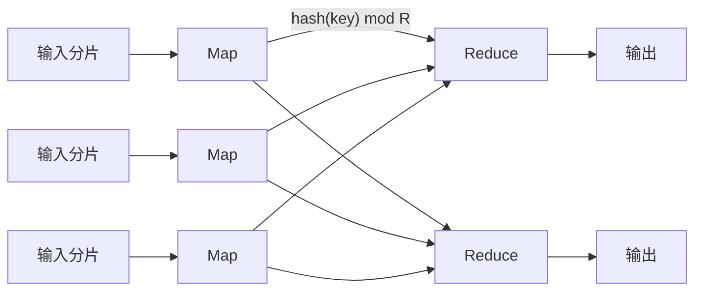

# CS 121: Information Retrieval — 话题：倒排索引与索引构建

## 目录

- [1. 从关联矩阵到索引](#1-从关联矩阵到索引)
- [2. 倒排索引：词典与 postings](#2-倒排索引词典与-postings)
- [3. 在内存中构建索引](#3-在内存中构建索引)
- [4. 更丰富的 postings：计数、位置、区段、分数](#4-更丰富的-postings计数位置区段分数)
- [5. 短语查询：双词索引与位置索引](#5-短语查询双词索引与位置索引)
- [6. 索引放不进内存时：内存与硬件](#6-索引放不进内存时内存与硬件)
- [7. 外部构建：部分索引与合并](#7-外部构建部分索引与合并)
- [8. 索引工程：读取比内存更大的索引](#8-索引工程读取比内存更大的索引)
- [9. 用 MapReduce 进行分布式索引](#9-用-mapreduce-进行分布式索引)
- [10. 更新索引](#10-更新索引)
- [11. 速查与五条要点](#11-速查与五条要点)

> 本章讲的是搜索引擎架构中的**索引创建**（Index Creation）模块（[搜索引擎与 Web](topic-search-engines.zh-CN.md)）：把经过处理的文本（[文本处理](topic-text-processing.zh-CN.md)）变成一种能快速回答查询的数据结构。索引如何被*使用*——为 AND 合并 postings、跳表指针、按文档处理与按词项处理的打分——见 [查询处理与高效 Top-K](topic-query-processing.zh-CN.md)；布尔模型与排序函数见 [检索模型：布尔、tf-idf 与向量空间](topic-retrieval-models.zh-CN.md)。

## 1. 从关联矩阵到索引

### 1.1 词项-文档关联矩阵

设想一个莎士比亚剧本的小型语料库，问：**哪些剧本同时包含 Brutus 和 Caesar，但不包含 Calpurnia？** 你可以在所有剧本中 grep Brutus 和 Caesar，再去掉含有 Calpurnia 的行。但这并不是可接受的搜索答案：

- 对大型语料库来说，它**很慢**。
- **NOT Calpurnia** 并不简单。
- 其他操作，例如找出 *Romans* **靠近** *countrymen* 的位置，无法实现。
- **排序检索**做不到，而用户想要的是排好序的文档。

**词项-文档关联矩阵**（term-document incidence matrix）是一个布尔矩阵：行是**词项**，列是**文档**；若剧本包含该词则值为 1，否则为 0。

| | Antony and Cleopatra | Julius Caesar | The Tempest | Hamlet | Othello | Macbeth |
|---|---|---|---|---|---|---|
| Antony | 1 | 1 | 0 | 0 | 0 | 1 |
| Brutus | 1 | 1 | 0 | 1 | 0 | 0 |
| Caesar | 1 | 1 | 0 | 1 | 1 | 1 |
| Calpurnia | 0 | 1 | 0 | 0 | 0 | 0 |
| Cleopatra | 1 | 0 | 0 | 0 | 0 | 0 |
| mercy | 1 | 0 | 1 | 1 | 1 | 1 |
| worser | 1 | 0 | 1 | 1 | 1 | 0 |

**关联向量**：每个词项都有一个 0/1 向量，即它所在的行。要回答查询，取 Brutus、Caesar 和 Calpurnia 的行，把 Calpurnia 的行**取反**，然后做**按位 AND**：

$$R = I_{Bru} \wedge I_{Cae} \wedge \neg I_{Cal}$$

$I_t$ 是词项 $t$ 的行，$\wedge$ 是按位 AND，$\neg$ 把每一位取反。

```text
(Brutus)         1 1 0 1 0 0  AND
(Caesar)         1 1 0 1 1 1  AND
(NOT Calpurnia)  1 0 1 1 1 1  =
                 1 0 0 1 0 0
```

结果中的 1 在第 1 列和第 4 列：**Antony and Cleopatra** 和 **Hamlet**。*Julius Caesar* 两个名字都有，但也包含 Calpurnia，所以被 NOT 排除了。可以逐步演示这一过程，也可以输入其他查询（对这些词项使用 AND / OR / NOT）：

```viz incidence-matrix
{"title": "Brutus AND Caesar AND NOT Calpurnia（布尔关联矩阵演示）", "terms": "Antony: 1 1 0 0 0 1; Brutus: 1 1 0 1 0 0; Caesar: 1 1 0 1 1 1; Calpurnia: 0 1 0 0 0 0; Cleopatra: 1 0 0 0 0 0; mercy: 1 0 1 1 1 1; worser: 1 0 1 1 1 0", "docs": "Antony and Cleopatra, Julius Caesar, The Tempest, Hamlet, Othello, Macbeth", "query": "Brutus AND Caesar AND NOT Calpurnia", "interactive": true}
```

匹配的两个文档，恰好是两个名字同时出现的剧本：

- *Antony and Cleopatra*，第三幕第二场——Agrippa [旁白给 Domitius Enobarbus]："Why, Enobarbus, / When Antony found Julius **Caesar** dead, / He cried almost to roaring; and he wept / When at Philippi he found **Brutus** slain."
- *Hamlet*，第三幕第二场——Lord Polonius："I did enact Julius **Caesar** I was killed i' the / Capitol; **Brutus** killed me."

> 📘 **延伸阅读**：[Manning 等，*Introduction to Information Retrieval*，第 1 章](https://nlp.stanford.edu/IR-book/pdf/irbookonlinereading.pdf)

### 1.2 为什么这个矩阵无法扩展

这种方法能用于更大的集合吗？设：

- $N = 10^6$ 篇文档，每篇约 $10^3$ 个词；
- 每个词约 6 字节（含空格和标点）→ 约 **6 GB** 数据；
- 其中有 $M = 500\text{K}$ 个**不同**的词项。

那么词项-文档矩阵是 $500\text{K} \times 1\text{M}$：有**五千亿**个 0 和 1，因此**无法在内存中构建**。但其中**最多只有十亿个 1**——最多 $10^6 \times 10^3$ 个，每个词的出现最多贡献一个 1。这个矩阵**极其稀疏**。

> 💡 **关键洞见**：更好的表示方法是**只记录 1 的位置**。对每个词项，保存包含它的文档列表。这就是 [§2](#2-倒排索引词典与-postings) 中的倒排索引。

> 📝 **练习**：[§1.3](#13-练习)

### 1.3 练习

#### 关联矩阵有多大？

一个集合有 $N = 10^6$ 篇文档，每篇约 $10^3$ 个词，每词约 6 字节，有 $M = 500\text{K}$ 个不同词项。文本有多少？关联矩阵有多少个格子？其中最多有多少个 1？

<details>
<summary>解答</summary>

文本：$10^6 \times 10^3 \times 6$ 字节 $= 6 \times 10^9$ 字节 ≈ **6 GB**。矩阵：$5 \times 10^5 \times 10^6 = 5 \times 10^{11}$ 个格子，即**五千亿**。1 的个数：每次词的出现最多贡献一个，所以最多 $10^6 \times 10^3 = 10^9$，即**十亿**。最多 $10^9 / (5 \times 10^{11}) = 0.2\%$ 的格子为 1，因此只存储 1 的位置。

</details>

## 2. 倒排索引：词典与 postings

### 2.1 每个词项一个列表

**对每个词项 *t*，存储一个包含 *t* 的所有文档的列表。** 每个文档由一个 **docID**（文档序号）标识。

```text
Brutus    → 1  2  4  11  31  45  173  174
Caesar    → 1  2  4   5   6  16   57  132
Calpurnia → 2  31 54 101
```

能否对这些列表使用定长数组？如果把词 *Caesar* 加入文档 14 会怎样？列表必须保持有序，所以 14 要插在 6 和 16 之间，这意味着后面的所有元素都要后移，而满了的数组还得换成更大的（在 [§2.4](#24-练习) 中有详细计算）。列表会随词项逐个增长和缩小，因此需要**变长的 postings 列表**：

- **在磁盘上**，**连续存放的一串 postings** 是最优方案。
- **在内存中**，可以使用链表、变长数组或关联数组，需要在**大小与插入的便利性**之间权衡。

词汇表：

| 部分 | 含义 |
|---|---|
| **词典**（Dictionary） | 词项（Brutus、Caesar、Calpurnia） |
| **Postings** | 所有列表合在一起 |
| **Posting** | 列表中的一项（一个 docID） |

列表按 **docID 排序**；原因是回答 AND 查询时的合并操作（[查询处理与高效 Top-K](topic-query-processing.zh-CN.md)）。

在代码中，倒排索引通常是一个以词项为键、以 postings 列表为值的映射（map / dictionary）：`friend → 2, 4, …`，`roman → 1, 2, …`，`countryman → 13, 16`。

### 2.2 索引的概念与术语

**索引是为加速搜索而设计的数据结构。** 文本搜索有其特殊需求，因此产生了特殊的数据结构。其中最常见的是**倒排索引**：

- 它是**一类结构的统称**，而不是某一种固定的布局；
- 之所以叫"倒排"，是因为它把**词与文档的关系颠倒过来**：从词关联到文档，而不是从文档关联到词，类似于书末的索引（concordance）。

Croft 的术语：

- 每个索引词项都关联一个**postings 列表**（inverted list），其中包含文档列表（或文档中词出现位置的列表）以及其他信息。
- 每一项是一个 **posting**。posting 中指向某个具体文档或位置的部分称为**指针**（pointer）。
- 集合中的每个文档都有一个**唯一编号**。
- 列表通常按**文档顺序**排列（按文档编号排序）。

### 2.3 运行示例：S1–S4

下面这个标准小例子为四个关于热带鱼的句子建立索引，后面各节会反复使用。

- **S1** Tropical fish include fish found in tropical environments around the world, including both freshwater and salt water species.
- **S2** Fishkeepers often use the term tropical fish to refer only those requiring fresh water, with saltwater tropical fish referred to as marine fish.
- **S3** Tropical fish are popular aquarium fish, due to their often bright coloration.
- **S4** In freshwater fish, this coloration typically derives from iridescence, while salt water fish are generally pigmented.

它的**简单倒排索引**（每个 posting 是句子编号；共 46 个词项）：

```text
and          1          marine       2           species      1
aquarium     3          often        2 3         term         2
are          3 4        only         2           the          1 2
around       1          pigmented    4           their        3
as           2          popular      3           this         4
both         1          refer        2           those        2
bright       3          referred     2           to           2 3
coloration   3 4        requiring    2           tropical     1 2 3
derives      4          salt         1 4         typically    4
due          3          saltwater    2           use          2
environments 1          fish         1 2 3 4     water        1 2 4
fishkeepers  2          found        1           while        4
fresh        2          freshwater   1 4         with         2
from         4          generally    4           world        1
in           1 4        include      1
including    1          iridescence  4
```

> 💡 **关键洞见**：索引从不存储 0。`fish` 有 4 个 posting，`marine` 只有 1 个——存储空间随（词项，文档）对的数量增长，而不是随词项数 × 文档数增长。

> 📘 **延伸阅读**：[Croft §5.3 Inverted Indexes 与 §5.3.1 Documents（书中第 129、131 页）](https://ciir.cs.umass.edu/downloads/SEIRiP.pdf) · [IIR 第 1–2 章](https://nlp.stanford.edu/IR-book/pdf/irbookonlinereading.pdf)

> 📝 **练习**：[§2.4](#24-练习)

### 2.4 练习

#### 为文档 14 加入 Caesar

*Caesar* 的 postings 存放在一个定长数组 `1 2 4 5 6 16 57 132` 中，共 8 个位置。现在把 *Caesar* 加入文档 14，会发生什么？

<details>
<summary>解答</summary>

列表必须保持按 docID 有序，所以 14 应当放在 6 和 16 之间：`1 2 4 5 6 14 16 57 132`。在定长数组中，这意味着把 16、57 和 132 **右移**一个位置；而数组已经满了（8 个位置，8 个元素），因此需要一个**更大的数组**。列表会随词项增减，所以定长数组行不通：我们需要**变长的 postings 列表**——磁盘上是一段连续存放的数据，内存中则用链表、变长数组或关联数组，需要在大小与插入便利性之间权衡。

</details>

## 3. 在内存中构建索引

### 3.1 流水线

倒排索引的构建分为若干阶段：

| 阶段 | 例子 |
|---|---|
| 待索引的文档 | `Friends, Romans, countrymen.` |
| **分词器**（Tokenizer）→ 词元流 | `Friends` `Romans` `Countrymen` |
| **文本处理：语言学模块** → 修改后的词元 | `friend` `roman` `countryman` |
| **索引器**（Indexer）→ 倒排索引 | `friend → 2 → 4`，`roman → 1 → 2`，`countryman → 13 → 16` |

**文本处理的典型最小阶段**包括：**分词**（把字符序列切分为词元，处理 "John's" 和 *a state-of-the-art solution*）、**规范化**（把文本与查询词映射到同一形式：希望 *U.S.A.* 与 *USA* 能匹配）、**可能的词干提取**（*authorize*、*authorization*），以及**可能的停用词去除**（*the, a, to, of*，可以去掉，也可以保留）。详情见 [文本处理](topic-text-processing.zh-CN.md)。

> ⚠️ **易错点**：对文档词元做的任何处理，都必须对**查询**词也做一遍（这正是"把文本与查询词映射到同一形式"的含义）。如果索引中对 *authorization* 做了词干提取，而查询中没做，查询就会漏掉结果。

### 3.2 词元序列、排序与合并

有两份文档：

- **Doc 1**：*I did enact Julius Caesar I was killed i' the Capitol; Brutus killed me.*
- **Doc 2**：*So let it be with Caesar. The noble Brutus hath told you Caesar was ambitious*

1. **词元序列**：按文本顺序排列的 **（修改后的词元，文档 ID）对**，即 `(I, 1) (did, 1) (enact, 1) … (me, 1) (so, 2) … (ambitious, 2)`，共 29 对。
2. **排序**：先按词项，再按 docID 排序：`(ambitious, 2) (be, 2) (brutus, 1) (brutus, 2) (caesar, 1) (caesar, 2) (caesar, 2) (capitol, 1) …`。
3. **合并与拆分**：同一文档中某词项的多个条目被**合并**；结果被拆分为**词典**和 **postings**；**文档频率**（df，即包含该词的文档数）被加入词典。

结果共 22 个词项。其中 `brutus`、`caesar`、`the`、`was` 有两条 posting（df = 2，postings 为 `1 → 2`），其他词项的 df 都是 1。例如 `hath` 只出现在 Doc 2 中，所以它的 posting 就是 `2`。下面是这些步骤的 Python 实现：

```python
import re

docs = {1: "I did enact Julius Caesar I was killed i' the Capitol; Brutus killed me.",
        2: "So let it be with Caesar. The noble Brutus hath told you Caesar was ambitious"}

# 1. token sequence: (modified token, docID) pairs in text order
pairs = [(t, d) for d, text in docs.items()
         for t in re.findall(r"[a-z0-9']+", text.lower())]
print(len(pairs), "pairs;", sum(1 for _, d in pairs if d == 1), "from doc 1,",
      sum(1 for _, d in pairs if d == 2), "from doc 2")

# 2. sort by term, then docID
pairs.sort()
print(pairs[:8])

# 3. merge repeats within a document, split into dictionary (term, df) and postings
postings = {}
for term, d in pairs:
    if not postings.get(term) or postings[term][-1] != d:
        postings.setdefault(term, []).append(d)
print(len(postings), "terms")
for term, plist in postings.items():
    if len(plist) > 1:
        print(term, "df =", len(plist), plist)
print("killed", postings["killed"], "hath", postings["hath"])
```

```text
29 pairs; 14 from doc 1, 15 from doc 2
[('ambitious', 2), ('be', 2), ('brutus', 1), ('brutus', 2), ('caesar', 1), ('caesar', 2), ('caesar', 2), ('capitol', 1)]
22 terms
brutus df = 2 [1, 2]
caesar df = 2 [1, 2]
the df = 2 [1, 2]
was df = 2 [1, 2]
killed [1] hath [2]
```

`killed` 在 Doc 1 中出现两次，但 df = 1，只有一条 posting：合并是按文档进行的。可以逐步演示构建过程，也可以输入自己的文档（`docID: text; docID: text`）：

```viz inverted-index
{"title": "Doc 1 与 Doc 2 的索引器步骤", "docs": "1: I did enact Julius Caesar I was killed i' the Capitol; Brutus killed me. ; 2: So let it be with Caesar. The noble Brutus hath told you Caesar was ambitious", "postings": "docs", "interactive": true}
```

结果包含两部分，都需要存储：**词项与计数**（词典），以及 **docID 列表**（postings）。实现 IR 系统要回答两个问题：**如何高效地建立索引？** 以及**需要多少存储空间？** 下面 [§3.3](#33-简单的内存索引器buildindex) 到 [§6](#6-索引放不进内存时内存与硬件) 依次讨论这两个问题。

### 3.3 简单的内存索引器：BuildIndex

最简单的索引器把整个索引保存在一个哈希表中，逐篇读取文档，并把每篇文档的编号追加到它所包含的每个不同词元的列表中：

```text
procedure BuildIndex(D)                      ▷ D is a set of text documents
    I ← HashTable()                          ▷ Inverted list storage
    n ← 0                                    ▷ Document numbering
    for all documents d ∈ D do
        n ← n + 1
        T ← Parse(d)                         ▷ Parse document into tokens
        Remove duplicates from T
        for all tokens t ∈ T do
            if I_t ∉ I then
                I_t ← List<Posting>()
            end if
            I_t.append(Posting(n))
        end for
    end for
    return I
end procedure
```

需要注意的几处：

- `n ← 0` / `n ← n + 1`：**文档编号**。docID 是一个计数器，而不是 URL（[§3.4](#34-docidurl-还是整数)）。
- `List<Posting>()` / `Posting(n)`：posting 中放什么（[§3.5](#35-一个-posting-包含什么)）。
- `I ← HashTable()` 和 `return I`：整个索引存放在一个内存哈希表中。如果内存用完了会怎样？→ 见 [§6](#6-索引放不进内存时内存与硬件)。

下面是可运行的 Python 版本，其中的 `Posting` 类保存了频率计数：

```python
import re

class Posting:
    def __init__(self, docid, tfidf, fields):
        self.docid = docid
        self.tfidf = tfidf  # use freq counts for now
        self.fields = fields

def parse(text):
    return re.findall(r"[a-z0-9']+", text.lower())

def build_index(docs):
    """BuildIndex(D) with docIDs 1, 2, ..."""
    index = {}                          # I <- HashTable()
    n = 0                               # document numbering
    for d in docs:
        n += 1
        tokens = parse(d)               # T <- Parse(d)
        for t in set(tokens):           # remove duplicates
            if t not in index:
                index[t] = []           # List<Posting>()
            index[t].append(Posting(n, tokens.count(t), []))
    return index

docs = ["I did enact Julius Caesar I was killed i' the Capitol; Brutus killed me.",
        "So let it be with Caesar. The noble Brutus hath told you Caesar was ambitious"]
index = build_index(docs)
for term in ["brutus", "caesar", "killed", "hath"]:
    print(term, [(p.docid, p.tfidf) for p in index[term]])
print(len(index), "terms")
```

```text
brutus [(1, 1), (2, 1)]
caesar [(1, 1), (2, 2)]
killed [(1, 2)]
hath [(2, 1)]
22 terms
```

这与 [§3.2](#32-词元序列排序与合并) 中基于排序的步骤得到的是同样的 22 个词项。文档按 docID 顺序处理，因此每个列表无需排序就已按 docID 有序。

### 3.4 docID：URL 还是整数

**如果 docID 是 URL**，`https://www.ics.uci.edu/~aburtsev/238P/lectures/lecture03-calling-conventions` 有 **77 个字符**：在 C++ 中占 77 字节，在 Java 中占 352 字节，在 Python 3 中则超过 100 字节（具体数字取决于解释器版本：用于下面检查的 Python 3.13 中为 118 字节，较早的 3.x 版本为 126 字节）。docID 会出现在 postings 列表中，取决于 posting 的结构，还可能在同一列表中**多次出现**。**字符串的存储和比较都非常浪费。**

**在处理文档时把 URL 映射为整数**：

```text
0 → https://www.ics.uci.edu/~aburtsev/238P/lectures/lecture03-calling-conventions
1 → https://www.ics.uci.edu/~goodrich/teach/ics247/notes
2 → https://www.ics.uci.edu/~thornton/ics184/MidtermSolutions.html
…
```

在 **C、C++ 和 Java** 中，整数占 **4 字节**；在 **Python** 中占 **28 字节**——无论字符串多长，整数的大小几乎都是固定的。（Python 3 只有一种任意精度的 `int`；"整数溢出时转换为 long" 的行为属于 Python 2。）

对 Python 3 的估算：10,000 个索引词项，每个词项约 20 条 posting，平均 URL 为 51 个字符（约 100 字节）：

| DocID 形式 | 大小 |
|---|---|
| URL | 10,000 × 20 × 100 ≈ **20,000,000 字节（20 MB）** |
| 整数 | 10,000 × 20 × 28 ≈ **5,600,000 字节（5.6 MB）** |

整数版本只占字符串版本的 **28%**，也就是说内存中大约能多放 **4 倍**的 postings，并且**排序明显更快**。检查这些数字：

```python
import sys

url = "https://www.ics.uci.edu/~aburtsev/238P/lectures/lecture03-calling-conventions"
print(len(url), "chars ->", sys.getsizeof(url), "bytes as a Python 3 str;",
      "int ->", sys.getsizeof(12345), "bytes")

terms, per_term = 10_000, 20
avg_url = 100                     # ~51-character URL as a Python 3 str
as_urls = terms * per_term * avg_url
as_ints = terms * per_term * sys.getsizeof(12345)
print("URLs:", as_urls, "bytes;", "ints:", as_ints, "bytes;",
      "ratio:", round(as_ints / as_urls, 2))
```

```text
77 chars -> 118 bytes as a Python 3 str; int -> 28 bytes
URLs: 20000000 bytes; ints: 5600000 bytes; ratio: 0.28
```

**你必须把这个映射保存在某处**：展示搜索结果时需要它（用户要的是 URL，而不是数字）。它通常**不属于倒排索引本身**，而是一个**辅助性质的记账结构**，序列化保存到文件中（见 [§8.2](#82-其他辅助结构)）。

### 3.5 一个 posting 包含什么

**postings 包含词项在文档中出现的上下文**：**doc id**、**频率计数或 tf-idf** 分数、**字段**、**位置**等。一个 posting 至少需要 doc id 和频率计数（或 tf-idf）：

```python
class Posting:
    def __init__(self, docid, tfidf, fields):
        self.docid = docid
        self.tfidf = tfidf  # use freq counts for now
        self.fields = fields
```

[§4](#4-更丰富的-postings计数位置区段分数) 介绍了一个 posting 还能携带哪些信息。

> 📘 **延伸阅读**：[Croft §5.6.1 Simple Construction（书中第 156 页）](https://ciir.cs.umass.edu/downloads/SEIRiP.pdf) · [Croft §5.5 Auxiliary Structures（第 154 页）、§5.6 Index Construction（第 156 页）](https://ciir.cs.umass.edu/downloads/SEIRiP.pdf) · [IIR 第 1、2、4 章（索引构建）](https://nlp.stanford.edu/IR-book/pdf/irbookonlinereading.pdf)

> 📝 **练习**：[§3.6](#36-练习)

### 3.6 练习

#### 为两个文档建立索引

Doc 1：*I did enact Julius Caesar I was killed i' the Capitol; Brutus killed me.* Doc 2：*So let it be with Caesar. The noble Brutus hath told you Caesar was ambitious*。把词元转为小写，然后建立词典（包含文档频率）和 postings。

<details>
<summary>解答</summary>

1. 词元序列：29 个 (词项, docID) 对，其中 14 个来自 Doc 1，15 个来自 Doc 2（`i` 出现两次，`killed` 出现两次，Doc 2 中 `caesar` 出现两次）。
2. 按词项、再按 docID 排序。
3. 合并同一文档中的重复项，并统计文档数：

```text
term       df  postings     term       df  postings
ambitious  1   2            julius     1   1
be         1   2            killed     1   1
brutus     2   1 → 2        let        1   2
caesar     2   1 → 2        me         1   1
capitol    1   1            noble      1   2
did        1   1            so         1   2
enact      1   1            the        2   1 → 2
hath       1   2            told       1   2
i          1   1            was        2   1 → 2
i'         1   1            with       1   2
it         1   2            you        1   2
```

共 22 个词项。`killed` 在 Doc 1 中出现两次，但 df = 1，只有一条 posting：合并是按文档进行的。

</details>

#### docID 用 URL 还是整数

一个索引有 10,000 个词项，每个词项约 20 条 posting。平均 URL 为 51 个字符（在 Python 3 中约 100 字节），Python 整数为 28 字节。比较 docID 为 URL 与为整数时 postings 的大小。

<details>
<summary>解答</summary>

URL：10,000 × 20 × 100 = 20,000,000 字节 ≈ **20 MB**。整数：10,000 × 20 × 28 = 5,600,000 字节 ≈ **5.6 MB**——是 URL 版本的 28%，因此在相同内存中大约能多放 3.6 倍（100 / 28 ≈ 3.6，接近 4 倍）的 postings；整数的排序和比较也快得多。代价是：需要保存一个 docID → URL 的辅助映射，以便展示结果。

</details>

## 4. 更丰富的 postings：计数、位置、区段、分数

从 [§2.3](#23-运行示例s1s4) 的 S1–S4 索引出发，可以一次为每条 posting 增加一种信息。

### 4.1 计数

**带计数的倒排索引**：每个 posting 是 `docID:count`，即该词在该文档中出现的次数。它**支持更好的排序算法**。

```text
fish      1:2  2:3  3:2  4:2
tropical  1:2  2:2  3:1
to        2:2  3:1
the       1:1  2:1
```

（其他词在它所在的每个文档中计数都是 1。）

### 4.2 位置与邻近匹配

**带位置的倒排索引**：每个 posting 是 `docID,position`（词在句子中的序号），每次出现对应一个 posting。它**支持邻近匹配**。

```text
tropical  1,1  1,7  2,6  2,17  3,1
fish      1,2  1,4  2,7  2,18  2,23  3,2  3,6  4,3  4,13
water     1,17  2,14  4,12
```

**邻近匹配**指匹配**短语**（"tropical fish"），或匹配**窗口内的词**（在 *fish* 的 5 个词之内找 *tropical*）。如果 posting 存储了位置，即 `[docID, 词位置]`，这些查询特征就能**高效**实现：对齐两个列表，查找同一文档中位于 *tropical* 位置 $p$ 之后、位置 $p+1$ 处的 `fish`。

```text
tropical  1,1        1,7  2,6  2,17        3,1
fish      1,2  1,4        2,7  2,18  2,23  3,2  3,6  4,3  4,13
```

短语 *tropical fish* 出现在 1,1–2、2,6–7、2,17–18 和 3,1–2 处（S4 中没有 *tropical*）。下面是完整的位置索引，可逐步查看构建过程：

```viz inverted-index
{"title": "S1–S4 的位置索引", "docs": "1: Tropical fish include fish found in tropical environments around the world, including both freshwater and salt water species. ; 2: Fishkeepers often use the term tropical fish to refer only those requiring fresh water, with saltwater tropical fish referred to as marine fish. ; 3: Tropical fish are popular aquarium fish, due to their often bright coloration. ; 4: In freshwater fish, this coloration typically derives from iridescence, while salt water fish are generally pigmented.", "postings": "positions"}
```

[§5](#5-短语查询双词索引与位置索引) 说明短语查询如何使用这些列表，以及它们的代价。

### 4.3 字段与区段

**文档结构对搜索有用**（参见 [文本处理](topic-text-processing.zh-CN.md) 中的标记与字段）：

- **字段限制**，例如日期、`from:` 等；
- **某些字段中的词更重要**，例如标题！

在索引中捕获这一信息的选项：

1. **为每种字段类型建立单独的倒排索引**；
2. **在 postings 中加入字段信息**；
3. 使用**区段列表**（extent lists）。

**区段列表**：**区段**（extent）是文档中一段**连续的区域**，用词位置表示。某个**字段类型**的postings 列表记录了该字段的所有区段：

```text
fish   1,2  1,4  2,7  2,18  2,23  3,2  3,6  4,3  4,13
title  1:(1,3)  2:(1,5)  4:(9,15)
```

`1:(1,3)` 表示文档 1 中的一个标题区段，由词位置 1 和 3 给出。要匹配**标题中的 fish**，对齐两个列表：`1,2` 落在 `1:(1,3)` 之内，`4,13` 落在 `4:(9,15)` 之内；文档 2 的标题区段 `(1,5)` 中没有 `fish` 的 posting，文档 3 则没有标题区段。

### 4.4 分数与按分数排序的列表

**其他可能性**：

- **存储预先计算的分数**：例如 *fish* 的列表为 `[(1:3.6), (3:2.2)]`，其中 3.6 是文档 1 的特征值总和。这**提高了速度，但降低了灵活性**：一旦更改排序方法，就必须重建索引。
- **建立按分数排序的列表**：查询处理引擎可以**只关注每个postings 列表的顶部**，那里是分数最高的文档。这对**单词查询非常高效**。

| Posting 存储的内容 | 示例 | 支持的功能 |
|---|---|---|
| docID | `fish 1 2 3 4` | 布尔查询（AND/OR/NOT） |
| docID:count | `fish 1:2 2:3 3:2 4:2` | 更好的排序（词频） |
| docID,position | `fish 1,2 1,4 …` | 短语、邻近窗口 |
| 每个字段的区段列表 | `title 1:(1,3) …` | 字段限制、标题加权 |
| docID:score | `fish (1:3.6) (3:2.2)` | 快速排序；灵活性较低 |

这些存储特征如何参与打分，见 [检索模型：布尔、tf-idf 与向量空间](topic-retrieval-models.zh-CN.md) 和 [查询处理与高效 Top-K](topic-query-processing.zh-CN.md)。

> 📘 **延伸阅读**：[Croft §5.3.2 Counts（第 133 页）、§5.3.3 Positions（第 134 页）、§5.3.4 Fields and Extents（第 136 页）、§5.3.5 Scores（第 138 页）、§5.3.6 Ordering（第 139 页）](https://ciir.cs.umass.edu/downloads/SEIRiP.pdf) · [IIR 第 2 章（位置 postings 与短语查询）](https://nlp.stanford.edu/IR-book/pdf/irbookonlinereading.pdf)

> 📝 **练习**：[§4.5](#45-练习)

### 4.5 练习

#### 找出短语 "tropical fish"

在下面的位置索引中，短语 *tropical fish* 出现在哪里？

```text
tropical  1,1  1,7  2,6  2,17  3,1
fish      1,2  1,4  2,7  2,18  2,23  3,2  3,6  4,3  4,13
```

<details>
<summary>解答</summary>

短语匹配要求：在与 `tropical` 位于位置 $p$ 的同一文档中，`fish` 位于位置 $p+1$：

| tropical | 需要 fish 位于 | 是否找到 |
|---|---|---|
| 1,1 | 1,2 | ✓ |
| 1,7 | 1,8 | ✗（S1 中第 8 个词是 *environments*） |
| 2,6 | 2,7 | ✓ |
| 2,17 | 2,18 | ✓ |
| 3,1 | 3,2 | ✓ |

短语出现 **4 次**，位于**文档 1、2 和 3** 中。文档 4 包含 *fish* 但不包含 *tropical*，因此只有文档级的索引（`tropical 1 2 3`、`fish 1 2 3 4`）无法把短语与两个词各自出现在任意位置区分开来——这正是位置信息的价值。

同样的检查用 Python 实现如下：

```python
tropical = [(1, 1), (1, 7), (2, 6), (2, 17), (3, 1)]
fish = [(1, 2), (1, 4), (2, 7), (2, 18), (2, 23), (3, 2), (3, 6), (4, 3), (4, 13)]

def phrase(first, second):
    """Positions where `second` immediately follows `first` in the same document."""
    later = set(second)
    return [(d, p) for d, p in first if (d, p + 1) in later]

hits = phrase(tropical, fish)
print(hits, "-> docs", sorted({d for d, _ in hits}))
```

```text
[(1, 1), (2, 6), (2, 17), (3, 1)] -> docs [1, 2, 3]
```

</details>

## 5. 短语查询：双词索引与位置索引

我们希望回答诸如 **"university of california"** 这样的查询——**作为一个短语**。句子 *"I went to university in california"* **不**匹配。

- 短语查询已被证明**易于用户理解**：是为数不多确实有效的"高级搜索"想法之一。
- 还有许多查询是**隐式**的短语查询。
- 为此，只存储 `<term : docs>` 条目**已经不够了**。

### 5.1 双词（bigram）索引

**第一次尝试：双词索引。** 把文本中**每对相邻词项**都作为一个短语来索引。*"Friends, Romans, Countrymen"* 会生成双词（即 bigram）**friends romans** 和 **romans countrymen**。每个双词现在都是一个**词典词项**：所有 bigram 都被索引，**两词短语查询可以直接回答**。对较小的 $n$ 可以采用，但**对任意大小都不可行**。

**更长的短语**会被拆分：*University of California Irvine* 变成对 bigram 的布尔查询：

```text
university of AND of california AND california irvine
```

如果没有文档本身，我们**无法验证**匹配这一布尔查询的文档是否包含**连续**的短语。**它可能产生假阳性！**

**问题**：

- 如上所述的假阳性；
- 词典变大导致**索引膨胀**：超过双词就不可行，即使是全部双词也很大——不过超大型搜索引擎会对较小的 $n$ 支持一些 n-gram；
- 因此为**所有** bigram 建索引**不是标准做法**，但它可以作为**组合策略的一部分**。

### 5.2 位置索引

**更好的做法**：在 postings 中，为每个词项存储它的词元出现的**位置**。位置 postings 本身已经在 [§4.2](#42-位置与邻近匹配) 中建立过（*tropical fish* 的例子）；本节补充的是短语查询如何使用它们，以及它们的代价。

```text
<term, number of docs containing term;
 doc1: position1, position2 … ;
 doc2: position1, position2 … ;
 etc.>
```

例如：

```text
<be: 993427;
 1: 7, 18, 34, 72, 86, 231;
 2: 3, 149;
 4: 17, 191, 291, 430, 434;
 5: 363, 367, …>
```

**文档 1、2、4、5 中，哪些可能包含 "to be or not to be"？**

- 对于短语查询，我们在**文档层面递归地使用合并算法**：先找出包含所有词项的文档，再在每篇文档内部比较位置。
- **预先清理**列表，只保留那些满足查询中重复出现的词之间**距离**的文档："to be or not to be" 中两个 *be* **相隔 4 个位置**。
- 这时处理的**不再只是相等**，还有 $p+1$、$p+4$ 这样的偏移。

只有文档 **4**（430、434）和文档 **5**（363、367）有两个恰好相隔 4 的 *be*，所以在检查其他词项之前，文档 1 和 2 就已经被排除了。

**处理短语查询**：取出每个不同词项（*to、be、or、not*）的倒排索引条目，合并它们的 doc:position 列表，枚举出所有可能是 "to be or not to be" 的位置：

```text
to: 2:1,17,74,222,551; 4:8,16,190,429,433; 7:13,23,191; ...
be: 1:17,19; 4:17,191,291,430,434; 5:14,19,101; ...
```

在文档 4 中，*to* 位于 429 和 433，*be* 位于 430 和 434，两者正好对齐：短语可以从**位置 429** 开始（to 429、be 430、……、to 433、be 434）。**同样的通用方法**也适用于**邻近搜索**（"相距 $k$ 个词以内"）。

> ⚠️ **易错点**：这两个 *be* 列表只是两个独立的示例（文档 1 在一个列表中是 `7, 18, …`，在另一个中是 `17, 19`，文档 5 也不同）；只有文档 4 的位置在两者中一致。不要把它们合并成一个索引。

### 5.3 位置索引的大小

- 位置索引会**大幅增加 postings 的存储量**，即使索引可以压缩也是如此。
- **尽管如此，位置索引现在已是标准做法**，因为短语查询和邻近查询功能强大、用途广泛，无论是**显式**使用，还是在排序检索系统中**隐式**使用。
- 它需要**为每次出现建立一项**，而不只是每个文档一项，因此其大小取决于**平均文档长度**：一个普通网页的词项通常不到 1,000 个，而 SEC 文件、书籍，甚至一些史诗，很容易就有 100,000 个。

**经验法则**，适用于"类英语"语言：

| 指标 | 经验法则 |
|---|---|
| 压缩后的位置索引 与 非位置索引 相比 | 大 **2–4 倍** |
| 位置索引 与 原始文本 相比 | 为原文体积的 **35–50%** |

### 5.4 混合方案

**n-gram 与位置方法可以结合使用。** 对于特定短语（*"Michael Jackson"*、*"Britney Spears"*），反复合并位置 postings 列表效率很低，对 *"The Who"*（两个停用词）更是如此。一种更精巧的混合索引方案（Williams 等，2004）在典型的网络查询组合上，用时仅为纯位置索引的 **¼**，而空间多出 **26%**。

> 📘 **延伸阅读**：[Croft §5.3.3 Positions（书中第 134 页）](https://ciir.cs.umass.edu/downloads/SEIRiP.pdf) · [IIR 第 2 章（双词索引、位置索引、组合方案）](https://nlp.stanford.edu/IR-book/pdf/irbookonlinereading.pdf)

> 📝 **练习**：[§5.5](#55-练习)

### 5.5 练习

#### 把 "University of California Irvine" 拆成双词

在双词索引上，哪个布尔查询能回答 *University of California Irvine* 这个短语？它可能出错吗？

<details>
<summary>解答</summary>

相邻词对：`university of AND of california AND california irvine`。

会出错。**假阳性**是指一篇文档包含这三个双词，但并不是作为一个连续短语出现的，例如 "university of" 出现在一句话中，而 "of california"、"california irvine" 出现在别处。没有文档文本（或位置信息），双词索引无法验证这个短语。

</details>

#### 哪些文档可能包含 "to be or not to be"？

*be* 的位置：`1: 7, 18, 34, 72, 86, 231; 2: 3, 149; 4: 17, 191, 291, 430, 434; 5: 363, 367, …`。文档 1、2、4、5 中哪些可能包含短语 *to be or not to be*？然后，给定文档 4 中 *to* 的位置（`8, 16, 190, 429, 433`）和 *be* 的位置（`17, 191, 291, 430, 434`），短语在文档 4 中从哪里开始？

<details>
<summary>解答</summary>

"to be or not to be" 中 *be* 位于偏移 1 和 5 处——**两个 *be* 相隔 4 个位置**。先清理 *be* 列表：

| 文档 | 相隔 4 的 *be* 位置对 |
|---|---|
| 1 | 无 |
| 2 | 无 |
| 4 | (430, 434) |
| 5 | (363, 367) |

只有**文档 4 和 5** 可能包含该短语（文档 5 还需要检查 *to*、*or*、*not*）。

在文档 4 中，起始位置 $p$ 需要 *to* 位于 $p$ 和 $p+4$，*be* 位于 $p+1$ 和 $p+5$。$p = 429$：to 429 ✓，be 430 ✓，to 433 ✓，be 434 ✓。短语从**位置 429** 开始（*or* 和 *not* 则必须位于 431 和 432）。

```python
be = {1: [7, 18, 34, 72, 86, 231], 2: [3, 149],
      4: [17, 191, 291, 430, 434], 5: [363, 367]}
for d, ps in be.items():
    print(d, [(p, p + 4) for p in ps if p + 4 in ps])

# doc 4: phrase starts at p if to@p, be@p+1, to@p+4, be@p+5
to4, be4 = {8, 16, 190, 429, 433}, {17, 191, 291, 430, 434}
print([p for p in to4 if p + 1 in be4 and p + 4 in to4 and p + 5 in be4])
```

```text
1 []
2 []
4 [(430, 434)]
5 [(363, 367)]
[429]
```

</details>

## 6. 索引放不进内存时：内存与硬件

### 6.1 索引能放进内存吗？

**小数据的倒排索引。** 如果能放进内存，就使用 Python 的字典 `{}`（或 Java 的 `HashMap`）：

- 索引时往里填充；
- 把它写入文件；
- 搜索时再把它加载回字典 / HashMap。

这非常简单……**但在任何真实的网络搜索引擎中都行不通。**

**大数据的倒排索引**——粗略估算：

| 量 | 数值 |
|---|---|
| 词汇表 | 50,000 个词元 |
| 平均 postings 列表长度 | 20 |
| Postings 数 | 50,000 × 20 = **1,000,000** |
| DocID = URL，平均 50 个字符 | 每个约 100 字节（Python） |
| Postings 存储 | 1,000,000 × 100 = **100,000,000 字节 = 100 MB** |
| 每条 posting 的附加载荷（如 tf-idf），每个 4 字节 | 还要再多出很多 MB |

而网络上的文档远不止 10⁶ 个（仅主机就超过 10⁹）。因此**索引通常无法一次全部放进内存**，会出现内存不足（out-of-memory）错误。

> 💡 **关键洞见**：这一估算指出两个方向：让 postings 变小（用整数 docID 代替 URL，见 [§3.4](#34-docidurl-还是整数)），以及不再假设整个索引都在内存中（即本章其余部分）。

### 6.2 硬件基础

**内存中的索引构建无法扩展**：你无法把整个文档集合放进内存。那么，在考虑内存、磁盘、速度等硬件约束的前提下，如何为非常大的集合构建索引？

- IR 系统所用的服务器通常有**几 GB 的主存**，有时达到数百 GB；可用**磁盘空间比内存大 2–3 个数量级**。
- 但**容错非常昂贵**：用许多**普通机器**比用一台容错机器便宜得多，而普通机器的内存要小得多。
- 大规模存储基于**机械硬盘**。访问内存中的数据比访问磁盘上的数据**快得多**。
- **磁盘寻道**：磁头定位期间不传输任何数据。因此，把**一大块**数据从磁盘传到内存，比传输**许多小块**要快。
- **磁盘 I/O 以块为单位**：读写的是整块，而不是更小的片段。块大小为 **8 KB 到 256 KB**。

Jeff Dean 的 **"Latency Numbers Every Programmer Should Know"**（2020 年更新版）：

| 操作 | 延迟 |
|---|---|
| L1 缓存访问 | 0.5–1.5 ns |
| L2 缓存访问 | 5–7 ns |
| L3 缓存访问 | 16–25 ns |
| 互斥锁加锁/解锁 | 25 ns |
| 访问 64 MB 主存 | 50–75 ns |
| 通过 100 Gbps HPC 网络发送 4 KB | 1,040 ns |
| 用 Zippy 压缩 1 KB | 2,000 ns（2 µs） |
| 从内存顺序读取 1 MB | 3,000 ns（3 µs） |
| 通过 10 Gbps 以太网发送 4 KB | 10,000 ns（10 µs） |
| 从 SSD 顺序读取 1 MB | 49,000 ns（49 µs） |
| 从 HDD 顺序读取 1 MB | 825,000 ns（825 µs） |
| 磁盘寻道（最长） | 2,000,000 ns（2,000 µs） |
| 发送数据包 CA → 荷兰 → CA | 150,000,000 ns（150,000 µs） |

回到索引器中的 `I ← HashTable()`：**它能直接是一个文件吗？** **不能。** 把最长 2 ms 的磁盘寻道与上表中 50–75 ns 的内存访问相比，差距一目了然。

**把磁盘当作"内存"用？** 能否在更大的集合上运行同样的算法，只是把磁盘换成内存？**不能**：在磁盘上访问和修改 $T \approx 10^8$–$10^9$ 条记录，意味着**过多的磁盘寻道**（每次最长 2 ms）。**我们需要一个外部算法**（见 [§7](#7-外部构建部分索引与合并)）。

> 💡 **关键洞见**：一次磁盘寻道的代价相当于数万次内存访问，而传输一大块数据比传输许多小块快。如何构建放不进内存的索引，见下一节。

> 📘 **延伸阅读**：[Jeff Dean](https://ai.google/research/people/jeff/) · [原始数据（Norvig）](http://norvig.com/21-days.html#answers) · [2019 版（gist）](https://gist.github.com/eshelman/343a1c46cb3fba142c1afdcdeec17646) · [2020 交互版](https://colin-scott.github.io/personal_website/research/interactive_latency.html) · [Croft §5.6.2 Merging（书中第 157 页）](https://ciir.cs.umass.edu/downloads/SEIRiP.pdf) · [IIR 第 4 章（硬件基础）](https://nlp.stanford.edu/IR-book/pdf/irbookonlinereading.pdf)

> 📝 **练习**：[§6.3](#63-练习)

### 6.3 练习

#### 索引有多大？

词汇表有 50,000 个词元，平均 postings 列表长 20，每个 docID 是约 50 个字符的 URL，在 Python 中约 100 字节。postings 需要多少内存？

<details>
<summary>解答</summary>

Postings：50,000 × 20 = 1,000,000。字节数：1,000,000 × 100 = 100,000,000 ≈ **100 MB**——这还没有计入附加载荷（tf-idf 每个占 4 字节，会再增加）。这只是 10⁶ 条 postings；网络上的文档远远超过 10⁶ 个，所以索引通常**无法一次全部放进内存**。

</details>

## 7. 外部构建：部分索引与合并

### 7.1 部分索引

外部算法如下：

1. 构建postings 列表结构，**直到达到一定大小**（大小根据可用内存选择，并需实测）。
2. **把部分索引写入磁盘**，然后开始一个新的。
3. 最后，磁盘上会有**许多部分索引**，再把它们**合并**。

部分列表（即部分索引）的设计必须能**分小块合并**，例如**按字母顺序存储**。

伪代码就是 [§3.3](#33-简单的内存索引器buildindex) 中的 `BuildIndex`，但有两处改动：按**批次**读取文档；每批之后把哈希表**排序并写入**磁盘，然后清空。

```text
procedure BuildIndex(D)
  I ← HashTable
  n ← 0
  B ← []                          # batch of documents
  while D is not empty do
    B ← GetBatch(D)
    for all documents d in B do
      n ← n+1
      T ← Parse(d)
      RemoveDuplicates(T)
      for all tokens t in T do
        if t not in I then
          I[t] = []
        I[t].append(Posting(n))
      end for
    end for
    SortAndWriteToDisk(I, name)
    I.empty()
  end while
```

> ⚠️ **易错点**：`n` 会跨批次持续计数，因此 docID 在全局上**唯一且递增**：每个部分索引都按 docID 有序，这正是下面的合并中，每个词项只需简单拼接的原因。（如果每批都把 `n` 重置，拼接后的列表就不再有序，而且不同批次的 docID 会冲突。）

### 7.2 合并两个部分索引

索引 A 包含 `aardvark 2 3 4 5` 和 `apple 2 4`；索引 B 包含 `aardvark 6 9` 和 `actor 15 42 68`。按词项顺序同时遍历两者：`aardvark` 两边都有，所以 A 的 postings 后面接上 B 的；`actor` 只在 B 中；`apple` 只在 A 中。

| 合并后的索引 | Postings |
|---|---|
| aardvark | 2 3 4 5 6 9 |
| actor | 15 42 68 |
| apple | 2 4 |

### 7.3 如何合并有序的段？

**二路合并**：每次合并 **2 个文件**。每一层中，以几 MB 的块读入内存（对 HDD 来说约 10 MB 很常见——**但要实测！**），合并，再写回。下面是从磁盘或 SSD 上合并两个段的过程：

| Run 1 | | Run 2 | | 合并后的 postings 列表 | |
|---|---|---|---|---|---|
| brutus | d1,d3 | brutus | d6,d7 | brutus | d1,d3,d6,d7 |
| caesar | d1,d2,d4 | caesar | d8,d9 | caesar | d1,d2,d4,d8,d9 |
| noble | d5 | julius | d10 | julius | d10 |
| with | d1,d2,d3,d5 | killed | d8 | killed | d8 |
| | | | | noble | d5 |
| | | | | with | d1,d2,d3,d5 |

**多路合并**效率更高：**同时读取所有文件**。

- 同时打开**所有**部分索引文件，每个文件配一个**读缓冲区**，输出文件配一个**写缓冲区**。
- 每一轮选出尚未处理的**最小 termID**。
- 合并该 termID 的**所有 postings 列表**，并写出。

只要每次把每个块中**足够大的一段**读入内存，并写出足够大的输出段，**就不会被磁盘寻道拖垮**。具体的段大小**必须实际测试**，它取决于硬件和文件系统。

下面用 `heapq.merge` 对 Index A 和 B 做多路合并，在所有段之间"选出最小的词项"：

```python
import heapq

def multiway_merge(*runs):
    """Merge partial indexes: each run is a list of
    (term, postings) sorted by term."""
    merged = []
    for term, postings in heapq.merge(*runs, key=lambda e: e[0]):
        if merged and merged[-1][0] == term:
            merged[-1][1].extend(postings)   # same term: append
        else:
            merged.append((term, list(postings)))
    return merged

index_a = [("aardvark", [2, 3, 4, 5]), ("apple", [2, 4])]
index_b = [("aardvark", [6, 9]), ("actor", [15, 42, 68])]
for term, postings in multiway_merge(index_a, index_b):
    print(term, postings)
```

```text
aardvark [2, 3, 4, 5, 6, 9]
actor [15, 42, 68]
apple [2, 4]
```

> 💡 **关键洞见**：每个部分索引都按字母排序，合并才能以流式进行：在真实的索引器中，每个段是一个文件，通过一个缓冲区从头到尾只读一遍，从不来回寻道。

> 📘 **延伸阅读**：[Croft §5.6.2 Merging（书中第 157 页）](https://ciir.cs.umass.edu/downloads/SEIRiP.pdf) · [IIR 第 4 章（基于块的排序索引）](https://nlp.stanford.edu/IR-book/pdf/irbookonlinereading.pdf)

> 📝 **练习**：[§7.4](#74-练习)

### 7.4 练习

#### 合并 Index A 与 Index B

索引 A：`aardvark 2 3 4 5`、`apple 2 4`。索引 B：`aardvark 6 9`、`actor 15 42 68`。合并后的索引是什么？

<details>
<summary>解答</summary>

按字母顺序遍历两个索引，每次取最小的词项：

1. `aardvark` 是两个索引中都有的最小词项 → 拼接：`2 3 4 5 6 9`（A 中的 docID 都小于 B 中的，因此拼接后列表仍然有序）。
2. `actor`（只在 B 中）→ `15 42 68`。
3. `apple`（只在 A 中）→ `2 4`。

合并后的索引：`aardvark 2 3 4 5 6 9 · actor 15 42 68 · apple 2 4`——即 [§7.3](#73-如何合并有序的段) 中 `multiway_merge` 代码的输出。

</details>

## 8. 索引工程：读取比内存更大的索引

在磁盘上建好索引只完成了一半；在**查询时**你还得找到 postings。

**小索引**：把它**整个载入内存**，作为哈希表或字典，按键查找 postings。*如果索引比可用内存还大呢？*

**大索引**：无法放进内存，因此必须**直接在文件中**查找 postings。怎么做？

1. **扫描文件**查找查询词项。如果文件中的词项**没有排序**呢？那就只能全量扫描，复杂度为 $O(n)$。如果词项**有序**，就可以二分查找：从 $O(n)$ 降到 $O(\log N)$——**对查询词项排序**也有帮助。
2. **直接跳到文件中的正确位置**：$O(1)$。**INDEX THE INDEX！**

### 8.1 为索引建索引

在构建倒排索引的同时，另建一个**记录偏移量的记账文件**，指向倒排索引文件中的位置：

- 词项 "ape" 位于位置 1311，"apple" 位于位置 1345，等等——**或者**
- 以 "b" 开头的词从位置 10035 开始，以 "c" 开头的词从位置 20457 开始，等等。

这个**二级索引比倒排索引小得多**，所以（通常）能放进内存。**然后调用 `seek(position)`。**

**Seek 操作**，使用一个小测试文件：

```python
with open("test.txt", "w") as f:
    f.write("Hello world!\nThis is a test file.\n"
            "For explaining how seek works.\n")

f = open("test.txt")
f.seek(4);  print(repr(f.readline()))
f.seek(13); print(repr(f.readline()))

# "Index the index": term -> byte offset of its line
offsets, pos = {}, 0
with open("test.txt", "rb") as g:
    for line in g:
        offsets[line.split()[0].decode()] = pos
        pos += len(line)
print(offsets)
f.seek(offsets["For"]); print(repr(f.readline()))
```

```text
'o world!\n'
'This is a test file.\n'
{'Hello': 0, 'This': 13, 'For': 34}
'For explaining how seek works.\n'
```

`seek(4)` 落在 "Hello" 中间，所以 `readline()` 返回第 1 行的剩余部分；`"Hello world!\n"` 是 13 个字节，所以 `seek(13)` 正好落在第 2 行的开头。后半部分就是这个记账文件的微型版本：每个条目一个偏移量，每次查找执行一次 seek。

> ⚠️ **易错点**：偏移量是**字节**偏移量。如上所示，用二进制模式（`"rb"`）读取来生成它们；在文本模式下，多字节的 UTF-8 字符和 Windows 的 `\r\n` 换行会让字符数与字节位置对不上。

### 8.2 其他辅助结构

| 结构 | 内容 | 存储方式 |
|---|---|---|
| **文档 ID** | 从 docid 到 URL 的查找表 | 内存中的哈希表，集合较大时用 B 树 |
| **词汇表**（vocabulary）或 **lexicon** | 从索引词项到其postings 列表在倒排文件中的**字节偏移量** 的查找表 | 内存中的哈希表，词汇较多时用 B 树 |
| **词项统计** | 例如 df | 放在每个postings 列表的**开头** |
| **集合统计** | 例如文档数 | 放在**单独的文件**中 |

### 8.3 替代单一倒排索引的做法

- 把倒排索引文件按**字母范围拆分**。
- 建立**文件系统路径树**：`index/a/`、`index/b/`、`index/c/`，等等。
- 搜索组件**始终保持文件打开**——**打开，但不放在内存中！**

**多文件与多线程：汇总！** 在多处理器机器上（多个处理器芯片、各自独立的内存卡、许多 I/O 插槽），拆分后的索引文件可以由**并行线程**读取，再汇总结果。

> 📘 **延伸阅读**：[Croft §5.5 Auxiliary Structures（书中第 154 页）](https://ciir.cs.umass.edu/downloads/SEIRiP.pdf)

> 📝 **练习**：[§8.4](#84-练习)

### 8.4 练习

#### seek 返回什么？

文件 `Test.txt` 内容为 `Hello world!` / `This is a test file.` / `For explaining how seek works.`（共三行）。`f.seek(4); f.readline()` 和 `f.seek(13); f.readline()` 分别返回什么？

<details>
<summary>解答</summary>

- `seek(4)` 把文件位置移到 `Hell` 之后，所以 `readline()` 返回第 1 行的剩余部分：`'o world!\n'`。
- `"Hello world!\n"` 是 13 个字节（12 个字符加换行符），所以 `seek(13)` 落在第 2 行的开头：`'This is a test file.\n'`。

这与 [§8.1](#81-为索引建索引) 中的运行结果一致。这就是"为索引建索引"的全部技巧：保存字节偏移量，`seek` 直接跳过去，读出一条记录。

</details>

## 9. 用 MapReduce 进行分布式索引

**向上扩展。** 分布式处理的动机是需要索引和分析**海量数据**（即整个 Web），而要使用**大量廉价服务器**，而不是更大、更贵的机器。**MapReduce** 是专为索引和分析任务设计的分布式编程工具。

**引例**：一个巨大的信用卡交易文本文件，每行包含一个卡号和一个金额。**统计不同卡号的数量。** 用哈希表会遇到内存问题；如果文件**已排序**，计数就很简单。在分布式环境中同样如此：**排序和数据放置至关重要。**

### 9.1 Map、Shuffle、Reduce

MapReduce 是一个**专注于数据放置与分布**的框架：

- **Mapper**：一般把一个元素列表变换为**另一个等长的元素列表**。
- **Reducer**：把一个元素列表变换为**单个元素**。
- 对输出数量的定义并不严格；集群上会运行**许多 mapper 和 reducer 任务**。

基本流程：

1. **Map** 阶段：把数据记录转换为**键值对**，例如 `<key="term", value="docId">`。
2. **Shuffle**：使用**哈希函数**，让所有**键相同**的对落在**同一台机器**上、彼此相邻，例如 `hash(term) mod (number of reduce machines)`。
3. **Reduce** 阶段：分批处理记录，**同一键的所有对同时处理**——同一词项的所有 `<term, docId>` 对都在同一台机器上，因此可以把它们归约为 postings 列表。



该图逐步展开：先是 map 方框，然后是全连接的 shuffle 边，最后是 reduce 方框和输出。

mapper 和 reducer 的**幂等性**提供了**容错能力**：在同一输入上多次运行得到相同输出，因此当某台机器**故障**或**变慢**时，库可以重新执行这部分工作——计算是冗余的，从而避免瓶颈。

### 9.2 伪代码

信用卡示例：map 发出 `(card, amount)`；shuffle 按卡号分组；reduce 把每张卡的金额求和。

```text
procedure MapCreditCards(input)
    while not input.done() do
        record ← input.next()
        card ← record.card
        amount ← record.amount
        Emit(card, amount)
    end while
end procedure

procedure ReduceCreditCards(key, values)
    total ← 0
    card ← key
    while not values.done() do
        amount ← values.next()
        total ← total + amount
    end while
    Emit(card, total)
end procedure
```

每次 reduce 调用对应一个唯一的卡号，因此输出对的数量就是唯一卡号的数量。

**建立索引**：map 为每个词发出 `(word, docNumber:position)`；reduce 写出该词一次，然后对它的 postings 进行编码。

```text
procedure MapDocumentsToPostings(input)
    while not input.done() do
        document ← input.next()
        number ← document.number
        position ← 0
        tokens ← Parse(document)
        for each word w in tokens do
            Emit(w, number:position)
            position = position + 1
        end for
    end while
end procedure

procedure ReducePostingsToLists(key, values)
    word ← key
    WriteWord(word)
    while not values.done() do
        EncodePosting(values.next())
    end while
end procedure
```

> ⚠️ **易错点**：reducer 必须遍历它自己的 `values`（`values.done()`，如 `ReduceCreditCards` 所示）。在 `input` 对象上循环会引用 mapper 的变量，而该变量在 reducer 内部并不存在。

**MapReduce 通常用于数据流**：它**没有终点**，也**没有"最终索引"**——只有一个**暂时有效**的索引。

> 📘 **延伸阅读**：[Croft §5.6.3 Parallelism and Distribution（书中第 158 页）](https://ciir.cs.umass.edu/downloads/SEIRiP.pdf) · [IIR 第 4 章（分布式索引）](https://nlp.stanford.edu/IR-book/pdf/irbookonlinereading.pdf)

## 10. 更新索引

**动态集合！** Web 持续变化。

- 当更新以**大批量**到达时，**索引合并**（[§7](#7-外部构建部分索引与合并)）是一个好策略。
- 对于**小批量更新**，它的效率很低。改为为新文档建立一个**单独的索引**，然后*事后*把两个索引的搜索结果**合并**。这个小索引可以**放在内存中**：更新和搜索都很快。
- **删除**通过一个**删除列表**处理。**修改** = 把旧版本放入删除列表 + 把新版本加入新文档索引。

在架构图中，这就是主索引旁边的第二个小 **Index** 方框，以及一个 **"Deleted Pages"** 存储。这就是**延迟更新策略**（delayed updating strategy）：为**更新的页面**和**已删除的页面**分别建立**临时的（且小得多）辅助索引结构**，它们与排序模块之间设有**否决机制**（veto system），因此被删除的页面会在结果到达用户界面之前就被过滤掉。

> 📘 **延伸阅读**：[Croft §5.6.4 Update（书中第 164 页）](https://ciir.cs.umass.edu/downloads/SEIRiP.pdf) · [IIR 第 4 章（动态索引）](https://nlp.stanford.edu/IR-book/pdf/irbookonlinereading.pdf)

## 11. 速查与五条要点

**索引术语**

| 术语 | 含义 |
|---|---|
| 词典（Dictionary） | 词项的集合（包含文档频率） |
| Postings 列表 / postings 列表（inverted list） | 某个词项的 docID（及更多信息），按 docID 排序 |
| Posting | 一条记录；其中的文档部分称为*指针* |
| 文档频率（document frequency，df） | 包含该词项的文档数 |
| 区段（Extent） | 文档中一段连续的区域（一个字段），用词位置表示 |
| 双词索引（Biword index） | 每对相邻词项都是一个词典词项 |
| 词汇表（Lexicon） | 词项 → 该词项列表在倒排文件中的字节偏移量 |

**索引器步骤**

| 步骤 | 输出 |
|---|---|
| 分词 + 语言学模块 | 修改后的词元 |
| 生成对 | 按文本顺序排列的 (term, docID) |
| 排序 | 先按词项，再按 docID |
| 合并 | 每个词项一条词典项 + df + postings |

**postings 可以存储的内容**

| Posting 存储的内容 | 支持的功能 |
|---|---|
| docID | 布尔查询 |
| docID:count | 按词频排序 |
| docID,position | 短语、邻近 |
| 区段列表 | 字段限制、标题加权 |
| docID:score | 快速排序；灵活性较低 |

**大小与延迟**

| 事实 | 数值 |
|---|---|
| 关联矩阵，$10^6$ 篇文档 × 50 万词项 | $5 \times 10^{11}$ 个格子，至多 $10^9$ 个 1 |
| 使用 URL docID 的 100 万条 postings（Python） | 约 100 MB |
| URL 与整数 docID，20 万条 postings | 20 MB 对 5.6 MB（28%） |
| 整数大小 | C/C++/Java 为 4 字节，Python 为 28 字节 |
| 内存访问与磁盘寻道 | 50–75 ns 对 最长 2 ms |
| 磁盘块大小 | 8–256 KB |
| 位置索引与非位置索引（压缩后） | 大 2–4 倍；为原文的 35–50% |

**必记的五件事**

1. 倒排索引只存储关联矩阵中的 1：**词项 → docID 的 postings 列表**，按 docID 排序，另在词典中保存 df。
2. 索引器生成 **(term, docID) 对，先按词项、再按 docID 排序，并合并同一文档中的重复项**；**df** 统计的是文档数，而不是出现次数。使用**整数 docID**，并配合辅助的 URL 映射。
3. Postings 可以携带**计数**（用于排序）、**位置**（用于短语和邻近）、**区段**（用于字段）或**预先计算的分数**（速度与灵活性之间的权衡）。双词索引会产生假阳性并使词典膨胀，因此**位置索引**（大 2–4 倍）是标准做法，有时会与 n-gram 混用。
4. 磁盘寻道的代价相当于数万次内存访问，所以要在内存中构建**部分索引**，把每个部分索引按**有序**写出，再用带缓冲的大块读取进行**多路合并**；MapReduce 则在多台机器上做同样的事（map → 按 `hash(term)` shuffle → reduce）。
5. 查询时要**为索引建索引**：在内存中保存一个从词项到字节偏移量的词汇表，然后 `seek`。更新通过一个小型辅助索引加**删除列表**处理，并分批合并。
