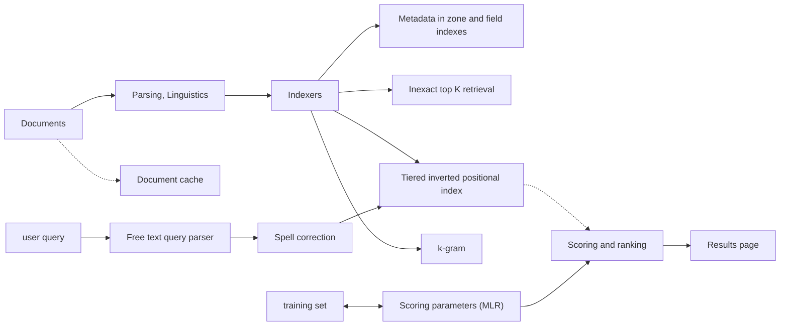

# CS 121: Information Retrieval — Topic: Retrieval Models: Boolean, tf-idf & Vector Space

## Table of Contents

- [1. Boolean Retrieval](#1-boolean-retrieval)
- [2. Retrieval Models and Ranked Retrieval](#2-retrieval-models-and-ranked-retrieval)
- [3. Term Weighting: Jaccard, tf, idf and tf-idf](#3-term-weighting-jaccard-tf-idf-and-tf-idf)
- [4. The Vector Space Model and Cosine Similarity](#4-the-vector-space-model-and-cosine-similarity)
- [5. tf-idf Variants and SMART Notation](#5-tf-idf-variants-and-smart-notation)
- [6. Beyond Cosine: Zones, Proximity, Query Parsers and Aggregate Scores](#6-beyond-cosine-zones-proximity-query-parsers-and-aggregate-scores)
- [7. Comparing the Models](#7-comparing-the-models)
- [8. Quick Reference & Top 5 Things to Remember](#8-quick-reference--top-5-things-to-remember)

> This chapter is about **what score a document gets for a query**: first the exact-match Boolean model, then ranked retrieval with tf-idf weights and the vector space model, and finally the extra evidence (fields, zones, proximity) a real engine mixes in. It assumes the inverted index and postings merging ([Inverted Indexes & Index Construction](topic-indexing.en-US.md)) and the tokens and terms from [Text Processing](topic-text-processing.en-US.md). How to compute the top $K$ **fast** (heaps, champion lists, tiered indexes, MaxScore) is the subject of [Query Processing & Efficient Top-K](topic-query-processing.en-US.md); the link-based quality score $g(d)$ comes from [Link Analysis: HITS & PageRank](topic-link-analysis.en-US.md); how to measure whether a ranking is any good is in [Search Engine Evaluation](topic-evaluation.en-US.md).

> 📘 **Going further**: [Croft §7.1 Overview of Retrieval Models (book p. 233)](https://ciir.cs.umass.edu/downloads/SEIRiP.pdf) · [IIR Ch 6 Scoring, term weighting and the vector space model](https://nlp.stanford.edu/IR-book/pdf/irbookonlinereading.pdf)

## 1. Boolean Retrieval

### 1.1 The exact-match model

In the **Boolean retrieval model**, queries are Boolean expressions joining terms with **AND, OR and NOT**, and each document is viewed as a **set of words**.

- It is **precise**: a document **matches the condition or not** — there is no ranking.
- Perhaps the simplest model to build an IR system on; it was the **primary commercial retrieval tool for 3 decades**.
- Many search systems are still Boolean: **email, library catalogs, macOS Spotlight**.

### 1.2 Evaluating a query on the term-document incidence matrix

The conceptual way to evaluate a Boolean query is on the **term-document incidence matrix**: rows are terms, columns are documents, an entry is 1 if the document contains the term. Each term has a 0/1 **incidence vector** (its row). Take the Shakespeare question *which plays contain Brutus AND Caesar but NOT Calpurnia?* The three rows, over the six plays Antony and Cleopatra, Julius Caesar, The Tempest, Hamlet, Othello, Macbeth:

| | Antony and Cleopatra | Julius Caesar | The Tempest | Hamlet | Othello | Macbeth |
|---|---|---|---|---|---|---|
| Brutus | 1 | 1 | 0 | 1 | 0 | 0 |
| Caesar | 1 | 1 | 0 | 1 | 1 | 1 |
| Calpurnia | 0 | 1 | 0 | 0 | 0 | 0 |

Take the rows for Brutus, Caesar and Calpurnia, **complement** Calpurnia's, and **bitwise AND** them:

$$R = I_{Bru} \wedge I_{Cae} \wedge \neg I_{Cal}$$

$I_t$ is term $t$'s row, $\wedge$ is bitwise AND, and $\neg$ flips every bit.

```text
(Brutus)         1 1 0 1 0 0  AND
(Caesar)         1 1 0 1 1 1  AND
(NOT Calpurnia)  1 0 1 1 1 1  =
                 1 0 0 1 0 0
```

The result's 1s are columns 1 and 4: **Antony and Cleopatra** and **Hamlet**. (Julius Caesar has both names but also Calpurnia, so the NOT removes it.) The matrix is only the idea: it is far too big to store, and a real system answers the same query by merging postings lists in an inverted index ([Inverted Indexes & Index Construction](topic-indexing.en-US.md)).

> 📝 **Practice**: [§1.5](#15-practice)

### 1.3 Example: WestLaw

WestLaw is the largest commercial (paying subscribers) legal search service: started 1975, ranking added 1992, federated search added 2010; tens of terabytes of data, about 700,000 users. **The majority of users still use Boolean queries** — in law, it is important to have **"exact"** results. Its Advanced Search page offers fields for terms, connectors and expanders, and date and citation restrictions.

| Information need | WestLaw query |
|---|---|
| What is the statute of limitations in cases involving the federal tort claims act? | `LIMIT! /3 STATUTE ACTION /S FEDERAL /2 TORT /3 CLAIM` |
| Requirements for disabled people to be able to access a workplace | `disabl! /p access! /s work-site work-place (employment /3 place` |

`/3` = within 3 words, `/S` = in the same sentence. **Note that SPACE is disjunction (OR), not conjunction!**

These are long, precise queries with proximity operators, developed incrementally — **not like web search**. Many professional searchers still like Boolean search: **you know exactly what you are getting**.

> ⚠️ **Pitfall**: In WestLaw, `work-site work-place` means work-site **OR** work-place. A simple search tool that ANDs every word of the query (so that `tropical fish` means *tropical AND fish*) uses the opposite convention. The meaning of the space operator is a design choice of each system.

> 📘 **Going further**: [WestLaw](http://www.westlaw.com/) · [Croft §7.1.1 Boolean Retrieval (book p. 235)](https://ciir.cs.umass.edu/downloads/SEIRiP.pdf) · [IIR Ch 1 Boolean retrieval](https://nlp.stanford.edu/IR-book/pdf/irbookonlinereading.pdf)

### 1.4 The verdict, and feast or famine

| Advantages | Disadvantages |
|---|---|
| results are **predictable**, relatively easy to explain | effectiveness **depends entirely on the user** |
| many different features can be incorporated | **simple queries usually don't work well** |
| **efficient** processing, since many documents can be eliminated | **complex queries are difficult** |

Boolean retrieval is good for **expert users** who know their needs and the collection, and for **applications**; it is not good for most "generic" users, who can't (or won't) write Boolean queries and **don't want to wade through 1000s of results** — particularly on the **web**.

**Feast or famine**: Boolean queries often return **too few (= 0) or too many (1000s)** results.

| Query | Hits |
|---|---|
| "standard user dlink650" | 200,000 |
| "standard user dlink650 no card found" | 0 |

It takes skill to write a query with a manageable number of hits: **AND gives too few; OR gives too many**. Except in specific cases (e.g. law), people happily **trade deterministic results for ease of use**. That is the motivation for ranking ([§2](#2-retrieval-models-and-ranked-retrieval)).

### 1.5 Practice

#### Brutus AND Caesar AND NOT Calpurnia

Using the incidence vectors Brutus = 110100, Caesar = 110111, Calpurnia = 010000 (columns: Antony and Cleopatra, Julius Caesar, The Tempest, Hamlet, Othello, Macbeth), which plays match *Brutus AND Caesar AND NOT Calpurnia*?

<details>
<summary>Solution</summary>

NOT Calpurnia = 101111. 110100 AND 110111 = 110100; AND 101111 = **100100**. Columns 1 and 4: **Antony and Cleopatra** and **Hamlet**. Julius Caesar has both names but also Calpurnia, so the NOT removes it.

</details>

## 2. Retrieval Models and Ranked Retrieval

### 2.1 Retrieval models and ranked retrieval

**Retrieval models** are a **mathematical framework for the search process** — **theories about relevance**: they state their **assumptions**, are the **basis of ranking algorithms**, and **can be implicit**; progress in them has tracked **improvements in effectiveness**. **Relevance** is complex (many factors; **people often disagree** in judgments), so models simplify it: **topical vs. user** relevance, **binary vs. continuous vs. multi-valued** relevance ([Search Engines & the Web](topic-search-engines.en-US.md)).

**Ranked retrieval models** return an **ordering** over the (top) documents instead of a **set**, usually for **free text queries** (just words, no operators) — two separate choices in principle, paired in practice. Feast or famine disappears: show the **top $k$ (≈ 10)**, whatever the result-set size. **Strong assumption: the ranking algorithm "works" for the user.**

**Scoring** is the basis: return documents in the order most likely to be useful. **Assign a score — say in $[0, 1]$ — to each document**, measuring how well document and query "match". Start with a **one-term query**:

- if the query term **does not occur** in the document, the score should be **0**;
- the **more frequent** the query term in the document, the **higher** the score should be.

The rest of the chapter builds the score step by step: set overlap (§3.1), term frequency (§3.3), rarity (§3.4), then vectors and angles ([§4](#4-the-vector-space-model-and-cosine-similarity)).

### 2.2 The abstract model of ranking

Indexes are designed to support search — **faster response time, and updates**. Web search engines use a particular form of search, **ranking**: documents are retrieved **in sorted order** according to a **score** computed from the document representation, the query and a ranking algorithm. A reasonable **abstract model of ranking** lets us discuss indexes without the details of a retrieval model.

Take a document, *Fred's Tropical Fish Shop* ("…the best place to find tropical fish at low, low prices. Whether you're looking for a little fish or a big fish… We even have fake seaweed for your fishtank (and little surfboards too)."). Two kinds of features describe it:

| Topical features (from the text) | Quality features (about the document) |
|---|---|
| 9.7 fish · 4.2 tropical · 22.1 tropical fish · 8.2 seaweed · 4.2 surfboards | 14 incoming links · 3 days since last update |

A **feature function** maps text to a real number, $f(\text{text}) \to \mathbb{R}$. The **ranking function** takes the features and the query (*tropical fish*) and produces a **document score** (24.5 in the abstract picture).

**More concrete model**:

$$R(Q, D) = \sum_i g_i(Q)\, f_i(D)$$

$f_i$ is a **document feature function**, $g_i$ is a **query feature function**, and $i$ runs over the features. The query *tropical fish* has its own feature values:

| Feature $i$ | $f_i(D)$ | $g_i(Q)$ |
|---|---|---|
| fish | 9.7 | 5.2 |
| tropical | 4.2 | 3.4 |
| tropical fish | 22.1 | 9.9 |
| seaweed | 8.2 | — |
| surfboards | 4.2 | — |
| chichlids | — | 1.2 |
| barbs | — | 0.7 |
| incoming links | 14 | 1.2 |
| update count | 3 | 0.9 |

Only features present on **both** sides contribute, giving a **document score of 303.01** (worked out in [§2.3](#23-practice)).

> 💡 **Key Insight**: Ranking is a sum over features of (query weight × document value). The index's job is to make the $f_i(D)$ cheap to find — which is why postings can carry counts, positions, extents and scores ([Inverted Indexes & Index Construction](topic-indexing.en-US.md)). Every model in this chapter — tf-idf, cosine, the aggregate formula of [§6.4](#64-aggregate-scores-a-real-engines-formula) — is a particular choice of the $g_i$ and $f_i$.

> 📘 **Going further**: [Croft §5.2 Abstract Model of Ranking (book p. 126)](https://ciir.cs.umass.edu/downloads/SEIRiP.pdf)

### 2.3 Practice

#### The document score 303.01

Use $R(Q,D) = \sum_i g_i(Q) f_i(D)$ with the feature table of [§2.2](#22-the-abstract-model-of-ranking). What is the score of *Fred's Tropical Fish Shop* for the query *tropical fish*, and which feature contributes most?

<details>
<summary>Solution</summary>

Only features with both an $f_i$ and a $g_i$ count (seaweed and surfboards have no query weight; chichlids and barbs aren't in the document):

| Feature | $g_i(Q) \cdot f_i(D)$ |
|---|---|
| fish | 5.2 × 9.7 = 50.44 |
| tropical | 3.4 × 4.2 = 14.28 |
| tropical fish | 9.9 × 22.1 = 218.79 |
| incoming links | 1.2 × 14 = 16.80 |
| update count | 0.9 × 3 = 2.70 |

$R = 50.44 + 14.28 + 218.79 + 16.80 + 2.70 = \mathbf{303.01}$. The phrase feature *tropical fish* contributes most of it. Checking in Python:

```python
q = {"fish": 5.2, "tropical": 3.4, "tropical fish": 9.9,
     "chichlids": 1.2, "barbs": 0.7, "incoming links": 1.2, "update count": 0.9}
d = {"fish": 9.7, "tropical": 4.2, "tropical fish": 22.1,
     "seaweed": 8.2, "surfboards": 4.2, "incoming links": 14, "update count": 3}
print(round(sum(q[f] * d[f] for f in q if f in d), 2))
```

```text
303.01
```

</details>

## 3. Term Weighting: Jaccard, tf, idf and tf-idf

### 3.1 Take 1: the Jaccard coefficient

A commonly used measure of the **overlap of two sets** $A$ and $B$:

$$J(A, B) = \frac{|A \cap B|}{|A \cup B|}$$

$|A \cap B|$ is the number of elements in both sets, $|A \cup B|$ the number in either. Score a document by taking $A$ = the query's terms and $B$ = the document's terms.

- $J(A, A) = 1$; $J(A, B) = 0$ if $A \cap B = \emptyset$.
- **Good properties**: $A$ and $B$ **don't have to be the same size**; it **always gives a number between 0 and 1**.

**Issues with Jaccard for scoring**:

- It **doesn't consider term frequency** (how many times a term occurs in a document).
- **Rare terms in a collection are more informative than frequent terms**; Jaccard ignores this.
- **More sophisticated heuristics to normalize for document length** give better scores. Another option, instead of $|A \cap B| / |A \cup B|$:

$$\frac{|A \cap B|}{\sqrt{|A \cup B|}}$$

> 💡 **Key Insight**: The three issues are the agenda of the next sections: term frequency → §3.3, rarity → §3.4 (idf), length normalization → the vector space model ([§4](#4-the-vector-space-model-and-cosine-similarity)).

### 3.2 Count vectors and the bag of words

The **term-document incidence matrix** (§1.2) makes each document a **binary vector** $\in \{0,1\}^{|V|}$. Instead, consider the **number** of occurrences of a term in a document. Each document is then a **count vector** in $\mathbb{N}^{|V|}$ — a column below:

| | Antony and Cleopatra | Julius Caesar | The Tempest | Hamlet | Othello | Macbeth |
|---|---|---|---|---|---|---|
| Antony | 157 | 73 | 0 | 0 | 0 | 0 |
| Brutus | 4 | 157 | 0 | 1 | 0 | 0 |
| Caesar | 232 | 227 | 0 | 2 | 1 | 1 |
| Calpurnia | 0 | 10 | 0 | 0 | 0 | 0 |
| Cleopatra | 57 | 0 | 0 | 0 | 0 | 0 |
| mercy | 2 | 0 | 3 | 5 | 5 | 1 |
| worser | 2 | 0 | 1 | 1 | 1 | 0 |

**Bag of words model**: the vector representation **doesn't consider the order** of words. *John is quicker than Mary* and *Mary is quicker than John* have **the same vectors**. In a sense this is a **temporary step back**, since a positional index can tell these two documents apart (see [Inverted Indexes & Index Construction](topic-indexing.en-US.md)) — positional information comes back later ([§6.2](#62-query-term-proximity)); for now, bag of words.

### 3.3 Term frequency and log-frequency weighting

The **term frequency** $\mathrm{tf}_{t,d}$ of term $t$ in document $d$ is the **number of times** $t$ occurs in $d$. (**Note: frequency = count in IR.**)

We want to use tf in query-document scores — but **raw tf is not what we want**. A document with 10 occurrences of the term is **more** relevant than one with 1 occurrence, **but not 10 times more**. Relevance doesn't increase proportionally with term frequency.

**Log-frequency weighting**:

$$w_{t,d} = \begin{cases} 1 + \log_{10} \mathrm{tf}_{t,d}, & \text{if } \mathrm{tf}_{t,d} > 0 \\ 0, & \text{otherwise} \end{cases}$$

| tf | 0 | 1 | 2 | 10 | 1000 |
|---|---|---|---|---|---|
| $w$ | 0 | 1 | 1.3 | 2 | 4 |

The score for a document-query pair sums over the terms $t$ in **both** $q$ and $d$:

$$\mathrm{score}(q, d) = \sum_{t \in q \cap d} \left(1 + \log_{10} \mathrm{tf}_{t,d}\right)$$

The score is **0** if none of the query terms is in the document.

### 3.4 Document frequency and idf

**Rare terms are more informative** than frequent terms — recall stop words. A query term that is rare in the collection, e.g. **arachnocentric**: a document containing it is very likely relevant to the query *arachnocentric*. → We want a **high weight for rare terms**.

**Frequent terms** (e.g. *high, increase, line*): a document containing one is more likely relevant than one that doesn't, but it's **not a sure indicator**. → **Positive weights** for *high, increase, line*, but **lower** than for rare terms.

We use **document frequency (df)** to capture this. $\mathrm{df}_t$ is the **document frequency** of $t$: **the number of documents that contain $t$**. It is an **inverse** measure of the informativeness of $t$, with $0 < \mathrm{df}_t \le N$. The **idf** (inverse document frequency) of $t$ is

$$\mathrm{idf}_t = \log_{10}\left(N / \mathrm{df}_t\right)$$

where $N$ is the number of documents in the collection. We use $\log(N/\mathrm{df}_t)$ instead of $N/\mathrm{df}_t$ to **dampen** the effect of idf. It will turn out that **the base of the log is immaterial**. There is **one idf value for each term $t$** in a collection.

**idf example, $N$ = 1 million:**

| term | $\mathrm{df}_t$ | $\mathrm{idf}_t$ |
|---|---|---|
| calpurnia | 1 | 6 |
| animal | 100 | 4 |
| sunday | 1,000 | 3 |
| fly | 10,000 | 2 |
| under | 100,000 | 1 |
| the | 1,000,000 | 0 |

**Effect of idf on ranking**: does idf matter for a **one-term query** like *iPhone*? **No — idf has no effect on ranking one-term queries**: every document gets the same idf factor. idf affects ranking for queries with **at least two terms**: for *capricious person*, idf makes occurrences of *capricious* count for **much more** than occurrences of *person*.

**Collection vs. document frequency**: the **collection frequency** of $t$ is the number of occurrences of $t$ in the collection, counting multiple occurrences.

| Word | Collection frequency | Document frequency |
|---|---|---|
| insurance | 10440 | 3997 |
| try | 10422 | 8760 |

*Which word is a better search term (and should get a higher weight)?* **insurance**: the two have almost the same collection frequency, but *insurance* is concentrated in fewer than half as many documents, so its df is lower and its idf higher. That's why idf uses df, not collection frequency.

### 3.5 tf-idf

The **tf-idf weight** of a term is the **product** of its tf weight and its idf weight:

$$w_{t,d} = \left(1 + \log \mathrm{tf}_{t,d}\right) \times \log\left(N / \mathrm{df}_t\right)$$

- The **best known** and most used weighting scheme in IR.
- The "-" in tf-idf is a **hyphen, not a minus sign!** Alternative names: tf.idf, tf × idf, tfidf.
- **Good properties**: it **increases with the number of occurrences** within a document, and **increases with the rarity** of the term in the collection.

The score of a document $d$ for a query $q$:

$$\mathrm{Score}(q, d) = \sum_{t \in q \cap d} \mathrm{tf.idf}_{t,d}$$

$\mathrm{Score}(q, d)$ is the **relevance score of a document given a query**, the sum runs over the **terms in the intersection of query and document**, and each summand $w_{t,d}$ is the **tf-idf** weight.

**Many variants** can be constructed: how "tf" is computed (with or without logs), whether the terms in the query are also weighted, … **pick and/or design your heuristics** ([§5](#5-tf-idf-variants-and-smart-notation) catalogs them).

The tf and idf columns above, computed:

```python
import math

N = 1_000_000
for term, df in [("calpurnia", 1), ("animal", 100),
                 ("sunday", 1_000), ("fly", 10_000),
                 ("under", 100_000), ("the", 1_000_000)]:
    print(f"{term:9} idf = {math.log10(N / df):.0f}")
print([round(1 + math.log10(tf), 1) for tf in (1, 2, 10, 1000)])
```

```text
calpurnia idf = 6
animal    idf = 4
sunday    idf = 3
fly       idf = 2
under     idf = 1
the       idf = 0
[1.0, 1.3, 2.0, 4.0]
```

> ⚠️ **Pitfall**: A term in **every** document (*the*, df = N) gets idf = 0, so its tf-idf is 0 no matter how often it appears — idf does the job of a stop list automatically.

> 📘 **Going further**: [Croft §7.1.2 The Vector Space Model (book p. 237)](https://ciir.cs.umass.edu/downloads/SEIRiP.pdf) · [IIR Ch 6 inverse document frequency and tf-idf weighting](https://nlp.stanford.edu/IR-book/pdf/irbookonlinereading.pdf)

> 📝 **Practice**: [§3.6](#36-practice)

### 3.6 Practice

#### Fill in the idf table

$N = 1{,}000{,}000$. df: calpurnia 1, animal 100, sunday 1,000, fly 10,000, under 100,000, the 1,000,000. Compute $\mathrm{idf}_t = \log_{10}(N/\mathrm{df}_t)$.

<details>
<summary>Solution</summary>

| term | $N/\mathrm{df}_t$ | idf |
|---|---|---|
| calpurnia | $10^6$ | 6 |
| animal | $10^4$ | 4 |
| sunday | $10^3$ | 3 |
| fly | $10^2$ | 2 |
| under | $10^1$ | 1 |
| the | $10^0$ | 0 |

Each 10× increase in df costs exactly 1 point of idf; a term in every document gets 0.

</details>

#### Insurance or try?

insurance: collection frequency 10440, document frequency 3997. try: collection frequency 10422, document frequency 8760. Which is the better search term?

<details>
<summary>Solution</summary>

**insurance**. Their collection frequencies are almost equal, so cf can't tell them apart. But *insurance* appears in 3997 documents (about 2.6 occurrences per document that has it) while *try* is spread over 8760 (about 1.2 each). Fewer documents → lower df → **higher idf**: a document containing *insurance* says more about its topic. That's why weighting uses **df**, not collection frequency.

</details>

## 4. The Vector Space Model and Cosine Similarity

### 4.1 Documents as vectors

The term-document matrix has gone through three versions: **incidence** (0/1, §1.2) → **counts** (§3.2) → **tf-idf weights**:

| | Antony and Cleopatra | Julius Caesar | The Tempest | Hamlet | Othello | Macbeth |
|---|---|---|---|---|---|---|
| Antony | 5.25 | 3.18 | 0 | 0 | 0 | 0.35 |
| Brutus | 1.21 | 6.1 | 0 | 1 | 0 | 0 |
| Caesar | 8.59 | 2.54 | 0 | 1.51 | 0.25 | 0 |
| Calpurnia | 0 | 1.54 | 0 | 0 | 0 | 0 |
| Cleopatra | 2.85 | 0 | 0 | 0 | 0 | 0 |
| mercy | 1.51 | 0 | 1.9 | 0.12 | 5.25 | 0.88 |
| worser | 1.37 | 0 | 0.11 | 4.15 | 0.25 | 1.95 |

**Each document is now represented by a real-valued vector of tf-idf weights $\in \mathbb{R}^{|V|}$** — a column of this table. (These weights are given as is; the collection size and document frequencies behind them are not specified, so they can't be recomputed.)

- We have a **$|V|$-dimensional vector space** ($|V|$ = vocabulary size).
- **Terms are the axes** of the space.
- **Documents are points or vectors** in this space.
- **Very high-dimensional**: tens of millions of dimensions for a web search engine.
- **Very sparse**: most entries are zero (a page uses a tiny fraction of the vocabulary).

> 💡 **Key Insight**: A document vector is never stored as $|V|$ numbers — its nonzero entries are exactly its postings.

> 📘 **Going further**: [Croft §7.1.2 The Vector Space Model (book p. 237)](https://ciir.cs.umass.edu/downloads/SEIRiP.pdf) · [IIR §6.3 The vector space model for scoring](https://nlp.stanford.edu/IR-book/pdf/irbookonlinereading.pdf)

### 4.2 Queries as vectors, and why not Euclidean distance

- **Key idea 1**: do the same for queries — represent them as **vectors in the same space**.
- **Key idea 2**: **rank documents by their proximity to the query** in this space. Proximity = similarity of vectors; proximity ≈ inverse of distance.
- Why: we want to get away from the **you're-either-in-or-out Boolean model** ([§1](#1-boolean-retrieval)), and instead **rank more relevant documents higher** than less relevant ones.

The first thing that comes to mind is the distance between two points (= between the end points of the two vectors): **Euclidean distance?** It's **a bad idea**, because Euclidean distance is **large for vectors of different lengths** — and **queries and documents usually have very different lengths**.

**The picture**: two axes, JEALOUS (x) and GOSSIP (y), both from 0 to 1. $d_1$ points almost straight up (mostly *gossip*), $d_3$ almost flat (mostly *jealous*), and $q$ and $d_2$ point in nearly the same direction (both terms, in similar proportion) — but $d_2$ is a much longer arrow that runs off the unit square. The Euclidean distance between $q$ and $d_2$ is **large even though the distribution of terms in $q$ and in $d_2$ is very similar**.

The same point as a ranking: on axes term1/term2, $q$ sits near (1, 1); $d_1$ lies further out **on the same line** through the origin as $q$, while $d_2$ is closer to $q$ as a point but off in a steeper direction. **By Euclidean tf-idf: $d_2, d_1$. By cosine: $d_1, d_2$.**

> ⚠️ **Pitfall**: "Closest point" and "most similar direction" are different questions. A long document that is about exactly the query's topic is *far* from a 3-word query in Euclidean terms. The vector space model ranks by direction.

### 4.3 Use the angle: cosine similarity

**Thought experiment**: take a document $d$ and **append it to itself**; call it $d'$.

- "Semantically" $d$ and $d'$ have **the same content**.
- The **Euclidean distance** between them can be **quite large** — bad!
- The **angle** between them is **0**, corresponding to **maximal similarity** — good!

**Key idea: rank documents according to the angle between document and query.**

Cosine is a **monotonically decreasing** function on $[0°, 180°]$ (1 at 0°, 0 at 90°, −1 at 180°, back to 1 at 360°). So ranking by angle and ranking by cosine are equivalent: **increasing angle = decreasing cosine**, best document first.

**cosine(query, document)**:

$$\cos(\vec q, \vec d) = \frac{\vec q \cdot \vec d}{\lvert\vec q\rvert\,\lvert\vec d\rvert} = \frac{\vec q}{\lvert\vec q\rvert} \cdot \frac{\vec d}{\lvert\vec d\rvert} = \frac{\sum_{i=1}^{|V|} q_i d_i}{\sqrt{\sum_{i=1}^{|V|} q_i^2}\,\sqrt{\sum_{i=1}^{|V|} d_i^2}}$$

$q_i$ is the tf-idf weight of term $i$ in the query, $d_i$ the tf-idf weight of term $i$ in the document. The numerator is the **dot product**; dividing by the two lengths turns both vectors into **unit vectors**. $\cos(\vec q, \vec d)$ is the cosine similarity of $q$ and $d$ — equivalently, the cosine of the angle between them.

> 📘 **Going further**: [Croft §7.1.2 The Vector Space Model (book p. 237)](https://ciir.cs.umass.edu/downloads/SEIRiP.pdf) · [IIR Ch 6 cosine similarity](https://nlp.stanford.edu/IR-book/pdf/irbookonlinereading.pdf)

### 4.4 Length normalization

A vector is **length-normalized** by dividing each component by its length, using the **$L_2$ norm**:

$$\lVert\vec x\rVert_2 = \sqrt{\sum_i x_i^2}$$

- Dividing by the $L_2$ norm makes it a **unit vector** — a point **on the surface of the unit hypersphere**.
- Effect on $d$ and $d'$ ($d$ appended to itself): **identical vectors** after length normalization.
- **Long and short documents now have comparable weights.**

**Cosine for length-normalized vectors** is simply the **dot product** (scalar product):

$$\cos(\vec q, \vec d) = \vec q \cdot \vec d = \sum_{i=1}^{|V|} q_i d_i \qquad \text{for } q, d \text{ length-normalized.}$$

Picture axes RICH and POOR, the unit square, and a dashed quarter-circle of radius 1. The normalized vectors $\vec v(d_1)$, $\vec v(q)$, $\vec v(d_2)$, $\vec v(d_3)$ all end **on that arc**; only their directions differ, and the angle $\theta$ is between $\vec v(d_1)$ and $\vec v(d_2)$. $\vec v(q)$ and $\vec v(d_2)$ are close neighbours on the arc.

> 💡 **Key Insight**: Once the documents are normalized they are "already on the surface of a hypersphere", so cosine needs no division at query time — just the dot product. That's why engines normalize document vectors **at index time**.

### 4.5 Example: how similar are three novels?

*Sense and Sensibility* (SaS), *Pride and Prejudice* (PaP), *Wuthering Heights* (WH), four terms, **no idf** to keep it simple (so the scheme is "lnc": log tf, no idf, cosine). Counts → log weights → normalize → dot products:

| term | SaS | PaP | WH |
|---|---|---|---|
| affection | 115 | 58 | 20 |
| jealous | 10 | 7 | 11 |
| gossip | 2 | 0 | 6 |
| wuthering | 0 | 0 | 38 |

Result: $\cos(\text{SaS}, \text{PaP}) \approx 0.94$, $\cos(\text{SaS}, \text{WH}) \approx 0.79$, $\cos(\text{PaP}, \text{WH}) \approx 0.69$. The two Austen novels are closest. Step through it:

```viz tfidf-cosine
{"title": "Three novels, pairwise cosine with lnc", "docs": "SaS: affection:115 jealous:10 gossip:2 wuthering:0; PaP: affection:58 jealous:7 gossip:0 wuthering:0; WH: affection:20 jealous:11 gossip:6 wuthering:38", "scheme": "lnc"}
```

> 📝 **Practice**: [§4.8](#48-practice)

### 4.6 Computing cosine scores: the CosineScore algorithm

```text
CosineScore(q)
 1  float Scores[N] = 0
 2  float Length[N]
 3  for each query term t
 4  do calculate w_t,q and fetch postings list for t
 5       for each pair(d, tf_t,d) in postings list
 6       do Scores[d] += w_t,d × w_t,q
 7  Read the array Length
 8  for each d
 9  do Scores[d] = Scores[d] / Length[d]
10  return Top K components of Scores[]
```

- It's **term-at-a-time** (see [Query Processing & Efficient Top-K](topic-query-processing.en-US.md)): `Scores` are the accumulators, filled one postings list at a time.
- Only documents that contain **at least one query term** ever get a nonzero score — the postings lists are the only thing read.
- `Length[d]` is computed **at index time** and just read (line 7); dividing at the end (line 9) is the document half of the cosine. The query's length is the same for every document, so it doesn't change the ranking.
- Line 10 is the top-$K$ problem: get the top $K$ without sorting everything — a heap, covered in [Query Processing & Efficient Top-K](topic-query-processing.en-US.md).

The same steps in Python, on the lnc.ltc example of [§5.2](#52-example-lncltc): the document *car insurance auto insurance*, the query *best car insurance*:

```python
import heapq
import math

docs = {"d": "car insurance auto insurance".split()}
df = {"auto": 5000, "best": 50000,
      "car": 10000, "insurance": 1000}
N = 1_000_000

def log_tf(tf):
    return 1 + math.log10(tf) if tf > 0 else 0

# Index time: postings (d, tf) and Length[d] (lnc)
postings, length = {}, {}
for d, words in docs.items():
    counts = {t: words.count(t) for t in set(words)}
    for t, tf in counts.items():
        postings.setdefault(t, []).append((d, tf))
    length[d] = math.sqrt(sum(log_tf(tf) ** 2
                              for tf in counts.values()))

def cosine_score(query, K=10):
    q = {t: query.count(t) for t in set(query)}
    w_q = {t: log_tf(tf) * math.log10(N / df[t])
           for t, tf in q.items()}          # ltc ...
    q_len = math.sqrt(sum(w * w for w in w_q.values()))
    scores = {}                             # line 1
    for t, wtq in w_q.items():              # lines 3-4
        for d, tf in postings.get(t, []):   # line 5
            scores[d] = scores.get(d, 0) + \
                log_tf(tf) * wtq / q_len    # line 6
    for d in scores:                        # lines 7-9
        scores[d] /= length[d]
    return heapq.nlargest(K, scores.items(),
                          key=lambda x: x[1])  # line 10

print(round(length["d"], 2))
print([(d, round(s, 2)) for d, s in
       cosine_score("best car insurance".split())])
```

```text
1.92
[('d', 0.8)]
```

The document length 1.92 and the score 0.8 match the hand computation in [§5.2](#52-example-lncltc). ($N$ = 1,000,000 is the value that reproduces the idf column used there, e.g. $\log_{10}(10^6/5000) = 2.3$.)

> 📘 **Going further**: [IIR Ch 6 computing vector scores](https://nlp.stanford.edu/IR-book/pdf/irbookonlinereading.pdf) · [Croft §5.7.3 Optimization Techniques (book p. 170)](https://ciir.cs.umass.edu/downloads/SEIRiP.pdf)

### 4.7 Vector space ranking in five steps

1. Represent the **query** as a weighted tf-idf vector.
2. Represent **each document** as a weighted tf-idf vector.
3. Compute the **cosine similarity** score for the query vector and each document vector.
4. **Rank** documents with respect to the query by score.
5. Return the **top K** (e.g., K = 10) to the user.

### 4.8 Practice

#### Rank d1 and d2 by distance and by angle

On axes term1/term2 the query is $q = (1, 1)$. Document $d_1 = (3, 3)$ lies further out along the **same line** through the origin as $q$; $d_2 = (1, 2)$ is a point **closer to $q$** but in a steeper direction (more term2 than term1). Rank $d_1$, $d_2$ by Euclidean distance, then by cosine. (These coordinates are illustrative.)

<details>
<summary>Solution</summary>

- **Euclidean distance**: $d_2$ is the nearer point → **$d_2$, $d_1$**.
- **Cosine**: $d_1$ has the **same direction** as $q$ (angle ≈ 0, cosine ≈ 1); $d_2$'s direction is off by a visible angle → **$d_1$, $d_2$**.

Cosine is right: $d_1$ has the query's terms in the query's proportions, just longer — like $d'$ in [§4.3](#43-use-the-angle-cosine-similarity). Checking the numbers:

```python
import math

q = (1, 1)
docs = {"d1": (3, 3), "d2": (1, 2)}
for name, d in docs.items():
    dist = math.dist(q, d)
    cos = (q[0]*d[0] + q[1]*d[1]) / (math.hypot(*q) * math.hypot(*d))
    print(name, "euclidean =", round(dist, 3), "cosine =", round(cos, 3))
```

```text
d1 euclidean = 2.828 cosine = 1.0
d2 euclidean = 1.0 cosine = 0.949
```

</details>

#### How similar are the three novels?

Counts (no idf): affection SaS 115 / PaP 58 / WH 20; jealous 10 / 7 / 11; gossip 2 / 0 / 6; wuthering 0 / 0 / 38. Compute log-frequency weights, length-normalize, and the three pairwise cosines. Why is $\cos(\text{SaS}, \text{PaP}) > \cos(\text{SaS}, \text{WH})$?

<details>
<summary>Solution</summary>

**1. Log-frequency weights** $1 + \log_{10}\mathrm{tf}$ (0 if tf = 0):

| term | SaS | PaP | WH |
|---|---|---|---|
| affection | 3.06 | 2.76 | 2.30 |
| jealous | 2.00 | 1.85 | 2.04 |
| gossip | 1.30 | 0 | 1.78 |
| wuthering | 0 | 0 | 2.58 |

**2. Lengths**: SaS $\sqrt{3.06^2 + 2.00^2 + 1.30^2} = 3.881$, PaP 3.323, WH 4.391. Divide each column by its length:

| term | SaS | PaP | WH |
|---|---|---|---|
| affection | 0.789 | 0.832 | 0.524 |
| jealous | 0.515 | 0.555 | 0.465 |
| gossip | 0.335 | 0 | 0.405 |
| wuthering | 0 | 0 | 0.588 |

**3. Dot products** (the vectors are unit length, so dot product = cosine):

- $\cos(\text{SaS}, \text{PaP}) = 0.789 \times 0.832 + 0.515 \times 0.555 + 0.335 \times 0 + 0 \times 0 \approx$ **0.94**
- $\cos(\text{SaS}, \text{WH}) \approx$ **0.79**
- $\cos(\text{PaP}, \text{WH}) \approx$ **0.69**

The same computation in Python:

```python
import math

counts = {
    "SaS": [115, 10, 2, 0],
    "PaP": [58, 7, 0, 0],
    "WH":  [20, 11, 6, 38],
}

def unit(v):
    w = [1 + math.log10(x) if x > 0 else 0 for x in v]   # log tf, no idf
    n = math.sqrt(sum(x * x for x in w))                  # L2 length
    return [x / n for x in w]

u = {k: unit(v) for k, v in counts.items()}
for k, v in u.items():
    print(k, [round(x, 3) for x in v])
for a, b in [("SaS", "PaP"), ("SaS", "WH"), ("PaP", "WH")]:
    print(a, b, round(sum(x * y for x, y in zip(u[a], u[b])), 3))
```

```text
SaS [0.789, 0.515, 0.335, 0.0]
PaP [0.832, 0.555, 0.0, 0.0]
WH [0.524, 0.465, 0.405, 0.588]
SaS PaP 0.942
SaS WH 0.789
PaP WH 0.694
```

**Why SaS–PaP > SaS–WH?** SaS and PaP have the **same shape**: dominated by *affection*, some *jealous*, and (almost) no *gossip* and **no *wuthering***. WH spreads its weight over all four terms and has a big *wuthering* component that the other two lack entirely — that dimension adds to WH's length but contributes **0** to every product with SaS or PaP. Same proportions → small angle → high cosine, regardless of the books' lengths.

</details>

## 5. tf-idf Variants and SMART Notation

### 5.1 The variants and ddd.qqq

**tf-idf weighting has many variants.** In parentheses: the **one-letter acronym** for each choice.

| Term frequency | | Document frequency | | Normalization | |
|---|---|---|---|---|---|
| n (natural) | $\mathrm{tf}_{t,d}$ | n (no) | 1 | n (none) | 1 |
| **l (logarithm)** | $1 + \log(\mathrm{tf}_{t,d})$ | **t (idf)** | $\log \frac{N}{\mathrm{df}_t}$ | **c (cosine)** | $\frac{1}{\sqrt{w_1^2 + w_2^2 + \dots + w_M^2}}$ |
| a (augmented) | $0.5 + \frac{0.5 \times \mathrm{tf}_{t,d}}{\max_t(\mathrm{tf}_{t,d})}$ | p (prob idf) | $\max\{0, \log \frac{N - \mathrm{df}_t}{\mathrm{df}_t}\}$ | u (pivoted unique) | $1/u$ |
| b (boolean) | 1 if $\mathrm{tf}_{t,d} > 0$, else 0 | | | b (byte size) | $1/\mathit{CharLength}^{\alpha}$, $\alpha < 1$ |
| L (log ave) | $\frac{1 + \log(\mathrm{tf}_{t,d})}{1 + \log(\mathrm{ave}_{t \in d}(\mathrm{tf}_{t,d}))}$ | | | | |

The first row (n, n, n — raw counts, no idf, no normalization) is the simplest scheme; the row l, t, c is **ltc: "the general standard that is usually adopted"**.

**Weighting may differ in queries vs documents:**

- Many search engines allow **different weightings for queries and documents**.
- **SMART notation** denotes the combination an engine uses as **ddd.qqq** — three letters for the document, three for the query, from the table above.
- **A very standard weighting scheme is lnc.ltc**:
  - **Document**: **l**ogarithmic tf, **n**o idf, **c**osine normalization.
  - **Query**: **l**ogarithmic tf, idf (**t**), **c**osine normalization.

### 5.2 Example: lnc.ltc

Document *car insurance auto insurance*; query *best car insurance*. The table is filled column by column (raw tf → tf-wt → df/idf → wt → normalized → products):

| Term | q tf-raw | q tf-wt | df | idf | q wt | q n'lize | d tf-raw | d tf-wt | d wt | d n'lize | Prod |
|---|---|---|---|---|---|---|---|---|---|---|---|
| auto | 0 | 0 | 5000 | 2.3 | 0 | 0 | 1 | 1 | 1 | 0.52 | 0 |
| best | 1 | 1 | 50000 | 1.3 | 1.3 | 0.34 | 0 | 0 | 0 | 0 | 0 |
| car | 1 | 1 | 10000 | 2.0 | 2.0 | 0.52 | 1 | 1 | 1 | 0.52 | 0.27 |
| insurance | 1 | 1 | 1000 | 3.0 | 3.0 | 0.78 | 2 | 1.3 | 1.3 | 0.68 | 0.53 |

Doc length $= \sqrt{1^2 + 0^2 + 1^2 + 1.3^2} \approx 1.92$. **Score $= 0 + 0 + 0.27 + 0.53 = 0.8$.** The document's "wt" column equals its tf-wt — that's the **n** (no idf) in lnc.

```viz tfidf-cosine
{"title": "tf-idf example: lnc.ltc", "docs": "d: car insurance auto insurance", "query": "best car insurance", "scheme": "lnc.ltc", "df": "auto:5000 best:50000 car:10000 insurance:1000", "N": 1000000, "interactive": true}
```

> ⚠️ **Pitfall**: In ddd.qqq the **document comes first**. lnc.ltc puts idf on the **query** side only — and since idf is a property of the term, applying it once (to the query) is enough to make rare query terms count more in the product. Mixing up which side gets the "t" is the classic trap.

> 📘 **Going further**: [IIR Ch 6 variant tf-idf functions, SMART notation](https://nlp.stanford.edu/IR-book/pdf/irbookonlinereading.pdf) · [Croft §7.1.2 The Vector Space Model (book p. 237)](https://ciir.cs.umass.edu/downloads/SEIRiP.pdf)

> 📝 **Practice**: [§5.3](#53-practice)

### 5.3 Practice

#### Score "best car insurance" with lnc.ltc

Document *car insurance auto insurance*; query *best car insurance*; $N = 10^6$; df: auto 5000, best 50000, car 10000, insurance 1000. Fill in the lnc.ltc table and compute the score.

<details>
<summary>Solution</summary>

**Query (ltc)**: tf-raw best 1, car 1, insurance 1, auto 0 → tf-wt 1, 1, 1, 0. idf = $\log_{10}(N/\mathrm{df})$: auto 2.3, best 1.3, car 2.0, insurance 3.0. wt = tf-wt × idf: auto 0, best 1.3, car 2.0, insurance 3.0. Length $= \sqrt{1.3^2 + 2.0^2 + 3.0^2} = 3.83$ → normalized: best **0.34**, car **0.52**, insurance **0.78**.

**Document (lnc)**: tf-raw auto 1, best 0, car 1, insurance 2 → tf-wt 1, 0, 1, $1 + \log_{10} 2 = 1.3$. No idf, so wt = tf-wt. Length $= \sqrt{1^2 + 0^2 + 1^2 + 1.3^2} \approx 1.92$ → normalized: auto **0.52**, car **0.52**, insurance **0.68**.

**Products**: auto $0 \times 0.52 = 0$; best $0.34 \times 0 = 0$; car $0.52 \times 0.52 = 0.27$; insurance $0.78 \times 0.68 = 0.53$.

**Score = 0 + 0 + 0.27 + 0.53 = 0.8** (unrounded: 0.801). *auto* is in the document but not the query and *best* in the query but not the document: both contribute 0, but both still count in their vector's length.

</details>

## 6. Beyond Cosine: Zones, Proximity, Query Parsers and Aggregate Scores

### 6.1 Parametric (field) and zone indexes

**Metadata.** Thus far, a doc has been a sequence of terms. In fact documents have **multiple parts, some with special semantics**: author, title, date of publication, language, format, etc. These constitute the **metadata** about a document.

**Fields.** We sometimes wish to search by these metadata — e.g. find docs **authored by William Shakespeare in the year 1601**, containing *alas poor Yorick*.

- **Year = 1601** is an example of a **field**; so is author last name = shakespeare.
- **Field or parametric index**: postings for each field value. Sometimes build **range trees** (e.g. for dates).
- A field query is typically treated as a **conjunction** (the doc **must** be authored by shakespeare).

**Zones.** A **zone** is a region of the doc that can contain an **arbitrary amount of text**: title, abstract, references… Build **inverted indexes on zones** as well to permit querying — e.g. "find docs with *merchant* in the **title** zone and matching the query *gentle rain*".

**Two ways to encode zones.** Zones in the **dictionary** — one postings list per term-zone pair:

| Dictionary entry | Postings |
|---|---|
| `william.abstract` | 11 → 121 → 1441 → 1729 |
| `william.title` | 2 → 4 → 8 → 16 |
| `william.author` | 2 → 3 → 5 → 8 |

Zones in the **postings** — one list for the term, each posting tagged with its zones:

| Dictionary entry | Postings |
|---|---|
| `william` | 2.author,2.title → 3.author → 4.title → 5.author |

> 💡 **Key Insight**: Field = a value matched exactly (year = 1601), used as a filter; zone = free text searched inside (title, abstract). Zone information is what feeds the "field weight" $P(t, D)$ in the aggregate formula of [§6.4](#64-aggregate-scores-a-real-engines-formula): a match in a title or header can be promoted over a match in running text.

> 📘 **Going further**: [IIR §6.1 Parametric and zone indexes](https://nlp.stanford.edu/IR-book/pdf/irbookonlinereading.pdf), which also develops weighted zone scoring (a weighted sum of per-zone matches).

### 6.2 Query term proximity

**Free text queries** — just a set of terms typed into the query box — are common on the web. **Users prefer docs in which query terms occur within close proximity of each other.**

Let $w$ be the **smallest window** in a doc containing **all** query terms. For the query *strained mercy*, the smallest window in the doc *The quality of mercy is not strained* is **4** (words): *mercy is not strained*.

- Intuition: **the smaller $w$ is, the better** the document matches the query.
- We would like the scoring function to take this into account: **add weights!**

Proximity needs word positions in the index ([Inverted Indexes & Index Construction](topic-indexing.en-US.md)).

### 6.3 Query parsers

A free text query from the user may in fact **spawn one or more queries** to the indexes. E.g. for the query *rising interest rates*:

1. Run the query as a **phrase query**.
2. If **< $K$ docs** contain the phrase *rising interest rates*, run the two phrase queries *rising interest* and *interest rates*.
3. If we **still have < $K$ docs**, run the **vector space query** *rising interest rates*.
4. **Rank matching docs by vector space scoring.**

This sequence is issued by a **query parser** — some method that transforms a user query into a **stream of multiple queries**. Phrase queries need the positional index ([Inverted Indexes & Index Construction](topic-indexing.en-US.md)). Each step relaxes the query only when the stricter one yields fewer than $K$ docs — the same fallback logic as tiered indexes ([Query Processing & Efficient Top-K](topic-query-processing.en-US.md)).

### 6.4 Aggregate scores: a real engine's formula

Score functions can combine **cosine, static quality, proximity**, etc. One possible aggregation of the scoring — a real engine mixes the vector space score with other evidence:

$$S(q, D) = \alpha\left[\beta \sum_{t \in (q \cap D)} \mathrm{tfidf}_{t,D}\,\bigl(1 + P(t, D)\bigr) + (1 - \beta)\cos(q, D)\right] \times \bigl(1 + \Phi(q, D)\bigr) + (1 - \alpha)\,g(D)$$

| Symbol | Meaning |
|---|---|
| $\mathrm{tfidf}(t, D)$ | the tf.idf of term $t$ in document $D$ |
| $\cos(q, D)$ | cosine similarity between the vectors of query $q$ and document $D$ |
| $P(t, D)$ | **"field weight"** of token $t$ in $D$ — promotes documents where the tokens appear in a **header, bold, italics**, etc. |
| $\Phi(q, D)$ | **"phrase weight"** of $q$ in $D$ — promotes documents where the tokens appear **in the same order and at the same distances** as in the query |
| $g(D)$ | a function of the **document's own characteristics and link analysis** (e.g. PageRank, HITS) |
| $\alpha$ | tunable: balances the **query + document** part against the **document-only** part |
| $\beta$ | tunable: balances the **tf.idf** part against the **cosine** part |

> 💡 **Key Insight**: Read it inside out: tf-idf boosted by fields, blended with cosine ($\beta$), boosted by phrase matches ($\Phi$), then blended with query-independent quality ($\alpha$, $g$). $P$ needs field information at index time, $\Phi$ needs **positions**, and $g$ is the PageRank/HITS score of [Link Analysis: HITS & PageRank](topic-link-analysis.en-US.md) — fields and zones, query term proximity and static quality scores in one formula.

How do we know the **best combination**?

- **User surveys**: ask real people to use your search engine.
- Some applications: **expert-tuned**.
- **Hand-tuning real-life systems is hard** (e.g. tens or hundreds of possible threshold choices, what to consider or not, etc.).
- Increasingly common technique: **adaptive-learning based optimization** (machine-learned ranking).

> 📘 **Going further**: [Croft §7.4 Complex Queries and Combining Evidence (book p. 267)](https://ciir.cs.umass.edu/downloads/SEIRiP.pdf) · [Croft §7.5 Web Search (book p. 279)](https://ciir.cs.umass.edu/downloads/SEIRiP.pdf) · [IIR Ch 7 A complete search system](https://nlp.stanford.edu/IR-book/pdf/irbookonlinereading.pdf)

### 6.5 Putting it all together: a complete search system



The scoring parameters are learned (**MLR**, machine-learned ranking) from a **training set**.

> 📝 **Practice**: [§6.6](#66-practice)

### 6.6 Practice

#### Smallest window for strained mercy

Query: *strained mercy*. Document: *The quality of mercy is not strained*. What is the smallest window $w$ containing all query terms?

<details>
<summary>Solution</summary>

*mercy* is word 4 and *strained* is word 7; each occurs once, so the only window containing both runs from word 4 to word 7: *mercy is not strained*. $w = 7 - 4 + 1 = $ **4 words**. The smaller $w$, the better the match — so a proximity-aware score would add weight to this document over one where the two words are far apart. A brute-force check over all windows:

```python
def smallest_window(doc, query):
    words = doc.lower().split()
    need = set(query.lower().split())
    best = None
    for i in range(len(words)):
        for j in range(i, len(words)):
            if need <= set(words[i:j + 1]):
                if best is None or j - i + 1 < best[1] - best[0] + 1:
                    best = (i, j)
                break
    return best[1] - best[0] + 1, " ".join(words[best[0]:best[1] + 1])

print(smallest_window("The quality of mercy is not strained", "strained mercy"))
```

```text
(4, 'mercy is not strained')
```

</details>

#### The query parser on rising interest rates

The user types *rising interest rates* and we want $K$ results. Which queries does the parser run, and when does it stop?

<details>
<summary>Solution</summary>

1. Phrase query **"rising interest rates"**. If at least $K$ docs contain the phrase, stop and rank them.
2. Otherwise, the two phrase queries **"rising interest"** and **"interest rates"**. If together they now give at least $K$ docs, stop.
3. Otherwise, the **vector space query** *rising interest rates* (no phrase constraint).
4. Rank the matching docs by **vector space scoring**.

Each step relaxes the query only when the stricter one yields fewer than $K$ docs — the same fallback logic as tiered indexes.

</details>

## 7. Comparing the Models

| | Boolean | Jaccard | tf-idf sum | Vector space (cosine) |
|---|---|---|---|---|
| Output | a set (match or not) | score in $[0, 1]$ | score | score (cosine in $[0, 1]$ for non-negative weights) |
| Document seen as | a set of words | a set of words | a bag of words | a length-normalized vector |
| Term frequency | ignored | ignored | $1 + \log \mathrm{tf}$ | $1 + \log \mathrm{tf}$ |
| Rare terms count more | no | no | yes (idf) | yes (idf, usually on the query side) |
| Length normalization | n/a | partly (the union in the denominator) | none | yes ($L_2$ norm) |
| Query | operators AND / OR / NOT | free text | free text | free text |
| Strength | exact, predictable, efficient | simple | simple, standard | robust to document length; the standard baseline |
| Weakness | feast or famine, needs skilled users | ignores tf, idf, length | favours long documents | needs extra evidence for fields, proximity, quality |

## 8. Quick Reference & Top 5 Things to Remember

| Term | Meaning |
|---|---|
| Boolean retrieval | exact match on AND / OR / NOT over a set of words; no ranking |
| Incidence matrix | terms × documents, 0/1; a Boolean query is a bitwise operation on its rows |
| Ranked retrieval | free text query, documents returned as an ordering, top $k$ shown |
| $R(Q,D) = \sum_i g_i(Q) f_i(D)$ | abstract model of ranking: query feature × document feature |
| Bag of words | counts only, word order ignored |
| $w_{t,d} = 1 + \log_{10}\mathrm{tf}_{t,d}$ | log-frequency weight (0 if tf = 0) |
| $\mathrm{idf}_t = \log_{10}(N/\mathrm{df}_t)$ | rare terms weigh more; 0 for a term in every document |
| tf-idf | $(1 + \log \mathrm{tf}) \times \log(N/\mathrm{df})$; score = sum over $t \in q \cap d$ |
| Cosine | $\vec q \cdot \vec d / (\lvert\vec q\rvert\lvert\vec d\rvert)$; the dot product of unit vectors |
| SMART ddd.qqq | document scheme . query scheme; lnc.ltc = log tf, idf on the query only, cosine |
| Field / zone | field = exact-valued metadata filter; zone = free-text region (title, abstract) |
| Query parser | turns a free text query into a sequence of progressively relaxed queries |

**Top 5 things to remember**

1. **Boolean retrieval** is exact match on sets of words (bitwise AND/OR/NOT on incidence vectors, or merged postings): precise and predictable, but feast or famine and no ranking — hence ranked retrieval.
2. **tf-idf**: weight $= (1 + \log_{10}\mathrm{tf}) \times \log_{10}(N/\mathrm{df})$; log damps repeated occurrences, idf (based on **df**, not collection frequency) makes rare terms count more, and a term in every document gets 0. idf does not matter for one-term queries.
3. **Vector space model**: documents and queries are tf-idf vectors; rank by **angle (cosine)**, not Euclidean distance, because cosine is independent of length. With unit vectors, cosine is just a dot product, and document lengths are computed at index time.
4. **SMART lnc.ltc**: document = log tf, no idf, cosine; query = log tf, idf, cosine. Worked example: *best car insurance* vs *car insurance auto insurance* scores 0.8, with document length 1.92.
5. A real engine adds **fields and zones, phrase and proximity evidence, and a query-independent quality score $g(D)$**, mixed by tunable (increasingly machine-learned) weights; the query parser relaxes phrase queries to vector space queries until $K$ results are found.
