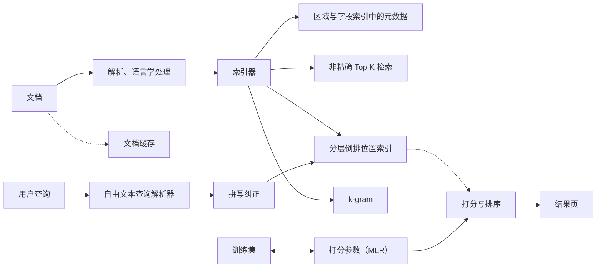

# CS 121: Information Retrieval — 话题：检索模型：布尔、tf-idf 与向量空间

## 目录

- [1. 布尔检索](#1-布尔检索)
- [2. 检索模型与排序检索](#2-检索模型与排序检索)
- [3. 词项加权：Jaccard、tf、idf 与 tf-idf](#3-词项加权jaccardtfidf-与-tf-idf)
- [4. 向量空间模型与余弦相似度](#4-向量空间模型与余弦相似度)
- [5. tf-idf 变体与 SMART 记法](#5-tf-idf-变体与-smart-记法)
- [6. 超越余弦：区域、邻近、查询解析器与聚合分数](#6-超越余弦区域邻近查询解析器与聚合分数)
- [7. 模型比较](#7-模型比较)
- [8. 速查与五条要点](#8-速查与五条要点)

> 本章讨论的是**一个文档对于一个查询能得到什么分数**：先是精确匹配的布尔模型，然后是使用 tf-idf 权重的排序检索与向量空间模型，最后是真实引擎会混合进来的额外证据（字段、区域、邻近）。它以倒排索引与 postings 列表的合并（[倒排索引与索引构建](topic-indexing.zh-CN.md)）以及 [文本处理](topic-text-processing.zh-CN.md) 中的词元与词项为前提。如何**快速**计算前 $K$ 个结果（堆、冠军列表、分层索引、MaxScore）是 [查询处理与高效 Top-K](topic-query-processing.zh-CN.md) 的主题；基于链接的质量分数 $g(d)$ 来自 [链接分析：HITS 与 PageRank](topic-link-analysis.zh-CN.md)；如何衡量一个排序是否良好，见 [搜索引擎评测](topic-evaluation.zh-CN.md)。

> 📘 **延伸阅读**：[Croft §7.1 Overview of Retrieval Models（书中第 233 页）](https://ciir.cs.umass.edu/downloads/SEIRiP.pdf) · [IIR Ch 6 Scoring, term weighting and the vector space model](https://nlp.stanford.edu/IR-book/pdf/irbookonlinereading.pdf)

## 1. 布尔检索

### 1.1 精确匹配模型

在**布尔检索模型**中，查询是用 **AND、OR 与 NOT** 连接词项而成的布尔表达式，每个文档被看作一个**词的集合**。

- 它是**精确的**：文档要么**满足条件，要么不满足**，没有排序。
- 它也许是构建信息检索系统最简单的模型；它曾是**三十年来主要的商用检索工具**。
- 许多搜索系统至今仍是布尔式的：**电子邮件、图书馆目录、macOS Spotlight**。

### 1.2 在词项-文档关联矩阵上求值查询

求值布尔查询的概念性方法，是在**词项-文档关联矩阵**上进行：行是词项，列是文档，若文档包含该词项则条目为 1。每个词项都有一个 0/1 的**关联向量**（即它所在的那一行）。以莎士比亚的问题为例：*哪些剧本同时包含 Brutus AND Caesar，却不包含 Calpurnia？* 下面是三行数据，针对六部剧本（Antony and Cleopatra、Julius Caesar、The Tempest、Hamlet、Othello、Macbeth）：

| | Antony and Cleopatra | Julius Caesar | The Tempest | Hamlet | Othello | Macbeth |
|---|---|---|---|---|---|---|
| Brutus | 1 | 1 | 0 | 1 | 0 | 0 |
| Caesar | 1 | 1 | 0 | 1 | 1 | 1 |
| Calpurnia | 0 | 1 | 0 | 0 | 0 | 0 |

取 Brutus、Caesar 与 Calpurnia 的行，将 Calpurnia 的那一行**取补**，再对三行做**按位与**：

$$R = I_{Bru} \wedge I_{Cae} \wedge \neg I_{Cal}$$

$I_t$ 是词项 $t$ 的行，$\wedge$ 是按位与，$\neg$ 将每一位取反。

```text
(Brutus)         1 1 0 1 0 0  AND
(Caesar)         1 1 0 1 1 1  AND
(NOT Calpurnia)  1 0 1 1 1 1  =
                 1 0 0 1 0 0
```

结果中为 1 的是第 1 列和第 4 列：**Antony and Cleopatra** 与 **Hamlet**。（Julius Caesar 两个名字都有，但它也包含 Calpurnia，所以 NOT 把它排除了。）这个矩阵只是一种思路：它大到无法存储，真实系统是通过合并倒排索引中的 postings 列表来回答同样的查询（[倒排索引与索引构建](topic-indexing.zh-CN.md)）。

> 📝 **练习**：[§1.5](#15-练习)

### 1.3 示例：WestLaw

WestLaw 是最大的商业（付费订阅）法律检索服务：1975 年启动，1992 年加入排序，2010 年加入联邦检索；数据量达数十 TB，约有 700,000 名用户。**大多数用户仍然使用布尔查询**——在法律领域，获得**"精确"**的结果非常重要。其高级搜索页面提供词项、连接符与扩展符的字段，以及日期和引文的限制。

| 信息需求 | WestLaw 查询 |
|---|---|
| 在涉及 federal tort claims act 的案件中，诉讼时效是什么？ | `LIMIT! /3 STATUTE ACTION /S FEDERAL /2 TORT /3 CLAIM` |
| 残障人士进入工作场所所需满足的要求 | `disabl! /p access! /s work-site work-place (employment /3 place` |

`/3` 表示相距 3 个词以内，`/S` 表示位于同一句中。**注意：SPACE 表示析取（OR），而不是合取（AND）！**

这些查询很长、很精确，带有邻近算子，是逐步构造出来的——**与网络搜索很不一样**。许多专业检索者仍然喜欢布尔检索：**你确切知道自己会得到什么**。

> ⚠️ **易错点**：在 WestLaw 中，`work-site work-place` 表示 work-site **或** work-place。一个会把查询的每个词都用 AND 连接的简单搜索工具（因此 `tropical fish` 意为 *tropical AND fish*）用的是相反的约定。空格算子的含义，是每个系统自己的设计选择。

> 📘 **延伸阅读**：[WestLaw](http://www.westlaw.com/) · [Croft §7.1.1 Boolean Retrieval（书中第 235 页）](https://ciir.cs.umass.edu/downloads/SEIRiP.pdf) · [IIR Ch 1 Boolean retrieval](https://nlp.stanford.edu/IR-book/pdf/irbookonlinereading.pdf)

### 1.4 结论与饥荒或盛宴（feast or famine）

| 优点 | 缺点 |
|---|---|
| 结果**可预测**，相对容易解释 | 效果**完全取决于用户** |
| 可以纳入许多不同的特征 | **简单查询通常效果不好** |
| **处理高效**，因为许多文档可以被排除 | **复杂查询难以编写** |

布尔检索适合**专家用户**（他们清楚自己的需求与文档集合），也适合**应用程序**；对于大多数"普通"用户，它并不好——这些用户写不出（或不愿写）布尔查询，也**不想翻阅成千上万条结果**，尤其是在**网络**上。

**饥荒或盛宴**：布尔查询往往返回**太少（= 0）或太多（数以千计）**的结果。

| 查询 | 命中数 |
|---|---|
| "standard user dlink650" | 200,000 |
| "standard user dlink650 no card found" | 0 |

要写出命中数可控的查询需要技巧：**AND 得到的太少；OR 得到的太多**。除了特定场合（例如法律），人们乐于**用确定性的结果换取易用性**。这正是排序的动机（[§2](#2-检索模型与排序检索)）。

### 1.5 练习

#### Brutus AND Caesar AND NOT Calpurnia

使用关联向量 Brutus = 110100、Caesar = 110111、Calpurnia = 010000（列依次为 Antony and Cleopatra、Julius Caesar、The Tempest、Hamlet、Othello、Macbeth），哪些剧本符合 *Brutus AND Caesar AND NOT Calpurnia*？

<details>
<summary>解答</summary>

NOT Calpurnia = 101111。110100 AND 110111 = 110100；再 AND 101111 = **100100**。第 1 列和第 4 列：**Antony and Cleopatra** 与 **Hamlet**。Julius Caesar 两个名字都有，但它也包含 Calpurnia，所以 NOT 把它排除了。

</details>

## 2. 检索模型与排序检索

### 2.1 检索模型与排序检索

**检索模型**是搜索过程的**数学框架**，也就是关于相关性的**理论**：它们陈述自己的**假设**，是**排序算法的基础**，并且**可以是隐含的**；这些模型的进展与**检索效果的提升**是同步的。**相关性**是复杂的（因素众多，**人们对判断也常常意见不一**），因此模型会对其加以简化：**主题相关与用户相关**，以及**二值、连续与多值**的相关性（[搜索引擎与 Web](topic-search-engines.zh-CN.md)）。

**排序检索模型**返回的是（前若干个）文档上的一个**次序**，而不是一个**集合**，通常用于**自由文本查询**（只有词，没有算子）——原则上这是两个独立的选择，实践中则是配对使用的。饥荒或盛宴就此消失：无论结果集多大，都展示**前 $k$ 个（约 10 个）**。**强假设：排序算法对用户"有效"。**

**打分**是基础：按最可能有用的顺序返回文档。**为每个文档分配一个分数**（比如在 $[0, 1]$ 中），衡量文档与查询的"匹配"程度。从**单词项查询**开始：

- 如果查询词项**未出现**在文档中，分数应为 **0**；
- 词项在文档中**出现得越频繁**，分数应**越高**。

本章其余部分会逐步构造这个分数：集合重叠（§3.1）、词频（§3.3）、稀有度（§3.4），然后是向量与夹角（[§4](#4-向量空间模型与余弦相似度)）。

### 2.2 排序的抽象模型

索引的设计是为了支持搜索——**更快的响应时间，以及更新**。网络搜索引擎使用一种特定形式的搜索，即**排序**：文档根据由文档表示、查询与排序算法计算出的**分数**，以**排好的顺序**被检索出来。一个合理的**排序抽象模型**，让我们可以在不涉及检索模型细节的情况下讨论索引。

以文档 *Fred's Tropical Fish Shop*（"…the best place to find tropical fish at low, low prices. Whether you're looking for a little fish or a big fish… We even have fake seaweed for your fishtank (and little surfboards too)."）为例。两类特征描述它：

| 主题特征（来自文本） | 质量特征（关于文档本身） |
|---|---|
| 9.7 fish · 4.2 tropical · 22.1 tropical fish · 8.2 seaweed · 4.2 surfboards | 14 incoming links · 3 days since last update |

一个**特征函数**把文本映射为一个实数，$f(\text{text}) \to \mathbb{R}$。**排序函数**接收这些特征与查询（*tropical fish*），输出一个**文档分数**（抽象示意图中为 24.5）。

**更具体的模型**：

$$R(Q, D) = \sum_i g_i(Q)\, f_i(D)$$

$f_i$ 是**文档特征函数**，$g_i$ 是**查询特征函数**，$i$ 遍历各个特征。查询 *tropical fish* 有它自己的特征值：

| 特征 $i$ | $f_i(D)$ | $g_i(Q)$ |
|---|---|---|
| fish | 9.7 | 5.2 |
| tropical | 4.2 | 3.4 |
| tropical fish | 22.1 | 9.9 |
| seaweed | 8.2 | — |
| surfboards | 4.2 | — |
| chichlids | — | 1.2 |
| barbs | — | 0.7 |
| incoming links | 14 | 1.2 |
| update count | 3 | 0.9 |

只有在**两边**都出现的特征才有贡献，由此得到**文档分数 303.01**（在 [§2.3](#23-练习) 中计算）。

> 💡 **关键洞见**：排序就是对各特征求和，每项为（查询权重 × 文档值）。索引的任务是让 $f_i(D)$ 易于获取——这就是 postings 可以携带计数、位置、范围与分数的原因（[倒排索引与索引构建](topic-indexing.zh-CN.md)）。本章中的每一个模型——tf-idf、余弦、[§6.4](#64-聚合分数一个真实引擎的公式) 中的聚合公式——都是对 $g_i$ 与 $f_i$ 的某种特定选择。

> 📘 **延伸阅读**：[Croft §5.2 Abstract Model of Ranking（书中第 126 页）](https://ciir.cs.umass.edu/downloads/SEIRiP.pdf)

### 2.3 练习

#### 文档分数 303.01

使用 $R(Q,D) = \sum_i g_i(Q) f_i(D)$ 与 [§2.2](#22-排序的抽象模型) 中的特征表。*Fred's Tropical Fish Shop* 对查询 *tropical fish* 的分数是多少？哪个特征贡献最大？

<details>
<summary>解答</summary>

只有同时具有 $f_i$ 与 $g_i$ 的特征才计入（seaweed 与 surfboards 没有查询权重；chichlids 与 barbs 不在文档中）：

| 特征 | $g_i(Q) \cdot f_i(D)$ |
|---|---|
| fish | 5.2 × 9.7 = 50.44 |
| tropical | 3.4 × 4.2 = 14.28 |
| tropical fish | 9.9 × 22.1 = 218.79 |
| incoming links | 1.2 × 14 = 16.80 |
| update count | 0.9 × 3 = 2.70 |

$R = 50.44 + 14.28 + 218.79 + 16.80 + 2.70 = \mathbf{303.01}$。短语特征 *tropical fish* 贡献了其中的大部分。用 Python 验算：

```python
q = {"fish": 5.2, "tropical": 3.4, "tropical fish": 9.9,
     "chichlids": 1.2, "barbs": 0.7, "incoming links": 1.2, "update count": 0.9}
d = {"fish": 9.7, "tropical": 4.2, "tropical fish": 22.1,
     "seaweed": 8.2, "surfboards": 4.2, "incoming links": 14, "update count": 3}
print(round(sum(q[f] * d[f] for f in q if f in d), 2))
```

```text
303.01
```

</details>

## 3. 词项加权：Jaccard、tf、idf 与 tf-idf

### 3.1 第一步：Jaccard 系数

衡量两个集合 $A$ 与 $B$ 重叠程度的一个常用度量：

$$J(A, B) = \frac{|A \cap B|}{|A \cup B|}$$

$|A \cap B|$ 是同时属于两个集合的元素个数，$|A \cup B|$ 是属于其中任一集合的元素个数。为给文档打分，取 $A$ 为查询的词项，$B$ 为文档的词项。

- $J(A, A) = 1$；若 $A \cap B = \emptyset$，则 $J(A, B) = 0$。
- **良好的性质**：$A$ 与 $B$ **不必大小相同**；它**总是给出一个介于 0 与 1 之间的数**。

**Jaccard 用于打分时的问题**：

- 它**不考虑词频**（一个词在文档中出现了多少次）。
- **集合中的稀有词项比常见词项更有信息量**；Jaccard 忽略了这一点。
- **针对文档长度进行归一化的更复杂启发式方法**能给出更好的分数。另一种选择是用下式替代 $|A \cap B| / |A \cup B|$：

$$\frac{|A \cap B|}{\sqrt{|A \cup B|}}$$

> 💡 **关键洞见**：这三个问题是接下来几节的议程：词频 → §3.3，稀有度 → §3.4（idf），长度归一化 → 向量空间模型（[§4](#4-向量空间模型与余弦相似度)）。

### 3.2 计数向量与词袋模型

**词项-文档关联矩阵**（§1.2）使每个文档成为一个**二值向量** $\in \{0,1\}^{|V|}$。现在改为考虑词项在文档中出现的**次数**。于是每个文档都是 $\mathbb{N}^{|V|}$ 中的一个**计数向量**——即下表中的一列：

| | Antony and Cleopatra | Julius Caesar | The Tempest | Hamlet | Othello | Macbeth |
|---|---|---|---|---|---|---|
| Antony | 157 | 73 | 0 | 0 | 0 | 0 |
| Brutus | 4 | 157 | 0 | 1 | 0 | 0 |
| Caesar | 232 | 227 | 0 | 2 | 1 | 1 |
| Calpurnia | 0 | 10 | 0 | 0 | 0 | 0 |
| Cleopatra | 57 | 0 | 0 | 0 | 0 | 0 |
| mercy | 2 | 0 | 3 | 5 | 5 | 1 |
| worser | 2 | 0 | 1 | 1 | 1 | 0 |

**词袋模型**：向量表示**不考虑词的顺序**。*John is quicker than Mary* 与 *Mary is quicker than John* 具有**相同的向量**。从某种意义上说，这是一次**暂时的倒退**，因为位置索引能够区分这两个文档（参见 [倒排索引与索引构建](topic-indexing.zh-CN.md)）——位置信息稍后会再次出现（[§6.2](#62-查询词项邻近)）；现在先用词袋模型。

### 3.3 词频与对数频率权重

词 $t$ 在文档 $d$ 中的**词频** $\mathrm{tf}_{t,d}$，是 $t$ 在 $d$ 中出现的**次数**。（**注意：在 IR 中，frequency 就是计数。**）

我们希望在查询-文档分数中使用 tf——但**原始的 tf 并不是我们想要的**。一个文档中某词出现 10 次，比只出现 1 次**更**相关，但**不是 10 倍更相关**。相关性并不随词频成比例增长。

**对数频率权重**：

$$w_{t,d} = \begin{cases} 1 + \log_{10} \mathrm{tf}_{t,d}, & \text{if } \mathrm{tf}_{t,d} > 0 \\ 0, & \text{otherwise} \end{cases}$$

| tf | 0 | 1 | 2 | 10 | 1000 |
|---|---|---|---|---|---|
| $w$ | 0 | 1 | 1.3 | 2 | 4 |

文档-查询对的分数，对同时位于 $q$ 与 $d$ 中的词项 $t$ 求和：

$$\mathrm{score}(q, d) = \sum_{t \in q \cap d} \left(1 + \log_{10} \mathrm{tf}_{t,d}\right)$$

若查询的词项都不在文档中，分数为 **0**。

### 3.4 文档频率与 idf

**稀有词项比常见词项更有信息量**——回想停用词。查询中在集合里很稀有的词项，例如 **arachnocentric**：包含它的文档很可能与查询 *arachnocentric* 相关。→ 我们希望**稀有词项获得高权重**。

**常见词项**（例如 *high、increase、line*）：包含其中一个的文档比不包含它的文档更可能相关，但这**不是确定的指标**。→ 对 *high、increase、line* 给予**正权重**，但要**低于**稀有词项的权重。

我们用**文档频率（df）**来刻画这一点。$\mathrm{df}_t$ 是 $t$ 的**文档频率**：**包含 $t$ 的文档数**。它是 $t$ 信息量的一个**反向**度量，且 $0 < \mathrm{df}_t \le N$。词项 $t$ 的 **idf**（逆文档频率）为

$$\mathrm{idf}_t = \log_{10}\left(N / \mathrm{df}_t\right)$$

其中 $N$ 是集合中的文档数。我们用 $\log(N/\mathrm{df}_t)$ 而不是 $N/\mathrm{df}_t$，以**抑制** idf 的影响。事实会证明，对数的底数无关紧要。集合中**每个词项 $t$ 对应一个 idf 值**。

**idf 示例，$N$ = 100 万：**

| 词项 | $\mathrm{df}_t$ | $\mathrm{idf}_t$ |
|---|---|---|
| calpurnia | 1 | 6 |
| animal | 100 | 4 |
| sunday | 1,000 | 3 |
| fly | 10,000 | 2 |
| under | 100,000 | 1 |
| the | 1,000,000 | 0 |

**idf 对排序的影响**：对于像 *iPhone* 这样的**单词项查询**，idf 重要吗？**不重要——idf 对单词项查询的排序没有影响**：每个文档得到的 idf 因子都相同。idf 对至少含**两个词项**的查询的排序有影响：对于 *capricious person*，idf 使 *capricious* 的出现比 *person* 的出现**重要得多**。

**集合频率与文档频率**：词项 $t$ 的**集合频率**，是 $t$ 在整个集合中的出现次数，多次出现分别计算。

| 词 | 集合频率 | 文档频率 |
|---|---|---|
| insurance | 10440 | 3997 |
| try | 10422 | 8760 |

*哪个词是更好的检索词（应获得更高的权重）？* **insurance**：两者的集合频率几乎相同，但 *insurance* 集中在不到一半数量的文档中，因此它的 df 更低、idf 更高。这就是 idf 使用 df 而不是集合频率的原因。

### 3.5 tf-idf

词项的 **tf-idf 权重**，是其 tf 权重与 idf 权重的**乘积**：

$$w_{t,d} = \left(1 + \log \mathrm{tf}_{t,d}\right) \times \log\left(N / \mathrm{df}_t\right)$$

- 它是信息检索中**最著名、使用最广**的加权方案。
- tf-idf 中的"-"是**连字符，不是减号！** 其他名称：tf.idf、tf × idf、tfidf。
- **良好的性质**：它**随词项在文档内的出现次数增加而增大**，并且**随词项在集合中的稀有程度增加而增大**。

文档 $d$ 对查询 $q$ 的分数：

$$\mathrm{Score}(q, d) = \sum_{t \in q \cap d} \mathrm{tf.idf}_{t,d}$$

$\mathrm{Score}(q, d)$ 是**给定查询时文档的相关性分数**，求和遍历**查询与文档交集中的词项**，每个求和项 $w_{t,d}$ 都是 **tf-idf** 权重。

**可以构造出许多变体**：tf 如何计算（有无对数）、查询中的词项是否也加权，……**选择或设计你自己的启发式方法**（[§5](#5-tf-idf-变体与-smart-记法) 对它们做了分类）。

上面表格中的 tf 与 idf 两列，计算如下：

```python
import math

N = 1_000_000
for term, df in [("calpurnia", 1), ("animal", 100),
                 ("sunday", 1_000), ("fly", 10_000),
                 ("under", 100_000), ("the", 1_000_000)]:
    print(f"{term:9} idf = {math.log10(N / df):.0f}")
print([round(1 + math.log10(tf), 1) for tf in (1, 2, 10, 1000)])
```

```text
calpurnia idf = 6
animal    idf = 4
sunday    idf = 3
fly       idf = 2
under     idf = 1
the       idf = 0
[1.0, 1.3, 2.0, 4.0]
```

> ⚠️ **易错点**：一个在**每一个**文档中都出现的词（*the*，df = N）的 idf 为 0，因此无论它出现多少次，其 tf-idf 都是 0——idf 自动承担了停用词表的作用。

> 📘 **延伸阅读**：[Croft §7.1.2 The Vector Space Model（书中第 237 页）](https://ciir.cs.umass.edu/downloads/SEIRiP.pdf) · [IIR Ch 6 inverse document frequency and tf-idf weighting](https://nlp.stanford.edu/IR-book/pdf/irbookonlinereading.pdf)

> 📝 **练习**：[§3.6](#36-练习)

### 3.6 练习

#### 填写 idf 表

$N = 1{,}000{,}000$。df：calpurnia 1、animal 100、sunday 1,000、fly 10,000、under 100,000、the 1,000,000。计算 $\mathrm{idf}_t = \log_{10}(N/\mathrm{df}_t)$。

<details>
<summary>解答</summary>

| 词项 | $N/\mathrm{df}_t$ | idf |
|---|---|---|
| calpurnia | $10^6$ | 6 |
| animal | $10^4$ | 4 |
| sunday | $10^3$ | 3 |
| fly | $10^2$ | 2 |
| under | $10^1$ | 1 |
| the | $10^0$ | 0 |

每当 df 增大 10 倍，idf 恰好减少 1；出现在每个文档中的词项得到 0。

</details>

#### insurance 还是 try？

insurance：集合频率 10440，文档频率 3997。try：集合频率 10422，文档频率 8760。哪个是更好的检索词？

<details>
<summary>解答</summary>

**insurance**。两者的集合频率几乎相等，因此 cf 无法区分它们。但 *insurance* 出现在 3997 个文档中（在包含它的每个文档中约出现 2.6 次），而 *try* 分散在 8760 个文档中（每个约 1.2 次）。文档更少 → df 更低 → **idf 更高**：包含 *insurance* 的文档更能说明其主题。这就是加权使用 **df** 而不是集合频率的原因。

</details>

## 4. 向量空间模型与余弦相似度

### 4.1 文档即向量

词项-文档矩阵经历了三个版本：**关联**（0/1，§1.2）→ **计数**（§3.2）→ **tf-idf 权重**：

| | Antony and Cleopatra | Julius Caesar | The Tempest | Hamlet | Othello | Macbeth |
|---|---|---|---|---|---|---|
| Antony | 5.25 | 3.18 | 0 | 0 | 0 | 0.35 |
| Brutus | 1.21 | 6.1 | 0 | 1 | 0 | 0 |
| Caesar | 8.59 | 2.54 | 0 | 1.51 | 0.25 | 0 |
| Calpurnia | 0 | 1.54 | 0 | 0 | 0 | 0 |
| Cleopatra | 2.85 | 0 | 0 | 0 | 0 | 0 |
| mercy | 1.51 | 0 | 1.9 | 0.12 | 5.25 | 0.88 |
| worser | 1.37 | 0 | 0.11 | 4.15 | 0.25 | 1.95 |

**每个文档现在都由一个实值的 tf-idf 权重向量表示** $\in \mathbb{R}^{|V|}$——即这张表中的一列。（这些权重按原样给出；产生它们的集合大小与文档频率并未说明，因此无法重新计算。）

- 我们有一个 **$|V|$ 维的向量空间**（$|V|$ 为词汇表大小）。
- **词项是空间的坐标轴**。
- **文档是这个空间中的点或向量**。
- **维度极高**：对于网络搜索引擎，可达数千万维。
- **非常稀疏**：大多数分量为零（一个页面只使用词汇表中极小的一部分）。

> 💡 **关键洞见**：文档向量从来不会被存储为 $|V|$ 个数字——它的非零分量，恰好就是它的 postings。

> 📘 **延伸阅读**：[Croft §7.1.2 The Vector Space Model（书中第 237 页）](https://ciir.cs.umass.edu/downloads/SEIRiP.pdf) · [IIR §6.3 The vector space model for scoring](https://nlp.stanford.edu/IR-book/pdf/irbookonlinereading.pdf)

### 4.2 查询也是向量，以及为何不用欧氏距离

- **关键思想 1**：对查询做同样的处理——把它们表示为**同一空间中的向量**。
- **关键思想 2**：在这个空间中，**按文档与查询的接近程度对文档排序**。接近程度 = 向量的相似度；接近程度 ≈ 距离的倒数。
- 原因：我们希望摆脱**"非此即彼"的布尔模型**（[§1](#1-布尔检索)），转而让**更相关的文档排在较不相关的文档之前**。

人们首先想到的是两点之间的距离（即两个向量端点之间的距离）：**欧氏距离？** 这是**个坏主意**，因为欧氏距离对于**长度不同的向量**会很大——而**查询与文档的长度通常相差很大**。

**示意图**：两个坐标轴，JEALOUS（x）与 GOSSIP（y），都在 0 到 1 之间。$d_1$ 几乎笔直朝上（主要是 *gossip*），$d_3$ 几乎平放（主要是 *jealous*），而 $q$ 与 $d_2$ 指向几乎相同的方向（两个词项以相近的比例出现）——但 $d_2$ 是一个长得多的箭头，冲出了单位正方形。即便 $q$ 与 $d_2$ 中词项的分布非常相似，它们之间的欧氏距离仍然**很大**。

同一个点用排序来表达：在词项1/词项2 坐标轴上，$q$ 位于 (1, 1) 附近；$d_1$ 位于与 $q$ 经过原点的**同一条直线**上、更远的地方；而 $d_2$ 作为一个点离 $q$ 更近，但方向更陡。**按欧氏 tf-idf：$d_2, d_1$。按余弦：$d_1, d_2$。**

> ⚠️ **易错点**："最近的点"与"方向最相似"是两个不同的问题。一个与查询主题完全相关的长文档，按欧氏距离来说，离一个 3 词的查询*很远*。向量空间模型按方向排序。

### 4.3 用夹角：余弦相似度

**思想实验**：取一个文档 $d$，把它自身追加到自己后面，称之为 $d'$。

- "语义上" $d$ 与 $d'$ 具有**相同的内容**。
- 它们之间的**欧氏距离**可能**相当大**——这很糟！
- 它们之间的**夹角**为 **0**，对应**最大相似度**——这很好！

**关键思想：按文档与查询之间的夹角对文档排序。**

余弦在 $[0°, 180°]$ 上是**单调递减**的函数（0° 时为 1，90° 时为 0，180° 时为 −1，360° 时再回到 1）。因此按夹角排序与按余弦排序是等价的：**夹角增大 = 余弦减小**，最好的文档排在最前。

**cosine(query, document)**：

$$\cos(\vec q, \vec d) = \frac{\vec q \cdot \vec d}{\lvert\vec q\rvert\,\lvert\vec d\rvert} = \frac{\vec q}{\lvert\vec q\rvert} \cdot \frac{\vec d}{\lvert\vec d\rvert} = \frac{\sum_{i=1}^{|V|} q_i d_i}{\sqrt{\sum_{i=1}^{|V|} q_i^2}\,\sqrt{\sum_{i=1}^{|V|} d_i^2}}$$

$q_i$ 是词项 $i$ 在查询中的 tf-idf 权重，$d_i$ 是词项 $i$ 在文档中的 tf-idf 权重。分子是**点积**；除以两个向量的长度，会把两个向量都变成**单位向量**。$\cos(\vec q, \vec d)$ 是 $q$ 与 $d$ 的余弦相似度——等价地，即它们之间夹角的余弦。

> 📘 **延伸阅读**：[Croft §7.1.2 The Vector Space Model（书中第 237 页）](https://ciir.cs.umass.edu/downloads/SEIRiP.pdf) · [IIR Ch 6 cosine similarity](https://nlp.stanford.edu/IR-book/pdf/irbookonlinereading.pdf)

### 4.4 长度归一化

通过将每个分量除以向量的长度，对向量做**长度归一化**，所用的是 **$L_2$ 范数**：

$$\lVert\vec x\rVert_2 = \sqrt{\sum_i x_i^2}$$

- 除以 $L_2$ 范数后，向量成为**单位向量**——即位于**单位超球面表面**上的一个点。
- 对 $d$ 与 $d'$（$d$ 追加到自身）的影响：长度归一化之后，二者得到**相同的向量**。
- **长文档与短文档现在具有可比较的权重。**

**对于长度归一化的向量，余弦就是点积**（标量积）：

$$\cos(\vec q, \vec d) = \vec q \cdot \vec d = \sum_{i=1}^{|V|} q_i d_i \qquad \text{for } q, d \text{ length-normalized.}$$

图示：坐标轴为 RICH 与 POOR，单位正方形，以及半径为 1 的虚线四分之一圆。归一化后的向量 $\vec v(d_1)$、$\vec v(q)$、$\vec v(d_2)$、$\vec v(d_3)$ 都**落在那段弧上**；它们只有方向不同，角 $\theta$ 位于 $\vec v(d_1)$ 与 $\vec v(d_2)$ 之间。$\vec v(q)$ 与 $\vec v(d_2)$ 在弧上是相邻的近邻。

> 💡 **关键洞见**：文档一旦归一化，就已经"位于超球面的表面上"，因此余弦在查询时不需要除法——只需点积。这就是引擎在**建立索引时**就对文档向量做归一化的原因。

### 4.5 示例：三部小说有多相似？

*Sense and Sensibility*（SaS）、*Pride and Prejudice*（PaP）、*Wuthering Heights*（WH），四个词项，为简单起见**不使用 idf**（因此方案为 "lnc"：对数 tf、无 idf、余弦归一化）。计数 → 对数权重 → 归一化 → 点积：

| term | SaS | PaP | WH |
|---|---|---|---|
| affection | 115 | 58 | 20 |
| jealous | 10 | 7 | 11 |
| gossip | 2 | 0 | 6 |
| wuthering | 0 | 0 | 38 |

结果：$\cos(\text{SaS}, \text{PaP}) \approx 0.94$，$\cos(\text{SaS}, \text{WH}) \approx 0.79$，$\cos(\text{PaP}, \text{WH}) \approx 0.69$。两部奥斯汀的小说最为接近。逐步查看：

```viz tfidf-cosine
{"title": "三部小说的两两余弦（lnc）", "docs": "SaS: affection:115 jealous:10 gossip:2 wuthering:0; PaP: affection:58 jealous:7 gossip:0 wuthering:0; WH: affection:20 jealous:11 gossip:6 wuthering:38", "scheme": "lnc"}
```

> 📝 **练习**：[§4.8](#48-练习)

### 4.6 计算余弦分数：CosineScore 算法

```text
CosineScore(q)
 1  float Scores[N] = 0
 2  float Length[N]
 3  for each query term t
 4  do calculate w_t,q and fetch postings list for t
 5       for each pair(d, tf_t,d) in postings list
 6       do Scores[d] += w_t,d × w_t,q
 7  Read the array Length
 8  for each d
 9  do Scores[d] = Scores[d] / Length[d]
10  return Top K components of Scores[]
```

- 它是**逐词项**的（参见 [查询处理与高效 Top-K](topic-query-processing.zh-CN.md)）：`Scores` 是累加器，一次填充一个 postings 列表。
- 只有包含**至少一个查询词项**的文档才会获得非零分数——被读取的只有 postings 列表。
- `Length[d]` 在**建立索引时**计算，这里只是读取（第 7 行）；最后的除法（第 9 行）是余弦中的文档部分。查询的长度对每个文档都相同，因此不改变排序。
- 第 10 行是 top-$K$ 问题：不必对所有分数排序即可获得前 $K$ 个——用堆，详见 [查询处理与高效 Top-K](topic-query-processing.zh-CN.md)。

同样的步骤用 Python 实现，基于 [§5.2](#52-示例lncltc) 中的 lnc.ltc 示例：文档 *car insurance auto insurance*，查询 *best car insurance*：

```python
import heapq
import math

docs = {"d": "car insurance auto insurance".split()}
df = {"auto": 5000, "best": 50000,
      "car": 10000, "insurance": 1000}
N = 1_000_000

def log_tf(tf):
    return 1 + math.log10(tf) if tf > 0 else 0

# Index time: postings (d, tf) and Length[d] (lnc)
postings, length = {}, {}
for d, words in docs.items():
    counts = {t: words.count(t) for t in set(words)}
    for t, tf in counts.items():
        postings.setdefault(t, []).append((d, tf))
    length[d] = math.sqrt(sum(log_tf(tf) ** 2
                              for tf in counts.values()))

def cosine_score(query, K=10):
    q = {t: query.count(t) for t in set(query)}
    w_q = {t: log_tf(tf) * math.log10(N / df[t])
           for t, tf in q.items()}          # ltc ...
    q_len = math.sqrt(sum(w * w for w in w_q.values()))
    scores = {}                             # line 1
    for t, wtq in w_q.items():              # lines 3-4
        for d, tf in postings.get(t, []):   # line 5
            scores[d] = scores.get(d, 0) + \
                log_tf(tf) * wtq / q_len    # line 6
    for d in scores:                        # lines 7-9
        scores[d] /= length[d]
    return heapq.nlargest(K, scores.items(),
                          key=lambda x: x[1])  # line 10

print(round(length["d"], 2))
print([(d, round(s, 2)) for d, s in
       cosine_score("best car insurance".split())])
```

```text
1.92
[('d', 0.8)]
```

文档长度 1.92 与分数 0.8，与 [§5.2](#52-示例lncltc) 中的手工计算一致。（$N$ = 1,000,000 是能重现那里所用 idf 列的值，例如 $\log_{10}(10^6/5000) = 2.3$。）

> 📘 **延伸阅读**：[IIR Ch 6 computing vector scores](https://nlp.stanford.edu/IR-book/pdf/irbookonlinereading.pdf) · [Croft §5.7.3 Optimization Techniques（书中第 170 页）](https://ciir.cs.umass.edu/downloads/SEIRiP.pdf)

### 4.7 向量空间排序的五个步骤

1. 将**查询**表示为加权的 tf-idf 向量。
2. 将**每个文档**表示为加权的 tf-idf 向量。
3. 计算查询向量与每个文档向量的**余弦相似度**分数。
4. 按分数对文档相对于查询进行**排序**。
5. 向用户返回**前 K 个**（例如 K = 10）结果。

### 4.8 练习

#### 分别按距离与夹角对 d1 与 d2 排序

在词项1/词项2 坐标轴上，查询为 $q = (1, 1)$。文档 $d_1 = (3, 3)$ 位于与 $q$ 经过原点的**同一条直线**上、更远的地方；$d_2 = (1, 2)$ 是离 $q$ **更近**的一个点，但方向更陡（词项2 比词项1 多）。分别按欧氏距离、再按余弦对 $d_1$、$d_2$ 排序。（这些坐标仅为示意。）

<details>
<summary>解答</summary>

- **欧氏距离**：$d_2$ 是更近的点 → **$d_2$, $d_1$**。
- **余弦**：$d_1$ 与 $q$ **方向相同**（夹角 ≈ 0，余弦 ≈ 1）；$d_2$ 的方向有明显的偏离 → **$d_1$, $d_2$**。

余弦是对的：$d_1$ 以查询的比例包含查询的词项，只是更长——就像 [§4.3](#43-用夹角余弦相似度) 中的 $d'$。下面检查数值：

```python
import math

q = (1, 1)
docs = {"d1": (3, 3), "d2": (1, 2)}
for name, d in docs.items():
    dist = math.dist(q, d)
    cos = (q[0]*d[0] + q[1]*d[1]) / (math.hypot(*q) * math.hypot(*d))
    print(name, "euclidean =", round(dist, 3), "cosine =", round(cos, 3))
```

```text
d1 euclidean = 2.828 cosine = 1.0
d2 euclidean = 1.0 cosine = 0.949
```

</details>

#### 三部小说有多相似？

计数（无 idf）：affection SaS 115 / PaP 58 / WH 20；jealous 10 / 7 / 11；gossip 2 / 0 / 6；wuthering 0 / 0 / 38。计算对数频率权重，做长度归一化，并求三对两两的余弦。为什么 $\cos(\text{SaS}, \text{PaP}) > \cos(\text{SaS}, \text{WH})$？

<details>
<summary>解答</summary>

**1. 对数频率权重** $1 + \log_{10}\mathrm{tf}$（tf = 0 时为 0）：

| term | SaS | PaP | WH |
|---|---|---|---|
| affection | 3.06 | 2.76 | 2.30 |
| jealous | 2.00 | 1.85 | 2.04 |
| gossip | 1.30 | 0 | 1.78 |
| wuthering | 0 | 0 | 2.58 |

**2. 长度**：SaS $\sqrt{3.06^2 + 2.00^2 + 1.30^2} = 3.881$，PaP 3.323，WH 4.391。将每一列除以其长度：

| term | SaS | PaP | WH |
|---|---|---|---|
| affection | 0.789 | 0.832 | 0.524 |
| jealous | 0.515 | 0.555 | 0.465 |
| gossip | 0.335 | 0 | 0.405 |
| wuthering | 0 | 0 | 0.588 |

**3. 点积**（向量为单位长度，因此点积即余弦）：

- $\cos(\text{SaS}, \text{PaP}) = 0.789 \times 0.832 + 0.515 \times 0.555 + 0.335 \times 0 + 0 \times 0 \approx$ **0.94**
- $\cos(\text{SaS}, \text{WH}) \approx$ **0.79**
- $\cos(\text{PaP}, \text{WH}) \approx$ **0.69**

用 Python 计算同样的结果：

```python
import math

counts = {
    "SaS": [115, 10, 2, 0],
    "PaP": [58, 7, 0, 0],
    "WH":  [20, 11, 6, 38],
}

def unit(v):
    w = [1 + math.log10(x) if x > 0 else 0 for x in v]   # log tf, no idf
    n = math.sqrt(sum(x * x for x in w))                  # L2 length
    return [x / n for x in w]

u = {k: unit(v) for k, v in counts.items()}
for k, v in u.items():
    print(k, [round(x, 3) for x in v])
for a, b in [("SaS", "PaP"), ("SaS", "WH"), ("PaP", "WH")]:
    print(a, b, round(sum(x * y for x, y in zip(u[a], u[b])), 3))
```

```text
SaS [0.789, 0.515, 0.335, 0.0]
PaP [0.832, 0.555, 0.0, 0.0]
WH [0.524, 0.465, 0.405, 0.588]
SaS PaP 0.942
SaS WH 0.789
PaP WH 0.694
```

**为什么 SaS–PaP > SaS–WH？** SaS 与 PaP 具有**相同的形状**：以 *affection* 为主，有一些 *jealous*，几乎没有 *gossip*，并且**完全没有 *wuthering***。WH 把权重分散到四个词项上，并且有一个较大的 *wuthering* 分量，而另外两部小说完全没有这一项。这一维度增加了 WH 的长度，但它对与 SaS 或 PaP 的每一个乘积贡献都是 **0**。比例相同 → 夹角小 → 余弦高，与书的长短无关。

</details>

## 5. tf-idf 变体与 SMART 记法

### 5.1 各种变体与 ddd.qqq

**tf-idf 加权有许多变体。** 括号中是每种选择的**单字母缩写**。

| 词频 | | 文档频率 | | 归一化 | |
|---|---|---|---|---|---|
| n（自然） | $\mathrm{tf}_{t,d}$ | n（无） | 1 | n（无） | 1 |
| **l（对数）** | $1 + \log(\mathrm{tf}_{t,d})$ | **t（idf）** | $\log \frac{N}{\mathrm{df}_t}$ | **c（余弦）** | $\frac{1}{\sqrt{w_1^2 + w_2^2 + \dots + w_M^2}}$ |
| a（增强） | $0.5 + \frac{0.5 \times \mathrm{tf}_{t,d}}{\max_t(\mathrm{tf}_{t,d})}$ | p（概率 idf） | $\max\{0, \log \frac{N - \mathrm{df}_t}{\mathrm{df}_t}\}$ | u（枢轴唯一） | $1/u$ |
| b（布尔） | 若 $\mathrm{tf}_{t,d} > 0$ 则为 1，否则为 0 | | | b（字节大小） | $1/\mathit{CharLength}^{\alpha}$，$\alpha < 1$ |
| L（对数平均） | $\frac{1 + \log(\mathrm{tf}_{t,d})}{1 + \log(\mathrm{ave}_{t \in d}(\mathrm{tf}_{t,d}))}$ | | | | |

第一行（n、n、n——原始计数，无 idf，无归一化）是最简单的方案；l、t、c 这一行则是 **ltc："通常采用的通用标准"**。

**查询与文档的加权可以不同：**

- 许多搜索引擎允许**对查询与文档使用不同的加权**。
- **SMART 记法**把引擎所用的组合记为 **ddd.qqq**——文档三个字母、查询三个字母，取自上表。
- **一种非常标准的加权方案是 lnc.ltc**：
  - **文档**：**l**对数 tf，**n**无 idf，**c**余弦归一化。
  - **查询**：**l**对数 tf，idf（**t**），**c**余弦归一化。

### 5.2 示例：lnc.ltc

文档 *car insurance auto insurance*；查询 *best car insurance*。下表按列填写（原始 tf → tf 权重 → df/idf → 权重 → 归一化 → 乘积）：

| 词项 | 查询原始 tf | 查询 tf 权重 | df | idf | 查询权重 | 查询归一化 | 文档原始 tf | 文档 tf 权重 | 文档权重 | 文档归一化 | 乘积 |
|---|---|---|---|---|---|---|---|---|---|---|---|
| auto | 0 | 0 | 5000 | 2.3 | 0 | 0 | 1 | 1 | 1 | 0.52 | 0 |
| best | 1 | 1 | 50000 | 1.3 | 1.3 | 0.34 | 0 | 0 | 0 | 0 | 0 |
| car | 1 | 1 | 10000 | 2.0 | 2.0 | 0.52 | 1 | 1 | 1 | 0.52 | 0.27 |
| insurance | 1 | 1 | 1000 | 3.0 | 3.0 | 0.78 | 2 | 1.3 | 1.3 | 0.68 | 0.53 |

文档长度 $= \sqrt{1^2 + 0^2 + 1^2 + 1.3^2} \approx 1.92$。**分数 $= 0 + 0 + 0.27 + 0.53 = 0.8$。** 文档的"权重"一列与其 tf 权重相同——这就是 lnc 中的 **n**（无 idf）。

```viz tfidf-cosine
{"title": "tf-idf 示例：lnc.ltc", "docs": "d: car insurance auto insurance", "query": "best car insurance", "scheme": "lnc.ltc", "df": "auto:5000 best:50000 car:10000 insurance:1000", "N": 1000000, "interactive": true}
```

> ⚠️ **易错点**：在 ddd.qqq 中，**文档在前**。lnc.ltc 只在**查询**一侧使用 idf——由于 idf 是词项的性质，只需对查询应用一次，就足以让稀有的查询词项在乘积中贡献更大。把"t"放在哪一侧搞混，是经典陷阱。

> 📘 **延伸阅读**：[IIR Ch 6 variant tf-idf functions, SMART notation](https://nlp.stanford.edu/IR-book/pdf/irbookonlinereading.pdf) · [Croft §7.1.2 The Vector Space Model（书中第 237 页）](https://ciir.cs.umass.edu/downloads/SEIRiP.pdf)

> 📝 **练习**：[§5.3](#53-练习)

### 5.3 练习

#### 用 lnc.ltc 为 "best car insurance" 打分

文档 *car insurance auto insurance*；查询 *best car insurance*；$N = 10^6$；df：auto 5000、best 50000、car 10000、insurance 1000。填写 lnc.ltc 表并计算分数。

<details>
<summary>解答</summary>

**查询（ltc）**：原始 tf best 1、car 1、insurance 1、auto 0 → tf 权重 1、1、1、0。idf = $\log_{10}(N/\mathrm{df})$：auto 2.3、best 1.3、car 2.0、insurance 3.0。权重 = tf 权重 × idf：auto 0、best 1.3、car 2.0、insurance 3.0。长度 $= \sqrt{1.3^2 + 2.0^2 + 3.0^2} = 3.83$ → 归一化后：best **0.34**、car **0.52**、insurance **0.78**。

**文档（lnc）**：原始 tf auto 1、best 0、car 1、insurance 2 → tf 权重 1、0、1、$1 + \log_{10} 2 = 1.3$。没有 idf，因此权重 = tf 权重。长度 $= \sqrt{1^2 + 0^2 + 1^2 + 1.3^2} \approx 1.92$ → 归一化后：auto **0.52**、car **0.52**、insurance **0.68**。

**乘积**：auto $0 \times 0.52 = 0$；best $0.34 \times 0 = 0$；car $0.52 \times 0.52 = 0.27$；insurance $0.78 \times 0.68 = 0.53$。

**分数 = 0 + 0 + 0.27 + 0.53 = 0.8**（未取整：0.801）。*auto* 出现在文档中但不在查询中，*best* 出现在查询中但不在文档中：两者的贡献都是 0，但它们仍然计入各自向量的长度。

</details>

## 6. 超越余弦：区域、邻近、查询解析器与聚合分数

### 6.1 参数（字段）索引与区域索引

**元数据。** 到目前为止，一个文档被视为词项的序列。实际上，文档具有**多个部分，其中一些具有特殊的语义**：作者、标题、出版日期、语言、格式等。这些构成了文档的**元数据**。

**字段。** 我们有时希望按这些元数据进行搜索——例如，查找由 William Shakespeare 于 1601 年撰写、并包含 *alas poor Yorick* 的文档。

- **Year = 1601** 就是一个**字段**的例子；作者姓氏 = shakespeare 也是。
- **字段索引或参数索引**：为每个字段值建立 postings。有时会为日期等建立**范围树**。
- 字段查询通常被视为**合取**（文档**必须**由 shakespeare 撰写）。

**区域。** **区域**是文档中可以包含**任意数量文本**的一部分：标题、摘要、参考文献……也可以为区域建立**倒排索引**，以支持查询——例如，"查找在**标题**区域中包含 *merchant*、并且匹配查询 *gentle rain* 的文档"。

**两种编码区域的方式。** 区域放在**词典**中——每个词项-区域对一个 postings 列表：

| 词典条目 | Postings |
|---|---|
| `william.abstract` | 11 → 121 → 1441 → 1729 |
| `william.title` | 2 → 4 → 8 → 16 |
| `william.author` | 2 → 3 → 5 → 8 |

区域放在 **postings** 中——一个词项一个列表，每个 posting 附带其区域标记：

| 词典条目 | Postings |
|---|---|
| `william` | 2.author,2.title → 3.author → 4.title → 5.author |

> 💡 **关键洞见**：字段 = 被精确匹配的值（year = 1601），用作过滤器；区域 = 在其内部进行自由文本搜索的部分（标题、摘要）。区域信息会输入 [§6.4](#64-聚合分数一个真实引擎的公式) 聚合公式中的"字段权重" $P(t, D)$：标题或页眉中的匹配，可以比正文中的匹配获得更高的排名。

> 📘 **延伸阅读**：[IIR §6.1 Parametric and zone indexes](https://nlp.stanford.edu/IR-book/pdf/irbookonlinereading.pdf)，其中还展开了加权区域打分（对各区域的匹配进行加权求和）。

### 6.2 查询词项邻近

**自由文本查询**——即在查询框中输入的一组词项——在网络上很常见。**用户更喜欢查询词项彼此靠得很近地出现的文档。**

设 $w$ 为文档中包含**所有**查询词项的**最小窗口**。对于查询 *strained mercy*，文档 *The quality of mercy is not strained* 中的最小窗口为 **4**（词）：*mercy is not strained*。

- 直觉：**$w$ 越小，文档与查询的匹配就越好。**
- 我们希望打分函数考虑这一点：**加上权重！**

邻近需要索引中记录词的位置（[倒排索引与索引构建](topic-indexing.zh-CN.md)）。

### 6.3 查询解析器

用户输入的自由文本查询，实际上可能**生成一个或多个**对索引的查询。例如，对于查询 *rising interest rates*：

1. 将查询作为**短语查询**运行。
2. 如果**少于 $K$ 个**文档包含短语 *rising interest rates*，则运行两个短语查询 *rising interest* 与 *interest rates*。
3. 如果**仍然少于 $K$ 个**文档，则运行**向量空间查询** *rising interest rates*。
4. **用向量空间打分对匹配的文档排序。**

这一序列由**查询解析器**发出——它是一种把用户查询转换为**一连串多个查询**的方法。短语查询需要位置索引（[倒排索引与索引构建](topic-indexing.zh-CN.md)）。只有当更严格的查询得到的文档少于 $K$ 个时，每一步才会放宽查询——这与分层索引（[查询处理与高效 Top-K](topic-query-processing.zh-CN.md)）的回退逻辑相同。

### 6.4 聚合分数：一个真实引擎的公式

打分函数可以组合**余弦、静态质量、邻近**等证据。一种可能的聚合方式——真实引擎会把向量空间分数与其他证据混合起来：

$$S(q, D) = \alpha\left[\beta \sum_{t \in (q \cap D)} \mathrm{tfidf}_{t,D}\,\bigl(1 + P(t, D)\bigr) + (1 - \beta)\cos(q, D)\right] \times \bigl(1 + \Phi(q, D)\bigr) + (1 - \alpha)\,g(D)$$

| 符号 | 含义 |
|---|---|
| $\mathrm{tfidf}(t, D)$ | 词项 $t$ 在文档 $D$ 中的 tf.idf |
| $\cos(q, D)$ | 查询 $q$ 与文档 $D$ 的向量之间的余弦相似度 |
| $P(t, D)$ | 词元 $t$ 在 $D$ 中的**"字段权重"**——提升词元出现在**标题、粗体、斜体**等位置的文档 |
| $\Phi(q, D)$ | $q$ 在 $D$ 中的**"短语权重"**——提升词元以与查询中**相同的顺序和相同的距离**出现的文档 |
| $g(D)$ | 文档自身特征与链接分析（例如 PageRank、HITS）的函数 |
| $\alpha$ | 可调参数：平衡 **查询 + 文档** 部分与 **仅文档** 部分 |
| $\beta$ | 可调参数：平衡 **tf.idf** 部分与 **余弦** 部分 |

> 💡 **关键洞见**：从内往外读：tf-idf 经字段加权后，与余弦按 $\beta$ 混合，再按短语匹配（$\Phi$）加权，最后与查询无关的文档质量（$\alpha$、$g$）混合。$P$ 需要建索引时的字段信息，$\Phi$ 需要**位置**，而 $g$ 是 [链接分析：HITS 与 PageRank](topic-link-analysis.zh-CN.md) 中的 PageRank/HITS 分数——字段与区域、查询词项邻近与静态质量分数，都在同一个公式中。

如何知道**最佳组合**？

- **用户调查**：请真实的人使用你的搜索引擎。
- 某些应用：**由专家调校**。
- **手工调校真实系统很困难**（例如有几十或几百种可能的阈值选择，哪些因素要考虑、哪些不考虑，等等）。
- 越来越常见的技术：**基于自适应学习的优化**（机器学习排序）。

> 📘 **延伸阅读**：[Croft §7.4 Complex Queries and Combining Evidence（书中第 267 页）](https://ciir.cs.umass.edu/downloads/SEIRiP.pdf) · [Croft §7.5 Web Search（书中第 279 页）](https://ciir.cs.umass.edu/downloads/SEIRiP.pdf) · [IIR Ch 7 A complete search system](https://nlp.stanford.edu/IR-book/pdf/irbookonlinereading.pdf)

### 6.5 整合：完整的搜索系统



打分参数是从**训练集**中学习得到的（**MLR**，即机器学习排序）。

> 📝 **练习**：[§6.6](#66-练习)

### 6.6 练习

#### strained mercy 的最小窗口

查询：*strained mercy*。文档：*The quality of mercy is not strained*。包含所有查询词项的最小窗口 $w$ 是多少？

<details>
<summary>解答</summary>

*mercy* 是第 4 个词，*strained* 是第 7 个词；两者各出现一次，因此唯一包含两者的窗口从第 4 个词到第 7 个词：*mercy is not strained*。$w = 7 - 4 + 1 = $ **4 个词**。$w$ 越小，匹配越好——因此考虑邻近的打分会给这篇文档加权，而不会给两个词相距很远的文档加权。用穷举法检查所有窗口：

```python
def smallest_window(doc, query):
    words = doc.lower().split()
    need = set(query.lower().split())
    best = None
    for i in range(len(words)):
        for j in range(i, len(words)):
            if need <= set(words[i:j + 1]):
                if best is None or j - i + 1 < best[1] - best[0] + 1:
                    best = (i, j)
                break
    return best[1] - best[0] + 1, " ".join(words[best[0]:best[1] + 1])

print(smallest_window("The quality of mercy is not strained", "strained mercy"))
```

```text
(4, 'mercy is not strained')
```

</details>

#### rising interest rates 上的查询解析器

用户输入 *rising interest rates*，我们希望得到 $K$ 个结果。解析器运行哪些查询？何时停止？

<details>
<summary>解答</summary>

1. 短语查询 **"rising interest rates"**。若至少有 $K$ 个文档包含该短语，则停止并对它们排序。
2. 否则，运行两个短语查询 **"rising interest"** 与 **"interest rates"**。若两者合起来现在给出至少 $K$ 个文档，则停止。
3. 否则，运行**向量空间查询** *rising interest rates*（不加短语约束）。
4. 用**向量空间打分**对匹配的文档排序。

每一步都只在更严格的查询得到的文档少于 $K$ 个时才放宽查询——与分层索引的回退逻辑相同。

</details>

## 7. 模型比较

| | 布尔 | Jaccard | tf-idf 求和 | 向量空间（余弦） |
|---|---|---|---|---|
| 输出 | 一个集合（匹配与否） | $[0, 1]$ 中的分数 | 分数 | 分数（对于非负权重，余弦位于 $[0, 1]$） |
| 文档被视为 | 词的集合 | 词的集合 | 词袋 | 长度归一化的向量 |
| 词频 | 忽略 | 忽略 | $1 + \log \mathrm{tf}$ | $1 + \log \mathrm{tf}$ |
| 稀有词项权重更高 | 否 | 否 | 是（idf） | 是（idf，通常在查询一侧） |
| 长度归一化 | 不适用 | 部分（分母中的并集） | 无 | 是（$L_2$ 范数） |
| 查询 | 算子 AND / OR / NOT | 自由文本 | 自由文本 | 自由文本 |
| 优势 | 精确、可预测、高效 | 简单 | 简单、标准 | 对文档长度稳健；标准基线 |
| 劣势 | 饥荒或盛宴，需要熟练的用户 | 忽略 tf、idf、长度 | 偏向长文档 | 需要额外证据来处理字段、邻近与质量 |

## 8. 速查与五条要点

| 术语 | 含义 |
|---|---|
| 布尔检索 | 对 AND / OR / NOT 的精确匹配，作用于一组词；无排序 |
| 关联矩阵 | 词项 × 文档，取值 0/1；布尔查询即对其行做按位运算 |
| 排序检索 | 自由文本查询，文档以排好的次序返回，展示前 $k$ 个 |
| $R(Q,D) = \sum_i g_i(Q) f_i(D)$ | 排序的抽象模型：查询特征 × 文档特征 |
| 词袋 | 只计数，忽略词序 |
| $w_{t,d} = 1 + \log_{10}\mathrm{tf}_{t,d}$ | 对数频率权重（tf = 0 时为 0） |
| $\mathrm{idf}_t = \log_{10}(N/\mathrm{df}_t)$ | 稀有词项权重更高；出现在每个文档中的词项为 0 |
| tf-idf | $(1 + \log \mathrm{tf}) \times \log(N/\mathrm{df})$；分数为 $t \in q \cap d$ 上的求和 |
| 余弦 | $\vec q \cdot \vec d / (\lvert\vec q\rvert\lvert\vec d\rvert)$；单位向量的点积 |
| SMART ddd.qqq | 文档方案 . 查询方案；lnc.ltc = 对数 tf，idf 仅用于查询，余弦 |
| 字段 / 区域 | 字段 = 精确取值的元数据过滤器；区域 = 自由文本区域（标题、摘要） |
| 查询解析器 | 把自由文本查询转换为一连串逐步放宽的查询 |

**五条要点**

1. **布尔检索**是对词集合的精确匹配（作用于关联向量的按位 AND/OR/NOT，或合并 postings）：精确且可预测，但存在饥荒或盛宴问题，且没有排序——因此需要排序检索。
2. **tf-idf**：权重 $= (1 + \log_{10}\mathrm{tf}) \times \log_{10}(N/\mathrm{df})$；对数抑制重复出现，idf（基于 **df**，而非集合频率）使稀有词项权重更高，出现在每个文档中的词项得 0。idf 对单词项查询没有影响。
3. **向量空间模型**：文档与查询都是 tf-idf 向量；按**夹角（余弦）**排序，而非欧氏距离，因为余弦与长度无关。对于单位向量，余弦就是点积，文档长度在建立索引时计算。
4. **SMART lnc.ltc**：文档 = 对数 tf、无 idf、余弦；查询 = 对数 tf、idf、余弦。示例：*best car insurance* 与 *car insurance auto insurance* 的分数为 0.8，文档长度为 1.92。
5. 真实引擎还会加入**字段与区域、短语与邻近证据，以及与查询无关的质量分数 $g(D)$**，通过可调（且越来越多地由机器学习得出）的权重混合；查询解析器会把短语查询逐步放宽为向量空间查询，直到找到 $K$ 个结果。
