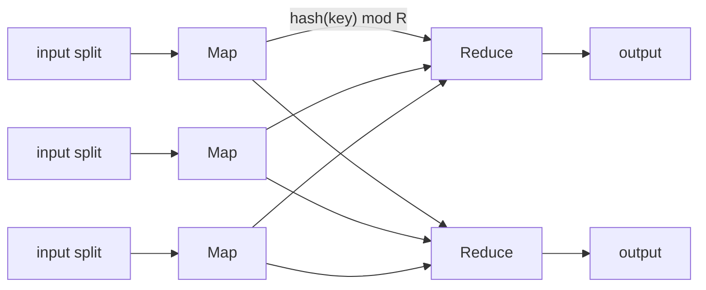

# CS 121: Information Retrieval — Week 7：分布式索引、工程问题

## 目录

- [1. 本周概览](#1-本周概览)
- [2. 超出内存的索引构建：部分索引与合并](#2-超出内存的索引构建部分索引与合并)
- [3. 更快的 AND 查询：跳表指针与查询顺序](#3-更快的-and-查询跳表指针与查询顺序)
- [4. 短语查询与双词索引](#4-短语查询与双词索引)
- [5. 位置索引](#5-位置索引)
- [6. 索引工程：读取比内存更大的索引](#6-索引工程读取比内存更大的索引)
- [7. 用 MapReduce 进行分布式索引](#7-用-mapreduce-进行分布式索引)
- [8. 更新索引](#8-更新索引)
- [9. 分布式查询求值](#9-分布式查询求值)
- [10. 查询缓存](#10-查询缓存)
- [11. 按文档处理与按词项处理](#11-按文档处理与按词项处理)
- [12. 合取处理](#12-合取处理)
- [13. 阈值方法、MaxScore 与提前终止](#13-阈值方法maxscore-与提前终止)
- [14. 从布尔检索到排序检索](#14-从布尔检索到排序检索)
- [15. 第一种尝试：Jaccard 系数](#15-第一种尝试jaccard-系数)
- [16. 计数向量与词袋模型](#16-计数向量与词袋模型)
- [17. 词频与对数频率权重](#17-词频与对数频率权重)
- [18. 文档频率、idf 与 tf-idf](#18-文档频率idf-与-tf-idf)
- [19. 课堂笔记与作业提示](#19-课堂笔记与作业提示)
- [20. 示例题（附解答）](#20-示例题附解答)
- [21. 速查与必记的 5 件事](#21-速查与必记的-5-件事)

> UCI CS 121 / IN4MATX 141: Information Retrieval — Prof. Alberto Krone-Martins, Fall 2026, week of Nov 11
> 整理自 Lecture 17、18、19 和 20 的幻灯片，外加 Lecture 20.5——11 月 18 日课上对这些内容的回顾，在课程安排中列于第 8 周下（YuJa 视频未收录；本周没有线下课，因此没有 Lecture 17.5）。按概念组织，而不是按讲次组织。
> 📖 本周阅读：[Croft et al.，第 5 章 Ranking with Indexes 与第 7 章 Retrieval Models](https://ciir.cs.umass.edu/downloads/SEIRiP.pdf) · [Manning, Raghavan & Schütze，*Introduction to IR*，第 2 和第 4 章](https://nlp.stanford.edu/IR-book/pdf/irbookonlinereading.pdf)

> 📅 **课程安排**：**11 月 11 日（周三）没有线下课**（退伍军人节）——本周的讲课以视频为准。
> Assignment 3 Milestone 2（布尔 AND 搜索）截止时间为 **11 月 13 日（周五）晚 11:59**。
> 下周：Online Quiz 3 在 **11 月 18 日（周三）** 课上进行（请带笔记本电脑）；Milestone 3（排序检索）截止时间为 **11 月 27 日（周五）晚 11:59**。

---

## 1. 本周概览

本周每份幻灯片都从架构图开始（[第 1 周第 10 节](week-01.zh-CN.md#10-搜索引擎架构)），高亮的方框依次移动：

- **索引创建 → 索引**（L17 p2–20，L18 p6–46）：构建放不进内存的索引，以及在多台机器上构建索引。
- **查询过程**（L17 p21–49，L19）：使用索引——布尔 AND、短语，然后是分布式与优化过的求值。"How do we process a query? Later — what kinds of complex queries can we process?"（L17 p22）
- **索引更新**（L18 p47–53）：架构图在主索引旁边多了一个小索引，以及一个 **"Deleted Pages!"** 存储。
- **排序**（L20）："Evolving from Boolean retrieval"——用分数代替是/否。

课堂回顾的议程（L20.5 p5–37）按顺序列出了本周视频的内容：索引工程问题（索引大于内存、辅助数据结构）、分布式索引（MapReduce）、更新索引、分布式查询求值、查询缓存、查询处理（按文档处理、按词项处理）、合取处理、阈值方法、排序检索，以及 Jaccard 系数。

L17 p3–6 重放了第 6 周的结尾：简单的内存版 `BuildIndex`，其中 `I ← HashTable()`（"Could this be a file, directly?"），以及 Jeff Dean 的延迟表。见[第 6 周第 9 节](week-06.zh-CN.md#9-简单的内存索引器与-docid)和[第 10 节](week-06.zh-CN.md#10-扩展索引构建硬件基础)。新的幻灯片是 L17 p6：

**把磁盘当作"内存"用？** 能不能在更大的集合上运行同一个算法，只是把内存换成磁盘？**不能**：在磁盘上访问和修改 $T \approx 10^8$–$10^9$ 条记录意味着**太多次磁盘寻道**（每次最长 2 ms）。**我们需要一个外部算法。**

---

## 2. 超出内存的索引构建：部分索引与合并

### 2.1 部分索引

外部算法（L17 p7–11）：

1. 构建倒排列表结构，**直到达到一定大小**（多大？见下面的课堂提示）。
2. **把部分索引写到磁盘上**，然后开始一个新的。
3. 最后磁盘上会有**许多部分索引**，再把它们**合并**。

部分列表（= 部分索引）的设计必须**能够分成小块合并**——例如**按字母顺序存储**。

幻灯片上的伪代码（L17 p11）就是第 6 周的 `BuildIndex` 加上两处高亮的改动：按**批次**读取文档，并在每批之后把哈希表**排序并写入**磁盘，然后清空。

```text
procedure BuildIndex(D)
  I ← HashTable
  n ← 0
  B ← []                          # batch of documents
  while D is not empty do
    B ← GetBatch(D)
    for all documents d in B do
      n ← n+1
      T ← Parse(d)
      RemoveDuplicates(T)
      for all tokens e in T do
        if t not in I then
          I[t] = []
        I[t].append(Posting(n))
      end for
    end for
    SortAndWriteToDisk(I, name)
    I.empty()
  end while
```

> ⚠️ **易错点**：幻灯片的循环写的是 `tokens e`，下面却用 `t`——两者都按同一个词元 `t` 理解。注意 `n` 跨批次持续计数，所以 docID **全局唯一且递增**：每个部分索引都按 docID 有序，这正是下面的合并对每个词项只需简单拼接的原因。

### 2.2 合并两个部分索引

L17 p12–15 逐步构建一张图。Index A 有 `aardvark 2 3 4 5` 和 `apple 2 4`；Index B 有 `aardvark 6 9` 和 `actor 15 42 68`。按词项顺序同时遍历两者：`aardvark` 两边都有，所以 A 的 postings 后面接上 B 的；`actor` 只在 B 中；`apple` 只在 A 中。

| 合并后的索引 | Postings |
|---|---|
| aardvark | 2 3 4 5 6 9 |
| actor | 15 42 68 |
| apple | 2 4 |

> 📝 **练习**：[例题 20.1](#201-合并-index-a-与-index-bl17-p1215)

### 2.3 如何合并有序的段？

**二路合并**（L17 p16）：**每次合并 2 个文件**。每一层中，以几 MB 的块**读入**内存（对 HDD 来说 ~10 MB 并不少见——**但你应该实测（profile）！**），**合并，再写回**。幻灯片上的图从磁盘/SSD 合并两个段：

| Run 1 | | Run 2 | | 合并后的 postings 列表 | |
|---|---|---|---|---|---|
| brutus | d1,d3 | brutus | d6,d7 | brutus | d1,d3,d6,d7 |
| caesar | d1,d2,d4 | caesar | d8,d9 | caesar | d1,d2,d4,d8,d9 |
| noble | d5 | julius | d10 | julius | d10 |
| with | d1,d2,d3,d5 | killed | d8 | killed | d8 |
| | | | | noble | d5 |
| | | | | with | d1,d2,d3,d5 |

**多路合并**（L17 p17–20）**效率更高**：**同时读取所有文件**。

- 同时打开**所有**部分索引文件，每个文件一个**读缓冲区**，输出文件一个**写缓冲区**。
- 每一轮**选出尚未处理的最小 termID**。
- 把这个 termID 的**所有 postings 列表合并**，写出去。

只要每次把每个块中**足够大的一段**读入内存，并写出足够大的输出段，**就不会被磁盘寻道拖垮**。这些段的实际大小**必须主动测试**——它取决于硬件和文件系统。

对幻灯片的 Index A 和 B 做多路合并，用 `heapq.merge` 在所有段中"选出最小的词项"：

```python
import heapq

def multiway_merge(*runs):
    """Merge partial indexes: each run is a list of
    (term, postings) sorted by term."""
    merged = []
    for term, postings in heapq.merge(*runs, key=lambda e: e[0]):
        if merged and merged[-1][0] == term:
            merged[-1][1].extend(postings)   # same term: append
        else:
            merged.append((term, list(postings)))
    return merged

index_a = [("aardvark", [2, 3, 4, 5]), ("apple", [2, 4])]
index_b = [("aardvark", [6, 9]), ("actor", [15, 42, 68])]
for term, postings in multiway_merge(index_a, index_b):
    print(term, postings)
```

```text
aardvark [2, 3, 4, 5, 6, 9]
actor [15, 42, 68]
apple [2, 4]
```

> 💡 **关键见解**：每个部分索引都按字母排序，合并才能以流的方式进行：在真实的索引器里，每个段是一个文件，经由一个缓冲区从头到尾只读一遍，从不来回寻道。

> 🔗 **延伸阅读**：[Croft §5.6.2 Merging（书中第 157 页）](https://ciir.cs.umass.edu/downloads/SEIRiP.pdf) · [IIR 第 4 章（基于块的排序索引）](https://nlp.stanford.edu/IR-book/pdf/irbookonlinereading.pdf)

---

## 3. 更快的 AND 查询：跳表指针与查询顺序

回顾：布尔模型（AND、OR、NOT；每个文档是一个词的集合；精确匹配；电子邮件、图书馆目录、macOS Spotlight），以及按 docID 排序的 postings 的 $O(x+y)$ 合并，见[第 6 周第 5 节](week-06.zh-CN.md#5-查询处理用合并-postings-实现-and)和[第 6 节](week-06.zh-CN.md#6-布尔检索模型)（L17 p23–25 重复了这些内容）。L17 p24 补充：布尔检索只有 **TRUE 和 FALSE 两种结果**——即"精确匹配"检索，是**最简单的一种"排序"**——另外也会用到**邻近运算符**。

### 3.1 跳表指针

"**You can also add skip pointers**"（L17 p26）。幻灯片的图中，*Brutus* `2 4 8 16 32 64 128` 的跳表指针是 2 → 16 → 128，*Caesar* `1 2 3 5 8 13 21 34` 的是 1 → 5 → 21。当跳转目标仍然小于另一个列表的当前 docID 时，跳表指针让合并直接越过一段 postings。结果相同（`2 8`），但读取的 postings 更少。

### 3.2 查询优化：按频率递增的顺序处理

能不能在**查询时**也做优化（L17 p27–32）？考虑一个由 $n$ 个词项做 AND 的查询：取出每个词项的 postings，再把它们 AND 起来。**最佳顺序是什么？**

| 词项 | Postings |
|---|---|
| Brutus | 2 4 8 16 32 64 128 |
| Caesar | 1 2 3 5 8 16 21 34 |
| Calpurnia | 13 16 |

查询：*Brutus AND Calpurnia AND Caesar*。**按频率递增的顺序处理**：从**最小的集合**开始，然后不断进一步缩小。按 **(Calpurnia AND Brutus) AND Caesar** 执行。中间结果永远不会比最短的列表更长，所以之后的每次合并都很便宜。

**这就是我们在词典里保存文档频率的原因**（L17 p30–32）：df 正好就是每个 postings 列表的长度，不用读任何列表就能知道。

优化后顺序的第一次合并：

```viz postings-intersect
{"title": "先算 (Calpurnia AND Brutus)——最短的列表打头（L17 p29–32）", "lists": "13 16 | 2 4 8 16 32 64 128", "terms": "Calpurnia, Brutus", "lang": "zh"}
```

结果 `[16]` 再与 Caesar 做 AND → `[16]`。

> ⚠️ **易错点**：按 **df**（文档数）排序，而不是按词项总共出现的次数——df 是 postings 列表的长度，它才决定合并的代价。

> 📝 **练习**：[例题 20.2](#202-brutus-and-calpurnia-and-caesar-的最佳顺序l17-p2932)

> 🔗 **延伸阅读**：[Croft §5.4.7 Skipping and Skip Pointers（书中第 151 页）](https://ciir.cs.umass.edu/downloads/SEIRiP.pdf) · [IIR 第 2 章（用跳表指针加快 postings 合并）](https://nlp.stanford.edu/IR-book/pdf/irbookonlinereading.pdf) · [IIR 第 1 章（处理布尔查询、查询优化）](https://nlp.stanford.edu/IR-book/pdf/irbookonlinereading.pdf)

---

## 4. 短语查询与双词索引

我们希望回答诸如 **"university of california"** 这样的查询——**作为一个短语**（L17 p33）。句子 *"I went to university in california"* **不**匹配。

- 短语查询已被证明**用户很容易理解**：是少数真正有用的"高级搜索"想法之一。
- 还有更多查询是**隐式的**短语查询。
- 为此，只存储 `<term : docs>` 条目**已经不够了**。

**第一种尝试：双词（bigram）索引**（L17 p34）。把文本中**每一对相邻词项**作为一个短语建立索引。*"Friends, Romans, Countrymen"* 生成双词（= bigram！）**friends romans** 和 **romans countrymen**。每个双词现在都是一个**词典词项**：所有 bigram 都被索引，**两个词的短语查询可以直接回答**。对较小的 $n$ 可以采用，但**对任意长度不可行**。

**更长的短语**会被拆开（L17 p35–36）：*University of California Irvine* 变成对 bigram 的布尔查询

```text
university of AND of california AND california irvine
```

没有文档本身，我们**无法验证**匹配这个布尔查询的文档包含**连续**的短语。**它可能有假阳性！**

**问题**（L17 p37）：

- 上面的假阳性；
- 词典变大导致**索引膨胀**：超过双词就不可行，即便只是全部双词也很大——不过超大型搜索引擎会对较小的 $n$ 支持一些 n-gram；
- 所以为**所有** bigram 建索引**不是标准做法**，但可以作为**组合策略的一部分**。

> 📝 **练习**：[例题 20.3](#203-把-university-of-california-irvine-拆成双词l17-p3536)

> 🔗 **延伸阅读**：[IIR 第 2 章（双词索引）](https://nlp.stanford.edu/IR-book/pdf/irbookonlinereading.pdf)

---

## 5. 位置索引

**方案 2**（L17 p38）：在 postings 中，为每个词项存储它的词元出现的**位置**。位置 postings 本身在[第 6 周第 8 节](week-06.zh-CN.md#8-更丰富的-postings计数位置区段与分数)中已经建过（*tropical fish* 的例子）；本周补充的是短语查询如何使用它们，以及它们的代价。

```text
<term, number of docs containing term;
 doc1: position1, position2 … ;
 doc2: position1, position2 … ;
 etc.>
```

### 5.1 用位置回答短语查询

幻灯片的例子（L17 p39–42）：

```text
<be: 993427;
 1: 7, 18, 34, 72, 86, 231;
 2: 3, 149;
 4: 17, 191, 291, 430, 434;
 5: 363, 367, …>
```

**文档 1、2、4、5 中哪些可能包含 "to be or not to be"？**

- 对短语查询，我们**在文档层面递归地使用合并算法**——先找包含所有词项的文档，再在每个文档内比较位置。
- **预先清理**列表，只保留那些满足查询中多次出现的词之间**距离**的文档："to be or not to be" 中两个 *be* **相隔 4 个位置**。
- 现在处理的**不只是相等**——还有 $p+1$、$p+4$ 这样的偏移。

只有文档 **4**（430、434）和文档 **5**（363、367）有两个恰好相隔 4 的 *be*，所以还没看其他词项，文档 1 和 2 就已经排除了。

**处理短语查询**（L17 p43–44）：取出每个不同词项——*to、be、or、not*——的倒排索引条目，合并它们的 doc:position 列表，找出所有出现 "to be or not to be" 的位置：

```text
to: 2:1,17,74,222,551; 4:8,16,190,429,433; 7:13,23,191; ...
be: 1:17,19; 4:17,191,291,430,434; 5:14,19,101; ...
```

在文档 4 中，*to* 在 429 和 433，*be* 在 430 和 434，正好对上：短语可以从**位置 429** 开始（to 429、be 430、……、to 433、be 434）。**同样的一般方法**也适用于**邻近搜索**（"相距 $k$ 个词以内"）。

> ⚠️ **易错点**：L17 p43 上的 *be* 列表和 p39–42 上的不是同一个（那里文档 1 是 `17,19`，文档 5 也不同）——它们是两个独立的示例。两处文档 4 的位置是一致的。

### 5.2 位置索引的大小

- 位置索引**会大幅增加 postings 的存储量**——尽管索引可以压缩（L17 p45–46）。
- **尽管如此，位置索引现在是标准做法**，因为短语查询和邻近查询非常强大、有用，无论是**显式**使用，还是在排序检索系统中**隐式**使用。
- 它需要**为每次出现**建一项，而不只是每个文档一项，所以大小取决于**平均文档长度**（L17 p47）：一个普通网页不到 1,000 个词项；SEC 文件、书籍，甚至一些史诗，很容易就有 100,000 个。

**经验法则**（L17 p48），适用于"类英语"的语言：

| 指标 | 经验法则 |
|---|---|
| 压缩后的位置索引 vs 非位置索引 | **2–4 倍**大 |
| 位置索引 vs 原始文本 | 原文体积的 **35–50%** |

### 5.3 混合方案

**N-gram 和位置的方法可以结合使用**（L17 p49）。对特定短语（*"Michael Jackson"*、*"Britney Spears"*），反复合并位置 postings 列表效率很低——*"The Who"*（两个停用词）更是如此。一种更复杂的混合索引方案（Williams et al., 2004）在典型的网络查询组合上，用时只有单纯位置索引的 **¼**，空间多出 **26%**。

> 📝 **练习**：[例题 20.4](#204-哪些文档可能包含-to-be-or-not-to-bel17-p3944)

> 🔗 **延伸阅读**：[Croft §5.3.3 Positions（书中第 134 页）](https://ciir.cs.umass.edu/downloads/SEIRiP.pdf) · [IIR 第 2 章（位置索引、组合方案）](https://nlp.stanford.edu/IR-book/pdf/irbookonlinereading.pdf)

---

## 6. 索引工程：读取比内存更大的索引

在磁盘上构建索引只是一半；在**查询时**你还得找到 postings（L18 p6–28 · L20.5 p6–23，"Index engineering issues"）。

**小索引**（L18 p7–8）：把它**整个载入内存**，作为哈希表 / 字典，按键查找 postings。*如果索引比可用内存还大呢？*

**大索引**（L18 p9–15）：放不进内存，所以必须**在文件本身**中查找 postings。怎么做？

1. **扫描文件**查找查询词项。如果文件中的词项**没有排序**呢？那就是全量扫描，$O(n)$。如果词项**有序**，就可以二分查找：从 $O(n)$ 降到 $O(\log N)$——**把查询词项也排好序**也有帮助。
2. **直接跳到文件中的正确位置**：$O(1)$。**INDEX THE INDEX！**

### 6.1 为索引建索引

在构建倒排索引的同时，另建一个**记录偏移量的簿记文件**，指向倒排索引文件中的位置（L18 p16–18）：

- 词项 "ape" 在位置 1311，"apple" 在位置 1345，等等——**或者**
- 以 "b" 开头的词从位置 10035 开始，以 "c" 开头的从 20457 开始，等等。

这个**二级索引比倒排索引小得多**，所以（通常）能放进内存。**然后：`seek(position)`。**

**Seek 操作**（L18 p19–23），以幻灯片上的 `Test.txt` 为例：

```python
with open("test.txt", "w") as f:
    f.write("Hello world!\nThis is a test file.\n"
            "For explaining how seek works.\n")

f = open("test.txt")
f.seek(4);  print(repr(f.readline()))
f.seek(13); print(repr(f.readline()))

# "Index the index": term -> byte offset of its line
offsets, pos = {}, 0
with open("test.txt", "rb") as g:
    for line in g:
        offsets[line.split()[0].decode()] = pos
        pos += len(line)
print(offsets)
f.seek(offsets["For"]); print(repr(f.readline()))
```

```text
'o world!\n'
'This is a test file.\n'
{'Hello': 0, 'This': 13, 'For': 34}
'For explaining how seek works.\n'
```

`seek(4)` 落在 "Hello" 中间，所以 `readline()` 返回第 1 行剩下的部分；`"Hello world!\n"` 是 13 个字节，所以 `seek(13)` 正好落在第 2 行开头。后半段就是一个迷你版的簿记文件：每个条目一个偏移量，每次查找一次 seek。

> ⚠️ **易错点**：偏移量是**字节**偏移量。像上面那样用二进制模式（`"rb"`）读取来生成它们；在文本模式下，多字节的 UTF-8 字符和 Windows 的 `\r\n` 换行会让字符数与字节位置对不上。

> 📝 **练习**：[例题 20.5](#205-seek-返回什么l18-p1923)

### 6.2 其他辅助结构

（L18 p26）

| 结构 | 内容 | 存储方式 |
|---|---|---|
| **文档 ID** | 从 docid 到 URL 的查找表 | 内存中的哈希表，集合较大时用 B 树 |
| **词汇表**（vocabulary / lexicon） | 从索引词项到其倒排列表在倒排文件中的**字节偏移量**的查找表 | 内存中的哈希表，词汇较多时用 B 树 |
| **词项统计** | 例如 df | 放在每个倒排列表的**开头** |
| **集合统计** | 例如文档数 | 放在**单独的文件**中 |

### 6.3 单一倒排索引之外的做法

（L18 p27–28）

- 把倒排索引文件按**字母范围拆分**。
- 建立**文件系统路径树**：`index/a/`、`index/b/`、`index/c/` 等。
- 搜索组件**一直保持文件打开**——**打开，但不在内存中！**

**Multiple files in multithreading: aggregate!**（L18 p28）——配图是 IBM Power 740 的系统图（两颗处理器芯片、独立的内存卡、许多 I/O 插槽）：拆分后的索引文件可以由**多个并行线程**读取，再汇总结果。

> 🔗 **延伸阅读**：[Croft §5.5 Auxiliary Structures（书中第 154 页）](https://ciir.cs.umass.edu/downloads/SEIRiP.pdf)

---

## 7. 用 MapReduce 进行分布式索引

**扩大规模**（L18 p29–31）。分布式处理的动力来自对**海量数据**（也就是 Web）进行索引和分析的需要，用的是**大量廉价服务器**，而不是更大、更贵的机器。**MapReduce** 是为索引和分析任务设计的分布式编程工具。

**引例**（L18 p32–33）：一个很大的信用卡交易文本文件，每行一个卡号和一个金额。**统计不同卡号的数量。** 用哈希表 → 内存问题；如果文件**有序**，计数就很简单。分布式环境下同样如此：**排序和数据放置至关重要**。

### 7.1 Map、Shuffle 与 Reduce

MapReduce 是一个**关注数据放置与分布**的框架（L18 p34–43）：

- **Mapper**：通常把一个元素列表变换成**另一个同样长度的元素列表**。
- **Reducer**：把一个元素列表变换成**单个元素**。
- 这些定义对输出数量并不严格；集群上会运行**许多 mapper 和 reducer 任务**。

基本流程：

1. **Map** 阶段：把数据记录变换成**键值对**——例如 `<key="term", value="docId">`。
2. **Shuffle**：用一个**哈希函数**，让所有**相同键**的对都落在**同一台机器上**、彼此相邻——例如 `hash(term) mod (number of reduce machines)`。
3. **Reduce** 阶段：按批处理记录，**同一个键的所有对同时处理**——同一个词项的所有 `<term, docId>` 对都在同一台机器上，所以可以把它们"归约"成 postings 列表。



幻灯片上的图（L18 p38–42）逐步构建这一过程：先是 map 方框，再是全连接的 shuffle 边，最后是 reduce 方框和输出。

mapper 和 reducer 的**幂等性**带来**容错**：在同一输入上多次运行得到相同输出，所以当某台机器**故障**或**太慢**时，库可以重新运行这部分工作——计算是冗余的，从而避免瓶颈。

### 7.2 伪代码

信用卡（L18 p44）：map 发出 `(card, amount)`；shuffle 按卡号分组；reduce 把每张卡的金额加起来。

```text
procedure MapCreditCards(input)
    while not input.done() do
        record ← input.next()
        card ← record.card
        amount ← record.amount
        Emit(card, amount)
    end while
end procedure

procedure ReduceCreditCards(key, values)
    total ← 0
    card ← key
    while not values.done() do
        amount ← values.next()
        total ← total + amount
    end while
    Emit(card, total)
end procedure
```

每次 reduce 调用对应一个不同的卡号，所以输出对的数量就是不同卡号的数量。

**建索引**（L18 p45，幻灯片上框出了关键部分）：map 为每个词元发出 `(word, docNumber:position)`；reduce 把词写出一次，然后编码它的 postings。

```text
procedure MapDocumentsToPostings(input)
    while not input.done() do
        document ← input.next()
        number ← document.number
        position ← 0
        tokens ← Parse(document)
        for each word w in tokens do
            Emit(w, number:position)
            position = position + 1
        end for
    end while
end procedure

procedure ReducePostingsToLists(key, values)
    word ← key
    WriteWord(word)
    while not input.done() do
        EncodePosting(values.next())
    end while
end procedure
```

> ⚠️ **幻灯片错误**：`ReducePostingsToLists` 的循环条件是 `input.done()`，但 reducer 里并没有 `input`——应理解为 `values.done()`，与 `ReduceCreditCards` 一样。

**MapReduce 通常用于数据流**（L18 p46）：**没有终点**，**没有"最终索引"**——只有一个**暂时有效**的索引。

> 🔗 **延伸阅读**：[Croft §5.6.3 Parallelism and Distribution（书中第 158 页）](https://ciir.cs.umass.edu/downloads/SEIRiP.pdf) · [IIR 第 4 章（分布式索引）](https://nlp.stanford.edu/IR-book/pdf/irbookonlinereading.pdf)

---

## 8. 更新索引

**动态的集合！** Web 在持续变化（L18 p48–53）。

- 当更新以**大批次**到来时，**索引合并**（第 2 节）是好策略。
- 对**少量更新**，它的效率很低。改为为新文档建一个**单独的索引**，然后*事后*把两个索引的搜索结果**合并**。这个小索引可以**放在内存中**：更新和搜索都很快。
- **删除**用一个**删除列表**处理。**修改** = 把旧版本放进删除列表 + 把新版本加入新文档索引。

这就是 L18 p51 和 p53 的架构图：多了一个小的 **Index** 方框，旁边是一个 **"Deleted Pages!"** 存储。

> 🗣️ **课堂**（L20.5 p28–30）：课堂版本把它称为**延迟更新策略**：为**更新的页面**（"Index n.."）和**删除的页面**（"Deleted Pages"）各建立**临时（且小得多）的辅助索引结构**，它们与排序模块之间设有**否决系统**（veto system），因此被删除的页面会在结果到达 UI 之前就被过滤掉。

> 🔗 **延伸阅读**：[Croft §5.6.4 Update（书中第 164 页）](https://ciir.cs.umass.edu/downloads/SEIRiP.pdf) · [IIR 第 4 章（动态索引）](https://nlp.stanford.edu/IR-book/pdf/irbookonlinereading.pdf)

---

## 9. 分布式查询求值

"Optimizing query evaluation"（L19 p2–18）。把查询分布出去**能显著加快查询处理**。

**基本流程**：所有查询都发给一台**调度机**（director）；调度机把消息发给许多**索引服务器**；每台索引服务器完成查询处理的**一部分**；调度机**整理结果**并返回给用户。拆分工作主要有两种方式：

| | 文档分布 | 词项分布 |
|---|---|---|
| 索引 | 每台索引服务器是集合中**一小部分文档的搜索引擎** | 整个集群**只有一个索引**；**每个倒排列表**分配给一台索引服务器 |
| 查询 | 调度机把**查询的副本发给每台**索引服务器；每台返回自己的 **top-k** | 多数情况下一个查询的数据**不在同一台机器上**；由一台服务器——通常是持有**最长倒排列表**的那台——处理查询，其他服务器**把信息发给它** |
| 结果 | 调度机把它们**合并**成一个排序列表 | 最终结果发回调度机 |
| 注意 | 为了排序有效，**集合统计量应该共享** | 列表数据要在服务器之间传输 |

> ⚠️ **易错点**：在文档分布下，每台服务器只看得到自己的文档。如果每台都用自己那部分来计算 df，同一个文档在不同服务器上会得到不同的分数——这就是集合统计量必须共享的原因。

> 🔗 **延伸阅读**：[Croft §5.7.5 Distributed Evaluation（书中第 180 页）](https://ciir.cs.umass.edu/downloads/SEIRiP.pdf)

---

## 10. 查询缓存

（L19 p19–24）

- 查询的分布**类似 Zipf**：**每天大约一半的查询是唯一的**，但有些查询**非常热门**。L19 p20 重放了 AP89 的 Zipf 图——在双对数坐标下中段是直线，最高频和最低频处偏离（hapax legomena = 只出现一次的词）；见[第 4 周第 11 节](week-04.zh-CN.md#11-文本统计与-zipf-定律)。
- 缓存能显著提升效率：
  - 缓存（可能**在内存中**）**热门查询的结果**；
  - 在**内存中**缓存常用的**倒排列表**。
- **倒排列表缓存即使对唯一查询也有帮助**——从没见过的查询仍然由常见词组成。
- 缓存**必须刷新**，以免数据过时。

> 🔗 **延伸阅读**：[Croft §5.7.6 Caching（书中第 181 页）](https://ciir.cs.umass.edu/downloads/SEIRiP.pdf)

---

## 11. 按文档处理与按词项处理

回到查询过程方框（L19 p25–39）。用倒排列表计算排序分数有两种方式：

- **按文档处理**（document-at-a-time）：**一次一个文档**，处理**所有词项列表**，算出文档的**完整分数**。
- **按词项处理**（term-at-a-time）：**一次一个词项列表**，把分数**累加**到各文档上。

**两者都有优化技巧**，能大幅减少计算分数的时间（第 12–13 节）。

幻灯片的例子：查询 **salt water tropical**，postings `x:y` = 文档编号和词出现次数，文档的分数是它的次数之和。按文档处理一列一列地进行（灰线是检索步骤）：文档 1 = 1 + 1 + 2 = **4**，文档 2 = 1 + 2 = **3**，文档 3 = **1**，文档 4 = 1 + 1 = **2**。按词项处理先读 *salt*（部分分数 1:1、4:1），再读 *water*（1:2、2:1、4:2），最后读 *tropical*——最终分数相同。

```viz query-eval
{"title": "salt water tropical（L19 p30–39）——在两种顺序之间切换", "postings": "salt: 1:1 4:1; water: 1:1 2:1 4:1; tropical: 1:2 2:2 3:1", "mode": "doc", "interactive": true}
```

> ⚠️ **幻灯片错误**：按词项处理的图（L19 p38）最后一行的最终分数是 `1:4 2:3 2:2 4:2`；第三个框应为 **3:1**（文档 3 只含一次 *tropical*——p33 按文档处理的图上是 3:1）。

### 11.1 伪代码

两个过程都接收查询 $Q$、索引 $I$、特征函数 $f$ 和 $g$，以及 $k$，并用一个大小为 $k$ 的**优先队列** $R$ 保存前几名结果。更新 $s_d \leftarrow s_d + g_i(Q) f_i(l_i)$ 就是[第 6 周第 7 节](week-06.zh-CN.md#7-索引与排序抽象模型)的抽象排序模型：查询特征乘以文档特征。在这个例子中，$g_i(Q) = 1$，$f_i$ 是出现次数。

按文档处理（L19 p34）：

```text
procedure DocumentAtATimeRetrieval(Q, I, f, g, k)
    L ← Array()
    R ← PriorityQueue(k)
    for all terms w_i in Q do
        l_i ← InvertedList(w_i, I)
        L.add( l_i )
    end for
    for all documents d ∈ I do
        s_d ← 0
        for all inverted lists l_i in L do
            if l_i.getCurrentDocument() = d then
                s_d ← s_d + g_i(Q) f_i(l_i)     ▷ Update the document score
            end if
            l_i.movePastDocument( d )
        end for
        R.add( s_d, d )
    end for
    return the top k results from R
end procedure
```

按词项处理（L19 p39）用一个哈希表 $A$ 保存**累加器**：

```text
procedure TermAtATimeRetrieval(Q, I, f, g, k)
    A ← HashTable()
    L ← Array()
    R ← PriorityQueue(k)
    for all terms w_i in Q do
        l_i ← InvertedList(w_i, I)
        L.add( l_i )
    end for
    for all lists l_i ∈ L do
        while l_i is not finished do
            d ← l_i.getCurrentDocument()
            A_d ← A_d + g_i(Q) f(l_i)
            l_i.moveToNextDocument()
        end while
    end for
    for all accumulators A_d in A do
        s_d ← A_d                ▷ Accumulator contains the document score
        R.add( s_d, d )
    end for
    return the top k results from R
end procedure
```

**列表函数**（L19 p35）：

| 函数 | 作用 |
|---|---|
| `getCurrentDocument()` | 当前 posting 的文档编号 |
| `skipForwardToDocument(d)` | 向前移动，直到 `getCurrentDocument()` ≥ $d$；可能一直读到列表末尾 |
| `movePastDocument(d)` | 向前移动，直到 `getCurrentDocument()` > $d$ |
| `moveToNextDocument()` | 移到下一个文档；= `movePastDocument(getCurrentDocument())` |
| `getNextAccumulator(d)` | 已经有累加器的第一个文档编号 $d' \ge d$ |
| `removeAccumulatorsBetween(a, b)` | 删除满足 $a < d < b$ 的文档的累加器 |

> ⚠️ **幻灯片错误**：幻灯片写的是 `skipForwardToDocument`："until `getCurrentDocument()` <= d"，`movePastDocument`："until … < d"——比较方向写反了。应该是向前移动**直到当前文档 ≥ d**（以及 **> d**）；只有这样，`moveToNextDocument` = `movePastDocument(current)` 才说得通。

**权衡**（L19 p40）：按词项处理**累加器占用更多内存**（到目前为止见过的每个文档都有一个部分分数），但**磁盘访问更高效**（每个列表顺序读一遍）。按文档处理只保留 $k$ 个结果，但要同时从所有列表读取。

> 📝 **练习**：[例题 20.6](#206-用两种顺序给-salt-water-tropical-打分l19-p3039)

> 🔗 **延伸阅读**：[Croft §5.7.1 Document-at-a-time Evaluation（书中第 166 页）、§5.7.2 Term-at-a-time Evaluation（书中第 168 页）](https://ciir.cs.umass.edu/downloads/SEIRiP.pdf)

---

## 12. 合取处理

**两类优化**（L19 p40–42）：

| 类别 | 例子 | 更适合 |
|---|---|---|
| 从倒排列表**少读数据** | 跳表（跳表指针，第 3.1 节）、为索引建索引（第 6.1 节） | **简单的**特征函数 |
| **为更少的文档计算分数** | **合取处理** | **复杂的**特征函数 |

**合取处理**（L19 p43–46）：

- 是**最简单的**查询优化之一，也是许多搜索引擎的**默认模式**；
- **返回的每个文档都必须包含所有查询词项**（一种带分数的 AND）；
- 当**某个查询词项很稀有**时效果最好：先选出包含稀有词项的文档，就能**跳过大部分**文档；
- 按词项处理和按文档处理**都可以**用。

**合取的按词项处理**（L19 p47）：**查看累加器，找到下一个包含之前所有词项的文档，并把 postings 列表跳到那个文档。** 第一个列表（$i = 0$）照常建立累加器；之后的列表中，`getNextAccumulator(d)` 找到下一个候选 $d'$，`removeAccumulatorsBetween(d_0, d')` 丢掉这个列表跳过的候选（它们不含该词项），然后这个列表要么为 $d$ 计分（若 $d = d'$），要么向前跳到 $d'$。

```text
 1: procedure TermAtATimeRetrieval(Q, I, f, g, k)
 2:   A ← Map()
 3:   L ← Array()
 4:   R ← PriorityQueue(k)
 5:   for all terms w_i in Q do
 6:     l_i ← InvertedList(w_i, I)
 7:     L.add( l_i )
 8:   end for
 9:   for all lists l_i ∈ L do
10:     d_0 ← −1
11:     while l_i is not finished do
12:       if i = 0 then
13:         d ← l_i.getCurrentDocument()
14:         A_d ← A_d + g_i(Q) f(l_i)
15:         l_i.moveToNextDocument()
16:       else
17:         d ← l_i.getCurrentDocument()
18:         d′ ← A.getNextAccumulator(d)
19:         A.removeAccumulatorsBetween(d_0, d′)
20:         if d = d′ then
21:           A_d ← A_d + g_i(Q) f(l_i)
22:           l_i.moveToNextDocument()
23:         else
24:           l_i.skipForwardToDocument(d′)
25:         end if
26:         d_0 ← d′
27:       end if
28:     end while
29:   end for
30:   for all accumulators A_d in A do
31:     s_d ← A_d           ▷ Accumulator contains the document score
32:     R.add( s_d, d )
33:   end for
34:   return the top k results from R
35: end procedure
```

**合取的按文档处理**（L19 p48）：**找到各倒排列表所指向的最大文档；尝试把所有列表都跳到这个文档；如果做得到就计分，否则 break。**

```text
 1: procedure DocumentAtATimeRetrieval(Q, I, f, g, k)
 2:   L ← Array()
 3:   R ← PriorityQueue(k)
 4:   for all terms w_i in Q do
 5:     l_i ← InvertedList(w_i, I)
 6:     L.add( l_i )
 7:   end for
 8:   d ← −1
 9:   while all lists in L are not finished do
10:     s_d ← 0
11:     for all inverted lists l_i in L do
12:       if l_i.getCurrentDocument() > d then
13:         d ← l_i.getCurrentDocument()
14:       end if
15:     end for
16:     for all inverted lists l_i in L do
17:       l_i.skipForwardToDocument(d)
18:       if l_i.getCurrentDocument() = d then
19:         s_d ← s_d + g_i(Q) f_i(l_i)     ▷ Update the document score
20:         l_i.movePastDocument( d )
21:       else
22:         d ← −1
23:         break
24:       end if
25:     end for
26:     if d > −1 then R.add( s_d, d )
27:     end if
28:   end while
29:   return the top k results from R
30: end procedure
```

在 *salt water tropical* 上，只有文档 1 包含全部三个词项，所以合取处理只返回文档 1 = 4——而且从不为文档 2、3、4 计分：

```viz query-eval
{"title": "合取的 salt water tropical——用跳过代替计分（L19 p43–48）", "postings": "salt: 1:1 4:1; water: 1:1 2:1 4:1; tropical: 1:2 2:2 3:1", "mode": "doc", "conjunctive": true}
```

> 💡 **关键见解**：合取处理还是[第 3.2 节](#32-查询优化按频率递增的顺序处理)的道理——最稀有的词项决定了工作量的上限。这里 *salt*（2 个文档）在 *water* 和 *tropical* 被完整读取之前，就把候选限制在文档 1 和 4 上。

> 🔗 **延伸阅读**：[Croft §5.7.3 Optimization Techniques（书中第 170 页）](https://ciir.cs.umass.edu/downloads/SEIRiP.pdf)

---

## 13. 阈值方法、MaxScore 与提前终止

**阈值方法**利用**需要的排名靠前的文档数（$k$）**来优化查询处理——对大多数应用来说，$k$ 很小（L19 p49–56）。

- 对任何查询，文档要被显示出来都有一个**最低分数**：第 $k$ 高的文档的分数，即**阈值 $\tau$**。
- 遗憾的是，查询结束之前**我们不知道 $\tau$**；优化方法会**估计一个 $\tau'$**，忽略不可能超过它的文档。
- **按文档处理**：用**目前排名最低的文档**（优先队列中的第 $k$ 个）的分数作为 $\tau'$。**按词项处理**：用**累加器表中第 $k$ 大的分数**。

**MaxScore** 把**剩余文档可能达到的最高分数**与 $\tau'$ 比较，忽略倒排列表中**不可能产生高于 $\tau'$ 的分数**的部分。它是一种**安全**的优化：排序结果与不用它时**完全相同**。

**MaxScore 示例**（L19 p57–60）：查询 *eucalyptus tree*。*Tree* 很常见（列表很长）；*eucalyptus* 很稀有（只有几个 posting）。

- 索引器计算 $\mu_{tree}$，即**任何只含 "tree" 的文档可能得到的最高分数**。
- 假设 $k = 3$；$\tau'$ 是前三个文档之后的最低分数。
- **很可能 $\tau' > \mu_{tree}$**：$\tau'$ 是一个**两个查询词项都包含**的文档的分数。
- 所以我们可以**安全地跳过所有灰色的 postings**：图中 *tree* 的 postings 只有最前面几个文档和同时含 *eucalyptus* 的文档是白色的；其余 *tree* posting 都是灰色——只含 tree 的文档最多得 $\mu_{tree} < \tau'$ 分，进不了前 3。

**其他方法**（L19 p61–66）：

| 方法 | 做法 | 安全？ |
|---|---|---|
| **提前终止** | 有些查询比其他查询更昂贵：按词项处理时**忽略高频词的列表**；按文档处理时**忽略列表末尾的文档** | **不安全**——排序可能改变 |
| **列表排序** | 按某种**质量指标**（例如 PageRank）或**部分分数**给倒排列表排序 | 让不安全（且快速）的优化**更有可能检索到好文档** |

> ⚠️ **易错点**："安全"指 top-$k$ 排序与完整求值完全一致（MaxScore）。提前终止是"不安全"的：更快，但可能漏掉本应进入前 $k$ 的文档。

> 🔗 **延伸阅读**：[Croft §5.7.3 Optimization Techniques（书中第 170 页）](https://ciir.cs.umass.edu/downloads/SEIRiP.pdf) · [Croft §5.3.6 Ordering（书中第 139 页）](https://ciir.cs.umass.edu/downloads/SEIRiP.pdf)

---

## 14. 从布尔检索到排序检索

**布尔检索的评价**（L17 p50）：

| 优点 | 缺点 |
|---|---|
| 结果**可预测**，相对容易解释 | 效果**完全取决于用户** |
| 可以融入许多不同的特征 | **简单查询通常效果不好** |
| 处理**高效**，因为可以排除很多文档 | **复杂查询很难写** |

**检索模型**（L20 p3–8）是**定义搜索过程的数学框架**——是**关于相关性的理论**：它们说明自己的**假设**，是**排序算法的基础**，并且**可以是隐式的**；检索模型的进步与**效果的提升**是同步的。**相关性**很复杂（因素很多；**人们在判断时常常意见不一**），所以模型会对它做简化：**主题相关 vs. 用户相关**，**二元 vs. 连续 vs. 多值**的相关性（[第 1 周第 6 节](week-01.zh-CN.md#6-核心问题相关性与检索模型)）。

**排序检索**（L20 p9–11）。到目前为止我们的查询都是**布尔**查询——适合**清楚自己需求和集合的专家用户**，以及**应用程序**；但不适合大多数**"普通"用户**：他们不会（或不愿）写布尔查询，也**不想翻看成千上万条结果**——在 **Web** 上尤其如此。

**要么撑死要么饿死**（feast or famine，L20 p12–14）：布尔查询常常返回**太少（= 0 条）或太多（上千条）**结果。

| 查询 | 结果数 |
|---|---|
| "standard user dlink650" | 200,000 |
| "standard user dlink650 no card found" | 0 |

要写出结果数量合适的查询需要技巧：**AND 给得太少，OR 给得太多**。除了某些特定场景（例如法律），人们乐意**用确定性的结果换取易用性**。

**排序检索模型**（L20 p15–19）返回 (排名靠前的) 文档的一个**排序**，而不是一个**集合**，通常配合**自由文本查询**（就是一些词，没有运算符）——原则上这是两个独立的选择，实际中总是一起出现。"要么撑死要么饿死"的问题消失了：无论结果集多大，只显示**前 $k$ 个（≈ 10）**。**很强的假设：排序算法对用户"有效"。**

**打分**是基础（L20 p20–26）：按最可能有用的顺序返回文档。**给每个文档分配一个分数——比如在 $[0, 1]$ 之间**——衡量文档与查询"匹配"得有多好。从**单词项查询**开始：

- 如果查询词项**不在**文档中，分数应为 **0**；
- 查询词项在文档中**出现越频繁**，分数应该**越高**。

> 🔗 **延伸阅读**：[Croft §7.1 Overview of Retrieval Models（书中第 233 页）、§7.1.1 Boolean Retrieval（书中第 235 页）](https://ciir.cs.umass.edu/downloads/SEIRiP.pdf) · [IIR 第 6 章（打分、词项加权）](https://nlp.stanford.edu/IR-book/pdf/irbookonlinereading.pdf)

---

## 15. 第一种尝试：Jaccard 系数

衡量两个集合 $A$ 和 $B$ **重叠程度**的常用指标（L20 p27–30 · L20.5 p38）：

$$J(A, B) = \frac{|A \cap B|}{|A \cup B|}$$

$|A \cap B|$ 是两个集合都有的元素个数，$|A \cup B|$ 是至少一个集合有的元素个数。给文档打分时，取 $A$ = 查询的词项，$B$ = 文档的词项。

- $J(A, A) = 1$；若 $A \cap B = \emptyset$，则 $J(A, B) = 0$。
- **好的性质**：$A$ 和 $B$ **不必一样大**；结果**总是在 0 和 1 之间**。

**用 Jaccard 打分的问题**（L20 p31–34）：

- 它**不考虑词频**（词项在文档中出现了多少次）。
- **集合中稀有的词项比常见的词项信息量更大**；Jaccard 忽略了这一点。
- 用**更精细的启发式方法对文档长度做归一化**能得到更好的分数。代替 $|A \cap B| / |A \cup B|$ 的另一种选择：

$$\frac{|A \cap B|}{\sqrt{|A \cup B|}}$$

> 💡 **关键见解**：这三个问题就是接下来几节的内容：词频 → 第 17 节，稀有度 → 第 18 节（idf），长度归一化 → 向量空间模型（第 8 周）。

> 🔗 **延伸阅读**：[IIR 第 6 章（打分与词项加权）](https://nlp.stanford.edu/IR-book/pdf/irbookonlinereading.pdf)

---

## 16. 计数向量与词袋模型

回忆**词项-文档关联矩阵**（[第 5 周第 13 节](week-05.zh-CN.md#13-词项-文档关联矩阵)，L20 p35）：每个文档是一个**二值向量** $\in \{0,1\}^{|V|}$。

**词项-文档计数矩阵**（L20 p36 · L20.5 p40）：考虑一个词项在文档中出现的**次数**。每个文档是 $\mathbb{N}^{|V|}$ 中的一个**计数向量**——即下表中的一列：

| | Antony and Cleopatra | Julius Caesar | The Tempest | Hamlet | Othello | Macbeth |
|---|---|---|---|---|---|---|
| Antony | 157 | 73 | 0 | 0 | 0 | 0 |
| Brutus | 4 | 157 | 0 | 1 | 0 | 0 |
| Caesar | 232 | 227 | 0 | 2 | 1 | 1 |
| Calpurnia | 0 | 10 | 0 | 0 | 0 | 0 |
| Cleopatra | 57 | 0 | 0 | 0 | 0 | 0 |
| mercy | 2 | 0 | 3 | 5 | 5 | 1 |
| worser | 2 | 0 | 1 | 1 | 1 | 0 |

（幻灯片把 *Julius Caesar* 一列框出来，作为一个文档的向量。）

**词袋模型**（bag of words，L20 p37–40）：向量表示**不考虑词的顺序**。*John is quicker than Mary* 和 *Mary is quicker than John* 的**向量相同**。从某种意义上说这是**暂时的倒退**，因为位置索引（第 5 节）能区分这两个文档——位置信息之后会回来；目前先用词袋模型。

> 🔗 **延伸阅读**：[IIR 第 6 章（词频与加权、词袋模型）](https://nlp.stanford.edu/IR-book/pdf/irbookonlinereading.pdf)

---

## 17. 词频与对数频率权重

词项 $t$ 在文档 $d$ 中的**词频** $\mathrm{tf}_{t,d}$ 是 $t$ 在 $d$ 中出现的**次数**（L20 p41–44）。（**注意：在 IR 中 frequency = count。**）

我们想在查询-文档的分数中使用 tf——但**原始 tf 并不是我们想要的**。一个词项出现 10 次的文档比只出现 1 次的文档**更**相关，**但并不是相关 10 倍**。相关性不会随词频成比例增长。

**对数频率权重**（L20 p45–46）：

$$w_{t,d} = \begin{cases} 1 + \log_{10} \mathrm{tf}_{t,d}, & \text{if } \mathrm{tf}_{t,d} > 0 \\ 0, & \text{otherwise} \end{cases}$$

| tf | 0 | 1 | 2 | 10 | 1000 |
|---|---|---|---|---|---|
| $w$ | 0 | 1 | 1.3 | 2 | 4 |

一个文档-查询对的分数对**同时**出现在 $q$ 和 $d$ 中的词项 $t$ 求和：

$$\mathrm{score}(q, d) = \sum_{t \in q \cap d} \left(1 + \log_{10} \mathrm{tf}_{t,d}\right)$$

如果文档中没有任何查询词项，分数为 **0**。

---

## 18. 文档频率、idf 与 tf-idf

### 18.1 稀有词项信息量更大

（L20 p47–51）

- **稀有词项**比常见词项信息量更大——回想一下停用词。一个在集合中很稀有的查询词项，例如 **arachnocentric**：包含它的文档很可能与查询 *arachnocentric* 相关。→ 我们希望**稀有词项的权重高**。
- **常见词项**（例如 *high、increase、line*）：包含它的文档比不包含的更可能相关，但它**不是可靠的指标**。→ 给 *high、increase、line* **正的权重**，但**低于**稀有词项。

我们将用**文档频率（df）**来刻画这一点。

### 18.2 idf

$\mathrm{df}_t$ 是 $t$ 的**文档频率**：**包含 $t$ 的文档数**（L20 p52–53）。它是 $t$ 信息量的一个**反向**度量，且 $0 < \mathrm{df}_t \le N$。$t$ 的 **idf**（逆文档频率）为

$$\mathrm{idf}_t = \log_{10}\left(N / \mathrm{df}_t\right)$$

其中 $N$ 是集合中的文档数。用 $\log(N/\mathrm{df}_t)$ 而不是 $N/\mathrm{df}_t$，是为了**减弱** idf 的影响。之后会看到，**对数的底数并不重要**。集合中**每个词项 $t$ 只有一个 idf 值**。

**idf 示例，$N$ = 1 million**（L20 p54）——幻灯片只填了前两行；其余用同一公式算出：

| 词项 | $\mathrm{df}_t$ | $\mathrm{idf}_t$ |
|---|---|---|
| calpurnia | 1 | 6 |
| animal | 100 | 4 |
| sunday | 1,000 | 3 |
| fly | 10,000 | 2 |
| under | 100,000 | 1 |
| the | 1,000,000 | 0 |

**idf 对排序的影响**（L20 p55–56）：idf 对 *iPhone* 这样的**单词项查询**有影响吗？**没有——idf 不影响单词项查询的排序**：每个文档都乘以同一个 idf 因子。idf 影响的是**至少有两个词项**的查询的排序：对 *capricious person*，idf 让 *capricious* 的出现比 *person* 的出现**重要得多**。

**集合频率 vs. 文档频率**（L20 p57）：$t$ 的**集合频率**是 $t$ 在整个集合中出现的次数，多次出现都要计数。

| 词 | 集合频率 | 文档频率 |
|---|---|---|
| insurance | 10440 | 3997 |
| try | 10422 | 8760 |

*哪个词是更好的检索词（应该得到更高的权重）？* **insurance**：两者的集合频率几乎相同，但 *insurance* 集中在不到 *try* 一半数量的文档里，所以它的 df 更低、idf 更高。这就是 idf 用 df 而不用集合频率的原因。

### 18.3 tf-idf

一个词项的 **tf-idf 权重**是它的 tf 权重与 idf 权重的**乘积**（L20 p58–59 · L20.5 p43）：

$$w_{t,d} = \left(1 + \log \mathrm{tf}_{t,d}\right) \times \log\left(N / \mathrm{df}_t\right)$$

- IR 中**最著名**、用得最多的加权方案。
- tf-idf 中的 "-" 是**连字符，不是减号！** 其他写法：tf.idf、tf × idf、tfidf。
- **好的性质**：它**随文档内出现次数增加而增大**，也**随词项在集合中的稀有程度增加而增大**。

文档 $d$ 对查询 $q$ 的分数（L20 p60–61 · L20.5 p44）：

$$\mathrm{Score}(q, d) = \sum_{t \in q \cap d} \mathrm{tf.idf}_{t,d}$$

课堂版本的这张幻灯片（L20.5 p44）标出了三个部分：$\mathrm{Score}(q, d)$ 是**文档在给定查询下的相关性分数**，求和遍历的是**查询与文档交集中的词项**，每个求和项 $w_{t,d}$ 是 **tf-idf** 权重。

可以构造**许多变体**："tf" 怎么算（取不取对数）、查询里的词项是否也加权……**选择和/或设计你自己的启发式方法**。

上面 tf 和 idf 两列的计算：

```python
import math

N = 1_000_000
for term, df in [("calpurnia", 1), ("animal", 100),
                 ("sunday", 1_000), ("fly", 10_000),
                 ("under", 100_000), ("the", 1_000_000)]:
    print(f"{term:9} idf = {math.log10(N / df):.0f}")
print([round(1 + math.log10(tf), 1) for tf in (1, 2, 10, 1000)])
```

```text
calpurnia idf = 6
animal    idf = 4
sunday    idf = 3
fly       idf = 2
under     idf = 1
the       idf = 0
[1.0, 1.3, 2.0, 4.0]
```

> ⚠️ **易错点**：出现在**每个**文档中的词项（*the*，df = N）idf = 0，所以无论它出现多少次，tf-idf 都是 0——idf 自动起到了停用词表的作用。

> 📝 **练习**：[例题 20.7](#207-填写-idf-表l20-p54) · [例题 20.8](#208-insurance-还是-tryl20-p57)

> 🔗 **延伸阅读**：[Croft §7.1.2 The Vector Space Model（书中第 237 页）](https://ciir.cs.umass.edu/downloads/SEIRiP.pdf) · [IIR 第 6 章（逆文档频率、tf-idf 加权）](https://nlp.stanford.edu/IR-book/pdf/irbookonlinereading.pdf)

---

## 19. 课堂笔记与作业提示

"On Assignment 3"（L18 p2–5）重复了[第 6 周第 11 节](week-06.zh-CN.md#11-课堂笔记与作业提示)的三个里程碑（MS1 索引器；MS2 只支持 AND、文本界面；MS3 排序检索，**300 ms** 以内，带计时器）。L18 p5 新增：MS3 **"may benefit from positional information; come back to these lectures"**——位置见第 5 节，快速打分见第 11–13 节。

**Project 3 里真的需要"为索引建索引"吗？**（L18 p24–25 · L20.5 p24）**Maybe!（mostly yes… ☺）** 记住 MS3 中查询处理的 **300 ms** 预算，也记住**你不能把整个索引对象载入内存**。所以查询端需要第 6 节的内容：一张内存中的偏移量表（或按字母拆分的文件），加上 `seek()`。

> 💡 **关键见解**：这一周几乎逐条对应 MS3：用部分索引 + 合并来构建（第 2 节），用为索引建索引 + seek 来查找（第 6 节），按 df 递增的顺序和合取处理来保证速度（第 3、12 节），用 tf-idf 来排序（第 18 节）。

---

## 20. 示例题（附解答）

### 20.1 合并 Index A 与 Index B（L17 p12–15）

Index A：`aardvark 2 3 4 5`、`apple 2 4`。Index B：`aardvark 6 9`、`actor 15 42 68`。合并后的索引是什么？

<details>
<summary>解答</summary>

按字母顺序同时遍历两个索引，每次取最小的词项：

1. `aardvark` 是两边最小的词项 → 拼接：`2 3 4 5 6 9`（A 的 docID 都比 B 的小，所以拼接后仍然有序）。
2. `actor`（只在 B 中）→ `15 42 68`。
3. `apple`（只在 A 中）→ `2 4`。

合并后的索引：`aardvark 2 3 4 5 6 9 · actor 15 42 68 · apple 2 4`——即幻灯片的最后一帧，也是第 2.3 节 `multiway_merge` 代码的输出。

</details>

回到[第 2.2 节](#22-合并两个部分索引)。

### 20.2 Brutus AND Calpurnia AND Caesar 的最佳顺序（L17 p29–32）

Brutus `2 4 8 16 32 64 128` · Caesar `1 2 3 5 8 16 21 34` · Calpurnia `13 16`。AND 应该按什么顺序执行？结果是什么？

<details>
<summary>解答</summary>

按文档频率递增排序：Calpurnia（df 2）、Brutus（df 7）、Caesar（df 8）。执行 **(Calpurnia AND Brutus) AND Caesar**：

1. Calpurnia AND Brutus = `[16]`。
2. `[16]` AND Caesar = `[16]`。

结果：**文档 16**。第二次合并处理的是一个只有 1 个元素的列表，而不是两个分别有 7 个和 8 个元素的列表。df 来自词典，不需要读任何 postings。

</details>

回到[第 3.2 节](#32-查询优化按频率递增的顺序处理)。

### 20.3 把 University of California Irvine 拆成双词（L17 p35–36）

在双词索引上，什么样的布尔查询能回答短语 *University of California Irvine*？它会出错吗？

<details>
<summary>解答</summary>

相邻的词对：`university of AND of california AND california irvine`。

会出错：**假阳性**是指一个文档包含全部三个 bigram，但它们并不构成一个连续的短语（例如 "university of" 在一句话里，"of california"、"california irvine" 在别处）。没有文档文本（或位置），双词索引无法验证这个短语。

</details>

回到[第 4 节](#4-短语查询与双词索引)。

### 20.4 哪些文档可能包含 to be or not to be？（L17 p39–44）

`be: 1: 7, 18, 34, 72, 86, 231; 2: 3, 149; 4: 17, 191, 291, 430, 434; 5: 363, 367, …`。文档 1、2、4、5 中哪些可能包含这个短语？然后，已知 `to: 4: 8, 16, 190, 429, 433` 和 `be: 4: 17, 191, 291, 430, 434`，短语在文档 4 中从哪里开始？

<details>
<summary>解答</summary>

"to be or not to be" 中 *be* 的偏移是 1 和 5——**两个相隔 4 个位置的 *be***。预先清理 *be* 列表：

| 文档 | 相隔 4 的 *be* 位置对 |
|---|---|
| 1 | 无 |
| 2 | 无 |
| 4 | (430, 434) |
| 5 | (363, 367) |

只有**文档 4 和 5** 可能包含它（文档 5 还需要检查 *to*、*or*、*not*）。

在文档 4 中：起点 $p$ 需要 *to* 在 $p$ 和 $p+4$，*be* 在 $p+1$ 和 $p+5$。$p = 429$：to 429 ✓、be 430 ✓、to 433 ✓、be 434 ✓。短语从**位置 429** 开始（*or* 和 *not* 必须分别在 431 和 432）。

</details>

回到[第 5.1 节](#51-用位置回答短语查询)。

### 20.5 seek 返回什么？（L18 p19–23）

`Test.txt` 的内容是 `Hello world!` / `This is a test file.` / `For explaining how seek works.`。`f.seek(4); f.readline()` 和 `f.seek(13); f.readline()` 分别返回什么？

<details>
<summary>解答</summary>

- `seek(4)` 把文件位置放在 `Hell` 之后，所以 `readline()` 返回第 1 行剩下的部分：`'o world!\n'`。
- `"Hello world!\n"` 是 13 个字节（12 个字符 + 换行），所以 `seek(13)` 落在第 2 行开头：`'This is a test file.\n'`。

两者都与幻灯片以及第 6.1 节的运行结果一致。"为索引建索引"的全部诀窍就在这里：存字节偏移量，直接 `seek` 过去，读一条记录。

</details>

回到[第 6.1 节](#61-为索引建索引)。

### 20.6 用两种顺序给 salt water tropical 打分（L19 p30–39）

Postings（doc:count）：salt `1:1 4:1` · water `1:1 2:1 4:1` · tropical `1:2 2:2 3:1`。分数 = 次数之和。分别用按文档处理和按词项处理算出最终分数，并给出合取处理的结果。

<details>
<summary>解答</summary>

**按文档处理**（一次一列）：

| 文档 | salt | water | tropical | 分数 |
|---|---|---|---|---|
| 1 | 1 | 1 | 2 | **4** |
| 2 | — | 1 | 2 | **3** |
| 3 | — | — | 1 | **1** |
| 4 | 1 | 1 | — | **2** |

**按词项处理**（一次一行，用累加器）：

| 读完 | 累加器 |
|---|---|
| salt | 1:1, 4:1 |
| water | 1:2, 2:1, 4:2 |
| tropical | 1:4, 2:3, 3:1, 4:2 |

最终分数相同；排名：**1、2、4、3**。（幻灯片最后一行第三个框印的是 2:2，应为 3:1。）

**合取处理**：只有文档 1 包含全部三个词项 → **文档 1 = 4**。

</details>

回到[第 11 节](#11-按文档处理与按词项处理)。

### 20.7 填写 idf 表（L20 p54）

$N = 1{,}000{,}000$。df：calpurnia 1、animal 100、sunday 1,000、fly 10,000、under 100,000、the 1,000,000。计算 $\mathrm{idf}_t = \log_{10}(N/\mathrm{df}_t)$。

<details>
<summary>解答</summary>

| 词项 | $N/\mathrm{df}_t$ | idf |
|---|---|---|
| calpurnia | $10^6$ | 6 |
| animal | $10^4$ | 4 |
| sunday | $10^3$ | 3 |
| fly | $10^2$ | 2 |
| under | $10^1$ | 1 |
| the | $10^0$ | 0 |

df 每增大 10 倍，idf 正好减 1；出现在每个文档中的词项得 0。

</details>

回到[第 18.2 节](#182-idf)。

### 20.8 insurance 还是 try？（L20 p57）

insurance：集合频率 10440，文档频率 3997。try：集合频率 10422，文档频率 8760。哪个是更好的检索词？

<details>
<summary>解答</summary>

**insurance**。两者的集合频率几乎相同，所以集合频率区分不了它们。但 *insurance* 出现在 3997 个文档中（在含它的文档里平均约出现 2.6 次），而 *try* 分散在 8760 个文档中（平均约 1.2 次）。文档更少 → df 更低 → **idf 更高**：一个包含 *insurance* 的文档更能说明它的主题。这就是加权时用 **df** 而不用集合频率的原因。

</details>

回到[第 18.2 节](#182-idf)。

---

## 21. 速查与必记的 5 件事

**构建与读取大索引**

| 问题 | 解决办法 | 幻灯片 |
|---|---|---|
| 构建时索引放不进内存 | 写出有序的**部分索引**，再**合并** | L17 p7–11 |
| 合并许多部分索引 | **多路合并**：每个文件一个读缓冲区，先取最小的词项，读足够大的块（要实测！） | L17 p16–20 |
| 查询时索引放不进内存 | **为索引建索引**：词项 → 字节偏移量，然后 `seek` | L18 p9–23 |
| 一台机器处理不了这么多数据 | **MapReduce**：map → 按 `hash(key) mod R` shuffle → reduce | L18 p30–45 |
| 少量更新 | 单独的小（内存）索引 + **删除列表**；合并结果 | L18 p48–52 |

**查询处理**

| 技术 | 思路 | 安全？ |
|---|---|---|
| 跳表指针 | 合并时越过一段 postings | 是 |
| 按 df 递增排序 | 先 AND 最短的列表 | 是 |
| 按文档 vs 按词项处理 | 每个文档读所有列表 vs 一次读一个列表（累加器：更占内存，磁盘访问更好） | — |
| 合取处理 | 只要包含所有词项的文档；跳到候选文档 | 是（对 AND 语义而言） |
| MaxScore | 跳过不可能超过 $\tau'$ 的 postings | **是** |
| 提前终止 | 丢弃高频词列表 / 列表末尾 | **否** |
| 文档分布 vs 词项分布 | 按文档拆分（共享集合统计量）vs 按倒排列表拆分 | — |
| 缓存 | 热门结果 + 常用倒排列表；要刷新 | — |

**短语**

| 索引 | 短语查询 | 代价 |
|---|---|---|
| 双词索引 | bigram 的 AND | 假阳性，词典膨胀 |
| 位置索引 | 先按文档合并，再比较位置（$p+1$、$p+k$） | 是非位置索引的 2–4 倍；原文的 35–50% |
| 混合 | 常见短语用 bigram + 其余用位置 | ¼ 的时间，多 26% 空间（Williams et al.） |

**打分公式**

| 名称 | 公式 |
|---|---|
| Jaccard | $\lvert A \cap B\rvert / \lvert A \cup B\rvert$（变体：除以 $\sqrt{\lvert A \cup B\rvert}$） |
| 对数 tf | 若 tf > 0 则为 $1 + \log_{10} \mathrm{tf}_{t,d}$，否则为 0 |
| idf | $\log_{10}(N / \mathrm{df}_t)$ |
| tf-idf | $(1 + \log \mathrm{tf}_{t,d}) \times \log(N/\mathrm{df}_t)$ |
| 分数 | $\sum_{t \in q \cap d} \mathrm{tf.idf}_{t,d}$ |

**必记的 5 件事**

1. 内存放不下的索引要构建成**有序的部分索引再做多路合并**，读取时通过内存里一张小的**偏移量表 + `seek`**——永远不要把磁盘当内存用。
2. 对多个词项的 AND，**按 df 递增的顺序处理**（这就是词典里存 df 的原因）；合取处理和跳表指针都基于同一个道理。
3. 短语查询：双词索引会有**假阳性**；位置索引检查**精确的偏移量**（两个 *be* 相隔 4），尽管大 2–4 倍，现在仍是标准做法。
4. **按文档处理**在所有列表上把一个文档算完；**按词项处理**读完一个列表并保留累加器（更占内存，磁盘顺序读）。MaxScore 是**安全**的，提前终止是**不安全**的。
5. **tf-idf** = $(1 + \log \mathrm{tf}) \times \log(N/\mathrm{df})$：随文档内出现次数增大，也随词项在集合中的稀有程度增大；idf **对单词项查询没有影响**，衡量稀有度用的是 df（不是集合频率）。
