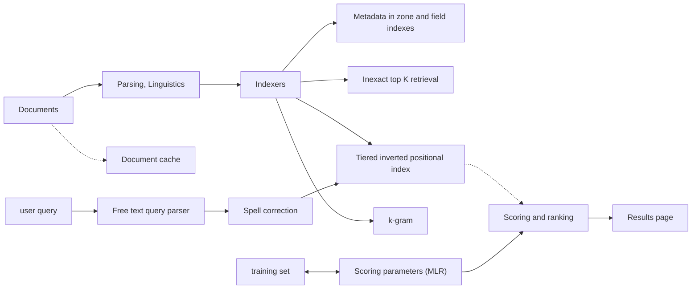

# CS 121: Information Retrieval — Week 9: The Vector Space Model, Scoring, Term Weighting / Link Analysis

## Table of Contents

- [1. Where We Are This Week](#1-where-we-are-this-week)
- [2. Inexact Top-K: Contenders and Index Elimination](#2-inexact-top-k-contenders-and-index-elimination)
- [3. Champion Lists](#3-champion-lists)
- [4. Static Quality Scores and the Net Score](#4-static-quality-scores-and-the-net-score)
- [5. Ordering Postings by g(d), and High and Low Lists](#5-ordering-postings-by-gd-and-high-and-low-lists)
- [6. Impact-Ordered Postings](#6-impact-ordered-postings)
- [7. Parametric and Zone Indexes](#7-parametric-and-zone-indexes)
- [8. Tiered Indexes](#8-tiered-indexes)
- [9. Query Term Proximity and Query Parsers](#9-query-term-proximity-and-query-parsers)
- [10. Aggregate Scores and the Complete Search System](#10-aggregate-scores-and-the-complete-search-system)
- [11. Link Analysis: HITS, Hubs and Authorities](#11-link-analysis-hits-hubs-and-authorities)
- [12. PageRank: The Random Surfer and Teleporting](#12-pagerank-the-random-surfer-and-teleporting)
- [13. Computing PageRank](#13-computing-pagerank)
- [14. PageRank in a Real Engine](#14-pagerank-in-a-real-engine)
- [15. Search Engine Evaluation: Effectiveness, Efficiency, Cost](#15-search-engine-evaluation-effectiveness-efficiency-cost)
- [16. Test Collections and Relevance Judgments](#16-test-collections-and-relevance-judgments)
- [17. Pooling](#17-pooling)
- [18. Query Logs and Clickthrough Data](#18-query-logs-and-clickthrough-data)
- [19. Precision, Recall and Classification Errors](#19-precision-recall-and-classification-errors)
- [20. In-class Notes & Assignment Tips](#20-in-class-notes--assignment-tips)
- [21. Worked Examples (with Solutions)](#21-worked-examples-with-solutions)
- [22. Quick Reference & Top 5 Things to Remember](#22-quick-reference--top-5-things-to-remember)

> UCI CS 121 / IN4MATX 141: Information Retrieval — Prof. Alberto Krone-Martins, Fall 2026, week of Nov 25
> Built from the Lecture 23, 24 and 25 slides (the YuJa videos are not included; the Schedule lists no X.5 deck this week). The decks are titled "Software Engineering 141 / Computer Science 121" — same course, cross-listed. Organized by concept, not by lecture.
> Lecture 25 is "Search Engine Evaluation", which the Schedule's topic list puts in Week 10; it is in this week's deck list, so it is covered here as far as its slides go (up to precision, recall and fallout).
> 📖 Readings this week: [Croft et al., §4.5 Link Analysis (book p. 104)](https://ciir.cs.umass.edu/downloads/SEIRiP.pdf) · [Manning, Raghavan & Schütze, *Introduction to IR*, Ch 21 Link analysis](https://nlp.stanford.edu/IR-book/pdf/irbookonlinereading.pdf) · [The PageRank paper (Canvas)](https://canvas.eee.uci.edu/courses/87165/files/37013232/download) · [The original Google paper (Canvas)](https://canvas.eee.uci.edu/courses/87165/files/37013231/download)

> 📅 **Class logistics**: Assignment 3 **Milestone 3** (ranked search) is due **Friday, Nov 27, 11:59 pm** (Thanksgiving week).
> Next week: **Online Quiz 4** in class on **Wednesday, Dec 2** (bring your laptop). Its topics: Search Engine Evaluation, Text classification, Recap.

---

## 1. Where We Are This Week

The architecture map ([Week 1 §10](week-01.en-US.md#10-search-engine-architecture)) opens all three decks (L23 p2, p64, p71 · L24 p2 · L25 p3): this week is **Ranking** (L23: fast and richer scoring; L24: link analysis) and **Evaluation** (L25).

L23 continues from [Week 8](week-08.en-US.md#6-computing-cosine-scores): tf-idf vectors ranked by **cosine similarity**, top $K$ returned. Scoring *every* document is the expensive part; §2–§8 are ways to avoid it.

---

## 2. Inexact Top-K: Contenders and Index Elimination

L23 p3–4 replay the end of Lecture 22 — the **generic approach** (a contender set $A$ with $K < |A| \ll N$ that has many, not necessarily all, of the top $K$; return the top $K$ in $A$; think of it as **pruning non-contenders**) and **index elimination** (only high-idf query terms; only docs containing many query terms). Both are in [Week 8 §11](week-08.en-US.md#11-cosine-is-only-a-proxy-inexact-top-k) and [§12](week-08.en-US.md#12-index-elimination). The same approach is also used for **other (non-cosine) scoring functions**; §3–§8 are schemes that follow it.

> ⚠️ **Pitfall**: These methods are **inexact** ("unsafe" in [Week 7 §13](week-07.en-US.md#13-threshold-methods-maxscore-and-early-termination)): the $K$ returned may not be the true top $K$ by cosine.

> 🔗 **Go deeper**: [IIR Ch 7 Computing scores in a complete search system](https://nlp.stanford.edu/IR-book/pdf/irbookonlinereading.pdf) · [Croft §5.7.3 Optimization Techniques (book p. 170)](https://ciir.cs.umass.edu/downloads/SEIRiP.pdf)

---

## 3. Champion Lists

(L23 p5–9)

- **Precompute** for each dictionary term $t$ the $r$ docs of **highest weight** in $t$'s postings. Call this the **champion list** for $t$ (aka **fancy list** or **top docs** for $t$).
- $r$ has to be chosen **at index build time**. Thus it's possible that $r < K$ — the query asks for more results than any one champion list holds.
- At query time, **only compute the complete scores for docs in the champion list of some query term**, then pick the $K$ top-scoring docs from amongst these.

> ⚠️ **Pitfall**: $r$ is fixed when the index is built, $K$ comes with the query. If $r < K$ (and the champion lists barely overlap), you can't even fill a page of $K$ results from the champions alone.

---

## 4. Static Quality Scores and the Net Score

**Static quality scores** (L23 p10–13). We want top-ranking documents to be **both relevant and authoritative**.

- **Relevance** is being modeled by **cosine scores**.
- **Authority** is typically a **query-independent** property of a document.

Examples of authority signals (the slide's arrows tag the last three as **Quantitative**):

| Signal | Quantitative? |
|---|---|
| Wikipedia among websites | |
| Articles in certain newspapers | |
| A paper with many citations | ✓ |
| Many bitly's, diggs or del.icio.us marks | ✓ |
| (PageRank, HITS) — §11–§13 | ✓ |

**Modeling authority** (L23 p14–15): assign to each document $d$ a **query-independent quality score in $[0, 1]$**, denoted $g(d)$. Thus a quantity like the number of citations is **scaled into $[0, 1]$**. The slide leaves "suggest a formula for this" as an **informal exercise** — no answer is given.

**Net relevance score** (L23 p16–18): a simple total score combining relevance and authority,

$$\text{net-score}(q, d) = g(d) + \text{cosine}(q, d)$$

$g(d)$ is the static quality of $d$; $\text{cosine}(q, d)$ is its query relevance from [Week 8](week-08.en-US.md#4-use-the-angle-cosine-similarity). You can use some other linear combination, $g(d) + \alpha \cdot \text{cosine}(q, d)$ ($\alpha$ sets how much relevance counts against authority) — indeed **any function of the two "signals" of user happiness**. Now we seek the **top $K$ docs by net score**.

---

## 5. Ordering Postings by g(d), and High and Low Lists

### 5.1 Order all postings by g(d)

(L23 p19–23)

- **First idea: order all postings by $g(d)$.**
- **Key**: this is a **common ordering for all postings** — every list is sorted the same way (by $g$, as docID order was before).
- Thus we can **concurrently traverse** the query terms' postings for **postings intersection** and **cosine score computation**, like the docID-ordered merge of [Week 6 §5](week-06.en-US.md#5-query-processing-and-by-merging-postings).

**Why order postings by $g(d)$?** Under $g(d)$-ordering, **top-scoring docs are likely to appear early** in postings traversal (remember: $g(d) + \alpha \cdot \text{cosine}(q, d)$). In **time-bound applications** (say, we have to return whatever search results we can in **~50 ms**), this allows us to **stop postings traversal early**, short of computing complete scores for all docs in postings.

### 5.2 Champion lists in g(d)-ordering

(L23 p24–26) Champion lists combine with $g(d)$-ordering: maintain for each term a champion list of the $r$ docs with **highest $g(d) + \text{tf-idf}_{t,d}$**, and seek top-$K$ results from **only the docs in these champion lists**.

### 5.3 High and low lists

(L23 p27–31)

- For each term, maintain **two disjoint sets**: **high** and **low** lists. Think of **high** as the champion list.
- When traversing postings on a query, **traverse high lists first**. If we get **more than $K$ docs**, select the top $K$ and **stop**; else proceed to get docs from the **low** lists.
- Can be used even for **simple cosine scores, without** a global quality $g(d)$.
- It is a means for **segmenting the index into two tiers** — generalized in §8.

> 💡 **Key Insight**: This is [Week 7 §13](week-07.en-US.md#13-threshold-methods-maxscore-and-early-termination)'s "list ordering by a quality metric (e.g. PageRank)", in detail.

---

## 6. Impact-Ordered Postings

(L23 p32–35) We only want to compute scores for docs for which $\mathrm{wf}_{t,d}$ (the weight of term $t$ in doc $d$, e.g. its tf-idf) is **high enough**. So **sort each postings list by $\mathrm{wf}_{t,d}$**.

**Now: not all postings are in a common order!** Each list has its own order, so the concurrent merge of §5.1 no longer works. How do we compute scores in order to pick off the top $K$? Two ideas:

**Idea 1 — early termination** (L23 p36–38):

- When traversing $t$'s postings, **stop early** after either a **fixed number of $r$ docs**, or when **$\mathrm{wf}_{t,d}$ drops below some threshold**.
- Take the **union** of the resulting sets of docs — one from the postings of each query term.
- **Compute only the scores for docs in this union.**

**Idea 2 — idf-ordered terms** (L23 p39–42):

- When considering the postings of query terms, look at them **in order of decreasing idf** — high-idf terms are likely to contribute most to the score.
- As we update the score contribution from each query term, **stop if doc scores are relatively unchanged**.
- Can apply to cosine or some other net scores.

> ⚠️ **Pitfall**: Don't mix the two orders. **$g(d)$-ordering** is one order shared by all lists (good for merging); **impact ordering** sorts each list by its own $\mathrm{wf}_{t,d}$ (good for cutting each list short, but no common order).

> 🔗 **Go deeper**: [Croft §5.7.3 Optimization Techniques (book p. 170)](https://ciir.cs.umass.edu/downloads/SEIRiP.pdf)

---

## 7. Parametric and Zone Indexes

**Metadata** (L23 p43–45). Thus far, a doc has been a sequence of terms. In fact documents have **multiple parts, some with special semantics**: author, title, date of publication, language, format, etc. These constitute the **metadata** about a document.

**Fields** (L23 p46–49). We sometimes wish to search by these metadata — e.g. find docs **authored by William Shakespeare in the year 1601**, containing *alas poor Yorick*.

- **Year = 1601** is an example of a **field**; so is author last name = shakespeare.
- **Field or parametric index**: postings for each field value. Sometimes build **range trees** (e.g. for dates).
- A field query is typically treated as a **conjunction** (the doc **must** be authored by shakespeare).

**Zones** (L23 p50–51). A **zone** is a region of the doc that can contain an **arbitrary amount of text**: title, abstract, references… Build **inverted indexes on zones** as well to permit querying — e.g. "find docs with *merchant* in the **title** zone and matching the query *gentle rain*".

**Two ways to encode zones** (L23 p52, "Encode zones in dictionary vs. postings"):

Zones in the **dictionary** — one postings list per term-zone pair:

| Dictionary entry | Postings |
|---|---|
| `william.abstract` | 11 → 121 → 1441 → 1729 |
| `william.title` | 2 → 4 → 8 → 16 |
| `william.author` | 2 → 3 → 5 → 8 |

Zones in the **postings** — one list for the term, each posting tagged with its zones:

| Dictionary entry | Postings |
|---|---|
| `william` | 2.author,2.title → 3.author → 4.title → 5.author |

> 💡 **Key Insight**: Field = a value matched exactly (year = 1601), used as a filter; zone = free text searched inside (title, abstract).

---

## 8. Tiered Indexes

(L23 p53–56)

- **Break postings up into a hierarchy of lists**: most important … least important.
- Can be done by **$g(d)$** or another measure (**zone weight, tf-idf**, etc.).
- The inverted index is thus broken up into **tiers of decreasing importance**.
- At query time **use the top tier unless it fails to yield $K$ docs**; if so, **drop to lower tiers**.

**Example tiered index** (L23 p57) — four terms, three documents:

| Term | Tier 1 | Tier 2 | Tier 3 |
|---|---|---|---|
| auto | Doc2 | — | Doc1 |
| best | — | Doc1, Doc3 | — |
| car | Doc1, Doc3 | — | Doc2 |
| insurance | Doc2, Doc3 | — | — |

High and low lists (§5.3) are the two-tier case.

> 🔗 **Go deeper**: [IIR Ch 7 Computing scores in a complete search system](https://nlp.stanford.edu/IR-book/pdf/irbookonlinereading.pdf)

---

## 9. Query Term Proximity and Query Parsers

### 9.1 Proximity

(L23 p58–63) **Free text queries** — just a set of terms typed into the query box — are common on the web. **Users prefer docs in which query terms occur within close proximity of each other.**

Let $w$ be the **smallest window** in a doc containing **all** query terms. For the query *strained mercy*, the smallest window in the doc *The quality of mercy is not strained* is **4** (words): *mercy is not strained*.

- Intuition: **the smaller $w$ is, the better** the document matches the query.
- We would like the scoring function to take this into account: **add weights!**

> 📝 **Practice**: [Worked Example 21.1](#211-smallest-window-for-strained-mercy-l23-p5863)

### 9.2 Query parsers

(L23 p65–67) A free text query from the user may in fact **spawn one or more queries** to the indexes. E.g. for the query *rising interest rates*:

1. Run the query as a **phrase query**.
2. If **< $K$ docs** contain the phrase *rising interest rates*, run the two phrase queries *rising interest* and *interest rates*.
3. If we **still have < $K$ docs**, run the **vector space query** *rising interest rates*.
4. **Rank matching docs by vector space scoring.**

This sequence is issued by a **query parser** — some method that transforms a user query into a **stream of multiple queries**. Phrase queries need the positional index of [Week 7 §5](week-07.en-US.md#5-positional-indexes).

> 📝 **Practice**: [Worked Example 21.2](#212-the-query-parser-on-rising-interest-rates-l23-p6567)

---

## 10. Aggregate Scores and the Complete Search System

**Aggregate scores** (L23 p68–69). Score functions can combine **cosine, static quality, proximity**, etc. How do we know the **best combination**?

- **User surveys**: ask real people to use your search engine (*think MS3!* — see §20).
- Some applications: **expert-tuned**.
- **Hand-tuning real-life systems is hard** (e.g. tens or hundreds of possible threshold choices, what to consider or not, etc.).
- Increasingly common technique: **adaptive-learning based optimization** (p68's first frame said "machine-learning"; p69 is the final wording).

**Putting it all together** (L23 p70) — the slide's diagram of a complete search system:



The scoring parameters are learned (**MLR**, machine-learned ranking) from a **training set**.

---

## 11. Link Analysis: HITS, Hubs and Authorities

### 11.1 Hubs and authorities

**Hyperlink-Induced Topic Search (HITS)** (L24 p5–7). In response to a query, instead of an ordered list of pages each meeting the query, find **two sets of inter-related pages**:

- **Hub pages** are **good lists of links** on a subject — e.g. "Bob's list of cancer-related links."
- **Authority pages** occur **recurrently on good hubs** for the subject.

HITS is best suited for **"broad topic" queries** rather than for page-finding queries, and gets at a **broader slice of common opinion**.

The definition (L24 p8–10) is **circular**:

- A good **hub** page for a topic **points to** many authoritative pages for that topic.
- A good **authority** page for a topic **is pointed to** by many good hubs for that topic.

The circularity is turned into an **iterative computation**. "The hope" (L24 p11): hubs Alice and Bob both link to AT&T, Sprint and Tmob, which come out as the authorities for *mobile telecom companies*.

### 11.2 The base set and the connectivity server

**High-level scheme** (L24 p12): extract from the web a **base set** of pages that could be good hubs or authorities; from these, identify a **small set of top hub and authority pages** → iterative algorithm.

**Creating the base set** (L24 p13–15, p19):

1. Given a text query (say *browser*), use a **text index** to get all pages containing *browser*. Call this the **root set**.
2. Add in any page that either **points to** a page in the root set, or **is pointed to** by a page in the root set.
3. Call this the **base set**.

The figure draws the root set as an inner region, with linked pages around it inside the base-set box: "Get in-links (and out-links) from a **connectivity server**".

**Connectivity server** (L24 p16–18): support for fast queries on the web graph — **which URLs point to a given URL? Which URLs does a given URL point to?**

- Stores mappings **in memory** from URL → outlinks and URL → inlinks.
- Uses the **sparse** properties of the graph (**do not build the entire matrix!**).
- Applications: **crawl control**; **web graph analysis** (connectivity, crawl optimization); **link analysis** (HITS, PageRank, …).

### 11.3 The iteration

**Distilling hubs and authorities** (L24 p20–24, overview on p34). Compute, for each page $x$ in the base set, a **hub score $h(x)$** and an **authority score $a(x)$**.

- **Initialize**: for all $x$, $h(x) \leftarrow 1$, $a(x) \leftarrow 1$.
- **Iteratively update** all $h(x)$, $a(x)$:

$$h(x) \leftarrow \sum_{x \mapsto y} a(y) \qquad\qquad a(x) \leftarrow \sum_{y \mapsto x} h(y)$$

$x \mapsto y$ means "$x$ links to $y$": a page's hub score is the sum of the authority scores of the pages it **points to**; its authority score is the sum of the hub scores of the pages that **point to it**.

- After a few iterations (or convergence), output pages with the **highest $h()$** scores as top hubs and **highest $a()$** scores as top authorities.

**Scaling** (L24 p25–26): to prevent $h()$ and $a()$ from getting too big, **scale down after each iteration**. The scaling factor doesn't really matter (as long as you are consistent): **we only care about the relative values** of the scores.

**How many iterations?** (L24 p27) Claim: relative values of scores **converge after a few iterations** — suitably scaled, $h()$ and $a()$ settle into a **steady state** ("you can demonstrate this…"). In practice, **~5 iterations** is enough to get you close to stability. (The slides give no numeric HITS run.)

### 11.4 Example and issues

**Japan Elementary Schools** (L24 p28): a HITS result in two columns. **Hubs** include "100 Schools Home Pages (English)", "K-12 from Japan", "Koulutus ja oppilaitokset" (Finnish) and "Education"; **authorities** include "The American School in Japan", "KEIMEI GAKUEN Home Page (Japanese)", "Torisu primary school" and "Yakumo Elementary, Hokkaido, Japan" — plus many Japanese titles (garbled on the slide).

Things to note (L24 p29–31):

- It **pulled together good pages regardless of the language** of page content.
- It uses **only link analysis after the base set is assembled** — the iterative scoring is **query-independent**.
- The iterative computation after text index retrieval is **significant overhead** (but **not at query time!**).

**HITS issues** (L24 p32–33):

- **Topic drift**: off-topic pages can cause off-topic "authorities" to be returned — e.g. the neighborhood graph can be about a "super topic".
- **Mutually reinforcing affiliates**: affiliated pages/sites can **boost each other's scores**. Linkage between affiliated pages is not a useful signal, so **avoid considering them** in the analysis.

> ⚠️ **Pitfall**: The arrows are the whole trick. **Hub** ← sum of **authorities it points to**; **authority** ← sum of **hubs pointing to it**. Swapping them is the classic quiz mistake.

> 🔗 **Go deeper**: [IIR Ch 21 Link analysis](https://nlp.stanford.edu/IR-book/pdf/irbookonlinereading.pdf) · [Croft §4.5 Link Analysis (book p. 104), §4.5.3 Link Quality (book p. 111)](https://ciir.cs.umass.edu/downloads/SEIRiP.pdf)

---

## 12. PageRank: The Random Surfer and Teleporting

**PageRank scoring** (L24 p36). Imagine a browser doing a **random walk** on web pages:

- Start at a random page.
- At each step, go out of the current page along one of the links on that page, **equiprobably** (the figure: a page with three out-links, each taken with probability 1/3).
- "In the **steady state**" each page has a **long-term visit rate** — use this as the page's score.

**Not quite enough** (L24 p37): the web is full of **dead-ends** (a page with in-links but no out-links). The random walk can get **stuck** in dead-ends, and then it makes no sense to talk about long-term visit rates.

**Teleporting** (L24 p38):

- **At a dead end**, jump to a **random web page**.
- **At any non-dead end**, with probability **10%**, jump to a random web page; with the remaining probability (**90%**), go out on a random link.
- The 10% is a **parameter**.

**Result of teleporting** (L24 p39–41, p45): now the walk **cannot get stuck locally**, and there is a **long-term rate at which any page is visited** (not obvious). The idea of PageRank is that **pages visited more by this random walker are more important**. How do we compute this visit rate? (§13)

**Why it mattered** (L24 p42–44). Status of searching the web in November 1997: "only one of the top four commercial search engines finds itself (returns its own search page in response to its name in the top ten results)." "Our main goal is to improve the quality of web search engines." (Brin & Page, 1997). The original Google and PageRank papers are on Canvas (linked in the scope note at the top).

> 💡 **Key Insight**: Unlike HITS, PageRank is computed **once for the whole web**, not per query — it's a $g(d)$ in the sense of §4. And unlike anchor text ([Week 5 §12](week-05.en-US.md#12-links-and-anchor-text)), it uses only the link structure, not the words on the link.

> 🔗 **Go deeper**: [Croft §4.5.2 PageRank (book p. 105)](https://ciir.cs.umass.edu/downloads/SEIRiP.pdf) · [IIR Ch 21 Link analysis](https://nlp.stanford.edu/IR-book/pdf/irbookonlinereading.pdf)

---

## 13. Computing PageRank

Two ways (L24 p46): **1. algebraic calculation** (given in the Google paper) and **2. Markov chain model**. The slides develop the algebraic one.

### 13.1 The formula

(L24 p47–51; p47 shows $p_i = [\text{matemagic}]\ p_j$ before revealing it)

$$p_i = (1 - d) + d \sum_{j=1}^{N} \left(\frac{L_{ij}}{c_j}\right) p_j \qquad\qquad c_j = \sum_{i=1}^{N} L_{ij}$$

$p_i$ is the PageRank of page $i$, $p_j$ the PageRank of page $j$; $L_{ij} = 1$ if page $j$ points to $i$, and 0 otherwise; $c_j$ is **how many pages are leaving page $j$** (its out-links); $d$ is the **damping factor**. (The p50–51 annotation reads "Liij" — a typo for $L_{ij}$.)

The same thing, as the Google paper writes it (L24 p52):

$$PR(A) = (1 - d) + d \left( \frac{PR(T_1)}{C(T_1)} + \dots + \frac{PR(T_n)}{C(T_n)} \right)$$

$A$ is a page; $T_1 \dots T_n$ are the pages that **link to** $A$; $PR(T_i)$ is the PageRank of $T_i$; $C(T_i)$ is the number of **outgoing** links from $T_i$; $d$ is a damping/teleport factor, **usually 0.85**.

> ⚠️ **Pitfall**: $C(T_i)$ counts the out-links of the page **giving** the vote, not the in-links of $A$. A page with many out-links splits its PageRank into many small votes.

The two slide parameterizations line up: $d$ is the probability of following a link, so the random walk's "10% teleport" is $d = 0.9$, and the formula's $d = 0.85$ is a 15% teleport. The formula is scaled so the **average** PageRank is 1 rather than the sum: in the example below the three values always add up to $N = 3$.

### 13.2 The slides' example

(L24 p53–56) Three pages: **A → B**, **B → C**, **C → A** and **C → B**. So $C(A) = 1$, $C(B) = 1$, $C(C) = 2$, and with $d = 0.85$:

$$PR(A) = 0.15 + 0.85 \cdot \frac{PR(C)}{2}$$
$$PR(B) = 0.15 + 0.85 \cdot \left(\frac{PR(A)}{1} + \frac{PR(C)}{2}\right)$$
$$PR(C) = 0.15 + 0.85 \cdot \frac{PR(B)}{1}$$

**How do we start?!?** Guess $PR(p) = 1$ for starters, then **iterate**. Each iteration computes all three new values from the **previous** iteration's values:

| Iteration | PR(A) | PR(B) | PR(C) | Sum |
|---|---|---|---|---|
| 0 (guess) | 1 | 1 | 1 | 3 |
| 1 | 0.575 | 1.425 | 1 | 3 |
| 2 | 0.575 | 1.06375 | 1.36125 | 3 |
| 3 | 0.728531 | 1.217281 | 1.054187 | 3 |
| … | | | | |
| 19 | 0.644456 | 1.192206 | 1.163337 | 3 |
| limit | 0.6444 | 1.1922 | 1.1634 | 3 |

The slide shows iterations 1 and 2; the other rows are from my script. Iteration 19 is the first where no value changes by 0.0001 or more; "limit" is the exact solution of the three equations (4 decimals). The algorithm **converges after N iterations**; once converged, the normalized probability distribution (**average PageRank for all pages**) will be **1** — here $3 / 3 = 1$. B wins: it gets votes from both A and C.

```viz pagerank
{"title": "PageRank on the slides' A, B, C graph (L24 p53–56)", "graph": "A -> B; B -> C; C -> A, B", "interactive": true}
```

> 📝 **Practice**: [Worked Example 21.3](#213-pagerank-iterations-on-the-a-b-c-graph-l24-p5356)

### 13.3 Matrix notation

(L24 p60–64) Stack all $p_i$ into a vector $\mathbf{p}$:

$$\mathbf{p} = (1 - d)\,\mathbf{e} + d \cdot \mathbf{L}\mathbf{D}_c^{-1}\mathbf{p} \qquad\qquad \mathbf{e}^T\mathbf{p} = N$$

$\mathbf{L}$ is the link matrix ($L_{ij}$), $\mathbf{D}_c$ the **diagonal matrix with diagonal elements $c_j$** (so $\mathbf{D}_c^{-1}$ divides each column by its out-degree), $\mathbf{e}$ the **vector of $N$ ones**. The constraint $\mathbf{e}^T\mathbf{p} = N$ is the **normalization** chosen so that **the average PageRank is 1**. Using it, $(1-d)\mathbf{e} = (1-d)\mathbf{e}\mathbf{e}^T\mathbf{p}/N$, which folds everything into one matrix:

$$\mathbf{p} = \left[(1 - d)\,\mathbf{e}\mathbf{e}^T/N + d\,\mathbf{L}\mathbf{D}_c^{-1}\right]\mathbf{p} = \mathbf{A}\mathbf{p}$$

So $\mathbf{p}$ is an eigenvector of $\mathbf{A}$ (eigenvalue 1), found by **power iteration**:

$$\mathbf{p}_k \leftarrow \mathbf{A}\mathbf{p}_{k-1}; \qquad \mathbf{p}_k \leftarrow N \frac{\mathbf{p}_k}{\mathbf{e}^T\mathbf{p}_k}$$

The same example in this form:

```python
import numpy as np

# L[i, j] = 1 if page j points to page i (order A, B, C)
L = np.array([[0, 0, 1],    # C -> A
              [1, 0, 1],    # A -> B, C -> B
              [0, 1, 0]])   # B -> C
N, d = 3, 0.85
e = np.ones(N)
Dc_inv = np.diag(1 / L.sum(axis=0))   # c_j = out-links of j
A = (1 - d) * np.outer(e, e) / N + d * L @ Dc_inv

p = np.ones(N)                 # guess 1
for k in range(50):
    p = A @ p                  # p_k <- A p_{k-1}
    p = N * p / (e @ p)        # keep e^T p = N
print(p.round(4))
```

```text
[0.6444 1.1922 1.1634]
```

Same values as the table's limit.

> 🔗 **Go deeper**: [PageRank visualization (linked on L24 p56)](http://ed.ilogues.com/projects/2015/03/22/pagerank-visualization) · [The PageRank paper (Canvas)](https://canvas.eee.uci.edu/courses/87165/files/37013232/download) · [Croft §4.5.2 PageRank (book p. 105)](https://ciir.cs.umass.edu/downloads/SEIRiP.pdf)

---

## 14. PageRank in a Real Engine

**PageRank summary** (L24 p57):

- **Preprocessing**: given the graph of links, build a **(sparse) matrix** of the links; from it compute PageRank.
- One possibility to add PR in query processing (at query time): retrieve pages meeting the query, **rank them by their PageRank**. But this rank order is **query-independent**…

**The reality** (L24 p58–59):

- PageRank is used in Google and other engines, but is **hardly the full story** of ranking. It is just **one among many criteria** used in relevance scoring; many additional sophisticated features are used, some address specific query classes, and **machine-learned ranking** is used more and more.
- Given a query, a real-life search engine computes a **composite score** for each web page that combines **hundreds of features** (cosine similarity, term proximity, PageRank, HITS, etc.) — the aggregate scores of §10.
- PageRank **alone** is still very useful for things like **crawl policy** ([Week 3](week-03.en-US.md)).

> 🔗 **Go deeper**: [Croft §7.5 Web Search (book p. 279)](https://ciir.cs.umass.edu/downloads/SEIRiP.pdf)

---

## 15. Search Engine Evaluation: Effectiveness, Efficiency, Cost

(L25 p4–8) For a **given query, a corpus and a specific definition of relevance**:

- **Effectiveness** measures the **ability to find the right information** — how well the rank corresponds to the rank that the user expects.
- **Efficiency** measures **how quickly** this is done and how many **resources** are needed — the time and space requirements of the methods that produced the ranking.

Evaluation is **key to building effective and efficient search engines**:

- Measurement is usually carried out in **controlled laboratory experiments**; **online** testing can also be done.
- **Effectiveness, efficiency and cost are related**: if we want a particular level of effectiveness and efficiency, this will determine the **cost** of the system configuration; **efficiency and cost targets may impact effectiveness**.

> 🔗 **Go deeper**: [Croft §8.1 Why Evaluate? (book p. 297)](https://ciir.cs.umass.edu/downloads/SEIRiP.pdf) · [IIR Ch 8 Evaluation in information retrieval](https://nlp.stanford.edu/IR-book/pdf/irbookonlinereading.pdf)

---

## 16. Test Collections and Relevance Judgments

**Evaluation corpus** (L25 p9–11): allows results from different methods to be **compared**. **Test collections** consist of **documents, queries, and relevance judgments**, e.g.:

- **CACM**: titles and abstracts from the *Communications of the ACM* from 1958–1979. Queries and relevance judgments generated by **computer scientists**.
- **AP**: Associated Press newswire documents from 1988–1990 (from TREC disks 1–3). Queries are the **title fields** from TREC topics 51–150. Topics and relevance judgments generated by **government information analysts**.
- **GOV2**: web pages crawled from websites in the **.gov** domain during early 2004. Queries are the title fields from TREC topics 701–850. Topics and relevance judgments generated by **government analysts**.

**Test collections** (L25 p12):

| Collection | Number of documents | Size | Average number of words/doc. |
|---|---|---|---|
| CACM | 3,204 | 2.2 Mb | 64 |
| AP | 242,918 | 0.7 Gb | 474 |
| GOV2 | 25,205,179 | 426 Gb | 1073 |

| Collection | Number of queries | Average number of words/query | Average number of relevant docs/query |
|---|---|---|---|
| CACM | 64 | 13.0 | 16 |
| AP | 100 | 4.3 | 220 |
| GOV2 | 150 | 3.1 | 180 |

**A TREC topic** (L25 p13) — **the title is used as the query**:

```text
<top>
<num> Number: 794

<title> pet therapy

<desc> Description:
How are pets or animals used in therapy for humans and what are the
benefits?

<narr> Narrative:
Relevant documents must include details of how pet- or animal-assisted
therapy is or has been used.  Relevant details include information
about pet therapy programs, descriptions of the circumstances in which
pet therapy is used, the benefits of this type of therapy, the degree
of success of this therapy, and any laws or regulations governing it.

</top>
```

**Relevance judgments** (L25 p14–15). Obtaining relevance judgments is an **expensive, time-consuming process**: who does it? What are the instructions? What is the level of agreement? **TREC judgments** depend on the task being evaluated, are **generally binary**, and **agreement is good because of the "narrative"** (the `<narr>` field spells out what counts as relevant).

> 💡 **Key Insight**: Compare the query lengths: 13.0 words per query for CACM (queries written by computer scientists) vs 4.3 and 3.1 for AP and GOV2, whose queries are the short TREC **title** fields.

> 🔗 **Go deeper**: [Croft §8.2 The Evaluation Corpus (book p. 299)](https://ciir.cs.umass.edu/downloads/SEIRiP.pdf)

---

## 17. Pooling

(L25 p16–18) **Exhaustive judgments for all documents in a collection are not practical** (think 25 million GOV2 pages × 150 topics). The **pooling** technique is used in GOV2:

- The **top $k$ results** (for TREC, $k$ varied **between 50 and 200**) from the rankings obtained by **different search engines** (or retrieval algorithms) are **merged into a pool**.
- **Duplicates are removed.**
- Documents are presented in some **random order** to the relevance judges.

Pooling produces a **large number of relevance judgments for each query, although still incomplete** — and studies have shown that **comparisons are accurate**.

> ⚠️ **Pitfall**: Only pooled documents get judged, so a relevant document that no participating system ranked in its top $k$ is never judged. That's why the slide says "still incomplete": pooled judgments are good for **comparing** systems, not a complete list of the relevant documents.

---

## 18. Query Logs and Clickthrough Data

**Query logs** (L25 p19–21) are used for both **tuning and evaluating** search engines, and also for techniques such as **query suggestion**. They **can generate privacy concerns** — anonymize the logged data? Typical contents:

- **User identifier** or user session identifier
- **Query terms** — stored **exactly** as the user entered them
- **List of URLs of results**, their **ranks** on the result list, and **whether they were clicked on**
- **Timestamp(s)** — the time of user events such as query submission and clicks
- **In which page the user clicked!!!**

**Clicks are not relevance judgments** (L25 p22–23), although they are **correlated**. They are **biased** by a number of factors such as **rank on the result list** (the slide calls it "confirmation bias!": people click what's on top). Clickthrough data can instead be used to predict **preferences between pairs of documents**:

- correlated with relevance judgments;
- appropriate for tasks with **multiple levels of relevance**, focused on **user relevance**;
- various **"policies"** are used to generate preferences.

**Example click policy: Skip Above and Skip Next** (Agichtein et al., 2006; L25 p24). Result list $d_1, d_2, d_3, d_4$, and only $d_3$ was clicked. Generated preferences: $d_3 > d_2$, $d_3 > d_1$, $d_3 > d_4$ — the clicked document beats every unclicked result **above** it (the user skipped them) and the unclicked result **just below** it.

> 📝 **Practice**: [Worked Example 21.4](#214-skip-above-and-skip-next-l25-p24)

**Click data of a single user can be noisy!** (L25 p25–26) But click data can be **aggregated** to remove noise. **Click distribution** information can identify clicks that have a **higher frequency than would be expected** — those have a **high correlation with relevance**, e.g. using **click deviation** to filter clicks for preference-generation policies.

**Filtering clicks** (L25 p27). The **click deviation** $CD(d, p)$ for a result $d$ in position $p$:

$$CD(d, p) = O(d, p) - E(p)$$

$O(d, p)$ is the **observed** click frequency for document $d$ at rank position $p$ **over all instances of a given query**; $E(p)$ is the **expected** click frequency at rank $p$ **averaged across all queries**. Use this value to filter clicks and provide more reliable information (optimizing your ranking).

> 🔗 **Go deeper**: [Croft §8.3 Logging (book p. 305)](https://ciir.cs.umass.edu/downloads/SEIRiP.pdf)

---

## 19. Precision, Recall and Classification Errors

Precision and recall first came up from the user's side in [Week 2 §6.1](week-02.en-US.md#61-precision-vs-recall); here they get their set definitions (L25 p28–29). Let **$A$ be the set of relevant documents** and **$B$ the set of retrieved documents**:

| | Relevant | Non-Relevant |
|---|---|---|
| **Retrieved** | $A \cap B$ | $\overline{A} \cap B$ |
| **Not Retrieved** | $A \cap \overline{B}$ | $\overline{A} \cap \overline{B}$ |

$$\text{Recall} = \frac{|A \cap B|}{|A|} \qquad\qquad \text{Precision} = \frac{|A \cap B|}{|B|}$$

$\overline{A}$ = non-relevant documents, $\overline{B}$ = documents not retrieved.

- **Recall**: how well the search engine is doing at **finding all the relevant documents** for a query.
- **Precision**: how well it is doing at **rejecting non-relevant documents**.

**Classification errors** (L25 p30–31):

- **False positive (Type I error)**: a **non-relevant document is retrieved** ($\overline{A} \cap B$). Its rate is the **fallout**:

$$\text{Fallout} = \frac{|\overline{A} \cap B|}{|\overline{A}|}$$

- **False negative (Type II error)**: **relevant documents that are not retrieved** ($A \cap \overline{B}$). As a fraction of the relevant documents, that's **$1 - \text{Recall}$**.

(L25 ends here; the Schedule continues evaluation in Week 10. The slides work no numeric precision/recall example.)

> ⚠️ **Pitfall**: The denominators decide everything: recall divides by **all relevant** ($|A|$), precision by **all retrieved** ($|B|$), fallout by **all non-relevant** ($|\overline{A}|$). Fallout is not $1 - \text{precision}$.

> 🔗 **Go deeper**: [Croft §8.4.1 Recall and Precision (book p. 308)](https://ciir.cs.umass.edu/downloads/SEIRiP.pdf) · [IIR Ch 8 Evaluation in information retrieval](https://nlp.stanford.edu/IR-book/pdf/irbookonlinereading.pdf)

---

## 20. In-class Notes & Assignment Tips

**"Think MS3!"** (L23 p68): the first way to find the best combination of scoring signals is **user surveys — ask real people to use your search engine**, as Assignment 3 Milestone 3 (due Fri, Nov 27) has you do. For MS3's ranked search, the week offers champion lists, tiers or high/low lists (§3, §5.3, §8) for speed, and title zones (§7) and proximity (§9.1) as extra signals.

---

## 21. Worked Examples (with Solutions)

### 21.1 Smallest window for strained mercy (L23 p58–63)

Query: *strained mercy*. Document: *The quality of mercy is not strained*. What is the smallest window $w$ containing all query terms?

<details>
<summary>Solution</summary>

*mercy* is word 4 and *strained* is word 7; each occurs once, so the only window containing both runs from word 4 to word 7: *mercy is not strained*. $w = 7 - 4 + 1 = $ **4 words** (a brute-force check over all windows in my script gives the same window). The smaller $w$, the better the match — so a proximity-aware score would add weight to this document over one where the two words are far apart.

</details>

Back to [§9.1](#91-proximity).

### 21.2 The query parser on rising interest rates (L23 p65–67)

The user types *rising interest rates* and we want $K$ results. Which queries does the parser run, and when does it stop?

<details>
<summary>Solution</summary>

1. Phrase query **"rising interest rates"**. If at least $K$ docs contain the phrase, stop and rank them.
2. Otherwise, the two phrase queries **"rising interest"** and **"interest rates"**. If together they now give at least $K$ docs, stop.
3. Otherwise, the **vector space query** *rising interest rates* (no phrase constraint).
4. Rank the matching docs by **vector space scoring**.

Each step relaxes the query only when the stricter one yields fewer than $K$ docs — the same fallback logic as tiered indexes (§8).

</details>

Back to [§9.2](#92-query-parsers).

### 21.3 PageRank iterations on the A, B, C graph (L24 p53–56)

Links: A → B, B → C, C → A, C → B. $d = 0.85$, every page starts at 1. Compute iterations 1 and 2, and say where it converges.

<details>
<summary>Solution</summary>

Out-link counts: $C(A) = 1$, $C(B) = 1$, $C(C) = 2$. In-links: A ← C; B ← A, C; C ← B. Every new value uses the **previous** iteration's values.

**Iteration 1** (all previous values = 1):
- $PR(A) = 0.15 + 0.85 \cdot 1/2 = 0.575$
- $PR(B) = 0.15 + 0.85 \cdot (1/1 + 1/2) = 1.425$
- $PR(C) = 0.15 + 0.85 \cdot 1/1 = 1$

**Iteration 2** (previous: A = 0.575, B = 1.425, C = 1):
- $PR(A) = 0.15 + 0.85 \cdot 1/2 = 0.575$
- $PR(B) = 0.15 + 0.85 \cdot (0.575 + 1/2) = 1.06375$
- $PR(C) = 0.15 + 0.85 \cdot 1.425 = 1.36125$

Both match the slide. Continuing (my script): iteration 3 gives A = 0.728531, B = 1.217281, C = 1.054187; iteration 19 is the first where no value changes by 0.0001 or more (A = 0.644456, B = 1.192206, C = 1.163337), and the exact solution is **A ≈ 0.6444, B ≈ 1.1922, C ≈ 1.1634**. The sum stays 3 in every iteration (no dead ends), so the average PageRank is **1**, as L24 p56 says. **B** ranks first: it collects A's whole vote plus half of C's.

```viz pagerank
{"title": "Check: iterations 1–2 page by page, then to convergence (L24 p53–55)", "graph": "A -> B; B -> C; C -> A, B", "code": "none"}
```

</details>

Back to [§13.2](#132-the-slides-example).

### 21.4 Skip Above and Skip Next (L25 p24)

The result list is $d_1, d_2, d_3, d_4$ and the user clicked only $d_3$. Which preferences does Skip Above and Skip Next generate?

<details>
<summary>Solution</summary>

- **Skip Above**: the user saw and skipped $d_1$ and $d_2$ before clicking $d_3$ → $d_3 > d_2$ and $d_3 > d_1$.
- **Skip Next**: the unclicked result right after the click → $d_3 > d_4$.

So $d_3 > d_2$, $d_3 > d_1$, $d_3 > d_4$ — the slide's three preferences: pairs ordered, not relevance judged.

</details>

Back to [§18](#18-query-logs-and-clickthrough-data).

---

## 22. Quick Reference & Top 5 Things to Remember

**Inexact top-K toolbox (L23)**

| Technique | Idea | Built when |
|---|---|---|
| Index elimination | only high-idf query terms; only docs with many query terms | query time |
| Champion list | top $r$ docs by weight per term; score only those ($r$ may be < $K$) | index time |
| Static quality $g(d)$ | query-independent authority in $[0,1]$; net score $g(d) + \alpha\cdot\text{cosine}$ | offline |
| $g(d)$-ordered postings | one common order → merge + stop early (~50 ms budget) | index time |
| Champion list in $g$-order | top $r$ by $g(d) + \text{tf-idf}_{t,d}$ | index time |
| High / low lists | high first; fall back to low if < $K$ docs (two tiers) | index time |
| Impact ordering | each list sorted by $\mathrm{wf}_{t,d}$; early termination or idf-ordered terms | index time |
| Tiered index | tiers by importance; drop a tier only if < $K$ docs | index time |
| Zones / fields | zone = searchable text region; field = exact-match metadata (conjunction) | index time |
| Proximity | smallest window $w$; smaller = better | query time |
| Query parser | phrase → sub-phrases → vector space, until $K$ docs | query time |

**Link analysis (L24)**

| | HITS | PageRank |
|---|---|---|
| Scores | hub $h(x)$, authority $a(x)$ | one score per page |
| Update | $h(x) \leftarrow \sum_{x \mapsto y} a(y)$, $a(x) \leftarrow \sum_{y \mapsto x} h(y)$ | $PR(A) = (1-d) + d\sum PR(T_i)/C(T_i)$ |
| Start | all 1 | all 1 |
| Graph | per-query base set (root set + neighbors) | whole web |
| Iterations | ~5, rescale each time | until it converges (avg PR = 1) |
| Issues | topic drift, mutually reinforcing affiliates | dead ends → teleporting |

**Evaluation (L25)**

| Name | Formula / meaning |
|---|---|
| Recall | $\lvert A \cap B\rvert / \lvert A\rvert$ — found all the relevant? |
| Precision | $\lvert A \cap B\rvert / \lvert B\rvert$ — rejected the non-relevant? |
| Fallout (Type I rate) | $\lvert \overline{A} \cap B\rvert / \lvert \overline{A}\rvert$ |
| False negative (Type II) | relevant not retrieved; rate $1 - \text{Recall}$ |
| Click deviation | $CD(d,p) = O(d,p) - E(p)$ |
| Pooling | top $k$ (50–200) from many systems, deduplicated, judged in random order |
| Skip Above / Skip Next | clicked doc > skipped docs above it, and > the next unclicked one |

**Top 5 things to remember**

1. Inexact top-K = pick a small **contender set** and score only that: champion lists, $g(d)$ ordering, high/low lists, tiers — all trade a little accuracy for speed, and $r$ is fixed at index time.
2. **net-score = $g(d)$ + cosine**: $g(d)$ is **query-independent** authority (citations, PageRank, HITS) scaled into $[0,1]$; ordering postings by it puts good documents first so you can stop early.
3. **HITS**: hub = sum of the authorities it points to, authority = sum of the hubs pointing to it; computed on a per-query **base set**, ~5 iterations, only relative values matter.
4. **PageRank**: $PR(A) = (1-d) + d \sum PR(T_i)/C(T_i)$, $d = 0.85$, start at 1, update all pages from the previous iteration's values; it converges with average PageRank 1. Teleporting fixes dead ends.
5. Evaluation needs **documents + queries + relevance judgments**; pooling makes judging feasible; clicks give **preferences**, not judgments; recall divides by relevant, precision by retrieved, fallout by non-relevant.
