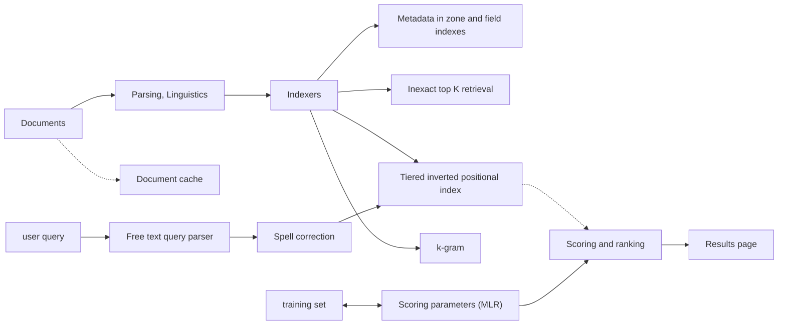

# CS 121: Information Retrieval — Week 9：向量空间模型、打分、词项加权 / 链接分析

## 目录

- [1. 本周概览](#1-本周概览)
- [2. 近似的前 K 个：候选集与索引剪枝](#2-近似的前-k-个候选集与索引剪枝)
- [3. 冠军列表](#3-冠军列表)
- [4. 静态质量分数与净得分](#4-静态质量分数与净得分)
- [5. 按 g(d) 排序 postings，以及高列表与低列表](#5-按-gd-排序-postings以及高列表与低列表)
- [6. 按影响排序的 postings](#6-按影响排序的-postings)
- [7. 参数化索引与区域索引](#7-参数化索引与区域索引)
- [8. 分层索引](#8-分层索引)
- [9. 查询词项邻近度与查询解析器](#9-查询词项邻近度与查询解析器)
- [10. 聚合分数与完整的搜索系统](#10-聚合分数与完整的搜索系统)
- [11. 链接分析：HITS、枢纽页与权威页](#11-链接分析hits枢纽页与权威页)
- [12. PageRank：随机游走者与远程跳转](#12-pagerank随机游走者与远程跳转)
- [13. 计算 PageRank](#13-计算-pagerank)
- [14. 真实搜索引擎中的 PageRank](#14-真实搜索引擎中的-pagerank)
- [15. 搜索引擎评价：有效性、效率、成本](#15-搜索引擎评价有效性效率成本)
- [16. 测试集合与相关性判断](#16-测试集合与相关性判断)
- [17. 汇集](#17-汇集)
- [18. 查询日志与点击数据](#18-查询日志与点击数据)
- [19. 精确率、召回率与分类错误](#19-精确率召回率与分类错误)
- [20. 课堂笔记与作业提示](#20-课堂笔记与作业提示)
- [21. 示例题（附解答）](#21-示例题附解答)
- [22. 速查与必记的 5 件事](#22-速查与必记的-5-件事)

> UCI CS 121 / IN4MATX 141: Information Retrieval — Prof. Alberto Krone-Martins, Fall 2026, week of Nov 25
> 整理自 Lecture 23、24 和 25 的幻灯片（YuJa 视频未收录；课程安排中本周没有 X.5 讲义）。幻灯片的标题是 "Software Engineering 141 / Computer Science 121"，即同一门课、交叉列课。内容按概念组织，而不是按讲次组织。
> Lecture 25 是 "Search Engine Evaluation"，课程安排的主题列表把它放在第 10 周；但它在本周的幻灯片清单中，因此这里覆盖到幻灯片所讲的部分（到精确率、召回率和误报率为止）。
> 📖 本周阅读：[Croft et al.，§4.5 Link Analysis（书中第 104 页）](https://ciir.cs.umass.edu/downloads/SEIRiP.pdf) · [Manning, Raghavan & Schütze，*Introduction to IR*，第 21 章 Link analysis](https://nlp.stanford.edu/IR-book/pdf/irbookonlinereading.pdf) · [PageRank 论文（Canvas）](https://canvas.eee.uci.edu/courses/87165/files/37013232/download) · [Google 原始论文（Canvas）](https://canvas.eee.uci.edu/courses/87165/files/37013231/download)

> 📅 **课程安排**：Assignment 3 **Milestone 3**（排序检索）截止时间为 **11 月 27 日（周五）晚 11:59**（感恩节周）。
> 下周：**Online Quiz 4** 于 **12 月 2 日（周三）** 课上进行（请带笔记本电脑）。其主题为：搜索引擎评价、文本分类、回顾。

---

## 1. 本周概览

[第 1 周第 10 节](week-01.zh-CN.md#10-搜索引擎架构)的架构图开启了三份幻灯片（L23 p2、p64、p71 · L24 p2 · L25 p3）：本周的内容是**排序**（L23：快速且更丰富的打分；L24：链接分析）和**评价**（L25）。

L23 接续[第 8 周](week-08.zh-CN.md#6-计算余弦分数)的内容：tf-idf 向量按**余弦相似度**排序，返回前 $K$ 个结果。给*每一个*文档打分是最昂贵的部分；第 2–8 节讲的都是如何避开这一步。

---

## 2. 近似的前 K 个：候选集与索引剪枝

L23 p3–4 重放了 Lecture 22 的结尾，包括**通用方法**（一个候选集 $A$，满足 $K < |A| \ll N$，且包含许多（不一定是全部的）前 $K$ 个文档；从 $A$ 中返回前 $K$ 个，可以把它看作**剪掉非候选者**）和**索引剪枝**（只使用高 idf 的查询词项；只考虑包含许多查询词项的文档）。两者分别见[第 8 周第 11 节](week-08.zh-CN.md#11-余弦只是代理近似的前-k-个)和[第 12 节](week-08.zh-CN.md#12-索引剪枝)。同样的方法也适用于**其他（非余弦）打分函数**；第 3–8 节的方案都遵循这一思路。

> ⚠️ **易错点**：这些方法是**近似的**（即第 7 周第 13 节中所说的"不安全"，见[第 7 周第 13 节](week-07.zh-CN.md#13-阈值方法maxscore-与提前终止)）：返回的 $K$ 个文档未必是按余弦排出的真正前 $K$ 个。

> 🔗 **延伸阅读**：[IIR 第 7 章 Computing scores in a complete search system](https://nlp.stanford.edu/IR-book/pdf/irbookonlinereading.pdf) · [Croft §5.7.3 Optimization Techniques（书中第 170 页）](https://ciir.cs.umass.edu/downloads/SEIRiP.pdf)

---

## 3. 冠军列表

（L23 p5–9）

- **预先计算**：对每个词典词项 $t$，保存其 postings 中**权重最高**的 $r$ 个文档。称之为 $t$ 的**冠军列表**（又称 **fancy list**，或 $t$ 的 **top docs**）。
- $r$ 必须在**建索引时**选定。因此可能出现 $r < K$：查询要求的结果数超过了任何一个冠军列表所能容纳的数量。
- 查询时，**只对某个查询词项的冠军列表中的文档计算完整分数**，然后从中挑出得分最高的 $K$ 个文档。

> ⚠️ **易错点**：$r$ 在建索引时固定，$K$ 随查询而来。若 $r < K$（且冠军列表几乎不重叠），仅靠冠军列表甚至凑不满一页 $K$ 条结果。

---

## 4. 静态质量分数与净得分

**静态质量分数**（L23 p10–13）。我们希望排名靠前的文档既**相关**又**权威**。

- **相关性**由**余弦分数**来建模。
- **权威性**通常是文档的**与查询无关**的属性。

权威性信号的例子（幻灯片上的箭头把后三项标为 **Quantitative**，即可量化）：

| 信号 | 可量化？ |
|---|---|
| 网站中的 Wikipedia | |
| 某些报纸上的文章 | |
| 被大量引用的论文 | ✓ |
| 获得大量 bitly、digg 或 del.icio.us 标记 | ✓ |
| （PageRank、HITS）—— 第 11–13 节 | ✓ |

**为权威性建模**（L23 p14–15）：为每个文档 $d$ 分配一个**与查询无关的质量分数**，取值在 $[0, 1]$ 之间，记为 $g(d)$。因此像引用次数这样的量会被**缩放到 $[0, 1]$**。幻灯片把"请为此提出一个公式"留作**非正式的练习**，没有给出答案。

**净相关性分数**（L23 p16–18）：把相关性与权威性合并为一个简单的总分：

$$\text{net-score}(q, d) = g(d) + \text{cosine}(q, d)$$

$g(d)$ 是 $d$ 的静态质量；$\text{cosine}(q, d)$ 是它与查询的相关度，见[第 8 周第 4 节](week-08.zh-CN.md#4-用夹角余弦相似度)。也可以使用其他线性组合，$g(d) + \alpha \cdot \text{cosine}(q, d)$（$\alpha$ 决定相关性相对于权威性的权重），事实上可以是关于用户"满意度"两个信号的**任何函数**。现在我们要求按净得分找出**前 $K$ 个文档**。

---

## 5. 按 g(d) 排序 postings，以及高列表与低列表

### 5.1 按 g(d) 排序所有 postings

（L23 p19–23）

- **第一个想法：按 $g(d)$ 对所有 postings 排序。**
- **关键**：这是**所有 postings 共用的排序**，每个列表都按同一方式（按 $g$ 排序，就像之前按 docID 排序一样）。
- 因此可以**并行遍历**查询词项的 postings，用于**求 postings 交集**和**余弦分数计算**，就像[第 6 周第 5 节](week-06.zh-CN.md#5-查询处理用合并-postings-实现-and)中按 docID 有序的合并那样。

**为什么按 $g(d)$ 排序 postings？** 在 $g(d)$ 排序下，**得分最高的文档很可能出现在 postings 遍历的前部**（记住：$g(d) + \alpha \cdot \text{cosine}(q, d)$）。在**有时限的应用**中（比如必须在约 **50 毫秒**内返回能返回的搜索结果），这允许我们**提前停止 postings 遍历**，无需为 postings 中的所有文档计算完整分数。

### 5.2 g(d) 排序中的冠军列表

（L23 p24–26）冠军列表可以与 $g(d)$ 排序结合：为每个词项维护一个冠军列表，保存 **$g(d) + \text{tf-idf}_{t,d}$ 最高**的 $r$ 个文档，并且只从这些冠军列表中的文档里寻找前 $K$ 个结果。

### 5.3 高列表与低列表

（L23 p27–31）

- 对每个词项，维护两个**互不相交**的集合：**高列表**和**低列表**。可以把**高列表**看作冠军列表。
- 遍历查询的 postings 时，**先遍历高列表**。如果得到**超过 $K$ 个**文档，就选出前 $K$ 个并**停止**；否则继续从**低列表**中取文档。
- 即使是**简单的余弦分数**，也可以在**没有**全局质量 $g(d)$ 的情况下使用。
- 这是把索引**切分为两层**的一种手段，第 8 节会把它推广。

> 💡 **关键见解**：这就是[第 7 周第 13 节](week-07.zh-CN.md#13-阈值方法maxscore-与提前终止)中"按质量指标（例如 PageRank）对列表排序"的具体展开。

---

## 6. 按影响排序的 postings

（L23 p32–35）我们只想为那些 $\mathrm{wf}_{t,d}$（词项 $t$ 在文档 $d$ 中的权重，例如 tf-idf）**足够高**的文档计算分数。因此要**按 $\mathrm{wf}_{t,d}$ 对每个 postings 列表排序**。

**现在，并非所有 postings 都处于同一排序之中！** 每个列表有自己的顺序，所以 §5.1 的并行合并不再适用。为了挑出前 $K$ 个，我们如何计算分数？有两个想法：

**想法 1：提前终止**（L23 p36–38）：

- 遍历 $t$ 的 postings 时，在**固定的 $r$ 个文档**之后，或当 $\mathrm{wf}_{t,d}$ 降到某个阈值以下时，**提前停止**。
- 取各查询词项得到的文档集合的**并集**。
- **只计算并集中文档的分数。**

**想法 2：按 idf 排序的词项**（L23 p39–42）：

- 考虑查询词项的 postings 时，**按 idf 从高到低**依次查看，因为高 idf 的词项很可能对分数贡献最大。
- 每当更新某个查询词项的分数贡献后，如果文档分数**相对没有变化**，就**停止**。
- 既可用于余弦分数，也可用于其他净得分。

> ⚠️ **易错点**：不要混用两种顺序。**$g(d)$ 排序**是所有列表共用的一种顺序（利于合并）；**影响排序**让每个列表按各自的 $\mathrm{wf}_{t,d}$ 排序（利于提前截断每个列表，但没有共同顺序）。

> 🔗 **延伸阅读**：[Croft §5.7.3 Optimization Techniques（书中第 170 页）](https://ciir.cs.umass.edu/downloads/SEIRiP.pdf)

---

## 7. 参数化索引与区域索引

**元数据**（L23 p43–45）。到目前为止，一个文档被看作一串词项。实际上文档有**多个部分，其中一些具有特殊语义**：作者、标题、出版日期、语言、格式等。这些构成了文档的**元数据**。

**字段**（L23 p46–49）。有时我们希望按这些元数据来搜索，例如查找**由 William Shakespeare 于 1601 年创作、包含 *alas poor Yorick* 的文档**。

- **Year = 1601** 是一个**字段**的例子；作者姓氏 = shakespeare 也是。
- **字段索引或参数化索引**：为每个字段值建立 postings。有时会建立**范围树**（例如用于日期）。
- 字段查询通常被当作**合取**处理（文档**必须**由 shakespeare 撰写）。

**区域**（L23 p50–51）。**区域**是文档中可以包含**任意长度文本**的一部分：标题、摘要、参考文献等。也要为**区域建立倒排索引**以支持查询，例如"查找**标题区域**中含 *merchant*、并且匹配查询 *gentle rain* 的文档"。

**两种编码区域的方式**（L23 p52，"Encode zones in dictionary vs. postings"）：

在**词典**中编码区域：每个"词项-区域"对一个 postings 列表。

| 词典条目 | Postings |
|---|---|
| `william.abstract` | 11 → 121 → 1441 → 1729 |
| `william.title` | 2 → 4 → 8 → 16 |
| `william.author` | 2 → 3 → 5 → 8 |

在 **postings 中**编码区域：词项只有一个列表，每个 posting 标注其所在的区域。

| 词典条目 | Postings |
|---|---|
| `william` | 2.author,2.title → 3.author → 4.title → 5.author |

> 💡 **关键见解**：字段是按值精确匹配的（year = 1601），作为过滤条件使用；区域是在其内部做自由文本搜索的部分（标题、摘要）。

---

## 8. 分层索引

（L23 p53–56）

- **把 postings 拆分成一个层级化的列表**：从最重要到最不重要。
- 可以按 **$g(d)$** 或其他度量（**区域权重、tf-idf** 等）来划分。
- 倒排索引因此被拆分成**重要性递减的层**。
- 查询时**使用顶层，除非它无法返回 $K$ 个文档**；若如此，则**降到下层**。

**分层索引示例**（L23 p57）：四个词项，三个文档。

| 词项 | 第 1 层 | 第 2 层 | 第 3 层 |
|---|---|---|---|
| auto | Doc2 | — | Doc1 |
| best | — | Doc1, Doc3 | — |
| car | Doc1, Doc3 | — | Doc2 |
| insurance | Doc2, Doc3 | — | — |

高/低列表（§5.3）是两层的情形。

> 🔗 **延伸阅读**：[IIR 第 7 章 Computing scores in a complete search system](https://nlp.stanford.edu/IR-book/pdf/irbookonlinereading.pdf)

---

## 9. 查询词项邻近度与查询解析器

### 9.1 邻近度

（L23 p58–63）**自由文本查询**，即在查询框中输入的一组词项，在网络上很常见。**用户更喜欢查询词项彼此靠得很近的文档。**

设 $w$ 为文档中包含**全部**查询词项的**最小窗口**。对于查询 *strained mercy*，在文档 *The quality of mercy is not strained* 中，最小窗口是 **4**（个词）：*mercy is not strained*。

- 直觉上：$w$ 越小，文档与查询的匹配就越好。
- 我们希望打分函数考虑这一点：**加权！**

> 📝 **练习**：[例题 21.1](#211-strained-mercy-的最小窗口l23-p5863)

### 9.2 查询解析器

（L23 p65–67）用户的自由文本查询实际上可能会**衍生出一个或多个**对索引的查询。例如对于查询 *rising interest rates*：

1. 把查询作为**短语查询**运行。
2. 如果**少于 $K$ 个**文档包含短语 *rising interest rates*，则运行两个短语查询 *rising interest* 和 *interest rates*。
3. 如果**仍然少于 $K$ 个**文档，则运行**向量空间查询** *rising interest rates*。
4. **用向量空间打分对匹配的文档排序。**

这一序列由**查询解析器**发出，它是一种把用户查询转换为**一连串多个查询**的方法。短语查询需要[第 7 周第 5 节](week-07.zh-CN.md#5-位置索引)的位置索引。

> 📝 **练习**：[例题 21.2](#212-rising-interest-rates-上的查询解析器l23-p6567)

---

## 10. 聚合分数与完整的搜索系统

**聚合分数**（L23 p68–69）。打分函数可以组合**余弦、静态质量、邻近度**等。如何知道**最佳组合**是什么？

- **用户调查**：请真实用户使用你的搜索引擎（*想想 MS3！*，见第 20 节）。
- 一些应用由**专家调优**。
- **手工调参在真实系统中很困难**（例如有数十甚至数百种可能的阈值选择，哪些因素要考虑、哪些不考虑等）。
- 越来越常见的技术：**基于自适应学习的优化**（p68 的第一帧写的是"machine-learning"；p69 是最终的措辞）。

**整体拼装**（L23 p70）：幻灯片上完整搜索系统的示意图：



打分参数是从**训练集**中学习得到的（**MLR**，即机器学习排序）。

---

## 11. 链接分析：HITS、枢纽页与权威页

### 11.1 枢纽页与权威页

**超链接诱导的主题搜索（HITS）**（L24 p5–7）。对于一个查询，它不返回一个由各自满足查询的页面组成的排序列表，而是找出**两组相互关联的网页**：

- **枢纽页**是关于某个主题的**优质链接列表**，例如"Bob 的癌症相关链接列表"。
- **权威页**会反复出现在该主题的**优质枢纽页**上。

HITS 最适合**"宽泛主题"查询**，而不是找单个页面的查询；它能反映**更广泛的大众共识**。

定义（L24 p8–10）是**循环的**：

- 一个主题的好**枢纽页**会**指向**该主题的许多权威页。
- 一个主题的好**权威页**会**被**该主题的许多好枢纽页**指向**。

这种循环通过一个**迭代计算**来求解。（L24 p11）的设想是：枢纽 Alice 与 Bob 都链接到 AT&T、Sprint 和 Tmob，它们最终被当作*移动电信公司*的权威页。

### 11.2 基础集与连通性服务器

**高层方案**（L24 p12）：从网络中提取一个**基础集**，其中的页面可能是好的枢纽或权威；从中找出**少量排名靠前的枢纽页和权威页**，再交给迭代算法。

**创建基础集**（L24 p13–15、p19）：

1. 给定文本查询（比如 *browser*），用**文本索引**获取所有包含 *browser* 的页面，称之为**根集**。
2. 加入任何**指向**根集中页面，或**被**根集中页面**指向**的页面。
3. 称之为**基础集**。

图中把根集画成内部区域，周围是基础集框内的链接页面，标注为"从**连通性服务器**获取入链（和出链）"。

**连通性服务器**（L24 p16–18）：支持对网络图进行快速查询，即**哪些 URL 指向给定的 URL？给定的 URL 指向哪些 URL？**

- 在**内存**中保存 URL 到出链、URL 到入链的映射。
- 利用图的**稀疏**性质（**不要构造整个矩阵！**）。
- 应用包括：**爬取控制**；**网络图分析**（连通性、爬取优化）；**链接分析**（HITS、PageRank 等）。

### 11.3 迭代过程

**提炼枢纽页与权威页**（L24 p20–24，概览见 p34）。对基础集中的每个页面 $x$，计算一个**枢纽分数 $h(x)$**和一个**权威分数 $a(x)$**。

- **初始化**：对所有 $x$，$h(x) \leftarrow 1$，$a(x) \leftarrow 1$。
- **迭代更新**所有 $h(x)$、$a(x)$：

$$h(x) \leftarrow \sum_{x \mapsto y} a(y) \qquad\qquad a(x) \leftarrow \sum_{y \mapsto x} h(y)$$

$x \mapsto y$ 表示"$x$ 链接到 $y$"：页面的枢纽分数是它**所指向**页面的权威分数之和；它的权威分数是**指向它**的页面的枢纽分数之和。

- 经过若干次迭代（或收敛后），输出 **$h()$ 最高**的页面作为顶级枢纽，**$a()$ 最高**的页面作为顶级权威。

**缩放**（L24 p25–26）：为防止 $h()$ 和 $a()$ 变得过大，要**每次迭代后缩小**。缩放因子其实无关紧要（只要保持一致）：**只关心分数的相对值**。

**需要多少次迭代？**（L24 p27）断言：分数的相对值在**几次迭代之后收敛**。适当缩放后，$h()$ 和 $a()$ 会趋于一个**稳态**（"你可以证明这一点……"）。实践中，**约 5 次迭代**就足以接近稳定。（幻灯片没有给出 HITS 的数值运行。）

### 11.4 例子与问题

**日本小学**（L24 p28）：HITS 的结果分两栏展示。**枢纽**包括 "100 Schools Home Pages (English)"、"K-12 from Japan"、"Koulutus ja oppilaitokset"（芬兰语）和 "Education"；**权威**包括 "The American School in Japan"、"KEIMEI GAKUEN Home Page (Japanese)"、"Torisu primary school" 和 "Yakumo Elementary, Hokkaido, Japan"，另有许多日文标题（幻灯片上显示为乱码）。

值得注意的地方（L24 p29–31）：

- 它**不论网页内容是什么语言**，都能把好页面聚集在一起。
- 基础集组装完成之后，它**只使用链接分析**；迭代打分与查询**无关**。
- 文本索引检索之后的迭代计算是**显著的开销**（但**不在查询时**！）。

**HITS 的问题**（L24 p32–33）：

- **主题漂移**：离题的页面可能导致离题的"权威"被返回，例如邻域图可能是关于某个"超级主题"的。
- **相互强化的附属站点**：附属页面或站点可以**相互抬高分数**。附属页面之间的链接不是有用的信号，因此**应避免在分析中考虑它们**。

> ⚠️ **易错点**：箭头就是全部诀窍。**枢纽** ← 它所指向的**权威**之和；**权威** ← 指向它的**枢纽**之和。把两者弄反是经典的测验错误。

> 🔗 **延伸阅读**：[IIR 第 21 章 Link analysis](https://nlp.stanford.edu/IR-book/pdf/irbookonlinereading.pdf) · [Croft §4.5 Link Analysis（书中第 104 页）、§4.5.3 Link Quality（书中第 111 页）](https://ciir.cs.umass.edu/downloads/SEIRiP.pdf)

---

## 12. PageRank：随机游走者与远程跳转

**PageRank 打分**（L24 p36）。想象一个浏览器在网页上做**随机游走**：

- 从一个随机页面开始。
- 每一步，沿当前页面的一条链接离开，且**每条链接被选中的概率相等**（图中：一个页面有三条出链，每条被选中的概率是 1/3）。
- "在**稳态**下"，每个页面都有一个**长期访问率**，用它作为该页面的分数。

**还不够**（L24 p37）：网络上充满了**死胡同**（有入链但没有出链的页面）。随机游走可能会被困在死胡同里，这时谈论长期访问率就没有意义了。

**远程跳转**（L24 p38）：

- **在死胡同处**，跳到一个**随机网页**。
- **在非死胡同处**，以 **10%** 的概率跳到一个随机网页；以剩下的概率（**90%**）沿一条随机链接离开。
- 10% 是一个**参数**。

**远程跳转的结果**（L24 p39–41、p45）：现在游走者**不会局部卡住**，并且任意页面都存在一个被访问的**长期速率**（这一点并不显然）。PageRank 的思想是：这个随机游走者访问得越多的页面越重要。如何计算这个访问率？（见第 13 节）

**它为何重要**（L24 p42–44）。1997 年 11 月的网络搜索状况："在四大商业搜索引擎中，只有一个能在以自己的名字搜索时，在前十条结果里返回它自己的搜索页面。" "我们的主要目标是提高网络搜索引擎的质量。"（Brin & Page，1997）。原版 Google 与 PageRank 论文在 Canvas 上（已在本周开头的阅读列表中链接）。

> 💡 **关键见解**：与 HITS 不同，PageRank 是为**整个网络**计算一次，而不是按查询计算，它在§4 的意义上就是一个 $g(d)$。而与锚文本（[第 5 周第 12 节](week-05.zh-CN.md#12-链接与锚文本)）不同，它只使用链接结构，不使用链接上的文字。

> 🔗 **延伸阅读**：[Croft §4.5.2 PageRank（书中第 105 页）](https://ciir.cs.umass.edu/downloads/SEIRiP.pdf) · [IIR 第 21 章 Link analysis](https://nlp.stanford.edu/IR-book/pdf/irbookonlinereading.pdf)

---

## 13. 计算 PageRank

有两种方法（L24 p46）：**1. 代数计算**（Google 论文中给出）和 **2. 马尔可夫链模型**。幻灯片展开的是代数方法。

### 13.1 公式

（L24 p47–51；p47 在揭示之前先展示了 $p_i = [\text{matemagic}]\ p_j$）

$$p_i = (1 - d) + d \sum_{j=1}^{N} \left(\frac{L_{ij}}{c_j}\right) p_j \qquad\qquad c_j = \sum_{i=1}^{N} L_{ij}$$

$p_i$ 是页面 $i$ 的 PageRank，$p_j$ 是页面 $j$ 的 PageRank；若页面 $j$ 指向 $i$，则 $L_{ij} = 1$，否则为 0；$c_j$ 是**离开页面 $j$ 的链接数**（即它的出链数）；$d$ 是**阻尼因子**。（p50–51 的标注写作 "Liij"，是 $L_{ij}$ 的笔误。）

Google 论文的写法（L24 p52）：

$$PR(A) = (1 - d) + d \left( \frac{PR(T_1)}{C(T_1)} + \dots + \frac{PR(T_n)}{C(T_n)} \right)$$

$A$ 是一个页面；$T_1 \dots T_n$ 是**链接到** $A$ 的页面；$PR(T_i)$ 是 $T_i$ 的 PageRank；$C(T_i)$ 是 $T_i$ 的**出链**数；$d$ 是阻尼或远程跳转因子，**通常取 0.85**。

> ⚠️ **易错点**：$C(T_i)$ 统计的是**投出票**的页面的出链数，而不是 $A$ 的入链数。一个出链很多的页面会把它的 PageRank 分成许多小票。

两种幻灯片的参数化是一致的：$d$ 是沿链接走的概率，所以随机游走中的"10% 远程跳转"对应 $d = 0.9$，而公式中的 $d = 0.85$ 对应 15% 的远程跳转。公式经过缩放，使**平均** PageRank 为 1（而不是总和为 1）：在下面的例子中，三个值之和始终是 $N = 3$。

### 13.2 幻灯片上的例子

（L24 p53–56）三个页面：**A → B**、**B → C**、**C → A** 和 **C → B**。因此 $C(A) = 1$、$C(B) = 1$、$C(C) = 2$，取 $d = 0.85$：

$$PR(A) = 0.15 + 0.85 \cdot \frac{PR(C)}{2}$$
$$PR(B) = 0.15 + 0.85 \cdot \left(\frac{PR(A)}{1} + \frac{PR(C)}{2}\right)$$
$$PR(C) = 0.15 + 0.85 \cdot \frac{PR(B)}{1}$$

**从哪里开始？！？** 先猜 $PR(p) = 1$，然后**迭代**。每一轮都用**上一轮**的值计算三个新值：

| 迭代 | PR(A) | PR(B) | PR(C) | 总和 |
|---|---|---|---|---|
| 0（猜测） | 1 | 1 | 1 | 3 |
| 1 | 0.575 | 1.425 | 1 | 3 |
| 2 | 0.575 | 1.06375 | 1.36125 | 3 |
| 3 | 0.728531 | 1.217281 | 1.054187 | 3 |
| … | | | | |
| 19 | 0.644456 | 1.192206 | 1.163337 | 3 |
| 极限 | 0.6444 | 1.1922 | 1.1634 | 3 |

幻灯片只显示第 1 和第 2 轮；其余各行来自我的脚本。第 19 轮是第一次没有任何值变化 0.0001 或更多的迭代；"极限"是三个方程的精确解（保留 4 位小数）。算法**在 N 轮迭代之后收敛**；收敛后，归一化的概率分布（**所有页面的平均 PageRank**）为 **1**，这里即 $3 / 3 = 1$。B 排名第一：它同时获得了 A 和 C 的投票。

```viz pagerank
{"title": "幻灯片上 A、B、C 图的 PageRank（L24 p53–56）", "graph": "A -> B; B -> C; C -> A, B", "interactive": true}
```

> 📝 **练习**：[例题 21.3](#213-abc-图上的-pagerank-迭代l24-p5356)

### 13.3 矩阵记法

（L24 p60–64）把所有 $p_i$ 堆叠成一个向量 $\mathbf{p}$：

$$\mathbf{p} = (1 - d)\,\mathbf{e} + d \cdot \mathbf{L}\mathbf{D}_c^{-1}\mathbf{p} \qquad\qquad \mathbf{e}^T\mathbf{p} = N$$

$\mathbf{L}$ 是链接矩阵（$L_{ij}$），$\mathbf{D}_c$ 是**对角元为 $c_j$ 的对角矩阵**（因此 $\mathbf{D}_c^{-1}$ 把每一列除以其出度），$\mathbf{e}$ 是**由 $N$ 个 1 组成的向量**。约束 $\mathbf{e}^T\mathbf{p} = N$ 是为使**平均 PageRank 为 1** 而选择的**归一化**。利用它，$(1-d)\mathbf{e} = (1-d)\mathbf{e}\mathbf{e}^T\mathbf{p}/N$，于是可以把所有项合并进一个矩阵：

$$\mathbf{p} = \left[(1 - d)\,\mathbf{e}\mathbf{e}^T/N + d\,\mathbf{L}\mathbf{D}_c^{-1}\right]\mathbf{p} = \mathbf{A}\mathbf{p}$$

因此 $\mathbf{p}$ 是 $\mathbf{A}$ 的特征向量（特征值为 1），可以用**幂迭代**求得：

$$\mathbf{p}_k \leftarrow \mathbf{A}\mathbf{p}_{k-1}; \qquad \mathbf{p}_k \leftarrow N \frac{\mathbf{p}_k}{\mathbf{e}^T\mathbf{p}_k}$$

同一个例子的这种形式：

```python
import numpy as np

# L[i, j] = 1 if page j points to page i (order A, B, C)
L = np.array([[0, 0, 1],    # C -> A
              [1, 0, 1],    # A -> B, C -> B
              [0, 1, 0]])   # B -> C
N, d = 3, 0.85
e = np.ones(N)
Dc_inv = np.diag(1 / L.sum(axis=0))   # c_j = out-links of j
A = (1 - d) * np.outer(e, e) / N + d * L @ Dc_inv

p = np.ones(N)                 # guess 1
for k in range(50):
    p = A @ p                  # p_k <- A p_{k-1}
    p = N * p / (e @ p)        # keep e^T p = N
print(p.round(4))
```

```text
[0.6444 1.1922 1.1634]
```

与表中的极限值相同。

> 🔗 **延伸阅读**：[PageRank 可视化（L24 p56 上的链接）](http://ed.ilogues.com/projects/2015/03/22/pagerank-visualization) · [PageRank 论文（Canvas）](https://canvas.eee.uci.edu/courses/87165/files/37013232/download) · [Croft §4.5.2 PageRank（书中第 105 页）](https://ciir.cs.umass.edu/downloads/SEIRiP.pdf)

---

## 14. 真实搜索引擎中的 PageRank

**PageRank 小结**（L24 p57）：

- **预处理**：给定链接图，构建一个（稀疏）链接矩阵，并由它计算 PageRank。
- 查询处理时加入 PR 的一种可能方式：检索满足查询的页面，**按它们的 PageRank 排序**。但这一排序与**查询无关**……

**现实情况**（L24 p58–59）：

- PageRank 被 Google 等搜索引擎使用，但它**远非排序的全部**。它只是相关性打分中**众多标准之一**；还使用了许多其他复杂的特征，有些针对特定的查询类别，而**机器学习排序**正被越来越多地使用。
- 对于一个查询，真实的搜索引擎会为每个网页计算一个**综合得分**，它结合了**数百个特征**（余弦相似度、词项邻近度、PageRank、HITS 等），即§10 中的聚合分数。
- 单独的 PageRank 对于**爬取策略**（[第 3 周](week-03.zh-CN.md)）等事情仍然非常有用。

> 🔗 **延伸阅读**：[Croft §7.5 Web Search（书中第 279 页）](https://ciir.cs.umass.edu/downloads/SEIRiP.pdf)

---

## 15. 搜索引擎评价：有效性、效率、成本

（L25 p4–8）对于**给定的查询、语料库和特定的相关性定义**：

- **有效性**衡量**找到正确信息的能力**，即排序与用户所期望的排序吻合得有多好。
- **效率**衡量**完成这件事有多快**，以及需要多少**资源**，即产生排序的方法所需的时间和空间。

评价是**构建有效且高效的搜索引擎的关键**：

- 测量通常在**受控的实验室实验**中进行；也可以进行**在线**测试。
- **有效性、效率和成本彼此相关**：如果想要某个水平的有效性和效率，这将决定系统配置的**成本**；**效率和成本目标可能会反过来影响有效性**。

> 🔗 **延伸阅读**：[Croft §8.1 Why Evaluate?（书中第 297 页）](https://ciir.cs.umass.edu/downloads/SEIRiP.pdf) · [IIR 第 8 章 Evaluation in information retrieval](https://nlp.stanford.edu/IR-book/pdf/irbookonlinereading.pdf)

---

## 16. 测试集合与相关性判断

**评价语料库**（L25 p9–11）：让不同方法的结果可以被**比较**。**测试集合**由**文档、查询和相关性判断**组成，例如：

- **CACM**：1958–1979 年《Communications of the ACM》的标题和摘要。查询和相关性判断由**计算机科学家**生成。
- **AP**：1988–1990 年美联社新闻专线的文档（来自 TREC 磁盘 1–3）。查询取自 TREC 主题 51–150 的 title 字段。主题和相关性判断由**政府信息分析师**生成。
- **GOV2**：2004 年初从 **.gov** 域名网站爬取的网页。查询取自 TREC 主题 701–850 的 title 字段。主题和相关性判断由**政府分析师**生成。

**测试集合**（L25 p12）：

| 集合 | 文档数 | 大小 | 每篇文档的平均词数 |
|---|---|---|---|
| CACM | 3,204 | 2.2 Mb | 64 |
| AP | 242,918 | 0.7 Gb | 474 |
| GOV2 | 25,205,179 | 426 Gb | 1073 |

| 集合 | 查询数 | 每个查询的平均词数 | 每个查询的平均相关文档数 |
|---|---|---|---|
| CACM | 64 | 13.0 | 16 |
| AP | 100 | 4.3 | 220 |
| GOV2 | 150 | 3.1 | 180 |

**一个 TREC 主题**（L25 p13），**title 被用作查询**：

```text
<top>
<num> Number: 794

<title> pet therapy

<desc> Description:
How are pets or animals used in therapy for humans and what are the
benefits?

<narr> Narrative:
Relevant documents must include details of how pet- or animal-assisted
therapy is or has been used.  Relevant details include information
about pet therapy programs, descriptions of the circumstances in which
pet therapy is used, the benefits of this type of therapy, the degree
of success of this therapy, and any laws or regulations governing it.

</top>
```

**相关性判断**（L25 p14–15）。获得相关性判断是一个**昂贵、耗时的过程**：由谁来做？指令是什么？一致程度如何？**TREC 的判断取决于被评价的任务**，通常是**二元**的，并且由于有 "narrative"（`<narr>` 字段详细说明了什么算相关），**一致性较好**。

> 💡 **关键见解**：比较查询长度。CACM 的查询由计算机科学家撰写，平均每个查询 13.0 个词；而 AP 和 GOV2 的查询使用的是简短的 TREC **title** 字段，分别只有 4.3 和 3.1 个词。

> 🔗 **延伸阅读**：[Croft §8.2 The Evaluation Corpus（书中第 299 页）](https://ciir.cs.umass.edu/downloads/SEIRiP.pdf)

---

## 17. 汇集

（L25 p16–18）**对集合中所有文档进行穷尽式判断是不现实的**（想想 2500 万个 GOV2 网页 × 150 个主题）。GOV2 使用了**汇集**（pooling）技术：

- 来自**不同搜索引擎**（或检索算法）排序的**前 $k$ 个结果**（对 TREC 而言，$k$ 在 **50 到 200** 之间）被合并为一个**池**。
- **去除重复项。**
- 文档以某种**随机顺序**呈现给相关性评审员。

汇集为每个查询提供了**大量的相关性判断，尽管仍然不完整**；研究表明，**比较结果是准确的**。

> ⚠️ **易错点**：只有被汇集的文档会被判断，因此没有任何参与系统把它排进前 $k$ 的相关文档永远不会被判断。这就是幻灯片说"仍然不完整"的原因：汇集判断适合用来**比较**系统，而不是作为完整的相关文档列表。

---

## 18. 查询日志与点击数据

**查询日志**（L25 p19–21）用于**调优和评价**搜索引擎，也用于**查询建议**等技术。它们**可能引发隐私问题**，因此要考虑是否对记录的数据做匿名化。典型内容包括：

- **用户标识符**或用户会话标识符
- **查询词项**，按用户输入的**原样**存储
- **结果的 URL 列表**、它们在结果列表中的**排名**，以及**是否被点击**
- **时间戳**，即查询提交和点击等用户事件的时间
- **用户点击了哪个页面！！！**

**点击不是相关性判断**（L25 p22–23），尽管两者**相关**。点击会因多种因素而**有偏**，例如**在结果列表中的排名**（幻灯片称之为 "confirmation bias!"：人们倾向于点击排在最上面的内容）。点击数据可以改用来预测**文档对之间的偏好**：

- 与相关性判断相关；
- 适用于具有**多个相关等级**、侧重**用户相关性**的任务；
- 使用各种**"策略"**来生成偏好。

**示例点击策略：Skip Above 与 Skip Next**（Agichtein et al., 2006；L25 p24）。结果列表为 $d_1, d_2, d_3, d_4$，只有 $d_3$ 被点击。生成的偏好为 $d_3 > d_2$、$d_3 > d_1$、$d_3 > d_4$：被点击的文档胜过它**上方**每一个未被点击的结果（用户跳过了它们），以及它**正下方**那个未被点击的结果。

> 📝 **练习**：[例题 21.4](#214-skip-above-与-skip-nextl25-p24)

**单个用户的点击数据可能很嘈杂！**（L25 p25–26）但点击数据可以被**聚合**以消除噪声。**点击分布**信息可以识别出**频率高于预期**的点击，这些点击与相关性有**高度相关性**，例如使用**点击偏差**来过滤用于生成偏好的点击。

**过滤点击**（L25 p27）。位置为 $p$ 的结果 $d$ 的**点击偏差** $CD(d, p)$：

$$CD(d, p) = O(d, p) - E(p)$$

$O(d, p)$ 是在给定查询的**所有实例**上，文档 $d$ 在排名位置 $p$ 处的**观察**点击频率；$E(p)$ 是在**所有查询**上平均的、排名 $p$ 处的**期望**点击频率。用这个值来过滤点击，以获得更可靠的信息（优化排序）。

> 🔗 **延伸阅读**：[Croft §8.3 Logging（书中第 305 页）](https://ciir.cs.umass.edu/downloads/SEIRiP.pdf)

---

## 19. 精确率、召回率与分类错误

[第 2 周第 6.1 节](week-02.zh-CN.md#61-精确率与召回率)中，精确率和召回率已从用户的角度首次出现；这里给出它们的集合定义（L25 p28–29）。设 $A$ 为**相关文档集合**，$B$ 为**检索到的文档集合**：

| | 相关 | 不相关 |
|---|---|---|
| **检索到** | $A \cap B$ | $\overline{A} \cap B$ |
| **未检索到** | $A \cap \overline{B}$ | $\overline{A} \cap \overline{B}$ |

$$\text{Recall} = \frac{|A \cap B|}{|A|} \qquad\qquad \text{Precision} = \frac{|A \cap B|}{|B|}$$

$\overline{A}$ 为不相关文档，$\overline{B}$ 为未被检索到的文档。

- **召回率**：搜索引擎在为查询**找全所有相关文档**方面做得如何。
- **精确率**：它在**排除不相关文档**方面做得如何。

**分类错误**（L25 p30–31）：

- **假阳性（第一类错误）**：**检索到了一个不相关文档**（$\overline{A} \cap B$）。其比率即**误报率**：

$$\text{Fallout} = \frac{|\overline{A} \cap B|}{|\overline{A}|}$$

- **假阴性（第二类错误）**：**相关但未被检索到的文档**（$A \cap \overline{B}$）。占相关文档的比例即 **$1 - \text{Recall}$**。

（L25 到此为止；课程安排在第 10 周继续讲评价。幻灯片没有给出数值化的精确率和召回率例子。）

> ⚠️ **易错点**：分母决定一切。召回率除以**所有相关文档**（$|A|$），精确率除以**所有检索到的文档**（$|B|$），误报率除以**所有不相关文档**（$|\overline{A}|$）。误报率不等于 $1 - \text{精确率}$。

> 🔗 **延伸阅读**：[Croft §8.4.1 Recall and Precision（书中第 308 页）](https://ciir.cs.umass.edu/downloads/SEIRiP.pdf) · [IIR 第 8 章 Evaluation in information retrieval](https://nlp.stanford.edu/IR-book/pdf/irbookonlinereading.pdf)

---

## 20. 课堂笔记与作业提示

**"Think MS3!"**（L23 p68）：找到最佳打分信号组合的第一种方法是**用户调查，即请真实用户使用你的搜索引擎**，这也正是 Assignment 3 Milestone 3（11 月 27 日周五截止）要求你做的事。对于 MS3 的排序检索，本周提供了冠军列表、分层或高/低列表（第 3、5.3、8 节）以提高速度，并把标题区域（第 7 节）和邻近度（第 9.1 节）作为额外信号。

---

## 21. 示例题（附解答）

### 21.1 strained mercy 的最小窗口（L23 p58–63）

查询：*strained mercy*。文档：*The quality of mercy is not strained*。包含全部查询词项的最小窗口 $w$ 是多少？

<details>
<summary>解答</summary>

*mercy* 是第 4 个词，*strained* 是第 7 个词；它们各出现一次，所以唯一同时包含两者的窗口从第 4 个词延伸到第 7 个词：*mercy is not strained*。$w = 7 - 4 + 1 = $ **4 个词**（我的脚本对所有窗口做了暴力检查，得到同样的窗口）。$w$ 越小，匹配越好，因此感知邻近度的打分会给这篇文档加权，胜过两个词相距很远的文档。

</details>

回到[第 9.1 节](#91-邻近度)。

### 21.2 rising interest rates 上的查询解析器（L23 p65–67）

用户输入 *rising interest rates*，我们想要 $K$ 个结果。查询解析器会运行哪些查询，何时停止？

<details>
<summary>解答</summary>

1. 短语查询 **"rising interest rates"**。如果至少有 $K$ 个文档包含该短语，就停止并对它们排序。
2. 否则，运行两个短语查询 **"rising interest"** 和 **"interest rates"**。如果两者合起来现在给出至少 $K$ 个文档，就停止。
3. 否则，运行**向量空间查询** *rising interest rates*（不加短语约束）。
4. 用**向量空间打分**对匹配的文档排序。

每一步只有在更严格的查询得到少于 $K$ 个文档时才会放宽，这与分层索引（第 8 节）的回退逻辑相同。

</details>

回到[第 9.2 节](#92-查询解析器)。

### 21.3 A、B、C 图上的 PageRank 迭代（L24 p53–56）

链接：A → B，B → C，C → A，C → B。$d = 0.85$，每个页面从 1 开始。计算第 1 和第 2 轮迭代，并说明它在哪里收敛。

<details>
<summary>解答</summary>

出链数：$C(A) = 1$，$C(B) = 1$，$C(C) = 2$。入链：A ← C；B ← A、C；C ← B。每个新值都使用**上一轮**的值。

**第 1 轮**（之前的值都为 1）：
- $PR(A) = 0.15 + 0.85 \cdot 1/2 = 0.575$
- $PR(B) = 0.15 + 0.85 \cdot (1/1 + 1/2) = 1.425$
- $PR(C) = 0.15 + 0.85 \cdot 1/1 = 1$

**第 2 轮**（之前的值：A = 0.575，B = 1.425，C = 1）：
- $PR(A) = 0.15 + 0.85 \cdot 1/2 = 0.575$
- $PR(B) = 0.15 + 0.85 \cdot (0.575 + 1/2) = 1.06375$
- $PR(C) = 0.15 + 0.85 \cdot 1.425 = 1.36125$

两者都与幻灯片一致。继续计算（我的脚本）：第 3 轮得到 A = 0.728531，B = 1.217281，C = 1.054187；第 19 轮是第一次没有任何值变化 0.0001 或更多的迭代（A = 0.644456，B = 1.192206，C = 1.163337），精确解为 **A ≈ 0.6444，B ≈ 1.1922，C ≈ 1.1634**。每一轮的总和都保持为 3（没有死胡同），因此平均 PageRank 为 **1**，正如 L24 p56 所说。**B** 排名第一：它获得了 A 的全部投票，加上 C 投票的一半。

```viz pagerank
{"title": "核对：逐页计算第 1–2 轮迭代，再到收敛（L24 p53–55）", "graph": "A -> B; B -> C; C -> A, B", "code": "none"}
```

</details>

回到[第 13.2 节](#132-幻灯片上的例子)。

### 21.4 Skip Above 与 Skip Next（L25 p24）

结果列表为 $d_1, d_2, d_3, d_4$，用户只点击了 $d_3$。Skip Above 与 Skip Next 会生成哪些偏好？

<details>
<summary>解答</summary>

- **Skip Above**：用户在点击 $d_3$ 之前看到并跳过了 $d_1$ 和 $d_2$，所以 $d_3 > d_2$ 且 $d_3 > d_1$。
- **Skip Next**：点击之后紧邻的未被点击的结果，所以 $d_3 > d_4$。

因此 $d_3 > d_2$、$d_3 > d_1$、$d_3 > d_4$，即幻灯片上的三个偏好。这里排序的是文档对，而不是判定相关性。

</details>

回到[第 18 节](#18-查询日志与点击数据)。

---

## 22. 速查与必记的 5 件事

**近似的前 K 个工具箱（L23）**

| 技术 | 思路 | 建立时机 |
|---|---|---|
| 索引剪枝 | 只用高 idf 的查询词项；只用包含许多查询词项的文档 | 查询时 |
| 冠军列表 | 每个词项按权重取前 $r$ 个文档；只对它们打分（$r$ 可能 < $K$） | 建索引时 |
| 静态质量 $g(d)$ | 与查询无关、取值在 $[0,1]$ 的权威度；净得分 $g(d) + \alpha\cdot\text{cosine}$ | 离线 |
| $g(d)$ 排序的 postings | 共同顺序，合并并提前停止（约 50 毫秒预算） | 建索引时 |
| $g$ 排序下的冠军列表 | 按 $g(d) + \text{tf-idf}_{t,d}$ 取前 $r$ 个 | 建索引时 |
| 高 / 低列表 | 先高后低；若不足 $K$ 个文档则回退到低列表（两层） | 建索引时 |
| 影响排序 | 每个列表按 $\mathrm{wf}_{t,d}$ 排序；提前终止或按 idf 排序词项 | 建索引时 |
| 分层索引 | 按重要性分层；只有不足 $K$ 个文档时才降层 | 建索引时 |
| 区域 / 字段 | 区域 = 可搜索的文本区域；字段 = 精确匹配的元数据（合取） | 建索引时 |
| 邻近度 | 最小窗口 $w$；越小越好 | 查询时 |
| 查询解析器 | 短语 → 子短语 → 向量空间，直到获得 $K$ 个文档 | 查询时 |

**链接分析（L24）**

| | HITS | PageRank |
|---|---|---|
| 分数 | 枢纽 $h(x)$，权威 $a(x)$ | 每个页面一个分数 |
| 更新 | $h(x) \leftarrow \sum_{x \mapsto y} a(y)$，$a(x) \leftarrow \sum_{y \mapsto x} h(y)$ | $PR(A) = (1-d) + d\sum PR(T_i)/C(T_i)$ |
| 起始 | 全部为 1 | 全部为 1 |
| 图 | 每个查询的基础集（根集 + 邻居） | 整个网络 |
| 迭代 | 约 5 次，每次重新缩放 | 直到收敛（平均 PR = 1） |
| 问题 | 主题漂移、相互强化的附属站点 | 死胡同 → 远程跳转 |

**评价（L25）**

| 名称 | 公式 / 含义 |
|---|---|
| 召回率 | $\lvert A \cap B\rvert / \lvert A\rvert$，是否找全了所有相关文档？ |
| 精确率 | $\lvert A \cap B\rvert / \lvert B\rvert$，是否排除了不相关文档？ |
| 误报率（第一类错误率） | $\lvert \overline{A} \cap B\rvert / \lvert \overline{A}\rvert$ |
| 假阴性（第二类错误） | 相关但未被检索到；比率为 $1 - \text{Recall}$ |
| 点击偏差 | $CD(d,p) = O(d,p) - E(p)$ |
| 汇集 | 来自多个系统的前 $k$ 个（50–200），去重，按随机顺序判断 |
| Skip Above / Skip Next | 被点击的文档优于其上被跳过的文档，并优于紧随其后未被点击的那个 |

**必记的 5 件事**

1. 近似的前 K 个就是选一个小的**候选集**，只对它打分：冠军列表、$g(d)$ 排序、高/低列表、分层，都是以少量精度换取速度，且 $r$ 在建索引时固定。
2. **净得分 = $g(d)$ + 余弦**：$g(d)$ 是**与查询无关**的权威度（引用、PageRank、HITS），缩放到 $[0,1]$；按它排序 postings 会把好文档放在前面，从而可以提前停止。
3. **HITS**：枢纽 = 它所指向的权威之和，权威 = 指向它的枢纽之和；在每个查询的**基础集**上计算，约 5 次迭代，只有相对值有意义。
4. **PageRank**：$PR(A) = (1-d) + d \sum PR(T_i)/C(T_i)$，$d = 0.85$，从 1 开始，每轮用上一轮的值更新所有页面；它以平均 PageRank 1 收敛。远程跳转解决死胡同问题。
5. 评价需要**文档 + 查询 + 相关性判断**；汇集让判断变得可行；点击提供的是**偏好**，而不是判断；召回率除以相关文档数，精确率除以检索到的文档数，误报率除以不相关文档数。
