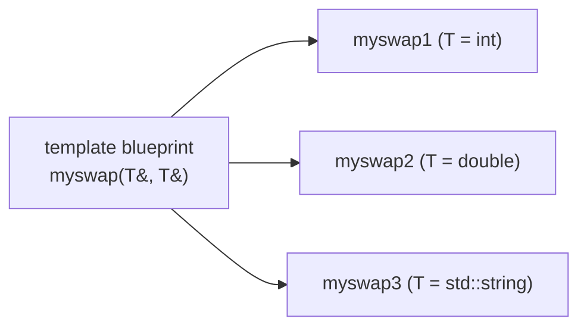
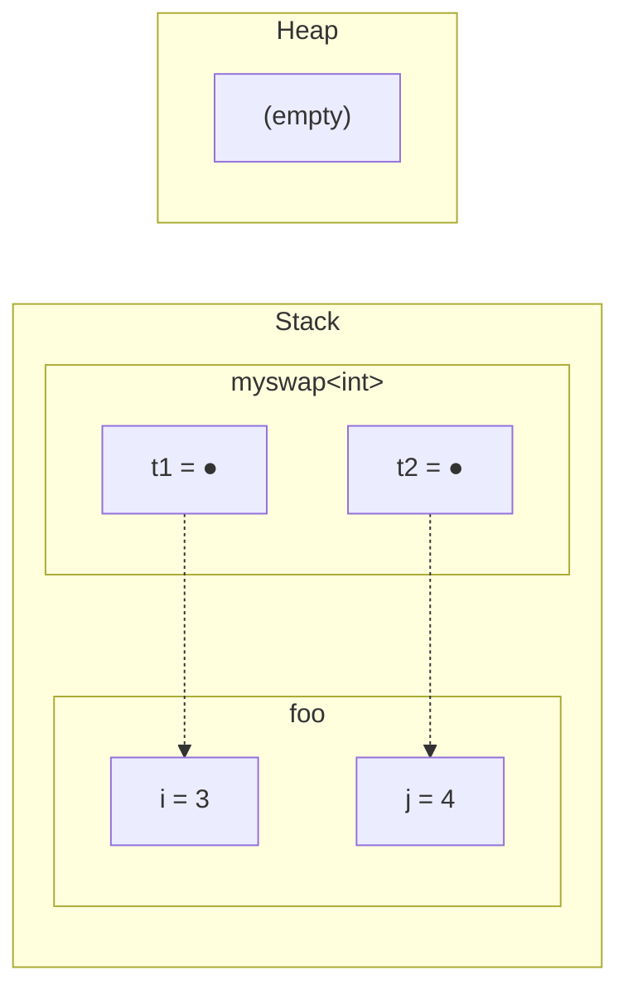
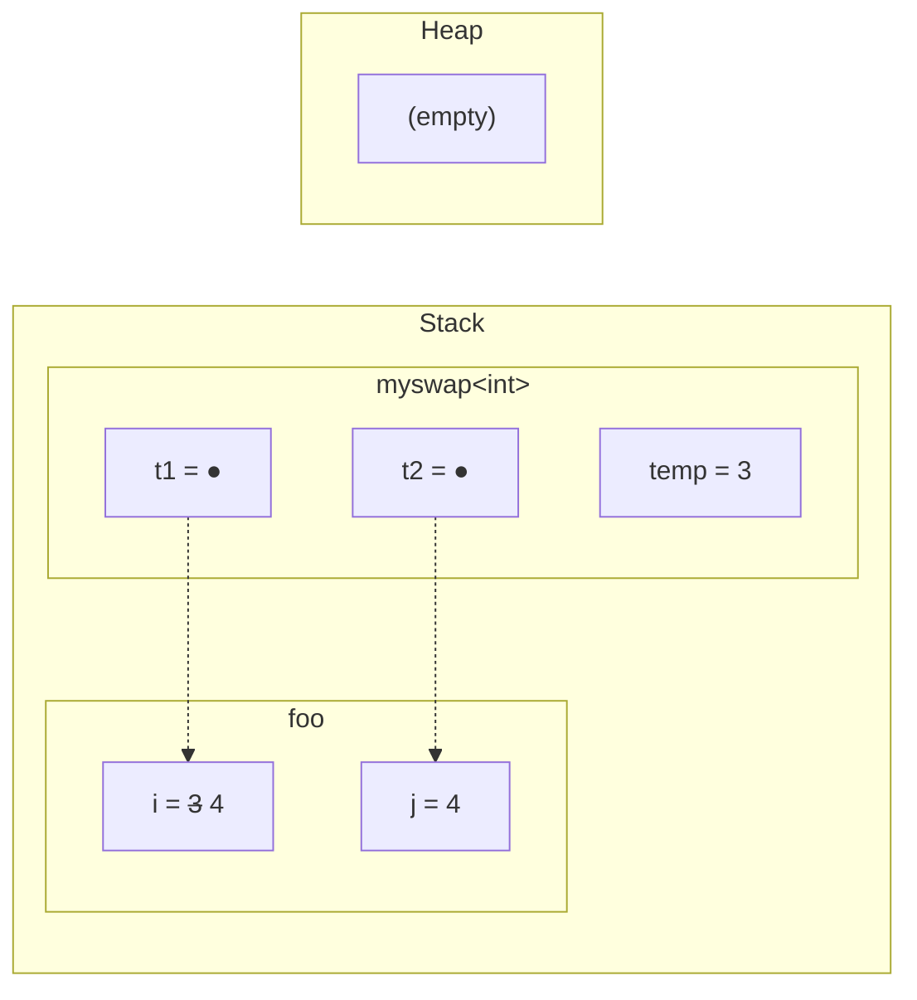
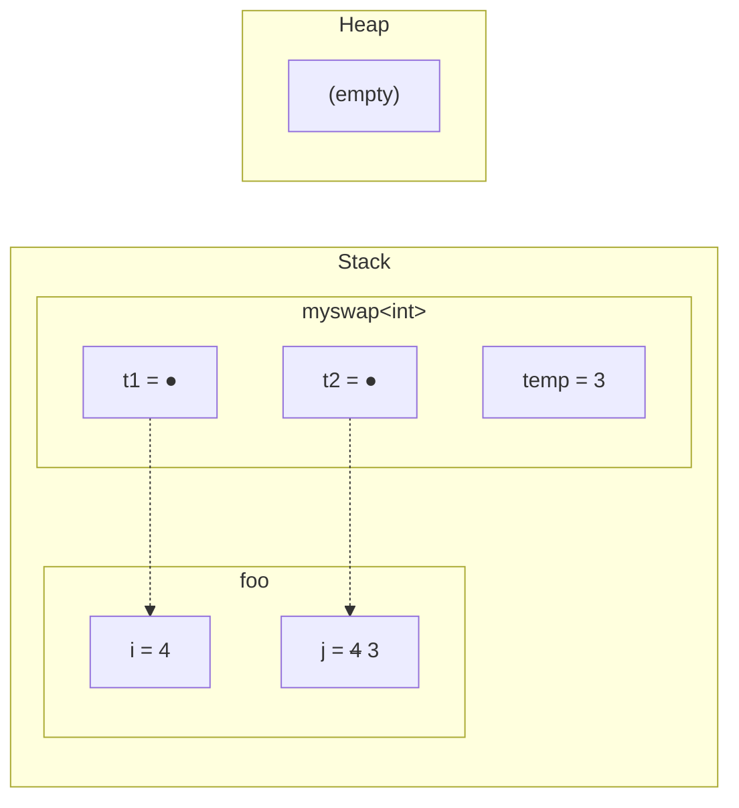

# Information and Computer Science 46 — Topic: C++ Foundations

## Table of Contents

- [1. Unit Tests with Google Test](#1-unit-tests-with-google-test)
- [2. Why Templates Exist](#2-why-templates-exist)
- [3. Writing a Function Template](#3-writing-a-function-template)
- [4. Function Template Instantiation (at Compile Time)](#4-function-template-instantiation-at-compile-time)
- [5. Where Template Code Lives (.hpp and .tpp)](#5-where-template-code-lives-hpp-and-tpp)
- [6. Implicit Constraints on Type Parameters](#6-implicit-constraints-on-type-parameters)
- [7. Class Templates](#7-class-templates)
- [8. A Class Template Example: Box](#8-a-class-template-example-box)
- [9. Randomness and Random Number Generation](#9-randomness-and-random-number-generation)
- [10. C++ References](#10-c-references)
- [11. C++ Pointers](#11-c-pointers)
- [12. Smart Pointers and Ownership](#12-smart-pointers-and-ownership)
- [13. C++ 1D Arrays](#13-c-1d-arrays)
- [14. Multidimensional Arrays](#14-multidimensional-arrays)
- [15. Complete Implementation](#15-complete-implementation)
- [16. Quick Reference & Top 5 Things to Remember](#16-quick-reference--top-5-things-to-remember)

> UCI ICS 46: Data Structure Implementation and Analysis — Prof. Tom Yeh. This note gathers C++ foundations from Lectures 0–2, organized by concept.

## 1. Unit Tests with Google Test

The course uses **Google Test**; its 1.10.0 Primer and Thornton's **Unit Testing** notes from ICS 45C are the references. What those two readings say, compressed:

### 1.1 What a unit test is

A **unit test** checks one small piece of a program — one class, one function — **in isolation** from the rest. A data structure is the textbook case: an `ArrayList` has behaviours (insert at the front, resize when full, remove the last element) that your app might never exercise in an obvious, repeatable way, but you still need to know they work.

Every test you write has the same shape: **set up a scenario → run it → compare the result to what you expected → report**. A **unit testing framework** does the boring parts: it finds all your tests automatically (no adding calls to `main`), runs each one independently, and reports which failed, with expected vs. actual values and the line number. C++'s standard library doesn't have one (Python has `unittest`; C++ doesn't), so we use Google's open-source **Google Test** (a.k.a. googletest/gtest).

### 1.2 Writing a test

```cpp
TEST(TestSuiteName, testName)
{
    // set up, run, check
}
```

`TEST` is a macro (it expands to a function plus registration code). It has no return type; the two names in parentheses are the **test suite** (a group of related tests) and the **test's own name**. Google Test registers every `TEST` automatically and runs them all from `RUN_ALL_TESTS()`; linking with `gtest_main` gives you a ready-made `main` that does this.

Inside a test you check results with assertions. They come in pairs:

| Fatal (`ASSERT_*`) | Non-fatal (`EXPECT_*`) | Passes if |
|---|---|---|
| `ASSERT_TRUE(c)` | `EXPECT_TRUE(c)` | `c` is true |
| `ASSERT_FALSE(c)` | `EXPECT_FALSE(c)` | `c` is false |
| `ASSERT_EQ(a, b)` | `EXPECT_EQ(a, b)` | `a == b` |
| `ASSERT_NE(a, b)` | `EXPECT_NE(a, b)` | `a != b` |
| `ASSERT_LT/LE/GT/GE(a, b)` | `EXPECT_LT/LE/GT/GE(a, b)` | `a < b`, `a <= b`, `a > b`, `a >= b` |
| `ASSERT_STREQ(s1, s2)` | `EXPECT_STREQ(s1, s2)` | two **C strings** have the same contents |

- **`ASSERT_*`** fails the test **and stops it** right there. Use it when continuing makes no sense (e.g. the next line dereferences a pointer you just asserted is non-null).
- **`EXPECT_*`** fails the test but **keeps going**, so one run can report several broken expectations. The primer prefers `EXPECT_*` by default.
- You can attach a message: `EXPECT_EQ(x[i], y[i]) << "differ at index " << i;`

Here is a small suite for the templates in this note (`myMin` from [§6.3](#63-practice) and `Pair` from [§8.2](#82-practice); code in [§15](#15-complete-implementation)):

```cpp
#include <gtest/gtest.h>
#include <string>
#include "templates.hpp"

TEST(MyMinTests, returnsSmallerInt)
{
    EXPECT_EQ(3, myMin(3, 5));
    EXPECT_EQ(-2, myMin(7, -2));
}

TEST(MyMinTests, comparesStringsAlphabetically)
{
    EXPECT_EQ("apple", myMin(std::string("apple"), std::string("banana")));
}

TEST(PairTests, containTheValuesGivenWhenConstructed)
{
    Pair<int> p{4, 6};
    EXPECT_EQ(4, p.first());
    EXPECT_EQ(6, p.second());
}

TEST(PairTests, setSecondReplacesOnlyTheSecondValue)
{
    Pair<std::string> p{"Zot", "Zot"};
    p.setSecond("Anteater");
    EXPECT_EQ("Zot", p.first());
    EXPECT_EQ("Anteater", p.second());
}
```

Built with `g++ -std=c++17 -Wall pair_tests.cpp -lgtest -lgtest_main -pthread` and run:

```text
Running main() from ./googletest/src/gtest_main.cc
[==========] Running 4 tests from 2 test suites.
[----------] Global test environment set-up.
[----------] 2 tests from MyMinTests
[ RUN      ] MyMinTests.returnsSmallerInt
[       OK ] MyMinTests.returnsSmallerInt (0 ms)
[ RUN      ] MyMinTests.comparesStringsAlphabetically
[       OK ] MyMinTests.comparesStringsAlphabetically (0 ms)
[----------] 2 tests from MyMinTests (0 ms total)

[----------] 2 tests from PairTests
[ RUN      ] PairTests.containTheValuesGivenWhenConstructed
[       OK ] PairTests.containTheValuesGivenWhenConstructed (0 ms)
[ RUN      ] PairTests.setSecondReplacesOnlyTheSecondValue
[       OK ] PairTests.setSecondReplacesOnlyTheSecondValue (0 ms)
[----------] 2 tests from PairTests (0 ms total)

[----------] Global test environment tear-down
[==========] 4 tests from 2 test suites ran. (0 ms total)
[  PASSED  ] 4 tests.
```

### 1.3 What makes a good test

- **One behaviour per test, not one function per test.** You can't test `first()` on its own — you test "after constructing with (4, 6), `first()` returns 4". A behaviour is a *sequence of calls with a known result*. If you want to check three behaviours, write three tests, so a failure tells you exactly which scenario broke.
- **Name the test after the behaviour** (`setSecondReplacesOnlyTheSecondValue`). The report prints the names of failing tests, so a good name often tells you the bug before you open the code.
- **Tests are independent.** There's no guaranteed order; never rely on another test having run first.
- **Vary your test data.** Thornton deliberately uses different constants in each test, so a test can't pass by accident because of a value that happens to work.
- **Edge cases** (empty structure, one element, full array, front vs back) are where data-structure bugs live.

> ⚠️ **Pitfall**: `EXPECT_EQ` on two `const char*` compares **pointers**, not text. Use `EXPECT_STREQ` for C strings, or compare `std::string`s with `EXPECT_EQ` (as above, where `"apple"` is compared to a `std::string`, so `std::string`'s `==` is used). For floating point, use the floating-point variants (e.g. `EXPECT_DOUBLE_EQ`) to avoid rounding failures.

> ⚠️ **Pitfall**: Thornton's 45C notes say `ASSERT_EQ(expected, actual)`, expected first, so the failure report reads correctly. The 1.10 primer notes that since 2016 `*_EQ` treats both arguments the same way; either order works, but stay consistent. (The examples here use expected-first.)

> 📘 **Beyond the lecture**: Terminology — what Google Test calls a **test suite** (first argument of `TEST`) was called a "test case" in older versions; Thornton's 45C notes use the old name. Test names shouldn't contain underscores. When many tests need the same setup, a **test fixture** (a class derived from `::testing::Test`, used with `TEST_F` instead of `TEST`) builds fresh objects for each test via `SetUp()`/`TearDown()`. If you write your own `main`, call `::testing::InitGoogleTest(&argc, argv)` and `return RUN_ALL_TESTS();`.

## 2. Why Templates Exist

C++ has a **static type system**: every variable's type is fixed at compile time. So a function that swaps two `int`s can't swap two `double`s, and to work with different parameter types you end up writing near-identical versions:

```cpp
void myswap(int& a, int& b) noexcept
{
    int temp = a;
    a = b;
    b = temp;
}
```

```cpp
void myswap(double& a, double& b) noexcept
{
    double temp = a;
    a = b;
    b = temp;
}
```

Because C++ allows **overloading** (same name, different parameter types), both can coexist, and you could have a hundred more for every type. But the bodies are identical except for the type name. Copy-paste like this means every bug fix has to be made N times.

A **template** solves this. It's a **blueprint for an infinite set of possibilities**: you write the code once and specify *how the different instances differ from each other* (here: only the type). The compiler stamps out each concrete version when it's needed. The picture is a blueprint with arrows to `myswap1`, `myswap2`, `myswap3`:



There are two main kinds:
1. **Function templates** — a blueprint for functions (§3–§6).
2. **Class templates** — a blueprint for classes (§7–§8). Data structures are their main use.

> 💡 **Key Insight**: A template is not a function or a class. It's a recipe the compiler uses to *generate* functions/classes, one per set of template arguments.

## 3. Writing a Function Template

### 3.1 Syntax

Four steps:

1. Start with the **`template`** keyword.
2. Enclose the template parameters in **`< >`**.
3. Write **`typename`** followed by the type parameter's name (`T` by convention).
4. Write the function definition as usual, using `T` wherever the type varies.

```cpp
template <typename T>
void myswap(T& t1, T& t2)
{
    T temp = t1;
    t1 = t2;
    t2 = temp;
}
```

- This is a **blueprint** for any number of `myswap` functions.
- The keyword **`typename`** says this parameter is a **type placeholder** (not, say, an `int` constant).
- **`T`** names that type; during instantiation, every `T` is replaced by the **actual type**.

### 3.2 Kinds of template parameters

| Kind | Examples | Meaning |
|---|---|---|
| **Type parameters** | `typename T`, `class T` | stand for a type; the argument is a type like `int` or `std::string` |
| **Non-type parameters** | constants, pointers, references | stand for a compile-time *value*, e.g. `template <typename T, int N>` |
| **Template template parameters** | — | a parameter that is itself a template (e.g. "some container template") |

`typename T` and `class T` mean exactly the same thing inside `< >` (`class` here doesn't require T to be a class; `int` works). The original table also lists `std::string` under type parameters — read that as an example of a type you'd *pass as the argument* (`T = std::string`), not as something you write in the parameter list.

A non-type parameter example (compiled):

```cpp
template <typename T, int N>
T sumFirst(const std::vector<T>& v) {
    T total{};
    for (int i = 0; i < N && i < static_cast<int>(v.size()); ++i) total += v[i];
    return total;
}
// sumFirst<int, 3>(std::vector<int>{1, 2, 3, 4, 5}) == 6
```

`N` must be known at compile time; `sumFirst<int, 3>` and `sumFirst<int, 4>` are two different generated functions.

### 3.3 Why the template dropped `noexcept`

Notice the `int` and `double` versions in [§2](#2-why-templates-exist) are `noexcept`, but the template isn't. That's deliberate (Thornton): swapping `int`s can never throw, but swapping `std::string`s copies strings, and copying a string can allocate memory, which can throw. A single template can't promise "never throws" for every `T`.

> 📘 **Beyond the lecture**: `noexcept` is a promise, not a check — if a `noexcept` function does throw, the program calls `std::terminate()`. A template can make the promise **conditional** on `T`: `noexcept(expr)` where `expr` is a compile-time `bool`. The inner `noexcept(...)` *operator* asks "is this expression declared not to throw?" without running it:
>
> ```cpp
> template <typename T>
> void myswap(T& t1, T& t2)
>     noexcept(noexcept(T{t1}) && noexcept(t1 = t2))
> ```
>
> or, more readably, with `#include <type_traits>`:
>
> ```cpp
> template <typename T>
> void myswap(T& t1, T& t2)
>     noexcept(std::is_nothrow_copy_constructible_v<T> &&
>              std::is_nothrow_copy_assignable_v<T>)
> ```
>
> Compiled check: `noexcept(myswap(i, j))` is `true` for `int` and `false` for `std::string`. (Thornton's page writes `std::is_nothrow_assignable_v<T>` with one argument; that trait actually takes two types, so use `is_nothrow_copy_assignable_v<T>`.) Library code like the standard containers cares about this because some operations get faster when the compiler knows moves/copies can't throw.

## 4. Function Template Instantiation (at Compile Time)

A function template generates nothing until it's **used**. When the compiler hits a call, it does three steps:

| Step | Name | What the compiler does |
|---|---|---|
| 1 | **Call encountered** | At a template call, checks whether it recognizes the function template. |
| 2 | **Type deduction** | Tries to automatically deduce the template parameter types from the argument types. |
| 3 | **Instantiation** | Generates an actual concrete function definition for the deduced types. |

The three pieces, as code:

**1. Call location (`foo`)**
```cpp
void foo()
{
    int i = 3;
    int j = 4;
    myswap(i, j);
}
```

**2. Template (`myswap`)**
```cpp
template <typename T>
void myswap(T& t1, T& t2)
{
    T temp = t1;
    t1 = t2;
    t2 = temp;
}
```

**3. Instantiated (`int`)** — what the compiler generates for T = `int`:
```cpp
void myswap(int& t1, int& t2)
{
    int temp = t1;
    t1 = t2;
    t2 = temp;
}
```

Both arguments are `int`, so `T&` must be `int&`, so T = `int`. The generated function is a real function in your program, called `myswap<int>`. Calling `myswap` with two `double`s later generates a second function `myswap<double>`; calling it with `int`s again reuses `myswap<int>`.

Here's what that call does in memory (Python Tutor style). `t1` and `t2` are references — dotted arrows — so writes through them land in `foo`'s variables:

**Memory trace: `myswap<int>(i, j)`** (4 steps)

**Step 1/4:** `myswap(i, j);  // enter myswap<int>` — t1 and t2 are references: aliases of foo's i and j, not copies



**Step 2/4:** `T temp = t1;` — copy constructor: temp is a new int initialised from i


**Step 3/4:** `t1 = t2;` — copy assignment through the alias writes foo's i



**Step 4/4:** `t2 = temp;` — copy assignment writes foo's j; temp is destroyed when myswap returns



The three operations the trace performs on `T` — copy-construct `temp`, copy-assign twice, destroy `temp` — are exactly the requirements in [§6](#6-implicit-constraints-on-type-parameters).

### 4.1 When deduction fails

Step 2 **fails if the compiler can't confidently determine the exact type** — e.g. a **conflict** between arguments, or **no hint** at all. Mixing types (compiled with g++ 13):

```cpp
int i = 3; double d = 4.0;
myswap(i, d);
```

```text
error: no matching function for call to 'myswap(int&, double&)'
note:   deduced conflicting types for parameter 'T' ('int' and 'double')
```

From the first argument T would be `int`, from the second `double`; the compiler won't pick one. (For `myswap` there's no fix — you can't bind an `int&` to a `double`. For a by-value or `const T&` function like `myMin`, you can supply the type yourself, see below.)

You can always give the template argument **explicitly**:

```cpp
myswap<int>(i, j);   // legal, but unnecessary here — deduction already gets int
```

Explicit arguments are required when there's nothing to deduce from (e.g. T only appears in the return type) and they settle conflicts where conversions are possible: `myMin<double>(3, 4.5)` compiles and returns 3 (the `int` 3 is converted to `double`).

> ⚠️ **Pitfall**: Deduction does **not** do the usual conversions. `myMin(3, 4.5)` is a compile error even though `int` → `double` is a normal conversion; `myMin<double>(3, 4.5)` is fine.

> 📘 **Beyond the lecture**: If two `.cpp` files both call `myswap<int>`, each one generates its own copy of `myswap<int>`. Normally two definitions of the same function would be a link error, but the linker is required to accept duplicate template instantiations and keep one. That's what makes the "put it in the header" rule in §5 work.

## 5. Where Template Code Lives (.hpp and .tpp)

The **instantiation requirement**: the **full template definition** (body included, not just the declaration) must be **visible wherever it's used**, so the compiler can generate the specialized function at that point. So template code goes in headers. Two options:

### 5.1 Option 1 — single header file (.hpp)

Declaration and definition together in the `.hpp`. Best for smaller utilities and straightforward templates.

```cpp
// myswap.hpp
#pragma once
#include <utility>

// 1. Declaration & definition combined
template <typename T>
void myswap(T& a, T& b) {
  T temp = std::move(a);
  a = std::move(b);
  b = std::move(temp);
}
```

### 5.2 Option 2 — split header and implementation (.hpp + .tpp)

- **Clean separation**: interface in `.hpp`, implementation in `.tpp`.
- **"Secret include"**: the `.hpp` `#include`s the `.tpp` **at the bottom**, so anyone who includes the header still gets the full definition.

```cpp
// myswap.hpp (Header & Interface)
#pragma once
// 1. Only declaration is visible first
template <typename T>
void myswap(T& a, T& b);
// 2. Include implementation at bottom
#include "myswap.tpp"
```

```cpp
// myswap.tpp (Template Implementation)
#include <utility>
template <typename T>
void myswap(T& a, T& b) {
  T temp = std::move(a);
  a = std::move(b);
  b = std::move(temp);
}
```

The `.tpp` is **not** compiled on its own and must not be listed as a source file; it's a header in disguise. (`.tpp` is a naming convention; the compiler doesn't care about the extension.) Tested: `#include "myswap.hpp"` then `myswap(i, j)` with `int`s, `myswap<double>` and `std::string`s gives `4 3`, `2.5 1.5`, `banana apple`.

This version uses **`std::move`** (from `<utility>`) instead of copying: it lets `T` *move* its contents (e.g. steal a string's buffer) rather than copy them, which is cheaper for big objects. For `int` it makes no difference. Move semantics come up again with smart pointers in [§12](#12-smart-pointers-and-ownership).

> ⚠️ **Pitfall**: The 45C habit of "declaration in `.hpp`, definition in `.cpp`" **breaks for templates**. A `.cpp` that only sees the declaration compiles fine, assumes `myswap<int>` is defined somewhere else, and you get an *undefined reference* **link error**, because the `.cpp` with the body never saw a call with `int` and so never generated it.

## 6. Implicit Constraints on Type Parameters

### 6.1 What T may be

Can `T` be anything?

- **T must be a concrete type** — a basic type (`int`) or a **fully filled-in template type** like `std::vector<int>` (not bare `std::vector`; that's a template, not a type).
- **T is subject to implicit restrictions** based on the **operations performed inside the template**. Nothing in `template <typename T>` says "T must be copyable"; the body says it.

**Required operations for `myswap`**:

| # | Operation | Where in `myswap` |
|---|---|---|
| 1 | **Copy constructor** | `T temp = t1;` |
| 2 | **Copy assignment operator** | `t1 = t2;` and `t2 = temp;` |
| 3 | **Destructor** | `temp` is a local (stack, "statically allocated") variable, so its destructor runs automatically when the function ends |

### 6.2 When a constraint fails

A type missing any of these three can't be used with `myswap`. Thornton's example: a class whose copy constructor and assignment are deleted.

```cpp
class X
{
public:
    X();
    X(const X& x) = delete;
    X& operator=(const X& x) = delete;
};

X a, b;
myswap(a, b);   // compile error
```

g++ 13 (with the `.tpp` version of `myswap`):

```text
myswap.tpp:5:5: error: use of deleted function 'X::X(const X&)'
myswap.tpp:6:5: error: use of deleted function 'X& X::operator=(const X&)'
```

Note *where* the error is reported: inside the template's body, at the line that needs the missing operation, not at your call. That's typical — template errors point into the template, and you work backwards to the type you passed.

> ⚠️ **Pitfall**: "Statically allocated" (here and in Thornton) means **automatic storage — a local variable on the stack**, not a `static` variable. It's the opposite of heap allocation with `new`.

> 💡 **Key Insight**: To find a template's requirements on `T`, read its body and list every operation it does to a `T`: construct (how?), copy, assign, compare (`<`, `==`), call a member, destroy. Each one is a requirement. That's how both template practice problems ([§6.3](#63-practice), [§8.2](#82-practice)) are answered.

> 📘 **Beyond the lecture**: These requirements are part of the template's **contract** — like a function's preconditions, but checked by the compiler at instantiation. Thornton's Contracts notes cover preconditions, postconditions, side effects, and class invariants more generally. (C++20 added *concepts* to write such requirements explicitly; this course uses C++17-style implicit constraints.)

### 6.3 Practice

#### A function template: myMin

- Implement a function template called `myMin` that returns the smaller of 2 inputs.
- Are there any constraints on the type of inputs?
- Implement a main function to test `myMin` with ints then strings.

> Hint: list every operation the body performs on a `T`, including the `return`.

<details>
<summary>Solution</summary>

**Solution** (compiled — output `3` then `apple`):

```cpp
template <typename T>
T myMin(const T& a, const T& b) {
    return (a < b) ? a : b;
}

int main() {
    std::cout << myMin(3, 5) << std::endl;
    std::cout << myMin(std::string("apple"), std::string("banana")) << std::endl;
}
```

(The original omits the includes: you need `<iostream>` and `<string>`.)

**Constraints on T**:
- The function **returns by value**, so T needs a **copy (or move) constructor** — the result is copied out of `a` or `b`.
- T must support **`operator<`**. With a struct that doesn't define it, g++ says: `no match for 'operator<' (operand types are 'const Point' and 'const Point')`.
- Also (implied): both arguments must deduce to the **same** T, and T must be destructible (the returned temporary is destroyed).

Why `std::string("apple")` and not just `"apple"`? Traps worth knowing:
- `myMin("apple", "banana")` doesn't compile: the literals are `const char[6]` and `const char[7]`, two different types → "deduced conflicting types".
- Even same-length literals, `myMin("abc", "abd")`, fail: T = `char[4]` and a function can't return an array.
- With `const char*` variables it compiles but compares **addresses**, not text — the "smaller" pointer is whichever string sits lower in memory. Wrapping in `std::string` makes `<` compare alphabetically.
- `myMin(3, 4.5)` fails (int vs double); `myMin<double>(3, 4.5)` works.

↩ Concepts: [§4.1 deduction](#41-when-deduction-fails), [§6 implicit constraints](#6-implicit-constraints-on-type-parameters).

</details>

## 7. Class Templates

**Data structure implementations are the primary use case for class templates.** A list works the same way whether it holds `int`s or `std::string`s; only the element type changes. Same syntax rules:

- Start with the **`template`** keyword.
- Template parameters go in **angle brackets `< >`, separated by commas**.
- **`ElementType`** below is a placeholder describing the type of element stored in a particular `Vector`.

```cpp
template <typename ElementType>
class Vector
{
    ...
};
```

Inside the class, you write `ElementType` everywhere you mean "the type of element in this Vector". The picture is one blueprint → `Vector1`, `Vector2`, `Vector3`.

### 7.1 Instantiating a class template

The standard-library example is `std::vector` itself:

| Code | Meaning |
|---|---|
| `std::vector<T>` | the template class (blueprint) |
| `std::vector<std::string>` | creates a vector of strings |
| `std::vector<int>` | creates a vector of integers |

The instantiation process is similar to function templates:

1. **Compiler verification** — at creation or use, the compiler checks that it recognizes the template.
2. **Type deduction** — typically requires **explicit** type parameters (e.g. `<int>`). Unlike `myswap(i, j)`, `std::vector v;` gives the compiler nothing to deduce from.
3. **Template instantiation & definition** — the full template definition must be available to generate the code.
4. **Header implementation** — so class templates go in `.hpp` or `.hpp` + `.tpp` files, exactly as in [§5](#5-where-template-code-lives-hpp-and-tpp).

> 📘 **Beyond the lecture**: Since C++17, the compiler *can* deduce class template arguments from a constructor call: `Box b{42};` makes a `Box<int>` (class template argument deduction, "CTAD" — compiled and checked). The "typically requires explicit type parameters" rule is still the safe habit; with no constructor arguments, or for clarity, write the type.

### 7.2 Each instantiation is a separate, unrelated type

`std::vector<int>` and `std::vector<std::string>` contain the same code with different types plugged in, but to the compiler they're **completely different classes**: not related by inheritance, not convertible, not assignable to each other. You can't pass a `vector<std::string>` to a function expecting a `vector<int>`. Compiled check with `Box` from [§8](#8-a-class-template-example-box):

```cpp
Box<int> b{42};
Box<double> d{2.5};
d = b;   // error: no match for 'operator=' (operand types are 'Box<double>' and 'Box<int>')
```

…even though `int` converts to `double`.

> ⚠️ **Pitfall**: Inside the class template you can write just `Vector` (it means "this instantiation"), but outside you must always write the arguments: `Vector<int>`, never bare `Vector` as a type.

## 8. A Class Template Example: Box

A one-item container:

```cpp
template <typename T>
class Box {
public:
    // Constructor
    Box(const T& value) : item{value} {}

    // Getter
    T getValue() const {
        return item;
    }

    // Setter
    void setValue(const T& value) {
        item = value;
    }

private:
    T item;
};
```

**What can T be?** ("typename parameter types")

- **Primitive types**: integer types, floating types — `Box<int>`, `Box<double>`.
- **Non-primitive types**:
  - user-defined: classes or structs — `Box<Person>`;
  - library-defined: e.g. `std::vector` — `Box<std::vector<int>>` (a filled-in vector type, per [§6](#6-implicit-constraints-on-type-parameters)).

**Compiler type requirements on T**: T must be a type the compiler can properly **copy, store, and destroy**:

| Requirement | Where Box needs it |
|---|---|
| **Copy-constructible** | `Box(const T& value)` initializing `item{value}` (also `getValue()` returning `T` by value) |
| **Copy-assignable** | `item = value;` in `setValue` |
| **Destructible** | `item` is a member; it's destroyed when the `Box` is |

**Note**: `T` is used to build other types — `const T&` is "reference to const T". Passing `const T&` instead of `T` avoids an extra copy of a possibly large object, while still promising not to modify it.

Tested usage:

```cpp
Box<int> bi{42};
bi.setValue(7);
Box<std::string> bs{"ICS 46"};
std::cout << bi.getValue() << " " << bs.getValue() << std::endl;   // 7 ICS 46
Box<std::vector<int>> bv{{1, 2, 3}};
std::cout << bv.getValue().size() << std::endl;                    // 3
```

### 8.1 Only the member functions you use get generated

A class template's member functions are themselves instantiated only **if they're called** (Thornton). So a requirement attached to one member function only matters if you call that function. Checked: a type `NoAssign` with a deleted assignment operator:

```cpp
struct NoAssign { NoAssign(int) {} NoAssign& operator=(const NoAssign&) = delete; };

Box<NoAssign> b{NoAssign{1}};
b.getValue();            // compiles: constructor and getValue only need copy construction
b.setValue(NoAssign{2}); // adding this line → error: use of deleted function
                         // 'NoAssign& NoAssign::operator=(const NoAssign&)'
```

So "copy-assignable" is really "copy-assignable **if you call `setValue`**". The table above is the full set of requirements for using the whole class.

> 📘 **Beyond the lecture**: Thornton's version of the same reasoning: if a member function of `Vector` contains
> `ElementType e; e.foo();`
> then `ElementType` must (1) be default-constructible (`e` is made with no arguments), (2) have a destructor (`e` is a local that gets destroyed), and (3) have a member function `foo` taking no arguments (any return type, since the result is ignored).

### 8.2 Practice

#### A class template: Pair

Implement a `Pair` class template that stores 2 items of the same type T.

What are some restrictions on the type T?

> Hint: do it the way §8 analyses `Box`.

<details>
<summary>Solution</summary>

**Solution** (the original's two setter lines run off the right edge, completed here as `first_ = value;` / `second_ = value;`, and the closing `};` is cut off at the bottom):

```cpp
template <typename T>
class Pair {
public:
    Pair(const T& first, const T& second)
        : first_(first), second_(second) {}

    T& first() { return first_; }
    const T& first() const { return first_; }
    T& second() { return second_; }
    const T& second() const { return second_; }

    void setFirst(const T& value) { first_ = value; }
    void setSecond(const T& value) { second_ = value; }

private:
    T first_;
    T second_;
};
```

Why two versions of each getter? The non-`const` one returns `T&` so you can modify the element in place (`p.first() += "!"`); the `const` one is the only one callable on a `const Pair` and returns `const T&` so the caller can't modify it. Returning references avoids copying T at all, so — unlike `Box::getValue` — the getters don't need T to be copyable.

**Restrictions on T**:
- ✓ **Copy-constructible** — required by the constructor: `first_(first)`.
- ✓ **Copy-assignable** — required by the setters `setFirst` and `setSecond`.
- ✓ **Destructible** — the `T` members are destroyed when the `Pair` goes out of scope.

(As [§8.1](#81-only-the-member-functions-you-use-get-generated) showed, copy-assignable only matters if you actually call a setter.)

↩ Concepts: [§7 class templates](#7-class-templates), [§8 Box](#8-a-class-template-example-box).

</details>

## 9. Randomness and Random Number Generation

### 9.1 What "random" means

A sequence is **random** if nobody can predict the next value better than chance, even after seeing all previous ones; the goal is for programs to *generate* such sequences. Uses: **machine learning** (weight init, train/test splits, SGD), **security** (keys, tokens — a predictable key is a guessable key), **simulation** (Monte Carlo, varying the seed), **games** (world generation, NPC decisions).

### 9.2 True random vs. pseudorandom

Random number generators (RNGs) come in two kinds:

| | Truly random (TRNG / hardware RNG) | Pseudorandom (PRNG) |
|---|---|---|
| How | measures changing **physical phenomena** | **computes** each value from the previous internal state |
| Examples | dice, coins, cards; network traffic, temperature, lava lamps; atmospheric noise (random.org) | Mersenne Twister, linear congruential generators |
| Reproducible? | no | **yes** — same seed, same sequence |
| Speed | limited (collecting entropy takes time) | very fast |

Cloudflare's lava-lamp "Wall of Entropy" is a real TRNG source.

> 📘 **Beyond the lecture** (Thornton, Randomness): entropy is scarce — the OS can only observe so many unpredictable events per second. So real programs combine both: take **one** value from the entropy source as the **seed**, then let a fast PRNG expand it into a long sequence.

### 9.3 Seeding the engine

In `<random>` the PRNG is called an **engine**, and you create it with a **seed**.

**Approach 01 — fixed seed**: identical sequence every run; best for testing, simulations, debugging.

```cpp
#include <random>
const unsigned int SEED = 123;
std::default_random_engine engine{SEED};
```

**Approach 02 — entropy source**: `std::random_device` taps the OS/hardware entropy; **call** it to get one seed. Different sequence each run; for production.

```cpp
#include <random>
std::random_device device;
std::default_random_engine engine{device()};   // note the ()
```

> ⚠️ **Pitfall**: a fixed seed reproduces the sequence only on the **same standard library** — `default_random_engine` is vendor-chosen, so g++ and MSVC may print different numbers for seed 123. Use `std::mt19937` if you need identical results everywhere.

### 9.4 Distributions: uniform and normal

The engine produces raw uniform bits; a **distribution** shapes them into the values you want.

- **Uniform integer**: integers in [min, max], **both inclusive**, all equally likely (flat).
- **Normal / Gaussian**: bell curve centered at the **mean**; the **standard deviation** sets the spread (e.g. exam scores).

```cpp
// Equal chance for 1, 2, 3, 4, 5, or 6
std::uniform_int_distribution<int> distribution{1, 6};

double mean = 10.0;
double stddev = 3.0;
std::normal_distribution<double> d(mean, stddev);
```

Two histograms (stars per value):

| value | 0 | 1 | 2 | 3 | 4 | 5 | 6 | 7 | 8 | 9 | 10 |
|---|---|---|---|---|---|---|---|---|---|---|---|
| uniform, min 0, max 10 | 4 | 4 | 4 | 4 | 4 | 4 | 4 | 4 | 4 | 4 | 4 |
| normal, mean 5.0, sd 2.0 | 0 | 1 | 3 | 6 | 9 | 9 | 8 | 5 | 3 | 1 | 0 |

(The normal histogram also lists −2, −1, 11, 12 — all empty.)

Uniform is flat; normal peaks around the mean and almost nothing lands more than 2 sd away (below 1 or above 9).

> ⚠️ **Pitfall** (N3551 §3): don't write `1 + engine() % 6`. The engine's range usually isn't a multiple of 6, so low values come out slightly more often — a biased die. Always go through a distribution (and avoid the old C `rand()`).

### 9.5 Putting it together: rolling dice

Create the three pieces **once** — (1) entropy + engine, (2) distribution mapping to [1, 6], (3) call `distribution(engine)` for each sample.

```cpp
#include <random>
#include <iostream>

// 1. Source of Entropy & Engine
std::random_device device;
std::default_random_engine engine{device()};   // slide: engine{device}

// 2. Inclusive Uniform Distribution [1, 6]
std::uniform_int_distribution<int> distribution{1, 6};

// 3. Generate Samples
for (int i = 0; i < 1000; ++i) {
    std::cout << distribution(engine) << " ";
}
std::cout << std::endl;
```

**Slide bug (the code as shown on the slides)**: `engine{device}` → `engine{device()}`. Passing the device object itself doesn't compile (g++: `no matching function for call to 'std::linear_congruential_engine<...>(<brace-enclosed initializer list>)'`); you must call it.

> ⚠️ **Pitfall** (Thornton): don't create the device/engine/distribution inside the loop — you'd hit the slow entropy source every time and throw away the PRNG state. Create once, call many times.

### 9.6 Practice

#### Fixed seed with a normal distribution

Update `random_test.cpp` to (1) print random numbers from a **PRNG seeded with 46**, (2) using a **normal distribution** with mean **4.0** and stddev **0.6**. The given code uses `engine{device}` and `uniform_int_distribution<int> distribution{1, 6}`.

<details>
<summary>Solution</summary>

Change the two lines (no `random_device` needed for a fixed seed):

```cpp
const unsigned int SEED = 46;
std::default_random_engine engine{SEED};                     // 1) fixed seed
std::normal_distribution<double> distribution{4.0, 0.6};    // 2) normal(4.0, 0.6)
```

First 10 values (g++ 13 / libstdc++), identical on every run:

```text
2.94246 4.7139 3.62995 3.87306 4.78358 4.23905 3.89193 3.93273 4.34897 4.33676
```

1000 samples have mean 4.007 and about 68% fall in 3.4–4.6 (within one sd). If you keep the device instead, fix `engine{device}` → `engine{device()}`.

</details>

## 10. C++ References

### 10.1 A reference is an alias

A **reference** is another name for an existing object. It **must be initialized**, and it **can never be re-bound** to another object. Also called an **lvalue reference**; declared with `&` on the type: `int& ref = existingVariable;`. Unlike a Python name, `r = j;` does not rebind `r` — it copies `j`'s value into whatever `r` refers to.

```cpp
int i = 3;
int& r = i;                       // r now refers to i
std::cout << r << std::endl;      // writes 3
r = 4;                            // a change to r is also a change to i
std::cout << i << std::endl;      // writes 4
i = 5;                            // a change to i is also a change to r
std::cout << r << std::endl;      // writes 5
```

There is one `int` with two names.

### 10.2 Pass-by-value vs. pass-by-reference

Pass-by-value gives the function a **copy**; pass-by-reference makes the parameter an **alias** for the caller's argument. Why use references: it **allows modification** of the original, and **avoids copying** large data (performance, memory).

```cpp
void foo(int& x)
{
    x++;
    std::cout << x << std::endl;   // prints 4
}

int main()
{
    int i = 3;
    foo(i);
    std::cout << i << std::endl;   // prints 4
    return 0;
}

void swap(int& a, int& b)
{
    int temp = a;
    a = b;
    b = temp;
}
```

With `void foo(int x)` the output would be `4` then `3`; `swap` without `&` would swap two copies and change nothing.

> 💡 **Key Insight**: read a big object → `const T&`; modify the caller's object → `T&`; small types like `int` → by value.

### 10.3 Return-by-value vs. return-by-reference

**Return by value by default** — it's safe (no dangling references), cheap thanks to RVO / move semantics / copy elision (guaranteed in C++17), and simpler. **Return by reference** for class getters (`const T&` to big internal data), operator overloading (`operator[]`, `operator=`, `operator<<` so calls can chain), and long-lived objects outside the function.

**Critical rule: never return a reference to a local stack variable** — it's destroyed when the function returns.

```cpp
// BAD: Dangling reference to local object
int& getBad() { int local = 42; return local; } // DANGER! Destroyed on exit

// GOOD: Return by value (optimized by RVO/Copy Elision)
int getGood() { int val = 42; return val; } // Safe zero-copy return
```

What `getBad()` actually does (g++ 13, `-Wall -fsanitize=address,undefined`):

```text
bad.cpp:2:40: warning: reference to local variable 'local' returned [-Wreturn-local-addr]
bad.cpp:2:40: runtime error: reference binding to null pointer of type 'int'
AddressSanitizer: SEGV on unknown address 0x000000000000
```

> 📘 **Beyond the lecture** (Thornton, Move Semantics): *moving* a `std::vector` just steals its internal array pointer, size and capacity (O(1)) instead of copying every element (O(n)). That's why return-by-value is cheap. `std::move(x)` only marks `x` as "safe to steal from" — it appears with `unique_ptr` in [§12.4](#124-unique_ptr-cannot-be-copied).

## 11. C++ Pointers

### 11.1 What a pointer is

A **pointer** holds a **memory address** (a run-time value) plus the **type** it points to (known at compile time). Declared with `*`: `int* x;`. Read declarations right to left: `int** q` is "pointer to pointer to int", `int*& s` is "reference to pointer to int".

| | Reference `int&` | Pointer `int*` |
|---|---|---|
| Can be null? | no | yes (`nullptr`) |
| Must be initialized? | yes | no (but uninitialized = garbage) |
| Can change target? | no | yes |
| Reach the object | just the name | `*p` |

### 11.2 `&`, `*`, and pointer assignment

The **address-of** operator `&` (in an *expression*) gives a variable's address — different from `&` in a *type*, which declares a reference. The **dereference** operator `*` is its opposite: it reaches the object at the address (and the name has nothing to do with references; it's an older C term). You can copy pointers (`int* q = p;` → both point at the same object) and have pointers to pointers (`int** q = &p;`).

```cpp
int i = 3;
int* p = &i;
std::cout << i << std::endl;   // 3
*p = 4;                        // change i through p
std::cout << i << std::endl;   // 4
int** q = &p;                  // *q is p, **q is i (prints 4)
```

Pointers enable direct memory manipulation, dynamic allocation, and data structures (linked lists, trees, graphs). Unlike a reference, a pointer can be **re-pointed**:

```cpp
int x = 10;
int* p = &x;    // p holds the memory address of x
*p = 20;        // changes x to 20 through the pointer
int y = 30;
p = &y;         // now p points to y instead of x
```

Verified: afterwards `x` is 20 and `*p` is 30.

> ⚠️ **Pitfall**: an address isn't an `int` — `int* p = i;` is a compile error; write `int* p = &i;`.

### 11.3 `nullptr`

`nullptr` means "points to nothing" (e.g. the last node's `next` in a linked list). Dereferencing it is **undefined behavior** — in practice a crash.

```cpp
int* p = nullptr;
*p = 3;              // CRASH
```

```text
Segmentation fault            # plain g++, exit code 139
```

Check `if (p != nullptr)` before dereferencing a pointer that might be null.

### 11.4 Stack vs. heap; pointers and references together

Two memory regions: the **stack** holds function calls and locals (static allocation, freed automatically); the **heap** holds objects created by `new` at run time (dynamic allocation, alive until `delete`). **References are implicit synonyms for objects; pointers store the location of objects.**

```cpp
int* p = new int;     // new int: allocate an int on the heap
*p = 3;

int& q = *p;          // q is another name for the heap int
q = 4;

std::cout << *p << std::endl;   // 4

int* r = &q;          // address of the int q names (same as p)
*r = 5;

std::cout << *p << std::endl;   // 5

int*& s = p;          // s is a reference to an int pointer
*s = 6;

std::cout << *p << std::endl;   // 6
```

This program in memory — one heap `int`, four ways to reach it (dotted arrows are references). Step through it below (← / → keys work when the demo is focused):

```viz memory-trace
{"title": "p, q, r, s", "steps": [{"code": "int* p = new int; *p = 3; int& q = *p; q = 4;", "note": "p points at a heap int; q is another name for it (dashed = reference), so q = 4 writes the int", "stack": [{"frame": "main", "vars": [{"name": "p", "value": "->h1"}, {"name": "q", "value": "->h1", "ref": true}]}], "heap": [{"id": "h1", "type": "int", "fields": [{"name": "value", "value": "4", "old": "3"}]}]}, {"code": "int* r = &q; *r = 5; int*& s = p; *s = 6;", "note": "r holds the same address as p; s is a reference to the pointer p itself", "add_vars": {"main": [{"name": "r", "value": "->h1"}, {"name": "s", "value": "->main.p", "ref": true}]}, "set": {"h1.value": {"value": "6", "old": "4"}}}]}
```

One heap `int`, four ways to reach it: verified `r == p` and `&s == &p` both print `true`.

### 11.5 `new`, `delete`, leaks and dangling pointers

`delete p` deletes **the object p points to**, not `p` itself. Rule: **every `new` has exactly one matching `delete`**. Breaking it:

| Bug | What happens |
|---|---|
| **Memory leak** | never deleted; once the last pointer to it is gone, it's unreachable but still allocated |
| **Dangling pointer** | after `delete p`, `p` still holds the old address; using it is undefined behavior |
| **Double free** | deleting the same address twice — undefined behavior (see [§11.6](#116-practice)) |

> 📘 **Beyond the lecture** (Thornton 45C): every time you write `new`, ask "who will delete this, and when?" Python frees heap objects with a garbage collector; C++ has none, so that's your job — or a smart pointer's.

### 11.6 Practice

#### Visualizing pointers and references

Draw stack/heap (dashed = reference, solid = pointer) for:

```cpp
int* a = new int;
*a = 2;

int* b = new int;
*b = 3;

*a = *b;

int& c = *b;
c = 6;

std::cout << *a << std::endl;

int*& d = a;
*d = 9;

std::cout << *a << std::endl;

delete a; delete b;
```

<details>
<summary>Solution</summary>

Prints **`3`** then **`9`**; clean under ASan.

- `*a = *b` copies the **value** 3; `a` and `b` still point at two different ints.
- `c` names `b`'s int, so `c = 6` leaves `a`'s int at 3 → prints 3.
- `d` is another name for the pointer `a`, so `*d = 9` writes `a`'s int → prints 9.
- Final picture: `a` → int 9, `b` → int 6, `c` dashed to the 6, `d` dashed to `a`. Two objects, each deleted once.

</details>

#### The same code with `a = b`

Same code, but `*a = *b;` becomes `a = b; // change from the previous problem`.

<details>
<summary>Solution</summary>

Prints **`6`** then **`9`**, then crashes:

- `a = b` copies the **address**: both point at the int holding 3. The int holding 2 has no pointer left → **leak**.
- `c = 6` and `*d = 9` both write that one shared int → 6, then 9.
- `delete a; delete b;` deletes the same address twice → **double free**:

```text
6
9
==ERROR: AddressSanitizer: attempting double-free on 0x502000000030 in thread T0
```

`*a = *b` copies what's pointed to; `a = b` copies the pointer — the aliasing smart pointers exist to prevent.

</details>

## 12. Smart Pointers and Ownership

### 12.1 The problem with raw pointers, and the three smart pointers

The dangers: dereferencing `nullptr` is UB; a bad cast can point anywhere; the **same syntax** points to one object or an array (`new int` vs `new int[10]`); and a pointer **still points to deallocated objects** (dangling). So: **prefer stack allocation** (cleaned up automatically on scope exit, even with exceptions) and **allocate dynamically only when necessary** — size unknown until run time, or the data must outlive the function.

Smart pointers (`#include <memory>`) are the modern solution: they delete their object for you when the pointer itself dies.

| Pointer | Ownership | Object destroyed when… | Copyable? |
|---|---|---|---|
| `std::unique_ptr` | 1-to-1 (exclusive) | that pointer is destroyed | no — transfer with `std::move` |
| `std::shared_ptr` | many-to-1 (reference count) | the **last** owning pointer is destroyed | yes (count +1) |
| `std::weak_ptr` | none — "loaning", a non-owning observer | never: no cleanup when it dies | yes |

`weak_ptr` is for function parameters and **cyclic data structures**. **`.get()`** extracts the raw address from a smart pointer.

**Slide bug (the code as shown on the slides)**: `std::share_ptr` → `std::shared_ptr`.

### 12.2 Ownership

A pointer that **owns** an object must make sure it's freed when the pointer is destroyed. Thinking in ownership prevents leaks (nobody deletes) and double deletes (two pointers delete).

```cpp
class A
{
public:
    A();
    ~A();

private:
    B* b;
    // other member variables would be here
};

A::A()
    : b{new B}, ... // other member variable initializers would be here
{
    // other code to be run after the initializers would be here
}

A::~A()
{
    // necessary cleanup other than deleting the object pointed to by b
    // would be here

    delete b;
}
```

**What if the constructor throws after `new B`?** `A` never finished constructing, so `~A()` never runs. The member `b` is destroyed, but destroying a *raw* pointer doesn't delete the `B` → **leak**. (Verified side by side in [§12.3](#123-stdunique_ptr-exclusive-ownership).)

### 12.3 `std::unique_ptr`: exclusive ownership

A `unique_ptr` **destroys the object it points to when it is itself destroyed** — guaranteed automatic deletion. Pointed-to type goes in `< >`.

```cpp
#include <memory>    // We need this if we want to use smart pointers

void foo()
{
    // Creates a unique_ptr called p and points it to a newly-allocated int.
    // p holds unique ownership of that int.
    std::unique_ptr<int> p{new int};

    // We can dereference the pointer with the * operator, just as you'd
    // expect with a raw pointer.
    *p = 3;
    std::cout << *p << std::endl;

    // When p falls out of scope -- either because the function ends normally
    // or because the function threw an exception -- it will destroy the
    // int it points to automatically, so no need for delete!  Similarly, if
    // we re-point p to a new integer later, or we point it to null, a
    // deletion will also be triggered.
}
```

Rewriting class `A` with `std::unique_ptr<B> b;` — `~A()` no longer needs `delete b` (and can be omitted entirely if it has nothing else to do). **Slide bug (the code as shown on the slides)**: the class is followed by a duplicated `};` → one `};`.

Example — both versions with a constructor that throws (verified):

```cpp
struct B {
    B()  { std::cout << "B constructed" << std::endl; }
    ~B() { std::cout << "B destroyed" << std::endl; }
};
class RawA {                     // raw-pointer version
public:
    RawA() : b{new B} { throw std::runtime_error("constructor failed"); }
    ~RawA() { delete b; }
private:
    B* b;
};
class A {                        // unique_ptr version
public:
    A() : b{new B} { throw std::runtime_error("constructor failed"); }
private:
    std::unique_ptr<B> b;
};
```

```text
B constructed
RawA: constructor failed          <- no "B destroyed": leaked
B constructed
B destroyed
A: constructor failed
==ERROR: LeakSanitizer: detected memory leaks   (1 byte: RawA's B)
```

> 📘 **Beyond the lecture** (Thornton, Smart Pointers): this is **RAII** — acquire in a constructor, release in a destructor; local objects' destructors always run, on normal return *and* during an exception. Modern code usually writes `auto p = std::make_unique<int>(3);` (and `std::make_shared`) instead of a bare `new`.

### 12.4 `unique_ptr` cannot be copied

**It's unsafe to copy a `unique_ptr`, so it's not allowed.** What happens with pass-by-value:

```cpp
void foo(std::unique_ptr<int> q)
{
    *q = 4;
}

void bar()
{
    std::unique_ptr<int> p{new int};
    *p = 3;
    foo(p);
    std::cout << *p << std::endl;
}
```

**Answer: it doesn't compile** — `error: use of deleted function 'std::unique_ptr<...>::unique_ptr(const std::unique_ptr<...>&)'`. If it were allowed, `p` and `q` would both "own" the int; when `foo` returns, `q` deletes it, and `p` dangles and would delete it again.

Ownership can only be transferred with `std::move`:

```cpp
std::unique_ptr<int> p(new int);
*p = 3;                  // * and -> work like a raw pointer
// std::unique_ptr<int> q = p;          // error: copy is deleted
std::unique_ptr<int> q = std::move(p);  // OK: q owns it, p is now nullptr
```

What to write instead of passing the owner by value (verified):

```cpp
void borrow(int& x) { x = 4; }                        // just use the int
void borrowOwner(std::unique_ptr<int>& q) { *q = 5; } // use the caller's owner
void take(std::unique_ptr<int> q) { /* ... */ }       // take ownership

borrow(*p);          // p still owns the int
borrowOwner(p);      // p still owns the int
take(std::move(p));  // ownership moves into q; afterwards p == nullptr
```

### 12.5 `std::shared_ptr`: reference counting

With shared ownership, the object lives **as long as at least one** `shared_ptr` points to it and is destroyed when the **last** one goes away. It works by **counting** pointers ("similar to Python garbage collection"), and `shared_ptr` **can be copied** safely — a copy adds 1.

```cpp
void foo()
{
    std::shared_ptr<int> p1{new int};     // p1 points to a new integer
    std::shared_ptr<int> p2 = p1;         // p2 points to the same integer
    *p1 = 4;                              // 4 is stored in that integer
    std::cout << *p2 << std::endl;        // prints 4
    p1 = nullptr;                         // p1 no longer points to the integer, but p2 still does
}                                         // when the function ends, the integer is destroyed
```

| After line | `use_count` |
|---|---|
| `p1{new int}` | 1 |
| `p2 = p1` | 2 |
| `p1 = nullptr` | 1 |
| `}` (p2 destroyed) | 0 → int deleted |

> ⚠️ **Pitfall**: `shared_ptr` is not garbage collection, and "similar to Python" is only half true — Python also has a cycle collector; `shared_ptr` does **not**. A **cycle** of `shared_ptr`s (parent owns child, child owns parent) never reaches count 0 and leaks. See [§12.6](#126-the-cycle-problem-and-stdweak_ptr).

### 12.6 The cycle problem and `std::weak_ptr`

Even shared ownership can leak.

```cpp
#include <iostream>
#include <memory>

struct Child;  // Forward declaration

struct Parent {
    std::shared_ptr<Child> child;
    ~Parent() { std::cout << "Parent destroyed\n"; }
};

struct Child {
    std::shared_ptr<Parent> parent;
    ~Child() { std::cout << "Child destroyed\n"; }
};

int main() {
    std::shared_ptr<Parent> p(new Parent());
    std::shared_ptr<Child>  c(new Child());

    p->child = c;    // Parent owns Child
    c->parent = p;   // Child owns Parent

    // Neither Parent nor Child is destroyed here because
    // they keep each other alive (circular reference).
    return 0;
}
```

The cycle in memory. Step through it below (← / → keys work when the demo is focused):

```viz memory-trace
{"title": "A shared_ptr cycle", "steps": [{"code": "shared_ptr<Parent> p(new Parent()); shared_ptr<Child> c(new Child());", "stack": [{"frame": "main", "vars": [{"name": "p", "value": "->P"}, {"name": "c", "value": "->C"}]}], "heap": [{"id": "P", "type": "Parent", "fields": [{"name": "child", "value": "nullptr"}, {"name": "use_count", "value": "1"}]}, {"id": "C", "type": "Child", "fields": [{"name": "parent", "value": "nullptr"}, {"name": "use_count", "value": "1"}]}]}, {"code": "p->child = c;  c->parent = p;", "note": "each object now has two owners: a local and the other object", "set": {"P.child": {"value": "->C", "old": "nullptr"}, "C.parent": {"value": "->P", "old": "nullptr"}, "P.use_count": {"value": "2", "old": "1"}, "C.use_count": {"value": "2", "old": "1"}}}, {"code": "} // end of scope: p and c destroyed", "note": "counts drop to 1, not 0 — the two objects keep each other alive and nothing outside can reach them: leaked, no destructor runs", "pop_frame": true, "set": {"P.use_count": {"value": "1", "old": "2"}, "C.use_count": {"value": "1", "old": "2"}}}]}
```

Neither destructor message prints. (Verified counts: Parent 2, Child 2 after the assignments. Run inside a helper function, LeakSanitizer reports `80 byte(s) leaked in 4 allocation(s)` — two objects plus two control blocks.)

**Fix**: make the back-pointer non-owning. A `weak_ptr` points at a `shared_ptr`-managed object **without** adding to its count.

```cpp
struct Child {
    std::weak_ptr<Parent> parent;          // FIX: observer, not owner
    ~Child() { std::cout << "Child destroyed\n"; }
};
// to use it:  if (std::shared_ptr<Parent> pp = c->parent.lock()) { ... }
```

```text
Parent count 1, Child count 2
child can still reach its parent
Parent destroyed
Child destroyed
```

`p` dies → Parent's count hits 0 → Parent destroyed, which destroys its `child` member → Child's count hits 0.

### 12.7 Borrowing vs. owning: guidelines

**Not all pointers imply ownership** — objects can be **borrowed** without taking responsibility for them.

| Use | Meaning | When |
|---|---|---|
| `A&` / `const A&` | reference: **guaranteed existence** (no null); `const` forbids modification | the borrower always needs an object |
| `A*` | raw pointer: **explicit non-ownership** by convention; **optional presence** (may be `nullptr`) | the object may be absent |
| `std::weak_ptr<A>` | smart non-owning; pairs with `shared_ptr` | back-references in shared structures |

Practical example: tree nodes hold `shared_ptr` to their **children** and `weak_ptr` to their **parent** — the [§12.6](#126-the-cycle-problem-and-stdweak_ptr) fix.

Rule of thumb for raw and smart pointers together:

- **Owners** — smart pointers control the resource's lifespan.
- **Observers** — raw pointers may look at (read, write, inspect) an object **without responsibility for destroying it**.
- **`.get()`** passes out a temporary, non-owning raw pointer **without giving up ownership**.

```cpp
root->left->parent = root.get();   // parent observes root; root still owns it
```

| Working design for a tree with parent links | When to use |
|---|---|
| `shared_ptr` down + `weak_ptr` up | shared or unpredictable lifetimes, breaking cycles; the observer can check if the object is gone (`lock()`, `expired()`) |
| `unique_ptr` down + raw `Node*` up (via `.get()`) | faster (no counting); safe **only if the owner outlives the observer** — true in a tree, since a parent's destructor destroys its children |

> 📘 **Beyond the lecture**: Thornton's rule for "loan this object to a function": prefer a reference (`const Node&`) since it can't be null; use a raw pointer if `nullptr` is a legal argument, and `weak_ptr` only if the borrower might outlive the owner.

### 12.8 A tree with parent links: four designs

Start from a raw-pointer `Node` with `left`, `right`, `parent`, three `new Node()`s linked parent↔child, and three manual `delete`s (the comment in the code: "Manual cleanup is fragile. Deleting out-of-order causes crash"). The four designs, all compiled with `g++ -std=c++17 -Wall -fsanitize=address,undefined`:

| Design | `left` / `right` | `parent` | Compiles? | Result |
|---|---|---|---|---|
| Raw | `Node*` | `Node*` | yes | correct only if every `delete` is written by hand; after `delete root` three pointers dangle |
| (a)/(b) naive | `unique_ptr` | `unique_ptr` | **no** | `root->left = leftChild;` copies a `unique_ptr` → "use of deleted function … `operator=`" |
| (c) | `shared_ptr` | `weak_ptr` | yes | all 3 destructors run, no leak |
| (c′) all shared (counter-example) | `shared_ptr` | `shared_ptr` | yes | **leaks**: no destructor runs (ASan: 216 bytes in 6 allocations) |
| (d) | `unique_ptr` | raw `Node*` | yes | all 3 destructors run, no leak, no counting |

Version (d):

```cpp
class Node {
public:
    Node() { std::cout << "Node created\n"; }
    ~Node() { std::cout << "Node destroyed\n"; }

    // Downward links hold exclusive ownership
    std::unique_ptr<Node> left;
    std::unique_ptr<Node> right;

    // Upward link is a non-owning observer
    Node* parent = nullptr;
};

int main() {
    {
        // 1. Initialize nodes as unique pointers
        std::unique_ptr<Node> root(new Node());
        std::unique_ptr<Node> leftChild(new Node());
        std::unique_ptr<Node> rightChild(new Node());

        // 2. Transfer ownership downward using std::move
        root->left = std::move(leftChild);
        root->right = std::move(rightChild);

        // 3. Set upward back-pointers using the raw address (.get())
        root->left->parent = root.get();
        root->right->parent = root.get();
    } // <-- All 3 nodes are completely destroyed here automatically!

    std::cout << "End of main.\n";
    return 0;
}
```

Design (d) in memory: owning `unique_ptr`s point down, raw `parent` pointers point up, and the moved-from locals are `nullptr`. Step through it below (← / → keys work when the demo is focused):

```viz memory-trace
{"title": "Design (d): unique_ptr down, raw pointer up", "steps": [{"code": "root->left = std::move(leftChild); ... root->left->parent = root.get(); ...", "note": "each Node has exactly one owner; the moved-from locals are nullptr; parent links only observe", "stack": [{"frame": "main", "vars": [{"name": "root (unique_ptr)", "value": "->n0"}, {"name": "leftChild (unique_ptr)", "value": "nullptr", "old_target": "n1"}, {"name": "rightChild (unique_ptr)", "value": "nullptr", "old_target": "n2"}]}], "heap": [{"id": "n0", "type": "Node (root)", "fields": [{"name": "left (unique_ptr)", "value": "->n1"}, {"name": "right (unique_ptr)", "value": "->n2"}, {"name": "parent (Node*)", "value": "nullptr"}]}, {"id": "n1", "type": "Node (left child)", "fields": [{"name": "left (unique_ptr)", "value": "nullptr"}, {"name": "right (unique_ptr)", "value": "nullptr"}, {"name": "parent (Node*)", "value": "->n0"}]}, {"id": "n2", "type": "Node (right child)", "fields": [{"name": "left (unique_ptr)", "value": "nullptr"}, {"name": "right (unique_ptr)", "value": "nullptr"}, {"name": "parent (Node*)", "value": "->n0"}]}]}, {"code": "}   // end of block", "note": "root dies -> deletes n0 -> n0's left/right die -> delete n1 and n2. No leak, no double delete", "free": ["n0", "n1", "n2"], "set": {"main.root (unique_ptr)": {"value": "nullptr", "old_target": "n0"}}}]}
```

Output (with one extra line after step 2 printing whether `leftChild` is null):

```text
Node created
Node created
Node created
leftChild is now nullptr
Node destroyed
Node destroyed
Node destroyed
End of main.
```

> ⚠️ **Pitfall**: After `std::move(leftChild)`, `leftChild` is `nullptr` — that's why version (d) writes `root->left->parent`, not `leftChild->parent` (which the `shared_ptr` version (c) can still use).

### 12.9 Practice

#### Shared ownership and a cycle

For the `Parent`/`Child` program in [§12.6](#126-the-cycle-problem-and-stdweak_ptr): (a) what happens to the parent and child at the end of `main`? (b) why? (c) what's the fix?

<details>
<summary>Solution</summary>

(a) Neither is destroyed — no destructor output; both objects leak.
(b) Each has two owners (a local + the other object). When `p` and `c` die, each count drops to 1, not 0: a **reference cycle**, which `shared_ptr` can't detect.
(c) Change `Child`'s member to `std::weak_ptr<Parent> parent;`. Parent's count stays 1, so both are destroyed (`Parent destroyed`, `Child destroyed`). Use `lock()` to reach the parent.

</details>

#### Converting a raw-pointer tree to smart pointers

Starting code (a raw-pointer tree):

```cpp
#include <iostream>

class Node {
public:
    Node() { std::cout << "Node created\n"; }
    ~Node() { std::cout << "Node destroyed\n"; }

    // Member pointers initialized safely to nullptr
    Node* left = nullptr;
    Node* right = nullptr;
    Node* parent = nullptr;
};

int main() {
    {
        std::cout << "--- Initializing Tree Elements ---\n";
        Node* root = new Node();
        Node* leftChild = new Node();
        Node* rightChild = new Node();

        // Linking parent-to-child and child-to-parent
        root->left = leftChild;
        root->right = rightChild;

        root->left->parent = root;
        root->right->parent = root; // Complete relationship mapping

        std::cout << "--- Tearing Down Tree Elements ---\n";
        // ⚠ Manual cleanup is fragile. Deleting out-of-order causes cras[h]
        delete root;
        delete leftChild;
        delete rightChild;
    }

    std::cout << "End of main.\n";
    return 0;
}
```


**(a)** Convert raw pointers to unique pointers.
**(b)** What happens when you try to compile? Why?
**(c)** Fix any necessary smart pointer types to ensure no memory leaks.
**(d)** Convert to using only `unique_ptr` and raw ptrs for performance.

<details>
<summary>Solution</summary>

**(a)** Make every `Node*` (members and locals) a `std::unique_ptr<Node>` and drop the `delete`s.

**(b)** Compile error: `root->left = leftChild;`, `root->right = rightChild;` and `root->left->parent = root;` each **copy** a `unique_ptr`, and its copy assignment is deleted (two unique owners would delete the same Node twice). The parent link is also a design error — a child can't own its parent.

**(c)** Ownership down, observation up: `left`/`right` (and locals) become `std::shared_ptr<Node>`, `parent` becomes `std::weak_ptr<Node>`. The `weak_ptr` doesn't count, so root's count drops to 0 at the end of the block and all three Nodes are destroyed. With `parent` as `shared_ptr` too, the cycle leaks all three.

**(d)** `unique_ptr` down, raw pointer up:

```cpp
root->left = std::move(leftChild);
root->right = std::move(rightChild);
root->left->parent = root.get();
root->right->parent = root.get();
```

Faster (no reference counts) and safe because the parent always outlives its children.

</details>

## 13. C++ 1D Arrays

### 13.1 Statically vs dynamically allocated

An array is contiguous cells of one type, indexed from 0, with a fixed size you must track yourself:

| | Statically allocated | Dynamically allocated |
|---|---|---|
| Syntax | `int a[10];` | `int* a = new int[size];` |
| Size known | at compile time | at run time |
| Lives on | run-time stack | heap; `new` returns a pointer to the first element |
| Cleanup | automatic | `delete[] a;` |

`void foo(unsigned int n) { int a[n]; }` is a **variable-length array**: some compilers accept it, but it's **not standard C++** (g++ `-pedantic`: `warning: ISO C++ forbids variable length array 'a' [-Wvla]`), and a large `n` can overflow the stack.

### 13.2 Passing arrays and pointer arithmetic

An array can be passed as a parameter **regardless of allocation method** — you pass a **pointer to the first element** plus the **size** for manual bounds checking.

```cpp
void zeroArray(int* a, unsigned int size)
{
    for (unsigned int i = 0; i < size; ++i)
    {
        a[i] = 0;
    }
}
```

```cpp
int x[10];
zeroFill(x, 50);

int* x = new int[10];
zeroFill(x, 50);
```

Both calls compile without a warning and write 40 ints past the end; the size is just a number C++ trusts. ASan catches the dynamic one: `heap-buffer-overflow … 0 bytes after 40-byte region … in zeroFill(int*, unsigned int)`.

> ⚠️ **Slide note (the code as shown on the slides)**: the function is named `zeroArray` in the definition but called as `zeroFill` — same function, pick one name.

Pointer arithmetic:

- `p + k` adds `k * sizeof(type)` bytes to the address.
- `(a + 1)` is the address of `a[1]`; `(a - 1)` is "`a[-1]`" — allowed by the compiler, but **undefined**.
- `(a - b)` = difference between `a[0]` and `b[0]`, divided by the size of the type.

> ⚠️ **Slide note (the code as shown on the slides)**: it writes `(a + 1) == a[1]`, missing a `*` → `*(a + 1) == a[1]` (or `a + 1 == &a[1]`).

```cpp
int a[10];
int b[10];
std::cout << a << std::endl;
std::cout << (a + 1) << std::endl;
*(a + 1) = 3;
std::cout << (a - 1) << std::endl;
std::cout << (a - b) << std::endl;
```

Verified: `sizeof(int) = 4`, `(char*)(a + 1) - (char*)a = 4 bytes`, after `*(a + 1) = 3` → `a[1] = 3`, and `&a[7] - a = 7 elements`.

For `int x[10];` (`x` decays to an `int*` to `&x[0]`):

| View | Formula |
|---|---|
| Pointer address | `&x[i] == x + i` (scaled by type size automatically) |
| Byte address | `Base + (i × sizeof(int))` |
| Value | `x[i] == *(x + i)` |

One multiply and one add, so **every index costs the same constant time**.

### 13.3 `std::vector`

`std::vector` is a dynamic 1D array **managed with RAII** (it frees its array in its destructor, so it can't leak), and **`at()`** is `[ ]` **plus a range check**.

```cpp
std::vector<int> v;
for (unsigned int i = 0; i < 10; i++)
{
    v.push_back(i);
}
for (unsigned int i = 0; i < 10; i++)
{
    v.at(i) += 10;
    std::cout << v.at(i) << std::endl;
}
```

Output (shown on one line), plus an extra `v.at(10) = 1;`:

```text
10 11 12 13 14 15 16 17 18 19
v.at(10) threw std::out_of_range
```

`v[10] = 1` would be silent undefined behaviour. Review link: Thornton's [ICS 45C Single-Dimension Arrays](http://www.ics.uci.edu/~thornton/ics45c/Notes/SingleDimensionArrays).

## 14. Multidimensional Arrays

### 14.1 Declaring and storing an nd array

Declare a **fixed, compile-time size for each dimension**; what each dimension *means* (rows vs columns) is up to you. In memory the array is **flattened into one row**, in **row-major order**: the rightmost index varies fastest, so elements with the same first index are contiguous.

```cpp
int a[4][5];

for (int i = 0; i < 4; ++i)
{
    for (int j = 0; j < 5; ++j)
    {
        a[i][j] = i * j;
    }
}
```

Layout of `int a[4][5]`: every element in memory order, then where `a[2][3]` lands. Step through it below (← / → keys work when the demo is focused):

```viz array-2d
{"title": "int a[4][5] in row-major order", "dims": [4, 5], "find": [2, 3]}
```

Reading the block straight through as `int*` prints the value row:

```text
flat: 0 0 0 0 0 0 1 2 3 4 0 2 4 6 8 0 3 6 9 12
```

### 14.2 Indexing: the address formula

For `int a[4][5];`, `a` decays to a pointer to a whole row (`int(*)[5]`), so `a + i` skips `i` rows of 5 ints:

| View | Formula |
|---|---|
| Element address | `&a[i][j] == *(a + i) + j == (int*)a + (i × 5 + j)` |
| Byte address | `Base + (i × 5 + j) × sizeof(int)` |
| Element value | `a[i][j] == *(*(a + i) + j) == *((int*)a + (i × 5 + j))` |

Worked case, `i = 2, j = 3` (real output):

```text
a[2][3] = 6, *(*(a + i) + j) = 6, *((int*)a + (i * 5 + j)) = 6
byte offset of a[2][3] = 52 = (2*5+3)*4
sizeof(a) = 80, sizeof(a[0]) = 20, (char*)(a + 1) - (char*)a = 20
```

**N-dimensional rule**: the address calculation needs the sizes of **all inner dimensions** — everything except the leftmost. The 5 appears in `i × 5 + j`; the 4 never does.

> 📘 **Beyond the lecture**: That rule is why a 2D array parameter must carry its inner size in the type — `void fill(int a[][5], int rows)` compiles, `void fill(int* a, int rows, int cols)` with `a[i][j]` does not (Thornton, *Multidimensional Data*).

### 14.3 Practice

#### Layout and formula for a 3D array

`int a[3][2][4];`
**(a)** Draw the 1D continuous memory layout of this 3d array.
**(b)** What is the pointer arithmetic formula for accessing `a[i][j][k]`?

<details>
<summary>Solution</summary>

**(a)** 24 ints in one block; `k` varies fastest, then `j`, then `i`. Each `a[i]` is 8 ints, each `a[i][j]` is 4:

| Flat positions | 0–3 | 4–7 | 8–11 | 12–15 | 16–19 | 20–23 |
|---|---|---|---|---|---|---|
| Elements | `a[0][0][0..3]` | `a[0][1][0..3]` | `a[1][0][0..3]` | `a[1][1][0..3]` | `a[2][0][0..3]` | `a[2][1][0..3]` |

**(b)** `&a[i][j][k] == (int*)a + (i * 2 * 4 + j * 4 + k)`, so `a[i][j][k] == *((int*)a + (i * 8 + j * 4 + k))` (also `*(*(*(a + i) + j) + k)`); byte address `Base + (i × 8 + j × 4 + k) × sizeof(int)`. Only the inner sizes 2 and 4 appear. Checked for all 24 cells: `correct for all 24 cells? 1`.

</details>

## 15. Complete Implementation

The templates from this note in one header (`myMin`, `Box`, and `Pair`; `myswap` is in [§5](#5-where-template-code-lives-hpp-and-tpp)), plus a test driver. Compiled with `g++ -std=c++17 -Wall -fsanitize=address,undefined`, no warnings.

```cpp
// templates.hpp
#pragma once
#include <string>

template <typename T>
T myMin(const T& a, const T& b) {
    return (a < b) ? a : b;
}

template <typename T>
class Box {
public:
    // Constructor
    Box(const T& value) : item{value} {}

    // Getter
    T getValue() const {
        return item;
    }

    // Setter
    void setValue(const T& value) {
        item = value;
    }

private:
    T item;
};

template <typename T>
class Pair {
public:
    Pair(const T& first, const T& second)
        : first_(first), second_(second) {}

    T& first() { return first_; }
    const T& first() const { return first_; }
    T& second() { return second_; }
    const T& second() const { return second_; }

    void setFirst(const T& value) { first_ = value; }
    void setSecond(const T& value) { second_ = value; }

private:
    T first_;
    T second_;
};
```

```cpp
// main.cpp
#include <iostream>
#include <string>
#include <vector>
#include "templates.hpp"

int main() {
    std::cout << myMin(3, 5) << std::endl;
    std::cout << myMin(std::string("apple"), std::string("banana")) << std::endl;
    std::cout << myMin<double>(3, 4.5) << std::endl;   // explicit T fixes the int/double conflict

    Box<int> bi{42};
    bi.setValue(7);
    Box<std::string> bs{"ICS 46"};
    std::cout << bi.getValue() << " " << bs.getValue() << std::endl;
    Box<std::vector<int>> bv{{1, 2, 3}};
    std::cout << bv.getValue().size() << std::endl;

    Pair<std::string> p{"Zot", "Zot!"};
    p.first() += "!";                 // non-const overload returns T&
    p.setSecond("Anteater");
    const Pair<std::string>& cp = p;  // const overload returns const T&
    std::cout << cp.first() << " " << cp.second() << std::endl;
    return 0;
}
```

Output:

```text
3
apple
3
7 ICS 46
3
Zot! Anteater
```

## 16. Quick Reference & Top 5 Things to Remember

| Concept | Syntax / rule |
|---|---|
| Function template | `template <typename T>` before a normal function definition |
| Class template | `template <typename ElementType>` before `class Vector { ... };` |
| `typename` vs `class` in `< >` | identical meaning |
| Non-type parameter | `template <typename T, int N>` — N is a compile-time constant |
| Deduction | function templates: from argument types; class templates: usually explicit `<int>` (C++17 can deduce from constructor args) |
| Explicit argument | `myswap<int>(i, j)`, `myMin<double>(3, 4.5)` |
| Deduction fails | conflicting types (`int` vs `double`) or no hint |
| Where to put the code | `.hpp`, or `.hpp` that `#include`s a `.tpp` at the bottom — never a separate `.cpp` |
| myswap needs | copy constructor, copy assignment, destructor |
| myMin needs | `operator<`, copy/move constructor (returns by value) |
| Box / Pair need | copy-constructible, copy-assignable, destructible |
| Instantiations | `Box<int>` and `Box<double>` are unrelated, incompatible types |
| Google Test | `TEST(Suite, name) { EXPECT_EQ(expected, actual); }`; `ASSERT_*` stops the test, `EXPECT_*` continues |
| reproducible engine | `std::default_random_engine engine{46u};` |
| real-run engine | `std::random_device device; std::default_random_engine engine{device()};` |
| die roll / bell curve | `std::uniform_int_distribution<int> d{1, 6};` / `std::normal_distribution<double> d{4.0, 0.6};` then `d(engine)` |
| alias, never null, never re-bound | `T& r = x;` |
| address / follow address | `&x` / `*p` |
| one owner, auto delete | `std::unique_ptr<T>` — `std::move` to hand over |
| several owners | `std::shared_ptr<T>` — copy adds to the count |
| non-owning back-pointer | `std::weak_ptr<T>` — `lock()` to use |
| borrow: must exist / may be absent | `const T&` or `T&` / `T*` |
| array element address / value | `&x[i] == x + i`; `x[i] == *(x + i)` — constant time per index |
| 2D array element | `&a[i][j] == (int*)a + (i × cols + j)`; needs all inner dimensions |

**Top 5 things to remember**

1. A template is a **blueprint**: nothing exists until the compiler instantiates it, each instantiation is a separate type/function, its full definition must be visible in a header, and constraints on `T` are implicit — list every operation the body does on a `T`; type deduction does no conversions (`myMin(3, 4.5)` fails, `myMin<double>(3, 4.5)` works).
2. In Google Test, **test one behaviour per test**, name it after that behaviour, use `EXPECT_*` by default and `ASSERT_*` when continuing makes no sense, and compare C strings with `STREQ`, not `EQ`.
3. Seed once (`engine{device()}` with the parentheses, or a fixed seed for tests) and always go through a distribution.
4. A reference is a permanent alias (never return one to a local); `*a = *b` copies the value, `a = b` copies the address — which can leak the old object and set up a double free.
5. `unique_ptr` can't be copied (borrow with `T&`/`T*` or transfer with `std::move`); `shared_ptr` cycles leak, so make the child → parent pointer a `weak_ptr`; arrays are flat blocks addressed by `base + index × size`, and a multidimensional index needs all inner dimensions.
