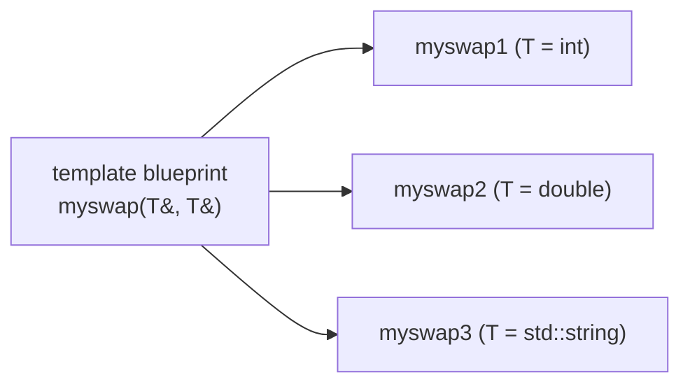

# Information and Computer Science 46 — Topic: C++ Foundations

## Table of Contents

- [1. C++ References](#1-c-references)
- [2. Pointers and the Heap](#2-pointers-and-the-heap)
- [3. Smart Pointers and Ownership](#3-smart-pointers-and-ownership)
- [4. One-Dimensional Arrays](#4-one-dimensional-arrays)
- [5. Multidimensional Arrays](#5-multidimensional-arrays)
- [6. Function Templates](#6-function-templates)
- [7. Class Templates](#7-class-templates)
- [8. Randomness and Random Number Generation](#8-randomness-and-random-number-generation)
- [9. Unit Tests with Google Test](#9-unit-tests-with-google-test)
- [10. Complete Implementation](#10-complete-implementation)
- [11. Quick Reference & Top 5 Things to Remember](#11-quick-reference--top-5-things-to-remember)

> This chapter collects the C++ that data-structure code is built from: references and pointers (and the smart pointers that manage them), arrays, templates, random numbers, and unit tests. It assumes basic C++ (classes, functions, `std::string`, `std::vector`) and is the foundation for every other topic, starting with [Analysis](topic-analysis.en-US.md) and [Linear Structures](topic-linear.en-US.md). All code was compiled with `g++ -std=c++17 -Wall -Wextra -fsanitize=address,undefined`.

## 1. C++ References

### 1.1 A reference is an alias

A **reference** is another name for an existing object. It **must be initialized**, and it **can never be re-bound** to a different object. It is also called an **lvalue reference** and is declared with `&` on the type: `int& ref = existingVariable;`. Unlike a Python name, `r = j;` does not rebind `r`: it copies `j`'s value into whatever `r` refers to.

```cpp
int i = 3;
int& r = i;                       // r now refers to i
std::cout << r << std::endl;      // writes 3
r = 4;                            // a change to r is also a change to i
std::cout << i << std::endl;      // writes 4
i = 5;                            // a change to i is also a change to r
std::cout << r << std::endl;      // writes 5
```

There is one `int` with two names.

### 1.2 Pass by value vs. pass by reference

Pass by value gives the function a **copy**; pass by reference makes the parameter an **alias** for the caller's argument. References are used for two reasons: they **allow modification** of the caller's object, and they **avoid copying** large data (performance and memory).

```cpp
void increment(int& x) {
  x++;
  std::cout << x << std::endl;    // prints 4
}

void myswapInt(int& a, int& b) {  // swaps the caller's variables
  int temp = a;
  a = b;
  b = temp;
}

int i = 3;
increment(i);
std::cout << i << std::endl;      // prints 4
```

With `void increment(int x)` the output would be `4` then `3`, and `myswapInt` without the `&`s would swap two copies and change nothing.

> 💡 **Key Insight**: To read a big object, take `const T&`; to modify the caller's object, take `T&`; small types such as `int` are passed by value.

### 1.3 Return by value vs. return by reference

**Return by value by default**: it is safe (no dangling references), cheap thanks to return-value optimization, move semantics and copy elision (guaranteed in C++17), and simpler. **Return by reference** for class getters (`const T&` to big internal data), for operator overloading (`operator[]`, `operator=`, `operator<<`, so that calls can chain), and for long-lived objects that exist outside the function.

**Critical rule: never return a reference to a local variable.** The local is destroyed when the function returns, so the reference dangles.

```cpp
// BAD: dangling reference to a local object
int& getBad() { int local = 42; return local; }   // DANGER: destroyed on exit

// GOOD: return by value (optimized by RVO / copy elision)
int getGood() { int val = 42; return val; }
```

What `getBad()` actually does when called:

```text
bad.cpp:2:40: warning: reference to local variable 'local' returned [-Wreturn-local-addr]
bad.cpp:2:40: runtime error: reference binding to null pointer of type 'int'
AddressSanitizer: SEGV on unknown address 0x000000000000
```

> 📘 **Going further**: Moving a `std::vector` just steals its internal array pointer, size and capacity (O(1)) instead of copying every element (O(n)), which is why returning big objects by value is cheap. `std::move(x)` only marks `x` as "safe to steal from"; it appears with `unique_ptr` in [section 3.4](#34-unique_ptr-cannot-be-copied). (Thornton, Move Semantics)

## 2. Pointers and the Heap

### 2.1 What a pointer is

A **pointer** holds a **memory address** (a run-time value) plus the **type** it points to (known at compile time). It is declared with `*`: `int* x;`. Read declarations right to left: `int** q` is "pointer to pointer to int", and `int*& s` is "reference to pointer to int".

| | Reference `int&` | Pointer `int*` |
|---|---|---|
| Can be null? | no | yes (`nullptr`) |
| Must be initialized? | yes | no (but uninitialized means garbage) |
| Can change target? | no | yes |
| Reach the object | just the name | `*p` |

### 2.2 `&`, `*` and pointer assignment

The **address-of** operator `&` (in an *expression*) gives a variable's address; this differs from `&` in a *type*, which declares a reference. The **dereference** operator `*` is its opposite: it reaches the object at an address (the name has nothing to do with references; it is an older C term). Pointers can be copied (`int* q = p;` makes both point at the same object), and there can be pointers to pointers (`int** q = &p;`).

```cpp
int i = 3;
int* p = &i;
std::cout << i << std::endl;   // 3
*p = 4;                        // change i through p
std::cout << i << std::endl;   // 4
int** q = &p;                  // *q is p, **q is i (prints 4)
```

Pointers enable direct memory manipulation, dynamic allocation, and data structures such as linked lists, trees and graphs. Unlike a reference, a pointer can be **re-pointed**:

```cpp
int x = 10;
int* p = &x;    // p holds the memory address of x
*p = 20;        // changes x to 20 through the pointer
int y = 30;
p = &y;         // now p points to y instead of x
```

Afterwards `x` is 20 and `*p` is 30.

> ⚠️ **Pitfall**: An address is not an `int`. `int* p = i;` is a compile error (`invalid conversion from 'int' to 'int*'`); write `int* p = &i;`.

### 2.3 `nullptr`

`nullptr` means "points to nothing" (for example the last node's `next` in a linked list). Dereferencing it is **undefined behavior**; in practice it crashes.

```cpp
int* p = nullptr;
*p = 3;              // CRASH
```

```text
Segmentation fault            # plain g++, exit code 139
```

Check `if (p != nullptr)` before dereferencing a pointer that might be null.

### 2.4 Stack vs. heap; pointers and references together

There are two memory regions. The **stack** holds function calls and local variables (automatic allocation, freed automatically on scope exit). The **heap** holds objects created by `new` at run time (dynamic allocation, alive until `delete`). **References are implicit synonyms for objects; pointers store the location of objects.**

```cpp
int* p = new int;     // new int: allocate an int on the heap
*p = 3;

int& q = *p;          // q is another name for the heap int
q = 4;

std::cout << *p << std::endl;   // 4

int* r = &q;          // address of the int q names (same as p)
*r = 5;

std::cout << *p << std::endl;   // 5

int*& s = p;          // s is a reference to an int pointer
*s = 6;

std::cout << *p << std::endl;   // 6
```

This program in memory: one heap `int`, four ways to reach it (dashed arrows are references). Step through it below (← / → keys work when the demo is focused):

```viz memory-trace
{"title": "p, q, r, s", "steps": [{"code": "int* p = new int; *p = 3; int& q = *p; q = 4;", "note": "p points at a heap int; q is another name for it (dashed = reference), so q = 4 writes the int", "stack": [{"frame": "main", "vars": [{"name": "p", "value": "->h1"}, {"name": "q", "value": "->h1", "ref": true}]}], "heap": [{"id": "h1", "type": "int", "fields": [{"name": "value", "value": "4", "old": "3"}]}]}, {"code": "int* r = &q; *r = 5; int*& s = p; *s = 6;", "note": "r holds the same address as p; s is a reference to the pointer p itself", "add_vars": {"main": [{"name": "r", "value": "->h1"}, {"name": "s", "value": "->main.p", "ref": true}]}, "set": {"h1.value": {"value": "6", "old": "4"}}}]}
```

`r == p` and `&s == &p` both hold (the compiled program in [section 10](#10-complete-implementation) prints `true` for each).

### 2.5 `new`, `delete`, leaks and dangling pointers

`delete p` deletes **the object `p` points to**, not `p` itself. The rule is: **every `new` has exactly one matching `delete`**. Breaking it gives:

| Bug | What happens |
|---|---|
| **Memory leak** | never deleted; once the last pointer to it is gone, the object is unreachable but still allocated |
| **Dangling pointer** | after `delete p`, `p` still holds the old address; using it is undefined behavior |
| **Double free** | deleting the same address twice is undefined behavior (see the second problem in [section 2.6](#26-practice)) |

> 📘 **Going further**: Every time you write `new`, ask "who will delete this, and when?" Python frees heap objects with a garbage collector; C++ has none, so that is your job, or a smart pointer's ([section 3](#3-smart-pointers-and-ownership)). (Thornton, Smart Pointers)

### 2.6 Practice

#### Visualizing pointers and references

Draw the stack and heap (dashed arrow = reference, solid arrow = pointer) for the following code, and say what it prints:

```cpp
int* a = new int;
*a = 2;

int* b = new int;
*b = 3;

*a = *b;

int& c = *b;
c = 6;

std::cout << *a << std::endl;

int*& d = a;
*d = 9;

std::cout << *a << std::endl;

delete a; delete b;
```

<details>
<summary>Solution</summary>

Prints **`3`** then **`9`**; clean under AddressSanitizer.

- `*a = *b` copies the **value** 3; `a` and `b` still point at two different ints.
- `c` names `b`'s int, so `c = 6` leaves `a`'s int at 3, which prints 3.
- `d` is another name for the pointer `a`, so `*d = 9` writes `a`'s int, which prints 9.
- Final picture: `a` points to an int holding 9, `b` points to an int holding 6, `c` has a dashed arrow to the 6, `d` has a dashed arrow to `a`. Two objects, each deleted once.

</details>

#### The same code with `a = b`

Take the program above and change the line `*a = *b;` to `a = b;`. What does it print, and what goes wrong?

<details>
<summary>Solution</summary>

Prints **`6`** then **`9`**, then crashes:

- `a = b` copies the **address**: both pointers now point at the int holding 3. The int holding 2 has no pointer left, so it **leaks**.
- `c = 6` and `*d = 9` both write that one shared int, giving 6 and then 9.
- `delete a; delete b;` deletes the same address twice, a **double free**:

```text
6
9
==ERROR: AddressSanitizer: attempting double-free on 0x502000000030 in thread T0
```

`*a = *b` copies what is pointed to; `a = b` copies the pointer itself. That aliasing is what smart pointers exist to prevent.

</details>

## 3. Smart Pointers and Ownership

### 3.1 The problem with raw pointers, and the three smart pointers

Raw pointers are dangerous: dereferencing `nullptr` is undefined behavior; a bad cast can point anywhere; the **same syntax** points to one object or to an array (`new int` vs. `new int[10]`); and a pointer **keeps pointing at deallocated objects** (dangling). So **prefer stack allocation** (cleaned up automatically on scope exit, even when an exception is thrown) and **allocate dynamically only when necessary**: the size is unknown until run time, or the data must outlive the function.

Smart pointers (`#include <memory>`) are the modern solution: they delete their object for you when the pointer itself dies.

| Pointer | Ownership | Object destroyed when… | Copyable? |
|---|---|---|---|
| `std::unique_ptr` | 1-to-1 (exclusive) | that pointer is destroyed | no; transfer with `std::move` |
| `std::shared_ptr` | many-to-1 (reference count) | the **last** owning pointer is destroyed | yes (count + 1) |
| `std::weak_ptr` | none: a non-owning observer ("loaning") | never; nothing happens when it dies | yes |

`weak_ptr` is for function parameters and **cyclic data structures**. **`.get()`** extracts the raw address from a smart pointer.

### 3.2 Ownership

A pointer that **owns** an object must make sure the object is freed when the pointer is destroyed. Thinking in terms of ownership prevents leaks (nobody deletes) and double deletes (two pointers delete). With raw pointers the owner is a class whose destructor deletes the member:

```cpp
class A {
public:
  A();
  ~A();

private:
  B* b;
  // other member variables would be here
};

A::A()
    : b{new B}  // other member variable initializers would be here
{
  // other code to be run after the initializers would be here
}

A::~A() {
  // necessary cleanup other than deleting the object pointed to by b
  // would be here

  delete b;
}
```

**What if the constructor throws after `new B`?** `A` never finished constructing, so `~A()` never runs. The member `b` is destroyed, but destroying a *raw* pointer does not delete the `B`, so the `B` **leaks**. The next section shows this side by side with the smart-pointer version.

### 3.3 `std::unique_ptr`: exclusive ownership

A `unique_ptr` **destroys the object it points to when it is itself destroyed**: automatic deletion is guaranteed. The pointed-to type goes in `< >`.

```cpp
#include <memory>    // needed for smart pointers

void foo() {
  // Creates a unique_ptr called p and points it to a newly allocated int.
  // p holds unique ownership of that int.
  std::unique_ptr<int> p{new int};

  // We can dereference the pointer with the * operator, just as with a raw pointer.
  *p = 3;
  std::cout << *p << std::endl;

  // When p falls out of scope -- either because the function ends normally
  // or because the function threw an exception -- it destroys the int it
  // points to automatically, so there is no need for delete. Similarly, if
  // we re-point p to a new integer later, or point it to null, a deletion
  // is also triggered.
}
```

Rewriting class `A` with `std::unique_ptr<B> b;` means `~A()` no longer needs `delete b` (and can be omitted entirely if it has nothing else to do). Here are both versions with a constructor that throws:

```cpp
struct B {
  B()  { std::cout << "B constructed" << std::endl; }
  ~B() { std::cout << "B destroyed" << std::endl; }
};
class RawA {                     // raw-pointer version
public:
  RawA() : b{new B} { throw std::runtime_error("constructor failed"); }
  ~RawA() { delete b; }
private:
  B* b;
};
class A {                        // unique_ptr version
public:
  A() : b{new B} { throw std::runtime_error("constructor failed"); }
private:
  std::unique_ptr<B> b;
};
```

Constructing each inside a `try` block and catching the exception prints:

```text
B constructed
RawA: constructor failed          <- no "B destroyed": leaked
B constructed
B destroyed
A: constructor failed
==ERROR: LeakSanitizer: detected memory leaks   (1 byte: RawA's B)
```

> 📘 **Going further**: This is **RAII**: acquire a resource in a constructor and release it in a destructor. The destructors of local objects always run, on a normal return *and* while an exception propagates. Modern code usually writes `auto p = std::make_unique<int>(3);` (and `std::make_shared`) instead of a bare `new`. (Thornton, Smart Pointers)

### 3.4 `unique_ptr` cannot be copied

**It is unsafe to copy a `unique_ptr`, so copying is not allowed.** What happens with pass by value:

```cpp
void foo(std::unique_ptr<int> q) {
  *q = 4;
}

void bar() {
  std::unique_ptr<int> p{new int};
  *p = 3;
  foo(p);
  std::cout << *p << std::endl;
}
```

This **does not compile**: `error: use of deleted function 'std::unique_ptr<...>::unique_ptr(const std::unique_ptr<...>&)'`. If it were allowed, `p` and `q` would both "own" the int; when `foo` returns, `q` would delete it, and `p` would dangle and delete it a second time.

Ownership can only be transferred, with `std::move`:

```cpp
std::unique_ptr<int> p(new int);
*p = 3;                  // * and -> work like a raw pointer
// std::unique_ptr<int> q = p;          // error: copy is deleted
std::unique_ptr<int> q = std::move(p);  // OK: q owns it, p is now nullptr
```

Instead of passing the owner by value, write one of these:

```cpp
void borrow(int& x) { x = 4; }                          // just use the int
void borrowOwner(std::unique_ptr<int>& q) { *q = 5; }   // use the caller's owner
void take(std::unique_ptr<int> q) { *q += 1; }          // take ownership

borrow(*p);          // p still owns the int
borrowOwner(p);      // p still owns the int
take(std::move(p));  // ownership moves into q; afterwards p == nullptr
```

### 3.5 `std::shared_ptr`: reference counting

With shared ownership, the object lives **as long as at least one** `shared_ptr` points to it and is destroyed when the **last** one goes away. It works by **counting** the pointers, and a `shared_ptr` **can be copied** safely: a copy adds 1 to the count.

```cpp
void foo() {
  std::shared_ptr<int> p1{new int};     // p1 points to a new integer
  std::shared_ptr<int> p2 = p1;         // p2 points to the same integer
  *p1 = 4;                              // 4 is stored in that integer
  std::cout << *p2 << std::endl;        // prints 4
  p1 = nullptr;                         // p1 no longer points to the integer, but p2 still does
}                                       // when the function ends, the integer is destroyed
```

| After line | `use_count` |
|---|---|
| `p1{new int}` | 1 |
| `p2 = p1` | 2 |
| `p1 = nullptr` | 1 |
| `}` (p2 destroyed) | 0, so the int is deleted |

> ⚠️ **Pitfall**: `shared_ptr` is not garbage collection. Python also has a cycle collector; `shared_ptr` does **not**. A **cycle** of `shared_ptr`s (parent owns child, child owns parent) never reaches count 0 and leaks, as the next section shows.

### 3.6 The cycle problem and `std::weak_ptr`

Even shared ownership can leak:

```cpp
#include <iostream>
#include <memory>

struct Child;  // forward declaration

struct Parent {
  std::shared_ptr<Child> child;
  ~Parent() { std::cout << "Parent destroyed\n"; }
};

struct Child {
  std::shared_ptr<Parent> parent;
  ~Child() { std::cout << "Child destroyed\n"; }
};

int main() {
  std::shared_ptr<Parent> p(new Parent());
  std::shared_ptr<Child>  c(new Child());

  p->child = c;    // Parent owns Child
  c->parent = p;   // Child owns Parent

  // Neither Parent nor Child is destroyed here because
  // they keep each other alive (circular reference).
  return 0;
}
```

The cycle in memory. Step through it below (← / → keys work when the demo is focused):

```viz memory-trace
{"title": "A shared_ptr cycle", "steps": [{"code": "shared_ptr<Parent> p(new Parent()); shared_ptr<Child> c(new Child());", "stack": [{"frame": "main", "vars": [{"name": "p", "value": "->P"}, {"name": "c", "value": "->C"}]}], "heap": [{"id": "P", "type": "Parent", "fields": [{"name": "child", "value": "nullptr"}, {"name": "use_count", "value": "1"}]}, {"id": "C", "type": "Child", "fields": [{"name": "parent", "value": "nullptr"}, {"name": "use_count", "value": "1"}]}]}, {"code": "p->child = c;  c->parent = p;", "note": "each object now has two owners: a local and the other object", "set": {"P.child": {"value": "->C", "old": "nullptr"}, "C.parent": {"value": "->P", "old": "nullptr"}, "P.use_count": {"value": "2", "old": "1"}, "C.use_count": {"value": "2", "old": "1"}}}, {"code": "} // end of scope: p and c destroyed", "note": "counts drop to 1, not 0 — the two objects keep each other alive and nothing outside can reach them: leaked, no destructor runs", "pop_frame": true, "set": {"P.use_count": {"value": "1", "old": "2"}, "C.use_count": {"value": "1", "old": "2"}}}]}
```

Neither destructor message prints. Both use counts are 2 after the two assignments. Run inside a helper function and built with `-O1`, LeakSanitizer reports `80 byte(s) leaked in 4 allocation(s)`: two objects plus two control blocks.

**Fix**: make the back-pointer non-owning. A `weak_ptr` points at a `shared_ptr`-managed object **without** adding to its count.

```cpp
struct Child {
  std::weak_ptr<Parent> parent;          // FIX: observer, not owner
  ~Child() { std::cout << "Child destroyed\n"; }
};
// to use it:  if (std::shared_ptr<Parent> pp = c->parent.lock()) { ... }
```

```text
Parent count 1, Child count 2
child can still reach its parent
Parent destroyed
Child destroyed
```

When `p` dies, the Parent's count hits 0 and the Parent is destroyed; that destroys its `child` member, so the Child's count hits 0 as well.

### 3.7 Borrowing vs. owning: guidelines

**Not all pointers imply ownership**: an object can be **borrowed** without taking responsibility for it.

| Use | Meaning | When |
|---|---|---|
| `A&` / `const A&` | reference: **guaranteed existence** (no null); `const` forbids modification | the borrower always needs an object |
| `A*` | raw pointer: **explicit non-ownership** by convention; **optional presence** (may be `nullptr`) | the object may be absent |
| `std::weak_ptr<A>` | smart non-owning pointer; pairs with `shared_ptr` | back-references in shared structures |

A practical example: tree nodes hold `shared_ptr` to their **children** and `weak_ptr` to their **parent**, which is the fix from the previous section.

Rule of thumb for raw and smart pointers together:

- **Owners**: smart pointers control the resource's lifespan.
- **Observers**: raw pointers may look at (read, write, inspect) an object **without responsibility for destroying it**.
- **`.get()`** passes out a temporary, non-owning raw pointer **without giving up ownership**.

```cpp
root->left->parent = root.get();   // parent observes root; root still owns it
```

| Working design for a tree with parent links | When to use |
|---|---|
| `shared_ptr` down + `weak_ptr` up | shared or unpredictable lifetimes, breaking cycles; the observer can check whether the object is gone (`lock()`, `expired()`) |
| `unique_ptr` down + raw `Node*` up (via `.get()`) | faster (no counting); safe **only if the owner outlives the observer**, which holds in a tree because a parent's destructor destroys its children |

> 📘 **Going further**: To "loan this object to a function", prefer a reference (`const Node&`) since it cannot be null; use a raw pointer if `nullptr` is a legal argument, and a `weak_ptr` only if the borrower might outlive the owner. (Thornton, Smart Pointers)

### 3.8 A tree with parent links: four designs

Start from a raw-pointer `Node` with `left`, `right` and `parent`, three `new Node()`s linked parent to child and child to parent, and three manual `delete`s. Manual cleanup is fragile: every `delete` must be written by hand. The four designs below were all compiled:

| Design | `left` / `right` | `parent` | Compiles? | Result |
|---|---|---|---|---|
| Raw | `Node*` | `Node*` | yes | correct only if every `delete` is written by hand; after `delete root` the children's `parent` pointers dangle |
| Naive unique | `unique_ptr` | `unique_ptr` | **no** | `root->left = leftChild;` copies a `unique_ptr`: "use of deleted function … `operator=`" |
| Shared down, weak up | `shared_ptr` | `weak_ptr` | yes | all 3 destructors run, no leak |
| All shared (counter-example) | `shared_ptr` | `shared_ptr` | yes | **leaks**: no destructor runs (AddressSanitizer: 216 bytes in 6 allocations) |
| Unique down, raw up | `unique_ptr` | raw `Node*` | yes | all 3 destructors run, no leak, no counting |

The last design:

```cpp
class Node {
public:
  Node() { std::cout << "Node created\n"; }
  ~Node() { std::cout << "Node destroyed\n"; }

  std::unique_ptr<Node> left;       // downward links own their children
  std::unique_ptr<Node> right;
  Node* parent = nullptr;           // upward link only observes
};

{
  // 1. Initialize nodes as unique pointers
  std::unique_ptr<Node> root(new Node());
  std::unique_ptr<Node> leftChild(new Node());
  std::unique_ptr<Node> rightChild(new Node());

  // 2. Transfer ownership downward using std::move
  root->left = std::move(leftChild);
  root->right = std::move(rightChild);

  // 3. Set upward back-pointers using the raw address (.get())
  root->left->parent = root.get();
  root->right->parent = root.get();
} // all 3 nodes are destroyed here automatically
```

In memory: owning `unique_ptr`s point down, raw `parent` pointers point up, and the moved-from locals are `nullptr`. Step through it below (← / → keys work when the demo is focused):

```viz memory-trace
{"title": "unique_ptr down, raw pointer up", "steps": [{"code": "root->left = std::move(leftChild); ... root->left->parent = root.get(); ...", "note": "each Node has exactly one owner; the moved-from locals are nullptr; parent links only observe", "stack": [{"frame": "main", "vars": [{"name": "root (unique_ptr)", "value": "->n0"}, {"name": "leftChild (unique_ptr)", "value": "nullptr", "old_target": "n1"}, {"name": "rightChild (unique_ptr)", "value": "nullptr", "old_target": "n2"}]}], "heap": [{"id": "n0", "type": "Node (root)", "fields": [{"name": "left (unique_ptr)", "value": "->n1"}, {"name": "right (unique_ptr)", "value": "->n2"}, {"name": "parent (Node*)", "value": "nullptr"}]}, {"id": "n1", "type": "Node (left child)", "fields": [{"name": "left (unique_ptr)", "value": "nullptr"}, {"name": "right (unique_ptr)", "value": "nullptr"}, {"name": "parent (Node*)", "value": "->n0"}]}, {"id": "n2", "type": "Node (right child)", "fields": [{"name": "left (unique_ptr)", "value": "nullptr"}, {"name": "right (unique_ptr)", "value": "nullptr"}, {"name": "parent (Node*)", "value": "->n0"}]}]}, {"code": "}   // end of block", "note": "root dies -> deletes n0 -> n0's left/right die -> delete n1 and n2. No leak, no double delete", "free": ["n0", "n1", "n2"], "set": {"main.root (unique_ptr)": {"value": "nullptr", "old_target": "n0"}}}]}
```

Output (the compiled program in [section 10](#10-complete-implementation) also prints whether `leftChild` is null after the moves):

```text
Node created
Node created
Node created
leftChild is now null: true
Node destroyed
Node destroyed
Node destroyed
End of main.
```

> ⚠️ **Pitfall**: After `std::move(leftChild)`, `leftChild` is `nullptr`. That is why this design writes `root->left->parent`, not `leftChild->parent`; with `shared_ptr`s the original local is still valid and could be used.

### 3.9 Practice

#### Shared ownership and a cycle

Consider the `Parent`/`Child` program of [section 3.6](#36-the-cycle-problem-and-stdweak_ptr), where each object holds a `shared_ptr` to the other. (a) What happens to the parent and child at the end of `main`? (b) Why? (c) What is the fix?

<details>
<summary>Solution</summary>

(a) Neither is destroyed: no destructor output, and both objects leak.

(b) Each has two owners (a local and the other object). When `p` and `c` die, each count drops to 1, not 0: a **reference cycle**, which `shared_ptr` cannot detect.

(c) Change `Child`'s member to `std::weak_ptr<Parent> parent;`. The Parent's count stays 1, so both objects are destroyed (`Parent destroyed`, `Child destroyed`). Use `lock()` to reach the parent.

</details>

#### Converting a raw-pointer tree to smart pointers

Starting code (a raw-pointer tree):

```cpp
#include <iostream>

class Node {
public:
  Node() { std::cout << "Node created\n"; }
  ~Node() { std::cout << "Node destroyed\n"; }

  // Member pointers initialized safely to nullptr
  Node* left = nullptr;
  Node* right = nullptr;
  Node* parent = nullptr;
};

int main() {
  {
    std::cout << "--- Initializing Tree Elements ---\n";
    Node* root = new Node();
    Node* leftChild = new Node();
    Node* rightChild = new Node();

    // Linking parent-to-child and child-to-parent
    root->left = leftChild;
    root->right = rightChild;

    root->left->parent = root;
    root->right->parent = root;

    std::cout << "--- Tearing Down Tree Elements ---\n";
    // Manual cleanup is fragile: every delete must be written by hand
    delete root;
    delete leftChild;
    delete rightChild;
  }

  std::cout << "End of main.\n";
  return 0;
}
```

**(a)** Convert the raw pointers to unique pointers.
**(b)** What happens when you try to compile? Why?
**(c)** Fix the smart pointer types as necessary so that there are no memory leaks.
**(d)** Convert to using only `unique_ptr` and raw pointers, for performance.

<details>
<summary>Solution</summary>

**(a)** Make every `Node*` (members and locals) a `std::unique_ptr<Node>` and drop the `delete`s.

**(b)** Compile error: `root->left = leftChild;`, `root->right = rightChild;` and `root->left->parent = root;` each **copy** a `unique_ptr`, and its copy assignment is deleted (two unique owners would delete the same Node twice). The parent link is also a design error: a child cannot own its parent.

**(c)** Ownership down, observation up: `left` and `right` (and the locals) become `std::shared_ptr<Node>`, and `parent` becomes `std::weak_ptr<Node>`. The `weak_ptr` does not count, so root's count drops to 0 at the end of the block and all three Nodes are destroyed. With `parent` as a `shared_ptr` too, the cycle leaks all three.

**(d)** `unique_ptr` down, raw pointer up:

```cpp
root->left = std::move(leftChild);
root->right = std::move(rightChild);
root->left->parent = root.get();
root->right->parent = root.get();
```

This is faster (no reference counts) and safe because the parent always outlives its children.

</details>

## 4. One-Dimensional Arrays

### 4.1 Statically vs. dynamically allocated

An array is a sequence of contiguous cells of one type, indexed from 0, with a fixed size that you must track yourself.

| | Statically allocated | Dynamically allocated |
|---|---|---|
| Syntax | `int a[10];` | `int* a = new int[size];` |
| Size known | at compile time | at run time |
| Lives on | the run-time stack | the heap; `new` returns a pointer to the first element |
| Cleanup | automatic | `delete[] a;` |

`void foo(unsigned int n) { int a[n]; }` is a **variable-length array**. Some compilers accept it, but it is **not standard C++** (g++ `-pedantic`: `warning: ISO C++ forbids variable length array 'a' [-Wvla]`), and a large `n` can overflow the stack.

### 4.2 Passing arrays

An array can be passed as a parameter **regardless of allocation method**: pass a **pointer to the first element** plus the **size**, so the function can do its own bounds checking.

```cpp
void zeroArray(int* a, unsigned int size) {
  for (unsigned int i = 0; i < size; ++i) {
    a[i] = 0;
  }
}
```

```cpp
int x[10];
zeroArray(x, 10);

int* y = new int[10];
zeroArray(y, 10);
delete[] y;
```

> ⚠️ **Pitfall**: The size is just a number that C++ trusts. `zeroArray(x, 50)` on either array compiles without a warning and writes 40 ints past the end. AddressSanitizer catches both: `stack-buffer-overflow … in zeroArray(int*, unsigned int)` for the static array, and `heap-buffer-overflow … 0 bytes after 40-byte region … in zeroArray(int*, unsigned int)` for the dynamic one.

### 4.3 Pointer arithmetic

- `p + k` adds `k * sizeof(type)` bytes to the address.
- `a + 1` is the address of `a[1]`, so `*(a + 1) == a[1]` and `a + 1 == &a[1]`.
- `q - p` for two pointers into the **same** array is the difference of their addresses divided by the size of the type.
- Pointers that leave the array are **undefined**: `a - 1` ("`a[-1]`") compiles but must not be used, and subtracting pointers into two different arrays is meaningless.

```cpp
int a[10];
*(a + 1) = 3;
std::cout << (char*)(a + 1) - (char*)a;   // 4 bytes
std::cout << a[1];                        // 3
std::cout << &a[7] - a;                   // 7 elements
```

With `sizeof(int) = 4`, the first prints 4 bytes, the second 3, and the third 7 elements.

For `int x[10];` (`x` decays to an `int*` to `&x[0]`):

| View | Formula |
|---|---|
| Pointer address | `&x[i] == x + i` (scaled by the type size automatically) |
| Byte address | `Base + (i × sizeof(int))` |
| Value | `x[i] == *(x + i)` |

It is one multiply and one add, so **every index costs the same constant time**.

### 4.4 `std::vector`

`std::vector` is a dynamic 1D array **managed with RAII** (it frees its array in its destructor, so it cannot leak), and **`at()`** is `[ ]` **plus a range check**.

```cpp
std::vector<int> v;
for (unsigned int i = 0; i < 10; i++) {
  v.push_back(i);
}
for (unsigned int i = 0; i < 10; i++) {
  v.at(i) += 10;
  std::cout << v.at(i) << " ";
}
v.at(10) = 1;                 // throws std::out_of_range
```

```text
10 11 12 13 14 15 16 17 18 19
v.at(10) threw std::out_of_range
```

`v[10] = 1` would be silent undefined behavior. (Thornton, Single-Dimension Arrays)

## 5. Multidimensional Arrays

### 5.1 Declaring and storing an nd array

Declare a **fixed, compile-time size for each dimension**; what each dimension *means* (rows vs. columns) is up to you. In memory the array is **flattened into one row**, in **row-major order**: the rightmost index varies fastest, so elements with the same first index are contiguous.

```cpp
int a[4][5];

for (int i = 0; i < 4; ++i) {
  for (int j = 0; j < 5; ++j) {
    a[i][j] = i * j;
  }
}
```

Layout of `int a[4][5]`: every element in memory order, then where `a[2][3]` lands. Step through it below (← / → keys work when the demo is focused):

```viz array-2d
{"title": "int a[4][5] in row-major order", "dims": [4, 5], "find": [2, 3]}
```

Reading the block straight through as `int*` prints the values row by row:

```text
flat: 0 0 0 0 0 0 1 2 3 4 0 2 4 6 8 0 3 6 9 12
```

### 5.2 Indexing: the address formula

For `int a[4][5];`, `a` decays to a pointer to a whole row (`int(*)[5]`), so `a + i` skips `i` rows of 5 ints:

| View | Formula |
|---|---|
| Element address | `&a[i][j] == *(a + i) + j == (int*)a + (i × 5 + j)` |
| Byte address | `Base + (i × 5 + j) × sizeof(int)` |
| Element value | `a[i][j] == *(*(a + i) + j) == *((int*)a + (i × 5 + j))` |

Worked case, `i = 2, j = 3` (real output):

```text
a[2][3] = 6, *(*(a + i) + j) = 6, *((int*)a + (i * 5 + j)) = 6
byte offset of a[2][3] = 52 = (2*5+3)*4
sizeof(a) = 80, sizeof(a[0]) = 20, (char*)(a + 1) - (char*)a = 20
```

**N-dimensional rule**: the address calculation needs the sizes of **all inner dimensions**, that is, everything except the leftmost. The 5 appears in `i × 5 + j`; the 4 never does.

> 📘 **Going further**: That rule is why a 2D array parameter must carry its inner size in the type: `void fill(int a[][5], int rows)` compiles, but `void fill(int* a, int rows, int cols)` with `a[i][j]` in the body does not. (Thornton, Multidimensional Data)

### 5.3 Practice

#### Layout and formula for a 3D array

Given `int a[3][2][4];`:
**(a)** Draw the 1D contiguous memory layout of this 3D array.
**(b)** What is the pointer arithmetic formula for accessing `a[i][j][k]`?

<details>
<summary>Solution</summary>

**(a)** 24 ints in one block; `k` varies fastest, then `j`, then `i`. Each `a[i]` is 8 ints, each `a[i][j]` is 4:

| Flat positions | 0–3 | 4–7 | 8–11 | 12–15 | 16–19 | 20–23 |
|---|---|---|---|---|---|---|
| Elements | `a[0][0][0..3]` | `a[0][1][0..3]` | `a[1][0][0..3]` | `a[1][1][0..3]` | `a[2][0][0..3]` | `a[2][1][0..3]` |

```viz array-2d
{"title": "int a[3][2][4] in row-major order", "dims": [3, 2, 4], "find": [1, 1, 2]}
```

**(b)** `&a[i][j][k] == (int*)a + (i * 2 * 4 + j * 4 + k)`, so `a[i][j][k] == *((int*)a + (i * 8 + j * 4 + k))` (also `*(*(*(a + i) + j) + k)`); the byte address is `Base + (i × 8 + j × 4 + k) × sizeof(int)`. Only the inner sizes 2 and 4 appear. The compiled program checks all 24 cells: `3D formula correct for all 24 cells? true`.

</details>

## 6. Function Templates

### 6.1 Why templates exist

C++ has a **static type system**: every variable's type is fixed at compile time. So a function that swaps two `int`s cannot swap two `double`s, and to work with different parameter types you end up writing near-identical versions:

```cpp
void myswap(int& a, int& b) noexcept {
  int temp = a;
  a = b;
  b = temp;
}
```

```cpp
void myswap(double& a, double& b) noexcept {
  double temp = a;
  a = b;
  b = temp;
}
```

Because C++ allows **overloading** (same name, different parameter types), both can coexist, and you could have a hundred more, one per type. But the bodies are identical except for the type name, and every bug fix has to be made N times.

A **template** solves this. It is a **blueprint for an infinite set of possibilities**: you write the code once and specify *how the instances differ from each other* (here: only the type). The compiler stamps out each concrete version when it is needed.



There are two main kinds: **function templates**, a blueprint for functions (this section), and **class templates**, a blueprint for classes ([section 7](#7-class-templates)); data structures are their main use.

> 💡 **Key Insight**: A template is not a function or a class. It is a recipe the compiler uses to *generate* functions or classes, one per set of template arguments.

### 6.2 Syntax

Four steps:

1. Start with the **`template`** keyword.
2. Enclose the template parameters in **`< >`**.
3. Write **`typename`** followed by the type parameter's name (`T` by convention).
4. Write the function definition as usual, using `T` wherever the type varies.

```cpp
template <typename T>
void myswap(T& t1, T& t2) {
  T temp = t1;
  t1 = t2;
  t2 = temp;
}
```

- This is a **blueprint** for any number of `myswap` functions.
- The keyword **`typename`** says this parameter is a **type placeholder** (not, say, an `int` constant).
- **`T`** names that type; during instantiation, every `T` is replaced by the **actual type**.

### 6.3 Kinds of template parameters

| Kind | Examples | Meaning |
|---|---|---|
| **Type parameters** | `typename T`, `class T` | stand for a type; the *argument* is a type such as `int` or `std::string` |
| **Non-type parameters** | integer constants, pointers, references | stand for a compile-time *value*, e.g. `template <typename T, int N>` |
| **Template template parameters** | a template | a parameter that is itself a template (e.g. "some container template") |

`typename T` and `class T` mean exactly the same thing inside `< >` (`class` here does not require `T` to be a class; `int` works). A non-type parameter example:

```cpp
template <typename T, int N>
T sumFirst(const std::vector<T>& v) {
  T total{};
  for (int i = 0; i < N && i < static_cast<int>(v.size()); ++i) total += v[i];
  return total;
}
// sumFirst<int, 3>(std::vector<int>{1, 2, 3, 4, 5}) == 6
```

`N` must be known at compile time; `sumFirst<int, 3>` and `sumFirst<int, 4>` are two different generated functions.

### 6.4 Why the template drops `noexcept`

The `int` and `double` versions above are `noexcept`, but the template is not. That is deliberate: swapping `int`s can never throw, but swapping `std::string`s copies strings, and copying a string can allocate memory, which can throw. A single template cannot promise "never throws" for every `T`. (Thornton)

> 📘 **Going further**: `noexcept` is a promise, not a check: if a `noexcept` function does throw, the program calls `std::terminate()`. A template can make the promise **conditional** on `T`: `noexcept(expr)` where `expr` is a compile-time `bool`. The inner `noexcept(...)` *operator* asks "is this expression declared not to throw?" without running it:
>
> ```cpp
> template <typename T>
> void myswap(T& t1, T& t2)
>     noexcept(noexcept(T{t1}) && noexcept(t1 = t2))
> ```
>
> or, more readably, with `#include <type_traits>`:
>
> ```cpp
> template <typename T>
> void myswap(T& t1, T& t2)
>     noexcept(std::is_nothrow_copy_constructible_v<T> &&
>              std::is_nothrow_copy_assignable_v<T>)
> ```
>
> Compiled check: `noexcept(myswap(i, j))` is `true` for `int` and `false` for `std::string`. (`std::is_nothrow_assignable_v<T>` with a single argument would be wrong: that trait takes two types, so use `is_nothrow_copy_assignable_v<T>`.) Library code such as the standard containers cares about this because some operations get faster when the compiler knows that moves and copies cannot throw.

### 6.5 Instantiation at compile time

A function template generates nothing until it is **used**. When the compiler reaches a call, it does three steps:

| Step | Name | What the compiler does |
|---|---|---|
| 1 | **Call encountered** | At a template call, checks whether it recognizes the function template. |
| 2 | **Type deduction** | Tries to deduce the template parameter types automatically from the argument types. |
| 3 | **Instantiation** | Generates an actual concrete function definition for the deduced types. |

The three pieces as code. The **call location**:

```cpp
void foo() {
  int i = 3;
  int j = 4;
  myswap(i, j);
}
```

The **template** is the `myswap` blueprint from [section 6.2](#62-syntax). What the compiler **instantiates** for `T = int`:

```cpp
void myswap(int& t1, int& t2) {
  int temp = t1;
  t1 = t2;
  t2 = temp;
}
```

Both arguments are `int`, so `T&` must be `int&`, so `T = int`. The generated function is a real function in the program, called `myswap<int>`. Calling `myswap` with two `double`s later generates a second function `myswap<double>`; calling it with `int`s again reuses `myswap<int>`.

Here is what that call does in memory. `t1` and `t2` are references (dashed arrows), so writes through them land in `foo`'s variables. Step through it below (← / → keys work when the demo is focused):

```viz memory-trace
{"title": "myswap<int>(i, j)", "steps": [{"code": "myswap(i, j);  // enter myswap<int>", "note": "t1 and t2 are references: aliases of foo's i and j, not copies", "stack": [{"frame": "myswap<int>", "vars": [{"name": "t1", "value": "->foo.i", "ref": true}, {"name": "t2", "value": "->foo.j", "ref": true}]}, {"frame": "foo", "vars": [{"name": "i", "value": "3"}, {"name": "j", "value": "4"}]}], "heap": []}, {"code": "T temp = t1;", "note": "copy constructor: temp is a new int initialised from i", "add_vars": {"myswap<int>": [{"name": "temp", "value": "3"}]}}, {"code": "t1 = t2;", "note": "copy assignment through the alias writes foo's i", "set": {"foo.i": {"value": "4", "old": "3"}}}, {"code": "t2 = temp;", "note": "copy assignment writes foo's j; temp is destroyed when myswap returns", "set": {"foo.j": {"value": "3", "old": "4"}}}]}
```

The three operations the trace performs on `T` (copy-construct `temp`, copy-assign twice, destroy `temp`) are exactly the requirements in [section 6.8](#68-implicit-constraints-on-type-parameters).

### 6.6 When deduction fails

Step 2 **fails if the compiler cannot confidently determine the exact type**: either two arguments **conflict**, or there is **no hint** at all. Mixing types:

```cpp
int i = 3; double d = 4.0;
myswap(i, d);
```

```text
error: no matching function for call to 'myswap(int&, double&)'
note:   deduced conflicting types for parameter 'T' ('int' and 'double')
```

From the first argument `T` would be `int`, from the second `double`; the compiler will not pick one. (For `myswap` there is no fix, because an `int&` cannot bind to a `double`. For a by-value or `const T&` function such as `myMin`, you can supply the type yourself, as below.)

You can always give the template argument **explicitly**:

```cpp
myswap<int>(i, j);   // legal, but unnecessary here: deduction already gets int
```

Explicit arguments are required when there is nothing to deduce from (for example `T` appears only in the return type), and they settle conflicts where a conversion is possible: `myMin<double>(3, 4.5)` compiles and returns 3 (the `int` 3 is converted to `double`).

> ⚠️ **Pitfall**: Deduction does **not** apply the usual conversions. `myMin(3, 4.5)` is a compile error even though `int` to `double` is a normal conversion; `myMin<double>(3, 4.5)` is fine.

> 📘 **Going further**: If two `.cpp` files both call `myswap<int>`, each generates its own copy. Normally two definitions of the same function would be a link error, but the linker is required to accept duplicate template instantiations and keep one. That is what makes the "put it in the header" rule of the next section work.

### 6.7 Where template code lives (.hpp and .tpp)

The **instantiation requirement**: the **full template definition** (body included, not just the declaration) must be **visible wherever the template is used**, so the compiler can generate the specialized function at that point. So template code goes in headers. There are two options.

**Option 1: a single header file (`.hpp`).** Declaration and definition together; best for smaller utilities and straightforward templates.

```cpp
// myswap.hpp
#pragma once

template <typename T>
void myswap(T& t1, T& t2) {
  T temp = t1;
  t1 = t2;
  t2 = temp;
}
```

**Option 2: split header and implementation (`.hpp` + `.tpp`).** The interface lives in the `.hpp` and the implementation in the `.tpp`, and the `.hpp` `#include`s the `.tpp` **at the bottom**, so anyone who includes the header still gets the full definition:

```cpp
// myswap.hpp (header and interface)
#pragma once

// 1. Only the declaration is visible first
template <typename T>
void myswap(T& t1, T& t2);

// 2. The implementation is included at the bottom
#include "myswap.tpp"
```

```cpp
// myswap.tpp (template implementation, not compiled on its own)
template <typename T>
void myswap(T& t1, T& t2) {
  T temp = t1;
  t1 = t2;
  t2 = temp;
}
```

The `.tpp` is **not** compiled on its own and must not be listed as a source file; it is a header in disguise. (`.tpp` is a naming convention; the compiler does not care about the extension.) Including `myswap.hpp` and calling `myswap` with two `int`s, `myswap<double>`, and two `std::string`s works as expected (the program in [section 10](#10-complete-implementation) prints `4 3`, `2.5 1.5`, `banana apple`).

> ⚠️ **Pitfall**: The usual habit of "declaration in the `.hpp`, definition in a `.cpp`" **breaks for templates**. A `.cpp` that sees only the declaration compiles fine and assumes `myswap<int>` is defined somewhere else, but the `.cpp` holding the body never saw a call with `int` and so never generated it. The result is a **link error**: `undefined reference to 'void myswap<int>(int&, int&)'`.

> 📘 **Going further**: A faster `myswap` moves instead of copying: `T temp = std::move(t1); t1 = std::move(t2); t2 = std::move(temp);` (`std::move` is in `<utility>`). It lets `T` *move* its contents (for example, steal a string's buffer) rather than copy them, which is cheaper for big objects; for `int` it makes no difference. The requirements then become move construction and move assignment, with copying as the fallback when a type has no move operations. Moves of `std::string` do not throw, so the conditional `noexcept` of that version is `true` for strings.

### 6.8 Implicit constraints on type parameters

Can `T` be anything?

- **`T` must be a concrete type**: a basic type (`int`) or a **fully filled-in template type** such as `std::vector<int>` (not bare `std::vector`, which is a template, not a type).
- **`T` is subject to implicit restrictions** based on the **operations the template performs**. Nothing in `template <typename T>` says "T must be copyable"; the body says it.

**Required operations for `myswap`**:

| # | Operation | Where in `myswap` |
|---|---|---|
| 1 | **Copy constructor** | `T temp = t1;` |
| 2 | **Copy assignment operator** | `t1 = t2;` and `t2 = temp;` |
| 3 | **Destructor** | `temp` is a local (automatic, stack) variable, so its destructor runs automatically when the function ends |

A type missing any of these three cannot be used with `myswap`. For example, a class whose copy constructor and copy assignment are deleted:

```cpp
class X {
public:
  X();
  X(const X& x) = delete;
  X& operator=(const X& x) = delete;
};

X a, b;
myswap(a, b);   // compile error
```

```text
myswap.tpp:4:5: error: use of deleted function 'X::X(const X&)'
myswap.tpp:5:6: error: use of deleted function 'X& X::operator=(const X&)'
myswap.tpp:6:6: error: use of deleted function 'X& X::operator=(const X&)'
```

Note *where* the error is reported: inside the template's body, at the line that needs the missing operation, not at your call. That is typical; template errors point into the template, and you work backwards to the type you passed.

> ⚠️ **Pitfall**: "Statically allocated" here means **automatic storage, a local variable on the stack**, not a `static` variable. It is the opposite of heap allocation with `new`.

> 💡 **Key Insight**: To find a template's requirements on `T`, read its body and list every operation it performs on a `T`: construct (how?), copy, assign, compare (`<`, `==`), call a member, destroy. Each one is a requirement. That is how both template practice problems ([`myMin`](#69-practice) and [`Pair`](#76-practice)) are answered.

> 📘 **Going further**: These requirements are part of the template's **contract**, like a function's preconditions, but checked by the compiler at instantiation. Thornton's Contracts notes cover preconditions, postconditions, side effects and class invariants more generally. (C++20 added *concepts* to write such requirements explicitly; this chapter uses C++17-style implicit constraints.)

### 6.9 Practice

#### A function template: myMin

- Implement a function template called `myMin` that returns the smaller of two inputs.
- Are there any constraints on the type of the inputs?
- Write a `main` function that tests `myMin` with `int`s and then with strings.

> Hint: list every operation the body performs on a `T`, including the `return`.

<details>
<summary>Solution</summary>

```cpp
#include <iostream>
#include <string>

template <typename T>
T myMin(const T& a, const T& b) {
  return (a < b) ? a : b;
}

int main() {
  std::cout << myMin(3, 5) << std::endl;
  std::cout << myMin(std::string("apple"), std::string("banana")) << std::endl;
}
```

It prints `3` then `apple`.

**Constraints on `T`**:
- The function **returns by value**, so `T` needs a **copy (or move) constructor**: the result is copied out of `a` or `b`.
- `T` must support **`operator<`**. With a struct that does not define it, g++ says `no match for 'operator<' (operand types are 'const Point' and 'const Point')`.
- Also (implied): both arguments must deduce to the **same** `T`, and `T` must be destructible (the returned temporary is destroyed).

Why `std::string("apple")` and not just `"apple"`? Several traps:
- `myMin("apple", "banana")` does not compile: the literals are `const char[6]` and `const char[7]`, two different types, giving "deduced conflicting types".
- Even same-length literals, `myMin("abc", "abd")`, fail: `T` is `char[4]` and a function cannot return an array.
- With `const char*` variables it compiles but compares **addresses**, not text: the "smaller" pointer is whichever string sits lower in memory. Wrapping in `std::string` makes `<` compare alphabetically.
- `myMin(3, 4.5)` fails (`int` vs. `double`); `myMin<double>(3, 4.5)` works.

Concepts used: [deduction](#66-when-deduction-fails) and [implicit constraints](#68-implicit-constraints-on-type-parameters).

</details>

## 7. Class Templates

### 7.1 Syntax

**Data structure implementations are the primary use case for class templates.** A list works the same way whether it holds `int`s or `std::string`s; only the element type changes. The syntax rules are the same as for function templates:

- Start with the **`template`** keyword.
- Template parameters go in **angle brackets `< >`, separated by commas**.
- **`ElementType`** below is a placeholder describing the type of element stored in a particular `Vector`.

```cpp
template <typename ElementType>
class Vector {
  ...
};
```

Inside the class, write `ElementType` wherever you mean "the type of element in this Vector". As with functions, one blueprint yields many classes (`Vector<int>`, `Vector<double>`, …).

### 7.2 Instantiating a class template

The standard-library example is `std::vector` itself:

| Code | Meaning |
|---|---|
| `std::vector<T>` | the template class (blueprint) |
| `std::vector<std::string>` | creates a vector of strings |
| `std::vector<int>` | creates a vector of integers |

The instantiation process is similar to that of function templates:

1. **Compiler verification**: at creation or use, the compiler checks that it recognizes the template.
2. **Type deduction**: this typically requires **explicit** type arguments (such as `<int>`). Unlike `myswap(i, j)`, `std::vector v;` gives the compiler nothing to deduce from.
3. **Template instantiation and definition**: the full template definition must be available to generate the code.
4. **Header implementation**: class templates therefore go in `.hpp` or `.hpp` + `.tpp` files, exactly as in [section 6.7](#67-where-template-code-lives-hpp-and-tpp).

> 📘 **Going further**: Since C++17 the compiler *can* deduce class template arguments from a constructor call: `Box b{42};` makes a `Box<int>` (class template argument deduction, "CTAD"). The "typically explicit" rule is still the safe habit; with no constructor arguments, or for clarity, write the type.

### 7.3 Each instantiation is a separate, unrelated type

`std::vector<int>` and `std::vector<std::string>` contain the same code with different types plugged in, but to the compiler they are **completely different classes**: not related by inheritance, not convertible, not assignable to each other. You cannot pass a `vector<std::string>` to a function expecting a `vector<int>`. With the `Box` template of the next section:

```cpp
Box<int> b{42};
Box<double> d{2.5};
d = b;   // error: no match for 'operator=' (operand types are 'Box<double>' and 'Box<int>')
```

This fails even though `int` converts to `double`.

> ⚠️ **Pitfall**: Inside the class template you can write just `Vector` (it means "this instantiation"), but outside you must always write the arguments: `Vector<int>`, never bare `Vector` as a type.

### 7.4 A class template example: Box

A one-item container:

```cpp
template <typename T>
class Box {
public:
  Box(const T& value) : item{value} {}   // constructor

  T getValue() const { return item; }    // getter

  void setValue(const T& value) { item = value; }  // setter

private:
  T item;
};
```

**What can `T` be?**

- **Primitive types**: integer and floating types, such as `Box<int>` and `Box<double>`.
- **Non-primitive types**:
  - user-defined classes or structs, such as `Box<Person>`;
  - library-defined types such as `std::vector`: `Box<std::vector<int>>` (a filled-in vector type, per [section 6.8](#68-implicit-constraints-on-type-parameters)).

**Compiler type requirements on `T`**: `T` must be a type the compiler can properly **copy, store and destroy**:

| Requirement | Where `Box` needs it |
|---|---|
| **Copy-constructible** | `Box(const T& value)` initializing `item{value}` (also `getValue()` returning `T` by value) |
| **Copy-assignable** | `item = value;` in `setValue` |
| **Destructible** | `item` is a member; it is destroyed when the `Box` is |

`T` is also used to build other types: `const T&` is "reference to const `T`". Passing `const T&` instead of `T` avoids an extra copy of a possibly large object while still promising not to modify it.

Usage:

```cpp
Box<int> bi{42};
bi.setValue(7);
Box<std::string> bs{"Anteater"};
std::cout << bi.getValue() << " " << bs.getValue() << std::endl;   // 7 Anteater
Box<std::vector<int>> bv{{1, 2, 3}};
std::cout << bv.getValue().size() << std::endl;                    // 3
```

### 7.5 Only the member functions you use get generated

A class template's member functions are themselves instantiated only **if they are called**. So a requirement attached to one member function matters only if you call that function. For a type `NoAssign` with a deleted assignment operator:

```cpp
struct NoAssign { NoAssign(int) {} NoAssign& operator=(const NoAssign&) = delete; };

Box<NoAssign> b{NoAssign{1}};
b.getValue();            // compiles: constructor and getValue only need copy construction
b.setValue(NoAssign{2}); // adding this line → error: use of deleted function
                         // 'NoAssign& NoAssign::operator=(const NoAssign&)'
```

So "copy-assignable" really means "copy-assignable **if you call `setValue`**". The table above is the full set of requirements for using the whole class.

> 📘 **Going further**: The same reasoning, stated generally: if a member function of `Vector` contains `ElementType e; e.foo();`, then `ElementType` must (1) be default-constructible (`e` is made with no arguments), (2) have a destructor (`e` is a local that gets destroyed), and (3) have a member function `foo` taking no arguments (any return type, since the result is ignored). (Thornton)

### 7.6 Practice

#### A class template: Pair

Implement a `Pair` class template that stores two items of the same type `T`. What restrictions does it place on `T`?

> Hint: analyse it the way `Box` was analysed above.

<details>
<summary>Solution</summary>

```cpp
template <typename T>
class Pair {
public:
  Pair(const T& first, const T& second)
      : first_(first), second_(second) {}

  T& first() { return first_; }
  const T& first() const { return first_; }
  T& second() { return second_; }
  const T& second() const { return second_; }

  void setFirst(const T& value) { first_ = value; }
  void setSecond(const T& value) { second_ = value; }

private:
  T first_;
  T second_;
};
```

Why two versions of each getter? The non-`const` one returns `T&` so you can modify the element in place (`p.first() += "!"`); the `const` one is the only one callable on a `const Pair` and returns `const T&` so the caller cannot modify it. Returning references avoids copying `T` at all, so, unlike `Box::getValue`, the getters do not need `T` to be copyable.

**Restrictions on `T`**:
- ✓ **Copy-constructible**: required by the constructor, `first_(first)`.
- ✓ **Copy-assignable**: required by the setters `setFirst` and `setSecond`.
- ✓ **Destructible**: the `T` members are destroyed when the `Pair` goes out of scope.

(As in [section 7.5](#75-only-the-member-functions-you-use-get-generated), copy-assignable matters only if you actually call a setter.)

Concepts used: [class templates](#71-syntax) and [`Box`](#74-a-class-template-example-box).

</details>

## 8. Randomness and Random Number Generation

### 8.1 What "random" means

A sequence is **random** if nobody can predict the next value better than chance, even after seeing all the previous ones; the goal is for programs to *generate* such sequences. Uses: **machine learning** (weight initialization, train/test splits, stochastic gradient descent), **security** (keys and tokens; a predictable key is a guessable key), **simulation** (Monte Carlo, varying the seed), and **games** (world generation, NPC decisions).

### 8.2 True random vs. pseudorandom

Random number generators (RNGs) come in two kinds:

| | Truly random (TRNG / hardware RNG) | Pseudorandom (PRNG) |
|---|---|---|
| How | measures changing **physical phenomena** | **computes** each value from the previous internal state |
| Examples | dice, coins, cards; network traffic, temperature, lava lamps; atmospheric noise (random.org) | Mersenne Twister, linear congruential generators |
| Reproducible? | no | **yes**: same seed, same sequence |
| Speed | limited (collecting entropy takes time) | very fast |

Cloudflare's lava-lamp "Wall of Entropy" is a real TRNG source.

> 📘 **Going further**: Entropy is scarce: the OS can only observe so many unpredictable events per second. So real programs combine both: take **one** value from the entropy source as the **seed**, then let a fast PRNG expand it into a long sequence. (Thornton, Randomness)

### 8.3 Seeding the engine

In `<random>` the PRNG is called an **engine**, and you create it with a **seed**.

**Approach 1, a fixed seed**: an identical sequence on every run; best for testing, simulations and debugging.

```cpp
#include <random>
const unsigned int SEED = 123;
std::default_random_engine engine{SEED};
```

**Approach 2, an entropy source**: `std::random_device` taps the OS/hardware entropy; **call** it to get one seed. The sequence differs on each run; use this in production.

```cpp
#include <random>
std::random_device device;
std::default_random_engine engine{device()};   // note the ()
```

> ⚠️ **Pitfall**: Passing the device object itself, `engine{device}`, does not compile (g++: `no matching function for call to 'std::linear_congruential_engine<...>(<brace-enclosed initializer list>)'`); you must call it: `engine{device()}`.

> ⚠️ **Pitfall**: A fixed seed reproduces the sequence only on the **same standard library**: `default_random_engine` is vendor-chosen, so g++ and MSVC may print different numbers for seed 123. Use `std::mt19937` if you need identical results everywhere.

### 8.4 Distributions: uniform and normal

The engine produces raw uniform bits; a **distribution** shapes them into the values you want.

- **Uniform integer**: integers in [min, max], **both inclusive**, all equally likely (flat).
- **Normal / Gaussian**: a bell curve centered at the **mean**; the **standard deviation** sets the spread (for example, heights).

```cpp
// Equal chance for 1, 2, 3, 4, 5, or 6
std::uniform_int_distribution<int> distribution{1, 6};

double mean = 10.0;
double stddev = 3.0;
std::normal_distribution<double> d(mean, stddev);
```

Two histograms (the count per value):

| value | 0 | 1 | 2 | 3 | 4 | 5 | 6 | 7 | 8 | 9 | 10 |
|---|---|---|---|---|---|---|---|---|---|---|---|
| uniform, min 0, max 10 | 4 | 4 | 4 | 4 | 4 | 4 | 4 | 4 | 4 | 4 | 4 |
| normal, mean 5.0, sd 2.0 | 0 | 1 | 3 | 6 | 9 | 9 | 8 | 5 | 3 | 1 | 0 |

(The normal histogram's axis also includes −2, −1, 11 and 12; all of those counts are 0.) The uniform histogram is flat; the normal one peaks around the mean, and almost nothing lands more than 2 standard deviations away (below 1 or above 9).

> ⚠️ **Pitfall**: Do not write `1 + engine() % 6`. The engine's range usually is not a multiple of 6, so low values come out slightly more often: a biased die. Always go through a distribution, and avoid the old C `rand()`. (N3551 §3)

### 8.5 Putting it together: rolling dice

Create the three pieces **once**: (1) entropy source and engine, (2) a distribution mapping to [1, 6], (3) a call `distribution(engine)` for each sample.

```cpp
#include <random>
#include <iostream>

// 1. Source of entropy and engine
std::random_device device;
std::default_random_engine engine{device()};

// 2. Inclusive uniform distribution [1, 6]
std::uniform_int_distribution<int> distribution{1, 6};

// 3. Generate samples
for (int i = 0; i < 1000; ++i) {
  std::cout << distribution(engine) << " ";
}
std::cout << std::endl;
```

> ⚠️ **Pitfall**: Do not create the device, engine or distribution inside the loop. You would hit the slow entropy source every time and throw away the PRNG state. Create once, call many times. (Thornton)

### 8.6 Practice

#### Fixed seed with a normal distribution

Modify the dice program above so that it (1) prints random numbers from a **PRNG seeded with 46**, (2) using a **normal distribution** with mean **4.0** and standard deviation **0.6**.

<details>
<summary>Solution</summary>

Change the two lines (no `random_device` is needed for a fixed seed):

```cpp
const unsigned int SEED = 46;
std::default_random_engine engine{SEED};                     // 1) fixed seed
std::normal_distribution<double> distribution{4.0, 0.6};    // 2) normal(4.0, 0.6)
```

The first 10 values (g++ 13 / libstdc++) are identical on every run:

```text
2.94246 4.7139 3.62995 3.87306 4.78358 4.23905 3.89193 3.93273 4.34897 4.33676
```

1000 samples have mean 4.007, and 66.9% of them fall in 3.4–4.6 (within one standard deviation; the theoretical figure is about 68%). If you keep the device instead, remember to call it: `engine{device()}`.

</details>

## 9. Unit Tests with Google Test

### 9.1 What a unit test is

A **unit test** checks one small piece of a program (one class, one function) **in isolation** from the rest. A data structure is the textbook case: an `ArrayList` has behaviors (insert at the front, resize when full, remove the last element) that an application might never exercise in an obvious, repeatable way, but you still need to know they work.

Every test has the same shape: **set up a scenario, run it, compare the result to what you expected, report**. A **unit testing framework** does the boring parts: it finds all the tests automatically (no adding calls to `main`), runs each one independently, and reports which failed, with expected vs. actual values and the line number. C++'s standard library has no such framework (Python has `unittest`; C++ does not), so we use Google's open-source **Google Test** (googletest, gtest; see its Primer, and Thornton's Unit Testing notes).

### 9.2 Writing a test

```cpp
TEST(TestSuiteName, testName)
{
    // set up, run, check
}
```

`TEST` is a macro (it expands to a function plus registration code). It has no return type; the two names in parentheses are the **test suite** (a group of related tests) and the **test's own name**. Google Test registers every `TEST` automatically and runs them all from `RUN_ALL_TESTS()`; linking with `gtest_main` supplies a ready-made `main` that does this.

Inside a test you check results with assertions, which come in pairs:

| Fatal (`ASSERT_*`) | Non-fatal (`EXPECT_*`) | Passes if |
|---|---|---|
| `ASSERT_TRUE(c)` | `EXPECT_TRUE(c)` | `c` is true |
| `ASSERT_FALSE(c)` | `EXPECT_FALSE(c)` | `c` is false |
| `ASSERT_EQ(a, b)` | `EXPECT_EQ(a, b)` | `a == b` |
| `ASSERT_NE(a, b)` | `EXPECT_NE(a, b)` | `a != b` |
| `ASSERT_LT/LE/GT/GE(a, b)` | `EXPECT_LT/LE/GT/GE(a, b)` | `a < b`, `a <= b`, `a > b`, `a >= b` |
| `ASSERT_STREQ(s1, s2)` | `EXPECT_STREQ(s1, s2)` | two **C strings** have the same contents |

- **`ASSERT_*`** fails the test **and stops it** right there. Use it when continuing makes no sense (for example, the next line dereferences a pointer you just asserted is non-null).
- **`EXPECT_*`** fails the test but **keeps going**, so one run can report several broken expectations. The Primer prefers `EXPECT_*` by default.
- You can attach a message: `EXPECT_EQ(x[i], y[i]) << "differ at index " << i;`

Here is a small suite for the templates of this chapter (`myMin` from [section 6.9](#69-practice) and `Pair` from [section 7.6](#76-practice); the header is in [section 10](#10-complete-implementation)):

```cpp
#include <gtest/gtest.h>
#include <string>
#include "templates.hpp"

TEST(MyMinTests, returnsSmallerInt)
{
    EXPECT_EQ(3, myMin(3, 5));
    EXPECT_EQ(-2, myMin(7, -2));
}

TEST(MyMinTests, comparesStringsAlphabetically)
{
    EXPECT_EQ("apple", myMin(std::string("apple"), std::string("banana")));
}

TEST(PairTests, containTheValuesGivenWhenConstructed)
{
    Pair<int> p{4, 6};
    EXPECT_EQ(4, p.first());
    EXPECT_EQ(6, p.second());
}

TEST(PairTests, setSecondReplacesOnlyTheSecondValue)
{
    Pair<std::string> p{"Zot", "Zot"};
    p.setSecond("Anteater");
    EXPECT_EQ("Zot", p.first());
    EXPECT_EQ("Anteater", p.second());
}
```

Built with `g++ -std=c++17 -Wall pair_tests.cpp -lgtest -lgtest_main -pthread` and run:

```text
Running main() from ./googletest/src/gtest_main.cc
[==========] Running 4 tests from 2 test suites.
[----------] Global test environment set-up.
[----------] 2 tests from MyMinTests
[ RUN      ] MyMinTests.returnsSmallerInt
[       OK ] MyMinTests.returnsSmallerInt (0 ms)
[ RUN      ] MyMinTests.comparesStringsAlphabetically
[       OK ] MyMinTests.comparesStringsAlphabetically (0 ms)
[----------] 2 tests from MyMinTests (0 ms total)

[----------] 2 tests from PairTests
[ RUN      ] PairTests.containTheValuesGivenWhenConstructed
[       OK ] PairTests.containTheValuesGivenWhenConstructed (0 ms)
[ RUN      ] PairTests.setSecondReplacesOnlyTheSecondValue
[       OK ] PairTests.setSecondReplacesOnlyTheSecondValue (0 ms)
[----------] 2 tests from PairTests (0 ms total)

[----------] Global test environment tear-down
[==========] 4 tests from 2 test suites ran. (0 ms total)
[  PASSED  ] 4 tests.
```

### 9.3 What makes a good test

- **One behavior per test, not one function per test.** You cannot test `first()` on its own; you test "after constructing with (4, 6), `first()` returns 4". A behavior is a *sequence of calls with a known result*. To check three behaviors, write three tests, so a failure tells you exactly which scenario broke.
- **Name the test after the behavior** (`setSecondReplacesOnlyTheSecondValue`). The report prints the names of failing tests, so a good name often tells you the bug before you open the code.
- **Tests are independent.** There is no guaranteed order; never rely on another test having run first.
- **Vary your test data.** Use different constants in each test, so a test cannot pass by accident because of a value that happens to work. (Thornton)
- **Edge cases** (empty structure, one element, full array, front vs. back) are where data-structure bugs live.

> ⚠️ **Pitfall**: `EXPECT_EQ` on two `const char*` compares **pointers**, not text. Use `EXPECT_STREQ` for C strings, or compare `std::string`s with `EXPECT_EQ` (as above, where `"apple"` is compared to a `std::string`, so `std::string`'s `==` is used). For floating point, use the floating-point variants (such as `EXPECT_DOUBLE_EQ`) to avoid rounding failures.

> ⚠️ **Pitfall**: Argument order. Some guides write `ASSERT_EQ(expected, actual)`, expected first, so that the failure report reads correctly. Since 2016 `*_EQ` treats both arguments the same way, so either order works, but stay consistent. (The examples here use expected-first.)

> 📘 **Going further**: Terminology: what Google Test calls a **test suite** (the first argument of `TEST`) was called a "test case" in older versions, and older guides still use that name. Test names should not contain underscores. When many tests need the same setup, a **test fixture** (a class derived from `::testing::Test`, used with `TEST_F` instead of `TEST`) builds fresh objects for each test via `SetUp()` and `TearDown()`. If you write your own `main`, call `::testing::InitGoogleTest(&argc, argv)` and `return RUN_ALL_TESTS();`.

## 10. Complete Implementation

Three programs cover the chapter, each compiled with `g++ -std=c++17 -Wall -Wextra -fsanitize=address,undefined` with no warnings and run clean under AddressSanitizer and UBSan. The first holds the templates (`myswap`, `myMin`, `Box`, `Pair`); the second the pointers, references and ownership examples; the third the arrays and random-number examples. (The deliberately broken snippets in the text, such as the dangling reference or the `shared_ptr` cycle, are not part of these programs, since they would fail the sanitizers on purpose.)

**Templates.** Three files: `myswap.hpp` and `myswap.tpp` (the split layout of [section 6.7](#67-where-template-code-lives-hpp-and-tpp)), `templates.hpp`, and the driver.

```cpp
// myswap.hpp (header and interface)
#pragma once

// 1. Only the declaration is visible first
template <typename T>
void myswap(T& t1, T& t2);

// 2. The implementation is included at the bottom
#include "myswap.tpp"
```

```cpp
// myswap.tpp (template implementation, not compiled on its own)
template <typename T>
void myswap(T& t1, T& t2) {
  T temp = t1;
  t1 = t2;
  t2 = temp;
}
```

```cpp
// templates.hpp
#pragma once

template <typename T>
T myMin(const T& a, const T& b) {
  return (a < b) ? a : b;
}

template <typename T>
class Box {
public:
  Box(const T& value) : item{value} {}   // constructor

  T getValue() const { return item; }    // getter

  void setValue(const T& value) { item = value; }  // setter

private:
  T item;
};

template <typename T>
class Pair {
public:
  Pair(const T& first, const T& second)
      : first_(first), second_(second) {}

  T& first() { return first_; }
  const T& first() const { return first_; }
  T& second() { return second_; }
  const T& second() const { return second_; }

  void setFirst(const T& value) { first_ = value; }
  void setSecond(const T& value) { second_ = value; }

private:
  T first_;
  T second_;
};
```

```cpp
// main.cpp
#include <iostream>
#include <string>
#include <vector>
#include "myswap.hpp"
#include "templates.hpp"

int main() {
  // myswap: deduced and explicit template arguments
  int i = 3, j = 4;
  myswap(i, j);
  std::cout << i << " " << j << std::endl;
  double x = 1.5, y = 2.5;
  myswap<double>(x, y);
  std::cout << x << " " << y << std::endl;
  std::string s = "apple", t = "banana";
  myswap(s, t);
  std::cout << s << " " << t << std::endl;

  // myMin
  std::cout << myMin(3, 5) << std::endl;
  std::cout << myMin(std::string("apple"), std::string("banana")) << std::endl;
  std::cout << myMin<double>(3, 4.5) << std::endl;  // explicit T settles int vs double

  // Box
  Box<int> bi{42};
  bi.setValue(7);
  Box<std::string> bs{"Anteater"};
  std::cout << bi.getValue() << " " << bs.getValue() << std::endl;
  Box<std::vector<int>> bv{{1, 2, 3}};
  std::cout << bv.getValue().size() << std::endl;

  // Pair
  Pair<std::string> p{"Zot", "Zot!"};
  p.first() += "!";                  // non-const overload returns T&
  p.setSecond("Anteater");
  const Pair<std::string>& cp = p;   // const overload returns const T&
  std::cout << cp.first() << " " << cp.second() << std::endl;
  return 0;
}
```

Output:

```text
4 3
2.5 1.5
banana apple
3
apple
3
7 Anteater
3
Zot! Anteater
```

**References, pointers and smart pointers.**

```cpp
// ownership.cpp: references, pointers, smart pointers, a tree with parent links
#include <iostream>
#include <memory>
#include <utility>

// ---------------------------------------------------------------- references
void increment(int& x) {            // pass by reference: x aliases the caller's int
  x++;
  std::cout << x << std::endl;
}

void myswapInt(int& a, int& b) {    // swaps the caller's variables
  int temp = a;
  a = b;
  b = temp;
}

int getGood() { int val = 42; return val; }   // return by value: safe

// ------------------------------------------------- smart pointers: unique_ptr
void borrow(int& x) { x = 4; }                          // just use the int
void borrowOwner(std::unique_ptr<int>& q) { *q = 5; }   // use the caller's owner
void take(std::unique_ptr<int> q) { *q += 1; }          // take ownership

// -------------------------------------------- smart pointers: shared and weak
struct Child;

struct Parent {
  std::shared_ptr<Child> child;
  ~Parent() { std::cout << "Parent destroyed\n"; }
};

struct Child {
  std::weak_ptr<Parent> parent;     // observer, not owner: breaks the cycle
  ~Child() { std::cout << "Child destroyed\n"; }
};

// ------------------------------------- a tree: unique_ptr down, raw pointer up
class Node {
public:
  Node() { std::cout << "Node created\n"; }
  ~Node() { std::cout << "Node destroyed\n"; }

  std::unique_ptr<Node> left;       // downward links own their children
  std::unique_ptr<Node> right;
  Node* parent = nullptr;           // upward link only observes
};

int main() {
  // References
  int i = 3;
  int& r = i;
  r = 4;
  std::cout << "i = " << i << ", r = " << r << std::endl;
  increment(i);
  std::cout << "after increment: " << i << std::endl;
  int j = 9;
  myswapInt(i, j);
  std::cout << "after swap: " << i << " " << j << std::endl;
  std::cout << "getGood() = " << getGood() << std::endl;

  // Pointers, references and the heap
  int* p = new int;
  *p = 3;
  int& q = *p;           // q is another name for the heap int
  q = 4;
  int* rp = &q;          // address of the int q names (same as p)
  *rp = 5;
  int*& s = p;           // s is a reference to the pointer p
  *s = 6;
  std::cout << "*p = " << *p << ", rp == p: " << std::boolalpha << (rp == p)
            << ", &s == &p: " << (&s == &p) << std::endl;
  delete p;

  // unique_ptr: exclusive ownership
  std::unique_ptr<int> up{new int};
  *up = 3;
  borrow(*up);
  std::cout << "after borrow: " << *up << std::endl;
  borrowOwner(up);
  std::cout << "after borrowOwner: " << *up << std::endl;
  std::unique_ptr<int> moved = std::move(up);    // copying would not compile
  std::cout << "up is null: " << (up == nullptr) << ", *moved = " << *moved << std::endl;
  take(std::move(moved));
  std::cout << "after take, moved is null: " << (moved == nullptr) << std::endl;

  // shared_ptr: reference counting
  {
    std::shared_ptr<int> p1{new int};
    std::cout << "count " << p1.use_count();
    std::shared_ptr<int> p2 = p1;
    std::cout << ", " << p1.use_count();
    *p1 = 4;
    std::cout << ", *p2 = " << *p2;
    p1 = nullptr;
    std::cout << ", count " << p2.use_count() << std::endl;
  }   // p2 dies: the int is destroyed

  // shared_ptr down, weak_ptr up: no cycle
  {
    std::shared_ptr<Parent> pa(new Parent());
    std::shared_ptr<Child> ch(new Child());
    pa->child = ch;
    ch->parent = pa;
    std::cout << "Parent count " << pa.use_count() << ", Child count " << ch.use_count() << std::endl;
    if (std::shared_ptr<Parent> pp = ch->parent.lock())
      std::cout << "child can still reach its parent" << std::endl;
  }

  // The tree: three nodes, all destroyed automatically
  {
    std::unique_ptr<Node> root(new Node());
    std::unique_ptr<Node> leftChild(new Node());
    std::unique_ptr<Node> rightChild(new Node());

    root->left = std::move(leftChild);
    root->right = std::move(rightChild);

    root->left->parent = root.get();
    root->right->parent = root.get();
    std::cout << "leftChild is now null: " << (leftChild == nullptr) << std::endl;
  }
  std::cout << "End of main." << std::endl;
  return 0;
}
```

Output:

```text
i = 4, r = 4
5
after increment: 5
after swap: 9 5
getGood() = 42
*p = 6, rp == p: true, &s == &p: true
after borrow: 4
after borrowOwner: 5
up is null: true, *moved = 5
after take, moved is null: true
count 1, 2, *p2 = 4, count 1
Parent count 1, Child count 2
child can still reach its parent
Parent destroyed
Child destroyed
Node created
Node created
Node created
leftChild is now null: true
Node destroyed
Node destroyed
Node destroyed
End of main.
```

**Arrays and random numbers.**

```cpp
// arrays_random.cpp: 1D and multidimensional arrays, vector, random numbers
#include <cstddef>
#include <iostream>
#include <random>
#include <stdexcept>
#include <vector>

void zeroArray(int* a, unsigned int size) {   // pointer to the first element + the size
  for (unsigned int i = 0; i < size; ++i) {
    a[i] = 0;
  }
}

int main() {
  // 1D arrays: static and dynamic, passed the same way
  int x[10];
  zeroArray(x, 10);
  int* y = new int[10];
  zeroArray(y, 10);
  std::cout << "x[9] = " << x[9] << ", y[9] = " << y[9] << std::endl;
  delete[] y;

  // pointer arithmetic
  int a[10];
  *(a + 1) = 3;
  std::cout << "sizeof(int) = " << sizeof(int)
            << ", (char*)(a + 1) - (char*)a = " << (char*)(a + 1) - (char*)a << " bytes"
            << ", a[1] = " << a[1]
            << ", &a[7] - a = " << &a[7] - a << " elements"
            << ", a + 1 == &a[1]: " << std::boolalpha << (a + 1 == &a[1]) << std::endl;

  // vector: RAII + checked access
  std::vector<int> v;
  for (unsigned int i = 0; i < 10; i++) {
    v.push_back(i);
  }
  for (unsigned int i = 0; i < 10; i++) {
    v.at(i) += 10;
    std::cout << v.at(i) << " ";
  }
  std::cout << std::endl;
  try {
    v.at(10) = 1;
  } catch (const std::out_of_range&) {
    std::cout << "v.at(10) threw std::out_of_range" << std::endl;
  }

  // 2D array: row-major layout
  int m[4][5];
  for (int i = 0; i < 4; ++i)
    for (int j = 0; j < 5; ++j)
      m[i][j] = i * j;
  std::cout << "flat:";
  const int* flat = &m[0][0];
  for (int k = 0; k < 20; ++k) std::cout << " " << flat[k];
  std::cout << std::endl;
  int i = 2, j = 3;
  std::cout << "m[2][3] = " << m[i][j] << ", *(*(m + i) + j) = " << *(*(m + i) + j)
            << ", *((int*)m + (i * 5 + j)) = " << *((int*)m + (i * 5 + j)) << std::endl;
  std::cout << "byte offset of m[2][3] = " << (char*)&m[i][j] - (char*)m << " = (2*5+3)*4" << std::endl;
  std::cout << "sizeof(m) = " << sizeof(m) << ", sizeof(m[0]) = " << sizeof(m[0])
            << ", (char*)(m + 1) - (char*)m = " << (char*)(m + 1) - (char*)m << std::endl;

  // 3D array: int a3[3][2][4]
  int a3[3][2][4];
  for (int k = 0; k < 24; ++k) *((int*)a3 + k) = k;
  bool ok = true;
  for (int p = 0; p < 3; ++p)
    for (int q = 0; q < 2; ++q)
      for (int r = 0; r < 4; ++r)
        ok = ok && (a3[p][q][r] == *((int*)a3 + (p * 8 + q * 4 + r)));
  std::cout << "3D formula correct for all 24 cells? " << ok << std::endl;

  // Random numbers: fixed seed, normal distribution
  const unsigned int SEED = 46;
  {
    std::default_random_engine engine{SEED};
    std::normal_distribution<double> distribution{4.0, 0.6};
    std::cout << "normal(4.0, 0.6), seed 46:";
    for (int k = 0; k < 10; ++k) std::cout << " " << distribution(engine);
    std::cout << std::endl;
  }

  // Random numbers: entropy source, dice (a different sequence on every run)
  {
    std::random_device device;
    std::default_random_engine engine{device()};   // note the ()
    std::uniform_int_distribution<int> distribution{1, 6};
    int counts[7] = {0};
    for (int k = 0; k < 1000; ++k) counts[distribution(engine)]++;
    int total = 0;
    for (int face = 1; face <= 6; ++face) total += counts[face];
    std::cout << "1000 dice rolls, faces 1-6 only: " << (total == 1000 && counts[0] == 0) << std::endl;
  }

  // Statistics of the normal distribution
  {
    std::default_random_engine engine{SEED};
    std::normal_distribution<double> distribution{4.0, 0.6};
    double sum = 0;
    int within = 0;
    for (int k = 0; k < 1000; ++k) {
      double sample = distribution(engine);
      sum += sample;
      if (sample >= 3.4 && sample <= 4.6) within++;
    }
    std::cout << "1000 samples: mean " << sum / 1000 << ", within one sd: " << within / 10.0 << "%" << std::endl;
  }
  return 0;
}
```

Output (the dice line does not depend on the entropy source's values; every run prints the other lines identically):

```text
x[9] = 0, y[9] = 0
sizeof(int) = 4, (char*)(a + 1) - (char*)a = 4 bytes, a[1] = 3, &a[7] - a = 7 elements, a + 1 == &a[1]: true
10 11 12 13 14 15 16 17 18 19 
v.at(10) threw std::out_of_range
flat: 0 0 0 0 0 0 1 2 3 4 0 2 4 6 8 0 3 6 9 12
m[2][3] = 6, *(*(m + i) + j) = 6, *((int*)m + (i * 5 + j)) = 6
byte offset of m[2][3] = 52 = (2*5+3)*4
sizeof(m) = 80, sizeof(m[0]) = 20, (char*)(m + 1) - (char*)m = 20
3D formula correct for all 24 cells? true
normal(4.0, 0.6), seed 46: 2.94246 4.7139 3.62995 3.87306 4.78358 4.23905 3.89193 3.93273 4.34897 4.33676
1000 dice rolls, faces 1-6 only: true
1000 samples: mean 4.00689, within one sd: 66.9%
```

## 11. Quick Reference & Top 5 Things to Remember

| Concept | Syntax / rule |
|---|---|
| alias, never null, never re-bound | `T& r = x;` |
| pass: read big / modify / small | `const T&` / `T&` / `T` by value |
| address / follow address | `&x` / `*p` |
| `*a = *b` vs `a = b` | copies the value / copies the address (may leak and double free) |
| one owner, auto delete | `std::unique_ptr<T>`; `std::move` to hand over |
| several owners | `std::shared_ptr<T>`; a copy adds to the count |
| non-owning back-pointer | `std::weak_ptr<T>`; `lock()` to use |
| borrow: must exist / may be absent | `const T&` or `T&` / `T*` |
| array element address / value | `&x[i] == x + i`; `x[i] == *(x + i)`; constant time per index |
| 2D array element | `&a[i][j] == (int*)a + (i × cols + j)`; needs all inner dimensions |
| Function template | `template <typename T>` before a normal function definition |
| Class template | `template <typename ElementType>` before `class Vector { ... };` |
| `typename` vs `class` in `< >` | identical meaning |
| Non-type parameter | `template <typename T, int N>`; `N` is a compile-time constant |
| Deduction | function templates: from argument types; class templates: usually explicit `<int>` (C++17 can deduce from constructor arguments) |
| Explicit argument | `myswap<int>(i, j)`, `myMin<double>(3, 4.5)` |
| Deduction fails | conflicting types (`int` vs `double`) or no hint |
| Where to put the code | `.hpp`, or a `.hpp` that `#include`s a `.tpp` at the bottom; never a separate `.cpp` |
| `myswap` needs | copy constructor, copy assignment, destructor |
| `myMin` needs | `operator<`, copy/move constructor (returns by value) |
| `Box` / `Pair` need | copy-constructible, copy-assignable, destructible |
| Instantiations | `Box<int>` and `Box<double>` are unrelated, incompatible types |
| reproducible engine | `std::default_random_engine engine{46u};` |
| real-run engine | `std::random_device device; std::default_random_engine engine{device()};` |
| die roll / bell curve | `std::uniform_int_distribution<int> d{1, 6};` / `std::normal_distribution<double> d{4.0, 0.6};` then `d(engine)` |
| Google Test | `TEST(Suite, name) { EXPECT_EQ(expected, actual); }`; `ASSERT_*` stops the test, `EXPECT_*` continues |

**Top 5 things to remember**

1. A reference is a permanent alias (never return one to a local); `*a = *b` copies the value, while `a = b` copies the address, which can leak the old object and set up a double free.
2. `unique_ptr` cannot be copied (borrow with `T&` or `T*`, or transfer with `std::move`); `shared_ptr` cycles leak, so make the child-to-parent pointer a `weak_ptr`; a smart pointer owns, a raw pointer or reference only observes.
3. Arrays are flat blocks addressed by `base + index × size`; the size is only a number C++ trusts, and a multidimensional index needs all inner dimensions.
4. A template is a **blueprint**: nothing exists until the compiler instantiates it, each instantiation is a separate type or function, its full definition must be visible in a header, and constraints on `T` are implicit, so list every operation the body performs on a `T`. Deduction does no conversions (`myMin(3, 4.5)` fails, `myMin<double>(3, 4.5)` works).
5. Seed once (`engine{device()}` with the parentheses, or a fixed seed for tests) and always go through a distribution; in Google Test, test one behavior per test, name it after that behavior, use `EXPECT_*` by default, and compare C strings with `STREQ`, not `EQ`.
