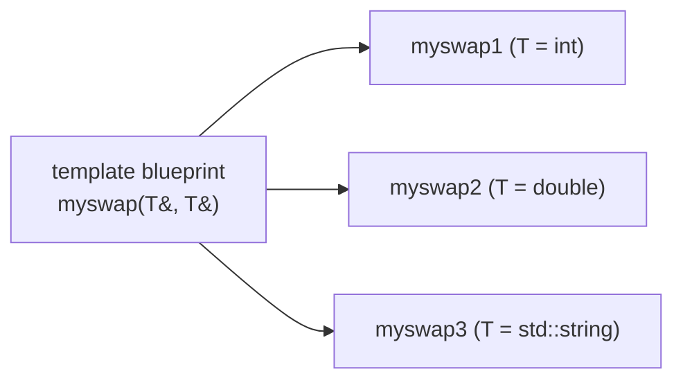

# 信息与计算机科学 46 — 话题：C++ 基础

## 目录

- [1. C++ 引用](#1-c-引用)
- [2. 指针与堆](#2-指针与堆)
- [3. 智能指针与所有权](#3-智能指针与所有权)
- [4. 一维数组](#4-一维数组)
- [5. 多维数组](#5-多维数组)
- [6. 函数模板](#6-函数模板)
- [7. 类模板](#7-类模板)
- [8. 随机性与随机数生成](#8-随机性与随机数生成)
- [9. 使用 Google Test 编写单元测试](#9-使用-google-test-编写单元测试)
- [10. 完整实现](#10-完整实现)
- [11. 速查与五个要点](#11-速查与五个要点)

> 本章汇集数据结构代码所依赖的 C++ 内容：引用与指针（以及管理指针的智能指针）、数组、模板、随机数和单元测试。本章假定读者已了解基础 C++（类、函数、`std::string`、`std::vector`），它是之后每个话题的基础，从 [算法分析](topic-analysis.zh-CN.md) 和 [线性结构](topic-linear.zh-CN.md) 开始。本章所有代码均使用 `g++ -std=c++17 -Wall -Wextra -fsanitize=address,undefined` 编译。

## 1. C++ 引用

### 1.1 引用是别名

**引用**是已存在对象的另一个名字。它**必须初始化**，并且**永远无法重新绑定**到另一个对象。它也称为**左值引用**，在类型上用 `&` 声明：`int& ref = existingVariable;`。与 Python 中的名字不同，`r = j;` 并不会让 `r` 改为指向别处，而是把 `j` 的值复制到 `r` 所引用的对象中。

```cpp
int i = 3;
int& r = i;                       // r now refers to i
std::cout << r << std::endl;      // writes 3
r = 4;                            // a change to r is also a change to i
std::cout << i << std::endl;      // writes 4
i = 5;                            // a change to i is also a change to r
std::cout << r << std::endl;      // writes 5
```

这里只有一个 `int`，它有两个名字。

### 1.2 按值传递与按引用传递

按值传递会让函数拿到一份**副本**；按引用传递则让形参成为调用者实参的**别名**。使用引用有两个原因：它们**允许修改**调用者的对象，并且**避免复制**大型数据（提升性能、节省内存）。

```cpp
void increment(int& x) {
  x++;
  std::cout << x << std::endl;    // prints 4
}

void myswapInt(int& a, int& b) {  // swaps the caller's variables
  int temp = a;
  a = b;
  b = temp;
}

int i = 3;
increment(i);
std::cout << i << std::endl;      // prints 4
```

如果写成 `void increment(int x)`，输出会先是 `4` 再是 `3`；而 `myswapInt` 若去掉 `&`，就只会交换两个副本，什么也不会改变。

> 💡 **关键洞见**：要读取大对象，使用 `const T&`；要修改调用者的对象，使用 `T&`；像 `int` 这样的小类型则按值传递。

### 1.3 按值返回与按引用返回

**默认按值返回**：它是安全的（不会产生悬空引用），由于返回值优化、移动语义和复制省略（C++17 起保证），按值返回的开销很低，而且更简单。**按引用返回**适用于类的取值函数（返回指向内部大型数据的 `const T&`）、运算符重载（`operator[]`、`operator=`、`operator<<`，使调用可以链式书写），以及存活时间超出函数本身的对象。

**关键规则：绝不要返回局部变量的引用。** 函数返回时，局部变量会被销毁，引用随之悬空。

```cpp
// BAD: dangling reference to a local object
int& getBad() { int local = 42; return local; }   // DANGER: destroyed on exit

// GOOD: return by value (optimized by RVO / copy elision)
int getGood() { int val = 42; return val; }
```

调用 `getBad()` 时实际发生的情况：

```text
bad.cpp:2:40: warning: reference to local variable 'local' returned [-Wreturn-local-addr]
bad.cpp:2:40: runtime error: reference binding to null pointer of type 'int'
AddressSanitizer: SEGV on unknown address 0x000000000000
```

> 📘 **延伸阅读**：移动一个 `std::vector` 只是偷走它内部数组的指针、大小和容量（O(1)），而不是复制每个元素（O(n)），这就是按值返回大对象开销很低的原因。`std::move(x)` 只是把 `x` 标记为"可以被偷走资源"；它会与 `unique_ptr` 一起出现，见 [第 3.4 节](#34-unique_ptr-不可复制)。（Thornton, Move Semantics）

## 2. 指针与堆

### 2.1 指针是什么

**指针**保存一个**内存地址**（运行时的值），以及它所指向的**类型**（编译期即已确定）。指针用 `*` 声明：`int* x;`。读声明时从右往左看：`int** q` 读作"指向 int 指针的指针"，`int*& s` 读作"指向 int 指针的引用"。

| | 引用 `int&` | 指针 `int*` |
|---|---|---|
| 能否为空？ | 不能 | 能（`nullptr`） |
| 必须初始化？ | 必须 | 不必（但未初始化的指针是垃圾值） |
| 能否改变所指对象？ | 不能 | 能 |
| 访问对象的方式 | 直接使用名字 | `*p` |

### 2.2 取址、解引用与指针赋值

**取址**运算符 `&`（用在*表达式*中）得到变量的地址；它与*类型*中的 `&`（声明引用）不同。**解引用**运算符 `*` 与之相反：它访问某个地址处的对象（这个名字与引用无关，是更早的 C 语言术语）。指针可以被复制（`int* q = p;` 让两者指向同一个对象），也可以有指向指针的指针（`int** q = &p;`）。

```cpp
int i = 3;
int* p = &i;
std::cout << i << std::endl;   // 3
*p = 4;                        // change i through p
std::cout << i << std::endl;   // 4
int** q = &p;                  // *q is p, **q is i (prints 4)
```

指针使我们能够直接操作内存、动态分配内存，并构造链表、树和图等数据结构。与引用不同，指针可以**重新指向**别处：

```cpp
int x = 10;
int* p = &x;    // p holds the memory address of x
*p = 20;        // changes x to 20 through the pointer
int y = 30;
p = &y;         // now p points to y instead of x
```

之后 `x` 为 20，`*p` 为 30。

> ⚠️ **易错点**：地址不是 `int`。`int* p = i;` 是编译错误（`invalid conversion from 'int' to 'int*'`）；应写作 `int* p = &i;`。

### 2.3 `nullptr`

`nullptr` 表示"不指向任何东西"（例如链表中最后一个节点的 `next`）。对它解引用是**未定义行为**；实践中通常会崩溃。

```cpp
int* p = nullptr;
*p = 3;              // CRASH
```

```text
Segmentation fault            # plain g++, exit code 139
```

在解引用一个可能为空的指针之前，先检查 `if (p != nullptr)`。

### 2.4 栈与堆，以及指针与引用

内存分为两个区域。**栈**存放函数调用和局部变量（自动分配，离开作用域时自动释放）。**堆**存放运行时由 `new` 创建的对象（动态分配，直到 `delete` 才会释放）。**引用是对象的隐式同义词；指针保存的则是对象的位置。**

```cpp
int* p = new int;     // new int: allocate an int on the heap
*p = 3;

int& q = *p;          // q is another name for the heap int
q = 4;

std::cout << *p << std::endl;   // 4

int* r = &q;          // address of the int q names (same as p)
*r = 5;

std::cout << *p << std::endl;   // 5

int*& s = p;          // s is a reference to an int pointer
*s = 6;

std::cout << *p << std::endl;   // 6
```

下面这段程序在内存中的情况：一个堆上的 `int`，四种访问它的方式（虚线箭头表示引用）。可以在下方逐步查看（演示获得焦点后，← / → 键可用）：

```viz memory-trace
{"title": "p、q、r、s", "steps": [{"code": "int* p = new int; *p = 3; int& q = *p; q = 4;", "note": "p points at a heap int; q is another name for it (dashed = reference), so q = 4 writes the int", "stack": [{"frame": "main", "vars": [{"name": "p", "value": "->h1"}, {"name": "q", "value": "->h1", "ref": true}]}], "heap": [{"id": "h1", "type": "int", "fields": [{"name": "value", "value": "4", "old": "3"}]}]}, {"code": "int* r = &q; *r = 5; int*& s = p; *s = 6;", "note": "r holds the same address as p; s is a reference to the pointer p itself", "add_vars": {"main": [{"name": "r", "value": "->h1"}, {"name": "s", "value": "->main.p", "ref": true}]}, "set": {"h1.value": {"value": "6", "old": "4"}}}]}
```

`r == p` 和 `&s == &p` 都成立（[第 10 节](#10-完整实现)中的完整程序会对两者都输出 `true`）。

### 2.5 `new`、`delete`、内存泄漏与悬空指针

`delete p` 删除的是 **`p` 所指向的对象**，而不是 `p` 本身。规则是：**每个 `new` 恰好对应一个 `delete`**。违反这条规则会导致：

| 错误 | 后果 |
|---|---|
| **内存泄漏** | 从未被删除；一旦指向它的最后一个指针消失，该对象便无法访问，却仍占用内存 |
| **悬空指针** | `delete p` 之后，`p` 仍保存着旧地址；继续使用它是未定义行为 |
| **重复释放** | 对同一地址删除两次是未定义行为（参见 [第 2.6 节](#26-练习)中的第二个问题） |

> 📘 **延伸阅读**：每次写 `new` 时，都要问一句："谁来删除它，什么时候删除？"Python 通过垃圾回收器释放堆上的对象；C++ 没有这种机制，这件事要由你来做，或者交给智能指针（[第 3 节](#3-智能指针与所有权)）。（Thornton, Smart Pointers）

### 2.6 练习

#### 用图理解指针与引用

画出下列代码执行时的栈与堆（虚线箭头 = 引用，实线箭头 = 指针），并写出它输出什么：

```cpp
int* a = new int;
*a = 2;

int* b = new int;
*b = 3;

*a = *b;

int& c = *b;
c = 6;

std::cout << *a << std::endl;

int*& d = a;
*d = 9;

std::cout << *a << std::endl;

delete a; delete b;
```

<details>
<summary>解答</summary>

输出 **`3`**，然后是 **`9`**；在 AddressSanitizer 下没有错误。

- `*a = *b` 复制的是**值** 3；`a` 与 `b` 仍然指向两个不同的 `int`。
- `c` 是 `b` 所指 `int` 的名字，所以 `c = 6` 不影响 `a` 所指的 `int`，它仍为 3，因此输出 3。
- `d` 是指针 `a` 的另一个名字，所以 `*d = 9` 写入的是 `a` 所指的 `int`，输出 9。
- 最终的状态：`a` 指向一个值为 9 的 `int`，`b` 指向一个值为 6 的 `int`，`c` 用虚线箭头指向那个 6，`d` 用虚线箭头指向 `a`。共两个对象，每个都恰好被删除一次。

</details>

#### 把 `a = b` 代入同一段代码

把上面程序中的 `*a = *b;` 改成 `a = b;`。它会输出什么？哪里出了问题？

<details>
<summary>解答</summary>

输出 **`6`**，然后是 **`9`**，接着程序崩溃：

- `a = b` 复制的是**地址**：两个指针现在都指向那个值为 3 的 `int`。原来值为 2 的那个 `int` 不再有指针指向它，因此**发生泄漏**。
- `c = 6` 和 `*d = 9` 都写入同一个共享的 `int`，依次得到 6 和 9。
- `delete a; delete b;` 对同一地址删除了两次，即**重复释放**：

```text
6
9
==ERROR: AddressSanitizer: attempting double-free on 0x502000000030 in thread T0
```

`*a = *b` 复制的是所指向的内容；`a = b` 复制的则是指针本身。正是这种别名关系，使智能指针得以避免此类问题。

</details>

## 3. 智能指针与所有权

### 3.1 裸指针的问题，以及三种智能指针

裸指针很危险：对 `nullptr` 解引用是未定义行为；错误的类型转换可能指向任何地方；**同样的语法**既可以指向单个对象，也可以指向数组（`new int` 与 `new int[10]`）；指针还可能**继续指向已经释放的对象**（悬空）。因此应**优先使用栈分配**（离开作用域时自动清理，即使抛出异常也不例外），并且**只在必要时才动态分配**：即大小要到运行时才能确定，或者数据必须比函数存活得更久。

智能指针（`#include <memory>`）是现代的解决方案：指针本身被销毁时，它们会替你删除所管理的对象。

| 指针 | 所有权 | 对象何时被销毁 | 能否复制？ |
|---|---|---|---|
| `std::unique_ptr` | 一对一（独占） | 该指针被销毁时 | 不能；用 `std::move` 转移 |
| `std::shared_ptr` | 多对一（引用计数） | **最后一个**拥有它的指针被销毁时 | 能（计数加 1） |
| `std::weak_ptr` | 无所有权：非拥有的观察者（"借用"） | 从不由它决定；它被销毁时什么也不会发生 | 能 |

`weak_ptr` 用于函数参数和**循环数据结构**。**`.get()`** 从智能指针中取出裸地址。

### 3.2 所有权

**拥有**对象的指针必须保证：在它被销毁时，所指对象也被释放。从所有权的角度思考，可以避免内存泄漏（没人删除）和重复删除（两个指针都去删除）。使用裸指针时，拥有者是一个类，它的析构函数负责删除成员：

```cpp
class A {
public:
  A();
  ~A();

private:
  B* b;
  // other member variables would be here
};

A::A()
    : b{new B}  // other member variable initializers would be here
{
  // other code to be run after the initializers would be here
}

A::~A() {
  // necessary cleanup other than deleting the object pointed to by b
  // would be here

  delete b;
}
```

**如果构造函数在 `new B` 之后抛出异常会怎样？** `A` 的构造没有完成，因此 `~A()` 永远不会运行。成员 `b` 会被销毁，但销毁一个*裸*指针并不会删除 `B`，所以 `B` **泄漏了**。下一节会把智能指针版本并列展示。

### 3.3 `std::unique_ptr`：独占所有权

`unique_ptr` 在**它自身被销毁时，会销毁它所指向的对象**：自动删除是有保证的。所指向的类型写在 `< >` 中。

```cpp
#include <memory>    // needed for smart pointers

void foo() {
  // Creates a unique_ptr called p and points it to a newly allocated int.
  // p holds unique ownership of that int.
  std::unique_ptr<int> p{new int};

  // We can dereference the pointer with the * operator, just as with a raw pointer.
  *p = 3;
  std::cout << *p << std::endl;

  // When p falls out of scope -- either because the function ends normally
  // or because the function threw an exception -- it destroys the int it
  // points to automatically, so there is no need for delete. Similarly, if
  // we re-point p to a new integer later, or point it to null, a deletion
  // is also triggered.
}
```

把类 `A` 改写为 `std::unique_ptr<B> b;` 之后，`~A()` 就不再需要 `delete b`（如果它没有其他工作要做，甚至可以完全省略）。下面是两个版本，构造函数都会抛出异常：

```cpp
struct B {
  B()  { std::cout << "B constructed" << std::endl; }
  ~B() { std::cout << "B destroyed" << std::endl; }
};
class RawA {                     // raw-pointer version
public:
  RawA() : b{new B} { throw std::runtime_error("constructor failed"); }
  ~RawA() { delete b; }
private:
  B* b;
};
class A {                        // unique_ptr version
public:
  A() : b{new B} { throw std::runtime_error("constructor failed"); }
private:
  std::unique_ptr<B> b;
};
```

在 `try` 块中分别构造它们并捕获异常，输出如下：

```text
B constructed
RawA: constructor failed          <- no "B destroyed": leaked
B constructed
B destroyed
A: constructor failed
==ERROR: LeakSanitizer: detected memory leaks   (1 byte: RawA's B)
```

> 📘 **延伸阅读**：这就是 **RAII**：在构造函数中获取资源，在析构函数中释放资源。局部对象的析构函数总会运行，无论是正常返回还是异常传播时。现代代码通常会写 `auto p = std::make_unique<int>(3);`（以及 `std::make_shared`），而不是直接写裸 `new`。（Thornton, Smart Pointers）

### 3.4 `unique_ptr` 不可复制

**复制 `unique_ptr` 是不安全的，因此不允许复制。** 按值传递时会发生以下情况：

```cpp
void foo(std::unique_ptr<int> q) {
  *q = 4;
}

void bar() {
  std::unique_ptr<int> p{new int};
  *p = 3;
  foo(p);
  std::cout << *p << std::endl;
}
```

这段代码**无法通过编译**：`error: use of deleted function 'std::unique_ptr<...>::unique_ptr(const std::unique_ptr<...>&)'`。如果允许编译，`p` 和 `q` 就会同时"拥有"那个 `int`；`foo` 返回时，`q` 会删除它，而 `p` 则会变成悬空指针，并再次删除它。

所有权只能通过 `std::move` 转移：

```cpp
std::unique_ptr<int> p(new int);
*p = 3;                  // * and -> work like a raw pointer
// std::unique_ptr<int> q = p;          // error: copy is deleted
std::unique_ptr<int> q = std::move(p);  // OK: q owns it, p is now nullptr
```

与其按值传递拥有者，不如写成下面几种形式之一：

```cpp
void borrow(int& x) { x = 4; }                          // just use the int
void borrowOwner(std::unique_ptr<int>& q) { *q = 5; }   // use the caller's owner
void take(std::unique_ptr<int> q) { *q += 1; }          // take ownership

borrow(*p);          // p still owns the int
borrowOwner(p);      // p still owns the int
take(std::move(p));  // ownership moves into q; afterwards p == nullptr
```

### 3.5 `std::shared_ptr`：引用计数

在共享所有权下，对象只要**至少还有一个** `shared_ptr` 指向它就会存活，并在**最后一个**指向它的 `shared_ptr` 离开时被销毁。它的工作方式是对指针进行**计数**，而且 `shared_ptr` **可以安全地复制**：每复制一次，计数就加 1。

```cpp
void foo() {
  std::shared_ptr<int> p1{new int};     // p1 points to a new integer
  std::shared_ptr<int> p2 = p1;         // p2 points to the same integer
  *p1 = 4;                              // 4 is stored in that integer
  std::cout << *p2 << std::endl;        // prints 4
  p1 = nullptr;                         // p1 no longer points to the integer, but p2 still does
}                                       // when the function ends, the integer is destroyed
```

| 执行到此行之后 | `use_count` |
|---|---|
| `p1{new int}` | 1 |
| `p2 = p1` | 2 |
| `p1 = nullptr` | 1 |
| `}`（p2 被销毁） | 0，因此 int 被删除 |

> ⚠️ **易错点**：`shared_ptr` 并不等同于垃圾回收。Python 也有循环垃圾回收器，而 `shared_ptr` **没有**。`shared_ptr` 构成的**环**（父对象拥有子对象，子对象又拥有父对象）的计数永远不会降到 0，于是发生泄漏，下一节会演示这一点。

### 3.6 循环引用问题与 `std::weak_ptr`

即使是共享所有权也可能泄漏：

```cpp
#include <iostream>
#include <memory>

struct Child;  // forward declaration

struct Parent {
  std::shared_ptr<Child> child;
  ~Parent() { std::cout << "Parent destroyed\n"; }
};

struct Child {
  std::shared_ptr<Parent> parent;
  ~Child() { std::cout << "Child destroyed\n"; }
};

int main() {
  std::shared_ptr<Parent> p(new Parent());
  std::shared_ptr<Child>  c(new Child());

  p->child = c;    // Parent owns Child
  c->parent = p;   // Child owns Parent

  // Neither Parent nor Child is destroyed here because
  // they keep each other alive (circular reference).
  return 0;
}
```

内存中的环形引用。可以在下方逐步查看（演示获得焦点后，← / → 键可用）：

```viz memory-trace
{"title": "shared_ptr 循环引用", "steps": [{"code": "shared_ptr<Parent> p(new Parent()); shared_ptr<Child> c(new Child());", "stack": [{"frame": "main", "vars": [{"name": "p", "value": "->P"}, {"name": "c", "value": "->C"}]}], "heap": [{"id": "P", "type": "Parent", "fields": [{"name": "child", "value": "nullptr"}, {"name": "use_count", "value": "1"}]}, {"id": "C", "type": "Child", "fields": [{"name": "parent", "value": "nullptr"}, {"name": "use_count", "value": "1"}]}]}, {"code": "p->child = c;  c->parent = p;", "note": "each object now has two owners: a local and the other object", "set": {"P.child": {"value": "->C", "old": "nullptr"}, "C.parent": {"value": "->P", "old": "nullptr"}, "P.use_count": {"value": "2", "old": "1"}, "C.use_count": {"value": "2", "old": "1"}}}, {"code": "} // end of scope: p and c destroyed", "note": "counts drop to 1, not 0 — the two objects keep each other alive and nothing outside can reach them: leaked, no destructor runs", "pop_frame": true, "set": {"P.use_count": {"value": "1", "old": "2"}, "C.use_count": {"value": "1", "old": "2"}}}]}
```

两个析构函数都不会输出任何信息。两次赋值之后，两个对象的使用计数都是 2。若把代码放在辅助函数中运行，并用 `-O1` 编译，LeakSanitizer 会报告 `80 byte(s) leaked in 4 allocation(s)`：两个对象加两个控制块。

**修正方法**：让回指指针变为非拥有的指针。`weak_ptr` 指向由 `shared_ptr` 管理的对象，但**不增加**其计数。

```cpp
struct Child {
  std::weak_ptr<Parent> parent;          // FIX: observer, not owner
  ~Child() { std::cout << "Child destroyed\n"; }
};
// to use it:  if (std::shared_ptr<Parent> pp = c->parent.lock()) { ... }
```

```text
Parent count 1, Child count 2
child can still reach its parent
Parent destroyed
Child destroyed
```

当 `p` 被销毁时，Parent 的计数降为 0，Parent 随之被销毁；这会销毁它的 `child` 成员，于是 Child 的计数也降为 0。

### 3.7 借用与拥有：准则

**并非所有指针都意味着所有权**：对象可以被**借用**，而借用者无需承担对它的责任。

| 用法 | 含义 | 适用场景 |
|---|---|---|
| `A&` / `const A&` | 引用：**保证对象存在**（不会为空）；`const` 禁止修改 | 借用者总是需要一个对象 |
| `A*` | 裸指针：按约定**明确表示不拥有**；**可以不存在**（可能为 `nullptr`） | 对象可能不存在 |
| `std::weak_ptr<A>` | 智能的非拥有指针；与 `shared_ptr` 配对使用 | 共享结构中的回指 |

一个实际例子：树节点用 `shared_ptr` 持有它的**子节点**，用 `weak_ptr` 指向它的**父节点**，这正是上一节的修正方案。

裸指针与智能指针并用时的经验法则：

- **拥有者**：智能指针控制资源的生命周期。
- **观察者**：裸指针可以查看（读取、写入、检查）对象，但**不负责销毁它**。
- **`.get()`** 交出一个临时的、非拥有的裸指针，**但不放弃所有权**。

```cpp
root->left->parent = root.get();   // parent observes root; root still owns it
```

| 带父链接的树的可行设计 | 何时使用 |
|---|---|
| 向下用 `shared_ptr`，向上用 `weak_ptr` | 生命周期共享或不可预测，需要打破环；观察者可以检查对象是否已经不存在（`lock()`、`expired()`） |
| 向下用 `unique_ptr`，向上用裸 `Node*`（通过 `.get()` 获得） | 更快（没有计数）；**仅当拥有者比观察者活得更久时才安全**，而在树中这一点成立，因为父节点的析构函数会销毁它的子节点 |

> 📘 **延伸阅读**："把这个对象借给函数"时，优先使用引用（`const Node&`），因为它不可能为空；只有当 `nullptr` 是合法实参时才使用裸指针；只有当借用者可能比拥有者活得更久时，才使用 `weak_ptr`。（Thornton, Smart Pointers）

### 3.8 带父链接的树：四种设计

从一个裸指针版本的 `Node` 开始，它有 `left`、`right` 和 `parent` 三个成员；创建三个 `new Node()`，让父节点与子节点互相链接，再手动 `delete` 三次。手动清理很脆弱：每一次 `delete` 都必须手写。下面四种设计都经过了编译：

| 设计 | `left` / `right` | `parent` | 能否编译？ | 结果 |
|---|---|---|---|---|
| 裸指针 | `Node*` | `Node*` | 能 | 只有手写每一次 `delete` 才正确；执行 `delete root` 之后，子节点的 `parent` 指针会悬空 |
| 朴素的 unique | `unique_ptr` | `unique_ptr` | **不能** | `root->left = leftChild;` 会复制一个 `unique_ptr`："use of deleted function … `operator=`" |
| 向下 shared，向上 weak | `shared_ptr` | `weak_ptr` | 能 | 三个析构函数都会运行，没有泄漏 |
| 全部 shared（反例） | `shared_ptr` | `shared_ptr` | 能 | **泄漏**：没有任何析构函数运行（AddressSanitizer：6 次分配共 216 字节） |
| 向下 unique，向上裸指针 | `unique_ptr` | 裸 `Node*` | 能 | 三个析构函数都会运行，没有泄漏，也没有计数开销 |

最后一种设计：

```cpp
class Node {
public:
  Node() { std::cout << "Node created\n"; }
  ~Node() { std::cout << "Node destroyed\n"; }

  std::unique_ptr<Node> left;       // downward links own their children
  std::unique_ptr<Node> right;
  Node* parent = nullptr;           // upward link only observes
};

{
  // 1. Initialize nodes as unique pointers
  std::unique_ptr<Node> root(new Node());
  std::unique_ptr<Node> leftChild(new Node());
  std::unique_ptr<Node> rightChild(new Node());

  // 2. Transfer ownership downward using std::move
  root->left = std::move(leftChild);
  root->right = std::move(rightChild);

  // 3. Set upward back-pointers using the raw address (.get())
  root->left->parent = root.get();
  root->right->parent = root.get();
} // all 3 nodes are destroyed here automatically
```

在内存中：拥有关系的 `unique_ptr` 指向下方，裸 `parent` 指针指向上方，而被移走的局部变量为 `nullptr`。可以在下方逐步查看（演示获得焦点后，← / → 键可用）：

```viz memory-trace
{"title": "unique_ptr 向下，裸指针向上", "steps": [{"code": "root->left = std::move(leftChild); ... root->left->parent = root.get(); ...", "note": "each Node has exactly one owner; the moved-from locals are nullptr; parent links only observe", "stack": [{"frame": "main", "vars": [{"name": "root (unique_ptr)", "value": "->n0"}, {"name": "leftChild (unique_ptr)", "value": "nullptr", "old_target": "n1"}, {"name": "rightChild (unique_ptr)", "value": "nullptr", "old_target": "n2"}]}], "heap": [{"id": "n0", "type": "Node (root)", "fields": [{"name": "left (unique_ptr)", "value": "->n1"}, {"name": "right (unique_ptr)", "value": "->n2"}, {"name": "parent (Node*)", "value": "nullptr"}]}, {"id": "n1", "type": "Node (left child)", "fields": [{"name": "left (unique_ptr)", "value": "nullptr"}, {"name": "right (unique_ptr)", "value": "nullptr"}, {"name": "parent (Node*)", "value": "->n0"}]}, {"id": "n2", "type": "Node (right child)", "fields": [{"name": "left (unique_ptr)", "value": "nullptr"}, {"name": "right (unique_ptr)", "value": "nullptr"}, {"name": "parent (Node*)", "value": "->n0"}]}]}, {"code": "}   // end of block", "note": "root dies -> deletes n0 -> n0's left/right die -> delete n1 and n2. No leak, no double delete", "free": ["n0", "n1", "n2"], "set": {"main.root (unique_ptr)": {"value": "nullptr", "old_target": "n0"}}}]}
```

输出（[第 10 节](#10-完整实现)中的完整程序还会输出移动之后 `leftChild` 是否为空）：

```text
Node created
Node created
Node created
leftChild is now null: true
Node destroyed
Node destroyed
Node destroyed
End of main.
```

> ⚠️ **易错点**：执行 `std::move(leftChild)` 之后，`leftChild` 为 `nullptr`。因此这种设计写的是 `root->left->parent`，而不是 `leftChild->parent`；如果使用 `shared_ptr`，原来的局部变量仍然有效，也可以使用。

### 3.9 练习

#### 共享所有权与环

考虑 [第 3.6 节](#36-循环引用问题与-stdweak_ptr)中的 `Parent`/`Child` 程序，其中每个对象都持有指向对方的 `shared_ptr`。(a) `main` 结束时，父对象和子对象会发生什么？(b) 为什么？(c) 应如何修正？

<details>
<summary>解答</summary>

(a) 两者都不会被销毁：没有析构函数的输出，两个对象都发生了泄漏。

(b) 每个对象都有两个拥有者（一个局部变量和另一个对象）。`p` 和 `c` 被销毁时，每个计数只降到 1，而不是 0：这是一个**引用环**，`shared_ptr` 无法检测到它。

(c) 把 `Child` 的成员改为 `std::weak_ptr<Parent> parent;`。Parent 的计数保持为 1，因此两个对象都会被销毁（输出 `Parent destroyed` 和 `Child destroyed`）。要访问父对象，使用 `lock()`。

</details>

#### 把裸指针树改写为智能指针

起始代码（裸指针树）：

```cpp
#include <iostream>

class Node {
public:
  Node() { std::cout << "Node created\n"; }
  ~Node() { std::cout << "Node destroyed\n"; }

  // Member pointers initialized safely to nullptr
  Node* left = nullptr;
  Node* right = nullptr;
  Node* parent = nullptr;
};

int main() {
  {
    std::cout << "--- Initializing Tree Elements ---\n";
    Node* root = new Node();
    Node* leftChild = new Node();
    Node* rightChild = new Node();

    // Linking parent-to-child and child-to-parent
    root->left = leftChild;
    root->right = rightChild;

    root->left->parent = root;
    root->right->parent = root;

    std::cout << "--- Tearing Down Tree Elements ---\n";
    // Manual cleanup is fragile: every delete must be written by hand
    delete root;
    delete leftChild;
    delete rightChild;
  }

  std::cout << "End of main.\n";
  return 0;
}
```

**(a)** 把裸指针改写为 unique 指针。
**(b)** 尝试编译时会发生什么？为什么？
**(c)** 根据需要修改智能指针的类型，使程序没有内存泄漏。
**(d)** 为了性能，改为只使用 `unique_ptr` 和裸指针。

<details>
<summary>解答</summary>

**(a)** 把每个 `Node*`（成员和局部变量）都改为 `std::unique_ptr<Node>`，并去掉所有 `delete`。

**(b)** 编译错误：`root->left = leftChild;`、`root->right = rightChild;` 和 `root->left->parent = root;` 都会**复制**一个 `unique_ptr`，而它的复制赋值运算符已被删除（两个独占的拥有者会对同一个 Node 删除两次）。父链接本身也是设计错误：子节点不应拥有它的父节点。

**(c)** 拥有关系向下，观察关系向上：`left` 和 `right`（以及局部变量）改为 `std::shared_ptr<Node>`，`parent` 改为 `std::weak_ptr<Node>`。`weak_ptr` 不计数，因此 root 的计数会在代码块结束时降为 0，三个 Node 全部被销毁。如果把 `parent` 也改为 `shared_ptr`，这个环会导致三个 Node 全部泄漏。

**(d)** 向下使用 `unique_ptr`，向上使用裸指针：

```cpp
root->left = std::move(leftChild);
root->right = std::move(rightChild);
root->left->parent = root.get();
root->right->parent = root.get();
```

这样做更快（没有引用计数），并且是安全的，因为父节点总是比它的子节点活得更久。

</details>

## 4. 一维数组

### 4.1 静态分配与动态分配

数组是同一类型的一段连续单元，从 0 开始编号，大小固定，并且需要你自己记录大小。

| | 静态分配 | 动态分配 |
|---|---|---|
| 语法 | `int a[10];` | `int* a = new int[size];` |
| 大小何时已知 | 编译期 | 运行时 |
| 存放位置 | 运行时栈 | 堆；`new` 返回指向第一个元素的指针 |
| 清理 | 自动 | `delete[] a;` |

`void foo(unsigned int n) { int a[n]; }` 是**变长数组**。某些编译器能接受它，但它**不是标准 C++**（使用 g++ 的 `-pedantic` 时会出现 `warning: ISO C++ forbids variable length array 'a' [-Wvla]`），而且 `n` 很大时可能耗尽栈空间。

### 4.2 传递数组

无论以何种方式分配，数组都可以作为参数传递：传入**指向第一个元素的指针**和**大小**，这样函数就能自行做边界检查。

```cpp
void zeroArray(int* a, unsigned int size) {
  for (unsigned int i = 0; i < size; ++i) {
    a[i] = 0;
  }
}
```

```cpp
int x[10];
zeroArray(x, 10);

int* y = new int[10];
zeroArray(y, 10);
delete[] y;
```

> ⚠️ **易错点**：大小只是一个 C++ 会直接信任的数字。无论对哪个数组调用 `zeroArray(x, 50)`，编译都不会有警告，而它会越过末尾写入 40 个 int。AddressSanitizer 能同时捕获两种情况：静态数组报 `stack-buffer-overflow … in zeroArray(int*, unsigned int)`，动态数组报 `heap-buffer-overflow … 0 bytes after 40-byte region … in zeroArray(int*, unsigned int)`。

### 4.3 指针算术

- `p + k` 会把地址增加 `k * sizeof(type)` 个字节。
- `a + 1` 是 `a[1]` 的地址，所以 `*(a + 1) == a[1]` 且 `a + 1 == &a[1]`。
- 对于指向**同一**数组的两个指针，`q - p` 等于它们地址之差除以类型大小。
- 超出数组范围的指针行为**未定义**：`a - 1`（即 "`a[-1]`"）可以编译，但不能使用；而对分别指向两个不同数组的指针做减法则没有意义。

```cpp
int a[10];
*(a + 1) = 3;
std::cout << (char*)(a + 1) - (char*)a;   // 4 bytes
std::cout << a[1];                        // 3
std::cout << &a[7] - a;                   // 7 elements
```

当 `sizeof(int) = 4` 时，第一行输出 4 个字节，第二行输出 3，第三行输出 7 个元素。

对于 `int x[10];`（`x` 会退化为指向 `&x[0]` 的 `int*`）：

| 视角 | 公式 |
|---|---|
| 指针地址 | `&x[i] == x + i`（自动按类型大小缩放） |
| 字节地址 | `Base + (i × sizeof(int))` |
| 值 | `x[i] == *(x + i)` |

它只需一次乘法和一次加法，因此**每次下标访问的代价都是相同的常数时间**。

### 4.4 `std::vector`

`std::vector` 是一个**采用 RAII 管理**的动态一维数组（它在析构函数中释放内部数组，因此不会泄漏），而 **`at()`** 相当于 `[ ]` **加上范围检查**。

```cpp
std::vector<int> v;
for (unsigned int i = 0; i < 10; i++) {
  v.push_back(i);
}
for (unsigned int i = 0; i < 10; i++) {
  v.at(i) += 10;
  std::cout << v.at(i) << " ";
}
v.at(10) = 1;                 // throws std::out_of_range
```

```text
10 11 12 13 14 15 16 17 18 19
v.at(10) threw std::out_of_range
```

`v[10] = 1` 则会是悄无声息的未定义行为。（Thornton, Single-Dimension Arrays）

## 5. 多维数组

### 5.1 声明与存储 n 维数组

为每个维度声明一个**编译期固定的大小**；每个维度*代表什么*（行还是列）由你决定。在内存中，数组会被**展平为一行**，按**行主序**存放：最右边的下标变化最快，因此第一个下标相同的元素是连续存放的。

```cpp
int a[4][5];

for (int i = 0; i < 4; ++i) {
  for (int j = 0; j < 5; ++j) {
    a[i][j] = i * j;
  }
}
```

`int a[4][5]` 的布局：按内存顺序列出每个元素，并标出 `a[2][3]` 的位置。可以在下方逐步查看（演示获得焦点后，← / → 键可用）：

```viz array-2d
{"title": "按行主序排列的 int a[4][5]", "dims": [4, 5], "find": [2, 3]}
```

把整个块直接当作 `int*` 来读取，会逐行输出这些值：

```text
flat: 0 0 0 0 0 0 1 2 3 4 0 2 4 6 8 0 3 6 9 12
```

### 5.2 下标：地址公式

对于 `int a[4][5];`，`a` 会退化为指向整行的指针（`int(*)[5]`），因此 `a + i` 会跨过 `i` 行，每行 5 个 int：

| 视角 | 公式 |
|---|---|
| 元素地址 | `&a[i][j] == *(a + i) + j == (int*)a + (i × 5 + j)` |
| 字节地址 | `Base + (i × 5 + j) × sizeof(int)` |
| 元素值 | `a[i][j] == *(*(a + i) + j) == *((int*)a + (i × 5 + j))` |

具体例子，`i = 2, j = 3`（真实输出）：

```text
a[2][3] = 6, *(*(a + i) + j) = 6, *((int*)a + (i * 5 + j)) = 6
byte offset of a[2][3] = 52 = (2*5+3)*4
sizeof(a) = 80, sizeof(a[0]) = 20, (char*)(a + 1) - (char*)a = 20
```

**N 维规则**：地址计算需要用到**所有内层维度**的大小，也就是除最左边一维之外的全部维度。`i × 5 + j` 中出现了 5；4 从未出现。

> 📘 **延伸阅读**：这条规则解释了为什么二维数组形参必须在类型中写出内层大小：`void fill(int a[][5], int rows)` 可以编译，但 `void fill(int* a, int rows, int cols)` 若在函数体中使用 `a[i][j]` 则不能。（Thornton, Multidimensional Data）

### 5.3 练习

#### 三维数组的布局与公式

给定 `int a[3][2][4];`：
**(a)** 画出这个三维数组在内存中连续的一维布局。
**(b)** 访问 `a[i][j][k]` 的指针算术公式是什么？

<details>
<summary>解答</summary>

**(a)** 共 24 个 int 放在一个连续块中；`k` 变化最快，其次是 `j`，最后是 `i`。每个 `a[i]` 占 8 个 int，每个 `a[i][j]` 占 4 个 int：

| 线性位置 | 0–3 | 4–7 | 8–11 | 12–15 | 16–19 | 20–23 |
|---|---|---|---|---|---|---|
| 元素 | `a[0][0][0..3]` | `a[0][1][0..3]` | `a[1][0][0..3]` | `a[1][1][0..3]` | `a[2][0][0..3]` | `a[2][1][0..3]` |

```viz array-2d
{"title": "按行主序排列的 int a[3][2][4]", "dims": [3, 2, 4], "find": [1, 1, 2]}
```

**(b)** `&a[i][j][k] == (int*)a + (i * 2 * 4 + j * 4 + k)`，因此 `a[i][j][k] == *((int*)a + (i * 8 + j * 4 + k))`（也等于 `*(*(*(a + i) + j) + k)`）；字节地址为 `Base + (i × 8 + j × 4 + k) × sizeof(int)`。公式中只出现了内层两个大小 2 和 4。编译后的程序对全部 24 个单元做了检查：`3D formula correct for all 24 cells? true`。

</details>

## 6. 函数模板

### 6.1 为什么需要模板

C++ 有**静态类型系统**：每个变量的类型在编译期就已确定。因此交换两个 `int` 的函数无法用来交换两个 `double`；要处理不同的形参类型，最后只能写出几乎相同的多个版本：

```cpp
void myswap(int& a, int& b) noexcept {
  int temp = a;
  a = b;
  b = temp;
}
```

```cpp
void myswap(double& a, double& b) noexcept {
  double temp = a;
  a = b;
  b = temp;
}
```

由于 C++ 允许**重载**（同名、形参类型不同），这些版本可以共存，每种类型各写一个，甚至可以写出一百个。但函数体除了类型名之外完全相同，而且每一次错误修正都得在 N 个地方重复进行。

**模板**解决了这个问题。它是一份**可以生成无穷多种实例的蓝图**：你只需写一次代码，并说明*各个实例之间有何不同*（这里只有类型不同）。编译器会在需要时为每个具体类型生成对应的版本。



模板主要有两类：**函数模板**，即函数的蓝图（本节），以及**类模板**，即类的蓝图（[第 7 节](#7-类模板)）；数据结构是后者最主要的用途。

> 💡 **关键洞见**：模板本身既不是函数也不是类。它是编译器用来*生成*函数或类的配方，每组模板实参生成一个对应的函数或类。

### 6.2 语法

共四个步骤：

1. 以关键字 **`template`** 开头。
2. 把模板形参放在 **`< >`** 中。
3. 写上 **`typename`**，后面跟类型形参的名字（习惯上用 `T`）。
4. 像往常一样编写函数定义，在类型会变化的地方使用 `T`。

```cpp
template <typename T>
void myswap(T& t1, T& t2) {
  T temp = t1;
  t1 = t2;
  t2 = temp;
}
```

- 这是可用于生成任意多个 `myswap` 函数的**蓝图**。
- 关键字 **`typename`** 表示该形参是一个**类型占位符**（而不是比如 `int` 常量）。
- **`T`** 是该类型的名字；在实例化时，每个 `T` 都会被替换为**实际类型**。

### 6.3 模板形参的种类

| 种类 | 示例 | 含义 |
|---|---|---|
| **类型形参** | `typename T`、`class T` | 代表一个类型；*实参*是某个类型，如 `int` 或 `std::string` |
| **非类型形参** | 整数常量、指针、引用 | 代表一个编译期*值*，例如 `template <typename T, int N>` |
| **模板模板形参** | 一个模板 | 形参本身就是模板（例如"某个容器模板"） |

在 `< >` 内，`typename T` 与 `class T` 的含义完全相同（这里的 `class` 并不要求 `T` 必须是类；`int` 也可以）。非类型形参的例子：

```cpp
template <typename T, int N>
T sumFirst(const std::vector<T>& v) {
  T total{};
  for (int i = 0; i < N && i < static_cast<int>(v.size()); ++i) total += v[i];
  return total;
}
// sumFirst<int, 3>(std::vector<int>{1, 2, 3, 4, 5}) == 6
```

`N` 必须在编译期已知；`sumFirst<int, 3>` 与 `sumFirst<int, 4>` 是两个不同的生成函数。

### 6.4 为什么模板去掉了 `noexcept`

上面的 `int` 和 `double` 版本都是 `noexcept` 的，但模板版本不是。这是有意为之：交换 `int` 永远不会抛出异常，而交换 `std::string` 需要复制字符串，复制字符串可能分配内存，进而抛出异常。单个模板无法对所有 `T` 都承诺"永不抛出"。（Thornton）

> 📘 **延伸阅读**：`noexcept` 是一个承诺，而不是检查：如果 `noexcept` 函数真的抛出了异常，程序会调用 `std::terminate()`。模板可以让这个承诺依赖于 `T`：即 `noexcept(expr)`，其中 `expr` 是编译期的 `bool`。内层的 `noexcept(...)` *运算符*可以在不实际运行表达式的情况下，询问"这个表达式是否被声明为不抛出异常"：
>
> ```cpp
> template <typename T>
> void myswap(T& t1, T& t2)
>     noexcept(noexcept(T{t1}) && noexcept(t1 = t2))
> ```
>
> 或者，更易读的写法（需要 `#include <type_traits>`）：
>
> ```cpp
> template <typename T>
> void myswap(T& t1, T& t2)
>     noexcept(std::is_nothrow_copy_constructible_v<T> &&
>              std::is_nothrow_copy_assignable_v<T>)
> ```
>
> 对此做编译验证：`noexcept(myswap(i, j))` 对 `int` 为 `true`，对 `std::string` 为 `false`。（若只写单个实参的 `std::is_nothrow_assignable_v<T>` 则是错误的：该类型特征需要两个类型，应使用 `is_nothrow_copy_assignable_v<T>`。）标准容器等库代码关心这一点，是因为当编译器知道移动和复制不会抛出异常时，某些操作可以变得更快。

### 6.5 编译期实例化

函数模板在**被使用**之前不会生成任何东西。编译器遇到调用时会执行三个步骤：

| 步骤 | 名称 | 编译器做的事 |
|---|---|---|
| 1 | **遇到调用** | 在模板调用处，检查它是否能识别出该函数模板。 |
| 2 | **类型推导** | 尝试根据实参类型自动推导模板形参的类型。 |
| 3 | **实例化** | 为推导出的类型生成一个实际的具体函数定义。 |

以代码展示这三部分。**调用处**：

```cpp
void foo() {
  int i = 3;
  int j = 4;
  myswap(i, j);
}
```

**模板**即 [第 6.2 节](#62-语法)中的 `myswap` 蓝图。当 `T = int` 时，编译器**实例化**出的内容为：

```cpp
void myswap(int& t1, int& t2) {
  int temp = t1;
  t1 = t2;
  t2 = temp;
}
```

两个实参都是 `int`，因此 `T&` 必须是 `int&`，即 `T = int`。生成的函数是程序中一个真实的函数，名为 `myswap<int>`。之后若以两个 `double` 调用 `myswap`，会再生成第二个函数 `myswap<double>`；再次以 `int` 调用时，则复用 `myswap<int>`。

下面是这次调用在内存中的情况。`t1` 和 `t2` 是引用（虚线箭头），因此通过它们的写入会落到 `foo` 的变量上。可以在下方逐步查看（演示获得焦点后，← / → 键可用）：

```viz memory-trace
{"title": "myswap<int>(i, j) 的调用", "steps": [{"code": "myswap(i, j);  // enter myswap<int>", "note": "t1 and t2 are references: aliases of foo's i and j, not copies", "stack": [{"frame": "myswap<int>", "vars": [{"name": "t1", "value": "->foo.i", "ref": true}, {"name": "t2", "value": "->foo.j", "ref": true}]}, {"frame": "foo", "vars": [{"name": "i", "value": "3"}, {"name": "j", "value": "4"}]}], "heap": []}, {"code": "T temp = t1;", "note": "copy constructor: temp is a new int initialised from i", "add_vars": {"myswap<int>": [{"name": "temp", "value": "3"}]}}, {"code": "t1 = t2;", "note": "copy assignment through the alias writes foo's i", "set": {"foo.i": {"value": "4", "old": "3"}}}, {"code": "t2 = temp;", "note": "copy assignment writes foo's j; temp is destroyed when myswap returns", "set": {"foo.j": {"value": "3", "old": "4"}}}]}
```

该跟踪对 `T` 执行的三种操作（复制构造 `temp`、两次复制赋值、销毁 `temp`），正是 [第 6.8 节](#68-类型形参的隐含约束)所列的要求。

### 6.6 推导失败的情况

若编译器无法确定精确的类型，第 2 步**就会失败**：要么两个实参的推导结果**相互冲突**，要么**完全没有提示**。混合类型的情况：

```cpp
int i = 3; double d = 4.0;
myswap(i, d);
```

```text
error: no matching function for call to 'myswap(int&, double&)'
note:   deduced conflicting types for parameter 'T' ('int' and 'double')
```

从第一个实参看 `T` 应为 `int`，从第二个看应为 `double`；编译器不会替你选择其中之一。（对于 `myswap` 没有修正办法，因为 `int&` 无法绑定到 `double` 上。对于按值传递或 `const T&` 形式的函数，例如下面的 `myMin`，则可以像下面这样自行指定类型。）

你始终可以**显式**给出模板实参：

```cpp
myswap<int>(i, j);   // legal, but unnecessary here: deduction already gets int
```

当没有任何东西可供推导时（例如 `T` 只出现在返回类型中），必须显式给出实参；当存在可以进行转换的情况时，显式实参也能消除冲突：`myMin<double>(3, 4.5)` 可以编译，并返回 3（`int` 3 被转换为 `double`）。

> ⚠️ **易错点**：推导**不会**应用通常的类型转换。即使 `int` 到 `double` 是常规转换，`myMin(3, 4.5)` 也是编译错误；`myMin<double>(3, 4.5)` 则没有问题。

> 📘 **延伸阅读**：若两个 `.cpp` 文件都调用了 `myswap<int>`，每个文件都会生成自己的一份。通常同一函数的两个定义会导致链接错误，但链接器要求接受重复的模板实例化，并只保留一份。这正是下一节"把它放进头文件"这条规则得以成立的原因。

### 6.7 模板代码放在哪里（.hpp 与 .tpp）

**实例化要求**：**完整的模板定义**（包括函数体，而不只是声明）必须在**模板被使用的每个地方都可见**，这样编译器才能在该处生成具体化的函数。因此模板代码要放在头文件中。有两种做法。

**方案一：单一头文件（`.hpp`）。** 声明与定义写在一起；适用于较小的工具函数和结构简单的模板。

```cpp
// myswap.hpp
#pragma once

template <typename T>
void myswap(T& t1, T& t2) {
  T temp = t1;
  t1 = t2;
  t2 = temp;
}
```

**方案二：头文件与实现分离（`.hpp` + `.tpp`）。** 接口放在 `.hpp` 中，实现放在 `.tpp` 中，`.hpp` 在**末尾** `#include` `.tpp`，因此任何包含该头文件的人仍能得到完整的定义：

```cpp
// myswap.hpp (header and interface)
#pragma once

// 1. Only the declaration is visible first
template <typename T>
void myswap(T& t1, T& t2);

// 2. The implementation is included at the bottom
#include "myswap.tpp"
```

```cpp
// myswap.tpp (template implementation, not compiled on its own)
template <typename T>
void myswap(T& t1, T& t2) {
  T temp = t1;
  t1 = t2;
  t2 = temp;
}
```

`.tpp` **不**单独编译，也不应被列为源文件；它其实是伪装成头文件的东西。（`.tpp` 只是命名习惯，编译器并不关心扩展名。）包含 `myswap.hpp` 并以两个 `int`、`myswap<double>` 以及两个 `std::string` 调用 `myswap`，都能按预期工作（[第 10 节](#10-完整实现)中的程序会输出 `4 3`、`2.5 1.5`、`banana apple`）。

> ⚠️ **易错点**：习惯上的做法"声明放在 `.hpp`，定义放在 `.cpp`"**对模板不适用**。只看到声明的 `.cpp` 可以正常编译，并假定 `myswap<int>` 的定义在别处；但保存函数体的那个 `.cpp` 从未见过以 `int` 进行的调用，因此也从未生成它。结果就是**链接错误**：`undefined reference to 'void myswap<int>(int&, int&)'`。

> 📘 **延伸阅读**：更快的 `myswap` 会使用移动而不是复制：`T temp = std::move(t1); t1 = std::move(t2); t2 = std::move(temp);`（`std::move` 位于 `<utility>` 中）。这使 `T` 可以*移动*其内容（例如偷走字符串的缓冲区），而不是复制它们，对于大对象开销更小；对于 `int` 则没有区别。此时的要求变为移动构造和移动赋值，当某类型没有移动操作时则回退为复制。`std::string` 的移动不会抛出异常，因此该版本的条件 `noexcept` 对字符串为 `true`。

### 6.8 类型形参的隐含约束

`T` 可以是任何类型吗？

- **`T` 必须是具体类型**：基本类型（`int`），或是**已完全指定的模板类型**，例如 `std::vector<int>`（而不是裸的 `std::vector`，后者是模板，不是类型）。
- **`T` 受隐含限制**，其限制取决于**模板对它执行的操作**。`template <typename T>` 中并没有写"T 必须可复制"；这一要求写在函数体里。

**`myswap` 所需的操作**：

| 编号 | 操作 | 在 `myswap` 中的位置 |
|---|---|---|
| 1 | **复制构造函数** | `T temp = t1;` |
| 2 | **复制赋值运算符** | `t1 = t2;` 和 `t2 = temp;` |
| 3 | **析构函数** | `temp` 是局部（自动存储期、位于栈上）变量，因此函数结束时会自动运行其析构函数 |

缺少其中任何一项的类型都不能用于 `myswap`。例如，一个删除了复制构造函数和复制赋值的类：

```cpp
class X {
public:
  X();
  X(const X& x) = delete;
  X& operator=(const X& x) = delete;
};

X a, b;
myswap(a, b);   // compile error
```

```text
myswap.tpp:4:5: error: use of deleted function 'X::X(const X&)'
myswap.tpp:5:6: error: use of deleted function 'X& X::operator=(const X&)'
myswap.tpp:6:6: error: use of deleted function 'X& X::operator=(const X&)'
```

注意错误是在*哪里*报告的：是在模板的函数体内、需要该缺失操作的那一行，而不是在你的调用处。这很典型：模板错误指向模板内部，你需要从中逆推出你所传入的类型。

> ⚠️ **易错点**：这里的"静态分配"指的是**自动存储期，即栈上的局部变量**，而不是 `static` 变量。它与使用 `new` 的堆分配正好相反。

> 💡 **关键洞见**：要找出模板对 `T` 的要求，读它的函数体，并列出它对 `T` 执行的每一种操作：构造（如何构造？）、复制、赋值、比较（`<`、`==`）、调用成员、销毁。每一项都是一条要求。这正是两道模板练习题（[`myMin`](#69-练习) 与 [`Pair`](#76-练习)）的解题思路。

> 📘 **延伸阅读**：这些要求是模板**契约**的一部分，类似于函数的前置条件，只不过由编译器在实例化时检查。Thornton 的契约笔记更全面地介绍了前置条件、后置条件、副作用和类不变量。（C++20 引入了*概念*（concepts）来显式地写出这类要求；本章使用的是 C++17 风格的隐含约束。）

### 6.9 练习

#### 函数模板：myMin

- 实现一个名为 `myMin` 的函数模板，返回两个输入中较小的那个。
- 输入的类型有什么约束吗？
- 编写一个 `main` 函数，先用 `int` 测试 `myMin`，再用字符串测试。

> 提示：列出函数体对 `T` 执行的每一种操作，包括 `return`。

<details>
<summary>解答</summary>

```cpp
#include <iostream>
#include <string>

template <typename T>
T myMin(const T& a, const T& b) {
  return (a < b) ? a : b;
}

int main() {
  std::cout << myMin(3, 5) << std::endl;
  std::cout << myMin(std::string("apple"), std::string("banana")) << std::endl;
}
```

输出 `3`，然后是 `apple`。

**对 `T` 的约束**：
- 函数**按值返回**，因此 `T` 需要**复制（或移动）构造函数**：结果是从 `a` 或 `b` 复制出来的。
- `T` 必须支持 **`operator<`**。若结构体未定义它，g++ 会报告 `no match for 'operator<' (operand types are 'const Point' and 'const Point')`。
- 另外（隐含地）：两个实参必须推导为**相同**的 `T`，并且 `T` 必须可销毁（返回的临时对象会被销毁）。

为什么要写 `std::string("apple")`，而不直接写 `"apple"`？有几个陷阱：
- `myMin("apple", "banana")` 无法编译：两个字面量分别是 `const char[6]` 和 `const char[7]`，是两种不同的类型，因此会得到"推导出冲突类型"的错误。
- 即使是长度相同的字面量，`myMin("abc", "abd")` 也会失败：`T` 为 `char[4]`，而函数无法返回数组。
- 若使用 `const char*` 变量，代码可以编译，但比较的是**地址**，而不是文本内容：所谓"较小"的指针，取决于哪个字符串在内存中位置更低。包装为 `std::string` 后，`<` 会按字母顺序比较。
- `myMin(3, 4.5)` 失败（`int` 与 `double` 不一致）；`myMin<double>(3, 4.5)` 则可以。

本题用到的概念：[推导](#66-推导失败的情况)与[隐含约束](#68-类型形参的隐含约束)。

</details>

## 7. 类模板

### 7.1 语法

**数据结构的实现是类模板最主要的用途。** 无论列表中存放的是 `int` 还是 `std::string`，其工作方式都相同；变化的只是元素类型。语法规则与函数模板相同：

- 以关键字 **`template`** 开头。
- 模板形参放在**尖括号 `< >` 中，以逗号分隔**。
- 下面的 **`ElementType`** 是一个占位符，表示某个 `Vector` 中存放的元素类型。

```cpp
template <typename ElementType>
class Vector {
  ...
};
```

在类内部，凡是表示"该 Vector 中元素的类型"的地方都写 `ElementType`。与函数一样，同一份蓝图可以生成许多类（`Vector<int>`、`Vector<double>`，……）。

### 7.2 类模板的实例化

标准库中的例子就是 `std::vector` 本身：

| 代码 | 含义 |
|---|---|
| `std::vector<T>` | 模板类（蓝图） |
| `std::vector<std::string>` | 创建一个字符串的 vector |
| `std::vector<int>` | 创建一个整数的 vector |

实例化过程与函数模板类似：

1. **编译器验证**：在创建或使用时，编译器检查它能识别该模板。
2. **类型推导**：这通常需要**显式**的类型实参（例如 `<int>`）。与 `myswap(i, j)` 不同，`std::vector v;` 没有给编译器任何可推导的依据。
3. **模板实例化与定义**：必须能够获得完整的模板定义，才能生成代码。
4. **头文件实现**：因此类模板也要放在 `.hpp` 文件，或 `.hpp` + `.tpp` 文件中，与 [第 6.7 节](#67-模板代码放在哪里hpp-与-tpp)完全一样。

> 📘 **延伸阅读**：从 C++17 起，编译器*可以*根据构造函数调用推导类模板实参：`Box b{42};` 会得到 `Box<int>`（类模板实参推导，即 "CTAD"）。"通常应显式指定"仍然是更安全的习惯；如果没有构造实参，或为了清晰起见，就把类型写出来。

### 7.3 每个实例都是独立且无关的类型

`std::vector<int>` 与 `std::vector<std::string>` 包含的代码相同，只是代入的类型不同；但对编译器而言，它们是**完全不同的类**：彼此之间没有继承关系，不能相互转换，也不能相互赋值。你不能把 `vector<std::string>` 传给一个要求 `vector<int>` 的函数。下面以下一节的 `Box` 模板为例：

```cpp
Box<int> b{42};
Box<double> d{2.5};
d = b;   // error: no match for 'operator=' (operand types are 'Box<double>' and 'Box<int>')
```

即使 `int` 可以转换为 `double`，这段代码也会失败。

> ⚠️ **易错点**：在类模板内部，你可以只写 `Vector`（它表示"此实例化"），但在外部必须始终写出实参：`Vector<int>`，而绝不能把裸的 `Vector` 当作类型使用。

### 7.4 类模板示例：Box

一个只能容纳一个元素的容器：

```cpp
template <typename T>
class Box {
public:
  Box(const T& value) : item{value} {}   // constructor

  T getValue() const { return item; }    // getter

  void setValue(const T& value) { item = value; }  // setter

private:
  T item;
};
```

**`T` 可以是什么？**

- **基本类型**：整数和浮点类型，例如 `Box<int>` 和 `Box<double>`。
- **非基本类型**：
  - 用户自定义的类或结构体，例如 `Box<Person>`；
  - 库中定义的类型，例如 `std::vector`：`Box<std::vector<int>>`（这是一个已完全指定的 vector 类型，参见 [第 6.8 节](#68-类型形参的隐含约束)）。

**编译器对 `T` 的类型要求**：`T` 必须是编译器能够正确**复制、存储和销毁**的类型：

| 要求 | `Box` 在哪里需要它 |
|---|---|
| **可复制构造** | `Box(const T& value)` 用 `item{value}` 进行初始化（另外 `getValue()` 按值返回 `T`） |
| **可复制赋值** | `setValue` 中的 `item = value;` |
| **可销毁** | `item` 是成员；它随 `Box` 一同被销毁 |

`T` 也用于构造其他类型：`const T&` 表示"指向 const `T` 的引用"。使用 `const T&` 而不是 `T` 作为形参，既可以避免复制可能很大的对象，又能承诺不修改它。

用法：

```cpp
Box<int> bi{42};
bi.setValue(7);
Box<std::string> bs{"Anteater"};
std::cout << bi.getValue() << " " << bs.getValue() << std::endl;   // 7 Anteater
Box<std::vector<int>> bv{{1, 2, 3}};
std::cout << bv.getValue().size() << std::endl;                    // 3
```

### 7.5 只生成你用到的成员函数

类模板的成员函数本身只有**在被调用时才会被实例化**。因此，附加在某个成员函数上的要求，只有在你调用该函数时才有影响。对于一个删除了赋值运算符的类型 `NoAssign`：

```cpp
struct NoAssign { NoAssign(int) {} NoAssign& operator=(const NoAssign&) = delete; };

Box<NoAssign> b{NoAssign{1}};
b.getValue();            // compiles: constructor and getValue only need copy construction
b.setValue(NoAssign{2}); // adding this line → error: use of deleted function
                         // 'NoAssign& NoAssign::operator=(const NoAssign&)'
```

因此，"可复制赋值"的真正含义是"**如果你调用 `setValue`，则需要可复制赋值**"。上表列出的是使用整个类时的全部要求。

> 📘 **延伸阅读**：同样的道理可以一般化地表述：若 `Vector` 的某个成员函数包含 `ElementType e; e.foo();`，那么 `ElementType` 必须 (1) 可默认构造（`e` 无需实参即可创建），(2) 有析构函数（`e` 是会被销毁的局部变量），并且 (3) 有一个不带实参的成员函数 `foo`（返回类型不限，因为结果被忽略）。（Thornton）

### 7.6 练习

#### 类模板：Pair

实现一个类模板 `Pair`，它存储两个相同类型 `T` 的元素。它对 `T` 施加了哪些限制？

> 提示：像上面分析 `Box` 那样来分析它。

<details>
<summary>解答</summary>

```cpp
template <typename T>
class Pair {
public:
  Pair(const T& first, const T& second)
      : first_(first), second_(second) {}

  T& first() { return first_; }
  const T& first() const { return first_; }
  T& second() { return second_; }
  const T& second() const { return second_; }

  void setFirst(const T& value) { first_ = value; }
  void setSecond(const T& value) { second_ = value; }

private:
  T first_;
  T second_;
};
```

为什么每个取值函数都有两个版本？非 `const` 版本返回 `T&`，因此你可以就地修改元素（`p.first() += "!"`）；`const` 版本只能在 `const Pair` 上调用，并返回 `const T&`，使调用者无法修改它。返回引用完全避免了复制 `T`，因此与 `Box::getValue` 不同，这些取值函数并不要求 `T` 可复制。

**对 `T` 的限制**：
- ✓ **可复制构造**：构造函数 `first_(first)` 需要它。
- ✓ **可复制赋值**：设值函数 `setFirst` 和 `setSecond` 需要它。
- ✓ **可销毁**：当 `Pair` 离开作用域时，其中的 `T` 成员会被销毁。

（与 [第 7.5 节](#75-只生成你用到的成员函数)一样，只有在真正调用设值函数时，可复制赋值才有影响。）

本题用到的概念：[类模板](#71-语法)与 [`Box`](#74-类模板示例box)。

</details>

## 8. 随机性与随机数生成

### 8.1 "随机"是什么意思

一个序列是**随机的**，指的是即使看过之前所有的值，也没有人能比凭运气猜得更好地预测下一个值；程序的目标是*生成*这样的序列。它的用途包括：**机器学习**（权重初始化、训练集与测试集划分、随机梯度下降）、**安全**（密钥与令牌；可预测的密钥就是可以被猜中的密钥）、**模拟**（蒙特卡洛方法、改变种子）以及**游戏**（世界生成、NPC 的决策）。

### 8.2 真随机与伪随机

随机数生成器（RNG）分为两类：

| | 真随机（TRNG / 硬件随机数生成器） | 伪随机（PRNG） |
|---|---|---|
| 工作方式 | 测量不断变化的**物理现象** | 根据前一个内部状态**计算**出每个值 |
| 示例 | 骰子、硬币、扑克牌；网络流量、温度、熔岩灯；大气噪声（random.org） | Mersenne Twister、线性同余生成器 |
| 能否复现？ | 不能 | **能**：相同的种子得到相同的序列 |
| 速度 | 有限（收集熵需要时间） | 非常快 |

Cloudflare 的熔岩灯"熵墙"就是一个真实的 TRNG 来源。

> 📘 **延伸阅读**：熵是稀缺资源：操作系统每秒只能观测到有限数量的不可预测事件。因此实际程序会把两者结合起来：从熵源取**一个**值作为**种子**，然后让一个快速的 PRNG 把它扩展成一个很长的序列。（Thornton, Randomness）

### 8.3 为引擎设置种子

在 `<random>` 中，PRNG 被称为**引擎**，创建它时需要一个**种子**。

**方法一，固定种子**：每次运行得到相同的序列；最适合测试、模拟和调试。

```cpp
#include <random>
const unsigned int SEED = 123;
std::default_random_engine engine{SEED};
```

**方法二，熵源**：`std::random_device` 读取操作系统或硬件的熵；**调用**它即可得到一个种子。每次运行的序列都不同；用于生产环境。

```cpp
#include <random>
std::random_device device;
std::default_random_engine engine{device()};   // note the ()
```

> ⚠️ **易错点**：直接传入设备对象本身，即 `engine{device}`，无法编译（g++ 报告 `no matching function for call to 'std::linear_congruential_engine<...>(<brace-enclosed initializer list>)'`）；必须调用它：`engine{device()}`。

> ⚠️ **易错点**：固定种子只能在**同一标准库**下复现序列：`default_random_engine` 的具体算法由各厂商选择，因此 g++ 与 MSVC 对种子 123 可能输出不同的数字。如果需要在所有平台上得到完全相同的结果，请使用 `std::mt19937`。

### 8.4 分布：均匀分布与正态分布

引擎产生的是原始的均匀随机位；**分布**则把它们塑造成你需要的值。

- **均匀整数**：区间 [min, max] 内的整数，**两端都包含**，且每个值的概率相同（平坦）。
- **正态 / 高斯分布**：以**均值**为中心的钟形曲线；**标准差**决定分散程度（例如身高）。

```cpp
// Equal chance for 1, 2, 3, 4, 5, or 6
std::uniform_int_distribution<int> distribution{1, 6};

double mean = 10.0;
double stddev = 3.0;
std::normal_distribution<double> d(mean, stddev);
```

两个直方图（每个值出现的次数）：

| 值 | 0 | 1 | 2 | 3 | 4 | 5 | 6 | 7 | 8 | 9 | 10 |
|---|---|---|---|---|---|---|---|---|---|---|---|
| 均匀，min 0，max 10 | 4 | 4 | 4 | 4 | 4 | 4 | 4 | 4 | 4 | 4 | 4 |
| 正态，均值 5.0，标准差 2.0 | 0 | 1 | 3 | 6 | 9 | 9 | 8 | 5 | 3 | 1 | 0 |

（正态直方图的横轴还包括 −2、−1、11 和 12；这些值的计数都是 0。）均匀直方图是平的；正态直方图在均值附近达到峰值，而距离均值超过 2 个标准差（小于 1 或大于 9）的值几乎不会出现。

> ⚠️ **易错点**：不要写 `1 + engine() % 6`。引擎的取值范围通常不是 6 的倍数，因此较小的数值会略微更常出现，这就是有偏的骰子。应始终通过分布来取值，并避免使用老旧的 C 语言 `rand()`。（N3551 §3）

### 8.5 综合应用：掷骰子

把三个部分**只创建一次**：(1) 熵源与引擎，(2) 映射到 [1, 6] 的分布，(3) 每次取样时调用 `distribution(engine)`。

```cpp
#include <random>
#include <iostream>

// 1. Source of entropy and engine
std::random_device device;
std::default_random_engine engine{device()};

// 2. Inclusive uniform distribution [1, 6]
std::uniform_int_distribution<int> distribution{1, 6};

// 3. Generate samples
for (int i = 0; i < 1000; ++i) {
  std::cout << distribution(engine) << " ";
}
std::cout << std::endl;
```

> ⚠️ **易错点**：不要在循环内部创建设备、引擎或分布。那样每次都会访问很慢的熵源，并丢弃 PRNG 的状态。应创建一次，多次调用。（Thornton）

### 8.6 练习

#### 固定种子与正态分布

修改上面的掷骰子程序，使其 (1) 从一个**种子为 46** 的 PRNG 输出随机数，(2) 使用**均值为 4.0、标准差为 0.6** 的**正态分布**。

<details>
<summary>解答</summary>

修改两行（固定种子不需要 `random_device`）：

```cpp
const unsigned int SEED = 46;
std::default_random_engine engine{SEED};                     // 1) fixed seed
std::normal_distribution<double> distribution{4.0, 0.6};    // 2) normal(4.0, 0.6)
```

在每次运行中，前 10 个值（g++ 13 / libstdc++）完全相同：

```text
2.94246 4.7139 3.62995 3.87306 4.78358 4.23905 3.89193 3.93273 4.34897 4.33676
```

1000 个样本的均值为 4.007，其中 66.9% 落在 3.4–4.6 之间（即一个标准差之内；理论值约为 68%）。如果你改为保留 device，记得调用它：`engine{device()}`。

</details>

## 9. 使用 Google Test 编写单元测试

### 9.1 什么是单元测试

**单元测试**会把程序的一小部分（一个类、一个函数）与其余部分**隔离开来**进行检查。数据结构是典型的例子：`ArrayList` 有一些行为（在前端插入、满时扩容、删除最后一个元素），应用程序可能从来不会以明显且可重复的方式触发它们，但你仍然需要知道它们是否正确。

每个测试的结构都相同：**搭建场景、运行、将结果与预期比较、报告**。**单元测试框架**负责那些繁琐的部分：它会自动找到所有测试（无需在 `main` 中逐个调用），各自独立运行，并报告哪些测试失败，包括预期值与实际值以及行号。C++ 标准库没有这样的框架（Python 有 `unittest`，C++ 没有），因此我们使用 Google 的开源框架 **Google Test**（googletest，简称 gtest；参见其 Primer，以及 Thornton 的 Unit Testing 笔记）。

### 9.2 编写测试

```cpp
TEST(TestSuiteName, testName)
{
    // set up, run, check
}
```

`TEST` 是一个宏（它展开为一个函数加上注册代码）。它没有返回类型；括号中的两个名字分别是**测试套件**（一组相关测试）和**测试自身的名字**。Google Test 会自动注册每个 `TEST`，并通过 `RUN_ALL_TESTS()` 运行所有测试；链接 `gtest_main` 会提供一个现成的 `main` 来完成这些工作。

在测试内部，用断言来检查结果，断言分为两组：

| 致命断言（`ASSERT_*`） | 非致命断言（`EXPECT_*`） | 通过条件 |
|---|---|---|
| `ASSERT_TRUE(c)` | `EXPECT_TRUE(c)` | `c` 为真 |
| `ASSERT_FALSE(c)` | `EXPECT_FALSE(c)` | `c` 为假 |
| `ASSERT_EQ(a, b)` | `EXPECT_EQ(a, b)` | `a == b` |
| `ASSERT_NE(a, b)` | `EXPECT_NE(a, b)` | `a != b` |
| `ASSERT_LT/LE/GT/GE(a, b)` | `EXPECT_LT/LE/GT/GE(a, b)` | `a < b`、`a <= b`、`a > b`、`a >= b` |
| `ASSERT_STREQ(s1, s2)` | `EXPECT_STREQ(s1, s2)` | 两个 **C 字符串**内容相同 |

- **`ASSERT_*`** 会使测试失败，并**立即停止**该测试。当继续执行没有意义时使用它（例如，下一行会对一个刚断言过非空的指针解引用）。
- **`EXPECT_*`** 会使测试失败，但**继续执行**，因此一次运行可以报告多个出错的期望。Primer 默认更推荐 `EXPECT_*`。
- 可以附加消息：`EXPECT_EQ(x[i], y[i]) << "differ at index " << i;`

下面是针对本章模板的一个小型测试套件（`myMin` 来自 [第 6.9 节](#69-练习)，`Pair` 来自 [第 7.6 节](#76-练习)；头文件见 [第 10 节](#10-完整实现)）：

```cpp
#include <gtest/gtest.h>
#include <string>
#include "templates.hpp"

TEST(MyMinTests, returnsSmallerInt)
{
    EXPECT_EQ(3, myMin(3, 5));
    EXPECT_EQ(-2, myMin(7, -2));
}

TEST(MyMinTests, comparesStringsAlphabetically)
{
    EXPECT_EQ("apple", myMin(std::string("apple"), std::string("banana")));
}

TEST(PairTests, containTheValuesGivenWhenConstructed)
{
    Pair<int> p{4, 6};
    EXPECT_EQ(4, p.first());
    EXPECT_EQ(6, p.second());
}

TEST(PairTests, setSecondReplacesOnlyTheSecondValue)
{
    Pair<std::string> p{"Zot", "Zot"};
    p.setSecond("Anteater");
    EXPECT_EQ("Zot", p.first());
    EXPECT_EQ("Anteater", p.second());
}
```

使用 `g++ -std=c++17 -Wall pair_tests.cpp -lgtest -lgtest_main -pthread` 编译并运行：

```text
Running main() from ./googletest/src/gtest_main.cc
[==========] Running 4 tests from 2 test suites.
[----------] Global test environment set-up.
[----------] 2 tests from MyMinTests
[ RUN      ] MyMinTests.returnsSmallerInt
[       OK ] MyMinTests.returnsSmallerInt (0 ms)
[ RUN      ] MyMinTests.comparesStringsAlphabetically
[       OK ] MyMinTests.comparesStringsAlphabetically (0 ms)
[----------] 2 tests from MyMinTests (0 ms total)

[----------] 2 tests from PairTests
[ RUN      ] PairTests.containTheValuesGivenWhenConstructed
[       OK ] PairTests.containTheValuesGivenWhenConstructed (0 ms)
[ RUN      ] PairTests.setSecondReplacesOnlyTheSecondValue
[       OK ] PairTests.setSecondReplacesOnlyTheSecondValue (0 ms)
[----------] 2 tests from PairTests (0 ms total)

[----------] Global test environment tear-down
[==========] 4 tests from 2 test suites ran. (0 ms total)
[  PASSED  ] 4 tests.
```

### 9.3 什么样的测试才是好测试

- **每个测试只测一种行为，而不是每个函数一个测试。** 你无法单独测试 `first()`；你测试的是"用 (4, 6) 构造之后，`first()` 返回 4"。一种行为就是*一系列已知结果的调用*。要检查三种行为，就写三个测试，这样失败时你能准确知道哪个场景出了问题。
- **以行为来命名测试**（`setSecondReplacesOnlyTheSecondValue`）。报告会打印失败测试的名字，因此一个好名字往往在你打开代码之前就已经暗示了问题所在。
- **测试之间相互独立。** 不保证执行顺序；绝不要依赖另一个测试已经先运行过。
- **改变测试数据。** 在每个测试中使用不同的常量，这样测试就不会因为某个碰巧正确的值而意外通过。（Thornton）
- **边界情况**（空结构、只有一个元素、数组已满、头部与尾部）正是数据结构的 bug 所在之处。

> ⚠️ **易错点**：对两个 `const char*` 使用 `EXPECT_EQ` 比较的是**指针**，而不是文本。对 C 字符串应使用 `EXPECT_STREQ`，或者像上面那样用 `EXPECT_EQ` 比较 `std::string`（上面的 `"apple"` 与 `std::string` 比较，因此使用的是 `std::string` 的 `==`）。对于浮点数，应使用浮点版本的断言（例如 `EXPECT_DOUBLE_EQ`），以避免因舍入误差而失败。

> ⚠️ **易错点**：实参顺序。有些指南写作 `ASSERT_EQ(expected, actual)`，即预期值在前，这样失败报告读起来更顺畅。自 2016 年起，`*_EQ` 对两个实参的处理方式相同，因此两种顺序都可以，但应保持一致。（本章的示例使用预期值在前的写法。）

> 📘 **延伸阅读**：术语方面，Google Test 所称的**测试套件**（`TEST` 的第一个实参）在旧版本中被称为"测试用例"（test case），较旧的指南仍使用这个名字。测试名称中不应包含下划线。当多个测试需要相同的初始化时，可以使用**测试夹具**（一个继承自 `::testing::Test` 的类，与 `TEST_F` 而不是 `TEST` 配合使用），它通过 `SetUp()` 和 `TearDown()` 为每个测试构建全新的对象。如果你自己编写 `main`，需要调用 `::testing::InitGoogleTest(&argc, argv)`，并 `return RUN_ALL_TESTS();`。

## 10. 完整实现

本章共有三个程序，均使用 `g++ -std=c++17 -Wall -Wextra -fsanitize=address,undefined` 编译，没有警告，并且在 AddressSanitizer 和 UBSan 下运行无错误。第一个程序包含模板（`myswap`、`myMin`、`Box`、`Pair`）；第二个包含指针、引用和所有权的示例；第三个包含数组和随机数的示例。（正文中刻意写出的错误片段，例如悬空引用或 `shared_ptr` 循环，不属于这些程序，因为它们会故意触发检查器报错。）

**模板。** 共三个文件：`myswap.hpp` 和 `myswap.tpp`（即 [第 6.7 节](#67-模板代码放在哪里hpp-与-tpp)的分离式布局）、`templates.hpp`，以及驱动程序。

```cpp
// myswap.hpp (header and interface)
#pragma once

// 1. Only the declaration is visible first
template <typename T>
void myswap(T& t1, T& t2);

// 2. The implementation is included at the bottom
#include "myswap.tpp"
```

```cpp
// myswap.tpp (template implementation, not compiled on its own)
template <typename T>
void myswap(T& t1, T& t2) {
  T temp = t1;
  t1 = t2;
  t2 = temp;
}
```

```cpp
// templates.hpp
#pragma once

template <typename T>
T myMin(const T& a, const T& b) {
  return (a < b) ? a : b;
}

template <typename T>
class Box {
public:
  Box(const T& value) : item{value} {}   // constructor

  T getValue() const { return item; }    // getter

  void setValue(const T& value) { item = value; }  // setter

private:
  T item;
};

template <typename T>
class Pair {
public:
  Pair(const T& first, const T& second)
      : first_(first), second_(second) {}

  T& first() { return first_; }
  const T& first() const { return first_; }
  T& second() { return second_; }
  const T& second() const { return second_; }

  void setFirst(const T& value) { first_ = value; }
  void setSecond(const T& value) { second_ = value; }

private:
  T first_;
  T second_;
};
```

```cpp
// main.cpp
#include <iostream>
#include <string>
#include <vector>
#include "myswap.hpp"
#include "templates.hpp"

int main() {
  // myswap: deduced and explicit template arguments
  int i = 3, j = 4;
  myswap(i, j);
  std::cout << i << " " << j << std::endl;
  double x = 1.5, y = 2.5;
  myswap<double>(x, y);
  std::cout << x << " " << y << std::endl;
  std::string s = "apple", t = "banana";
  myswap(s, t);
  std::cout << s << " " << t << std::endl;

  // myMin
  std::cout << myMin(3, 5) << std::endl;
  std::cout << myMin(std::string("apple"), std::string("banana")) << std::endl;
  std::cout << myMin<double>(3, 4.5) << std::endl;  // explicit T settles int vs double

  // Box
  Box<int> bi{42};
  bi.setValue(7);
  Box<std::string> bs{"Anteater"};
  std::cout << bi.getValue() << " " << bs.getValue() << std::endl;
  Box<std::vector<int>> bv{{1, 2, 3}};
  std::cout << bv.getValue().size() << std::endl;

  // Pair
  Pair<std::string> p{"Zot", "Zot!"};
  p.first() += "!";                  // non-const overload returns T&
  p.setSecond("Anteater");
  const Pair<std::string>& cp = p;   // const overload returns const T&
  std::cout << cp.first() << " " << cp.second() << std::endl;
  return 0;
}
```

输出：

```text
4 3
2.5 1.5
banana apple
3
apple
3
7 Anteater
3
Zot! Anteater
```

**引用、指针与智能指针。**

```cpp
// ownership.cpp: references, pointers, smart pointers, a tree with parent links
#include <iostream>
#include <memory>
#include <utility>

// ---------------------------------------------------------------- references
void increment(int& x) {            // pass by reference: x aliases the caller's int
  x++;
  std::cout << x << std::endl;
}

void myswapInt(int& a, int& b) {    // swaps the caller's variables
  int temp = a;
  a = b;
  b = temp;
}

int getGood() { int val = 42; return val; }   // return by value: safe

// ------------------------------------------------- smart pointers: unique_ptr
void borrow(int& x) { x = 4; }                          // just use the int
void borrowOwner(std::unique_ptr<int>& q) { *q = 5; }   // use the caller's owner
void take(std::unique_ptr<int> q) { *q += 1; }          // take ownership

// -------------------------------------------- smart pointers: shared and weak
struct Child;

struct Parent {
  std::shared_ptr<Child> child;
  ~Parent() { std::cout << "Parent destroyed\n"; }
};

struct Child {
  std::weak_ptr<Parent> parent;     // observer, not owner: breaks the cycle
  ~Child() { std::cout << "Child destroyed\n"; }
};

// ------------------------------------- a tree: unique_ptr down, raw pointer up
class Node {
public:
  Node() { std::cout << "Node created\n"; }
  ~Node() { std::cout << "Node destroyed\n"; }

  std::unique_ptr<Node> left;       // downward links own their children
  std::unique_ptr<Node> right;
  Node* parent = nullptr;           // upward link only observes
};

int main() {
  // References
  int i = 3;
  int& r = i;
  r = 4;
  std::cout << "i = " << i << ", r = " << r << std::endl;
  increment(i);
  std::cout << "after increment: " << i << std::endl;
  int j = 9;
  myswapInt(i, j);
  std::cout << "after swap: " << i << " " << j << std::endl;
  std::cout << "getGood() = " << getGood() << std::endl;

  // Pointers, references and the heap
  int* p = new int;
  *p = 3;
  int& q = *p;           // q is another name for the heap int
  q = 4;
  int* rp = &q;          // address of the int q names (same as p)
  *rp = 5;
  int*& s = p;           // s is a reference to the pointer p
  *s = 6;
  std::cout << "*p = " << *p << ", rp == p: " << std::boolalpha << (rp == p)
            << ", &s == &p: " << (&s == &p) << std::endl;
  delete p;

  // unique_ptr: exclusive ownership
  std::unique_ptr<int> up{new int};
  *up = 3;
  borrow(*up);
  std::cout << "after borrow: " << *up << std::endl;
  borrowOwner(up);
  std::cout << "after borrowOwner: " << *up << std::endl;
  std::unique_ptr<int> moved = std::move(up);    // copying would not compile
  std::cout << "up is null: " << (up == nullptr) << ", *moved = " << *moved << std::endl;
  take(std::move(moved));
  std::cout << "after take, moved is null: " << (moved == nullptr) << std::endl;

  // shared_ptr: reference counting
  {
    std::shared_ptr<int> p1{new int};
    std::cout << "count " << p1.use_count();
    std::shared_ptr<int> p2 = p1;
    std::cout << ", " << p1.use_count();
    *p1 = 4;
    std::cout << ", *p2 = " << *p2;
    p1 = nullptr;
    std::cout << ", count " << p2.use_count() << std::endl;
  }   // p2 dies: the int is destroyed

  // shared_ptr down, weak_ptr up: no cycle
  {
    std::shared_ptr<Parent> pa(new Parent());
    std::shared_ptr<Child> ch(new Child());
    pa->child = ch;
    ch->parent = pa;
    std::cout << "Parent count " << pa.use_count() << ", Child count " << ch.use_count() << std::endl;
    if (std::shared_ptr<Parent> pp = ch->parent.lock())
      std::cout << "child can still reach its parent" << std::endl;
  }

  // The tree: three nodes, all destroyed automatically
  {
    std::unique_ptr<Node> root(new Node());
    std::unique_ptr<Node> leftChild(new Node());
    std::unique_ptr<Node> rightChild(new Node());

    root->left = std::move(leftChild);
    root->right = std::move(rightChild);

    root->left->parent = root.get();
    root->right->parent = root.get();
    std::cout << "leftChild is now null: " << (leftChild == nullptr) << std::endl;
  }
  std::cout << "End of main." << std::endl;
  return 0;
}
```

```text
i = 4, r = 4
5
after increment: 5
after swap: 9 5
getGood() = 42
*p = 6, rp == p: true, &s == &p: true
after borrow: 4
after borrowOwner: 5
up is null: true, *moved = 5
after take, moved is null: true
count 1, 2, *p2 = 4, count 1
Parent count 1, Child count 2
child can still reach its parent
Parent destroyed
Child destroyed
Node created
Node created
Node created
leftChild is now null: true
Node destroyed
Node destroyed
Node destroyed
End of main.
```

**数组与随机数。**

```cpp
// arrays_random.cpp: 1D and multidimensional arrays, vector, random numbers
#include <cstddef>
#include <iostream>
#include <random>
#include <stdexcept>
#include <vector>

void zeroArray(int* a, unsigned int size) {   // pointer to the first element + the size
  for (unsigned int i = 0; i < size; ++i) {
    a[i] = 0;
  }
}

int main() {
  // 1D arrays: static and dynamic, passed the same way
  int x[10];
  zeroArray(x, 10);
  int* y = new int[10];
  zeroArray(y, 10);
  std::cout << "x[9] = " << x[9] << ", y[9] = " << y[9] << std::endl;
  delete[] y;

  // pointer arithmetic
  int a[10];
  *(a + 1) = 3;
  std::cout << "sizeof(int) = " << sizeof(int)
            << ", (char*)(a + 1) - (char*)a = " << (char*)(a + 1) - (char*)a << " bytes"
            << ", a[1] = " << a[1]
            << ", &a[7] - a = " << &a[7] - a << " elements"
            << ", a + 1 == &a[1]: " << std::boolalpha << (a + 1 == &a[1]) << std::endl;

  // vector: RAII + checked access
  std::vector<int> v;
  for (unsigned int i = 0; i < 10; i++) {
    v.push_back(i);
  }
  for (unsigned int i = 0; i < 10; i++) {
    v.at(i) += 10;
    std::cout << v.at(i) << " ";
  }
  std::cout << std::endl;
  try {
    v.at(10) = 1;
  } catch (const std::out_of_range&) {
    std::cout << "v.at(10) threw std::out_of_range" << std::endl;
  }

  // 2D array: row-major layout
  int m[4][5];
  for (int i = 0; i < 4; ++i)
    for (int j = 0; j < 5; ++j)
      m[i][j] = i * j;
  std::cout << "flat:";
  const int* flat = &m[0][0];
  for (int k = 0; k < 20; ++k) std::cout << " " << flat[k];
  std::cout << std::endl;
  int i = 2, j = 3;
  std::cout << "m[2][3] = " << m[i][j] << ", *(*(m + i) + j) = " << *(*(m + i) + j)
            << ", *((int*)m + (i * 5 + j)) = " << *((int*)m + (i * 5 + j)) << std::endl;
  std::cout << "byte offset of m[2][3] = " << (char*)&m[i][j] - (char*)m << " = (2*5+3)*4" << std::endl;
  std::cout << "sizeof(m) = " << sizeof(m) << ", sizeof(m[0]) = " << sizeof(m[0])
            << ", (char*)(m + 1) - (char*)m = " << (char*)(m + 1) - (char*)m << std::endl;

  // 3D array: int a3[3][2][4]
  int a3[3][2][4];
  for (int k = 0; k < 24; ++k) *((int*)a3 + k) = k;
  bool ok = true;
  for (int p = 0; p < 3; ++p)
    for (int q = 0; q < 2; ++q)
      for (int r = 0; r < 4; ++r)
        ok = ok && (a3[p][q][r] == *((int*)a3 + (p * 8 + q * 4 + r)));
  std::cout << "3D formula correct for all 24 cells? " << ok << std::endl;

  // Random numbers: fixed seed, normal distribution
  const unsigned int SEED = 46;
  {
    std::default_random_engine engine{SEED};
    std::normal_distribution<double> distribution{4.0, 0.6};
    std::cout << "normal(4.0, 0.6), seed 46:";
    for (int k = 0; k < 10; ++k) std::cout << " " << distribution(engine);
    std::cout << std::endl;
  }

  // Random numbers: entropy source, dice (a different sequence on every run)
  {
    std::random_device device;
    std::default_random_engine engine{device()};   // note the ()
    std::uniform_int_distribution<int> distribution{1, 6};
    int counts[7] = {0};
    for (int k = 0; k < 1000; ++k) counts[distribution(engine)]++;
    int total = 0;
    for (int face = 1; face <= 6; ++face) total += counts[face];
    std::cout << "1000 dice rolls, faces 1-6 only: " << (total == 1000 && counts[0] == 0) << std::endl;
  }

  // Statistics of the normal distribution
  {
    std::default_random_engine engine{SEED};
    std::normal_distribution<double> distribution{4.0, 0.6};
    double sum = 0;
    int within = 0;
    for (int k = 0; k < 1000; ++k) {
      double sample = distribution(engine);
      sum += sample;
      if (sample >= 3.4 && sample <= 4.6) within++;
    }
    std::cout << "1000 samples: mean " << sum / 1000 << ", within one sd: " << within / 10.0 << "%" << std::endl;
  }
  return 0;
}
```

输出（掷骰子那一行的结果取决于熵源，因此具体数值不固定；其他行在每次运行中都完全相同）：

```text
x[9] = 0, y[9] = 0
sizeof(int) = 4, (char*)(a + 1) - (char*)a = 4 bytes, a[1] = 3, &a[7] - a = 7 elements, a + 1 == &a[1]: true
10 11 12 13 14 15 16 17 18 19 
v.at(10) threw std::out_of_range
flat: 0 0 0 0 0 0 1 2 3 4 0 2 4 6 8 0 3 6 9 12
m[2][3] = 6, *(*(m + i) + j) = 6, *((int*)m + (i * 5 + j)) = 6
byte offset of m[2][3] = 52 = (2*5+3)*4
sizeof(m) = 80, sizeof(m[0]) = 20, (char*)(m + 1) - (char*)m = 20
3D formula correct for all 24 cells? true
normal(4.0, 0.6), seed 46: 2.94246 4.7139 3.62995 3.87306 4.78358 4.23905 3.89193 3.93273 4.34897 4.33676
1000 dice rolls, faces 1-6 only: true
1000 samples: mean 4.00689, within one sd: 66.9%
```

## 11. 速查与五个要点

| 概念 | 语法 / 规则 |
|---|---|
| 别名，永不为空，永不重新绑定 | `T& r = x;` |
| 传参：大对象只读 / 修改 / 小对象 | `const T&` / `T&` / 按值传递 `T` |
| 取址 / 沿地址访问 | `&x` / `*p` |
| `*a = *b` 与 `a = b` | 复制值 / 复制地址（可能导致泄漏和重复释放） |
| 唯一拥有者，自动删除 | `std::unique_ptr<T>`；用 `std::move` 转交 |
| 多个拥有者 | `std::shared_ptr<T>`；每次复制使计数加 1 |
| 非拥有的回指针 | `std::weak_ptr<T>`；用 `lock()` 访问 |
| 借用：必须存在 / 可以不存在 | `const T&` 或 `T&` / `T*` |
| 数组元素的地址 / 值 | `&x[i] == x + i`；`x[i] == *(x + i)`；每次下标访问为常数时间 |
| 二维数组元素 | `&a[i][j] == (int*)a + (i × cols + j)`；需要所有内层维度 |
| 函数模板 | 普通函数定义之前加 `template <typename T>` |
| 类模板 | 在 `class Vector { ... };` 之前加 `template <typename ElementType>` |
| `< >` 中的 `typename` 与 `class` | 含义完全相同 |
| 非类型形参 | `template <typename T, int N>`；`N` 是编译期常量 |
| 推导 | 函数模板：从实参类型推导；类模板：通常需显式指定 `<int>`（C++17 可从构造实参推导） |
| 显式实参 | `myswap<int>(i, j)`、`myMin<double>(3, 4.5)` |
| 推导失败 | 类型冲突（`int` 与 `double`）或没有任何提示 |
| 代码放在哪里 | `.hpp`，或在末尾 `#include` `.tpp` 的 `.hpp`；绝不放在单独的 `.cpp` 中 |
| `myswap` 需要 | 复制构造函数、复制赋值运算符、析构函数 |
| `myMin` 需要 | `operator<`、复制或移动构造函数（按值返回） |
| `Box` / `Pair` 需要 | 可复制构造、可复制赋值、可销毁 |
| 实例化结果 | `Box<int>` 与 `Box<double>` 是互不相关、互不兼容的类型 |
| 可复现的引擎 | `std::default_random_engine engine{46u};` |
| 真实运行的引擎 | `std::random_device device; std::default_random_engine engine{device()};` |
| 掷骰子 / 钟形曲线 | `std::uniform_int_distribution<int> d{1, 6};` / `std::normal_distribution<double> d{4.0, 0.6};`，然后 `d(engine)` |
| Google Test | `TEST(Suite, name) { EXPECT_EQ(expected, actual); }`；`ASSERT_*` 会停止测试，`EXPECT_*` 则继续执行 |

**需要记住的五个要点**

1. 引用是永久的别名（绝不要返回指向局部变量的引用）；`*a = *b` 复制的是值，而 `a = b` 复制的是地址，这可能导致旧对象泄漏，并引发重复释放。
2. `unique_ptr` 不能被复制（用 `T&` 或 `T*` 借用，或用 `std::move` 转移）；`shared_ptr` 构成的环会泄漏，因此应把子节点指向父节点的指针设为 `weak_ptr`；智能指针负责拥有，裸指针或引用只负责观察。
3. 数组是扁平的块，通过 `base + index × size` 寻址；大小只是 C++ 会信任的一个数字，多维下标则需要所有内层维度。
4. 模板是一份**蓝图**：在编译器实例化之前什么都不存在，每个实例化结果都是一个独立的类型或函数，其完整定义必须在头文件中可见；对 `T` 的约束是隐含的，因此要列出函数体对 `T` 执行的每一种操作。推导不进行任何类型转换（`myMin(3, 4.5)` 失败，`myMin<double>(3, 4.5)` 可行）。
5. 只需设置一次种子（使用带括号的 `engine{device()}`，或在测试中使用固定种子），并且始终通过分布来取值；在 Google Test 中，每个测试只测一种行为，并以该行为命名，默认使用 `EXPECT_*`，比较 C 字符串时使用 `STREQ` 而不是 `EQ`。
