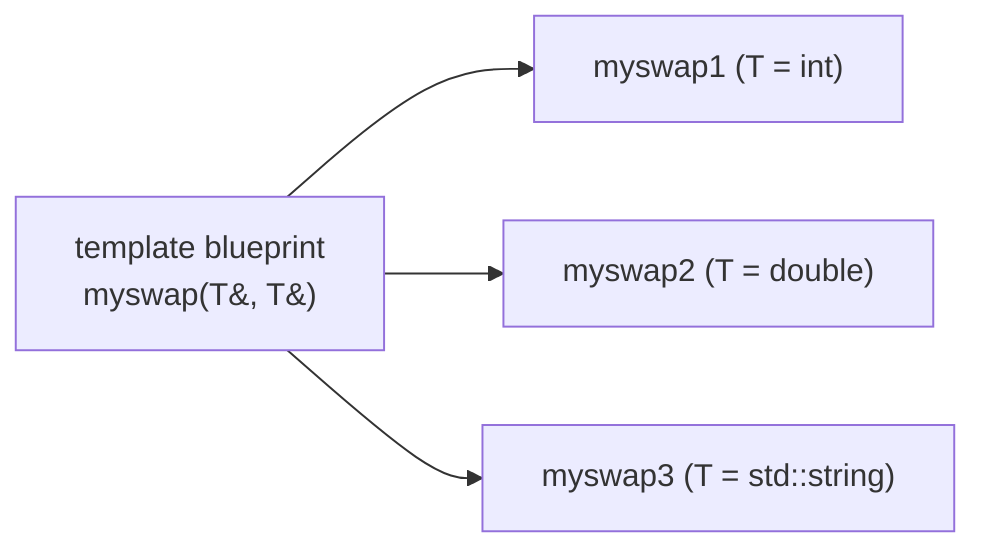
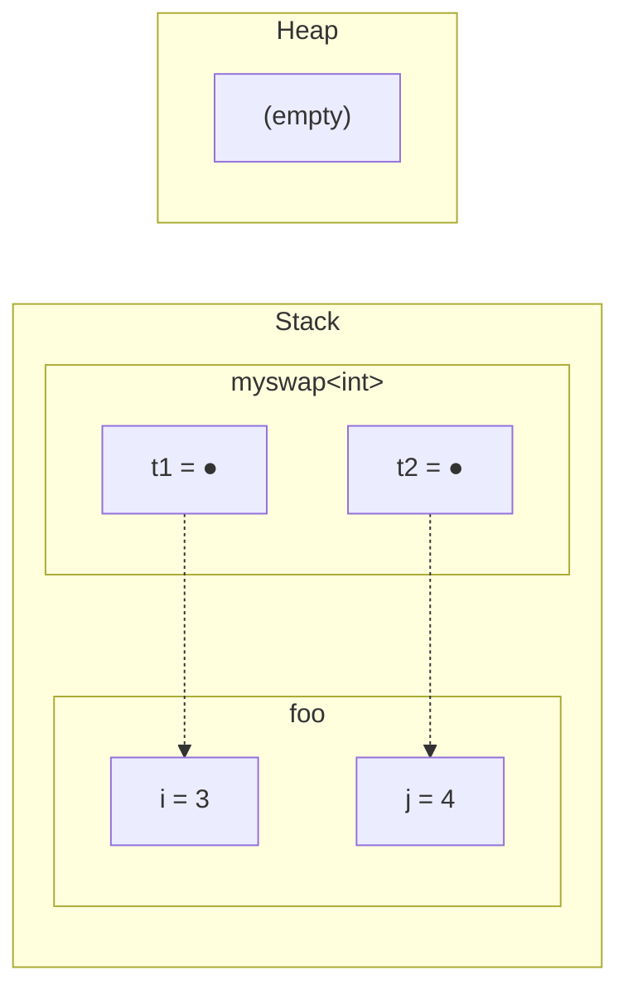
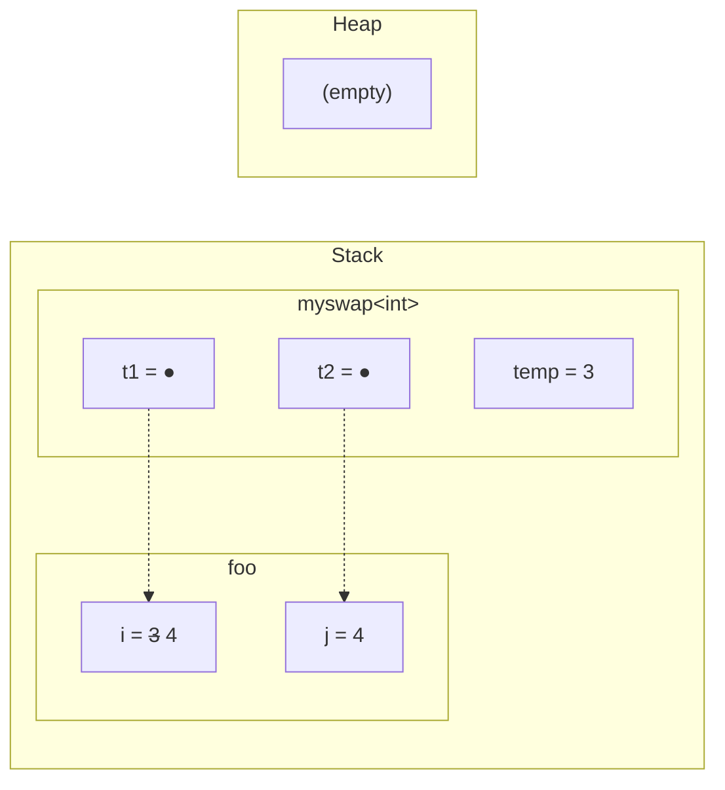
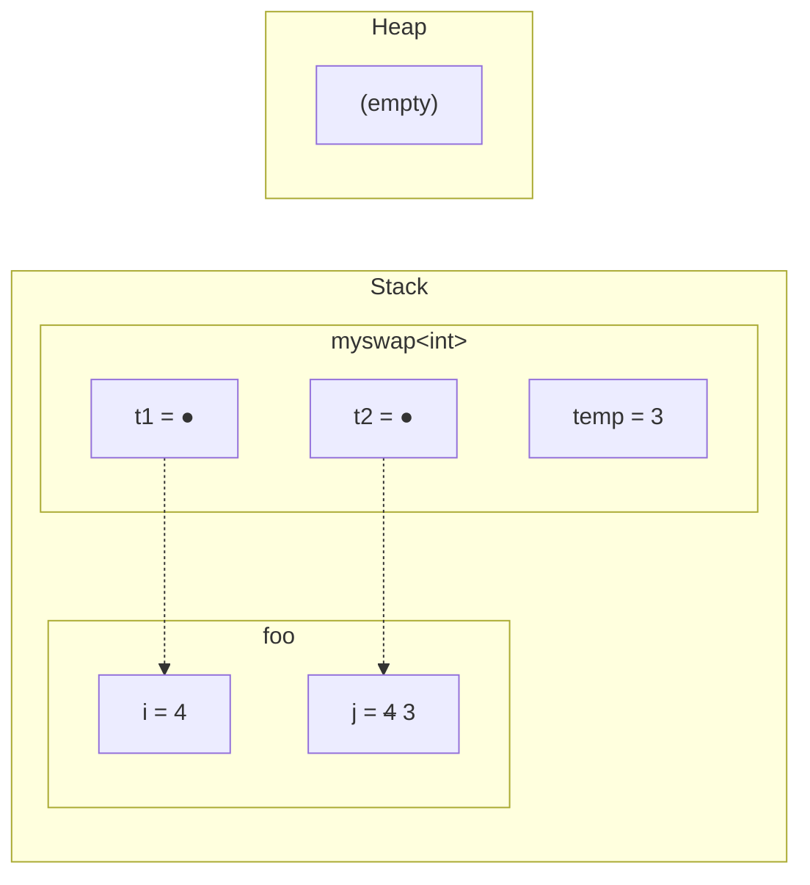

# 信息与计算机科学 46 — 话题：C++ 基础

## 目录

- [1. 用 Google Test 编写 C++ 单元测试](#1-用-google-test-编写-c-单元测试)
- [2. 为什么需要模板](#2-为什么需要模板)
- [3. 编写函数模板](#3-编写函数模板)
- [4. 函数模板的实例化（编译期进行）](#4-函数模板的实例化编译期进行)
- [5. 模板代码放在哪里（.hpp 与 .tpp）](#5-模板代码放在哪里hpp-与-tpp)
- [6. 类型参数的隐含约束](#6-类型参数的隐含约束)
- [7. 类模板](#7-类模板)
- [8. 类模板示例：Box](#8-类模板示例box)
- [9. 随机性与随机数生成](#9-随机性与随机数生成)
- [10. C++ 引用](#10-c-引用)
- [11. C++ 指针](#11-c-指针)
- [12. 智能指针与所有权](#12-智能指针与所有权)
- [13. C++ 一维数组](#13-c-一维数组)
- [14. 多维数组](#14-多维数组)
- [15. 完整实现](#15-完整实现)
- [16. 速查与必记的 5 个要点](#16-速查与必记的-5-个要点)

> UCI ICS 46：数据结构的实现与分析 — Tom Yeh 教授。本笔记把第 0–2 讲中的C++ 基础内容汇集在一起，按概念组织。

## 1. 用 Google Test 编写 C++ 单元测试

本课程使用 **Google Test**；它的 1.10.0 Primer 和 Thornton 的 ICS 45C **Unit Testing** 笔记是参考资料。以下是这两份阅读材料的压缩要点。

### 1.1 什么是单元测试

**单元测试**检查程序中的一个小部分——一个类、一个函数——并且与其余部分**隔离**开来进行。数据结构就是典型例子：`ArrayList` 有一些行为（在前端插入、满了时扩容、删除最后一个元素），你的应用程序可能永远不会以明显、可重复的方式触发它们，但你仍然需要知道它们是否正确。

每个测试都有相同的形式：**设置场景 → 运行 → 将结果与预期比较 → 报告**。**单元测试框架**负责那些枯燥的部分：它自动找到所有测试（无需在 `main` 中添加调用），独立运行每个测试，并报告哪些失败、给出预期值与实际值以及行号。C++ 标准库没有自带的框架（Python 有 `unittest`，C++ 没有），所以我们使用 Google 的开源 **Google Test**（又名 googletest/gtest）。

### 1.2 编写测试

```cpp
TEST(TestSuiteName, testName)
{
    // set up, run, check
}
```

`TEST` 是一个宏（它展开为一个函数加上注册代码）。它没有返回类型；括号中的两个名字分别是**测试套件**（一组相关测试）和**测试自身的名字**。Google Test 会注册每个 `TEST`，并通过 `RUN_ALL_TESTS()` 运行它们全部；链接 `gtest_main` 即可获得一个现成的 `main`，替你完成这一步。

在测试中，你用断言来检查结果。断言成对出现：

| 致命（`ASSERT_*`） | 非致命（`EXPECT_*`） | 通过条件 |
|---|---|---|
| `ASSERT_TRUE(c)` | `EXPECT_TRUE(c)` | `c` 为真 |
| `ASSERT_FALSE(c)` | `EXPECT_FALSE(c)` | `c` 为假 |
| `ASSERT_EQ(a, b)` | `EXPECT_EQ(a, b)` | `a == b` |
| `ASSERT_NE(a, b)` | `EXPECT_NE(a, b)` | `a != b` |
| `ASSERT_LT/LE/GT/GE(a, b)` | `EXPECT_LT/LE/GT/GE(a, b)` | `a < b`、`a <= b`、`a > b`、`a >= b` |
| `ASSERT_STREQ(s1, s2)` | `EXPECT_STREQ(s1, s2)` | 两个 **C 字符串**内容相同 |

- **`ASSERT_*`** 会使测试失败并**立即停止**。当继续执行没有意义时使用它（例如下一行会解引用你刚断言为非空的指针）。
- **`EXPECT_*`** 会使测试失败但**继续执行**，因此一次运行可以报告多个出错的期望。Primer 默认更推荐 `EXPECT_*`。
- 你可以附加一条消息：`EXPECT_EQ(x[i], y[i]) << "differ at index " << i;`

下面是针对本笔记中模板的一个小测试套件（`myMin` 来自 [§6.3](#63-练习)，`Pair` 来自 [§8.2](#82-练习)；代码见 [§15](#15-完整实现)）：

```cpp
#include <gtest/gtest.h>
#include <string>
#include "templates.hpp"

TEST(MyMinTests, returnsSmallerInt)
{
    EXPECT_EQ(3, myMin(3, 5));
    EXPECT_EQ(-2, myMin(7, -2));
}

TEST(MyMinTests, comparesStringsAlphabetically)
{
    EXPECT_EQ("apple", myMin(std::string("apple"), std::string("banana")));
}

TEST(PairTests, containTheValuesGivenWhenConstructed)
{
    Pair<int> p{4, 6};
    EXPECT_EQ(4, p.first());
    EXPECT_EQ(6, p.second());
}

TEST(PairTests, setSecondReplacesOnlyTheSecondValue)
{
    Pair<std::string> p{"Zot", "Zot"};
    p.setSecond("Anteater");
    EXPECT_EQ("Zot", p.first());
    EXPECT_EQ("Anteater", p.second());
}
```

用 `g++ -std=c++17 -Wall pair_tests.cpp -lgtest -lgtest_main -pthread` 编译并运行，输出如下：

```text
Running main() from ./googletest/src/gtest_main.cc
[==========] Running 4 tests from 2 test suites.
[----------] Global test environment set-up.
[----------] 2 tests from MyMinTests
[ RUN      ] MyMinTests.returnsSmallerInt
[       OK ] MyMinTests.returnsSmallerInt (0 ms)
[ RUN      ] MyMinTests.comparesStringsAlphabetically
[       OK ] MyMinTests.comparesStringsAlphabetically (0 ms)
[----------] 2 tests from MyMinTests (0 ms total)

[----------] 2 tests from PairTests
[ RUN      ] PairTests.containTheValuesGivenWhenConstructed
[       OK ] PairTests.containTheValuesGivenWhenConstructed (0 ms)
[ RUN      ] PairTests.setSecondReplacesOnlyTheSecondValue
[       OK ] PairTests.setSecondReplacesOnlyTheSecondValue (0 ms)
[----------] 2 tests from PairTests (0 ms total)

[----------] Global test environment tear-down
[==========] 4 tests from 2 test suites ran. (0 ms total)
[  PASSED  ] 4 tests.
```

### 1.3 好测试的特征

- **一个测试只覆盖一种行为，而不是一个函数对应一个测试。** 你不能单独测试 `first()`，而应测试"用 (4, 6) 构造之后，`first()` 返回 4"。行为是一个*带有已知结果的调用序列*。如果你要检查三种行为，就写三个测试，这样失败时你能准确知道是哪个场景出错了。
- **以行为命名测试**（`setSecondReplacesOnlyTheSecondValue`）。报告会打印失败测试的名字，因此一个好名字往往在你打开代码之前就暗示了错误所在。
- **测试之间相互独立。** 不保证执行顺序；永远不要依赖另一个测试先运行过。
- **变化测试数据。** Thornton 特意在每个测试中使用不同的常量，这样测试就不会因为某个恰好可行的值而意外通过。
- **边界情况**（空结构、只有一个元素、数组已满、头部与尾部）是数据结构错误最容易藏身的地方。

> ⚠️ **易错点**：对两个 `const char*` 使用 `EXPECT_EQ` 比较的是**指针**，而不是文本。比较 C 字符串请使用 `EXPECT_STREQ`，或者用 `EXPECT_EQ` 比较 `std::string`（如上面的例子，`"apple"` 与 `std::string` 比较，因此使用的是 `std::string` 的 `==`）。对于浮点数，请使用浮点版本（例如 `EXPECT_DOUBLE_EQ`），以避免舍入导致的失败。

> ⚠️ **易错点**：Thornton 的 45C 笔记写的是 `ASSERT_EQ(expected, actual)`，即预期值在前，这样失败报告才读得通。1.10 版 Primer 指出，自 2016 年起 `*_EQ` 对两个参数一视同仁；两种顺序都可以，但要保持一致。（本笔记的示例采用预期值在前的写法。）

> 📘 **课外补充**：术语方面，Google Test 称为**测试套件**（`TEST` 的第一个参数）的东西，在旧版本中叫作 "test case"；Thornton 的 45C 笔记使用的是旧名称。测试名称中不应包含下划线。当许多测试需要相同的设置时，可以使用**测试夹具**（继承自 `::testing::Test` 的类，配合 `TEST_F` 而不是 `TEST` 使用），它通过 `SetUp()`/`TearDown()` 为每个测试构建全新的对象。如果你自己编写 `main`，请调用 `::testing::InitGoogleTest(&argc, argv)`，然后 `return RUN_ALL_TESTS();`。

## 2. 为什么需要模板

C++ 有**静态类型系统**：每个变量的类型在编译期就已固定。因此，交换两个 `int` 的函数不能用来交换两个 `double`；要处理不同的参数类型，你最终会写出几乎相同的多个版本：

```cpp
void myswap(int& a, int& b) noexcept
{
    int temp = a;
    a = b;
    b = temp;
}
```

```cpp
void myswap(double& a, double& b) noexcept
{
    double temp = a;
    a = b;
    b = temp;
}
```

由于 C++ 允许**重载**（同名、不同参数类型），这两个函数可以共存，而且每种类型都可以再写上一百个。但它们的函数体除了类型名之外完全相同。这种复制粘贴意味着每个 bug 修复都要做 N 次。

**模板**解决了这个问题。它是**无限多种可能性的蓝图**：你只需编写一次代码，并说明*各个实例彼此之间有何不同*（这里只是类型）。编译器会在需要时生成每个具体版本。下图是一张蓝图，箭头指向 `myswap1`、`myswap2`、`myswap3`：



模板主要有两种：
1. **函数模板**——函数的蓝图（§3–§6）。
2. **类模板**——类的蓝图（§7–§8）。数据结构是它们最主要的用途。

> 💡 **关键洞见**：模板既不是函数，也不是类。它是编译器用来*生成*函数或类的配方，每组模板实参生成一个。

## 3. 编写函数模板

### 3.1 语法

四个步骤：

1. 以 **`template`** 关键字开头。
2. 把模板参数放在 **`< >`** 中。
3. 写 **`typename`**，后面跟类型参数的名字（按惯例用 `T`）。
4. 像往常一样编写函数定义，在类型会变化的地方使用 `T`。

```cpp
template <typename T>
void myswap(T& t1, T& t2)
{
    T temp = t1;
    t1 = t2;
    t2 = temp;
}
```

- 这是任意数量 `myswap` 函数的**蓝图**。
- 关键字 **`typename`** 表明该参数是一个**类型占位符**（而不是例如 `int` 常量）。
- **`T`** 代表该类型；在实例化时，每个 `T` 都会被替换为**实际类型**。

### 3.2 模板参数的种类

| 种类 | 示例 | 含义 |
|---|---|---|
| **类型参数** | `typename T`、`class T` | 代表一个类型；实参是 `int` 或 `std::string` 这样的类型 |
| **非类型参数** | 常量、指针、引用 | 代表一个编译期的*值*，例如 `template <typename T, int N>` |
| **模板模板参数** | — | 本身就是模板的参数（例如"某个容器模板"） |

`typename T` 与 `class T` 在 `< >` 中的含义完全相同（这里的 `class` 并不要求 T 必须是类；`int` 也可以）。原表格也把 `std::string` 列在类型参数下——应当把它理解为你*作为实参传入*的类型（`T = std::string`），而不是你在参数列表中书写的内容。

非类型参数的例子（已编译）：

```cpp
template <typename T, int N>
T sumFirst(const std::vector<T>& v) {
    T total{};
    for (int i = 0; i < N && i < static_cast<int>(v.size()); ++i) total += v[i];
    return total;
}
// sumFirst<int, 3>(std::vector<int>{1, 2, 3, 4, 5}) == 6
```

`N` 必须在编译期已知；`sumFirst<int, 3>` 与 `sumFirst<int, 4>` 是两个不同的生成函数。

### 3.3 为什么模板去掉了 `noexcept`

注意 [§2](#2-为什么需要模板) 中 `int` 与 `double` 的版本都是 `noexcept`，而模板版本不是。这是有意为之（Thornton 的说法）：交换 `int` 绝不会抛出异常，但交换 `std::string` 会复制字符串，而复制字符串可能分配内存，进而抛出异常。单个模板无法对每个 `T` 都承诺"永不抛出"。

> 📘 **课外补充**：`noexcept` 是一种承诺，而不是检查——如果一个 `noexcept` 函数真的抛出了异常，程序会调用 `std::terminate()`。模板可以让这个承诺**依赖于** `T`：`noexcept(expr)` 中的 `expr` 是一个编译期 `bool`。内层的 `noexcept(...)` *运算符*用来询问"这个表达式是否被声明为不会抛出异常"，而无需真正执行它：
>
> ```cpp
> template <typename T>
> void myswap(T& t1, T& t2)
>     noexcept(noexcept(T{t1}) && noexcept(t1 = t2))
> ```
>
> 或者更易读的写法（需要 `#include <type_traits>`）：
>
> ```cpp
> template <typename T>
> void myswap(T& t1, T& t2)
>     noexcept(std::is_nothrow_copy_constructible_v<T> &&
>              std::is_nothrow_copy_assignable_v<T>)
> ```
>
> 已编译检查：对于 `int`，`noexcept(myswap(i, j))` 为 `true`；对于 `std::string` 则为 `false`。（Thornton 的页面写的是 `std::is_nothrow_assignable_v<T>`，只带一个参数；但该 trait 实际上接受两个类型，所以应使用 `is_nothrow_copy_assignable_v<T>`。）标准容器这类库代码很在意这一点，因为当编译器知道移动或复制不会抛出异常时，某些操作会更快。

## 4. 函数模板的实例化（编译期进行）

函数模板在被**使用**之前不会生成任何东西。当编译器遇到调用时，会做三步：

| 步骤 | 名称 | 编译器做什么 |
|---|---|---|
| 1 | **遇到调用** | 在模板调用处，检查它是否能识别该函数模板。 |
| 2 | **类型推导** | 尝试根据实参类型自动推导出模板参数的类型。 |
| 3 | **实例化** | 为推导出的类型生成一个实际的具体函数定义。 |

三部分的代码如下：

**1. 调用位置（`foo`）**

```cpp
void foo()
{
    int i = 3;
    int j = 4;
    myswap(i, j);
}
```

**2. 模板（`myswap`）**

```cpp
template <typename T>
void myswap(T& t1, T& t2)
{
    T temp = t1;
    t1 = t2;
    t2 = temp;
}
```

**3. 实例化（`int`）**——编译器为 T = `int` 生成的代码：

```cpp
void myswap(int& t1, int& t2)
{
    int temp = t1;
    t1 = t2;
    t2 = temp;
}
```

两个实参都是 `int`，所以 `T&` 必须是 `int&`，因此 T = `int`。生成的函数是程序中一个真实的函数，名为 `myswap<int>`。之后用两个 `double` 调用 `myswap`，会生成第二个函数 `myswap<double>`；再次用 `int` 调用时则复用 `myswap<int>`。

下面是这次调用在内存中的过程（Python Tutor 风格）。`t1` 与 `t2` 是引用——虚线箭头——因此通过它们的写入会落在 `foo` 的变量上：

**内存追踪：`myswap<int>(i, j)`**（4 步）

**第 1/4 步：** `myswap(i, j);  // enter myswap<int>`——t1 和 t2 是引用，即 foo 中 i 和 j 的别名，而不是副本



**第 2/4 步：** `T temp = t1;`——拷贝构造：temp 是一个用 i 初始化的新 int


**第 3/4 步：** `t1 = t2;`——通过别名进行拷贝赋值，写入的是 foo 中的 i



**第 4/4 步：** `t2 = temp;`——拷贝赋值写入 foo 中的 j；myswap 返回时 temp 被销毁



对 `T` 执行的三类操作——拷贝构造 `temp`、两次拷贝赋值、销毁 `temp`——正是 [§6](#6-类型参数的隐含约束) 中的要求。

### 4.1 推导失败的情况

第 2 步在**编译器无法确定精确类型**时失败——例如实参之间存在**冲突**，或者**完全没有提示**。混用类型的例子（用 g++ 13 编译）：

```cpp
int i = 3; double d = 4.0;
myswap(i, d);
```

```text
error: no matching function for call to 'myswap(int&, double&)'
note:   deduced conflicting types for parameter 'T' ('int' and 'double')
```

从第一个实参推出 T 是 `int`，从第二个实参推出 T 是 `double`；编译器不会替你选一个。（对于 `myswap` 没有修复办法——你无法把 `int&` 绑定到 `double` 上。对于按值或 `const T&` 传递的函数，如 `myMin`，你可以自己指定类型，见下文。）

你总是可以**显式**地给出模板实参：

```cpp
myswap<int>(i, j);   // legal, but unnecessary here — deduction already gets int
```

显式实参在"没有可推导的依据"时是必需的（例如 T 只出现在返回类型中），并且在可以进行转换的情况下用来消除冲突：`myMin<double>(3, 4.5)` 可以通过编译，并返回 3（`int` 的 3 被转换为 `double`）。

> ⚠️ **易错点**：推导**不会**进行通常的类型转换。`myMin(3, 4.5)` 是编译错误，即使 `int` → `double` 是一种普通的转换；而 `myMin<double>(3, 4.5)` 是可以的。

> 📘 **课外补充**：如果两个 `.cpp` 文件都调用了 `myswap<int>`，每个文件都会生成自己的一份 `myswap<int>`。通常同一函数的两个定义会导致链接错误，但链接器被要求接受重复的模板实例化并只保留一份。这正是 [§5](#5-模板代码放在哪里hpp-与-tpp) 中"把它放进头文件"这一规则能够生效的原因。

## 5. 模板代码放在哪里（.hpp 与 .tpp）

**实例化要求**：**完整的模板定义**（包括函数体，而不仅仅是声明）必须在**每个使用处都可见**，这样编译器才能在该处生成特化的函数。因此模板代码要放在头文件中。有两种做法：

### 5.1 方案一：单一头文件

在 `.hpp` 中同时写出声明与定义。最适合较小的工具函数和简单的模板。

```cpp
// myswap.hpp
#pragma once
#include <utility>

// 1. Declaration & definition combined
template <typename T>
void myswap(T& a, T& b) {
  T temp = std::move(a);
  a = std::move(b);
  b = std::move(temp);
}
```

### 5.2 方案二：拆分的头文件与实现

- **清晰的分离**：接口放在 `.hpp` 中，实现放在 `.tpp` 中。
- **"秘密包含"**：`.hpp` 在**底部** `#include` `.tpp`，因此任何包含该头文件的人仍能获得完整定义。

```cpp
// myswap.hpp (Header & Interface)
#pragma once
// 1. Only declaration is visible first
template <typename T>
void myswap(T& a, T& b);
// 2. Include implementation at bottom
#include "myswap.tpp"
```

```cpp
// myswap.tpp (Template Implementation)
#include <utility>
template <typename T>
void myswap(T& a, T& b) {
  T temp = std::move(a);
  a = std::move(b);
  b = std::move(temp);
}
```

`.tpp` 不单独编译，也不应列为源文件；它实际上是一个伪装成实现文件的头文件。（`.tpp` 只是命名惯例，编译器并不在意扩展名。）已测试：先 `#include "myswap.hpp"`，然后对 `int` 调用 `myswap(i, j)`、对 `double` 调用 `myswap<double>`、对 `std::string` 调用，输出依次为 `4 3`、`2.5 1.5`、`banana apple`。

这个版本使用的是 **`std::move`**（来自 `<utility>`）而不是拷贝：它让 `T` 可以*移动*其内容（例如偷走字符串的缓冲区），而不是复制，这对大对象来说开销更小。对 `int` 来说没有区别。移动语义会在 [§12](#12-智能指针与所有权) 中随智能指针再次出现。

> ⚠️ **易错点**：在 45C 中养成的"声明放 `.hpp`、定义放 `.cpp`"的习惯**对模板不适用**。只看到声明的 `.cpp` 可以正常编译，并假定 `myswap<int>` 在别处有定义，于是你会遇到**未定义引用**的链接错误——因为包含函数体的那个 `.cpp` 从未见过用 `int` 的调用，因此也从未生成它。

## 6. 类型参数的隐含约束

### 6.1 T 可以是什么

`T` 可以是任何东西吗？

- **T 必须是具体类型**——基本类型（`int`），或**完整指定的模板类型**，例如 `std::vector<int>`（而不是裸的 `std::vector`；后者是模板，不是类型）。
- **T 受到隐含限制**，这些限制取决于模板内部对它执行的**操作**。`template <typename T>` 中没有任何地方写明"T 必须可拷贝"；这一要求写在函数体里。

**`myswap` 需要的操作**：

| # | 操作 | 在 `myswap` 中的位置 |
|---|---|---|
| 1 | **拷贝构造函数** | `T temp = t1;` |
| 2 | **拷贝赋值运算符** | `t1 = t2;` 和 `t2 = temp;` |
| 3 | **析构函数** | `temp` 是局部（栈上、"静态分配"）变量，因此函数结束时它的析构函数自动运行 |

### 6.2 约束不满足时

任何缺少上述三项之一的类型都不能用于 `myswap`。Thornton 的例子是一个拷贝构造与赋值都被删除的类。

```cpp
class X
{
public:
    X();
    X(const X& x) = delete;
    X& operator=(const X& x) = delete;
};

X a, b;
myswap(a, b);   // compile error
```

g++ 13（使用 `.tpp` 版本的 `myswap`）：

```text
myswap.tpp:5:5: error: use of deleted function 'X::X(const X&)'
myswap.tpp:6:5: error: use of deleted function 'X& X::operator=(const X&)'
```

注意错误**报告在哪里**：在模板函数体内部、需要那个缺失操作的那一行，而不是在你的调用处。这很典型——模板错误会指向模板内部，你需要从那里反推到你传入的类型。

> ⚠️ **易错点**：这里以及 Thornton 的讲义中的 "statically allocated" 指的是**自动存储期——栈上的局部变量**，而不是 `static` 变量。它与用 `new` 进行的堆分配正好相反。

> 💡 **关键洞见**：要找出模板对 `T` 的要求，请阅读它的函数体，并列出它对 `T` 做的每一项操作：构造（怎样构造？）、拷贝、赋值、比较（`<`、`==`）、调用成员、销毁。每一项都是一条要求。这就是两道模板练习题（[§6.3](#63-练习)、[§8.2](#82-练习)）的解法。

> 📘 **课外补充**：这些要求是模板**契约**的一部分——类似函数的前置条件，只不过由编译器在实例化时检查。Thornton 的 Contracts 笔记更一般地讨论了前置条件、后置条件、副作用以及类不变式。（C++20 加入了 *concepts* 来显式地书写这类要求；本课程使用的是 C++17 风格的隐含约束。）

### 6.3 练习

#### 函数模板：myMin

- 实现一个名为 `myMin` 的函数模板，返回两个输入中较小的那个。
- 输入的类型有任何约束吗？
- 编写一个 main 函数，先用 int 再用 string 测试 `myMin`。

> 提示：列出函数体对 `T` 执行的每一项操作，包括 `return`。

<details>
<summary>解答</summary>

**解答**（已编译——输出 `3`，然后是 `apple`）：

```cpp
template <typename T>
T myMin(const T& a, const T& b) {
    return (a < b) ? a : b;
}

int main() {
    std::cout << myMin(3, 5) << std::endl;
    std::cout << myMin(std::string("apple"), std::string("banana")) << std::endl;
}
```

（原文省略了头文件：你需要 `<iostream>` 和 `<string>`。）

**对 T 的约束**：
- 函数**按值返回**，因此 T 需要**拷贝（或移动）构造函数**——结果是从 `a` 或 `b` 中拷贝出来的。
- T 必须支持 **`operator<`**。如果一个结构体没有定义它，g++ 会报：`no match for 'operator<' (operand types are 'const Point' and 'const Point')`。
- 另外（隐含的）：两个实参必须推导为**同一个** T，并且 T 必须是可析构的（返回的临时对象会被销毁）。

为什么用 `std::string("apple")`，而不直接用 `"apple"`？这里有些值得了解的陷阱：
- `myMin("apple", "banana")` 无法通过编译：字面量分别是 `const char[6]` 与 `const char[7]`，是两种不同的类型 → "deduced conflicting types"。
- 即使长度相同的字面量，如 `myMin("abc", "abd")`，也会失败：T = `char[4]`，而函数不能返回数组。
- 使用 `const char*` 变量时可以编译，但比较的是**地址**，不是文本——"较小"的指针是指内存中位置更低的那个字符串。包装成 `std::string` 后，`<` 才会按字母顺序比较。
- `myMin(3, 4.5)` 失败（int 与 double）；`myMin<double>(3, 4.5)` 可以。

↩ 相关概念：[§4.1 推导失败的情况](#41-推导失败的情况)、[§6 类型参数的隐含约束](#6-类型参数的隐含约束)。

</details>

## 7. 类模板

**数据结构的实现是类模板的主要用途。** 一个链表无论存放的是 `int` 还是 `std::string`，工作方式都相同；只有元素类型会改变。语法规则相同：

- 以 **`template`** 关键字开头。
- 模板参数放在**尖括号 `< >` 中，用逗号分隔**。
- **`ElementType`** 是一个占位符，描述某个特定 `Vector` 中存储的元素类型。

```cpp
template <typename ElementType>
class Vector
{
    ...
};
```

在类内部，凡是你想表示"这个 Vector 中元素的类型"的地方，都写 `ElementType`。图示为一个蓝图 → `Vector1`、`Vector2`、`Vector3`。

### 7.1 实例化类模板

标准库中的例子就是 `std::vector` 本身：

| 代码 | 含义 |
|---|---|
| `std::vector<T>` | 模板类（蓝图） |
| `std::vector<std::string>` | 创建一个字符串 vector |
| `std::vector<int>` | 创建一个整数 vector |

实例化过程与函数模板相似：

1. **编译器验证**——在创建或使用时，编译器检查它是否识别该模板。
2. **类型推导**——通常需要**显式**的类型参数（例如 `<int>`）。与 `myswap(i, j)` 不同，`std::vector v;` 没有给编译器任何可推导的依据。
3. **模板实例化与定义**——必须能拿到完整的模板定义才能生成代码。
4. **头文件实现**——因此类模板要放在 `.hpp` 中，或放在 `.hpp` + `.tpp` 文件中，与 [§5](#5-模板代码放在哪里hpp-与-tpp) 中完全一样。

> 📘 **课外补充**：自 C++17 起，编译器*可以*从构造函数调用中推导类模板实参：`Box b{42};` 会得到一个 `Box<int>`（类模板实参推导，即 "CTAD"——已编译并检查）。"通常需要显式类型参数"的规则仍是安全的习惯；如果没有构造实参，或为了清晰，就把类型写出来。

### 7.2 每个实例都是独立且无关的类型

`std::vector<int>` 与 `std::vector<std::string>` 包含的是同样的代码，只是插入了不同的类型；但对编译器来说，它们是**完全不同的类**：没有继承关系，不能相互转换，也不能相互赋值。你不能把 `vector<std::string>` 传给一个期望 `vector<int>` 的函数。下面是用 [§8](#8-类模板示例box) 中的 `Box` 做的已编译检查：

```cpp
Box<int> b{42};
Box<double> d{2.5};
d = b;   // error: no match for 'operator=' (operand types are 'Box<double>' and 'Box<int>')
```

……即使 `int` 可以转换为 `double`。

> ⚠️ **易错点**：在类模板内部，你可以只写 `Vector`（它指的是"这个实例化"），但在外部你必须始终写出实参：`Vector<int>`，而不能把裸的 `Vector` 当作类型使用。

## 8. 类模板示例：Box

一个单元素容器：

```cpp
template <typename T>
class Box {
public:
    // Constructor
    Box(const T& value) : item{value} {}

    // Getter
    T getValue() const {
        return item;
    }

    // Setter
    void setValue(const T& value) {
        item = value;
    }

private:
    T item;
};
```

**T 可以是什么？**（"typename 参数类型"）

- **基本类型**：整数类型、浮点类型——`Box<int>`、`Box<double>`。
- **非基本类型**：
  - 用户定义的：类或结构体——`Box<Person>`；
  - 库定义的：例如 `std::vector`——`Box<std::vector<int>>`（一个完整指定的 vector 类型，见 [§6](#6-类型参数的隐含约束)）。

**编译器对 T 的类型要求**：T 必须是编译器能够正确**拷贝、存储和销毁**的类型：

| 要求 | Box 在哪里需要它 |
|---|---|
| **可拷贝构造** | `Box(const T& value)` 用 `item{value}` 初始化（`getValue()` 按值返回 `T` 也需要） |
| **可拷贝赋值** | `setValue` 中的 `item = value;` |
| **可析构** | `item` 是成员；当 `Box` 被销毁时它也被销毁 |

**注意**：`T` 被用来构造其他类型——`const T&` 表示"对 const T 的引用"。传递 `const T&` 而不是 `T`，可以避免复制一个可能很大的对象，同时承诺不修改它。

测试用法：

```cpp
Box<int> bi{42};
bi.setValue(7);
Box<std::string> bs{"ICS 46"};
std::cout << bi.getValue() << " " << bs.getValue() << std::endl;   // 7 ICS 46
Box<std::vector<int>> bv{{1, 2, 3}};
std::cout << bv.getValue().size() << std::endl;                    // 3
```

### 8.1 只有你用到的成员函数才会被生成

类模板的成员函数**只有在被调用时**才会被实例化（Thornton）。因此，附加在某个成员函数上的要求，只有当你调用该函数时才有意义。下面检查的是一个赋值运算符被删除的类型 `NoAssign`：

```cpp
struct NoAssign { NoAssign(int) {} NoAssign& operator=(const NoAssign&) = delete; };

Box<NoAssign> b{NoAssign{1}};
b.getValue();            // compiles: constructor and getValue only need copy construction
b.setValue(NoAssign{2}); // adding this line → error: use of deleted function
                         // 'NoAssign& NoAssign::operator=(const NoAssign&)'
```

所以"可拷贝赋值"真正的含义是"如果你调用 `setValue`，就需要可拷贝赋值"。上面的表格是使用整个类所需的全部要求。

> 📘 **课外补充**：Thornton 对同一推理的表述：如果 `Vector` 的某个成员函数包含
> `ElementType e; e.foo();`
> 那么 `ElementType` 必须 (1) 可默认构造（`e` 无需参数即可创建），(2) 有析构函数（`e` 是会被销毁的局部变量），并且 (3) 有一个不接受参数的成员函数 `foo`（返回类型任意，因为结果被忽略）。

### 8.2 练习

#### 类模板：Pair

实现一个类模板 `Pair`，存储 2 个相同类型 T 的元素。

T 有哪些限制？

> 提示：参照 [§8](#8-类模板示例box) 中 `Box` 的分析方式来做。

<details>
<summary>解答</summary>

**解答**（原文的两行 setter 超出了右边界，这里补全为 `first_ = value;` 和 `second_ = value;`；原文底部的 `};` 也被截掉了）：

```cpp
template <typename T>
class Pair {
public:
    Pair(const T& first, const T& second)
        : first_(first), second_(second) {}

    T& first() { return first_; }
    const T& first() const { return first_; }
    T& second() { return second_; }
    const T& second() const { return second_; }

    void setFirst(const T& value) { first_ = value; }
    void setSecond(const T& value) { second_ = value; }

private:
    T first_;
    T second_;
};
```

为什么每个 getter 要两个版本？非 const 版本返回 `T&`，这样你就可以原地修改元素（`p.first() += "!"`）；const 版本是唯一可以在 `const Pair` 上调用的，它返回 `const T&`，使调用者无法修改。返回引用避免了对 T 的任何复制，所以——与 `Box::getValue` 不同——这些 getter 不要求 T 可拷贝。

**对 T 的限制**：
- ✓ **可拷贝构造**——构造函数 `first_(first)` 需要它。
- ✓ **可拷贝赋值**——setter `setFirst` 和 `setSecond` 需要它。
- ✓ **可析构**——`Pair` 离开作用域时，其中的 `T` 成员会被销毁。

（如 [§8.1](#81-只有你用到的成员函数才会被生成) 所示，只有真正调用 setter 时，"可拷贝赋值"才有影响。）

↩ 相关概念：[§7 类模板](#7-类模板)、[§8 Box](#8-类模板示例box)。

</details>

## 9. 随机性与随机数生成

### 9.1 "随机"是什么意思

一个序列是**随机的**，如果即使看过之前所有的值，也无法比机会更好地预测下一个值；我们的目标是让程序*生成*这样的序列。用途包括：**机器学习**（权重初始化、训练/测试划分、SGD）、**安全**（密钥、令牌——可预测的密钥就是可被猜中的密钥）、**模拟**（蒙特卡洛，改变种子）、**游戏**（世界生成、NPC 决策）。

### 9.2 真随机与伪随机

随机数生成器（RNG）有两种：

| | 真随机（TRNG / 硬件 RNG） | 伪随机（PRNG） |
|---|---|---|
| 如何产生 | 测量变化的**物理现象** | 从前一个内部状态**计算**出每个值 |
| 例子 | 骰子、硬币、扑克牌；网络流量、温度、熔岩灯；大气噪声（random.org） | Mersenne Twister、线性同余生成器 |
| 能否复现？ | 不能 | **能**——相同的种子，相同的序列 |
| 速度 | 有限（收集熵需要时间） | 非常快 |

Cloudflare 的熔岩灯"熵墙"（Wall of Entropy）就是一个真实的 TRNG 来源。

> 📘 **课外补充**（Thornton，Randomness）：熵是稀缺的——操作系统每秒只能观察到有限数量的不可预测事件。因此实际程序会把两者结合起来：从熵源中取**一个**值作为**种子**，然后让快速的 PRNG 把它扩展成一个很长的序列。

### 9.3 为引擎设置种子

在 `<random>` 中，PRNG 被称为**引擎**（engine），创建时需要一个**种子**（seed）。

**方法 01——固定种子**：每次运行的序列完全相同；最适合测试、模拟和调试。

```cpp
#include <random>
const unsigned int SEED = 123;
std::default_random_engine engine{SEED};
```

**方法 02——熵源**：`std::random_device` 会获取操作系统或硬件的熵；**调用**它即可得到一个种子。每次运行的序列都不同；用于生产环境。

```cpp
#include <random>
std::random_device device;
std::default_random_engine engine{device()};   // note the ()
```

> ⚠️ **易错点**：固定种子只有在**同一个标准库**上才能复现序列——`default_random_engine` 是由编译器厂商选定的实现，因此 g++ 与 MSVC 对种子 123 可能输出不同的数字。如果你需要在所有平台上得到完全相同的结果，请使用 `std::mt19937`。

### 9.4 分布：均匀分布与正态分布

引擎产生的是原始的均匀比特；**分布**（distribution）则把它们塑造成你想要的值。

- **均匀整数**：[min, max] 中的整数，**两端都包含**，且每个值等可能（平坦）。
- **正态 / 高斯分布**：以**均值**为中心的钟形曲线；**标准差**决定分布的宽窄（例如考试成绩）。

```cpp
// Equal chance for 1, 2, 3, 4, 5, or 6
std::uniform_int_distribution<int> distribution{1, 6};

double mean = 10.0;
double stddev = 3.0;
std::normal_distribution<double> d(mean, stddev);
```

两个直方图（每个值对应的星号数）：

| 值 | 0 | 1 | 2 | 3 | 4 | 5 | 6 | 7 | 8 | 9 | 10 |
|---|---|---|---|---|---|---|---|---|---|---|---|
| 均匀，最小 0，最大 10 | 4 | 4 | 4 | 4 | 4 | 4 | 4 | 4 | 4 | 4 | 4 |
| 正态，均值 5.0，标准差 2.0 | 0 | 1 | 3 | 6 | 9 | 9 | 8 | 5 | 3 | 1 | 0 |

（正态分布的直方图还列出了 −2、−1、11、12——都为空。）

均匀分布是平的；正态分布在均值附近达到峰值，距离均值超过 2 个标准差（低于 1 或高于 9）的几乎没有。

> ⚠️ **易错点**（N3551 §3）：不要写 `1 + engine() % 6`。引擎的取值范围通常不是 6 的倍数，因此较小的值会出现得稍多一些——这是一个有偏的骰子。始终通过分布来取值（并避免使用老的 C 语言 `rand()`）。

### 9.5 综合起来：掷骰子

把三个部分**各创建一次**——(1) 熵源与引擎，(2) 映射到 [1, 6] 的分布，(3) 对每个样本调用 `distribution(engine)`。

```cpp
#include <random>
#include <iostream>

// 1. Source of Entropy & Engine
std::random_device device;
std::default_random_engine engine{device()};   // slide: engine{device}

// 2. Inclusive Uniform Distribution [1, 6]
std::uniform_int_distribution<int> distribution{1, 6};

// 3. Generate Samples
for (int i = 0; i < 1000; ++i) {
    std::cout << distribution(engine) << " ";
}
std::cout << std::endl;
```

**幻灯片中的错误（幻灯片上显示的代码）**：`engine{device}` → `engine{device()}`。直接传入 device 对象无法编译（g++：`no matching function for call to 'std::linear_congruential_engine<...>(<brace-enclosed initializer list>)'`）；你必须调用它。

> ⚠️ **易错点**（Thornton）：不要在循环中创建 device、engine 或 distribution——否则每次都会访问缓慢的熵源，并丢弃 PRNG 的状态。创建一次，多次调用。

### 9.6 练习

#### 固定种子与正态分布

更新 `random_test.cpp`，使其 (1) 从**种子为 46** 的 PRNG 中输出随机数，(2) 使用均值为 **4.0**、标准差为 **0.6** 的**正态分布**。给定的代码使用的是 `engine{device}` 和 `uniform_int_distribution<int> distribution{1, 6}`。

<details>
<summary>解答</summary>

只需修改两行（固定种子不需要 `random_device`）：

```cpp
const unsigned int SEED = 46;
std::default_random_engine engine{SEED};                     // 1) fixed seed
std::normal_distribution<double> distribution{4.0, 0.6};    // 2) normal(4.0, 0.6)
```

前 10 个值（g++ 13 / libstdc++，每次运行都相同）：

```text
2.94246 4.7139 3.62995 3.87306 4.78358 4.23905 3.89193 3.93273 4.34897 4.33676
```

1000 个样本的均值为 4.007，约 68% 落在 3.4–4.6 之间（即一个标准差之内）。如果你保留 device，请把 `engine{device}` 改为 `engine{device()}`。

</details>

## 10. C++ 引用

### 10.1 引用是别名

**引用**是现有对象的另一个名字。它**必须被初始化**，并且**永远不能重新绑定**到另一个对象。它也叫作左值引用，在类型上用 `&` 声明：`int& ref = existingVariable;`。与 Python 中的名字不同，`r = j;` 并不会让 `r` 重新指向别处——它会把 `j` 的值复制到 `r` 所引用的对象中。

```cpp
int i = 3;
int& r = i;                       // r now refers to i
std::cout << r << std::endl;      // writes 3
r = 4;                            // a change to r is also a change to i
std::cout << i << std::endl;      // writes 4
i = 5;                            // a change to i is also a change to r
std::cout << r << std::endl;      // writes 5
```

这里只有一个 `int`，却有两个名字。

### 10.2 按值传递与按引用传递

按值传递会给函数一个**副本**；按引用传递则使形参成为调用者实参的**别名**。使用引用的原因有两个：它**允许修改**原始对象，并且**避免复制**大型数据（提高性能、节省内存）。

```cpp
void foo(int& x)
{
    x++;
    std::cout << x << std::endl;   // prints 4
}

int main()
{
    int i = 3;
    foo(i);
    std::cout << i << std::endl;   // prints 4
    return 0;
}

void swap(int& a, int& b)
{
    int temp = a;
    a = b;
    b = temp;
}
```

若 `foo` 改为 `void foo(int x)`，输出会是 `4` 然后 `3`；`swap` 若没有 `&`，则只会交换两个副本，什么也不改变。

> 💡 **关键洞见**：读取大对象 → `const T&`；修改调用者的对象 → `T&`；`int` 这类小类型 → 按值传递。

### 10.3 按值返回与按引用返回

**默认按值返回**——它是安全的（不会产生悬空引用），借助 RVO、移动语义和复制省略（C++17 中有保证），开销很小，而且更简单。**按引用返回**适用于类的 getter（返回对内部大型数据的 `const T&`）、运算符重载（`operator[]`、`operator=`、`operator<<`，以便调用可以链式使用），以及函数外部的长生命周期对象。

**关键规则：永远不要返回指向局部栈变量的引用**——它会在函数返回时被销毁。

```cpp
// BAD: Dangling reference to local object
int& getBad() { int local = 42; return local; } // DANGER! Destroyed on exit

// GOOD: Return by value (optimized by RVO/Copy Elision)
int getGood() { int val = 42; return val; } // Safe zero-copy return
```

`getBad()` 实际的表现（g++ 13，`-Wall -fsanitize=address,undefined`）：

```text
bad.cpp:2:40: warning: reference to local variable 'local' returned [-Wreturn-local-addr]
bad.cpp:2:40: runtime error: reference binding to null pointer of type 'int'
AddressSanitizer: SEGV on unknown address 0x000000000000
```

> 📘 **课外补充**（Thornton，Move Semantics）：*移动* `std::vector` 只是窃取其内部数组指针、大小和容量（O(1)），而不是复制每个元素（O(n)）。这就是按值返回开销很小的原因。`std::move(x)` 只是把 `x` 标记为"可以安全地窃取其资源"——它与 `unique_ptr` 一起出现在 [§12.4](#124-unique_ptr-不能被复制) 中。

## 11. C++ 指针

### 11.1 指针是什么

**指针**保存一个**内存地址**（运行时的值），以及它所指向的**类型**（编译期已知）。用 `*` 声明：`int* x;`。声明应从右往左读：`int** q` 是"指向 int 指针的指针"，`int*& s` 是"指向 int 指针的引用"。

| | 引用 `int&` | 指针 `int*` |
|---|---|---|
| 能否为空？ | 不能 | 能（`nullptr`） |
| 必须初始化？ | 必须 | 不必（但未初始化就是垃圾值） |
| 能否改指向的对象？ | 不能 | 能 |
| 访问对象的方式 | 直接用名字 | `*p` |

### 11.2 `&`、`*` 与指针赋值

**取地址**运算符 `&`（用在*表达式*中）给出变量的地址——这与*类型*中的 `&`（用于声明引用）不同。**解引用**运算符 `*` 则与之相反：它访问地址处的对象。（这个名字与引用无关；它是一个较老的 C 语言术语。）你可以复制指针（`int* q = p;`，两者指向同一个对象），也可以拥有指向指针的指针（`int** q = &p;`）。

```cpp
int i = 3;
int* p = &i;
std::cout << i << std::endl;   // 3
*p = 4;                        // change i through p
std::cout << i << std::endl;   // 4
int** q = &p;                  // *q is p, **q is i (prints 4)
```

指针支持直接的内存操作、动态分配以及数据结构（链表、树、图）。与引用不同，指针可以**重新指向**别处：

```cpp
int x = 10;
int* p = &x;    // p holds the memory address of x
*p = 20;        // changes x to 20 through the pointer
int y = 30;
p = &y;         // now p points to y instead of x
```

验证：之后 `x` 为 20，`*p` 为 30。

> ⚠️ **易错点**：地址不是 `int`——`int* p = i;` 是编译错误；应写 `int* p = &i;`。

### 11.3 `nullptr`

`nullptr` 表示"不指向任何东西"（例如链表中最后一个节点的 `next`）。对它解引用是**未定义行为**——实际上通常会崩溃。

```cpp
int* p = nullptr;
*p = 3;              // CRASH
```

```text
Segmentation fault            # plain g++, exit code 139
```

在解引用一个可能为空的指针之前，请先检查 `if (p != nullptr)`。

### 11.4 栈与堆；指针和引用一起用

有两个内存区域：**栈**保存函数调用和局部变量（静态分配，自动释放）；**堆**保存运行时由 `new` 创建的对象（动态分配，直到 `delete` 才会释放）。**引用是对象的隐式同义词；指针则存储对象的位置。**

```cpp
int* p = new int;     // new int: allocate an int on the heap
*p = 3;

int& q = *p;          // q is another name for the heap int
q = 4;

std::cout << *p << std::endl;   // 4

int* r = &q;          // address of the int q names (same as p)
*r = 5;

std::cout << *p << std::endl;   // 5

int*& s = p;          // s is a reference to an int pointer
*s = 6;

std::cout << *p << std::endl;   // 6
```

下面展示该程序的内存状态：堆上只有一个 `int`，却有四种方式访问它（虚线箭头为引用）。在演示区域获得焦点时，可用 ← / → 键逐步查看：

```viz memory-trace
{"title": "p, q, r, s", "steps": [{"code": "int* p = new int; *p = 3; int& q = *p; q = 4;", "note": "p points at a heap int; q is another name for it (dashed = reference), so q = 4 writes the int", "stack": [{"frame": "main", "vars": [{"name": "p", "value": "->h1"}, {"name": "q", "value": "->h1", "ref": true}]}], "heap": [{"id": "h1", "type": "int", "fields": [{"name": "value", "value": "4", "old": "3"}]}]}, {"code": "int* r = &q; *r = 5; int*& s = p; *s = 6;", "note": "r holds the same address as p; s is a reference to the pointer p itself", "add_vars": {"main": [{"name": "r", "value": "->h1"}, {"name": "s", "value": "->main.p", "ref": true}]}, "set": {"h1.value": {"value": "6", "old": "4"}}}]}
```

同一个堆上的 `int`，四种访问方式：已验证 `r == p` 与 `&s == &p` 都输出 `true`。

### 11.5 `new`、`delete`、内存泄漏与悬空指针

`delete p` 删除的是 **p 所指向的对象**，而不是 `p` 本身。规则：**每个 `new` 恰好对应一个 `delete`**。违反它的情况：

| 错误 | 会发生什么 |
|---|---|
| **内存泄漏** | 从未被删除；一旦指向它的最后一个指针消失，它就无法再被访问，但仍占用内存 |
| **悬空指针** | 执行 `delete p` 之后，`p` 仍保存着旧地址；使用它是未定义行为 |
| **重复释放** | 对同一地址删除两次——未定义行为（见 [§11.6](#116-练习)） |

> 📘 **课外补充**（Thornton 45C）：每次写 `new` 时，都问一句"谁来删除它，什么时候删除？" Python 用垃圾回收器释放堆对象；C++ 没有这种机制，所以这份责任要么由你承担，要么交给智能指针。

### 11.6 练习

#### 可视化指针与引用

画出栈与堆的状态（虚线 = 引用，实线 = 指针）：

```cpp
int* a = new int;
*a = 2;

int* b = new int;
*b = 3;

*a = *b;

int& c = *b;
c = 6;

std::cout << *a << std::endl;

int*& d = a;
*d = 9;

std::cout << *a << std::endl;

delete a; delete b;
```

<details>
<summary>解答</summary>

输出 **`3`**，然后是 **`9`**；在 ASan 下没有错误。

- `*a = *b` 复制的是**值** 3；`a` 与 `b` 仍指向两个不同的 int。
- `c` 是 `b` 所指 int 的名字，因此 `c = 6` 不影响 `a` 所指的 int，它仍为 3 → 输出 3。
- `d` 是指针 `a` 的另一个名字，因此 `*d = 9` 写入的是 `a` 所指的 int → 输出 9。
- 最终状态：`a` → int 9，`b` → int 6，`c` 以虚线指向 6，`d` 以虚线指向 `a`。两个对象，各被删除一次。

</details>

#### 将 `*a = *b;` 换成 `a = b` 后的同一代码

代码相同，但 `*a = *b;` 变为 `a = b; // change from the previous problem`。

<details>
<summary>解答</summary>

输出 **`6`**，然后是 **`9`**，接着崩溃：

- `a = b` 复制的是**地址**：两者都指向保存 3 的那个 int。保存 2 的那个 int 已经没有指针指向它 → **泄漏**。
- `c = 6` 与 `*d = 9` 写入的都是同一个共享的 int → 先为 6，然后为 9。
- `delete a; delete b;` 对同一地址删除了两次 → **重复释放**：

```text
6
9
==ERROR: AddressSanitizer: attempting double-free on 0x502000000030 in thread T0
```

`*a = *b` 复制的是所指向的内容；`a = b` 复制的是指针——这正是智能指针要防止的别名问题。

</details>

## 12. 智能指针与所有权

### 12.1 裸指针的问题，以及三种智能指针

危险之处在于：对 `nullptr` 解引用是未定义行为；错误的类型转换可能指向任何地方；**相同的语法**既可以指向一个对象，也可以指向一个数组（`new int` 与 `new int[10]`）；而且指针仍可能指向已被释放的对象（悬空）。因此，**优先使用栈分配**（离开作用域时自动清理，即使发生异常也一样），并且**只在必要时才动态分配**——例如大小要到运行时才知道，或者数据必须比函数的生命周期更长。

智能指针（`#include <memory>`）是现代的解决方案：当指针本身被销毁时，它们会替你删除所指的对象。

| 指针 | 所有权 | 对象何时被销毁 | 能否复制？ |
|---|---|---|---|
| `std::unique_ptr` | 一对一（独占） | 该指针被销毁时 | 不能——用 `std::move` 转移 |
| `std::shared_ptr` | 多对一（引用计数） | **最后一个**拥有者指针被销毁时 | 能（计数加 1） |
| `std::weak_ptr` | 无——"借出"的非拥有观察者 | 从不：它被销毁时不做清理 | 能 |

`weak_ptr` 用于函数参数以及**循环数据结构**。**`.get()`** 可以从智能指针中取出原始地址。

**幻灯片中的错误（幻灯片上显示的代码）**：`std::share_ptr` → `std::shared_ptr`。

### 12.2 所有权

**拥有**对象的指针必须确保在它自身被销毁时释放该对象。从所有权的角度思考，可以防止泄漏（无人删除）和重复删除（两个指针都去删除）。

```cpp
class A
{
public:
    A();
    ~A();

private:
    B* b;
    // other member variables would be here
};

A::A()
    : b{new B}, ... // other member variable initializers would be here
{
    // other code to be run after the initializers would be here
}

A::~A()
{
    // necessary cleanup other than deleting the object pointed to by b
    // would be here

    delete b;
}
```

**如果在 `new B` 之后构造函数抛出异常会怎样？** `A` 没有完成构造，因此 `~A()` 永远不会运行。成员 `b` 会被销毁，但销毁一个*裸*指针并不会删除 `B` → **泄漏**。（与之并排的验证见 [§12.3](#123-stdunique_ptr独占所有权)。）

### 12.3 `std::unique_ptr`：独占所有权

`unique_ptr` 会在**它自身被销毁时**销毁它所指向的对象——自动删除得到保证。所指类型写在 `< >` 中。

```cpp
#include <memory>    // We need this if we want to use smart pointers

void foo()
{
    // Creates a unique_ptr called p and points it to a newly-allocated int.
    // p holds unique ownership of that int.
    std::unique_ptr<int> p{new int};

    // We can dereference the pointer with the * operator, just as you'd
    // expect with a raw pointer.
    *p = 3;
    std::cout << *p << std::endl;

    // When p falls out of scope -- either because the function ends normally
    // or because the function threw an exception -- it will destroy the
    // int it points to automatically, so no need for delete!  Similarly, if
    // we re-point p to a new integer later, or we point it to null, a
    // deletion will also be triggered.
}
```

把类 `A` 改写为 `std::unique_ptr<B> b;` 之后，`~A()` 不再需要 `delete b`（如果它没有其他事情要做，甚至可以整个省略）。**幻灯片中的错误**：类定义之后多了一个重复的 `};` → 只保留一个 `};`。

下面是两个版本的对比，构造函数都会抛出异常（已验证）：

```cpp
struct B {
    B()  { std::cout << "B constructed" << std::endl; }
    ~B() { std::cout << "B destroyed" << std::endl; }
};
class RawA {                     // raw-pointer version
public:
    RawA() : b{new B} { throw std::runtime_error("constructor failed"); }
    ~RawA() { delete b; }
private:
    B* b;
};
class A {                        // unique_ptr version
public:
    A() : b{new B} { throw std::runtime_error("constructor failed"); }
private:
    std::unique_ptr<B> b;
};
```

```text
B constructed
RawA: constructor failed          <- no "B destroyed": leaked
B constructed
B destroyed
A: constructor failed
==ERROR: LeakSanitizer: detected memory leaks   (1 byte: RawA's B)
```

> 📘 **课外补充**（Thornton，Smart Pointers）：这就是 **RAII**——在构造函数中获取资源，在析构函数中释放资源；局部对象的析构函数总会运行，无论是正常返回，还是在异常传播期间。现代代码通常会写 `auto p = std::make_unique<int>(3);`（以及 `std::make_shared`），而不是裸的 `new`。

### 12.4 `unique_ptr` 不能被复制

**复制 `unique_ptr` 是不安全的，因此不被允许。** 按值传递时会发生什么：

```cpp
void foo(std::unique_ptr<int> q)
{
    *q = 4;
}

void bar()
{
    std::unique_ptr<int> p{new int};
    *p = 3;
    foo(p);
    std::cout << *p << std::endl;
}
```

**答案：无法通过编译**——`error: use of deleted function 'std::unique_ptr<...>::unique_ptr(const std::unique_ptr<...>&)'`。如果允许，`p` 与 `q` 都会"拥有"这个 int；`foo` 返回时 `q` 会删除它，而 `p` 就成了悬空指针，并会再次删除它。

只能用 `std::move` 转移所有权：

```cpp
std::unique_ptr<int> p(new int);
*p = 3;                  // * and -> work like a raw pointer
// std::unique_ptr<int> q = p;          // error: copy is deleted
std::unique_ptr<int> q = std::move(p);  // OK: q owns it, p is now nullptr
```

代替按值传递所有者，应该这样写（已验证）：

```cpp
void borrow(int& x) { x = 4; }                        // just use the int
void borrowOwner(std::unique_ptr<int>& q) { *q = 5; } // use the caller's owner
void take(std::unique_ptr<int> q) { /* ... */ }       // take ownership

borrow(*p);          // p still owns the int
borrowOwner(p);      // p still owns the int
take(std::move(p));  // ownership moves into q; afterwards p == nullptr
```

### 12.5 `std::shared_ptr`：引用计数

在共享所有权下，对象**只要至少有一个** `shared_ptr` 指向它就会存活，并在**最后一个** `shared_ptr` 离开时被销毁。它通过**计数**指针来实现（"类似 Python 的垃圾回收"），而且 `shared_ptr` **可以安全地复制**——复制一次，计数加 1。

```cpp
void foo()
{
    std::shared_ptr<int> p1{new int};     // p1 points to a new integer
    std::shared_ptr<int> p2 = p1;         // p2 points to the same integer
    *p1 = 4;                              // 4 is stored in that integer
    std::cout << *p2 << std::endl;        // prints 4
    p1 = nullptr;                         // p1 no longer points to the integer, but p2 still does
}                                         // when the function ends, the integer is destroyed
```

| 执行到这一行之后 | `use_count` |
|---|---|
| `p1{new int}` | 1 |
| `p2 = p1` | 2 |
| `p1 = nullptr` | 1 |
| `}`（p2 被销毁） | 0 → int 被删除 |

> ⚠️ **易错点**：`shared_ptr` 不是垃圾回收，"类似 Python"只说对了一半——Python 还有循环垃圾回收器，而 `shared_ptr` **没有**。`shared_ptr` 构成的**环**（父拥有子，子又拥有父）永远无法使计数降到 0，从而泄漏。参见 [§12.6](#126-循环引用问题与-stdweak_ptr)。

### 12.6 循环引用问题与 `std::weak_ptr`

即使是共享所有权也会泄漏。

```cpp
#include <iostream>
#include <memory>

struct Child;  // Forward declaration

struct Parent {
    std::shared_ptr<Child> child;
    ~Parent() { std::cout << "Parent destroyed\n"; }
};

struct Child {
    std::shared_ptr<Parent> parent;
    ~Child() { std::cout << "Child destroyed\n"; }
};

int main() {
    std::shared_ptr<Parent> p(new Parent());
    std::shared_ptr<Child>  c(new Child());

    p->child = c;    // Parent owns Child
    c->parent = p;   // Child owns Parent

    // Neither Parent nor Child is destroyed here because
    // they keep each other alive (circular reference).
    return 0;
}
```

循环在内存中的状况。在演示区域获得焦点时，可用 ← / → 键逐步查看：

```viz memory-trace
{"title": "shared_ptr 循环引用", "steps": [{"code": "shared_ptr<Parent> p(new Parent()); shared_ptr<Child> c(new Child());", "stack": [{"frame": "main", "vars": [{"name": "p", "value": "->P"}, {"name": "c", "value": "->C"}]}], "heap": [{"id": "P", "type": "Parent", "fields": [{"name": "child", "value": "nullptr"}, {"name": "use_count", "value": "1"}]}, {"id": "C", "type": "Child", "fields": [{"name": "parent", "value": "nullptr"}, {"name": "use_count", "value": "1"}]}]}, {"code": "p->child = c;  c->parent = p;", "note": "each object now has two owners: a local and the other object", "set": {"P.child": {"value": "->C", "old": "nullptr"}, "C.parent": {"value": "->P", "old": "nullptr"}, "P.use_count": {"value": "2", "old": "1"}, "C.use_count": {"value": "2", "old": "1"}}}, {"code": "} // end of scope: p and c destroyed", "note": "counts drop to 1, not 0 — the two objects keep each other alive and nothing outside can reach them: leaked, no destructor runs", "pop_frame": true, "set": {"P.use_count": {"value": "1", "old": "2"}, "C.use_count": {"value": "1", "old": "2"}}}]}
```

两个析构函数的消息都不会输出。（验证计数：赋值之后，Parent 为 2，Child 为 2。若把它放进一个辅助函数中运行，LeakSanitizer 会报告 `80 byte(s) leaked in 4 allocation(s)`——两个对象加两个控制块。）

**修复**：让回指使用非拥有方式。`weak_ptr` 指向一个由 `shared_ptr` 管理的对象，但**不会**增加它的计数。

```cpp
struct Child {
    std::weak_ptr<Parent> parent;          // FIX: observer, not owner
    ~Child() { std::cout << "Child destroyed\n"; }
};
// to use it:  if (std::shared_ptr<Parent> pp = c->parent.lock()) { ... }
```

```text
Parent count 1, Child count 2
child can still reach its parent
Parent destroyed
Child destroyed
```

`p` 被销毁 → Parent 的计数降为 0 → Parent 被销毁，这会销毁它的 `child` 成员 → Child 的计数降为 0。

### 12.7 借用与拥有：准则

**并非所有指针都意味着所有权**——对象可以被**借用**，而不必承担对它的责任。

| 写法 | 含义 | 何时使用 |
|---|---|---|
| `A&` / `const A&` | 引用：**保证存在**（不会为空）；`const` 禁止修改 | 借用者总是需要一个对象 |
| `A*` | 裸指针：按惯例表示**明确的非拥有**；**可选存在**（可以是 `nullptr`） | 对象可能不存在 |
| `std::weak_ptr<A>` | 智能的非拥有指针；与 `shared_ptr` 配对 | 共享结构中的回指 |

实际例子：树的节点用 `shared_ptr` 指向它的**子节点**，用 `weak_ptr` 指向它的**父节点**——即 [§12.6](#126-循环引用问题与-stdweak_ptr) 中的修复方法。

裸指针与智能指针一起使用时的经验法则：

- **拥有者**——智能指针控制资源的生命周期。
- **观察者**——裸指针可以查看（读取、写入、检查）一个对象，而**不负责销毁它**。
- **`.get()`** 交出一个临时的、非拥有的裸指针，**而不放弃所有权**。

```cpp
root->left->parent = root.get();   // parent observes root; root still owns it
```

| 带父链接的树的可行设计 | 何时使用 |
|---|---|
| `shared_ptr` 向下 + `weak_ptr` 向上 | 生命周期共享或不可预测、需要打破循环；观察者可以检查对象是否已不存在（`lock()`、`expired()`） |
| `unique_ptr` 向下 + 裸 `Node*` 向上（通过 `.get()`） | 更快（没有计数）；**只有在拥有者比观察者活得更久时才安全**——在树中这是成立的，因为父节点的析构函数会销毁它的子节点 |

> 📘 **课外补充**：Thornton 关于"把对象借给函数"的规则：优先使用引用（`const Node&`），因为它不会为空；如果 `nullptr` 是合法参数，就使用裸指针；只有当借用者可能比拥有者活得更久时，才使用 `weak_ptr`。

### 12.8 带父链接的树：四种设计

从一个裸指针版本的 `Node` 开始：它有 `left`、`right`、`parent` 三个指针，三个 `new Node()` 之间相互连接父子关系，并手动进行三次 `delete`（代码中的注释写道："Manual cleanup is fragile. Deleting out-of-order causes crash"）。四种设计均使用 `g++ -std=c++17 -Wall -fsanitize=address,undefined` 编译：

| 设计 | `left` / `right` | `parent` | 能否编译？ | 结果 |
|---|---|---|---|---|
| 裸指针 | `Node*` | `Node*` | 能 | 只有每一次 `delete` 都手动写对才正确；`delete root` 之后三个指针都成了悬空指针 |
| (a)/(b) 朴素写法 | `unique_ptr` | `unique_ptr` | **不能** | `root->left = leftChild;` 复制了一个 `unique_ptr` → "use of deleted function … `operator=`" |
| (c) | `shared_ptr` | `weak_ptr` | 能 | 三个析构函数全部运行，没有泄漏 |
| (c′) 全部共享（反例） | `shared_ptr` | `shared_ptr` | 能 | **泄漏**：没有任何析构函数运行（ASan：6 次分配共 216 字节） |
| (d) | `unique_ptr` | 裸 `Node*` | 能 | 三个析构函数全部运行，没有泄漏，也没有计数 |

版本 (d)：

```cpp
class Node {
public:
    Node() { std::cout << "Node created\n"; }
    ~Node() { std::cout << "Node destroyed\n"; }

    // Downward links hold exclusive ownership
    std::unique_ptr<Node> left;
    std::unique_ptr<Node> right;

    // Upward link is a non-owning observer
    Node* parent = nullptr;
};

int main() {
    {
        // 1. Initialize nodes as unique pointers
        std::unique_ptr<Node> root(new Node());
        std::unique_ptr<Node> leftChild(new Node());
        std::unique_ptr<Node> rightChild(new Node());

        // 2. Transfer ownership downward using std::move
        root->left = std::move(leftChild);
        root->right = std::move(rightChild);

        // 3. Set upward back-pointers using the raw address (.get())
        root->left->parent = root.get();
        root->right->parent = root.get();
    } // <-- All 3 nodes are completely destroyed here automatically!

    std::cout << "End of main.\n";
    return 0;
}
```

版本 (d) 在内存中的样子：拥有者 `unique_ptr` 指向下方，裸 `parent` 指针指向上方，而被移走的局部变量为 `nullptr`。在演示区域获得焦点时，可用 ← / → 键逐步查看：

```viz memory-trace
{"title": "设计 (d)：unique_ptr 向下，裸指针向上", "steps": [{"code": "root->left = std::move(leftChild); ... root->left->parent = root.get(); ...", "note": "each Node has exactly one owner; the moved-from locals are nullptr; parent links only observe", "stack": [{"frame": "main", "vars": [{"name": "root (unique_ptr)", "value": "->n0"}, {"name": "leftChild (unique_ptr)", "value": "nullptr", "old_target": "n1"}, {"name": "rightChild (unique_ptr)", "value": "nullptr", "old_target": "n2"}]}], "heap": [{"id": "n0", "type": "Node (root)", "fields": [{"name": "left (unique_ptr)", "value": "->n1"}, {"name": "right (unique_ptr)", "value": "->n2"}, {"name": "parent (Node*)", "value": "nullptr"}]}, {"id": "n1", "type": "Node (left child)", "fields": [{"name": "left (unique_ptr)", "value": "nullptr"}, {"name": "right (unique_ptr)", "value": "nullptr"}, {"name": "parent (Node*)", "value": "->n0"}]}, {"id": "n2", "type": "Node (right child)", "fields": [{"name": "left (unique_ptr)", "value": "nullptr"}, {"name": "right (unique_ptr)", "value": "nullptr"}, {"name": "parent (Node*)", "value": "->n0"}]}]}, {"code": "}   // end of block", "note": "root dies -> deletes n0 -> n0's left/right die -> delete n1 and n2. No leak, no double delete", "free": ["n0", "n1", "n2"], "set": {"main.root (unique_ptr)": {"value": "nullptr", "old_target": "n0"}}}]}
```

输出（第 2 步之后多打印一行，说明 `leftChild` 是否为空）：

```text
Node created
Node created
Node created
leftChild is now nullptr
Node destroyed
Node destroyed
Node destroyed
End of main.
```

> ⚠️ **易错点**：执行 `std::move(leftChild)` 之后，`leftChild` 为 `nullptr`——这就是为什么版本 (d) 写的是 `root->left->parent`，而不是 `leftChild->parent`（后者在 `shared_ptr` 版本 (c) 中仍然可用）。

### 12.9 练习

#### 共享所有权与循环

对于 [§12.6](#126-循环引用问题与-stdweak_ptr) 中的 `Parent`/`Child` 程序：(a) 在 `main` 结束时，父节点和子节点会怎样？(b) 为什么？(c) 修复方法是什么？

<details>
<summary>解答</summary>

(a) 两者都不会被销毁——没有析构函数的输出；两个对象都泄漏了。
(b) 每个对象都有两个拥有者（一个局部指针，加上另一个对象）。`p` 与 `c` 被销毁时，每个计数只降到 1，而不是 0：形成了**引用循环**，`shared_ptr` 无法检测它。
(c) 把 `Child` 的成员改为 `std::weak_ptr<Parent> parent;`。Parent 的计数保持为 1，因此两者都会被销毁（输出 `Parent destroyed` 和 `Child destroyed`）。用 `lock()` 来访问父节点。

</details>

#### 将裸指针树改写为智能指针

起始代码（裸指针树）：

```cpp
#include <iostream>

class Node {
public:
    Node() { std::cout << "Node created\n"; }
    ~Node() { std::cout << "Node destroyed\n"; }

    // Member pointers initialized safely to nullptr
    Node* left = nullptr;
    Node* right = nullptr;
    Node* parent = nullptr;
};

int main() {
    {
        std::cout << "--- Initializing Tree Elements ---\n";
        Node* root = new Node();
        Node* leftChild = new Node();
        Node* rightChild = new Node();

        // Linking parent-to-child and child-to-parent
        root->left = leftChild;
        root->right = rightChild;

        root->left->parent = root;
        root->right->parent = root; // Complete relationship mapping

        std::cout << "--- Tearing Down Tree Elements ---\n";
        // ⚠ Manual cleanup is fragile. Deleting out-of-order causes cras[h]
        delete root;
        delete leftChild;
        delete rightChild;
    }

    std::cout << "End of main.\n";
    return 0;
}
```

**(a)** 把裸指针改为 unique_ptr。
**(b)** 尝试编译会发生什么？为什么？
**(c)** 修改必要的智能指针类型，确保没有内存泄漏。
**(d)** 为了性能，改为只使用 `unique_ptr` 与裸指针。

<details>
<summary>解答</summary>

**(a)** 把每个 `Node*`（成员与局部变量）都改为 `std::unique_ptr<Node>`，并删除所有 `delete`。

**(b)** 编译错误：`root->left = leftChild;`、`root->right = rightChild;` 和 `root->left->parent = root;` 都会**复制**一个 `unique_ptr`，而它的拷贝赋值被删除了（两个独占拥有者会删除同一个 Node 两次）。父链接本身也是设计错误——子节点不应拥有它的父节点。

**(c)** 向下拥有、向上观察：`left`/`right`（以及局部变量）改为 `std::shared_ptr<Node>`，`parent` 改为 `std::weak_ptr<Node>`。`weak_ptr` 不计数，因此 root 的计数在代码块结束时降为 0，三个 Node 全部被销毁。如果 `parent` 也用 `shared_ptr`，循环会使三个 Node 全部泄漏。

**(d)** 向下 `unique_ptr`，向上裸指针：

```cpp
root->left = std::move(leftChild);
root->right = std::move(rightChild);
root->left->parent = root.get();
root->right->parent = root.get();
```

更快（没有引用计数），而且是安全的，因为父节点总是比它的子节点活得更久。

</details>

## 13. C++ 一维数组

### 13.1 静态分配与动态分配

数组是同一类型的连续单元，从 0 开始编号，大小固定，且需要你自己记住大小：

| | 静态分配 | 动态分配 |
|---|---|---|
| 语法 | `int a[10];` | `int* a = new int[size];` |
| 大小何时已知 | 编译期 | 运行时 |
| 存放位置 | 运行时栈 | 堆；`new` 返回指向第一个元素的指针 |
| 清理 | 自动 | `delete[] a;` |

`void foo(unsigned int n) { int a[n]; }` 是**变长数组**：有些编译器可以接受，但它**不是标准 C++**（使用 g++ `-pedantic` 时会报 `warning: ISO C++ forbids variable length array 'a' [-Wvla]`），而且 `n` 很大时可能会耗尽栈空间。

### 13.2 传递数组与指针运算

无论采用哪种分配方式，数组都可以作为参数传递——你传入的是**指向第一个元素的指针**，外加用于手动检查边界的**大小**。

```cpp
void zeroArray(int* a, unsigned int size)
{
    for (unsigned int i = 0; i < size; ++i)
    {
        a[i] = 0;
    }
}
```

```cpp
int x[10];
zeroFill(x, 50);

int* x = new int[10];
zeroFill(x, 50);
```

这两次调用都能通过编译且没有警告，但都会写到数组末尾之后的 40 个 int 上；大小只是一个 C++ 信任的数字。ASan 能捕获动态分配的那次：`heap-buffer-overflow … 0 bytes after 40-byte region … in zeroFill(int*, unsigned int)`。

> ⚠️ **幻灯片注意**（幻灯片上显示的代码）：函数在定义中名为 `zeroArray`，调用时却写成 `zeroFill`——同一个函数，请统一为一个名字。

指针运算：

- `p + k` 会给地址加上 `k * sizeof(type)` 个字节。
- `(a + 1)` 是 `a[1]` 的地址；`(a - 1)` 相当于"`a[-1]`"——编译器允许，但这是**未定义行为**。
- `(a - b)` 等于 `a[0]` 与 `b[0]` 之间的差，再除以该类型的大小。

> ⚠️ **幻灯片注意**（幻灯片上显示的代码）：它写的是 `(a + 1) == a[1]`，缺了一个 `*` → 应为 `*(a + 1) == a[1]`（或 `a + 1 == &a[1]`）。

```cpp
int a[10];
int b[10];
std::cout << a << std::endl;
std::cout << (a + 1) << std::endl;
*(a + 1) = 3;
std::cout << (a - 1) << std::endl;
std::cout << (a - b) << std::endl;
```

验证结果：`sizeof(int) = 4`，`(char*)(a + 1) - (char*)a = 4 bytes`，执行 `*(a + 1) = 3` 之后 `a[1] = 3`，并且 `&a[7] - a = 7 elements`。

对于 `int x[10];`（`x` 会退化为指向 `&x[0]` 的 `int*`）：

| 视角 | 公式 |
|---|---|
| 指针地址 | `&x[i] == x + i`（自动按类型大小缩放） |
| 字节地址 | `Base + (i × sizeof(int))` |
| 值 | `x[i] == *(x + i)` |

只需一次乘法和一次加法，因此**每个下标的开销都是同样的常数时间**。

### 13.3 `std::vector`

`std::vector` 是一个**用 RAII 管理**的动态一维数组（它在析构函数中释放自己的数组，因此不会泄漏）；**`at()`** 就是 `[ ]` **再加上范围检查**。

```cpp
std::vector<int> v;
for (unsigned int i = 0; i < 10; i++)
{
    v.push_back(i);
}
for (unsigned int i = 0; i < 10; i++)
{
    v.at(i) += 10;
    std::cout << v.at(i) << std::endl;
}
```

输出（显示在一行中），另外再执行一次 `v.at(10) = 1;`：

```text
10 11 12 13 14 15 16 17 18 19
v.at(10) threw std::out_of_range
```

`v[10] = 1` 则会静默地产生未定义行为。复习链接：Thornton 的 [ICS 45C Single-Dimension Arrays](http://www.ics.uci.edu/~thornton/ics45c/Notes/SingleDimensionArrays)。

## 14. 多维数组

### 14.1 声明与存储 n 维数组

为每个维度声明一个**固定的、编译期确定的大小**；每个维度*代表什么*（行还是列）由你决定。在内存中，数组会被**展平成一行**，采用**行主序**：最右边的下标变化最快，因此第一个下标相同的元素是连续存放的。

```cpp
int a[4][5];

for (int i = 0; i < 4; ++i)
{
    for (int j = 0; j < 5; ++j)
    {
        a[i][j] = i * j;
    }
}
```

`int a[4][5]` 的布局：按内存顺序列出每个元素，然后标出 `a[2][3]` 的位置。在演示区域获得焦点时，可用 ← / → 键逐步查看：

```viz array-2d
{"title": "int a[4][5]，行主序", "dims": [4, 5], "find": [2, 3]}
```

把整个块直接当作 `int*` 从头读取，会按行输出这些值：

```text
flat: 0 0 0 0 0 0 1 2 3 4 0 2 4 6 8 0 3 6 9 12
```

### 14.2 下标：地址公式

对于 `int a[4][5];`，`a` 会退化为指向整行的指针（`int(*)[5]`），因此 `a + i` 会跳过 `i` 行，每行 5 个 int：

| 视角 | 公式 |
|---|---|
| 元素地址 | `&a[i][j] == *(a + i) + j == (int*)a + (i × 5 + j)` |
| 字节地址 | `Base + (i × 5 + j) × sizeof(int)` |
| 元素值 | `a[i][j] == *(*(a + i) + j) == *((int*)a + (i × 5 + j))` |

以 `i = 2, j = 3` 为例（真实输出）：

```text
a[2][3] = 6, *(*(a + i) + j) = 6, *((int*)a + (i * 5 + j)) = 6
byte offset of a[2][3] = 52 = (2*5+3)*4
sizeof(a) = 80, sizeof(a[0]) = 20, (char*)(a + 1) - (char*)a = 20
```

**N 维规则**：地址计算需要**所有内层维度**的大小——即除最左边那一维之外的全部维度。5 出现在 `i × 5 + j` 中；4 则从不出现。

> 📘 **课外补充**：这条规则说明了为什么二维数组形参必须在类型中带上内层大小：`void fill(int a[][5], int rows)` 可以编译，而 `void fill(int* a, int rows, int cols)` 中使用 `a[i][j]` 则不行（Thornton，*Multidimensional Data*）。

### 14.3 练习

#### 三维数组的布局与公式

`int a[3][2][4];`
**(a)** 画出这个三维数组在内存中的一维连续布局。
**(b)** 访问 `a[i][j][k]` 的指针运算公式是什么？

<details>
<summary>解答</summary>

**(a)** 24 个 int 组成一个连续块；`k` 变化最快，其次是 `j`，最后是 `i`。每个 `a[i]` 占 8 个 int，每个 `a[i][j]` 占 4 个：

| 展平后的位置 | 0–3 | 4–7 | 8–11 | 12–15 | 16–19 | 20–23 |
|---|---|---|---|---|---|---|
| 元素 | `a[0][0][0..3]` | `a[0][1][0..3]` | `a[1][0][0..3]` | `a[1][1][0..3]` | `a[2][0][0..3]` | `a[2][1][0..3]` |

**(b)** `&a[i][j][k] == (int*)a + (i * 2 * 4 + j * 4 + k)`，因此 `a[i][j][k] == *((int*)a + (i * 8 + j * 4 + k))`（也可写作 `*(*(*(a + i) + j) + k)`）；字节地址为 `Base + (i × 8 + j × 4 + k) × sizeof(int)`。只出现了内层的大小 2 和 4。对全部 24 个单元进行了检查：`correct for all 24 cells? 1`。

</details>

## 15. 完整实现

本笔记中的模板（`myMin`、`Box` 和 `Pair`；`myswap` 见 [§5](#5-模板代码放在哪里hpp-与-tpp)）集中在一个头文件中，外加一个测试驱动程序。使用 `g++ -std=c++17 -Wall -fsanitize=address,undefined` 编译，没有警告。

```cpp
// templates.hpp
#pragma once
#include <string>

template <typename T>
T myMin(const T& a, const T& b) {
    return (a < b) ? a : b;
}

template <typename T>
class Box {
public:
    // Constructor
    Box(const T& value) : item{value} {}

    // Getter
    T getValue() const {
        return item;
    }

    // Setter
    void setValue(const T& value) {
        item = value;
    }

private:
    T item;
};

template <typename T>
class Pair {
public:
    Pair(const T& first, const T& second)
        : first_(first), second_(second) {}

    T& first() { return first_; }
    const T& first() const { return first_; }
    T& second() { return second_; }
    const T& second() const { return second_; }

    void setFirst(const T& value) { first_ = value; }
    void setSecond(const T& value) { second_ = value; }

private:
    T first_;
    T second_;
};
```

```cpp
// main.cpp
#include <iostream>
#include <string>
#include <vector>
#include "templates.hpp"

int main() {
    std::cout << myMin(3, 5) << std::endl;
    std::cout << myMin(std::string("apple"), std::string("banana")) << std::endl;
    std::cout << myMin<double>(3, 4.5) << std::endl;   // explicit T fixes the int/double conflict

    Box<int> bi{42};
    bi.setValue(7);
    Box<std::string> bs{"ICS 46"};
    std::cout << bi.getValue() << " " << bs.getValue() << std::endl;
    Box<std::vector<int>> bv{{1, 2, 3}};
    std::cout << bv.getValue().size() << std::endl;

    Pair<std::string> p{"Zot", "Zot!"};
    p.first() += "!";                 // non-const overload returns T&
    p.setSecond("Anteater");
    const Pair<std::string>& cp = p;  // const overload returns const T&
    std::cout << cp.first() << " " << cp.second() << std::endl;
    return 0;
}
```

输出：

```text
3
apple
3
7 ICS 46
3
Zot! Anteater
```

## 16. 速查与必记的 5 个要点

| 概念 | 语法 / 规则 |
|---|---|
| 函数模板 | 在普通函数定义之前写 `template <typename T>` |
| 类模板 | 在 `class Vector { ... };` 之前写 `template <typename ElementType>` |
| `< >` 中的 `typename` 与 `class` | 含义相同 |
| 非类型参数 | `template <typename T, int N>`——N 是编译期常量 |
| 推导 | 函数模板：从实参类型推导；类模板：通常显式写 `<int>`（C++17 可从构造函数实参推导） |
| 显式实参 | `myswap<int>(i, j)`、`myMin<double>(3, 4.5)` |
| 推导失败 | 类型冲突（`int` 与 `double`）或没有提示 |
| 代码放在哪里 | `.hpp`，或在底部 `#include` `.tpp` 的 `.hpp`——绝不要放在单独的 `.cpp` 中 |
| myswap 需要 | 拷贝构造、拷贝赋值、析构函数 |
| myMin 需要 | `operator<`，拷贝/移动构造（按值返回） |
| Box / Pair 需要 | 可拷贝构造、可拷贝赋值、可析构 |
| 实例化 | `Box<int>` 与 `Box<double>` 是无关、不兼容的类型 |
| Google Test | `TEST(Suite, name) { EXPECT_EQ(expected, actual); }`；`ASSERT_*` 会停止测试，`EXPECT_*` 会继续 |
| 可复现的引擎 | `std::default_random_engine engine{46u};` |
| 真实运行的引擎 | `std::random_device device; std::default_random_engine engine{device()};` |
| 掷骰子 / 钟形曲线 | `std::uniform_int_distribution<int> d{1, 6};` / `std::normal_distribution<double> d{4.0, 0.6};`，然后调用 `d(engine)` |
| 别名，永不为空，永不重新绑定 | `T& r = x;` |
| 取地址 / 通过地址访问 | `&x` / `*p` |
| 一个拥有者，自动删除 | `std::unique_ptr<T>`——用 `std::move` 转交 |
| 多个拥有者 | `std::shared_ptr<T>`——复制会增加计数 |
| 非拥有的回指 | `std::weak_ptr<T>`——用 `lock()` 访问 |
| 借用：必须存在 / 可以不存在 | `const T&` 或 `T&` / `T*` |
| 数组元素的地址 / 值 | `&x[i] == x + i`；`x[i] == *(x + i)`——每个下标都是常数时间 |
| 二维数组元素 | `&a[i][j] == (int*)a + (i × cols + j)`；需要所有内层维度 |

**必记的 5 个要点**

1. 模板是一张**蓝图**：在编译器实例化它之前什么都不存在；每个实例化都是独立的类型或函数；它的完整定义必须在头文件中可见；对 `T` 的约束是隐含的——列出函数体对 `T` 做的每一项操作；类型推导不做任何转换（`myMin(3, 4.5)` 失败，`myMin<double>(3, 4.5)` 成功）。
2. 在 Google Test 中，**每个测试只测一种行为**，并以该行为命名；默认使用 `EXPECT_*`，只有在继续执行没有意义时才用 `ASSERT_*`；比较 C 字符串时使用 `STREQ`，而不是 `EQ`。
3. 只设置一次种子（写作 `engine{device()}`，带括号；或在测试中使用固定种子），并且始终通过分布来取值。
4. 引用是永久的别名（永远不要返回指向局部变量的引用）；`*a = *b` 复制的是值，`a = b` 复制的是地址——这可能导致旧对象泄漏，并引发重复释放。
5. `unique_ptr` 不能被复制（用 `T&` / `T*` 借用，或用 `std::move` 转移）；`shared_ptr` 构成的环会泄漏，因此要把子指向父的指针设为 `weak_ptr`；数组是平坦的内存块，通过 `base + index × size` 寻址，而多维下标需要用到所有内层维度。
