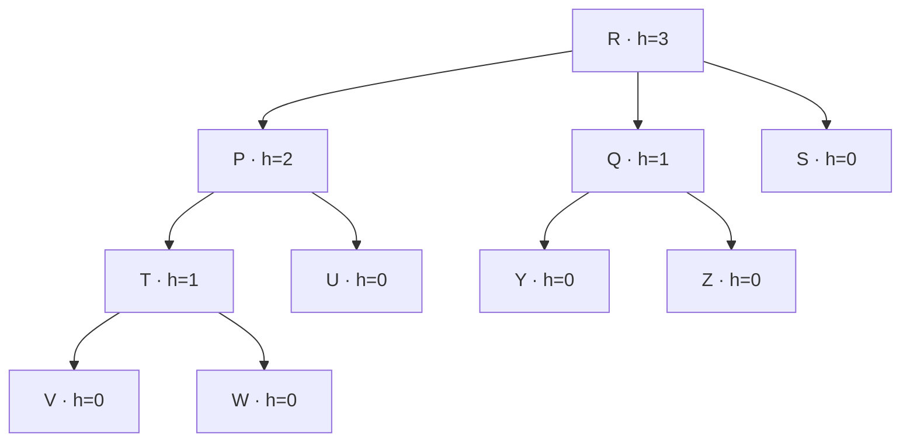

# Information and Computer Science 46 — Topic: Trees & Traversals

## Table of Contents

- [1. Trees: Hierarchical Data](#1-trees-hierarchical-data)
- [2. Tree Terminology](#2-tree-terminology)
- [3. Depth, Level and Height](#3-depth-level-and-height)
- [4. Full and Complete Binary Trees](#4-full-and-complete-binary-trees)
- [5. Counting Nodes and Height Bounds](#5-counting-nodes-and-height-bounds)
- [6. Skeleton Implementation](#6-skeleton-implementation)
- [7. Breadth-First: Level-Order Traversal](#7-breadth-first-level-order-traversal)
- [8. Depth-First: Pre-, In- and Post-Order](#8-depth-first-pre--in--and-post-order)
- [9. Complete Implementation](#9-complete-implementation)
- [10. Quick Reference & Top 5 Things to Remember](#10-quick-reference--top-5-things-to-remember)

> This chapter introduces trees as a data structure: the vocabulary, depth and height, the shapes of binary trees and what they imply for height, a pointer-based `BinaryTree`, and the four standard traversals (level-, pre-, in- and post-order). It assumes pointers and recursion ([C++ Essentials](topic-cpp.en-US.md)), linked nodes and queues ([Linear Structures](topic-linear.en-US.md)) and big-O analysis ([Analysis](topic-analysis.en-US.md)).

## 1. Trees: Hierarchical Data

Lists, stacks and queues are **linear**: every element has at most one predecessor and one successor. A **tree** is an abstract data type that stores elements **hierarchically**: each element has a **single parent** (its immediate ancestor) and **zero or more children** (its immediate descendants). Examples: an organization chart (CEO → CFO, CMO, COO, CTO → …), a website's sitemap (Home → About, Products, …), and a file system (`/` → Documents, Downloads, Music → …).

In CS we draw trees upside down: the **root** at the top, the **leaves** at the bottom.

**Definition.** A tree $T$ is a set of nodes that store elements in a parent–child relationship such that

- if $T$ is non-empty, it has a special node, the **root**, that has no parent;
- every node $v$ other than the root has a **unique parent**.

Example: root A; A's children B and C; B has only a right child D; C's children E and F; E has a left child G; F's children H and I. Step through it (← / → keys work when the demo is focused):

```viz binary-tree
{"title": "A first tree", "tree": "A, B, C, -, D, E, F, -, -, -, -, G, -, H, I", "views": "root; parent:C; ancestors:G"}
```

## 2. Tree Terminology

All examples use one **example tree**:

| Node | K | C | N | A | F | M | V | B | D | H | U |
|---|---|---|---|---|---|---|---|---|---|---|---|
| Left child | C | A | M | — | D | — | U | — | — | — | — |
| Right child | N | F | V | B | H | — | — | — | — | — | — |

| Term | Meaning | Example |
|---|---|---|
| Edge | a pair of connected nodes | (K, C) |
| Parent / child | node directly above / below | K is the parent of C and N |
| Siblings | nodes with the same parent | A and F |
| Ancestor / descendant | anywhere above / below on the path to the root | K is an ancestor of B; B is a descendant of K |
| Subtree | a node plus all of its descendants | subtree at N = {N, M, V, U} |
| Leaf (external node) | no children | {B, D, H, M, U} |
| Internal node | at least one child | {K, C, N, A, F, V} |
| Forest | a set of disjoint trees | |
| Simple path | distinct nodes with an edge between each consecutive pair | K-N-V-U |
| Path length | number of **edges** on the path | K-C-A has length 2 |
| Height of a node | length of the longest path from it down to a leaf | height(C) = 2 (C-F-D) |
| Height of the tree | longest root-to-leaf path = height of the root | 3 (e.g. K-C-A-B) |
| Degree of a node | number of its children | degree(C) = 2 |
| Degree (arity) of a tree | max degree of any node | 2 |
| Binary tree | a tree with arity 2: each node has at most 2 children, each in a **left** or **right** slot | |

Each term on the example tree, one step per term:

```viz binary-tree
{"title": "Terminology on the example tree", "tree": "K, C, N, A, F, M, V, -, B, D, H, -, -, U", "views": "parent:K; siblings:A; ancestors:B; subtree:N; leaves; internal; path:K-N-V-U; path:K-C-A; degree"}
```

> ⚠️ **Pitfall**: A leaf has **no** children at all; being near the bottom of the drawing is not enough. V sits at the lower right but has a child (U), so V is **internal**: the leaves are {B, D, H, M, U} and the internal nodes are {K, C, N, A, F, V}.

## 3. Depth, Level and Height

**Depth (= level)** of a node: its distance (number of edges) from the root. The root is at depth/level 0. The **depth of a binary tree** is the maximum level of all its nodes, and a node with the maximum depth is always a leaf.

**Height** is measured the other way, from the bottom:

- a leaf has height 0;
- any other node has height 1 + the maximum height of its non-null children.

The **height of the tree** is the height of its root. So depth counts down from the root, height counts up from the leaves, and for the whole tree the two agree (max depth = height of the root).

Example, on a general tree (a node may have three children, so it is not binary). Each node is labelled with its height: the leaves are 0, their parents 1 and 2, and the root 3. The deepest leaves (V and W) sit at depth 3, so tree depth = tree height = 3.



In the example tree from [§2](#2-tree-terminology): depth(F) = 2, height(F) = 1, height(K) = 3. The viz shows depth (badges counted down from the root) and height (counted up from the leaves) on that tree:

```viz binary-tree
{"title": "Depth vs height", "tree": "K, C, N, A, F, M, V, -, B, D, H, -, -, U", "views": "depth; height"}
```

The definition of height is recursive, and so is the code (`Node` is defined in [§6](#6-skeleton-implementation)):

```cpp
static int height(const Node* t) {       // empty = -1, leaf = 0
  if (t == nullptr) return -1;
  return 1 + std::max(height(t->left), height(t->right));
}
```

> ⚠️ **Pitfall**: Depth and height are counted in **edges**, not nodes. A single-node tree has height 0; with the recursive formula an empty tree is given height −1 so that a leaf comes out as 1 + max(−1, −1) = 0.

## 4. Full and Complete Binary Trees

### 4.1 Definitions

- **Full (proper)** binary tree: every node has **0 or 2** children — never exactly one.
- **Complete** binary tree: has minimal height — every level is full except possibly the last, and the nodes on the last level are **as far left as possible** (no holes in level order).
- **Perfect** binary tree: every level is full, including the last (so it is both full and complete).

The two properties are independent (a tree can be either, both or neither):

| | Full | Not full |
|---|---|---|
| **Complete** | every level full, or last level left-packed with pairs | last level ends with a lone left child |
| **Not complete** | some leaf missing on an upper level, or a gap on the last level, but no node with one child | e.g. a node with one child *and* a gap |

Four shapes, then the example tree — nodes with one child are marked purple for *full*, gaps in level order show as dashed slots for *complete*:

```viz binary-tree
{"title": "Complete and full", "tree": "Neither complete nor full = A, B, C, D, E, F, G, H, -, -, -, I, J | Complete but not full = A, B, C, D, E, F, G, H | Full but not complete = A, B, C, D, E, F, G, H, I, -, -, J, K | Complete and full = A, B, C, D, E, F, G, H, I | Example tree = K, C, N, A, F, M, V, -, B, D, H, -, -, U", "views": "full; complete"}
```

The example tree from [§2](#2-tree-terminology) is **neither**: A and V have one child each (not full), and its last level has a hole where A's left child would be (not complete).

### 4.2 Practice

#### Full or complete?

**(a)** A root with two children; the left child has two children (leaves); the right child has one child, on its left. Is the tree A: Full, B: Complete, C: Full and Complete, D: Neither Full nor Complete?

**(b)** A root with a single child, on its **right**. Same choices.

<details>
<summary>Solution</summary>

**(a) B: Complete.** Levels 0 and 1 are full and the last level (three leaves) is packed to the left. Not full: the root's right child has exactly one child.

**(b) D: Neither.** The root has exactly one child (not full), and the last level's only node is on the right, leaving a hole on the left (not complete). A root whose only child is on the **left** would be complete.

```viz binary-tree
{"title": "Practice check: (a) and (b)", "tree": "(a) = A, B, C, D, E, F | (b) = A, -, B", "views": "full; complete"}
```

</details>

## 5. Counting Nodes and Height Bounds

**Lemma.** A binary tree has at most $2^k$ nodes on level $k$ (each level can at most double). Level 2 of the example tree holds the maximum $2^2 = 4$: A, F, M, V.

**Theorem.** A binary tree of height $h$ with $n$ nodes satisfies

$$h + 1 \le n \le 2^{h+1} - 1 \qquad\Longleftrightarrow\qquad \log_2(n+1) - 1 \le h \le n - 1$$

- **Minimum** $n = h + 1$: a "stick" — every node has one child, the tree is a linked list. So the **worst-case height is $n - 1 = O(n)$**.
- **Maximum** $n = 1 + 2 + 4 + \dots + 2^h = 2^{h+1} - 1$: every level full. So the **best-case height is $O(\log n)$**, reached by compact (complete) trees.

Example: 7 nodes can have height anywhere from 2 (all three levels full) to 6 (a stick).

```viz binary-tree
{"title": "Fewest vs most nodes for the same height h = 2", "tree": "h = 2, most nodes (7) = A, B, C, D, E, F, G | h = 2, fewest nodes (3, a stick) = A, B, -, C", "views": "depth"}
```

> 💡 **Key Insight**: Every tree operation that walks one root-to-leaf path costs O(height) — between O(log n) and O(n). Keeping trees short is what balanced trees ([Search Trees](topic-search-trees.en-US.md)) and [Heaps](topic-heaps.en-US.md) are about.

> ⚠️ **Pitfall**: The maximum $2^{h+1} - 1$ is reached only when **every** level is full, that is by a *perfect* tree, not by every complete tree: a complete tree of height $h$ can have anywhere from $2^h$ to $2^{h+1} - 1$ nodes.

## 6. Skeleton Implementation

Like the linked list, a binary tree is a set of `Node` objects linked by pointers, but each node has **two** links. All code in this chapter uses the one skeleton below (the full class is in [§9](#9-complete-implementation)):

```cpp
template <typename Item>
class BinaryTree {
private:
  struct Node {
    Item item;       // payload
    Node* left;      // left child, or nullptr
    Node* right;     // right child, or nullptr
    Node(Node* leftNode, Node* rightNode, const Item& value)
        : item(value), left(leftNode), right(rightNode) {}
  };
  Node* root;        // top node of the tree, nullptr when empty
  // ...
```

The picture names the parts: `root` points at the top node; each `left`/`right` pointer is a **link**; any node together with everything below it is a **subtree** (so every link points at a subtree, which is why tree code is naturally recursive); a **leaf** is a node whose two links are both **null links** (`nullptr`).

```viz binary-tree
{"title": "Root, subtree and null links", "tree": "K, C, N, A, F, M, V, -, B, D, H, -, -, U", "views": "root; subtree:C; nulls"}
```

Example: a 3-node tree is `new Node(new Node(nullptr, nullptr, "A"), new Node(nullptr, nullptr, "C"), "B")`. Note that the constructor takes the children **first** and the value last.

For testing it helps to build a tree from a list of items in level order (the same notation as the viz demos, shifted to 0-based: the children of `pos[i]` are `pos[2i+1]` and `pos[2i+2]`, and an entry equal to `none` means "no node here"). Because the tree owns its heap-allocated nodes, the destructor frees the children before the node itself (a post-order walk, [§8](#8-depth-first-pre--in--and-post-order)) and copying is disabled:

```cpp
  static Node* build(const std::vector<Item>& pos, size_t i, const Item& none) {
    if (i >= pos.size() || pos[i] == none) return nullptr;
    return new Node(build(pos, 2 * i + 1, none), build(pos, 2 * i + 2, none), pos[i]);
  }
  static void destroy(Node* t) {           // post-order: children before the node
    if (t == nullptr) return;
    destroy(t->left);
    destroy(t->right);
    delete t;
  }
public:
  explicit BinaryTree(const std::vector<Item>& pos, const Item& none)
      : root(build(pos, 0, none)) {}
  ~BinaryTree() { destroy(root); }
  BinaryTree(const BinaryTree&) = delete;
  BinaryTree& operator=(const BinaryTree&) = delete;
```

## 7. Breadth-First: Level-Order Traversal

Linear structures have one natural order; trees can be traversed in several:

- **breadth-first**: level order;
- **depth-first**: pre-order, in-order, post-order ([§8](#8-depth-first-pre--in--and-post-order)).

A traversal takes a `visit` function and calls it once per node, so the same code can print, count or collect the items.

**Level order**: mark the nodes of level $i$ as visited, left to right, before any node of level $i + 1$, starting at level 0. On the example tree: **K C N A F M V B D H U**.

The standard implementation uses a FIFO queue ([Linear Structures](topic-linear.en-US.md)): pop a node, visit it, push its children.

```cpp
  template <typename Visit>
  void levelorder(Visit visit) const {
    std::queue<const Node*> q;
    if (root) q.push(root);
    while (!q.empty()) {
      const Node* t = q.front();
      q.pop();
      visit(t->item);
      if (t->left)  q.push(t->left);
      if (t->right) q.push(t->right);
    }
  }
```

Step through it below (← / → keys work when the demo is focused):

```viz tree-traversal
{"title": "Level order of the example tree", "tree": "K, C, N, A, F, M, V, -, B, D, H, -, -, U", "order": "level", "interactive": true}
```

Each node enters and leaves the queue once, so the traversal is O(n); the queue holds at most one level plus the children just pushed, so the extra space is proportional to the widest level (up to O(n)).

> ⚠️ **Pitfall**: Level order is **not** sorted order, even on a binary search tree. The traversal that lists a BST's keys in sorted order is **in-order** ([§8](#8-depth-first-pre--in--and-post-order)).

## 8. Depth-First: Pre-, In- and Post-Order

### 8.1 The Three Orders

All three visit the root and recursively traverse the left subtree, then the right subtree. The prefix says **when the root is marked visited**: **pre** = before both subtrees, **in** = between them, **post** = after both.

| Traversal | Recursion | Example tree | Typical use |
|---|---|---|---|
| Pre-order | root, Preorder(left), Preorder(right) | K C A B F D H N M V U | process a parent before its children, e.g. **copy** a tree |
| In-order | Inorder(left), root, Inorder(right) | A B C D F H K M N U V | on a binary search tree gives **sorted order** (e.g. find the kth smallest) |
| Post-order | Postorder(left), Postorder(right), root | B A D H F C M U V N K | process both subtrees before the parent, e.g. **deletion** |

As code, only the position of `visit` changes:

```cpp
  template <typename Visit>
  static void preorder(const Node* t, Visit& visit) {
    if (t == nullptr) return;
    visit(t->item);                        // root first
    preorder(t->left, visit);
    preorder(t->right, visit);
  }
  // inorder:   inorder(t->left, visit);  visit(t->item);  inorder(t->right, visit);
  // postorder: postorder(t->left, visit); postorder(t->right, visit); visit(t->item);
```

Public wrappers such as `template <typename Visit> void preorder(Visit visit) const { preorder(root, visit); }` start each traversal at the root.

Step through the in-order traversal (the call stack is shown in orange):

```viz tree-traversal
{"title": "In-order of the example tree", "tree": "K, C, N, A, F, M, V, -, B, D, H, -, -, U", "order": "in", "interactive": true}
```

Every node gets exactly one call (plus one call per null link), so each traversal is O(n) time; the call stack holds one frame per level, O(height) extra space. That is O(log n) for a compact tree but O(n) for a stick ([§5](#5-counting-nodes-and-height-bounds)).

> 💡 **Key Insight**: A quick way to check by hand: in pre-order the **root is first**, in post-order the **root is last**, and in in-order the root **splits** the left subtree's nodes from the right subtree's (A B C D F H | K | M N U V).

### 8.2 Practice

#### List the nodes in all four orders

List the nodes in pre-order, in-order, post-order, and level order:

| Node | 8 | 5 | 4 | 9 | 7 | 11 | 1 | 12 | 3 | 2 |
|---|---|---|---|---|---|---|---|---|---|---|
| Left child | 5 | 9 | — | — | 1 | 3 | — | 2 | — | — |
| Right child | 4 | 7 | 11 | — | 12 | — | — | — | — | — |

(Root 8; 5 has children 9 and 7; 7 has children 1 and 12; 12 has a left child 2; 4 has only a right child 11; 11 has a left child 3.)

> Hint: 4 has no left child and 11 has no right child — when the recursion reaches them, the missing side returns immediately.

<details>
<summary>Solution</summary>

| Order | Sequence |
|---|---|
| Pre-order | 8 5 9 7 1 12 2 4 11 3 |
| In-order | 9 5 1 7 2 12 8 4 3 11 |
| Post-order | 9 1 2 12 7 5 3 11 4 8 |
| Level order | 8 5 4 9 7 11 1 12 3 2 |

Checks: pre-order starts with the root 8, post-order ends with it; in-order puts 8 between the left subtree (9 5 1 7 2 12) and the right subtree (4 3 11). In in-order, 4 comes **before** 3 and 11 because it has no left subtree; in level order, 3 (level 3, under 11) comes **after** 1 and 12 and 2 is last (level 4). The viz below replays the post-order:

```viz tree-traversal
{"title": "Post-order check", "tree": "8, 5, 4, 9, 7, -, 11, -, -, 1, 12, -, -, 3, -, -, -, -, -, -, -, 2", "order": "post"}
```

</details>

## 9. Complete Implementation

One class template, `BinaryTree`: a `Node` struct, a level-order constructor, a destructor, `height`, `size`, `isFull`, `isComplete` and the four traversals, each taking a `visit` function. `isFull` checks that no node has exactly one child; `isComplete` runs a level-order pass that also queues the null links and fails if a real node comes after the first gap. `main` reproduces the traversals of the example tree, the practice tree, and the shapes of [§4](#4-full-and-complete-binary-trees) and [§5](#5-counting-nodes-and-height-bounds).

```cpp
#include <algorithm>
#include <iostream>
#include <queue>
#include <string>
#include <vector>

template <typename Item>
class BinaryTree {
private:
  struct Node {
    Item item;
    Node* left;
    Node* right;
    Node(Node* leftNode, Node* rightNode, const Item& value)
        : item(value), left(leftNode), right(rightNode) {}
  };
  Node* root;

  // pos holds the items in level order (pos[0] is the root, the children of
  // pos[i] are pos[2i+1] and pos[2i+2]); "-" marks a missing node.
  static Node* build(const std::vector<Item>& pos, size_t i, const Item& none) {
    if (i >= pos.size() || pos[i] == none) return nullptr;
    return new Node(build(pos, 2 * i + 1, none), build(pos, 2 * i + 2, none), pos[i]);
  }

  static void destroy(Node* t) {           // post-order: children before the node
    if (t == nullptr) return;
    destroy(t->left);
    destroy(t->right);
    delete t;
  }

  static int height(const Node* t) {       // empty = -1, leaf = 0
    if (t == nullptr) return -1;
    return 1 + std::max(height(t->left), height(t->right));
  }

  static size_t size(const Node* t) {
    return t == nullptr ? 0 : 1 + size(t->left) + size(t->right);
  }

  static bool isFull(const Node* t) {      // every node has 0 or 2 children
    if (t == nullptr) return true;
    if ((t->left == nullptr) != (t->right == nullptr)) return false;
    return isFull(t->left) && isFull(t->right);
  }

  template <typename Visit>
  static void preorder(const Node* t, Visit& visit) {
    if (t == nullptr) return;
    visit(t->item);                        // root first
    preorder(t->left, visit);
    preorder(t->right, visit);
  }

  template <typename Visit>
  static void inorder(const Node* t, Visit& visit) {
    if (t == nullptr) return;
    inorder(t->left, visit);
    visit(t->item);                        // root between the subtrees
    inorder(t->right, visit);
  }

  template <typename Visit>
  static void postorder(const Node* t, Visit& visit) {
    if (t == nullptr) return;
    postorder(t->left, visit);
    postorder(t->right, visit);
    visit(t->item);                        // root last
  }

public:
  // Build from a level-order list; the entry equal to `none` means "no node here".
  explicit BinaryTree(const std::vector<Item>& pos, const Item& none)
      : root(build(pos, 0, none)) {}
  ~BinaryTree() { destroy(root); }
  BinaryTree(const BinaryTree&) = delete;
  BinaryTree& operator=(const BinaryTree&) = delete;

  int height() const { return height(root); }
  size_t size() const { return size(root); }
  bool isFull() const { return isFull(root); }

  template <typename Visit> void preorder(Visit visit) const { preorder(root, visit); }
  template <typename Visit> void inorder(Visit visit) const { inorder(root, visit); }
  template <typename Visit> void postorder(Visit visit) const { postorder(root, visit); }

  template <typename Visit>
  void levelorder(Visit visit) const {
    std::queue<const Node*> q;
    if (root) q.push(root);
    while (!q.empty()) {
      const Node* t = q.front();
      q.pop();
      visit(t->item);
      if (t->left)  q.push(t->left);
      if (t->right) q.push(t->right);
    }
  }

  // Complete: in level order, once a missing child appears no node may follow.
  bool isComplete() const {
    std::queue<const Node*> q;
    q.push(root);
    bool gap = false;
    while (!q.empty()) {
      const Node* t = q.front();
      q.pop();
      if (t == nullptr) { gap = true; continue; }
      if (gap) return false;
      q.push(t->left);
      q.push(t->right);
    }
    return true;
  }
};

using Tree = BinaryTree<std::string>;

void show(const char* label, const Tree& t) {
  std::cout << label << ' ';
  t.levelorder([](const std::string& s) { std::cout << s << ' '; });
  std::cout << "-> size " << t.size() << ", height " << t.height()
            << ", full " << t.isFull() << ", complete " << t.isComplete() << '\n';
}

int main() {
  auto print = [](const std::string& s) { std::cout << s << ' '; };
  const std::string none = "-";

  Tree ex({"K", "C", "N", "A", "F", "M", "V", "-", "B", "D", "H", "-", "-", "U"}, none);
  std::cout << "pre:   "; ex.preorder(print);   std::cout << '\n';
  std::cout << "in:    "; ex.inorder(print);    std::cout << '\n';
  std::cout << "post:  "; ex.postorder(print);  std::cout << '\n';
  std::cout << "level: "; ex.levelorder(print); std::cout << '\n';
  std::cout << "size " << ex.size() << ", height " << ex.height() << "\n\n";

  Tree numbers({"8", "5", "4", "9", "7", "-", "11", "-", "-", "1", "12", "-", "-", "3", "-",
                "-", "-", "-", "-", "-", "-", "2"}, none);
  std::cout << "pre:   "; numbers.preorder(print);   std::cout << '\n';
  std::cout << "in:    "; numbers.inorder(print);    std::cout << '\n';
  std::cout << "post:  "; numbers.postorder(print);  std::cout << '\n';
  std::cout << "level: "; numbers.levelorder(print); std::cout << '\n';

  std::cout << '\n';
  show("(a)", Tree({"A", "B", "C", "D", "E", "F"}, none));
  show("(b)", Tree({"A", "-", "B"}, none));
  show("example tree           ", ex);
  show("complete and full      ", Tree({"A", "B", "C", "D", "E", "F", "G", "H", "I"}, none));
  show("complete, not full     ", Tree({"A", "B", "C", "D", "E", "F", "G", "H"}, none));
  show("full, not complete     ", Tree({"A", "B", "C", "D", "E", "F", "G", "H", "I", "-", "-", "J", "K"}, none));
  show("neither                ", Tree({"A", "B", "C", "D", "E", "F", "G", "H", "-", "-", "-", "I", "J"}, none));
  show("stick (h = n - 1)      ", Tree({"A", "B", "-", "C"}, none));
  show("perfect (n = 2^(h+1)-1)", Tree({"A", "B", "C", "D", "E", "F", "G"}, none));
  Tree single({"A"}, none);
  std::cout << "single node: height " << single.height() << ", size " << single.size() << '\n';
  Tree empty({}, none);
  std::cout << "empty tree: height " << empty.height() << ", size " << empty.size() << '\n';
}
```

Output (`g++ -std=c++17 -Wall -Wextra -fsanitize=address,undefined`):

```text
pre:   K C A B F D H N M V U 
in:    A B C D F H K M N U V 
post:  B A D H F C M U V N K 
level: K C N A F M V B D H U 
size 11, height 3

pre:   8 5 9 7 1 12 2 4 11 3 
in:    9 5 1 7 2 12 8 4 3 11 
post:  9 1 2 12 7 5 3 11 4 8 
level: 8 5 4 9 7 11 1 12 3 2 

(a) A B C D E F -> size 6, height 2, full 0, complete 1
(b) A B -> size 2, height 1, full 0, complete 0
example tree            K C N A F M V B D H U -> size 11, height 3, full 0, complete 0
complete and full       A B C D E F G H I -> size 9, height 3, full 1, complete 1
complete, not full      A B C D E F G H -> size 8, height 3, full 0, complete 1
full, not complete      A B C D E F G H I J K -> size 11, height 3, full 1, complete 0
neither                 A B C D E F G H I J -> size 10, height 3, full 0, complete 0
stick (h = n - 1)       A B C -> size 3, height 2, full 0, complete 0
perfect (n = 2^(h+1)-1) A B C D E F G -> size 7, height 2, full 1, complete 1
single node: height 0, size 1
empty tree: height -1, size 0
```

## 10. Quick Reference & Top 5 Things to Remember

| Operation / fact | Cost | Why |
|---|---|---|
| Pre/in/post/level-order traversal | O(n) | one visit per node |
| Depth-first extra space | O(height) | one call-stack frame per level |
| Height of a binary tree with n nodes | between ⌈log₂(n+1)⌉ − 1 and n − 1 | complete vs stick |
| Max nodes on level k / in a tree of height h | 2^k / 2^(h+1) − 1 | each level doubles |

**Top 5 things to remember**

1. Depth counts edges down from the root (root = 0); height counts edges up from the deepest leaf (leaf = 0); tree height = height of the root.
2. Full = every node has 0 or 2 children; complete = all levels full except the last, which is filled from the left — they are independent.
3. A binary tree with n nodes has height between log₂(n+1) − 1 and n − 1, so root-to-leaf operations cost O(log n) to O(n).
4. Pre = root first, in = root in the middle, post = root last; in-order of a BST is sorted, level order uses a queue.
5. Every traversal visits each node once: O(n) time, with O(height) call-stack space for the depth-first orders.
