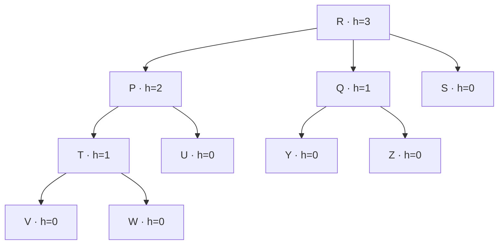

# Information and Computer Science 46 — 话题：树与遍历

## 目录

- [1. 树：层次化数据](#1-树层次化数据)
- [2. 树的术语](#2-树的术语)
- [3. 深度、层与高度](#3-深度层与高度)
- [4. 满二叉树与完全二叉树](#4-满二叉树与完全二叉树)
- [5. 节点计数与高度界](#5-节点计数与高度界)
- [6. 骨架实现](#6-骨架实现)
- [7. 广度优先：层序遍历](#7-广度优先层序遍历)
- [8. 深度优先：前序、中序与后序](#8-深度优先前序中序与后序)
- [9. 完整实现](#9-完整实现)
- [10. 速查与五个要点](#10-速查与五个要点)

> 本章把树作为一种数据结构来介绍：相关术语、深度与高度、二叉树的形状及其对高度的影响、基于指针的 `BinaryTree`，以及四种标准遍历（层序、前序、中序和后序）。学习本章需要先掌握指针与递归（[C++ 基础](topic-cpp.zh-CN.md)）、链式节点与队列（[线性数据结构](topic-linear.zh-CN.md)）以及大 O 分析（[算法分析](topic-analysis.zh-CN.md)）。

## 1. 树：层次化数据

列表、栈和队列都是**线性**的：每个元素至多有一个前驱和一个后继。**树**是一种抽象数据类型，它以**层次化**的方式存储元素：每个元素有**一个父节点**（直接祖先）和**零个或多个子节点**（直接后代）。例子包括：组织结构图（CEO → CFO、CMO、COO、CTO → ……）、网站的站点地图（Home → About、Products，……），以及文件系统（`/` → Documents、Downloads、Music → ……）。

在计算机科学中，树通常画成倒置的：**根**在顶部，**叶子**在底部。

**定义。** 树 $T$ 是一组节点，这些节点以父子关系存储元素，并满足：

- 若 $T$ 非空，则它有一个特殊节点，即**根**，根没有父节点；
- 除根以外的每个节点 $v$ 都有**唯一的父节点**。

例：根为 A；A 的子节点为 B 和 C；B 只有一个右子节点 D；C 的子节点为 E 和 F；E 有一个左子节点 G；F 的子节点为 H 和 I。逐步查看（演示获得焦点时可用 ← / → 键）：

```viz binary-tree
{"title": "第一棵树", "tree": "A, B, C, -, D, E, F, -, -, -, -, G, -, H, I", "views": "root; parent:C; ancestors:G"}
```

## 2. 树的术语

所有例子都使用同一棵**示例树**：

| 节点 | K | C | N | A | F | M | V | B | D | H | U |
|---|---|---|---|---|---|---|---|---|---|---|---|
| 左子节点 | C | A | M | — | D | — | U | — | — | — | — |
| 右子节点 | N | F | V | B | H | — | — | — | — | — | — |

| 术语 | 含义 | 示例 |
|---|---|---|
| 边 | 一对相连的节点 | (K, C) |
| 父节点 / 子节点 | 直接在上方 / 直接在下方的节点 | K 是 C 和 N 的父节点 |
| 兄弟节点 | 具有相同父节点的节点 | A 和 F |
| 祖先 / 后代 | 沿着通往根的路径，位于上方 / 下方的任意节点 | K 是 B 的祖先；B 是 K 的后代 |
| 子树 | 一个节点及其所有后代 | 以 N 为根的子树 = {N, M, V, U} |
| 叶子（外部节点） | 没有子节点 | {B, D, H, M, U} |
| 内部节点 | 至少有一个子节点 | {K, C, N, A, F, V} |
| 森林 | 一组互不相交的树 | |
| 简单路径 | 节点互不相同，且相邻两个节点之间有一条边 | K-N-V-U |
| 路径长度 | 路径上**边**的数量 | K-C-A 的长度为 2 |
| 节点的高度 | 从该节点向下到某个叶子的最长路径的长度 | height(C) = 2（C-F-D） |
| 树的高度 | 根到叶子的最长路径 = 根的高度 | 3（例如 K-C-A-B） |
| 节点的度 | 子节点的数量 | degree(C) = 2 |
| 树的度（arity） | 任一节点的度的最大值 | 2 |
| 二叉树 | 度为 2 的树：每个节点至多有 2 个子节点，分别位于**左**或**右**位置 | |

下面在示例树上逐个演示术语，每次一步：

```viz binary-tree
{"title": "示例树上的术语", "tree": "K, C, N, A, F, M, V, -, B, D, H, -, -, U", "views": "parent:K; siblings:A; ancestors:B; subtree:N; leaves; internal; path:K-N-V-U; path:K-C-A; degree"}
```

> ⚠️ **易错点**：叶子**没有**任何子节点；位于图的底部并不足以成为叶子。V 位于右下方，但它有一个子节点（U），因此 V 是**内部节点**：叶子为 {B, D, H, M, U}，内部节点为 {K, C, N, A, F, V}。

## 3. 深度、层与高度

节点的**深度（即层）**是它到根的距离（边的数量）。根的深度/层为 0。**二叉树的深度**是其所有节点层数的最大值，且深度最大的节点一定是叶子。

**高度**则是从底部反向度量的：

- 叶子的高度为 0；
- 其他任何节点的高度为 1 加上其非空子节点的最大高度。

**树的高度**是其根的高度。因此，深度从根向下计数，高度从叶子向上计数；对整棵树而言，二者一致（最大深度 = 根的高度）。

例：在一棵一般树上（节点可以有三个子节点，因此它不是二叉树），每个节点都标注了其高度：叶子为 0，它们的父节点为 1 和 2，根为 3。最深的叶子（V 和 W）位于深度 3，因此树的深度 = 树的高度 = 3。



在 [§2](#2-树的术语) 的示例树中：depth(F) = 2，height(F) = 1，height(K) = 3。下面的演示在该树上同时显示深度（从根向下计数的徽标）和高度（从叶子向上计数）：

```viz binary-tree
{"title": "深度与高度", "tree": "K, C, N, A, F, M, V, -, B, D, H, -, -, U", "views": "depth; height"}
```

高度的定义是递归的，代码也是递归的（`Node` 在 [§6](#6-骨架实现) 中定义）：

```cpp
static int height(const Node* t) {       // empty = -1, leaf = 0
  if (t == nullptr) return -1;
  return 1 + std::max(height(t->left), height(t->right));
}
```

> ⚠️ **易错点**：深度和高度按**边**计数，而不是按节点计数。单节点树的高度为 0；在递归公式中，空树被赋予高度 −1，这样叶子的高度就是 1 + max(−1, −1) = 0。

## 4. 满二叉树与完全二叉树

### 4.1 定义

- **满（full / proper）二叉树**：每个节点都有 **0 或 2** 个子节点——绝不能恰好只有一个。
- **完全（complete）二叉树**：高度最小——除最后一层外每层都是满的，并且最后一层的节点**尽可能靠左**（按层序没有空洞）。
- **完美（perfect）二叉树**：每一层都是满的，包括最后一层（因此它既满又完全）。

这两个性质相互独立（一棵树可以两者都是、只满足其一，或两者都不满足）：

| | 满 | 不满 |
|---|---|---|
| **完全** | 每层都满，或最后一层的节点从左侧成对紧凑排列 | 最后一层以一个孤立的左子节点结束 |
| **不完全** | 较高的某层缺少一个叶子，或最后一层有空隙，但没有只有一个子节点的节点 | 例如，既有只有一个子节点的节点，又有空隙 |

四种形状，然后是示例树——只有一个子节点的节点以紫色标出（针对*满*），层序中的空位以虚线槽显示（针对*完全*）：

```viz binary-tree
{"title": "完全与满", "tree": "Neither complete nor full = A, B, C, D, E, F, G, H, -, -, -, I, J | Complete but not full = A, B, C, D, E, F, G, H | Full but not complete = A, B, C, D, E, F, G, H, I, -, -, J, K | Complete and full = A, B, C, D, E, F, G, H, I | Example tree = K, C, N, A, F, M, V, -, B, D, H, -, -, U", "views": "full; complete"}
```

[§2](#2-树的术语) 中的示例树**两者都不是**：A 和 V 各只有一个子节点（不满），其最后一层中 A 的左子节点应当所在的位置是空的（不完全）。

### 4.2 练习

#### 满还是完全？

**(a)** 根有两个子节点；左子节点有两个子节点（叶子）；右子节点只有一个子节点，位于其左侧。这棵树属于 A：满；B：完全；C：既满又完全；还是 D：既不满也不完全？

**(b)** 根只有一个子节点，位于其**右侧**。选项同上。

<details>
<summary>解答</summary>

**(a) B：完全。** 第 0 层和第 1 层都是满的，最后一层（三个叶子）紧靠左侧排列。不满：根的右子节点恰好只有一个子节点。

**(b) D：既不满也不完全。** 根恰好只有一个子节点（不满），且最后一层唯一的节点位于右侧，左侧留下一个空洞（不完全）。如果根唯一的子节点位于**左侧**，则它是完全的。

```viz binary-tree
{"title": "练习验证：(a) 与 (b)", "tree": "(a) = A, B, C, D, E, F | (b) = A, -, B", "views": "full; complete"}
```

</details>

## 5. 节点计数与高度界

**引理。** 二叉树的第 $k$ 层最多有 $2^k$ 个节点（每一层最多翻倍）。示例树的第 2 层达到最大值 $2^2 = 4$：A、F、M、V。

**定理。** 高度为 $h$、含 $n$ 个节点的二叉树满足

$$h + 1 \le n \le 2^{h+1} - 1 \qquad\Longleftrightarrow\qquad \log_2(n+1) - 1 \le h \le n - 1$$

- **最小值** $n = h + 1$：一根"棍子"——每个节点都只有一个子节点，树退化为链表。因此**最坏情况下的高度为 $n - 1 = O(n)$**。
- **最大值** $n = 1 + 2 + 4 + \dots + 2^h = 2^{h+1} - 1$：每一层都满。因此**最好情况下的高度为 $O(\log n)$**，由紧凑（完全）的树达到。

例：7 个节点的树，其高度可以从 2（三层都满）一直到 6（棍子）。

```viz binary-tree
{"title": "同为 h = 2 时节点数最多与最少", "tree": "h = 2, most nodes (7) = A, B, C, D, E, F, G | h = 2, fewest nodes (3, a stick) = A, B, -, C", "views": "depth"}
```

> 💡 **关键洞见**：每一个沿着一条根到叶子路径执行的树操作，代价都是 O(height)——介于 O(log n) 与 O(n) 之间。保持树的高度较小，正是平衡树（[查找树](topic-search-trees.zh-CN.md)）和[堆](topic-heaps.zh-CN.md)要解决的问题。

> ⚠️ **易错点**：只有当**每一层**都满时，节点数才能达到 $2^{h+1} - 1$，也就是*完美*树；并非每棵完全树都能达到：高度为 $h$ 的完全树，其节点数可以在 $2^h$ 到 $2^{h+1} - 1$ 之间。

## 6. 骨架实现

与链表一样，二叉树是由通过指针相连的 `Node` 对象组成的集合，但每个节点有**两个**链接。本章所有代码都使用下面这个骨架（完整的类见 [§9](#9-完整实现)）：

```cpp
template <typename Item>
class BinaryTree {
private:
  struct Node {
    Item item;       // payload
    Node* left;      // left child, or nullptr
    Node* right;     // right child, or nullptr
    Node(Node* leftNode, Node* rightNode, const Item& value)
        : item(value), left(leftNode), right(rightNode) {}
  };
  Node* root;        // top node of the tree, nullptr when empty
  // ...
```

下图标出了各个部分：`root` 指向顶部的节点；每个 `left`/`right` 指针都是一个**链接**；任一节点连同其下方的所有内容构成一棵**子树**（因此每个链接都指向一棵子树，这正是树的代码天然是递归的原因）；**叶子**是两个链接都是**空链接**（`nullptr`）的节点。

```viz binary-tree
{"title": "根、子树与空链接", "tree": "K, C, N, A, F, M, V, -, B, D, H, -, -, U", "views": "root; subtree:C; nulls"}
```

例：一棵 3 节点的树可以写作 `new Node(new Node(nullptr, nullptr, "A"), new Node(nullptr, nullptr, "C"), "B")`。注意，构造函数**先**接收子节点，最后接收值。

测试时，从一个按层序排列的列表构建树会很有帮助（记法与 viz 演示相同，但改为从 0 开始编号：`pos[i]` 的子节点为 `pos[2i+1]` 和 `pos[2i+2]`，值等于 `none` 的项表示"此处没有节点"）。由于树拥有其在堆上分配的节点，析构函数需要先释放子节点、再释放节点本身（即后序遍历，见 [§8](#8-深度优先前序中序与后序)），并且禁止拷贝：

```cpp
  static Node* build(const std::vector<Item>& pos, size_t i, const Item& none) {
    if (i >= pos.size() || pos[i] == none) return nullptr;
    return new Node(build(pos, 2 * i + 1, none), build(pos, 2 * i + 2, none), pos[i]);
  }
  static void destroy(Node* t) {           // post-order: children before the node
    if (t == nullptr) return;
    destroy(t->left);
    destroy(t->right);
    delete t;
  }
public:
  explicit BinaryTree(const std::vector<Item>& pos, const Item& none)
      : root(build(pos, 0, none)) {}
  ~BinaryTree() { destroy(root); }
  BinaryTree(const BinaryTree&) = delete;
  BinaryTree& operator=(const BinaryTree&) = delete;
```

## 7. 广度优先：层序遍历

线性结构只有一种自然的顺序；树则可以按多种顺序遍历：

- **广度优先**：层序；
- **深度优先**：前序、中序、后序（见 [§8](#8-深度优先前序中序与后序)）。

遍历函数接收一个 `visit` 函数，并对每个节点调用一次，因此同一段代码可以用来打印、计数或收集元素。

**层序**：从第 0 层开始，先从左到右访问第 $i$ 层的所有节点，然后才访问第 $i + 1$ 层的任何节点。对示例树而言，顺序为：**K C N A F M V B D H U**。

标准实现使用 FIFO 队列（见[线性数据结构](topic-linear.zh-CN.md)）：弹出一个节点，访问它，然后把它的子节点入队。

```cpp
  template <typename Visit>
  void levelorder(Visit visit) const {
    std::queue<const Node*> q;
    if (root) q.push(root);
    while (!q.empty()) {
      const Node* t = q.front();
      q.pop();
      visit(t->item);
      if (t->left)  q.push(t->left);
      if (t->right) q.push(t->right);
    }
  }
```

下面逐步演示（演示获得焦点时，← / → 键可用）：

```viz tree-traversal
{"title": "示例树的层序遍历", "tree": "K, C, N, A, F, M, V, -, B, D, H, -, -, U", "order": "level", "interactive": true}
```

每个节点进入和离开队列各一次，因此遍历的时间复杂度为 O(n)；队列中最多同时保存一层加上刚刚入队的子节点，因此额外空间与最宽的一层成正比（最多为 O(n)）。

> ⚠️ **易错点**：层序**不是**有序的，即使对二叉搜索树也是如此。按排序顺序列出二叉搜索树键值的遍历是**中序**（见 [§8](#8-深度优先前序中序与后序)）。

## 8. 深度优先：前序、中序与后序

### 8.1 三种顺序

三种遍历都会访问根，并递归地先遍历左子树、再遍历右子树。前缀表示根**何时**被标记为已访问：**前序**（pre）= 在两棵子树之前；**中序**（in）= 在两者之间；**后序**（post）= 在两者之后。

| 遍历 | 递归 | 示例树 | 典型用途 |
|---|---|---|---|
| 前序 | 根，Preorder(左)，Preorder(右) | K C A B F D H N M V U | 先处理父节点再处理子节点，例如**复制**一棵树 |
| 中序 | Inorder(左)，根，Inorder(右) | A B C D F H K M N U V | 在二叉搜索树上得到**有序序列**（例如查找第 k 小的元素） |
| 后序 | Postorder(左)，Postorder(右)，根 | B A D H F C M U V N K | 先处理两棵子树再处理父节点，例如**删除** |

从代码上看，只有 `visit` 的位置发生变化：

```cpp
  template <typename Visit>
  static void preorder(const Node* t, Visit& visit) {
    if (t == nullptr) return;
    visit(t->item);                        // root first
    preorder(t->left, visit);
    preorder(t->right, visit);
  }
  // inorder:   inorder(t->left, visit);  visit(t->item);  inorder(t->right, visit);
  // postorder: postorder(t->left, visit); postorder(t->right, visit); visit(t->item);
```

形如 `template <typename Visit> void preorder(Visit visit) const { preorder(root, visit); }` 的公有包装函数，会从根开始每一次遍历。

逐步演示中序遍历（调用栈以橙色显示）：

```viz tree-traversal
{"title": "示例树的中序遍历", "tree": "K, C, N, A, F, M, V, -, B, D, H, -, -, U", "order": "in", "interactive": true}
```

每个节点恰好被调用一次（另加每个空链接一次调用），因此每种遍历的时间复杂度为 O(n)；调用栈每层保存一个栈帧，额外空间为 O(height)。对紧凑的树而言这是 O(log n)，而对棍子而言则是 O(n)（见 [§5](#5-节点计数与高度界)）。

> 💡 **关键洞见**：手工检验的一个快捷方法：前序中**根排在第一位**，后序中**根排在最后**，而中序中根把左子树的节点与右子树的节点**分隔**开（A B C D F H | K | M N U V）。

### 8.2 练习

#### 按四种顺序列出节点

按前序、中序、后序和层序列出节点：

| 节点 | 8 | 5 | 4 | 9 | 7 | 11 | 1 | 12 | 3 | 2 |
|---|---|---|---|---|---|---|---|---|---|---|
| 左子节点 | 5 | 9 | — | — | 1 | 3 | — | 2 | — | — |
| 右子节点 | 4 | 7 | 11 | — | 12 | — | — | — | — | — |

（根为 8；5 的子节点为 9 和 7；7 的子节点为 1 和 12；12 有一个左子节点 2；4 只有一个右子节点 11；11 有一个左子节点 3。）

> 提示：4 没有左子节点，11 没有右子节点——当递归走到它们时，缺失的那一侧会立即返回。

<details>
<summary>解答</summary>

| 顺序 | 序列 |
|---|---|
| 前序 | 8 5 9 7 1 12 2 4 11 3 |
| 中序 | 9 5 1 7 2 12 8 4 3 11 |
| 后序 | 9 1 2 12 7 5 3 11 4 8 |
| 层序 | 8 5 4 9 7 11 1 12 3 2 |

检验：前序以根 8 开始，后序以 8 结束；中序把 8 放在左子树（9 5 1 7 2 12）与右子树（4 3 11）之间。在中序中，4 排在 3 和 11 **之前**，因为它没有左子树；在层序中，3（位于第 3 层，在 11 之下）排在 1 和 12 **之后**，而 2 排在最后（第 4 层）。下面的演示回放了这里的后序：

```viz tree-traversal
{"title": "后序检验", "tree": "8, 5, 4, 9, 7, -, 11, -, -, 1, 12, -, -, 3, -, -, -, -, -, -, -, 2", "order": "post"}
```

</details>

## 9. 完整实现

一个类模板 `BinaryTree`：包含一个 `Node` 结构体、按层序构建的构造函数、析构函数、`height`、`size`、`isFull`、`isComplete`，以及四种遍历，每种遍历都接收一个 `visit` 函数。`isFull` 检查没有节点恰好只有一个子节点；`isComplete` 执行一次层序遍历，同时把空链接也入队，一旦某个真实节点出现在第一个空位之后就判定失败。`main` 重现了示例树、练习树以及 [§4](#4-满二叉树与完全二叉树) 和 [§5](#5-节点计数与高度界) 中各种形状的遍历结果。

```cpp
#include <algorithm>
#include <iostream>
#include <queue>
#include <string>
#include <vector>

template <typename Item>
class BinaryTree {
private:
  struct Node {
    Item item;
    Node* left;
    Node* right;
    Node(Node* leftNode, Node* rightNode, const Item& value)
        : item(value), left(leftNode), right(rightNode) {}
  };
  Node* root;

  // pos holds the items in level order (pos[0] is the root, the children of
  // pos[i] are pos[2i+1] and pos[2i+2]); "-" marks a missing node.
  static Node* build(const std::vector<Item>& pos, size_t i, const Item& none) {
    if (i >= pos.size() || pos[i] == none) return nullptr;
    return new Node(build(pos, 2 * i + 1, none), build(pos, 2 * i + 2, none), pos[i]);
  }

  static void destroy(Node* t) {           // post-order: children before the node
    if (t == nullptr) return;
    destroy(t->left);
    destroy(t->right);
    delete t;
  }

  static int height(const Node* t) {       // empty = -1, leaf = 0
    if (t == nullptr) return -1;
    return 1 + std::max(height(t->left), height(t->right));
  }

  static size_t size(const Node* t) {
    return t == nullptr ? 0 : 1 + size(t->left) + size(t->right);
  }

  static bool isFull(const Node* t) {      // every node has 0 or 2 children
    if (t == nullptr) return true;
    if ((t->left == nullptr) != (t->right == nullptr)) return false;
    return isFull(t->left) && isFull(t->right);
  }

  template <typename Visit>
  static void preorder(const Node* t, Visit& visit) {
    if (t == nullptr) return;
    visit(t->item);                        // root first
    preorder(t->left, visit);
    preorder(t->right, visit);
  }

  template <typename Visit>
  static void inorder(const Node* t, Visit& visit) {
    if (t == nullptr) return;
    inorder(t->left, visit);
    visit(t->item);                        // root between the subtrees
    inorder(t->right, visit);
  }

  template <typename Visit>
  static void postorder(const Node* t, Visit& visit) {
    if (t == nullptr) return;
    postorder(t->left, visit);
    postorder(t->right, visit);
    visit(t->item);                        // root last
  }

public:
  // Build from a level-order list; the entry equal to `none` means "no node here".
  explicit BinaryTree(const std::vector<Item>& pos, const Item& none)
      : root(build(pos, 0, none)) {}
  ~BinaryTree() { destroy(root); }
  BinaryTree(const BinaryTree&) = delete;
  BinaryTree& operator=(const BinaryTree&) = delete;

  int height() const { return height(root); }
  size_t size() const { return size(root); }
  bool isFull() const { return isFull(root); }

  template <typename Visit> void preorder(Visit visit) const { preorder(root, visit); }
  template <typename Visit> void inorder(Visit visit) const { inorder(root, visit); }
  template <typename Visit> void postorder(Visit visit) const { postorder(root, visit); }

  template <typename Visit>
  void levelorder(Visit visit) const {
    std::queue<const Node*> q;
    if (root) q.push(root);
    while (!q.empty()) {
      const Node* t = q.front();
      q.pop();
      visit(t->item);
      if (t->left)  q.push(t->left);
      if (t->right) q.push(t->right);
    }
  }

  // Complete: in level order, once a missing child appears no node may follow.
  bool isComplete() const {
    std::queue<const Node*> q;
    q.push(root);
    bool gap = false;
    while (!q.empty()) {
      const Node* t = q.front();
      q.pop();
      if (t == nullptr) { gap = true; continue; }
      if (gap) return false;
      q.push(t->left);
      q.push(t->right);
    }
    return true;
  }
};

using Tree = BinaryTree<std::string>;

void show(const char* label, const Tree& t) {
  std::cout << label << ' ';
  t.levelorder([](const std::string& s) { std::cout << s << ' '; });
  std::cout << "-> size " << t.size() << ", height " << t.height()
            << ", full " << t.isFull() << ", complete " << t.isComplete() << '\n';
}

int main() {
  auto print = [](const std::string& s) { std::cout << s << ' '; };
  const std::string none = "-";

  Tree ex({"K", "C", "N", "A", "F", "M", "V", "-", "B", "D", "H", "-", "-", "U"}, none);
  std::cout << "pre:   "; ex.preorder(print);   std::cout << '\n';
  std::cout << "in:    "; ex.inorder(print);    std::cout << '\n';
  std::cout << "post:  "; ex.postorder(print);  std::cout << '\n';
  std::cout << "level: "; ex.levelorder(print); std::cout << '\n';
  std::cout << "size " << ex.size() << ", height " << ex.height() << "\n\n";

  Tree numbers({"8", "5", "4", "9", "7", "-", "11", "-", "-", "1", "12", "-", "-", "3", "-",
                "-", "-", "-", "-", "-", "-", "2"}, none);
  std::cout << "pre:   "; numbers.preorder(print);   std::cout << '\n';
  std::cout << "in:    "; numbers.inorder(print);    std::cout << '\n';
  std::cout << "post:  "; numbers.postorder(print);  std::cout << '\n';
  std::cout << "level: "; numbers.levelorder(print); std::cout << '\n';

  std::cout << '\n';
  show("(a)", Tree({"A", "B", "C", "D", "E", "F"}, none));
  show("(b)", Tree({"A", "-", "B"}, none));
  show("example tree           ", ex);
  show("complete and full      ", Tree({"A", "B", "C", "D", "E", "F", "G", "H", "I"}, none));
  show("complete, not full     ", Tree({"A", "B", "C", "D", "E", "F", "G", "H"}, none));
  show("full, not complete     ", Tree({"A", "B", "C", "D", "E", "F", "G", "H", "I", "-", "-", "J", "K"}, none));
  show("neither                ", Tree({"A", "B", "C", "D", "E", "F", "G", "H", "-", "-", "-", "I", "J"}, none));
  show("stick (h = n - 1)      ", Tree({"A", "B", "-", "C"}, none));
  show("perfect (n = 2^(h+1)-1)", Tree({"A", "B", "C", "D", "E", "F", "G"}, none));
  Tree single({"A"}, none);
  std::cout << "single node: height " << single.height() << ", size " << single.size() << '\n';
  Tree empty({}, none);
  std::cout << "empty tree: height " << empty.height() << ", size " << empty.size() << '\n';
}
```

输出（`g++ -std=c++17 -Wall -Wextra -fsanitize=address,undefined`）：

```text
pre:   K C A B F D H N M V U 
in:    A B C D F H K M N U V 
post:  B A D H F C M U V N K 
level: K C N A F M V B D H U 
size 11, height 3

pre:   8 5 9 7 1 12 2 4 11 3 
in:    9 5 1 7 2 12 8 4 3 11 
post:  9 1 2 12 7 5 3 11 4 8 
level: 8 5 4 9 7 11 1 12 3 2 

(a) A B C D E F -> size 6, height 2, full 0, complete 1
(b) A B -> size 2, height 1, full 0, complete 0
example tree            K C N A F M V B D H U -> size 11, height 3, full 0, complete 0
complete and full       A B C D E F G H I -> size 9, height 3, full 1, complete 1
complete, not full      A B C D E F G H -> size 8, height 3, full 0, complete 1
full, not complete      A B C D E F G H I J K -> size 11, height 3, full 1, complete 0
neither                 A B C D E F G H I J -> size 10, height 3, full 0, complete 0
stick (h = n - 1)       A B C -> size 3, height 2, full 0, complete 0
perfect (n = 2^(h+1)-1) A B C D E F G -> size 7, height 2, full 1, complete 1
single node: height 0, size 1
empty tree: height -1, size 0
```

## 10. 速查与五个要点

| 操作 / 事实 | 代价 | 原因 |
|---|---|---|
| 前序/中序/后序/层序遍历 | O(n) | 每个节点访问一次 |
| 深度优先的额外空间 | O(height) | 每层一个调用栈帧 |
| 含 n 个节点的二叉树的高度 | 介于 ⌈log₂(n+1)⌉ − 1 与 n − 1 之间 | 完全树与棍子 |
| 第 k 层的最大节点数 / 高度为 h 的树的最大节点数 | 2^k / 2^(h+1) − 1 | 每层翻倍 |

**必记的五个要点**

1. 深度从根向下数边（根 = 0）；高度从最深的叶子向上数边（叶子 = 0）；树的高度 = 根的高度。
2. 满 = 每个节点有 0 或 2 个子节点；完全 = 除最后一层外每层都满，且最后一层从左侧开始填充——二者相互独立。
3. 含 n 个节点的二叉树，其高度介于 log₂(n+1) − 1 与 n − 1 之间，因此沿根到叶子路径的操作代价为 O(log n) 到 O(n)。
4. 前序 = 根最先，中序 = 根居中，后序 = 根最后；二叉搜索树的中序遍历有序，层序遍历使用队列。
5. 每种遍历都只访问每个节点一次：时间为 O(n)；深度优先的几种顺序额外使用 O(height) 的调用栈空间。
