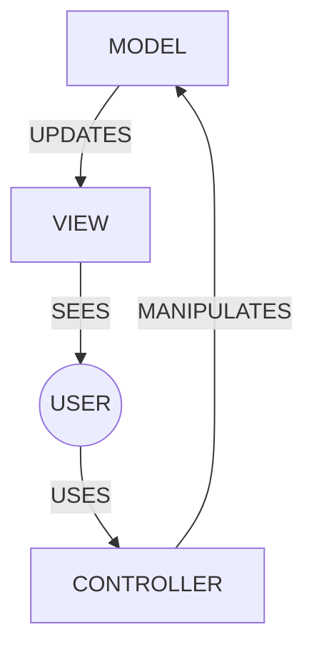

# IN4MATX 133: User Interface Software — Lecture 15：设备资源与传感器

## 目录

- [1. Ionic 与 Capacitor](#1-ionic-与-capacitor)
- [2. 为项目添加 Capacitor 和插件](#2-为项目添加-capacitor-和插件)
- [3. 在浏览器中运行：ionic serve](#3-在浏览器中运行ionic-serve)
- [4. 在模拟器或真机上运行](#4-在模拟器或真机上运行)
- [5. Signals](#5-signals)
- [6. 本地通知](#6-本地通知)
- [7. 地理定位](#7-地理定位)
- [8. 分享](#8-分享)
- [9. 插件质量与插件问题](#9-插件质量与插件问题)
- [10. 混合应用的优点与缺点](#10-混合应用的优点与缺点)
- [11. 课堂问题与演示（附解答）](#11-课堂问题与演示附解答)
- [12. 速查与必记的 5 个要点](#12-速查与必记的-5-个要点)

> UCI IN4MATX 133: User Interface Software — Prof. Travis Linden Reid，2026 年秋季学期，周二 11/17（第 8 周）
> 内容整理自 Lecture 15 的幻灯片（共 35 页）和 demo 仓库文件夹 `W8_L1_DeviceResources_Signals`。内容按概念组织，而不是按来源组织。

> 📅 **课程安排**：A4 截止于 **11 月 23 日周一午夜**。请在 Canvas 上加入一个 A4 小组。

今天的目标（幻灯片 3、34）：用 Capacitor 插件访问设备资源；在模拟器或真机上运行 Ionic/Capacitor 项目；用 signals 细粒度地追踪变量变化；说明 Web 混合应用的优点和局限。

---

## 1. Ionic 与 Capacitor

**Ionic**（幻灯片 4）为移动界面中常见的许多元素提供了 Angular 风格的组件：列表、按钮、滑块、标签页、模态对话框、搜索栏等等（幻灯片上展示了一个 iOS 的“最近对话”列表和一个滑块界面）。这是 UI 那一半，[Lecture 13](lec-13.zh-CN.md) 已经讲过。

**Capacitor**（幻灯片 5）是另一半：以**插件**形式提供的、连接**设备资源**的库。

- 插件有数百个。
- 分为**官方**插件（由 Capacitor 团队维护）和**社区**插件。
- 有些插件存在已知问题（见[第 9 节](#9-插件质量与插件问题)）。

所以，Ionic 应用本身是一个 Web 应用（Angular + Ionic 组件），而 Capacitor 是从这段 Web 代码通往手机通知、GPS、分享面板、相机等功能的桥梁。

> 🔗 **延伸阅读**：[Ionic UI components](https://ionicframework.com/docs/components/) · [Ionic：原生 API / Capacitor 插件](https://ionicframework.com/docs/native/)

## 2. 为项目添加 Capacitor 和插件

为**已有的** Ionic 项目添加 Capacitor（幻灯片 6）需要两个 npm 包，之后每种设备资源再装一个包：

```bash
cd [project folder]
npm install @capacitor/core
npm install @capacitor/cli

# one package per resource, e.g. local notifications
npm install @capacitor/local-notifications
```

之后就可以在 TypeScript 中使用该资源：

```ts
import { LocalNotifications } from ‘capacitor/local-notifications’;
var notif = await LocalNotifications.schedule ( { …. } );
```

⚠️ 幻灯片 6 的 import 有两处笔误：弯引号 `‘…’`（在 TS 里是语法错误），以及漏了 `@`。正确写法：`import { LocalNotifications } from '@capacitor/local-notifications';`——所有官方插件都在 `@capacitor/` 作用域下。

在为手机构建之前，还有两步配置（幻灯片 8）：

```bash
# initialize Capacitor settings for the project (app name, app id, web dir)
npx cap init

# set up the project for Android or iOS
npm install @capacitor/[android or ios]
npx cap add [android or ios]
```

`npx cap init` 会生成 `capacitor.config.ts`。demo 项目中的版本（来自仓库）：

```ts
import type { CapacitorConfig } from '@capacitor/cli';

const config: CapacitorConfig = {
  appId: 'com.inf133.deviceexamples',
  appName: 'DeviceResourceExamples',
  webDir: 'www'
};

export default config;
```

`webDir: 'www'` 是 `ionic build` 输出编译后 Web 应用的位置，Capacitor 会把它复制到原生项目中。demo 应用的 `package.json` 包含 `@capacitor/core`、`@capacitor/cli`、`@capacitor/ios`，以及本讲用到的三个插件：`@capacitor/local-notifications`、`@capacitor/geolocation`、`@capacitor/share`。它的 `ios/` 文件夹（一个 Xcode 项目）就是 `npx cap add ios` 生成的。

> 🧪 **Demo 文件**：[capacitor.config.ts](https://github.com/travislindenreid/INF33-Demos/blob/main/W8_L1_DeviceResources_Signals/solution1/DeviceResourceExamples/capacitor.config.ts) · [package.json](https://github.com/travislindenreid/INF33-Demos/blob/main/W8_L1_DeviceResources_Signals/solution1/DeviceResourceExamples/package.json)

## 3. 在浏览器中运行：ionic serve

在浏览器中运行 Ionic 项目（幻灯片 7）：

```bash
ionic serve
```

Capacitor 会**在运行时判断所在平台和可用资源**。插件会尝试使用原生功能；没有原生功能时（也就是在浏览器里），它会**退回到 Web API**。所以同一句 `LocalNotifications.schedule(...)`，在手机上是原生通知，在 `ionic serve` 里则是浏览器通知。

不同浏览器的能力不同——例如 Firefox 不支持本地通知，而 Safari 支持。

幻灯片 10 的结论：**如果你没有用 Capacitor 访问原生设备资源，那么上面这些配置和部署命令都不需要**——只用 `ionic serve` 在浏览器里测试即可。

> ⚠️ **易错点**：“在 `ionic serve` 里能跑”只测试了 Web 回退。插件在浏览器里的行为可能和真机不同（甚至缺失）——见[第 8 节](#8-分享)的分享插件。

> 🔗 **延伸阅读**：[Ionic CLI: ionic serve](https://ionicframework.com/docs/cli/commands/serve) · [Capacitor：渐进式 Web 应用](https://capacitorjs.com/docs/basics/progressive-web-app)

## 4. 在模拟器或真机上运行

部署（幻灯片 9）的流程是：构建 → 同步 → 打开原生 IDE：

```bash
# build the Ionic project and sync the web app into the native project
ionic build
npx cap sync

# open the native project in Android Studio or Xcode
npx cap open [android or ios]
```

然后**在原生 IDE 中**部署到模拟器或真机（Android Studio / Xcode 的 Run 按钮）。

另一种方式是**实时重载（live reload）**，在你编辑代码时持续更新模拟器或真机：

```bash
ionic cap run [android or iOS] -l --external
```

`-l` 表示实时重载；`--external` 让开发服务器在你电脑的网络地址上提供服务，手机才能访问到它。（demo 项目的 `ios/App/App/Info.plist` 把 `NSAllowsArbitraryLoads` 设为 true，即允许 iOS 应用加载像这个开发服务器一样的纯 `http` 页面。）

| 时机 | 命令 | 作用 |
|---|---|---|
| 一次 | `npx cap init` | 生成项目的 Capacitor 配置 |
| 每个平台一次 | `npm install @capacitor/ios` + `npx cap add ios` | 创建原生项目 |
| 每次修改 | `ionic build` | 把 Web 应用编译到 `www/` |
| 每次修改 | `npx cap sync` | 把 `www/` 和插件复制进原生项目 |
| 运行 | `npx cap open ios` | 打开 Xcode / Android Studio，从那里运行 |
| 或者 | `ionic cap run ios -l --external` | 在模拟器/真机上实时重载 |

**A4 与真机测试**（幻灯片 11–12）。A4 有两个选项：

- 使用一种**原生设备资源**，或
- 把数据写入**本地存储（local storage）**。

如果你选择的原生资源必须在真机上测试（浏览器或模拟器不行），那就**先**做这件事：安装 Capacitor，以极其简单的方式用一下这个资源，然后尝试部署到真机。部署到真机可以计入**加分**（A4/A5）。

为什么值得做：这是很好的经验；要在 App Store / Google Play 上发布应用就必须这样做；而且真机测试并不简单——你做的每个应用都会遇到设备特有的错误，而用户只会在自己的设备上体验你的应用。“不简单，但在真实世界里不可省略。”

## 5. Signals

Angular 的变更检测机制（幻灯片 13）很复杂，并且在今年 7 月有一次重大更新，换成了新的模型。**视图只会在以下情况刷新**：

- 某个事件触发，
- 某个输入（input）发生变化，
- 你手动刷新，或
- 某个 **signal** 发生变化。

**signal** 是一个变量包装器，用来通知视图刷新。

**它在哪个位置：Model-View-Controller**（幻灯片 14）。**模型（model）**是应用背后的数据。它在变化时通知视图，允许视图查询数据，也允许控制器修改数据。幻灯片里的图：控制器*修改（manipulates）*模型，模型*更新（updates）*视图，用户*看到（sees）*视图并*使用（uses）*控制器。signal 就是“模型通知视图”这一条箭头。



signal 的作用（幻灯片 15）：

- 包装一个变量；
- 值变化时，只更新**模板中用到这个变量的那一部分**——比刷新整个视图更高效；
- 确保变量**每次**更新时视图都随之更新。

Prof. Reid 的经验：**如果你想在异步回调之后刷新视图，就要把变量包在 signal 里**——包括 Capacitor 调用之后，或向远程 API 发起 `fetch` 之后。

用法（幻灯片 16）：从 `@angular/core` 导入 `signal`，用 `signal<type>(defaultValue)` 初始化，用 `set(newValue)` 更新，**通过调用来读取**——`readyForSelfie()`：

```ts
// component.ts file
// at top of file…
import { Component, signal } from ‘@angular/core’;

// in Component variable declarations…
readyForSelfie = signal<boolean>(false);

// in some function…
readyForSelfie.set(true);
```

```html
<!-- component.html file -->
@if ( readyForSelfie() )
{ … }
```

幻灯片上的两处小错：又是弯引号（应写 `'@angular/core'`）；在组件方法内部应写 `this.readyForSelfie.set(true)`。

demo 应用（solution1 的 `home.page.ts`）把所有状态都放在 signal 里，并且在 **await** 完 Capacitor 调用**之后**才 set：

```ts
export class HomePage {
  finishedReminder = signal<boolean>(false);
  finishedLocation = signal<boolean>(false);

  latCoord = signal<number>(0);
  longCoord = signal<number>(0);

  async getLocation () {
    const position = await Geolocation.getCurrentPosition();
    this.finishedLocation.set(true);
    this.latCoord.set(position.coords.latitude);
    this.longCoord.set(position.coords.longitude);
  }
  // scheduleReminder() and shareStuff(): Sections 6 and 8
}
```

```html
<div id="container">
  @if(!finishedReminder())
  {
    <ion-button (click)="scheduleReminder()">Schedule a reminder</ion-button>
  }
  @if(finishedReminder() && !finishedLocation())
  {
    <ion-button (click)="getLocation()">Print geolocation</ion-button>
  }
  @if(finishedLocation())
  {
    <ion-item>Coordinates: ({{latCoord()}}, {{longCoord()}})</ion-item>

    <ion-button (click)="shareStuff()">Share my coordinates</ion-button>
  }
</div>
```

这个说法在本项目（Angular 22）中成立：构建后在 Chromium 中运行，允许通知和定位时，每次点击都会切换到下一个按钮，坐标也会显示出来。把四个 signal 改成普通字段（`finishedReminder = false;` … `this.finishedReminder = true;`，模板中去掉 `()`）后，点击之后页面**一直停在 “Schedule a reminder”**，尽管代码已经执行了——赋值发生在 `await` 之后，没有任何东西通知视图刷新。

下面可以动手试：这个页面用 Ionic Web 组件重新实现了 demo 应用（沙箱里没有 Angular，所以 `signal()` 和三个插件都是为这个页面写的小替身）。依次点击三个按钮，然后按 Next 换成普通变量：

```viz web-demo
{"title": "演示 1（幻灯片 25 · setup1 → solution1）用 Ionic Web 组件重现；signal() 和三个插件都是替身", "width": 375, "height": 420, "html": "<link rel=\"stylesheet\" href=\"https://cdn.jsdelivr.net/npm/@ionic/core@8.8.19/css/ionic.bundle.css\">\n<script type=\"module\" src=\"https://cdn.jsdelivr.net/npm/@ionic/core@8.8.19/dist/ionic/ionic.esm.js\"></script>\n<ion-app>\n<ion-header><ion-toolbar><ion-title>Daily selfie</ion-title></ion-toolbar></ion-header>\n<ion-content>\n  <div id=\"container\"></div>\n</ion-content>\n</ion-app>", "css": "#container { text-align: center; position: absolute; left: 0; right: 0; top: 50%; transform: translateY(-50%); }", "js": "// ---- Stand-ins (the sandbox has no Angular and no Capacitor) ----\n// A tiny signal(): read with s(), write with s.set(v); set() re-renders the template.\nfunction signal(value) {\n  const s = () => value;\n  s.set = (v) => { value = v; render(); };\n  return s;\n}\nconst LocalNotifications = {\n  requestPermissions: async () => ({ display: 'granted' }),\n  schedule: async (opts) => { console.log('scheduled', opts.notifications[0].title); return opts; }\n};\nconst Geolocation = {\n  getCurrentPosition: async () => ({ coords: { latitude: 33.6405, longitude: -117.8443 } })\n};\nconst Share = {\n  share: async () => { throw new Error('Share API not available in this browser'); }\n};\n\n// ---- home.page.ts (solution1) ----\nconst finishedReminder = signal(false);\nconst finishedLocation = signal(false);\nconst latCoord = signal(0);\nconst longCoord = signal(0);\n\nasync function scheduleReminder() {\n  console.log('clicked schedule selfie');\n  const perm = await LocalNotifications.requestPermissions();\n  if (perm.display == 'granted') {\n    await LocalNotifications.schedule({ notifications: [{ title: 'Daily Reminder', body: 'Time to do the thing!', id: 1, schedule: { at: new Date(Date.now()) } }] });\n    finishedReminder.set(true);\n  }\n}\nasync function getLocation() {\n  const position = await Geolocation.getCurrentPosition();\n  finishedLocation.set(true);\n  latCoord.set(position.coords.latitude);\n  longCoord.set(position.coords.longitude);\n}\nasync function shareStuff() {\n  try {\n    await Share.share({ title: 'Share coordinates', text: `My current coordinates are ${latCoord()}, ${longCoord()}`, dialogTitle: 'Share my coordinates' });\n  } catch (e) {\n    console.log(e.message);\n  }\n}\n\n// ---- home.page.html: the three @if blocks ----\nfunction button(label, onClick) {\n  const b = document.createElement('ion-button');\n  b.textContent = label;\n  b.addEventListener('click', onClick);\n  return b;\n}\nfunction render() {\n  const c = document.getElementById('container');\n  c.innerHTML = '';\n  if (!finishedReminder()) c.append(button('Schedule a reminder', scheduleReminder));\n  if (finishedReminder() && !finishedLocation()) c.append(button('Print geolocation', getLocation));\n  if (finishedLocation()) {\n    const item = document.createElement('ion-item');\n    item.textContent = `Coordinates: (${latCoord()}, ${longCoord()})`;\n    c.append(item, button('Share my coordinates', shareStuff));\n  }\n}\nrender();", "steps": [{"note": "换成普通变量：set() 只保存值，不会重绘，所以第一个按钮一直不消失（和真实应用把 signal 改成普通字段时的表现一致）。", "js": "\n// ---- Without signals: assigning a value doesn't refresh the view ----\nfunction signal(value) {\n  const s = () => value;\n  s.set = (v) => { value = v; };\n  return s;\n}"}], "interactive": true}
```

> 💡 **关键理解**：signal 用 `()` 读取，用 `.set()` 写入。模板里忘了 `()` 会打印出函数本身而不是值；用 `=` 赋值则会把 signal 替换成普通值，视图从此不再更新。

> 🧪 **Demo 文件**：[solution1/…/home.page.ts](https://github.com/travislindenreid/INF33-Demos/blob/main/W8_L1_DeviceResources_Signals/solution1/DeviceResourceExamples/src/app/home/home.page.ts) · [solution1/…/home.page.html](https://github.com/travislindenreid/INF33-Demos/blob/main/W8_L1_DeviceResources_Signals/solution1/DeviceResourceExamples/src/app/home/home.page.html)

> 📝 **练习**：[演示 1](#111-演示-1安排提醒获取并分享位置幻灯片-25--setup1--solution1)

> 🔗 **延伸阅读**：[Angular：Signals 指南](https://angular.dev/guide/signals) · [Wikipedia：Model–view–controller](https://en.wikipedia.org/wiki/Model%E2%80%93view%E2%80%93controller)

## 6. 本地通知

幻灯片 17：三个官方插件示例——**本地通知（Local Notification）**、**地理定位（Geolocation）**、**分享（Sharing）**（还有其他插件）。

**目标**（幻灯片 18）：向手机发送一条通知——例如提醒某人记录自己的困倦程度。

**第 1 步——导入并请求权限**（幻灯片 19）。在 service 或组件中导入插件，然后提示用户授权通知，例如在页面初始化时：

```ts
import { LocalNotifications } from '@capacitor/local-notifications';

async ngOnInit() {
    await LocalNotifications.requestPermissions();
}
```

不同平台上的提示外观不同。在 Web 上：浏览器栏显示 “http://localhost:8102 wants to — Show notifications — Block / Allow”。在 iOS 上：系统弹窗 ““myApp” Would Like to Send You Notifications … Don't Allow / Allow”。

**第 2 步——安排通知**（幻灯片 20）。`schedule` 接收一个通知数组；`schedule.at` 是一个 `Date`，所以**可以安排在未来**（这里是 5 秒之后）：

```ts
import { LocalNotifications } from '@capacitor/local-notifications';

const notifs = await LocalNotifications.schedule({
  notifications: [
    {
      title: "Title",
      body: "Body",
      id: 1,
      schedule: { at: new Date(Date.now() + 1000 * 5) },
      sound: null,
      attachments: null,
      actionTypeId: "",
      extra: null
    }
  ]
});
console.log('scheduled notifications', notifs);
```

demo 应用（幻灯片 25 展示了它在浏览器里的样子：“Daily selfie” 页面和一个 “Schedule a selfie reminder” 按钮）在安排通知之前先检查权限结果，然后切换一个 signal：

```ts
async scheduleReminder () {
  console.log("clicked schedule selfie");
  const perm = await LocalNotifications.requestPermissions();
  if(perm.display == 'granted')
  {
    const notif = await LocalNotifications.schedule({
      notifications: [
        {
          title: 'Daily Reminder',
          body: 'Time to do the thing!',
          id: 1,
          schedule: {at: new Date(Date.now())}
        }
      ]
    });
    this.finishedReminder.set(true);
  }
}
```

当浏览器没有授予通知权限时（无头 Chromium 的默认情况），控制台只显示 `clicked schedule selfie`，页面停在第一个按钮：`perm.display` 不是 `'granted'`，所以什么都没有安排，signal 也没有被 set。

> ⚠️ **易错点**：无论用户同意还是拒绝，`requestPermissions()` 都会正常 resolve。在依赖通知之前先检查 `perm.display == 'granted'`——用户随时可以点 “Don't Allow”。

> 🔗 **延伸阅读**：[Capacitor：Local Notifications API](https://capacitorjs.com/docs/apis/local-notifications)

## 7. 地理定位

**目标**（幻灯片 21）：获取设备的位置、朝向和速度。它大概和 A4 关系不大——但能在浏览器中测试、且在浏览器里有意义的 Capacitor 插件很少，这就是其中之一。

导入 `Geolocation` 并调用 `getCurrentPosition()`（幻灯片 22）：

```ts
import { Geolocation } from '@capacitor/geolocation';

const position = await Geolocation.getCurrentPosition({});
```

结果中的 `coords.latitude` / `coords.longitude` 就是 demo 保存的值（第 5 节的 `getLocation()`）。在浏览器里它使用浏览器的定位权限；允许定位后，demo 会显示 `Coordinates: (<lat>, <long>)` 和 “Share my coordinates” 按钮。

## 8. 分享

**目标**（幻灯片 23）：把应用中的数据导出到设备上的社交应用——把照片分享到 Facebook，或在短信里分享文字。

- 在浏览器中它使用 **Web Share API**——“目前支持情况参差不齐”。
- 可以分享 URL、文字和文件（例如图片）。
- 某些桌面浏览器中不可用，但手机浏览器通常可以。

导入插件，然后带上要分享的内容调用 `Share.share()`（幻灯片 24）：

```ts
import { Share } from '@capacitor/share';

let shareRet = await Share.share({
  title: 'See cool stuff',
  text: 'Really awesome thing you need to see right meow',
  url: 'http://ionicframework.com/',
  dialogTitle: 'Share with buddies'
});
```

demo 用 `try/catch` 包住它，因为**用户取消分享时会抛出错误**（仓库中的注释）：

```ts
async shareStuff () {
  // try/catch because error is thrown if user cancells sharing operation
  try {
    await Share.share({
      title: 'Share coordinates',
      text: `Just in case you wanted to know, these are my current coordinates. Perhaps this is an emergency location sharing app idk. My current coordinates are ${this.latCoord()}, ${this.longCoord()}`,
      dialogTitle: 'Share my coordinates',
    });
  } catch (e) {
    console.log(e);
  }
}
```

注意 `this.latCoord()`——在模板字符串里读取 signal 同样要调用它。在桌面 Chromium（Linux）中执行的是 catch 分支：控制台显示 `CapacitorException: Share API not available in this browser`——这正是幻灯片 23 所说的“某些桌面浏览器中不可用”，由同一个 `try/catch` 接住。

> ⚠️ **易错点**：`Share.share()` 外面一定要加 `try/catch`——用户取消时它会 reject，浏览器没有 Web Share API 时也会 reject。

> 🔗 **延伸阅读**：[Capacitor：Share API](https://capacitorjs.com/docs/apis/share) · [web.dev：Web Share API](https://web.dev/web-share/) · [Capacitor issue #910](https://github.com/ionic-team/capacitor/issues/910) · [Ionic：Social Sharing 插件](https://ionicframework.com/docs/native/social-sharing) · [SocialSharing-PhoneGap-Plugin（GitHub）](https://github.com/EddyVerbruggen/SocialSharing-PhoneGap-Plugin)

## 9. 插件质量与插件问题

Capacitor 插件（幻灯片 26）：有些由官方维护，另一些由社区维护。因此：

- 质量差别**极大**；
- 功能可能不按预期工作；
- 社区信息可能已经过时。

插件问题（幻灯片 27）：问题很多。例如：Prof. Reid 本想在这堂课的 demo 里用 **Camera（相机）**插件，结果发现它**已经不能在浏览器中使用了**——所以 demo 改用了通知、定位和分享。只有一部分功能可用，插件可能不可靠，而 Capacitor 还在持续改进。

关于原生资源的思考（幻灯片 31）：

- 原生支持的现状“还行而已”。
- 你可以 **fork**（复制）一个有问题或不完整的插件，自己打补丁。这比自己从头写插件更好还是更糟？
- 这是混合应用相比原生应用的明显缺点：**不能直接使用设备库**——要么依赖社区库，要么自己补上缺失的部分。

> 🔗 **延伸阅读**：[GitHub 上的 Capacitor issues](https://github.com/ionic-team/capacitor/issues)

## 10. 混合应用的优点与缺点

| 缺点（幻灯片 32） | 优点（幻灯片 33） |
|---|---|
| 性能问题 | Web 和移动端可以共用一套代码 |
| 与平台不一致 | 可以节省时间和精力（有时候） |
| 对设备能力的访问有限 | 容易为各种尺寸的设备设计 |
| | 可以访问*部分*设备能力 |

**选择的关键在于分析需求。** 当你需要的设备资源为零、或者都有维护良好的插件时，混合应用占优；当你需要大量原生资源或高性能时，原生应用占优。

> 📝 **练习**：[问题 1](#112-问题-1什么时候开发-web-混合应用比原生应用更合适幻灯片-2830)

## 11. 课堂问题与演示（附解答）

### 11.1 演示 1：安排提醒、获取并分享位置（幻灯片 25 · setup1 → solution1）

**任务。** `setup1` 是一个 Ionic + Angular + Capacitor 应用（“Daily selfie”），模板、四个 signal 和插件的 import 都已经写好。三个方法是空的：

```ts
async scheduleReminder () {
  console.log("clicked schedule selfie");
  // TODO: request permissions, schedule reminder, update finishedReminder
}

async getLocation () {
  // TODO: get current location, update latCoord and longCoord, update finishedLocation
}

async shareStuff () {
  // TODO: share current coordinates
  // TODO: try/catch because error is thrown if user cancells sharing operation
}
```

模板（第 5 节）每次只显示一步：“Schedule a reminder” → “Print geolocation” → 坐标和 “Share my coordinates”。

<details>
<summary>答案</summary>

```ts
async scheduleReminder () {
  console.log("clicked schedule selfie");
  const perm = await LocalNotifications.requestPermissions();
  if(perm.display == 'granted')
  {
    const notif = await LocalNotifications.schedule({
      notifications: [
        {
          title: 'Daily Reminder',
          body: 'Time to do the thing!',
          id: 1,
          schedule: {at: new Date(Date.now())}
        }
      ]
    });
    this.finishedReminder.set(true);
  }
}

async getLocation () {
  const position = await Geolocation.getCurrentPosition();
  this.finishedLocation.set(true);
  this.latCoord.set(position.coords.latitude);
  this.longCoord.set(position.coords.longitude);
}

async shareStuff () {
  // try/catch because error is thrown if user cancells sharing operation
  try {
    await Share.share({
      title: 'Share coordinates',
      text: `Just in case you wanted to know, these are my current coordinates. Perhaps this is an emergency location sharing app idk. My current coordinates are ${this.latCoord()}, ${this.longCoord()}`,
      dialogTitle: 'Share my coordinates',
    });
  } catch (e) {
    console.log(e);
  }
}
```

在允许通知和定位的 Chromium 中的结果：“Schedule a reminder” → “Print geolocation” → `Coordinates: (<lat>, <long>)` 和 “Share my coordinates”；点击 Share 会输出 `CapacitorException: Share API not available in this browser`（被 catch 接住）。要点：

- `await` 之后的每次更新都通过 `.set()` 完成——正是这一点让 `@if` 块切换（换成普通字段后，页面停在第一个按钮）；
- 安排通知前检查 `perm.display == 'granted'`；
- `Share.share()` 外面加 `try/catch`。

可交互的重现版本在[第 5 节](#5-signals)。

</details>

> 🧪 **Demo 文件**：[setup1/…/home.page.ts](https://github.com/travislindenreid/INF33-Demos/blob/main/W8_L1_DeviceResources_Signals/setup1/DeviceResourceExamples/src/app/home/home.page.ts) · [solution1/…/home.page.ts](https://github.com/travislindenreid/INF33-Demos/blob/main/W8_L1_DeviceResources_Signals/solution1/DeviceResourceExamples/src/app/home/home.page.ts) · [home.page.html](https://github.com/travislindenreid/INF33-Demos/blob/main/W8_L1_DeviceResources_Signals/solution1/DeviceResourceExamples/src/app/home/home.page.html)

回到 [第 5 节](#5-signals)。

### 11.2 问题 1：什么时候开发 Web 混合应用比原生应用更合适？（幻灯片 28–30）

When might developing a web hybrid app be preferable to a native app?

- A. When you need to access a lot of native device resources
- B. When you don't need any native device resources
- C. When you can use well-maintained libraries to access native resources
- D. When you need high performance
- E. I don't know, this lecture has scared me away from making hybrid apps

<details>
<summary>答案</summary>

**答案：B 和 C**（幻灯片没有公布投票结果；这是根据幻灯片 31–33 推出的）。

- **B**——不需要任何原生资源时，混合应用最大的弱点（设备访问有限、插件不可靠）就不存在了，同时还保留了它的优点：Web 和移动端一套代码、容易适配各种尺寸。
- **C**——缺点在于依赖质量参差的插件；如果你需要的插件维护良好，这个风险就很小。
- **A** 错：大量原生资源意味着大量质量不一的插件，或者要自己写/修补——这正是“明显的缺点”（幻灯片 31）。
- **D** 错：性能问题是幻灯片 32 列出的第一个缺点。
- **E**——这堂课的重点是“分析需求”，而不是“永远不做混合应用”。

</details>

回到 [第 10 节](#10-混合应用的优点与缺点)。

## 12. 速查与必记的 5 个要点

**Capacitor 命令**

| 命令 | 用途 |
|---|---|
| `npm install @capacitor/core` / `@capacitor/cli` | 为 Ionic 项目添加 Capacitor |
| `npm install @capacitor/local-notifications` | 添加一个插件（每种资源一个包） |
| `ionic serve` | 在浏览器中运行（插件退回到 Web API） |
| `npx cap init` | 生成 Capacitor 配置 |
| `npm install @capacitor/ios` · `npx cap add ios` | 创建原生项目 |
| `ionic build` · `npx cap sync` | 构建 Web 应用，复制进原生项目 |
| `npx cap open ios` | 打开 Xcode / Android Studio，在模拟器/真机上运行 |
| `ionic cap run ios -l --external` | 在模拟器/真机上实时重载 |

**插件调用**

| 插件 | 导入 | 调用 |
|---|---|---|
| Local Notifications | `@capacitor/local-notifications` | `requestPermissions()`、`schedule({ notifications: [...] })` |
| Geolocation | `@capacitor/geolocation` | `getCurrentPosition()` → `coords.latitude/longitude` |
| Share | `@capacitor/share` | `share({ title, text, url, dialogTitle })`（加 try/catch） |

**Signals**

| 操作 | 代码 |
|---|---|
| 导入 | `import { Component, signal } from '@angular/core';` |
| 声明 | `ready = signal<boolean>(false);` |
| 写入 | `this.ready.set(true);` |
| 读取（TS 或模板） | `this.ready()` / `@if (ready()) { … }` |

**必记的 5 个要点**

1. Capacitor 插件把 Web 代码连到设备资源；在浏览器里会退回到 Web API，而各浏览器支持不同（Firefox：没有本地通知；桌面 Chromium：没有 Share）。
2. 不用原生资源时只需 `ionic serve`；要上真机就是 `ionic build` → `npx cap sync` → `npx cap open`，然后在原生 IDE 里运行。
3. 视图只在事件、输入变化、手动刷新和 signal 变化时刷新——所以在 `await` 之后（Capacitor 调用、`fetch`）设置的值应该是 signal，用 `.set()` 写、用 `()` 读。
4. `requestPermissions()` 之后检查 `perm.display == 'granted'`；`Share.share()` 外面加 `try/catch`。
5. 混合还是原生是一个需求问题：混合应用共用一套代码、适配多种尺寸；原生在性能、平台一致性和完整设备访问上占优。
